# Structural influence of nitrogen-containing groups on triphenylmethane-based levelers in super-conformal copper electroplating

Zhen Li a,b, Baizhao Tana, Jiye Luoa,∗, Jinfeng Qina, Guannan Yang b,∗, Chengqiang Cui b,∗, Li Panc

a School of Chemical Engineering and Light Industry, Guangdong University of Technology, Guangzhou, Guangdong 510006, China b School of Electromechanical Engineering, Guangdong University of Technology, Guangzhou, Guangdong 510006, China c The AKM Electronics Industrial (Pan Yu) Ltd, Guangzhou, Guangdong 510006, China

## a r t i c l e i n f o

Article history: Received 10 April 2021 Revised 22 September 2021 Accepted 18 October 2021 Available online 22 October 2021

Keywords: Electroplating additives Levelers Microvia filling Copper electroplating

## a b s t r a c t

Leveler is one of the most important additives for super-conformal copper electroplating, which has been widely applied in the fabrication of nanoscale (or microscale) interconnect features in integrated circuits (ICs) and printed circuit boards (PCBs). Because the structure-property relationship of the leveler is not clear, the development of novel leveler with high microvia filling performance is very time-consuming and challenging. In this study, a series of triphenylmethane-based (TPM-based) molecules with different nitrogen-containing groups have been designed, synthesized, and investigated as novel levelers for superconformal copper electroplating. Their structure-property relationships are investigated by electrochemical analyses, contact angle measurements, and microvia filling electroplating experiments. It is found that the steric hindrance and the type of the nitrogen-containing groups (tertiary amine or quaternary ammonium with counter anions) in a leveler not only affect its adsorption ratio and strength on the copper interface, but also affect its adsorption preference on different copper crystalline plane. In combination with Cl−, polyethylene glycol (PEG, suppressor), and bis-(3-sulfopropyl) disulfide (SPS, accelerator), all TPM-based levelers show excellent microvia filling performances in copper electroplating and their effective concentrations are related to their antagonistic ability against the accelerator SPS.

© 2021 Elsevier Ltd. All rights reserved.

## 1. Introduction

Copper electrochemical deposition (ECD) for trench and microvia filling as interconnects in integrated circuits (ICs) or printed circuit boards (PCBs) is one of the most important techniques in modern electronic manufacturing industry [1,2]. For better stability and reliability, the ECD copper in these nanoscale and microscale interconnect features are required to be void-free. Therefore, a technology named “super-conformal” or “bottom-up” copper electroplating has been developed and widely applied in industrial practice. The electroplating process was carried out in an acid copper electrolyte, which was composed of copper sulfate, sulfuric acid, chloride, and trace organic additives. Though the organic additives’ amounts in the electrolytes are very small (generally at several parts per million), the additives play a crucial role in the super-conformal electroplating. The competitive adsorption and differential distribution of the additives on the cathode surface are the origination for the realization of “bottom-up” copper filling electroplating.

According to the additives’ different electrochemical effects in the electroplating, the additives were categorized as accelerators, suppressors, and levelers, respectively. Bis-(3-sulfopropyl) disulfide (SPS) [3,4] and its reduced monomer sodium 3-mercapto-1-propanesulfonate (MPS) [5,6] are most widely used accelerators. In electroplating, the accelerators can reduce the cathodic polarization and facilitate the copper reduction [7,8]. The suppressors are usually polyether compounds, such as polyethylene glycol (PEG) [9,10], polypropylene glycol (PPG) [11,12], or their copolymers [13,14]. In contrast to the accelerators, the suppressors synergistically work with chloride ions to increase the cathodic polarization and thus suppress the copper reduction. Leveler is another important additive used in the electrolyte to fulfill the super-conformal electroplating, which usually are nitrogencontaining molecules and positively charged in the acid electroplating solution. As reported, the levelers can adsorb at the highdensity charge region of the cathode to inhibit the copper deposition and level the copper surface [15]. In addition, the use of a leveler in the microvia filling electroplating solution can greatly expand the application concentration range of accelerators [16].

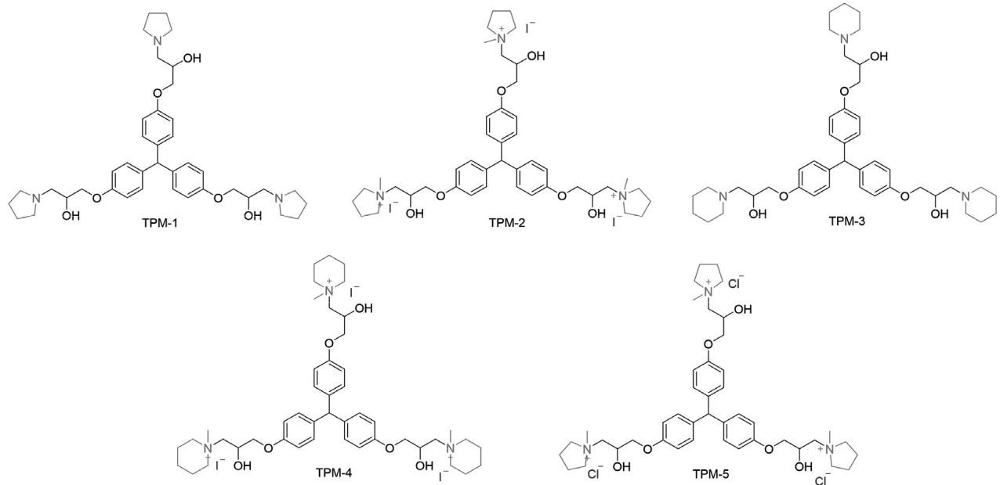  
Fig. 1. Molecular structures of TPM-1, TPM-2, TPM-3, TPM-4, and TPM-5.

Currently, most of the reported levelers are nitrogen-containing dyes, such as the Janus Green B (JGB) [17], Alcian Blue (ABPV) [18,19], and Diazine Black (DB)[16] etc., or non-dye heterocyclic aromatic molecules, such as 2-amino-4-methylbenzothiazole (AMBT)[20] and 2-mercaptopyridine (2-MP)[21,22] etc. Because the structure-property relationship of the leveler is not clear yet, the development of novel leveler with high microvia filling performance is very time-consuming and challenging. More and more research groups began to purposefully design and synthesize various nitrogen-containing levelers to study their structureproperty relationship [23–27]. In our previous study, we reported a triphenylmethane-based leveler TPM-1, in which three pyrrolidine rings (nitrogen-containing functional groups) were linked by a triphenylmethane (TPM) backbone [28]. It was found that the small molecule with three saturated tertiary amines already be able to show strong inhibition effect and promising microvia filling performance in the copper electroplating experiments.

To further investigate the structural influence of nitrogencontaining groups on their electrochemical properties and microvia filling performance, a series of novel TPM-based molecules with different nitrogen-containing functional groups were designed and synthesized. As shown in Fig. 1, TPM-1 and TPM-3 are tertiary amines with pyrrolidine and piperidine as the nitrogen-containing groups, respectively. TPM-2, TPM-4, and TPM-5 are quaternary ammoniums, in which TPM-2 and TPM-5 were methylated base on TPM-1 with I− and Cl− as the counter anions, respectively, and TPM-4 was methylated from TPM-3. In this study, the TPM-based molecules were used as levelers in the super-conformal copper electroplating and their structure-property relationship were carefully investigated by electrochemical analyses, contact angle measurements, and microvia filling electroplating experiments.

## 2. Experimental section

## 2.1. Materials synthesis and characterization

Triphenylmethane based levelers were synthesized in the lab. The reagents and starting materials employed were commercially available and used without further purification. 1H and $^ { 1 3 } \mathsf { C }$ nuclear magnetic resonance (NMR) spectra were recorded on a Brucker ADVANCE III 400 MHz spectrometer (1H NMR: 400 MHz, $^ { 1 3 } \mathsf { C }$ NMR: 100 MHz). Mass spectra were recorded on a Thermo Fisher TSQ Endura 95 spectrometer with the electrospray ionization (ESI) method. (Detailed syntheses and characterization are given in the supporting information).

## 2.2. Electrochemical measurements

All electrochemical measurements were carried out using an electrochemical workstation (CHI 760E) with a three-electrode system. A platinum rotating disk electrode (Pt-RDE, PINE) with a diameter of 5 mm was employed as the working electrode. The counter electrode and the reference electrode were Pt bar and saturated mercury-mercurous sulfate electrode (SMSE), respectively. The volume of the electroplating solution was 50 ml and the temperature were controlled at $2 5 ~ ^ { \circ } \mathsf C .$

Before the galvanostatic measurements (GMs), a thin copper layer was deposited on the Pt-RDE (10 mA/cm2, 900 s) in the base electroplating solution to prepare a Cu-RDE. The composition of the base electroplating solution was 0.88 mol/L $\mathrm { C u S O } _ { 4 } { \cdot } 5 \mathrm { H } _ { 2 } 0$ (JHD, analytical reagent, recrystallized from ultrapure water before use) and 0.54 mol/L $\mathrm { H } _ { 2 } S 0 _ { 4 }$ . The GMs were carried out with the current density of 20 mA/cm2. The rotating speed of the working electrode was controlled at 100 rpm or 1000 rpm to simulate the forced convection at the bottom of microvia and on the copper surface, respectively. Cyclic voltammetry (CV) was carried out by a negative sweep from -0.4 to 0.75 V and then back from 0.75 to -0.4 V with a scan rate of 0.01 $\mathsf { V } / \mathsf { s }$

## 2.3. Contact angle measurements

Contact angle measurements were examined by the fully automatic contact angle measuring and contour analysis system (Dataphysics OCA100) using sessile drop method. The copper plate was thoroughly cleaned with ethanol, dilute $\mathrm { H } _ { 2 } S 0 _ { 4 } ,$ pure water, and treated with plasma before the contact angle measurements. A 3 μl droplet was generated on the top surface of the copper plate. The droplet-solid interface image was collected, and the contact angle of the droplet was measured.

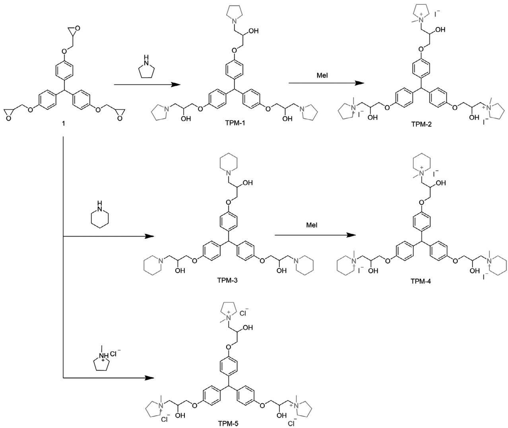  
Scheme 1. Synthesis of TPM-1, TPM-2, TPM-3, TPM-4, and TPM-5.  
thesized in lab. As shown in Scheme 1, TPM-2 is a quaternary ammonium salt with I− as the counter ions, which can be easily prepared from TPM-1 by methylation with iodomethane. TPM-5 is also a quaternary ammonium salt derived from TPM-1 with $\mathrm { ~ \mathsf ~ { ~ C ~ l ~ } ~ } ^ { - } \mathrm { ~ \mathsf ~ { ~ a ~ s ~ } ~ }$ the counter ions. To avoid the introduction of I− from the quaternization process, TPM-5 was synthesized directly from tris(4-hydroxyphenyl)methane triglycidyl ether (1) and Nmethylpyrrolidine hydrochloride with a ring-opening addition reaction. TPM-3 was synthesized in a similar way as TPM-1, in which six-membered piperidine rather than five-membered pyrrolidine ring was used as the nitrogen-containing group to react with tris(4-hydroxyphenyl)methane triglycidyl ether (1). Then TPM-3 was methylated with $\mathrm { C H } _ { 3 } \mathrm { I }$ to give the target molecule TPM-4. The newly synthesized TPM-based molecules all have been carefully characterized by 1H NMR, $^ { 1 3 } \mathsf { C }$ NMR and mass spectra to ensure the structure correctness. (Detailed synthetic methods and characterizations were provided in supporting information)

## 2.4. Electroplating measurements

Printed circuit boards $( 6 \times 8 ~ \mathrm { c m } ^ { 2 } )$ with many microvias formed by ${ \mathsf { C O } } _ { 2 }$ laser ablation were used as test samples for filling plating experiments. The diameter and depth of the microvias were 75 and $5 0 ~ \mu \mathrm { { m } }$ , respectively. Two phosphorus-containing copper slices $( 6 0 \times 1 5 0 ~ \mathrm { m m } ^ { 2 } )$ were used as anode and placed in the electroplating solution with a 1000 mL working volume. The electroplating solution was constantly agitated by air bubbles during electroplating to ensure suficiently convection. The composition of the electrolyte for microvia filling plating was 0.88 mol/L $\mathrm { C u S O } _ { 4 } { \bullet } \mathrm { S H } _ { 2 } 0$ 0.54 mol/L $\mathrm { H } _ { 2 } \mathrm { S O } _ { 4 }$ , 200 ppm PEG (MW6000), 40 ppm Cl− (added as NaCl), 2 ppm SPS and various TPMs. The current density was controlled at 1.8 $\mathsf { A } / \mathsf { d } \mathsf { m } ^ { 2 }$ (ASD) for 45 min. The surface morphologies and crystalline structures of the copper deposits were characterized by a field-emission scanning electron microscopy (FE-SEM, Hitach SU8220) and an $\mathbf { X } { \mathrm { - } } \mathbf { I } \mathbf { a } \mathbf { y }$ diffractometer (XRD, Bruker D8 AD-VANCE), resepctively. The microvia filling performances were examined by cross-sectional imaging with optical microscopy (OM).

## 3. Results and discussion

## 3.1. Synthesis of triphenylmethane-based levelers

Tris(4-hydroxyphenyl)methane triglycidyl ether (1) and TPM-1 were synthesized as reported in our previous work [28]. TPM-2, TPM-3, TPM-4, and TPM-5 were newly designed and syn-

## 3.2. Galvanostatic measurements with different additive injection orders

The electrochemical properties of TPM-based levelers were investigated with GMs and CVS methods. Fig. 2 shows the GMs with different injection orders of Cl−, PEG, SPS and TPM-based levelers. As shown in Fig. 2a, with the addition of 40 ppm $\mathrm { C l ^ { - } } ,$ 200 ppm PEG, and 2 ppm SPS in sequence, the cathode potential went through three changes: rising, sharply decreasing, and slowly rising again. The results are consistent with the literature reports [5,7]: Cl− itself is a depolarizer; however, the Cl− and PEG will synergistically form a barrier layer on the cathode and significantly suppress the copper reduction; SPS is a depolarizer in the presence of Cl−, which can gradually replace the suppressor layer on the cathode leading to a slowly potential increase.

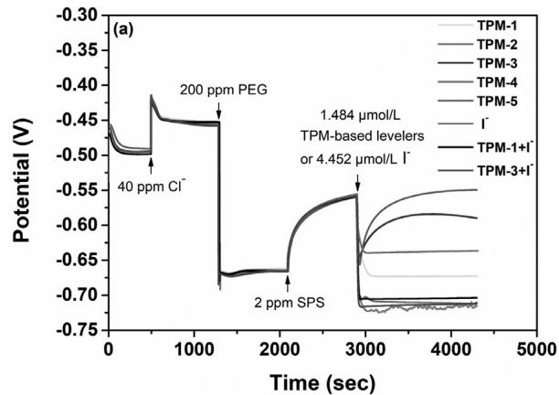

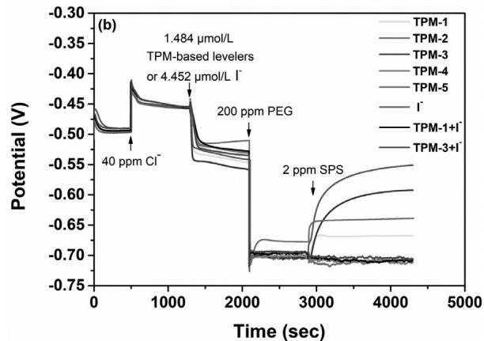  
Fig. 2. Galvanostatic measurements with different injection orders of additives at 1000 rpm. The concentration of I− is 4.452 μmol/L. The electroplating solution is composed of 0.88 mol/L CuSO •5H O, 0.54 mol/L $\mathrm { H } _ { 2 } \mathrm { S O } _ { 4 }$ . The molar ratio of TPMand TPM-3 to I− are both 1:3.

Following the addition of SPS, 1.484 μmol/L TPM-based levelers were injected into the electroplating solution. The cathode potential drops from 0.559 to 0.673 and 0.712 V for TPM-1 and TPM-2, respectively, which imply that at the same concentration, the inhibition effect of the quaternary ammonium TPM-2 was much stronger than the tertiary amine TPM-1. Comparing the molecular structures of TPM-1 and TPM-2, two differences were found: the quaternary ammonium structure and the I− ion. It has been reported that counter anion in a leveler influence its electrochemical behavior and I− can inhibite the $\mathsf { C u } ^ { 2 + }$ reduction [29– 33]. To distinguish the stronger inhibition ability of TPM-2 was induced by the ammonium structure or I−, we designed and synthesized a new molecule TPM-5, which have the same cationic structure as TPM-2 but with Cl− instead of I− as the counter ion. When TPM-5 was injected in the copper electroplating solution, the potential drops from 0.559 to 0.654 V (fast adsorption) and then slowly moves back to 0.547 V(gradually deactivated by the SPS through the ion pairing interactions)[34–36]. The result indicates that though with the same cationic skeleton, TPM-5 has a much weaker inhibition effect against SPS than TPM-2. As shown in Fig. 2a, the steady potential after addition of TPM-5 is close to the initial value before the leveler injection, which means the adsorption of TPM-5 on the copper surface is weak and the adsorbed leveler was replaced by SPS gradually in the electroplating process. From the GMs of TPM-2 and TPM-5, it can be concluded that the extraordinarily strong inhibition effect of TPM-2 should be related to the anion I− instead of causing by the quaternized pyrrolidine group. In addition, from Fig. 2a, we can see that the inhibition effect of TPM-5 is also weaker than TPM-1. Therefore, by comparing the molecular structures and inhibition abilities of TPM-1, TPM-2 and TPM-5, it was found that the methylated quaternary ammonium structure actually weakens the leveler’s inhibition effect instead of strengthening it, and the exist of I− is the cause of dramatical improvement of the molecule’s inhibition ability.

TPM-3, in which three six-membered piperidine rings were introduced to replace the five-membered pyrrolidine rings in TPM-1, has also been added in the electroplating solution to investigate how the ring size of the nitrogen-containing groups affect their electrochemical properties. As shown in Fig. 2a, with the addition of TPM-3, the cathode potential drops from 0.559 to 0.646 V and then slowly moves back to 0.590 V. The results show that the antagonistic effect of TPM-3 against SPS is weaker than the TPM-1. Since the electronic structures of nitrogen atoms in pyrrolidine and piperidine are very close (the pKa value of pyrrolidine and piperidine are 11.27 and 11.22, respectievely [37]), the electrochemical property difference of TPM-1 and TPM-3 should mainly be caused by the steric hindrance, that is, a bigger head group of the nitrogen-containing group leads to a weaker antagonistic effect against SPS. While for the TPM-4, which also has I− as the counter ion, no surprise, the addition of the molecule leading to a strong polarization and the potential sharply drops to approximately 0.712 V just as TPM-2.

To further verify the strong inhibition effect of TPM-2 and TPM-4 was caused by the I− alone or the synergistic effect of I− and the TPM-based counterpart, equivalent amount of I− as in TPM-2 and TPM-4 was injected into the electroplating solution. As shown in Fig. 2a, the addition of I− alone in the presence of Cl−, PEG, and SPS leads a further polarization from 0.559 to 0.662 V, which means I− has a certain kind of antagonistic against SPS, however, the inhibiton ability is much weaker than that of TPM-2 and TPM-4 as shown in the GMs. The results clearly indicate that the strong inhibition effect of TPM-2 and TPM-4 was caused by the synergistic effect of I− and its counterpart rather than I− itself alone. To further confirm whether the synergistic effect is related the quaternary ammoiunm structure, TPM-1 I− and TPM-3 I− with a molar ratio of 1:3 have aslo been injected together into the electroplating solution, respectively. As shown in Fig. 2a, with iodide ions in the electrolyte, the potentials of TPM-1 and TPM-3 also dramatically decreased to 0.710 V and 0.713 V, respectively. The polarization of TPM-1 I− and TPM-3 I− behaved very similarly as TPM-2 and TPM-4. Since TPM-1 and TPM-3 have no quaternary ammonium structure, the strong inhibition effect of TPM-2 and TPM-4 should be caused by the synergistic effect of I− and the whole structure of the TPM-based counterpart, rather than specifically interacted with the quaternary ammonium structures.

GMs with injection orders of Cl−, TPM-based levelers, PEG, and SPS has also been carried out to investigate the synergistic interaction of the TPM-based levelers with Cl− and PEG without the interference of SPS. As shown in Fig. 2b, following the addition of Cl−, the subsequent injection of TPM-based levelers leaded to potential decreases of approximately 93 mV (for TPM-1), 75 mV (for TPM-2, TPM-4, TPM-1 I−, and TPM-3 I−), 100 mV (for TPM-3), 88 mV (for TPM-5), and 49 mV (for I−), respectively. Comparing the inhibition ability of the TPM-1, TPM-2, TPM-5, and $\mathrm { I } ^ { - } ,$ , it can be found that in the presence of Cl−, I− leads to the weakest inhibition effect, the TPM-2 (quaternary ammonium salt with I as counter ion) exhibit weaker inhibition effect than TPM-5 (quaternary ammonium salt with Cl− as counter ion), which is further weaker than TPM-1 (tertary amine). Then 200 ppm PEG was added into the electroplating solution. For all TPM-based levelers, the potentials sharply decreased to approximately 0.702 V, which were much lower than the potentials obtained by PEG and Cl− in the absence of TPM-based levelers (approximately 0.667 V, as shown in Fig. 2a). The results imply that the TPM-based levelers synergistically interact with halides and PEG to form stronger barrier layers than those formed by PEG and Cl−. While for the I−,the potential gradually moved back to 0.678 V after the sharp decrease, which is higher than that induced by TPM-based leveler. Finally, SPS was added into the electrolyte and it was found that with TPM-1, TPM-3, TPM-5, and I− presented in the electroplating solution, the cathodic potentials increased by 37 mV, 108 mV, 143 mV, and 39 mV, respectively. While for the electroplating solution contain TPM-2, TPM-4, TPM-1 I−, and TPM-3 I−, instead of increase, the cathodic potential even slightly decreased. These results indicated that with the participate of I−, the TPM-based levelers could synergistically interact with PEG and Cl− forming much stronger barrier layers than those formed by TPM-based levelers without I−. SPS can hardly replace the complex inhibitors composed of PEG, Cl−, and TPM-2 (or TPM-4, TPM-1 I−, TPM-3 I−), which further demonstrated that the combination of iodide ion and TPM-based levelers rather than any of them alone strongly improve the leveler’s inhibition effect and quenched the activity of SPS on the cathodic surface. To make the interactions more comprehensible, a schematic diagram was provided in Fig. 3.

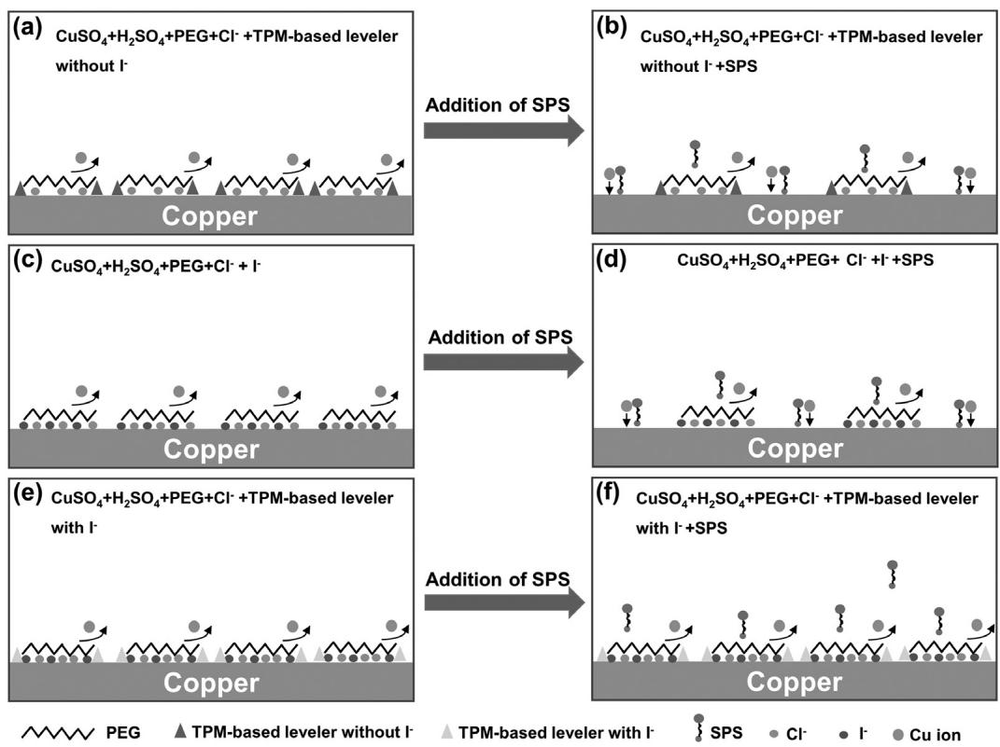  
Fig. 3. Schematic diagram of the interaction of TPM-based leveler with I−, Cl−, PEG and SPS.

## 3.3. Cyclic voltammetry measurements

To charactrized the effect of the leveler concentrations on its electrochemical properties, cyclic voltammetry measurements with various concentrations of TPM-based levelers (or I−) in an electroplating solution containing 2 ppm SPS, 40 ppm Cl− and 200 ppm PEG have been carried out. As shown in Fig. 4, the increase of the TPM-based levelers (or I−) concentration all leads to a further polarization. For TPM-1, the addition of 0.05 ppm leveler not only decreases the absolute current density, but also changes the relative current density values in the forward (negative-going) and backward (positive-going) sweep. As reported, the current densities in the return sweep larger than the forward values indicate a positive feedback for the copper electroplating [38,39]. In addition, when the concentration of TPM-1 reaches as high as 8 ppm, an evident negative differential resistance (NDR) phenomenon was observed, which has been widely used to explain the mechanism of extremely bottom-up filling of Cu or other metals with one suppressor as the additive in electroplating [38,40–42]. Similarly, NDR has also been observed with other TPM-based levelers at relatively high concentrations (above 2 ppm for TPM-2 and TPM-4; above 8 for TPM-3; above 20 ppm for TPM-5). Though ternary additives (leveler, suppressor, and accelerator) were used in this research instead of one additive system reported in literature, extremely bottom-up microvia filling effect has also been otained with high concentrations of TPM-2 or TPM-4 (as shown in Figs. 7–2f, 7–2g, 7–4f, and 7–4g), which imply a gradual breakdown of the suppression starting from the microvia bottom. NDR is observed for all high concentration TPM-based levelers, however, only TPM-2 and TPM-4 result in the extremely bottom-up filling. One possible explanation is that due to the strong inhibition strength caused by the synergistic effect of I− and the TPM-based counterpart, the suppression layer formed by high concentration of TPM-2 (or TPM-4) plays a predominant effect on the cathod surface and overshadowed the effect of SPS (as shown in Fig. 3e and f). While for other TPM-based levelers (or I−), the antagonistic effect of SPS and the inhibitors contributes together to achieve the super-conformal electroplaitng, as described by the curvature enhanced adsorbate coverage (CEAC) [36] or convection-dependent adsorption (CDA) [43] mechanisms.

## 3.4. Galvanostatic measurements at different rotating speeds

As suggested by the CDA mechanism [16,44], the electrolyte convection states inside and outside the microvia have a great influence on the microvia filling performance. Different rotating speeds of the working electrode has been widely used to simulate the convection states of the plating solution on the top (1000 rpm) or at the bottom (100 rpm) of a microvia. The potential difference $( \Delta \eta = \eta _ { 1 0 0 } - \eta _ { 1 0 0 0 } )$ measured from the two rotating speeds in GMs can be used to predict the microvia filling performance. Generally, a larger positive $\Delta \eta$ value implies a better microvia filling performance.

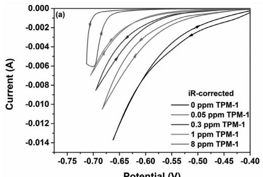  
Potential (V)

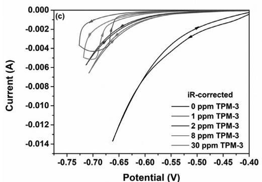

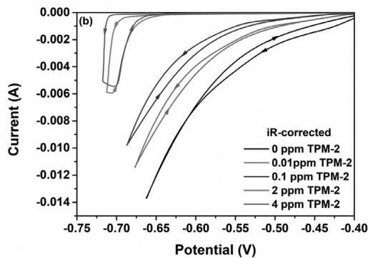

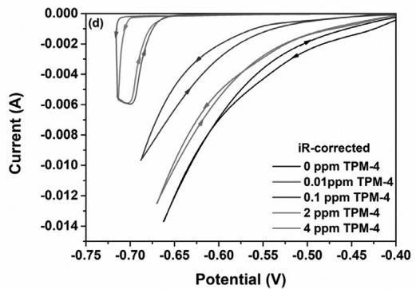

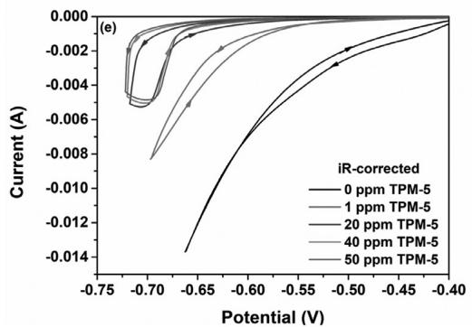

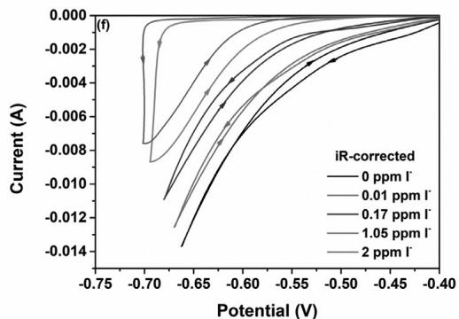  
Fig. 4. The post-experimental iR-corrected voltammogram with various concentrations of TPM-based levelers (or I−). iR compensation of 100% of the measured impendance (6.4 ohm) was achived during the electroanalyical measurements. The rotation speed of the working electrode is 1000 rpm. The electroplating solution is composed of 0.88 mol/I $\mathrm { C u S O } _ { 4 } { \bullet } 5 \mathrm { H } _ { 2 } 0 ,$ 0.54 mol/L $\mathrm { H } _ { 2 } S 0 _ { 4 }$ 200 ppm PFG, 2 ppm SPS and 40 ppm Cl− and (a) TPM-1: (b) TPM-2: (c) TPM-3: (d) TPM-4: (e) TPM-5: (f) I−

As shown in the Fig. 5, the GMs have been carried out in a base solution with 200 ppm PEG, 2 ppm SPS, 40 ppm Cl− and various concentrations of TPM-based levelers $( \mathrm { o r ~ I ^ { - } } )$ at 100 rpm and 1000 rpm, respectively. Before the addition of TPM-based levelers, the cathodic potentials continuously positively shift due to the depolarization effect of SPS, and no CDA phenomenon was observed (the $\Delta \eta$ values obtained from two different rotating speeds all are near zero). With the addition of TPM-based levelers (or I−), the cathodic potential gradually negatively shifted and the $\Delta \eta$ value turned to positive for TPM-1 (between 0.05 ppm and 4 ppm), TPM-2 (between 0.01 ppm and 2 ppm), TPM-3 (between 1 ppm and 30 ppm), TPM-4 (between 0.01 ppm and 2 ppm), TPM-5 (between 4 ppm and 50 ppm), I− (between 0.003 ppm and 1.4 ppm) as summarized in Table 1.

## 3.5. Contact angle (CA) measurements

The TPM-based levelers are quaternary ammoniums (TPM-2, TPM-4, and TPM-5) or tertiary amines (TPM-1 and TPM-3), which will all be positively charged and show a certain kind of surface activity in the acid electroplating solution. To better understand adsorption of the TPM-based levelers on the copper surface, contact angle measurements were detected. As shown in Fig. 6, the contact angle of the basic electroplating solution (0.88 mol/L $\mathrm { C u S O } _ { 4 } { \cdot } 5 \mathrm { H } _ { 2 } 0$ and 0.54 mol/L $\mathrm { H } _ { 2 } S 0 _ { 4 } )$ on copper surface is $4 5 . 6 ^ { \circ }$ With the addition of 1.484 $\mu \mathrm { m o l } / \mathrm { L }$ TPM-based levelers, the contact angles of the electroplating solution all decreased and the values for TPM-1, TPM-2, TPM-3, TPM-4, TPM-5 are $2 7 . 4 ^ { \circ } , 2 3 . 8 ^ { \circ } , 3 2 . 9 ^ { \circ } , 2 3 . 5 ^ { \circ } ,$ $3 6 . 2 ~ \mathrm { ~ \textdegree ~ } ,$ , respectively. Generally, a smaller contact angle of an electroplating solution indicates a stronger surface activity of the TPMbased leveler, and denser adsorbed leveler layers were formed on the copper interface, which will lead to a stronger inhibition effect of the leveler. As shown in Fig. 6, the contact angle values followed in an order: leveler free > TPM-5 > TPM-3 > TPM-1 > TPM-2 TPM-4, which are in good accordance with the electrochemical measurement results.

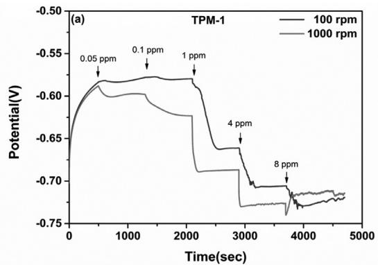

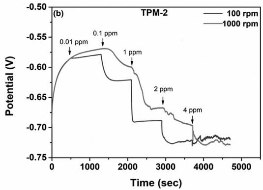

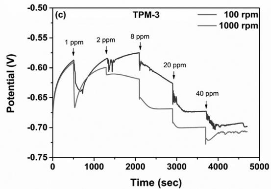

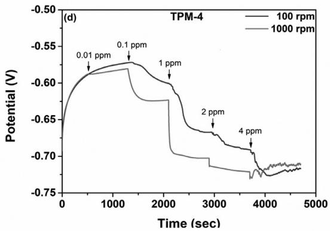

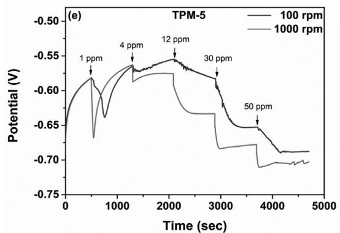

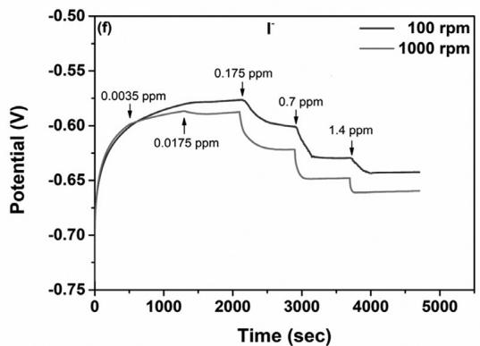  
Fig. 5. Galvanostatic measurements with various concentrations of TPM-based levelers (or I−) at different rotational speeds: 100 rpm and 1000 rpm. The electroplating solution is composed of 0.88 mol/L $\mathrm { C u S O } _ { 4 } { \bullet } 5 \mathrm { H } _ { 2 } 0 ,$ 0.54 mol/L $\mathrm { H } _ { 2 } S 0 _ { 4 } ,$ 200 ppm PEG, 2 ppm SPS, 40 ppm Cl− and (a) TPM-1; (b) TPM-2; (c) TPM-3; (d) TPM-4; (e) TPM-5; (f) I− .

The value of potential difference (-η) at the various concentration of TPM-based levelers and I−.

<table><tr><td></td><td>TPM-1</td><td>TPM-2</td><td>TPM-3</td><td>TPM-4</td><td>TPM-5</td><td> $I^{-}$ </td></tr><tr><td> $\Delta\eta>0$ </td><td>0.05 - 4 ppm</td><td>0.01 - 2 ppm</td><td>1 - 40 ppm</td><td>0.01 - 2 ppm</td><td>4 - 50 ppm</td><td>0.003 - 1.4 ppm</td></tr><tr><td> $\Delta\eta<0$ </td><td>8 ppm</td><td>4 ppm</td><td></td><td>4 ppm</td><td>1 ppm</td><td></td></tr></table>

## 3.6. Microvia filling electroplating with TPM-based levelers

To evaluate the actual microvia filling performance of the TPMbased levelers, electroplating experiments with TPM-based levelers, PEG and SPS have been carried out. Fig. 7 shows a summary of the optical microscope images of microvia cross-sections after electroplating. The microvia cross-sections of TPM-1 (Figs. 7–1a– 7–1g) were quoted from our previous work [28] as a reference for other TPM-based levelers

For TPM-2, super-conformal electroplating was observed at the concentration as low as 0.01 ppm (as shown in the Fig. 7–2a). When the concentrations of TPM-2 increased from 0.03 to 2 ppm, fully microvia filling (microvia filling power > 85%) were obtained (as shown in the Figs. 7–2b–7–2e). Above 3 ppm, the microvia filling performance gradually deteriorated (big dimples appeared in the microvia, as shown in the Figs. 7–2f and $\mathsfit { 7 - 2 g ) }$ and the copper surface became uneven. The electroplating experiments are in good accordance with the GMs results as shown in Fig. 5 and Table 1 $( \Delta \eta > 0$ between 0.01–2 ppm). TPM-3, which contains sixmembered piperidine rings as the nitrogen-containing functional groups, shows a much higher concentration to achieve the superconformal electroplating than TPM-1. As shown in Figs. 7–3a–7– 3g, super-conformal electroplating was observed at the concentration of 1 ppm (with a big dimple), and with the concentration in-

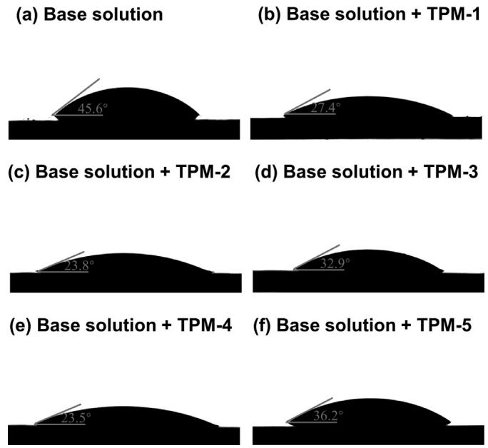  
Fig. 6. Contact angles of the base electroplating solution with or without TPMbased levelers toward the Cu surface. The concentration of TPM-based levelers is 1.484 μmol/L.

crease, full microvia filling performances were observed between 2 and 16 ppm. Above 20 ppm, the filling performance deteriorated gradually, and nodules were found on the copper surface. The electroplating experiments for TPM-3 are consistent with the GM results as shown in Fig. 5 and Table 1 $( \Delta \eta > 0$ between 1 and 40 ppm). TPM-4, which also have I− as counter ion as TPM-2, shows very similar microvia filling performances as TPM-2. While for TPM-5, which was also a quaternary ammonium salt as TPM-2, but with $\mathrm { C l ^ { - } }$ instead of I− as the counter ion, conformal electroplating was obtained at the concentration of 1 ppm. With the increasing of concentration, the super-conformal electroplating occurred with big dimples at the concentrations of 4 to 12 ppm (as shown in the Figs. 7–5b and ${ \mathfrak { c } } ) ,$ and full microvia fillings were observed at the concentrations between 20 ppm to 40 ppm, which was much higher than the values obtained from TPM-1 and TPM-2. The electroplating results are once again in good accordance with the GMs as shown in Fig. 5 and Table 1 (-η > 0 between 4 and 50 ppm). Finally, the I− alone, which show $\Delta \eta > 0$ between 0.003 and 1.4 ppm in the GMs, has also been tested as a leveler in the microvia filling electroplating. Correspondingly, superconformal electroplating was obtained between the concentration range.

As shown in Fig. 2, the strength of TPM-based leveler’s antagonistic effect against SPS is in the following order: TPM-2 TPM-4 > TPM-1 > TPM-3 > TPM-5. Correspondingly, the concentrations for the levelers to achieve full microvia filling performance are followed in a reverse order as: TPM-5 > TPM-3 > TPM-1 > TPM-4 TPM-2. The results are reasonable, because the weaker antagonistic effect of the leveler against accelerator SPS requires higher concentration to achieve the same inhibition power.

## 3.7. Surface morphology and crystalline orientation of the Cu deposition

The structural influences of the TPM-based levelers on the surface morphology of the copper depositions were characterized with SEM. As shown in Fig. 8, in the presence of PEG and SPS, the surface morphology of the copper film electroplated without leveler is already flat and uniform. When TPM-based levelers have been added into the electroplating solution, the grain sizes of the

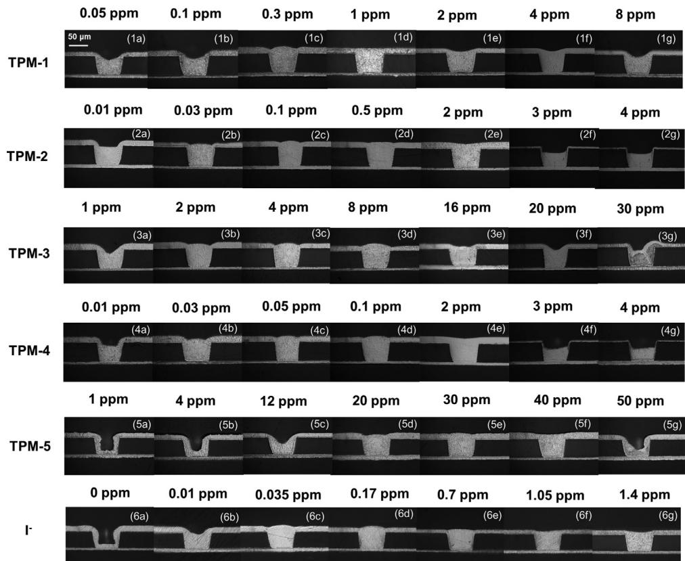  
Fig. 7. The optical microscope images of microvia cross-sections after electroplating in a solution with 0.88 mol/L CuSO •5H O, 0.54 mol/L H SO , 200 ppm PEG, 2 ppm SPS, 40 ppm Cl−, and various concentrations of TPM-based levelers or I−.

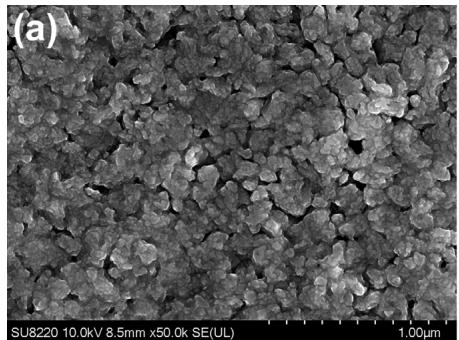

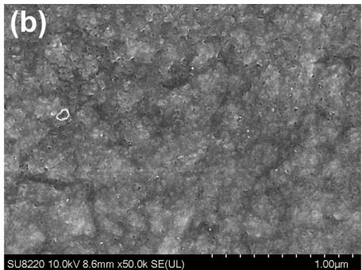

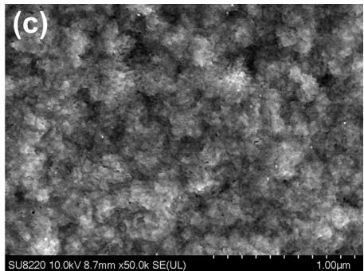

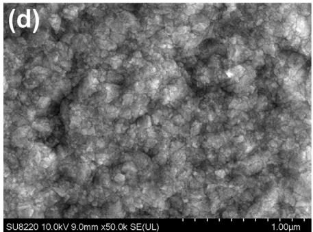

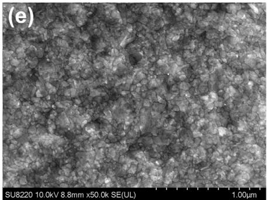

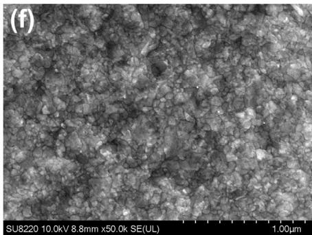  
Fig. 8. SEM images of plated copper films obtained from electrodeposition with or without TPM-based levelers. The electroplating solution is composed of 0.88 mol/L CuSO •5H O, 0.54 mol/L $\mathrm { H } _ { 2 } S 0 _ { 4 } ,$ 200 ppm PEG, 2 ppm SPS and 40 ppm Cl−. (a) leveler free, (b) 1 ppm TPM-1, (c) 0.5 ppm TPM-2, (d) 4 ppm TPM-3, (e) 0.5 ppm TPM-4, (f) 20 ppm TPM-5.

(a)  
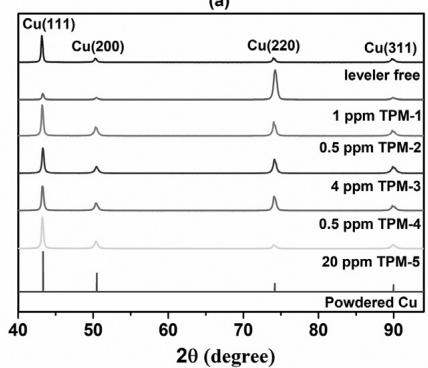

(b)  
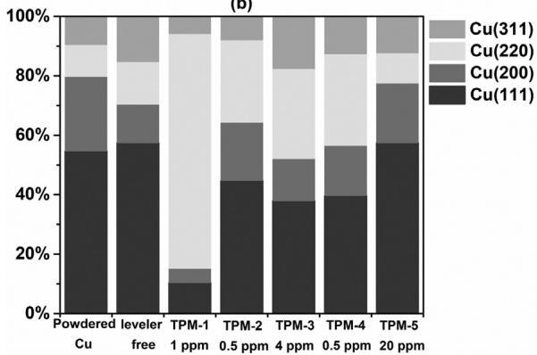  
Fig. 9. XRD patterns of plated copper films obtained from electrodeposition with or without TPM-based levelers.

copper depositions become smaller (Fig. 8b–f). The addition of TPM-based levelers in the electroplating solution can improve the surface morphologies of the copper depositions.

As reported, the electromigration resistance of copper film is affected largely by the (111) orientation [45,46]. The crystalline structure of the copper depositions electroplated with various TPMbased levelers were characterized by XRD. As shown in Fig. 9, without leveler in the electroplating solution, the preferred crystalline orientation of the copper layer is Cu (111). When TPM-1 was added in the electroplating solution, the predominant texture peak was changed from Cu (111) to Cu (220), which means the leveler TPM-1 can hinder the growth of Cu (111). Different from TPM-1, the preferred crystalline orientation of the copper layers deposited with TPM-2, TPM-3, TPM-4 and TPM-5 as levelers is Cu (111) again. Considering the molecular structures, electrochemical properties, and the crystalline orientations, the nitrogen-containing groups in a leveler not only affect its adsorption strength on the copper surface, but also affect its adsorption preference on different crystalline plane.

## 4. Conclusions

In this study, a series of novel triphenylmethane-based molecules (TPM-2 to TPM-5) with varied nitrogen-containing functional groups were synthesized and investigated as levelers for copper super-conformal electroplating. The structure-property relationships of the TPM-based levelers have been studied in detail with electrochemical analyses, surface activity measurements, and microvia filling electroplating experiments. It was found that all TPM-based levelers show inhibition effect in the copper electroplating and their antagonistic ability against SPS followed in the order of TPM-2 TPM-4 TPM-1 TPM-3 TPM-5. The inhibition ability of the TPM-based levelers positively correlated to their adsorption ratio on the copper interface. Electrochemical measurements demonstrate that the strongest inhibition effect of TPM-2 and TPM-4 was caused by the synergist interaction of the TPMbased structures and the counter ion I−; the replacement of a fivemembered pyrrolidine ring (TPM-1) by a six-membered piperidine ring (TPM-2) leads to a decrease of the leveler’s inhibition ability; the quaternization of a tertiary amine (TPM-1) with Cl− $\mathrm { C l ^ { - } }$ as the counter ion leads a much weaker antagonistic effect against SPS (TPM-5). Based on the results, it can be concluded that the minor adjustment of the nitrogen-containing group’s structures in a leveler has a significant impact on its electrochemical properties and microvia filling performance. The steric hindrance and the type (tertiary amine or quaternary ammonium with counter anions) of the nitrogen-containing groups need to be comprehensively considered when one designs new levelers for the super-conformal copper electroplating.

## Supporting Information

Additional information, including experimental details; 1H NMR, 13C NMR, and ESI-MS results of all compounds.

## Declaration of Competing Interest

The authors declare that they have no known competing financial interests or personal relationships that could have appeared to influence the work reported in this paper.

## Credit authorship contribution statement

Zhen Li: Conceptualization, Data curation, Formal analysis, Investigation, Methodology, Visualization, Writing – original draft, Writing – review & editing. Baizhao Tan: Conceptualization, Data curation, Investigation, Methodology, Visualization. Jiye Luo: Conceptualization, Data curation, Formal analysis, Investigation, Methodology, Project administration, Resources, Supervision, Visualization, Writing – original draft, Writing – review & editing. Jinfeng Qin: Conceptualization, Investigation. Guannan Yang: Conceptualization, Investigation, Project administration, Supervision, Validation. Chengqiang Cui: Conceptualization, Project administration, Resources, Supervision. Li Pan: Resources, Validation.

## Acknowledgments

The authors thank the National Natural Science Foundation of China (Grant No. 22178071 and 61874155), the start-up funding from the “One-hundred Young Talents of Guangdong University of Technology (class $A ) "$ program (Grant No. 220413155), for financially supporting this research. The authors also thank the AKM Electronics Industrial (Pan Yu) Ltd for providing the PCB testing samples.

## Supplementary materials

Supplementary material associated with this article can be found, in the online version, at doi:10.1016/j.electacta.2021.139445.

## References

[1] P.C. Andricacos, C. Uzoh, J.O. Dukovic, J. Horkans, H. Deligianni, Damascene Copper Electroplating for Chip Interconnections, IBM J. Res. Dev. 42 (1998) 567–574.

[2] K. Kondo, R.N. Akolkar, D.P. Barkey, M. Yokoi, Copper Electrodeposition for Nanofabrication of Electronics Devices, Springer, 2014 New York. USA.

[3] F. Wang, Y. Li, H. He, Y. Wang, W. Zhu, J. Li, Effect of Bis-(3-sulfopropyl) disulfide and chloride ions on the localized electrochemical deposition of copper microstructures L. Electrochem, Soc, 164 (2017) D419–D424

[4] R. Kimizuka, H. Toda, T. Eda, K. Kishimoto, R. Oh, H. Honma, O. Takai, Influence of SPS decomposition product 1,3-propane disulfonic acid on electrolytic copper via filling performance L. Electrochem, Soc, 162 (2015) D584-D588

[5] M. Tan, C. Guymon, D.R. Wheeler, J.N. Harb, The role of SPS, MPSA, and chloride in additive systems for copper electrodeposition, J. Electrochem. Soc. 154 (2007) D78–D81.

[6] M. Gu, Q. Zhong, Copper electrocrystallization from acidic sulfate electrolyte containing MPS additive, J. Appl. Electrochem. 41 (2011) 765–771.

[7] J. Luo, Z. Li, M. Shi, J. Chen, Z. Hao, J. He, Effects of accelerator alkyl chain length on the microvia filling performance in copper superconformal electroplating L. Electrochem, Soc, 166 (2019) D104-D112

[8] Z. Li B. Tan M. Shi L. Luo Z. Hao L He G. Yang C. Cui Bis-(sodium sulfoethyl)-disulfide: a promising accelerator for super-conformal copper electrodeposition with wide operating concentration ranges, J. Electrochem. Soc. 167 (2020) 042508.

[9] T.P. Moffat, D. Wheeler, D. Josell, Electrodeposition of copper in the SPS-PEG-Cl additive system - I. kinetic measurements: influence of SPS, J. Electrochem. Soc. 151 (2004) C262–C271.

[10] W. Wang, Y.B. Li, Effect of Cl− on the adsorption–desorption behavior of PEG, J. Electrochem. Soc. 155 (2008) D263–D269.

[11] J.W. Gallaway, A.C. West, P.P.G. PEG, PEG, PPG and their triblock copolymers as suppressors in copper electroplating, J. Electrochem. Soc. 155 (2008) D632–D639.

[12] K. Ryan, K. Dunn, J. van Eisden, J. Adolf, Properties of PEG, PPG and their copolymers: influence on copper filling of damascene interconnects, J. Electrochem. Soc. 160 (2013) D3186–D3196.

[13] J.W. Gallaway, A.C. West, P.P.G. PEG, Their triblock copolymers as suppressors in copper electroplating, J. Electrochem. Soc. 155 (2008) D632–D639.

[14] J.W. Gallaway, M.J. Willey, A.C. West, Copper filling of 100nm trenches using PEG, PPG, and a triblock copolymer as plating suppressors, J. Electrochem. Soc. 156 (2009) D287–D295.

[15] J. Xu, B. Chen, J. Lv, D. Chang, D. Niu, S. Hu, X. Zhang, Z. Xin, L. Wang, Aryl modification of diketopyrrolopyrrole-based quaternary ammonium salts and their applications in copper electrodeposition, Dyes Pigments 170 (2019) 107559.

[16] W.P. Dow, C.C. Li, Y.C. Su, S.P. Shen, C.C. Huang, C. Lee, B. Hsu, S. Hsu, Microvia filling by copper electroplating using diazine black as a leveler, Electrochim. Acta 54 (2009) 5894–5901.

[17] J. Tang, Q.S. Zhu, Y. Zhang, X. Zhang, J.D. Guo, J.K. Shang, Copper bottom-up filling for through silicon Via (TSV) using single JGB additive, ECS Electrochem. Lett. 4 (2015) D28–D30.

[18] S.M. Huang, C.W. Liu, W.P. Dow, Effect of convection-dependent adsorption of additives on microvia filling in an acidic copper plating solution, J. Electrochem. Soc. 159 (2012) D135–D141.

[19] W.P. Dow, C.C. Li, M.W. Lin, G.W. Su, Copper Fill of Microvia using a thiol– modified Cu seed layer and various levelers, J. Electrochem. Soc. 156 (2009) D314–D320.

[20] C. Liao, S. Zhang, S. Chen, Y. Qiang, G. Liu, M. Tang, B. Tan, D. Fu, Y. Xu, The effect of tricyclazole as a novel leveler for filling electroplated copper microvias, I. Electroanal, Chem, 827 (2018) 151–159

[21] C. Chang, X. Lu, Z. Lei, Z. Wang, C. Zhao, 2-Mercaptopyridine as a new leveler for bottom-up filling of micro-vias in copper electroplating, Electrochim. Acta 208 (2016) 33–38.

[22] S. Ren, Z. Lei, Z. Wang, Investigation of nitrogen heterocyclic compounds as levelers for electroplating cu filling by electrochemical method and quantum chemical calculation, J. Electrochem. Soc. 162 (2015) D509–D514.

[23] J. Li, J. Xu, X. Wang, X. Wei, J. Lv, L. Wang, Novel 2,5-Bis(6-(trimethylamonium)hexyl)-3,6-diaryl-1,4-diketopyrrolo[3,4-c]pyrrole pigments as levelers for eficient electroplating applications, Dyes Pigments 186 (2021) 109064.

[24] B. Chen, J. Xu, L.S Wang, S. Wu, Synthesis of quaternary ammonium salts based on diketopyrrolopyrroles skeletons and their applications in copper electroplating, ACS Appl. Mater. Inter. 9 (2017) 7793–7803.

[25] M.H. Lee, Y. Lee, M. Sung, S.K. Cho, Y.G. Kim, J.J. Kim, Structural influence of terminal functional groups on teg-based leveler in microvia filling, J. Electrochem. Soc. 167 (2020) 102505.

[26] M. Sung, Y. Lee, M. Lee, Y. Jeon, T. Lim, Y.G. Kim, J.J. Kim, Polyethylene glycol-based single organic additive for through silicon via filling and its structural modification effect, J. Electrochem. Soc. 168 (2021) 012506.

[27] N.T.M. Hai, J. Furrer, E. Barletta, N. Luedi, P. Broekmann, Copolymers of imidazole and 1,4-butandiol diglycidyl ether as an eficient suppressor additive for copper electroplating, J. Electrochem. Soc. 161 (2014) D381–D387.

[28] J. Luo, Z. Li, B. Tan, C. Cui, M. Shi, Z. Hao, Communication—triphenylmethane-based leveler for microvia filling in copper super-conformal electroplating, J. Electrochem. Soc. 166 (2019) D603–D605.

[29] M. Sung, Y. Yoon, J. Hong, M.J. Kim, J.J. Kim, Bromide ion as a leveler for high--speed TSV filling, J. Electrochem. Soc. 166 (2019) D546–D550.

[30] W. Lee, B. J, S.K. Cho, J.J. Kim, Effect of halides on Cu electrodeposit film: potential-dependent impurity incorporation, J. Electrochem. Soc. 164 (2017) D493–D497.

[31] M.J. Kim, H.C. Kim, J.J. Kim, The influences of iodide ion on Cu electrodeposition and TSV filling I. Electrochem, Soc, 163 (2016) D434–D441

[32] M.J. Kim, Y. Seo, J.H. Oh, Y. Lee, H.C. Kim, Y.G. Kim, J.J. Kim, Communication—halide ions in TEG-based levelers affecting TSV filling performance, J. Electrochem. Soc. 163 (2016) D185–D187.

[33] T.M.T. Huynh, F. Weiss, N.T.M. Hai, W. Reckien, T. Bredow, A. Fluegel, M. Arnold, D. Maver, H. Keller P Broekmann On the role of halides and thiols in additive-assisted copper electroplating, Electrochim. Acta 89 (2013) 537–548.

[34] S.K. Kim, D. Josell, T.P. Moffat, Cationic surfactants for the control of overfill bumps in Cu superfilling, J. Electrochem. Soc. 153 (2006) C826–C833.

[35] S.K. Kim, D. Josell, T.P. Moffat, Electrodeposition of Cu in the PEI-PEG-Cl-SPS additive system - reduction of overfill bump formation during superfilling, J. Electrochem, Soc, 153 (2006) C616-C622

[36] T.P. Moffat, D. Wheeler, S.K. Kim, D. Josell, Curvature enhanced adsorbate coverage mechanism for bottom-up superfilling and bump control in damascene processing, Electrochim. Acta 53 (2007) 145–154.

[37] H.K. Hall. Correlation of the base strengths of amines, I. Am, Chem, Soc. 79 (1957) 5441–5444.

[38] T.P. Moffat, D. Josell, Extreme bottom-Up superfilling of through-silicon-vias by damascene processing: suppressor disruption, positive feedback and turing patterns, J. Electrochem. Soc. 159 (2012) D208–D216.

[39] D. Josell, T.P. Moffat, Bottom-Up electrodeposition of zinc in through silicon vias, J. Electrochem. Soc. 162 (2015) D129–D135.

[40] D. Josell, D. Wheeler, D. Josell, T.P. Moffat, Modeling extreme bottom-up filling of through silicon vias, J. Electrochem. Soc. 159 (2012) D570–D576.

[41] D. Wheeler, T.P. Moffat, D. Josell, Spatial-temporal modeling of extreme bottom-up filling of through-silicon-vias, J. Electrochem. Soc. 160 (2013) D3260–D3265.

[42] T.M. Braun, D. Josell, T.P. Moffat, Microelectrode studies of S-NDR copper elec trodeposition: potentiodynamic and galvanodynamic measurements and sim ulations, J. Electrochem. Soc. 167 (2020) 082509

[43] W.P. Dow, H.S. Huang, M.Y. Yen, H.C. Huang, Influence of convection-dependent adsorption of additives on microvia filling by copper electroplating, J. Electrochem. Soc. 152 (2005) C425–C434.

[44] W.P. Dow, M.Y. Yen, S.Z. Liao, Y.D. Chiu, H.C. Huang, Filling mechanism in microvia metallization by copper electroplating, Electrochim. Acta 53 (2008) 8228–8237.

[45] T. Hara, K. Sakata, Y. Yoshida, Control of the (111) orientation in copper interconnection layer, Electrochem. Solid State Lett. 5 (2002) C41–C43.

[46] Q. Shen, X. Wang, Effect of 3-S-isothiuronium propyl sulfonate on bottom-up filling in copper electroplating, Comput. Model. New Technol. 19 (2015) 23–25.