# Investigation of single additive ZPS on performance of copper foil

Yaqiang Li a,b,1, Yuanhang Zhang a,c,1, Ruopeng Li a,\*, Xingchen Ma b, Fuxue Wang b, Fan Meng a, Jie Jiang a, Xuesong Peng a,\*, Lanchen Li d,\*, Maozhong An a,\*

a School of Chemistry and Chemical Engineering, Harbin Institute of Technology, Harbin, 150001, PR China

b College of Chemistry, Institute of Molecular Engineering Plus, Fuzhou University, Fuzhou, Fujian, 350116, PR China

c School of Environmental and Chemical Engineering, Shenyang Ligong University, Shenyang, 110159, PR China

d Dalian Changfeng Industrial Corporation, Dalian, 116038, PR China

## A R T I C L E I N F O

Keywords: Copper foil Electrodeposition Theoretical calculation Finite element simulation Turing growth

## A B S T R A C T

This work investigated the influence of Sodium 3- (benzothiazole-2 -ylthio)- 1- propanesulfonate (ZPS) as a single additive on performance of copper foil. Electrochemical analysis indicates that ZPS is of accelerating effect during electroplating. Chronoamperometry and ex situ SEM confirm that Copper growth obeys 3D diffusioncontrolled instantaneous nucleation and growth process, with ZPS significantly increasing the density of active sites. A comprehensive theoretical framework combining density functional theory calculations, molecula dynamics simulations, and in situ infrared spectroscopy elucidates an adsorption-capturing acceleration mechanism: ZPS can adsorb on copper surface and “catch” free Cu2+ to the active sites to accelerate the electrochemical reduction process coupled with adsorbed Cl− . Furthermore, a Turing oscillation growth model, supported by finite element simulations and AFM analysis, is proposed to describe the morphological evolution, wherein ZPS preferentially accumulates at valley regions, improving surface flatness through cyclic peak-valley transfer, though with inherently limited ultimate smoothing. Structurally, XRD shows ZPS promotes Cu (220) orientation, while HRTEM confirms the presence of twin boundaries, and lattice fringe measurements reveal a transition from (111)-dominated to (220)-dominated regions upon ZPS addition. Electron backscatter diffraction (EBSD) further indicates grain refinement (mean size from 3.29 μm to 2.60 μm) and increased twin-boundary density, which contribute to strengthening via Hall-Petch and dislocation-blocking effects. In terms of performance, ZPS improves surface morphology and reduces roughness. Mechanical properties are optimized at 30 mg/L ZPS, with tensile strength reaching 331 MPa and elongation 3.78 %. Finite-element simulation of high frequency signal transmission demonstrates that the lowered roughness effectively mitigates the skin effect, reducing signal loss. Overall, this work provides a comprehensive mechanistic understanding of ZPS and dem onstrates its potential as a single additive for producing high-performance electrolytic copper foils.

## 1. Introduction

With the progress of 5 G communication technology, there are new requirements for electronic devices, such as laptop, communication station, smart watch and phone and so on [1]. In these devices, printed Circuit Board (PCB), as the “mother board” for integrated circuit and all kinds of electronic components, has attracted researchers’ wide attention in recent years [2]. Copper clad laminate (CCL) is one of the key materials in PCB, consisting of copper foil and substrate, among which copper foil directly affects the electrical performance and mechanical performance of PCB [3]. There are two methods to prepare copper foil in industry, namely, electrolytic copper foil and rolled copper foil, among which rolled copper foil is fabricated by rolling and compressing pure copper [4]. However, the production cost of rolled copper foil is expensive and the thickness is limited [5]. In contrast, electrolyte copper foil is cost-friendly and suitable for scale-up production [6]. In widely-used acid sulfate copper electroplating process, free $\mathrm { { C u } ^ { 2 + } }$ obtain electrons and is reduced on Ti cathode surface to form copper foil [7,8]. However, it is hard to directly prepare satisfied electrolyte copper foil from acid sulfate copper solution without the aid of additives to satisfy the fabrication requirement of advanced electronic products [9].

Additives usually consist of organic molecules, which plays roles mainly on the interface between substrate and electrolyte. Thus, it is significantly important to apply specific additives to modulate the nucleation and growth process of copper foil and control the surface morphology to improve the performance of copper foil. As for proposed additives, Zhang et al. [10] studied the influence of DPS and hydrolysis animal protein on surface morphology and mechanical property, while Xiao et al. [11] applied SPS, SH110, gelatin to change surface roughness and tensile strength of copper foil. Alexandrov [12] et al. studied the effect of two composite additives (gelatin-polyacrylamide and thiourea-polyacrylamide) on surface roughness, tensile strength of copper foil. Sun [13] et al. applied three composite additives (SPS, HEC, collagen) to fabricate copper foil with low roughness. Despite the development of diverse additives (surfactants, polymers, dyes, proteins, etc.), poor mechanistic insight has rendered additive design largely empirical, necessitating exhaustive experimental screening with little predictive guidance.

As investigation method progresses, theoretical calculation [14], spectrum technology [15], microscopic technology [16] are widely used to gain deeper understanding of additives during copper electrodeposition, providing guidance for researchers. An et al. [17,18] coupled in situ Raman spectra and infrared spectra, DFT (density functional theory) calculation to study triphenylmethane-based levelers during copper electroplating and proposed difunctional mechanism of coordination and adsorption, providing insights into future leveler molecular design. Wheeler et al. [19] used ab initio MD simulation method and found that the adsorption strength order is $\mathrm { C l ^ { - } > N a ^ { + } > M P S > H _ { 2 } O . }$ . The addition of Cl⁻ results in the decline of copper substrate work function, indicating that electrons can transfer more readily from the metal to surface-active species. Meanwhile, sulfide bond of MPS adsorbs onto the copper substrate, whereas the sulfonate group tends to attract ${ \mathrm { C u } } ^ { 2 + }$ and reduce $\mathrm { C u } ^ { 2 + }$ with Cl− adsorption layer. Broekmann [20] investigated the accelerating mechanism of SPS by STM and found that SPS adsorbs on copper sub strate by disulfide. Laterally, SPS will break into two MPS molecules, among which one side (sulfide bond) adsorbs on copper substrate and the other side (sulfonate group) catches $\mathrm { C u } ^ { 2 + }$ , consistent with Ref [19]. The desorbed MPS will be oxidized to SPS or PDS. Overall, emerging advanced research technology provide support for the underlying mechanism of electroplating additives.

In this work, a novel accelerating additive, namely, accelerator (benzothiazole-2 -ylthio)- 1- propanesulfonate (ZPS) is introduced to prepare copper foil. Electrochemical analysis method, including cyclic voltammetry, electrochemical impedance spectra, was used to study the effect of ZPS in cathode surface. Chronoamperometry and ex situ SEM was used to investigate the nucleation and growth process. DFT calcu lation, molecular dynamics (MD) simulation and in situ infrared spectroscopy is used to study the accelerating mechanism on the cathode surface. Besides, growth model of copper foil under the influence of ZPS was established based on finite element (FE) simulation. The phase structure and surface morphology under the influence of ZPS is also investigated, while tensile strength and elongation of copper foil is evaluated. Based on FE simulation, the skin effect is studied for copper foil with different surface roughness.

## 2. Experimental

## 2.1. Chemicals

The chemicals used in this work, including $\mathrm { C u S O _ { 4 } \ 5 H _ { 2 } O , \ H _ { 2 } S O _ { 4 } } ,$ NaCl, Sodium 3- (benzothiazole-2 -ylthio)- 1- propanesulfonate (ZPS) of CAS number of 49,625-94-7, are purchased from Sinopharm Chemical Reagent Co. Ltd and are analytical-grade (AR). Deionized water was used to prepare all the electroplating solutions. The virgin make-up solution (VMS) consists of 190 g/L CuSO 5H O, 100 g/L $\mathrm { H } _ { 2 } S 0 _ { 4 }$ and 98 mg/L NaCl.

## 2.2. Electrochemical tests

Electrochemical tests were carried out at room temperature (298 K). Cyclic voltammetry (CV), electrochemical impedance spectra (EIS) and chronoamperometry are measured by Gamry Framework station in traditional three-electrode system, in which Pt rotating disk electrode with diameter of 0.5 cm, saturated mercury sulfate electrode (SSE) and Pt plate with area of $1 \times 2 ~ \mathrm { c m } ^ { 2 }$ were used as the working electrode, reference electrode and counter electrode, respectively. CV was swept from −0.8 V to 0.2 V vs. SSE with scan rate of 50 mV/s and 1000 rpm. EIS was carried out at −0.45 V vs. SSE with the frequency range of $1 0 ^ { \bar { 5 } }$ to $1 0 ^ { - 2 }$ HZ and amplitude of 10 mV on pre-plated $( 1 \mathrm { A } / \mathrm { d } \mathrm { m } ^ { 2 }$ for 60 s in VMS) Pt rotating working electrode. Chronoamperometry was measured with different ZPS concentration at 1000 rpm. Nicolet IS50 FTIR spectrometer with MCT detector was used to measure in situ infrared spectroscopy during electroplating. The testing solution consists of 1.9 g/L CuSO4•5 H2O+ 1 g/L $\mathrm { H } _ { 2 } S O _ { 4 } +$ 0.98 mg/L Cl− .

## 2.3. Theoretical calculation

The optimization for ZPS was carried out by Gaussian software according to density functional theory (DFT) at B3LYP/6–311 G level [21]. Gaussview was used to visualize frontiers molecular orbits (FMO). The electrostatic potential (ESP) was drawn by VMD 1.9.3, as well as ESP distribution were calculated [22]. The interaction between ZPS and $\mathrm { { C u } } ^ { 2 + }$ was investigated by applying atoms-in-molecules (AIM) theory and interaction region indicator (IRI) through Multiwfn 3.8 [23].

The adsorption simulation of ZPS on different copper crystal planes was calculated by Vienna Ab-initio Simulation Package (VASP) [24,25]. The structural relaxation and exchange-correlation function was calculated by the general gradient approximation (GGA) parameterized by Perdew, Burke and Ernzerhof (PBE) [26]. The ion-electron interactions were solved by projected augmented wave (PAW) pseudopotentials and 500 eV was set as the cutoff energy of plane wave basis set. 10− 5 was set as the convergence criterion of self-consistent field (SCF).

Molecular dynamics (MD) simulation was applied by Material Studio to study the adsorption configuration of ZPS in solution under the influence of electric field. The water density of 1 $\ g \ c m ^ { - 3 }$ was used and COMPASS (Condensed-Phase Optimized Molecular Potentials for Atomistic Simulation Studies) force filed was accepted with NVT ensemble [27]. Simulation temperature was set as 298 K with simulated time of 400 ps. The adsorption energy $( E _ { \mathrm { e n e r g y } } )$ of ZPS on copper sub strate was calculated as follows:

$$
E _ {\text { energy }} = E _ {\text { Total }} - E _ {\text { substrate }} - E _ {\text { additive }}\tag{1}
$$

Where $E _ { \mathrm { t o t a l } }$ represents total energy of simulation system, $E _ { \mathrm { s u b s t r a t e } }$ is the energy of copper substrate and $E _ { \mathrm { a d d i t i v e } }$ is the energy of ZPS.

## 2.4. Electroplating

Electroplating was carried out in circulating cell with volume of 1 L and the circulating rate was 3 L/min. Phosphor copper plate was used as anode, while polished titanium plate was used as cathode. Before carrying out electroplating, titanium substrate was immersed in acetone at ultrasonic condition for 10 min to degrease oil and laterally was activated by 10 wt. % $\mathrm { H } _ { 2 } S 0 _ { 4 }$ . The current density used for electroplating was 30 $\mathrm { \sf A } / \mathrm { d } \mathrm { m } ^ { 2 }$ at 298 K for 40 s and the thickness of prepared copper foil was about 4.5 μm.

## 2.5. Structural and performance characterization

The surface morphology of prepared copper foil was measured by Scanning electron microscope (Helios Nanolab 600i) and OLYMPUS confocal laser microscope (DSX510). Atomic force microscope (AFM, Bruker Multimode 8) was used to study the surface roughness of copper foil deposited in different time in the intermittent contact mode. X-ray diffraction (XRD, D/max-γβ, Rigaku Corporation) with Cu Kα radiation at 40 kV and 40 mA $( \lambda = 0 . 1 5 4 6$ nm) was used to study the phase structure of copper foil. The 2θ ranged from 20◦ to 100◦ and the scan rate was $0 . 0 2 ^ { \circ } \ s ^ { - 1 }$ . The texture coefficient $R _ { \mathrm { C T } ( h k l ) }$ was calculated according to Eq. 2 [28] and the grain size D (nm) was calculated by Scherrer’s formula as follows:

$$
R _ {\mathrm{CT} (h k l)} = \frac {I _ {(h k l)} / I _ {0 (h k l)}}{\sum \left(I _ {(h k l)} / I _ {0 (h k l)}\right)}\tag{2}
$$

$$
D = \frac {K \lambda}{\beta \cos \theta}\tag{3}
$$

In which $I _ { 0 ( h k l ) }$ represents the intensity of standard sample, while $I _ { ( h k l ) }$ is the normalized intensity of copper foil, K is 0.89, β is the full width at half maxima in 2θ degrees, and θ is the diffraction angle. Electron Backscatter Diffraction (EBSD, Oxford C-nano system) was used to measure the micro structures of prepared copper foil, while atomiclevel structure characterization was measured by Transmission elec tron microscopy (TEM, JEM-2100, Japan). Universal Test Machine (HZ-1007E) was used to measure the elongation and tensile strength. During tests, elongation rate was set as 1 mm min− 1. The prepared samples were measured five times in the same condition to calculate the average.

## 2.6. COMSOL multiphysics simulations

The growth process simulation of copper foil and current distribution simulation was calculated by COMSOL Multiphysics software. Electroplating module, coupled with surface reactions module and diluted species module, were used together to solve the growth process under the influence of ZPS. The parameters used in this work were obtained from experiments and theoretical calculations (details seen Supporting Information). Electrostatics module was used to calculate the current density distribution at high-frequency current.

## 3. Results and discussion

## 3.1. Electrochemical and nucleation study

In this part, the influence of ZPS on cathode process was investigated. The influencing effect of ZPS on copper electrodeposition was studied by applying cyclic voltammetry (CV) and electrochemical impedance spectra (EIS), while the nucleation and growth of copper foil was studied by chronoamperometry and ex situ SEM.

Fig. 1a1 shows the effects of ZPS on electrochemical reduction of $\mathrm { { C u ^ { 2 + } } }$ and the onset potential was about −0.525 V. After the introduction of ZPS, the onset potential shifted positively. When ZPS concentration was 40 mg/L, the onset potential was increased to about −0.425 V, indicating that ZPS is of depolarization effect during copper electrodeposition. Besides, it is obvious that the anodic stripping area saw an increase with the rising of ZPS concentration, which demonstrates that the number of deposited copper during cathodic reactions was increased with the addition of ZPS, resulting in the increase of anodic stripping area. As a result, the anodic stripping coulomb was calculated to quantitively evaluate the accelerating effect [29], as shown in fig 1a2. The coulomb was 1.75 $\mathrm { C } / \mathrm { c m } ^ { 2 }$ for VMS, while there is a continuous increasing trend with the rising concentration of ZPS. When ZPS concentration was 5 mg/L, the coulomb was increased to 1.87 $\mathrm { C } / \mathrm { c m } ^ { 2 } .$ . With ZPS concentration further increased to higher than 10 mg/L, coulomb rises higher than $2 \ \mathrm { C } / \mathrm { c m } ^ { 2 }$ . However, it should be noted that the increasing trend is slowing down with ZPS concentration. Especially, when ZPS concentration ranging from 30 mg/L to 40 mg/L, the coulomb slightly increases (about 0.02 $\mathrm { C } / \mathrm { c m } ^ { 2 } )$ to 2.17 $\mathrm { { C / c m } ^ { 2 } } .$ . To elucidate the effect of Cl− , the CV tests were carried out in solution without Cl− (Fig. S1). Although anodic stripping coulomb still sees a continuously increase with ZPS, the increase trend is less pronounced than that under Cl− -containing condition, demonstrating that $\mathrm { C l ^ { - } }$ play a strengthening role in the acceleration. In summary, ZPS is of accelerating effect for copper electrodeposition.

The impedance ring in Electrochemical impedance spectra (EIS) represents the charge transfer process. As shown in fig. 1b1, it is directly observed that the impedance ring decreases with rising ZPS concentration, demonstrating that the charge transfer process is accelerated. The fitted values for charge transfer impedance $( R _ { \mathrm { c t } } )$ and solution impedance (Rs) were shown in fig. 1b2 and fig. S2 according to equivalent circuit (inserted figure). There is no change in terms of $R _ { s }$ regardless of ZPS concentration, illustrating that ZPS has no influence on solution impedance. Fig. 1b shows that the $R _ { \mathrm { { c t } } }$ without ZPS is 5.9 Ω. When ZPS concentration ranges from 5 mg/L to 10 mg/L, $R _ { \mathrm { { c t } } }$ decreases from 5.5 Ω to 5.1 Ω, demonstrating that ZPS can effectively accelerate copper electrodeposition. With ZPS concentration further increased from 20 mg/L to 40 mg/L, there is a slight decline about $R _ { \mathrm { c t } }$ (4.9 Ω to 4.6 Ω), which suggests that the accelerating effect is almost maximized, in accordance with CV analysis. Overall, CV study and EIS study indicate that ZPS can accelerate copper growth process.

The influence of ZPS on nucleation and growth of copper foil was studied by chronoamperometry [30] and ex situ SEM images [31]. Fig. 1c1 and S2 shows that the current density gradually increases until it reaches a maximum value $( \boldsymbol { i } _ { \mathrm { m } } )$ at the beginning stage of copper electrodeposition, which corresponds to the nucleation and growth of cop per grain. As copper grains grow, the copper particle begin to contact and combine with each other, resulting in the decline of current density and finally reaching stable. According to Scharifker and Hills' (SH) three-dimensional (3D) nucleation model [32,33], the current density was normalized to evaluate the nucleation and growth process. Based on SH model, the instantaneous nucleation and growth process can be expressed as follows:

$$
\left(\frac {i}{i _ {\mathrm{m}}}\right) ^ {2} = 1. 9 5 4 2 \left(\frac {t _ {\mathrm{m}}}{t}\right) \left\{1 - \exp \left[ - 1. 2 5 6 4 \left(\frac {t}{t _ {\mathrm{m}}}\right) \right] \right\} ^ {2}\tag{4}
$$

While progressive nucleation and growth process is expressed as follow:

$$
\left(\frac {i}{i _ {\mathrm{m}}}\right) ^ {2} = 1. 2 2 5 4 \left(\frac {t _ {\mathrm{m}}}{t}\right) \left\{1 - \exp \left[ - 2. 3 3 6 7 \left(\frac {t}{t _ {\mathrm{m}}}\right) ^ {2} \right] \right\} ^ {2}\tag{5}
$$

Where i is current density, $i _ { \mathrm { m } }$ is the maximum current density, t is time, and $t _ { \mathrm { m } }$ is the time when $i _ { \mathrm { m } }$ is achieved.

Fig. S3 shows that copper foil growth obeys instantaneous nucleation and growth process without ZPS when cathodic potential $\mathrm { i } s - 0 . 7 \ : \mathrm { V }$ and −0.9 V. After the introduction of ZPS, the copper still follows instantaneous nucleation and growth process, illustrating that the growth process is not changed by ZPS $( \mathrm { f i g . }$ 1c2). However, the active sites density (Fig. 1d) calculated based on Eq. S1-S3 indicates that the introduction of ZPS is beneficial to increase the number of nuclei. Ex situ SEM images further verify that the addition of ZPS is beneficial to form uniform copper layer due to its increased nuclei number and growth rate though copper foil obeys instantaneous nucleation and growth regardless of ZPS (Fig. 1e).

## 3.2. Interface behavior study

Density functional theory (DFT) calculation, molecular dynamics simulation (MD) and in situ infrared spectroscopy were applied to study the interface behavior of ZPS and adsorption-capturing accelerating mechanism was proposed.

Fig. S4 shows the optimized structure of ZPS and it is expected that ZPS is of relatively good adsorption behavior since ZPS is of quasi-plane structure. Besides, the highest occupied molecular orbital (HOMO) and lowest unoccupied molecular orbital (LUMO) are used to analyze the possible additive adsorption configuration [33]. Fig. 2a shows the distribution of HOMO and LUMO as well as energy gap, respectively. The HOMO and LUMO are distributed around ring structures and heteroatom (S atom) due to π-π conjugate electron cloud and lone pair electrons, suggesting that adsorption preferentially occurred on these areas. The large energy gap ΔE (ELUMO-EHOMO) illustrates that it is hard for electrons to transfer within ZPS, demonstrating that ZPS is of good stability.

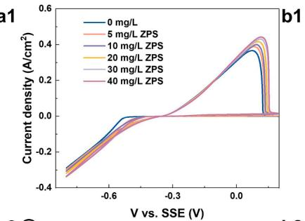

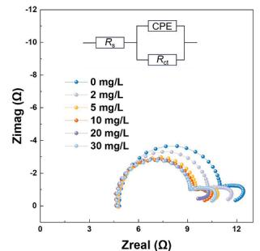

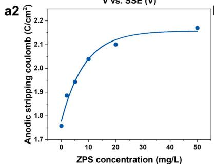

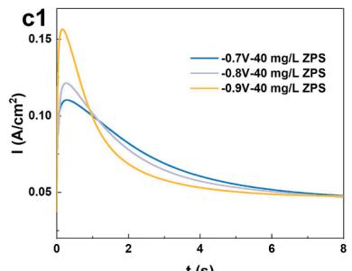

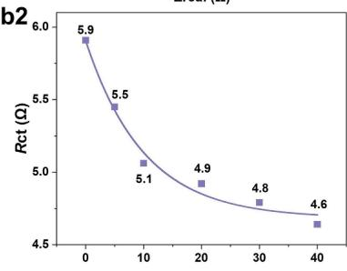

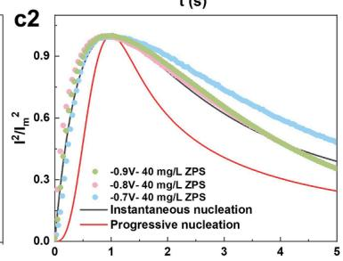

d  
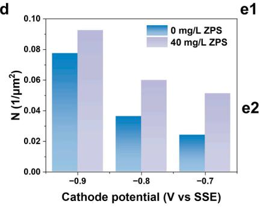

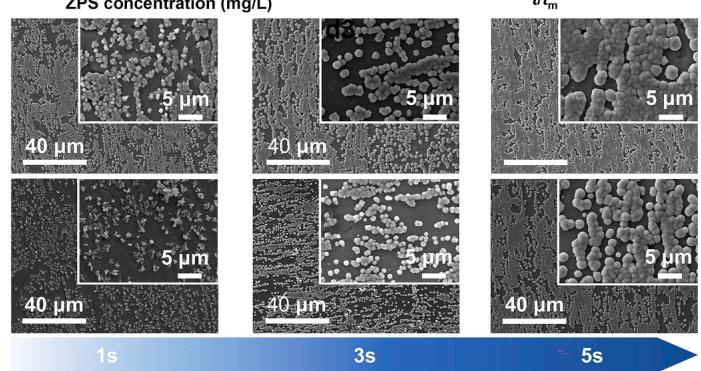  
Fig. 1. Cyclic voltammetry with different ZPS concentration measured at 50 mV/s and 1000 rpm (a1) and the calculated anodic stripping coulomb from CV curves (a2). (b) EIS obtained at −0.5 V vs. SSE, 1000 rpm with equivalent circuit inserted (b1) and histogram of $R _ { \mathrm { c t } }$ and $R _ { s }$ calculated from EIS (b2). Current transient curves measured at different potential with 40 mg/L ZPS (c1) and normalized current transient curves according to the Scharifker and Hills' model measured with and without ZPS (c2). (d) Active site density (N) under the influence of ZPS with different cathode potential. Time-dependent ex situ SEM images revealing the morphological evolution of copper layer with 40 mg/L ZPS (e1) and without ZPS (e2) at 30 $\mathrm { \bf A } / \mathrm { d } \mathrm { m } ^ { 2 }$

Fig. 2b shows the adsorption difference of ZPS on Cu (111), Cu (200) and Cu (220). The adsorption energies order of ZPS was Cu (220)> Cu (111)> Cu (200), which is due to the adsorption configuration difference (Fig. 2c, Fig. S5-S7). Fig. 2c shows that there are three charge transfer area (interaction sites) between ZPS and Cu (220), namely -SO group area, two S atoms area of ZPS and copper substrate. In contrast, there is only one adsorption site between ZPS and other two copper planes (Fig. S6, S7). PDOS was calculated to investigate the detailed interaction between ZPS and Cu (220) (Fig. S8, S9) [34]. The molecular orbitals are broadened throughout Fermi Energy owing to p hybridization renormalization between p orbits of $| 0 , s ,$ N from ZPS and d orbits of Cu. Specifically, there are four d p orbital interactions among two O atoms, two S atoms from ZPS and Cu (220) substrate. The above analysis confirms the multi-adsorption effect between ZPS and copper substrate, mainly including S atoms and sulfonate group.

Furthermore, MD simulation was used to evaluate the ZPS adsorp tion process under the influence of electric filed. The initial configuration, final configuration and energy curves were shown in Fig. S10-S12 and Fig. 2d. Simulated results illustrate ZPS adsorbs parallel on different Cu crystal planes and is of adsorption property regardless of applying electric field. Adsorption energies of ZPS calculated from MD simulation under applying −0.025 V/nm indicate that negative electric field (cathodic polarization) is beneficial to strengthen the adsorption of ZPS regardless of copper crystal planes (Fig. S13). In situ infrared spectroscopy were measured to confirm the theoretical analytical results [35], as shown in Fig. 2e. The typical peak appeared at $1 1 \dot { 0 } 8 ~ \mathrm { c m } ^ { - 1 }$ attributes to the vibration of $\mathrm { C } { \cdot } \mathrm { S } { \cdot } \mathrm { C } ,$ while 1172 $\mathrm { c m } ^ { - 1 }$ is due to vibration of $- S O _ { 3 } ^ { - }$ Besides, 1439, 1560 and 1654 $\mathrm { c m } ^ { - 1 }$ attributes to benzene -CH vibration, while1677 and $1 7 0 1 \mathrm { c m } ^ { - 1 }$ is due to the vibration of $\mathrm { c } { = } \mathrm { N }$ in heterocycle. Infrared spectroscopy confirms the parallel adsorption configuration of ZPS. The relationship between typical peak of the vibration of C-S-C and cathodic potential was analyzed. The continuous increase intensity of vibration indicates that the adsorption is strengthened with the increase of cathodic polarization, consistent with MD analysis.

Electrostatic potential distribution [35], Atoms-in-molecules analysis $[ 3 6 , 3 7 ]$ and interaction region indicator (IRI) analysis [23] was used to study the possible interaction between $\mathrm { { C u } ^ { 2 + } }$ and ZPS. Fig. S14 shows the charge distribution of ZPS. The oxygen atoms (O1, O2 and O3) are negatively charged, illustrating that O atoms might form interaction with $\mathrm { { C u } ^ { 2 + } }$ since O atoms are of lone pair electrons and $\mathrm { { C u } } ^ { 2 + }$ is of empty d orbits. Fig. 2f and S15 shows that the local potential minima appear around O atoms of $- S O _ { 3 } ^ { - }$ of ZPS, indicating that possible interaction could be formed between ZPS and $\mathrm { C u } ^ { 2 + }$

The possible interaction area between ZPS and $\mathrm { { C u } } ^ { 2 + }$ was rendered, as shown in fig. 2g, 2h and fig. S16. Based on IRI theory, the blue region in

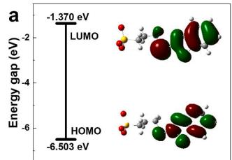

b  
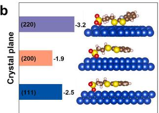

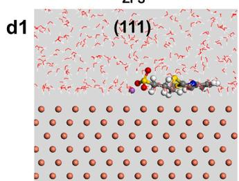

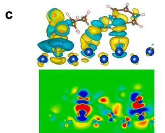

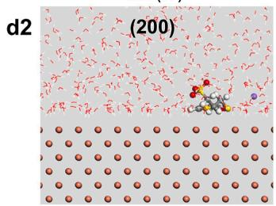

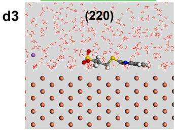

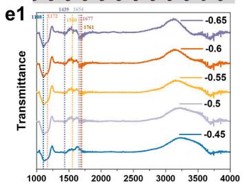

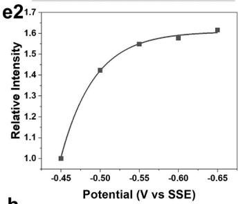

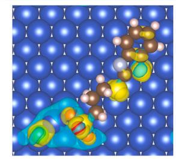

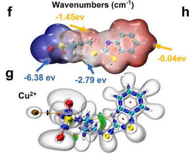

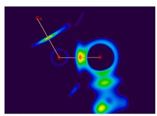

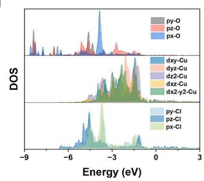  
Fig. 2. (a) HOMO, LUMO and energy gap of ZPS. (b) Adsorption energies comparison of ZPS on different copper crystal planes. (c) 3D and 2D Charge density difference of ZPS on Cu (220). (d) Molecular dynamics simulation of ZPS on different copper crystal planes: final configurations on (111) (d1), (200) (d2), (220) (d3) with applying electric field (−0.025 V/nm). (e) In situ infrared spectroscopy of ZPS during electroplating (e1) and relationship between typical peak intensity of ZPS and cathode potential (e2). (f) Electrostatic potential distribution of ZPS. (g) 3D and (h) 2D isosurface map of IRI of ZPS- $\cdot \mathrm { C u } ^ { 2 \bar { + } }$ complexes. (i) Top view of 3D charge density difference of coordinated ${ \mathrm { Z P S - C u } } ^ { 2 + }$ complex adsorbed on copper surface with Cl− . (j) PDOS of coordinated Cu atom, O atom from ZPS and adsorbed Cl− .

Fig. 2h and red region in 3i represents covalent bonding area, hydrogen bonding area or relatively strong coordination bonding area. As a result, the blue area between O1 and $\mathrm { { C u } ^ { 2 + } }$ indicates that relatively strong interaction is formed. Besides, it can be seen from optimized ZPS- $\mathsf { C u } ^ { 2 \bar { + } }$ complex in fig. S16 that the distance between O1 and $\mathrm { { C u } ^ { 2 + } }$ is 1.87 $\mathring { \mathsf { A } } ,$ which confirms orbital overlap occurs between them. The quantum information about bond critical point was analyzed based on AIM theory to evaluate the interaction property between O1 and $\mathrm { C u } ^ { 2 + }$ , including electron density $\left( \rho _ { \mathrm { B C P } } \right)$ , Laplacian of electron density $( \nabla 2 \rho _ { \mathrm { B C P } } )$ , energy density $\left( H _ { \mathrm { B C P } } \right)$ and potential energy density $\left( V \mathbf { r } _ { \mathrm { B C P } } \right) ,$ , as listed in tab. 1. The ρ and $\bigtriangledown 2 \rho _ { \mathrm { B C P } }$ was 0.0981 a.u. and 0.65 a.u., respectively. $\mathbf { A c } \cdot \mathbf { \partial }$ cording to AIM theory, ionic bond is of positive $\bigtriangledown 2 \ \rho _ { \mathrm { B C P } }$ and ρBCP lowered than 0.1 a.u., which suggests that the interaction formed between ZPS and $\mathrm { { C u } } ^ { 2 + }$ is of ionic coordination bonding property [38].

Besides, the relatively $H _ { \mathrm { B C P } } \ ( - 0 . 0 0 7 6 8 \ \mathrm { a . u . } )$ and $V \mathrm { r } _ { \mathrm { B C P } } \ ( - 1 7 7 . 8 8 \ \mathrm { a . u . ) }$ also demonstrate that the formed ionic coordination bond is of strong intensity.

Based on above analysis, adsorption-capturing accelerating mechanism was proposed. During electroplating, ZPS adsorbs well on copper substrate by multiple sites (heterotoms S and $- S O _ { 3 } ^ { - } )$ , different from typical accelerator SPS, which breaks into two MPS molecules on copper surface and adsorbs by sulfide bond [16,20]. Therewith, $- S O _ { 3 } ^ { - }$ captures $\mathrm { { C u } ^ { 2 + } }$ moving to the cathode surface, after which $\mathrm { { C u } ^ { 2 + } }$ obtains electrons and is rapidly reduced through “bridging effect” of adsorbed Cl− on copper surface, verified by electrochemical tests, similar to the accelerating effect of SPS. Fig. 2i and S17 shows that ZPS- $\mathrm { C u } ^ { 2 + }$ complex could adsorb on copper substrate with $\mathrm { { c l } ^ { - } }$ layer to form $\mathrm { \Delta _ { Z P S - C u } ^ { 2 + } \bar { \cdot } _ { C l } ^ { - } }$ surface complex, among which Cl− plays a bridging role to deliver electrons from copper substrate to $\mathrm { { C u } } ^ { 2 + }$ . There is obvious charge density difference among $\mathrm { Z P S , C u ^ { 2 + } , C l ^ { - } }$ and copper substrate. PDOS analysis indicates that px, py, pz orbits of O atoms from ZPS interact with dz2 of $\mathrm { { C u } } ^ { 2 + }$ , indicating the “capturing effect” of -SO3− . Besides, px and py orbits of Cl− have large overlap with dyz and dxz orbits of $\mathrm { C u } ^ { 2 + }$ , while pz orbits interact with dz2 orbits of $\mathrm { { C u } ^ { 2 + } }$ . The d p hybridization between $\mathrm { C l ^ { - } }$ and ${ \mathrm { C u } } ^ { 2 + }$ creates electron transport channels and facilitating electron transfer (bridging effect) (Fig. 2j).

Electron density $( \rho _ { \mathrm { B C P } } ) ,$ Laplacian of electron density $( \nabla 2 \rho _ { \mathtt { B C P } } ) ,$ , energy density $\left( H _ { \mathrm { B C P } } \right)$ , and potential energy density $\left( V \mathbf { r } _ { \mathrm { B C P } } \right)$ at bond critical point between O16 and $\mathrm { { C u } ^ { 2 + } }$ based on AIM Analysis.

<table><tr><td>Complexes</td><td>Bond atoms</td><td> $\rho_{\text{BCP}} \times 10^{2}$  (a.u.)</td><td> $\nabla^{2} \rho_{\text{BCP}} \times 10^{2}$  (a.u.)</td><td> $H_{\text{BCP}} \times 10^{3}$  (a.u.)</td><td> $V_{\text{rBCP}} \times 10^{3}$  (a.u.)</td></tr><tr><td>ZPS-Cu $^{2+}$ </td><td>O16⋯Cu $^{2+}$ </td><td>9.81</td><td>65.00</td><td>-7.68</td><td>-177.88</td></tr></table>

## 3.3. Shape evolution study

The influence of ZPS on copper foil shape evolution was studied by Finite element simulation and AFM [39]. Coupled with Molecular dynamics simulation [40], electrochemical tests [41] and finite element simulation [42], the kinetics and relevant parameters were obtained (detailed in Supporting Information, tab. S1) and discussed in fig. S18- S20. The simulated 2D copper foil growth evolution was shown in Fig. 3a and 3b. Without $\mathrm { Z P S , \thinspace C u ^ { 2 + } }$ concentration at the valley position was lower than peak position due to limited mass transfer (fig. S21, S22), resulting in a lower growth rate at the valley than in other area and leading to more uneven copper surface.

After adding ZPS, the electrode reaction is divided into two distinct kinetic regimes: Accelerator (fast deposition process) occurs on surface regions with high ZPS coverage, characterized by a high exchange current density $i _ { 0 , \mathrm { ~ A ~ } }$ (twice that without $\mathrm { Z P S } , i _ { 0 , \mathrm { C u } } )$ . Inhibitor (slow depo sition process) exists on cathode surface wherever ZPS coverage is low, characterized by the intrinsic slow kinetics of copper reduction without ZPS. Notably, the inhibitor is not a chemical species but the ubiquitous background slow kinetics; the accelerator is a locally emerging state whose spread is limited by the slow geometric evolution of the surface. This contrast between the locally emerging fast process and the ubiquitous slow process satisfies the activator-inhibitor conditions for Turing-type reaction-diffusion patterns [43,44]. Furthermore, a mathematical shape evolution model based on Turing model was established (detailed in supplementary) as follows:

$$
\frac {\partial \xi}{\partial t} = \nu (\mathrm{A}, \mathrm{S})\tag{6}
$$

$$
\frac {\partial \theta}{\partial t} = k _ {\mathrm{ad}} c _ {\mathrm{ZPS}} (1 - \theta) + \kappa \nu - k _ {\mathrm{de}} \theta\tag{7}
$$

Where ξ represents the shape contour, $k _ { \mathrm { a d } }$ is adsorption rate constant of ${ \mathrm { \Delta } } 2 { \mathrm { P S } } , c _ { \mathrm { Z P S } }$ is ZPS concentration, $k _ { \mathrm { d e } }$ was desorption rate constant of ZPS, κ is local curvature (positive for concave). The term κv captures the geometry-dependent trapping of ZPS with concave (κ>0) enhancing θ and convex (κ<0) reducing θ. v is growth rate affected by activator (A) and inhibitor (I), which is function of $\theta .$ Owing to its relative fast diffusion property and strong adsorption of ZPS (Fig. 2b, S18), the adsorption equilibrium of ZPS is achieved rapidly, leading to ZPS coverage evolution mainly depending on local curvature change (geometric effect).

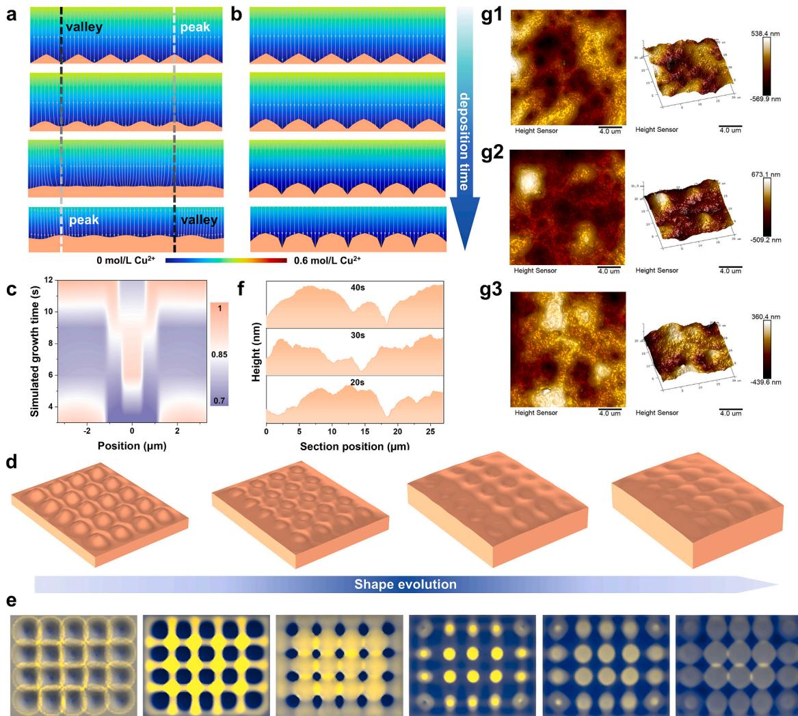  
Fig. 3. Simulated 2D shape evolution with ZPS (a) and without ZPS (b). (c) Surface coverage evolution of ZPS on substrate with simulated growth time. Simulated 3D copper foil shape evolution (d) and respected activator (fast deposition process) and inhibitor (slow deposition process) profile evolution. (f) Cross-sectional profiles of copper layer from AFM images deposited with different time. (g) AFM images of copper layer deposited with 20 s (g1), 30 s (g2) and $4 0 \ s \ ( g 3 )$

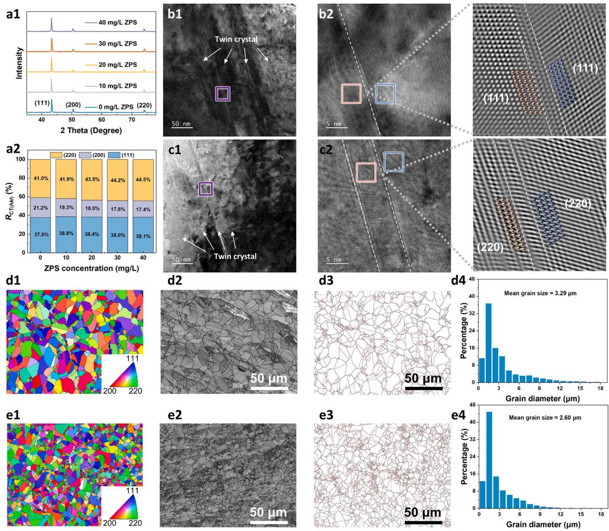

Under the influence of ZPS, the shape evolution exhibits the transfer of valley and peak (Fig. 3a). Further analysis reveals that ZPS surface coverage was improved at the valley position due to geometric change (fig. S23), leading to a higher growth rate at valley position after the introduction of ZPS and the surface flatness is improved as so. However, when valley grows up to the same level as peak, the accumulated ZPS is still higher than original peak position, resulting the continuous accelerated growth (fig. S24) and the original valley changes into peak. In this circumstance, the ZPS will be accumulated in newly-formed valley (original peak) and accelerate the local growth. As a result, ZPS surface coverage exhibits oscillation behavior (Fig. 3c) and shape evolution is characterized by continuous peak-valley transfer, which illustrates that the improved surface flatness is limited. Furthermore, the respective Turing pattern was visualized to better illustrate the application of Turing model. Fig. 3d shows the 3D shape evolution under the influence of ZPS. The fast deposition process area with high ZPS coverage and slow deposition process area with low ZPS coverage evolution were shown in Fig. 3e and fig. S25. The process area evolution and ZPS coverage evolution exhibit typical Turing patterns characterization (spots, stripes), and the transfer between peak and valley arises from the slow geometric evolution of the surface.

Based on above analysis, Turing oscillation growth mechanism was proposed. On one hand, the accumulation of ZPS on valley position improve the flatness. On the other hand, the continuous change between valley and peak (oscillation) indicates that the boosting effect of addi tives on surface flatness is limited, overcoming previous diffusionadsorption theory based on suppressor-type additives, in which the surface flatness should be continuously improved to plane $( R _ { \mathrm { z } }$ tending to 0). To verify the mechanism, the cross-sectional profile of copper foil was calculated from AFM images used to measure copper layer deposited with different deposition time (Fig. 3F and 3g). The almost unchanged surface roughness with deposition time confirms the limited improved flatness of copper foil under the influence of ZPS due to the transfer of valley and peak.

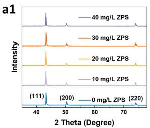

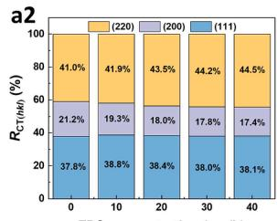

## 3.4. Characterization of copper foil

XRD was used to analyze the influence of ZPS on phase structure [45] (Fig. 4a). The diffraction peak of copper foil under ZPS appeared at 43.30◦, 50.43◦ and 74.13◦, respectively. Laterally, the texture coefficient $( R _ { \mathrm { C T } ( h l k ) } )$ was calculated to analyze crystal orientation under the influence of ZPS according to Eq. 2 (fig. 4a2). $R _ { \mathrm { C T ~ ( 1 1 1 ) } }$ stayed basically unchanged regardless of ZPS concentration, ranging from 37.8% to 38.8%. In contrast, RCT (200) sees a continuous decline from 21.2% to 17.4%, while RCT (220) rises from 41.0% to 44.5% with ZPS concentration rising from 0 mg/L to 40 mg/L, suggesting that ZPS is beneficial for the growth of Cu (220) crystal plane and suppress Cu (200) plane.

To directly observe the internal interface structures at the atomic scale, high-resolution transmission electron microscopy (HRTEM) was employed to investigate the microstructural evolution of copper foils influenced by ZPS (bis-(sodium sulfopropyl)-disulfide) [46]. HRTEM observations consistently revealed the presence of twin boundaries on the copper foil surfaces, irrespective of ZPS addition (Fig. 4b and 4c). Quantitative measurements of lattice fringe spacings in the twin-boundary regions demonstrated a distinct crystallographic transition: in the absence of ZPS, the twin-boundary vicinities were predominantly characterized by (111) planes; upon ZPS introduction, the regions transformed to (220) planes (Fig. S26-S29). This finding is in agreement with the XRD analysis, confirming that ZPS facilitates the preferential growth of (220)-oriented grains. Consequently, the enhanced mechanical properties are attributed to the synergistic effects of the favorable slip characteristics associated with the (220) texture and the strengthening contributions from the high-density twin boundaries. Furthermore, the cross-sectional Inverse Pole Figure (IPF) orientation maps (d1, e1) from EBSD tests indicates that ZPS has a limited effect on grain orientation, with only a slight enhancement of (220) texture. The obtained Cu (220) is of better for improving elongation of copper foil compared with Cu (111) and Cu (200) plane [47] owing to more glide planes [48].

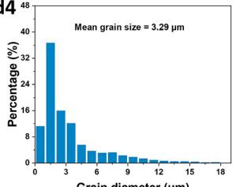

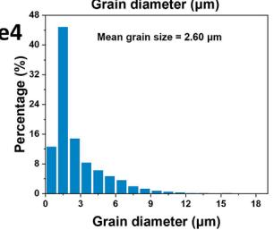  
Fig. 4. XRD patterns of copper foil under the influence of ZPS (a1) and corresponding histogram of texture coefficient $( R _ { \mathrm { C T } ( h l k ) } )$ (a2). TEM images for copper foil obtained with 0 mg/L ZPS (b) and 30 mg/L ZPS (c) TEM bright images (b1, c1), TEM bright images of the area marked by purple frame and corresponding lattice fringe images (b2, c2). EBSD tests of copper foil obtained with 0 mg/L ZPS (d) and 30 mg/L ZPS (e). IPF orientation (d1, e1), IQ (d2, e2), twin boundary distribution (d3, e3), and the statistical grain size distribution histogram (d4, e4).

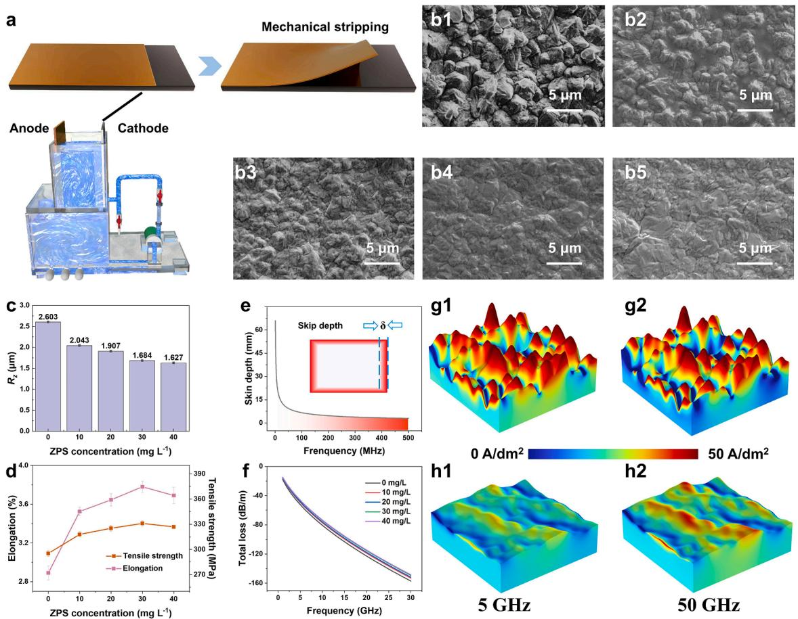

The influence of ZPS on grain size was investigated by EBSD. The Image Quality (IQ) maps (d2, e2) show that the addition of ZPS reduces the grain size and induces high density boundaries. Specifically, the mean grain size decreases from 3.29 μm to 2.60 μm (d4, e4). According to Hall-Petch strengthening mechanism, grain boundaries act as strong barriers to dislocation motion. Grain refinement dramatically increases the total grain boundary area, leading to sharp increase in strength. As a result, the improved grain boundaries density by ZPS is conducive for enhancing mechanical performance. Furthermore, twin grain boundaries, as a special type of high-angle grain boundary, are characterized by low interfacial energy and high stability, and they exhibit a stronger strengthening effect due to their unique symmetric structure. As revealed by fig. d3, e2, the introduction of ZPS increases the density of twin boundaries (red lines), thereby further enhancing both elongation and tensile strength.

## 3.5. Performance of copper foil

The influence of ZPS on performance of copper foil was studied, including surface roughness, mechanical properties, and signal transmittance [49]. Fig. 5a shows the schematic diagram of electroplating device.

The copper foil without ZPS is uneven and full of large copper grain size, while the surface flatness is improved and the grain size is reduced with ZPS rising from 10 mg/L to 20 mg/L, which is due to ZPS boost the nucleation growth, resulting in more compact and even growth of copper foil. When ZPS was 30 mg/L, copper foil becomes compact and flat and there is no obvious improvement with ZPS increased to 40 mg/L, indicating that accelerating effect of ZPS is achieved the most (Fig. 5b), in accordance with CV analysis and EIS analysis. Apart from surface morphology, the surface roughness was also illustrated (fig. 5c, S30). $R _ { \mathrm { z } }$ declines from 2.603 μm to 1.627 μm with ZPS from 0 mg/L to 40 mg/L, further demonstrating that ZPS can improve copper foil morphology.

Elongation and tensile strength are key indicators to evaluate the performance of copper foil [50]. Fig. 5d shows the influence of ZPS concentration on mechanical performance of copper foil. The elongation for copper foil obtained in VMS was 2.89%. After adding ZPS, there is an increasing trend (from 3.53% to 3.78%) with the rising ZPS concentration until 40 mg/L. ZPS can accelerate the nucleation and growth process so as to increase the number of copper grain and refining the grain size, which is beneficial to boost the elongation [51]. As for tensile strength, similar results can be found. Tensile strength increases from 295 MPa to 331 MPa with ZPS concentration rising from 0 mg/L to 30 mg/L and then sees a slightly decrease to 327 MPa with 40 mg/L ZPS, which is due to copper foil grain refined by ZPS provides more grain boundary hindering the crack propagation, thereby improving the tensile strength [52]. However, overhigh ZPS leads to grain further reduced, weakening the elongation to some extent [51]. The mechanical performance of copper foil from this work was compared with copper foils from researches in recent years (Fig. S31) and it is obvious that single additive ZPS is beneficial to improve copper foil properties with elongation of 3.78% and tensile strength of 331 MPa obtained by 30 mg/L ZPS.

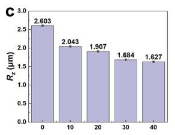

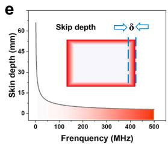

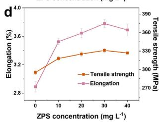

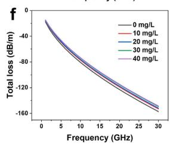  
Fig. 5. (a) Schematic diagram of electroplating device. (b) SEM images of copper foil obtained at 0 mg/L (b1), 10 mg/L (b2), 20 mg/L (b3), 30 mg/L (b4) and 40 mg/ L (b5). (c) Histogram of surface roughness under influence of ZPS. (d) Histograms of elongation and tensile strength of copper foil under the influence of ZPS. (e) Schematic diagram of skin depth when transmitting signals with different frequencies. (f) Relationship between total loss and frequency under the influence of ZPS concentration. Simulation of skin effect for copper layer obtained without ZPS (g) and with 30 mg/L ZPS (h) under 5 GHz (g1, h1) and 50 GHz (g2, h2).

The signal transmission performance is analyzed based on finite element simulation, respectively to evaluate the practical application. The established models were of the same $R _ { \mathrm { z } }$ as experimental samples (fig. S32). Fig. 5e shows the schematic diagram of skin effect. The skin depth decreases with the increase of frequency, which means that the current density is mainly distributed on the surface area under high frequency signals, while Fig. 5f shows the relationship among ZPS concentration, signal losses and frequency. At the same frequency, the signal losses rise with the increase of surface roughness. The current distribution on copper surface with different roughness under different frequency was depicted in fig. 5g and 5h. When high-frequency signal transmission is applied, the current density tends to transfer on the copper foil surface. Especially for copper foil with high surface rough ness, current density is gathered on the interface and the phenomena is intensified with rising frequency of signals. As for relatively even copper foil obtained with ZPS, the current density distributes relatively more uniform on copper foil.

## 4. Conclusion

In this study, additive Sodium 3-(benzothiazole-2-ylthio)-1-pro panesulfonate (ZPS) has been systematically investigated for copper foil electrodeposition. Cyclic voltammetry and electrochemical impedance spectra indicate that ZPS is of accelerating effect during electroplating. Chronoamperometry and ex situ SEM shows that the 3D diffusion controlled instantaneous nucleation and growth model is not changed but the active sites are increased by ZPS. Theoretical analysis suggests that ZPS can adsorb on copper surface and catch free $\mathrm { C u } ^ { 2 + }$ by -SO3− to accelerate the electro-reduction coupled with adsorbed Cl− through “bridging effect”. Adsorption-capturing accelerating mechanism was proposed. Molecular dynamics simulation and in situ infrared spectroscopy verify the improved adsorption property of ZPS with increased cathodic polarization. A Turing oscillation growth model, validated by finite-element simulation and AFM, reveals that ZPS accumulates in valleys to locally accelerate growth, improving flatness via cyclic peakvalley transfer, but the smoothing effect is ultimately constrained by this oscillation. Structural characterization demonstrates that ZPS selectively promotes the Cu (220) crystal orientation and suppresses the (200) plane, while HRTEM directly visualizes twin boundaries, with lattice fringes showing a shift from (111) to (220) in twin-vicinity regions upon ZPS addition. EBSD confirms grain refinement (mean grain size reduced from 3.29 μm to 2.60 μm) and a marked increase in twinboundary density, which together enhance mechanical performance through Hall-Petch strengthening and dislocation obstruction. Regarding copper foil performance, surface morphology is noticeably improved, while the optimal mechanical properties are achieved at 30 mg/L ZPS, yielding a tensile strength of 331 MPa and elongation of 3.78 %, attributed to grain refinement and twin-boundary strengthening. Finite-element simulation of skin effect demonstrates that the reduced roughness significantly lowers signal loss. Collectively, this work not only establishes ZPS as an effective single additive for industrial copper foil production but also advances the fundamental understanding of additive-induced structure-property relationships, offering a solid foundation for future additive design and process optimization.

## CRediT authorship contribution statement

Yaqiang Li: Formal analysis, Investigation, Writing – original draft. Yuanhang Zhang: Methodology. Ruopeng Li: Conceptualization, Funding acquisition. Xingchen Ma: Resources. Fuxue Wang: Validation. Fan Meng: Data curation. Jie Jiang: Visualization. Xuesong Peng: Writing – review & editing. Lanchen Li: Supervision, Validation. Maozhong An: Funding acquisition, Project administration.

## Declaration of competing interest

No conflict of interest exists in the submission of this manuscript. I would like to declare on behalf of my co-authors that the work described herein is original that has not been published previously and is not under consideration for publication elsewhere, in whole or in part. All the authors listed have approved the manuscript that is enclosed.

## Acknowledgements

This work was granted by the National Key Research and Development Program of China [No. 2021YFB3400800], National Natural Science Foundation of China [No. 22402041, 22502032, 22541202] and the Fuzhou University Testing Fund of precious apparatus (No. 2025T017). The theoretical calculation was carried out in Hefei advanced computing center.

## Supplementary materials

Supplementary material associated with this article can be found, in the online version, at doi:10.1016/j.electacta.2026.149561.

## Data availability

Data will be made available on request.

## References

[1] C.C. Vu, S.J. Kim, J. Kim, Flexible wearable sensors-an update in view of touchsensing, Sci. Technol. Adv. Mater. 22 (1) (2021) 26–36, https://doi.org/10.1080 14686996.2020.1862629.

[2] L. Yaqiang, R. Penghui, Z. Yuanhang, et al., Investigation of novel leveler rhodamine B on copper superconformal electrodeposition of microvias by theoretical and experimental studies, Appl. Surf. Sci. 615 (2023) 156266, https:// doi.org/10.1016/j.apsusc.2022.156266.

[3] L. Kui, T. Lifen, J. Kun, et al., Design of flexible copper clad laminate with outstanding adhesion strength induced by chemical bonding, J. Mater. Sci. Mater. Electron. 25 (12) (2014) 5446 5451, https://doi.org/10.1007/s10854-014-2327- y.

[4] H. Jing, F. Binfeng, W. Zhong, et al., Research progress on the texture of electrolytic copper foils, J. Electron. Mater. 53 (2024) 3460–3473, https://doi.org 10.1007/s11664-024-11118-5.

[5] X. Yin, P. Lijun, H.K. Saif, et al., Mechanical properties and microstructure of rolled and electrodeposited thin copper foil, Rare Met. 35 (12) (2016) 909–914, https:// doi.org/10.1007/s12598-016-0806-4.

[6] L. Zhuang, W.B. Cai, H.X. Ji, et al., Development trends and priority research fields of electrochemical discipline in the 15th five year plan period, J. Electrochem. 31 (10) (2025) 31, https://doi.org/10.61558/2993-074X.3590.

[7] S. Kawai, M. Ogawa, K. Ishibashi, et al., Transient mass transfer rate of $\mathrm { C u } ^ { 2 + }$ caused by copper electrodeposition with alternating electrolytic current, Electrochim. Acta 55 (12) (2010) 3987–3994, https://doi.org/10.1016/j. electacta 2010.02.039

[8] P. Xuesong, L. Lanchen, J. Jie, et al., Mechanistic insight into the Janus Green B on electrochemical roughening layer of copper foil, Colloids Surf. A: Physicochem. Eng. Asp. 698 (2024) 134523, https://doi.org/10.1016/j.colsurfa.2024.134523.

[9] S. Gui, L. Xiaodong, L. Youzhi, et al., High-efficiency and low-consumption preparation of ultra-thin and high-performance nanotwinned copper foils by highgravity intensified direct current electrodeposition, Chem. Eng. Sci. 296 (2024) 120248, https://doi.org/10.1016/j.ces.2024.120248.

[10] Z. Ran, Y. Sen, Q. Shuiping, et al., Effects of DPS on surface roughness and mechanical properties of electrodeposited copper foils, Cystal. Res. Technol. 58 (2023) 2200260, https://doi.org/10.1002/crat.202200260.

[11] X. Yan, S. Wan-chang, B. Zhong-bo, et al., Effect of additives on microstructure and properties of the coarsened layer of very low profile (HVLP) copper foil, J. Appl. Electrochem. 53 (2023) 2331 2346, https://doi.org/10.1007/s10800-023-01930- y.

[12] P.W. Shao, X.W. Kun, W. Wei, et al., Enhancing surface roughness and tensile strength of electrodeposited copper foils by composite additives, Phys. Status Solid (A) 219 (5) (2022) 2100735, https://doi.org/10.1002/pssa.202100735.

[13] B. Zhang, W.C. Sun, E.Y. Liu, et al., Influences of composite additives and technological parameters on the microstructure and properties of electrolytic copper foil, Mater. Sci. Eng. Technol. 56 (2025) 235–250, https://doi.org 10.1002/mawe.202400186.

[14] Y.X. Luo, J.J. Wang, L. Wang, et al., Effect of saccharin on crystallization behavior of electroless cobalt plating, J. Electrochem. 31 (8) (2025) 2412231, https://doi. org/10.61558/2993-074X.3533.

[15] L. Yaqiang, M. Xiaochuan, L. Chengzhi, et al., Investigation of novel suppressor nitrotetrazolium blue chloride on cobalt superconformal growth, J. Manuf. Process. 101 (2023) 15–24, https://doi.org/10.1016/j.jmapro.2023.05.059.

[16] T.M.T. Huynh, N.T.M. Hai, P. Broekmann, Quasi-reversible interaction of MPS and chloride on Cu (100) studied by In situ STM, J. Electrochem. Soc. 160 (12) (2013) D3063–D3069, https://doi.org/10.1149/2.012312jes

[17] L. Yaqiang, P. Xuesong, L. Ruopeng, et al., Insight into leveler basic blue 7 towards copper superfilling within microvias, New. J. Chem. 49 (2025) 12079–12089, https://doi.org/10.1039/d5nj02092a.

[18] L. Mingjie, P. Xuesong, J. Jie, et al., Filling performance of an acid blue 1 leveler on blind microvias, New. J. Chem. 49 (2025) 4538–4546, https://doi.org/10.1039/ d4nj05470a.

[19] C.G. Guymon, J.N. Harb, R.L. Rowley, et al., MPSA effects on copper electrodeposition investigated by molecular dynamics simulations, J. Chem. Phys. 128 (2008) 044717, https://doi.org/10.1063/1.2824928.

[20] N.T.M. Hai, T.T.M. Huynh, A. Fluegel, et al., Competitive anion/anion interactions on copper surfaces relevant for Damascene electroplating, Electrochim. Acta 70 (2012) 286–295, https://doi.org/10.1016/j.electacta.2012.03.054.

[21] L. Yaqiang, L. Lijuan, W. Qifeng, et al., Highly selective separation of acetic acid and hydrochloric acid by alkylamide based on double hydrogen bond coupling mechanism, Sep. Purif. Technol. 275 (2021) 119110, https://doi.org/10.1016/j. seppur.2021.119110.

[22] W. Humphrey, A. Dalke, K. Schulten, VMD: visual molecular dynamics, J. Mol. Graph. 14 (1) (1996) 33 38, https://doi.org/10.1016/0263-7855(96)00018-5.

[23] T. Lu, F. Chen, Multiwfn: a multifunctional wavefunction analyzer, J. Comput. Chem. 33 (5) (2012) 580–592, https://doi.org/10.1002/jcc.22885.

[24] G. Kresse, J. Furthmiiller, Efficiency of ab-initio total energy calculations for metals and semiconductors using a plane-wave basis set, Comput. Mater. Sci. 6 (1) (1996) 15–50, https://doi.org/10.1016/0927-0256(96)00008-0.

[25] G. Kresse, J. Furthmiiller, Efficient iterative schemes for ab initio total-energy calculations using a plane-wave basis set, Phys. Rev. B 54 (16) (1996) 11169–11186, https://doi.org/10.1103/PhysRevB.54.11169.

[26] L. Yaqiang, R. Penghui, Y. Zhang, et al., The influence of leveler Brilliant Green on copper superconformal electroplating based on electrochemical and theoretical study, J. Ind. Eng. Chem. 118 (2023) 78–90, https://doi.org/10.1016/j. jiec.2022.10.047.

[27] L. Mingjie, L. Xin, P. Xuesong, et al., Investigation of novel brightener acid blue 1 on copper electroplating coating, Ion 31 (2025) 1061–1075, https://doi.org/ 10.1007/s11581-024-05930-6.

[28] L. Yaqiang, L. Chengzhi, L. Ruopeng, et al., Experimental and theoretical study of the new leveler basic blue 1 during copper superconformal growth, ACS. Appl. Mater. Interfaces. 15 (2023) 47628–47639, https://doi.org/10.1021/ acsami.3c06567.

[29] L. Yaqiang, M. Xiaochuan, L. Ruopeng, et al., Suppressing-accelerating effect of nitrotetrazolium Blue chloride in boosting superconformal cobalt filling, J. Electroanal. Chem. 945 (2023) 117671, https://doi.org/10.1016/j. jelechem.2023.117671.

[30] C. Youchi, X. Shuzhou, J. Jie, et al., Deciphering the role of chromotrope 2R in conformal copper electrodeposition and microstructural control for PCB through-

hole metallization, Electrochim. Acta 550 (2026) 148106, https://doi.org 10.1016/j.electacta.2025.148106.

[31] P. Xuesong, J. Jie, W. Xinrui, et al., Substrate engineering for high-performance ultrathin copper foils: unveiling the electronic-geometric synergy of low-rangeorder Ni-W alloys, Adv. Funct. Mater. 36 (39) (2026) e74586, https://doi.org 10.1002/adfm.74586.

[32] B. Scharifker, G. Hills, Theoretical and experimental studies of multiple nucleation, Electrochim. Acta 28 (1983) 879–889, https://doi.org/10.1016/0013-4686(83) 85163-9.

[33] G. Gunawardena, G. Hills, I. Montenegro, et al., Electrochemical nucleation: part I. General considerations, J. Electroanal. Chem. 138 (1982) 225–239, https://doi. org/10.1016/0022-0728(82)85080-8.

[34] P. Xuesong, Z. Xu, J. Jie, et al., Theoretical research and application of additive DPS in the electrochemical microroughening layer of copper foil, Langmuir 41 (2025) 6081–6091, https://doi.org/10.1021/acs.langmuir.4c04932.

[35] Z. Vivian Feng, X. Li, A.A Gewirth, Inhibition due to the interaction of polyethylene glycol, chloride, and copper in plating baths: a surface-enhanced Raman study, J. Phys. Chem. B 107 (2003) 9415–9423, https://doi.org/10.1021/jp034875m

[36] M. Linghui, J. Jiang, P. Xuesong, et al., Theoretical and experimental study of functional additives in Au(I) DMH cyanide-free gold electroplating system, Langmuir 41 (2025) 20683–20696, https://doi.org/10.1021/acs. langmuir.5c02124.

[37] E.V. Bartashevich, D.K. Nikulov, M.V. Vener, et al., QTAIMC study of the X-H/HO bond order indices (X = O, N, C) in molecular systems, Comput. Theor. Chem. 973 (2011) 33–39, https://doi.org/10.1016/j.comptc.2011.06.025.

[38] R. Yiming, T. Hao, S. Lang, et al., Theoretical study on complexation of U(VI) with ODA, IDA and TDA based on density functional theory, RSC Adv. 6 (6) (2016) 46467–46474, https://doi.org/10.1039/C6RA05382C.

[39] L.J. Ren, G.M. Li, Z.X. Zhu, et al., Numerical simulation of the pitting corrosion behavior of stainless steel bellows influenced by varying liquid film thicknesses, J. Electrochem. 31 (7) (2025) 2502161, https://doi.org/10.61558/2993- 074X.3539.

[40] M.A. Orekhov, Improving molecular dynamics calculation of diffusivity in liquids with theoretical models, J. Mol. Liq. 322 (2021) 114554, https://doi.org/10.1016 j.molliq.2020.114554.

[41] B. Lindsay, L. Uziel, Additives Co-injection: a test for determining the efficacy and process parameters of bottom-up plating, J. Electrochem. Soc. 163 (7) (2016) D314–D321, https://doi.org/10.1149/2.0971607jes.

[42] Y. Liu, R. Aleksandar, D. Johan, et al., Modeling the bottom-up filling of through silicon vias through suppressor adsorption/desorption mechanism, J. Electrochem. Soc. 160 (12) (2013) D3051–D3056, https://doi.org/10.1149/2.010312jes.

[43] S. Kondo, T. Miura, Reaction-diffusion model as a framework for understanding biological pattern formation, Science 329 (2010) 1616–1620, https://doi.org/ 10.1126/science.1179047.

[44] Z. Tan, S. Chen, X. Peng, L. Zhang, C. Gao, Polyamide membranes with nanoscale turing structures for water purification, Science 360 (2018) 518–521, https://doi. org/10.1126/science.aar6308.

[45] J. Lin, L. Zhu, X. Peng, et al., Enhancing corrosion resistance of electrodeposited Ni-P alloy coatings vias glycine-modified, Surf. Coat. Technol. 533 (2026) 133640, https://doi.org/10.1016/j.surfcoat.2026.133640.

[46] X. Peng, F. Meng, J. Jiang, et al., Electrodeposition of low ordered Ni-W as a release layer for ultrathin Cu foils: experimental and theoretical insights, Appl. Surf. Sci. 718 (2026) 164968, https://doi.org/10.1016/j.apsusc.2025.164968.

[47] L. Linbo, C. Jiawen, S. Xixun, Influence of annealing temperature on microstructure and mechanical properties of nanocrystalline copper, Mater. Mech. Eng. 46 (8) (2022) 22–27, https://doi.org/10.11973/jxgccl202208004.

[48] Z. Shichao, J. Tao, B. Zhiming, et al., Preferred orientation of electrolytic copper foil, J. Beijing Univ. Aeronaut. Astronaut. 30 (10) (2004) 1008–1012, https://doi. org/10.13700/j.bh.1001-5965.2004.10.022.

[49] P. Chuan, Z. Yuehui, C. Xianming, et al., Structure performance correlation of N heterocyclic oligomer leveler for acid copper plating of advanced interconnects, Molecules 28 (2023) 2783, https://doi.org/10.3390/molecules28062783.

[50] L.L. Lu, H.T. Liu, Z.D. Wang, et al., Advances in electrolytic copper foils: fabrication, microstructure, and mechanical properties, Rare Met. 44 (2) (2025) 757–792, https://doi.org/10.1007/s12598-024-02965-6.

[51] R. Zheng, J.P. Du, S. Gao, et al., Transition of dominant deformation mode in bulk polycrystalline pure Mg by ultra-grain refinement down to sub-micrometer, Acta Mater. 198 (2020) 35 46, https://doi.org/10.1016/j.actamat.2020.07.055.

[52] W. Sang, L. Ma, M. Ji, Effect of grain size on tensile properties at different temperatures of 304L stainless steel, Mater. Mech. Eng. 93 (2) (2014) 10–23, https://doi.org/10.1016/j.matchar.2014.03.013.