# Thermodynamic aspects of bis(3‑sulfopropyl) disulfide and 3‑mercapto‑1‑propanesulfonic acid in Cu electrodeposition

Huizi Shena, Hoe Chul Kima, Minjae Sunga, Taeho Limb, , Jae Jeong Kima,

a School of Chemical and Biological Engineering, Institute of Chemical Process, Seoul National University, 1 Gwanak-ro, Gwanak-gu, Seoul 08826, Republic of Korea b Department of Chemical Engineering, Soongsil University, 369 Sangdo-ro, Dongjak-gu, Seoul 06978, Republic of Korea

## A R T I C L E I N F O

Keywords: Cu electrodeposition Accelerator SPS MPS Reduction potential

## A B S T R A C T

Organic additives play an important role in regulating film growth and properties in Cu electrodeposition. 3‑Mercapto‑1‑propane sulfonate (MPS) and its dimer bis(3‑sulfopropyl) disulfide (SPS) are representative accelerators that promote Cu electrodeposition rate. In this study, the formal reduction potential of SPS to MPS wa determined by measuring the equilibrium constants of thiol–disulfide interchange reactions with the reference thiol/disulfide pairs by 1H nuclear magnetic resonance (1H NMR) spectroscopy. The calculated formal reduction potential of SPS to MPS was 0.153 V (vs. standard hydrogen electrode). Based on this calculation, the cell potentials of Cu(I)(thiolate) formation reaction with either SPS or MPS, which is a key reaction in accelerating mechanism, were also estimated by ultraviolet–visible absorption and 1H NMR spectroscopies: they were found to be 0.202 V and 0.214 V for SPS and MPS, respectively. The positive cell potential indicates that the formation of Cu(I)(thiolate) complexes is thermodynamically favorable in the presence of additives.

## 1. Introduction

Cu has been widely used as metallization material in the semi conductor industry owing to its low electrical resistivity and high electromigration resistance. Cu metallization is usually performed by electrodeposition, which eficiently yields high quality films by a relatively simple and inexpensive process. Electrolyte for Cu electrodeposition typically contains small quantities of organic additives, which are essential to regulate film growth and properties. Additives are grouped into accelerators, suppressors, and levelers according to their roles in controlling the deposition rate. Among them, 3‑mercap to‑1‑propanesulfonate (MPS) and its dimer bis(3‑sulfopropyl) disulfide (SPS) are the most representative accelerators in Cu electrodeposition [1].

The accelerating efect of SPS or MPS has been explained by two mechanisms [2]. One describes competitive adsorption between accel erator and suppressor; the displacement of suppressor inhibition layer by SPS or MPS facilitates the approach of Cu ions to electrode surface, enhancing the deposition rate $[ 3 - 7 ]$ . The other mechanism focuses on direct catalytic reduction of $\mathrm { C u } ^ { 2 + }$ ion to $\mathrm { { C u } ^ { + } }$ ion by forming Cu(I) (thiolate) complex [8–11]. The reduction of ${ \mathsf { C u } } ^ { 2 + } { \mathsf { t o } } { \mathsf { C u } } ^ { + }$ is known as the rate-determining step of Cu electrodeposition [12]. Vereecken et al. reported that the amount of $\mathrm { { C u } ^ { + } }$ near electrode surface is a key factor determining the deposition rate in Cu electrodeposition [13,14].

Nevertheless, only trace amounts of $\mathrm { { C u } ^ { + } }$ can exist in the electrolyte, as $\mathrm { { C u } ^ { + } }$ is easily oxidized to $\mathrm { C u } ^ { 2 + }$ by dissolved oxygen. MPS or SPS in electrolyte can form stable Cu(I)(thiolate) complex, increasing the amount of $\mathrm { { C u } ^ { + } }$ species near the electrode surface [14]. The corresponding reactions are described as follows.

$$
4 \mathrm{MPS} + 2 \mathrm{Cu} ^ {2 +} \leftrightarrow \mathrm{SPS} + 2 \mathrm{Cu(I)(thiolate)} + 4 \mathrm{H} ^ {+}\tag{1}
$$

$$
\mathrm{SPS} + 4 \mathrm{Cu} ^ {+} \leftrightarrow 2 \mathrm{Cu(I)(thiolate)} + 2 \mathrm{Cu} ^ {2 +}\tag{2}
$$

In spite of the significance of these reactions, few thermodynamic data have been reported. Eqs. (1) and (2) are both complexation reactions including the redox reactions between $\mathsf { C u } ^ { 2 + } / \mathsf { C u } ^ { + }$ and SPS/MPS. Though the standard reduction potential of $\mathsf { C u } ^ { 2 + }$ to $\mathrm { { C u } ^ { + } }$ is known as 0.159 V (vs. standard hydrogen electrode (SHE)) [15], the lack of reduction potential of SPS makes it dificult to obtain the cell potentials of Eqs. (1) and (2). The reduction reaction of SPS is shown by Eq. (3).

$$
\mathrm{SPS} + 2 \mathrm{H} ^ {+} + 2 \mathrm{e} ^ {-} \leftrightarrow 2 \mathrm{MPS}\tag{3}
$$

Herein, the formal reduction potential of SPS $( \operatorname { E q } .$ . (3)) was obtained, and the cell potentials of Eqs. (1) and (2) were estimated by spectroscopy. The formal reduction potential of SPS was obtained by measuring the chemical equilibrium constants of thiol–disulfide interchange reaction between MPS/SPS pairs and reference thiol/disulfide pairs, lipoic acid (Lip) and mercaptoethanol (ME). The calculation provides thermodynamic information of accelerating mechanism by either SPS or MPS in Cu electrodeposition.

## 2. Experimental

## 2.1. Electrochemical analysis

Linear sweep voltammetry (LSV) was performed with electrolyte composed of 0.25 M CuSO and 1.0 M H SO . SPS or MPS was also added to the electrolyte. The concentrations of SPS and MPS were 50 μM and 100 μM, respectively, at which the equivalent concentration of thiolate functional group is same: one SPS is reduced to two MPS (Eq. (3)). The electrochemical analysis was conducted in a three-electrode system comprising a Cu rotating disk electrode $( 0 . 2 \thinspace { \mathrm { c m } } ^ { 2 } )$ , Cu rod, and $\mathbf { A g } / \mathbf { A g C l } ,$ /saturated KCl electrode $( \mathsf { A g / A g C l } )$ as the working electrode, the counter electrode, and the reference electrode, respectively. Temperature was held at $3 0 ^ { \circ } \mathrm { C }$ (303 K) by thermostat during the analysis. The potential applied on the working electrode was swept from 0.15 V $\mathrm { t o } - 0 . 8 5 \ : \mathrm { V }$ (vs. Ag/AgCl) at a scan rate of 10 mV/s using a potentiostat (PAR 273A, EG&G Princeton Applied Research Corporation). All the LSV analysis was conducted right after the solution preparation to minimize the extent of reactions, Eqs. (1) and (2).

## 2.2. Preparation of samples $f o r ~ ^ { 1 } H$ nuclear magnetic resonance (NMR) spectroscopy

Chemical equilibrium constants were obtained by measuring the equilibrium concentrations of chemical species by $\mathrm { ^ { 1 } H }$ NMR spectroscopy (Bruker Avance III 400 FT-NM, Bruker). For thiol–disulfide interchange reaction, all the reactants were dissolved in deuterated phosphate bufer, prepared by dissolving 10 mM phosphoric acid (85% $\mathrm { D } _ { 3 } \mathrm { P O } _ { 4 }$ in $\mathrm { D } _ { 2 } \mathrm { O } ,$ , Cambridge Isotopes Laboratories) in 50 mL of $\mathrm { D } _ { 2 } \mathrm { O } .$ . The pD of the solution was adjusted to 7 by adding NaOD (30% in $\mathrm { D } _ { 2 } \mathrm { O } ) ;$ the $\mathtt { p D }$ was calculated by the following relationship, $\mathrm { \ p D } = \mathrm { \ p H } + 0 . 4$ [16].

Two test samples were prepared in 5 mm NMR tubes. One comprised 10 mM Lip and 20 mM MPS and the other had 20 mM ME and 10 mM SPS, dissolved in the deuterated phosphate bufer solution. The NMR tubes containing samples were sealed completely with polytetrafluoroethylene (PTFE) tape and then kept on shelves at room temperature for 0–45 h before acquiring NMR spectra. The concentrations of the species were determined by measuring the peak areas of the following NMR resonances, Lip: 3.69 ppm, $\operatorname { L i p } ^ { \mathrm { r e d } } \colon$ 3.58 ppm, MEox: 3.86 ppm, ME: 3.69 ppm, MPS: 2.66 ppm and 2.02 ppm, and SPS: 2.86 ppm and 2.15 ppm [17,18].

$\mathbf { D } _ { 2 } \mathbf { O }$ solution containing 0.05 M SPS, 0.05 M CuCl, and 0.25 M D SO was prepared to measure chemical the equilibrium constants of Cu(I)(thiolate) formation reactions. The solution was kept at room temperature for 0–15 h in a 5–mm NMR tube sealed with PTFE tape before acquiring NMR spectra. The characteristic 1H NMR resonances of Cu(I)(thiolate) appeared at 3.15 ppm and 2.32 ppm, whereas 1H NMR peaks for SPS appeared at 3.03 ppm, 2.86 ppm, and 2.15 ppm [18].

All the experiments were carried out under nitrogen atmosphere (99.9% purity) at room temperature (298 K) to avoid any oxidation of components by oxygen.

## 2.3. Ultraviolet–visible (UV–vis) absorption spectroscopy

UV–vis (Genesys10s, Thermo Fisher Scientific) spectroscopic mea surement was carried out to verify the formation pathway of Cu(I) (thiolate). Test samples were aqueous solutions consisting of Cu source and SPS (or MPS). For the measurement, $\mathrm { C u S O _ { 4 } }$ and CuCl were used as $\mathrm { C u } ^ { 2 + }$ and $\mathrm { { C u } ^ { + } }$ sources, respectively. For measuring the chemical equilibrium constant of Cu(I)(thiolate) formation reaction (Eq. (2)), 0.05 M SPS and 0.05 M CuCl were dissolved in 0.25 M H SO and stirred overnight at room temperature. The concentration of $\mathrm { C u } ^ { 2 + }$ at steady state was estimated from the UV–vis spectra using the Beer

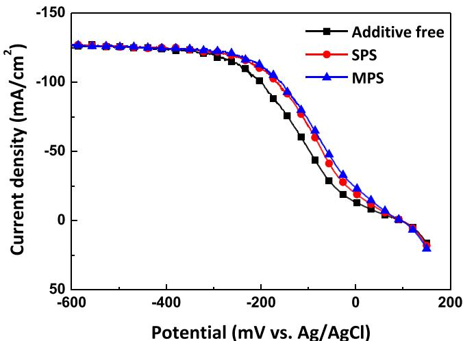  
Fig. 1. Linear sweep voltammograms of Cu electrodeposition with accelerators.

Lambert Law. The molar attenuation coeficient of $\mathsf { C u } ^ { 2 + }$ in the system was calculated as 13.2 mol−1·cm−1 based on the absorbance at 800 nm with diferent $\mathrm { C u S O _ { 4 } }$ concentrations.

## 3. Results and discussion

## 3.1. Electrochemical analysis of acceleration efect by SPS or MPS

The accelerating efect of SPS or MPS in Cu electrodeposition was observed in LSV, as shown in Fig. 1. The addition of either SPS or MPS into deposition electrolyte increases Cu ion reduction current, indicating that the electrodeposition process is accelerated by direct catalytic reduction of $\mathrm { C u } ^ { 2 + }$ to $\mathrm { { C u } ^ { + } }$ via formation of Cu(I)(thiolate) complex. It is notable that MPS exhibits slightly stronger acceleration efect than SPS at the same equivalent thiolate concentration, because MPS directly forms Cu(I)(thiolate) complex with major ${ \mathrm { C u } } ^ { 2 + }$ , whereas SPS only combines with minor $\mathrm { { C u } ^ { + } }$ , coming from the comproportio nation reaction between $\mathrm { C u } ^ { 2 + }$ and metallic Cu (Eq. (4)).

$$
\mathrm{Cu} + \mathrm{Cu} ^ {2 +} \leftrightarrow 2 \mathrm{Cu} ^ {+}\tag{4}
$$

## 3.2. Formal reduction potential of SPS

As a pair of thiol/disulfide, SPS and MPS can react with another thiol/disulfide pair via substitution, which is called thiol–disulfide interchange reaction [19–22]. The reduction potential of disulfide compound in thiol–disulfide interchange is usually obtained by establishing the equilibrium between the target material and a reference thiol/disulfide pair of known redox potential, rather than electroanalytical measurements because many redox systems of sulfur are electrochemically irreversible $[ 1 5 , 1 7 , 2 3 , 2 4 ]$ . The irreversible characteristic leads to the unsteady electrode potential which is inconsistent with the Nernst equation, hindering the accurate calculation of reduction potential. Therefore, in this study, the thiol–disulfide interchange reaction was introduced with Lip and ME as the reference materials. The thiol–disulfide interchange reactions between SPS/MPS and Lip/ME are as follows.

$$
2 \mathrm{MPS} + \mathrm{Lip} \leftrightarrow \mathrm{SPS} + \mathrm{Lip} ^ {\mathrm{red}}\tag{5}
$$

$$
\mathrm{SPS} + 2 \mathrm{ME} \leftrightarrow 2 \mathrm{MPS} + \mathrm{ME} ^ {\mathrm{ox}}\tag{6}
$$

where superscript ‘red’ and ‘ox’ indicate the reduced and oxidized forms, respectively. The formal reduction potentials of Lip $( \mathrm { E _ { L i p } } )$ and $\mathbf { M E } ^ { \mathbf { o x } } \left( \mathbf { E } _ { \mathbf { M E } } \right)$ are 0.125 V and 0.153 V, respectively, with respect to the SHE [17]. The equilibrium constants $\mathrm { ( K _ { e q } ) }$ of Eqs. (5) and (6) are de-fined as follows:

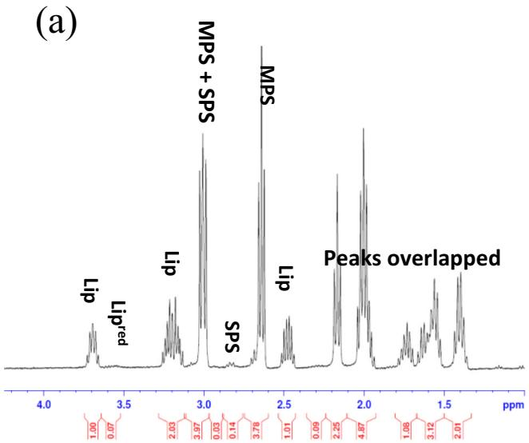  
(b)

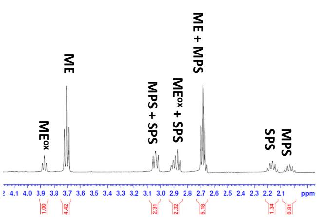  
Fig. 2. 1H NMR spectra of solutions after thiol–disulfide interchange reactions, (a) MPS/Lip and (b) SPS/ME.

$$
\mathrm{K} _ {\mathrm{eq5}} = ([ \mathrm{Lip} ^ {\mathrm{red}} ] [ \mathrm{SPS} ]) / ([ \mathrm{Lip} ] [ \mathrm{MPS} ] ^ {2})\tag{7}
$$

$$
\mathrm{K} _ {\mathrm{eq6}} = ([ \mathrm{ME} ^ {\mathrm{ox}} ] [ \mathrm{MPS} ] ^ {2}) / ([ \mathrm{SPS} ] [ \mathrm{ME} ] ^ {2})\tag{8}
$$

where square brackets denote the concentrations of chemical species.

Those equilibrium constants can be measured by calculating the steady-state concentration of each component by 1H NMR spectroscopy. With known equilibrium constants, the cell potentials $\mathrm { ( E _ { c e l l } ^ { o } ) }$ of Eqs. (5) and (6) can be calculated by using the Nernst equation.

$$
\mathrm{E} _ {\text { cell }} ^ {\mathrm{o}} = (\mathrm{RT/nF}) \cdot \ln (\mathrm{K} _ {\mathrm{eq}})\tag{9}
$$

where $\begin{array} { r l } { \mathsf { R } } & { { } ( 8 . 3 1 4 \mathrm { J } { \cdot } \mathrm { K } ^ { - 1 } { \cdot } \mathrm { m o l } ^ { - 1 } ) } \end{array}$ is the universal gas constant, F (96,485 C·mol−1) is the Faraday constant, n is the number of moles of electrons transferred in half-cell reaction, and T (298 K) is the temperature.

The formal reduction potential of SPS $\mathrm { ( E _ { S P S } ) }$ then can be obtained from the reduction potential diference between Lip and SPS or between ME and SPS (Eqs. (5) and (6)).

$$
\mathrm {E^ {o} _ {cell} = E_ {Lip} - E_ {SPS} = E_ {SPS} - E_ {ME}}\tag{10}
$$

The steady-state concentration of each component for the calcula tion of $\mathrm { K } _ { \mathrm { e q 5 } }$ and $\mathrm { K _ { e q 6 } }$ was measured by 1H NMR spectroscopy. The 1H NMR spectra of overall components of Eqs. (5) and (6) at the steady state are shown in Fig. 2, representing the chemical shift of each proton.

(b)  
(a)  
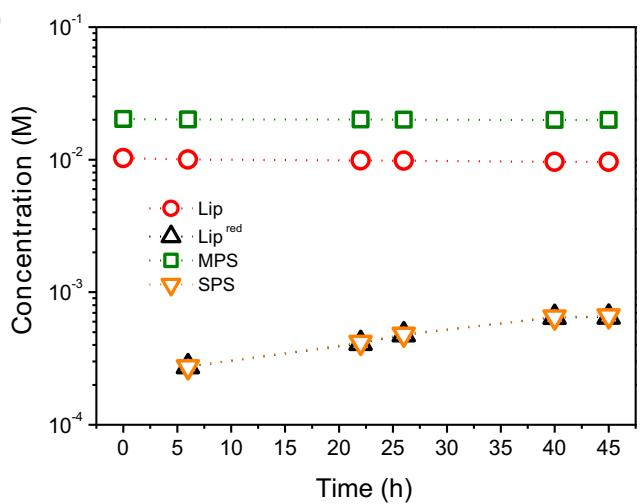

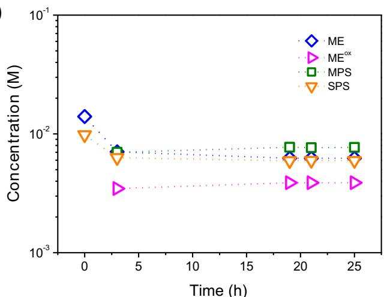  
Fig. 3. The concentration change of each species during thiol–disulfide interchange reactions, (a) MPS/Lip and (b) SPS/ME. The concentrations of SPS and $\mathrm { L i p } ^ { \mathrm { r e d } }$ in (a) and the concentration of MPS and MEox in (b) were zero at the initial stage.

The characteristic peaks of each compound, which does not overlap with another, were chosen for the accurate calculation of steady-state concentration as mentioned in the experimental section. The concentration of each species was determined by considering the initial concentrations of reactants and relative proton percentage measured by peak integration. In the measurement, it was not able to measure the concentration of 1,3‑disulfonic acid (PDS), the decomposition product of SPS, because the characteristic peaks of PDS overlap with those of SPS (2.15 ppm and 3.03 ppm). However, it is supposed that the formation of PDS rarely took place during the measurement in the absence of Cu and dissolved oxygen. It has been reported that the decomposition of SPS is catalyzed by metallic Cu [25].

In order to determine the reaction times needed for establishing the steady states of Eqs. (5) and (6), the concentration change of each species was monitored. Fig. 3(a) and (b) shows changes in the concentration of each species according to the reaction times of Eqs. (5) and $^ { ( 6 ) , }$ respectively. The concentration change became negligible after 40 h for Eq. (5) and 20 h for Eq. (6), indicating that the reactions almost reached the steady state. Therefore, at this status, the equilibrium constants were calculated via Eqs. (7) and (8) after the concentration of each species was measured. To minimize the errors originating from uncertainties in weighing materials, air oxidation, and other experimental errors, the measurement was repeated 5 times to obtain average equilibrium constants listed in Table 1. The average $\mathrm { K } _ { \mathrm { e q 5 } }$ and $\mathrm { K _ { e q 6 } }$ values were $0 . 1 1 4 \mathbf { M } ^ { - 1 } \left( \mathbf { \Sigma } \pm 0 . 0 2 \right)$ and $0 . 9 9 0 \ ( \ \pm \ 0 . 0 1 ) _ { \mathrm { { i } } }$ , respectively. By substituting the equilibrium constants associated with MPS-Lip and ME SPS pairs to $\operatorname { E q . } \left( 9 \right)$ and introducing the known values of $\mathrm { E _ { L i p } }$ and $\mathrm { E } _ { \mathrm { M E } }$ to Eq. (10), the formal reduction potential of SPS was calculated as 0.153 V (vs. SHE) in both the cases (Eqs. (5) and (6)).

Equilibrium constants and formal reduction potential of SPS calculated by the thiol–disulfide interchange reactions (Eqs. (5) and (6)).

<table><tr><td rowspan="2"></td><td colspan="2">Species</td><td rowspan="2"> $K_{eq}$ </td><td rowspan="2"> $E_{cell}^{o} (V)$ </td><td rowspan="2"> $E_{SPS} (V vs. SHE)$ </td></tr><tr><td>Measured substance</td><td>Reference substance</td></tr><tr><td>Eq. (5)</td><td>MPS</td><td>Lip</td><td>0.114  $M^{-1}$ </td><td>-0.028</td><td>0.153 ( $\pm$  0.001)</td></tr><tr><td>Eq. (6)</td><td>SPS</td><td>ME</td><td>0.990</td><td>0</td><td>0.153 ( $\pm$  0.001)</td></tr></table>

## 3.3. Cell potential of Cu(I)(thiolate) formation reaction

Cu(I)(thiolate) is formed by the reaction between $\mathrm { { C u } ^ { + } }$ and SPS or $\mathrm { C u } ^ { 2 + }$ and MPS during Cu electrodeposition (Eqs. (1) and (2)) as proved by many studies based on the electrochemical analysis [14,18]. We verified the formation pathway in thermodynamic aspect by spectroscopic analysis.

(a)  
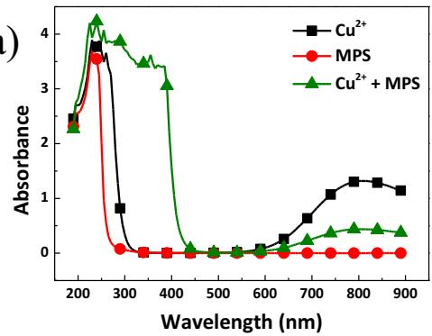

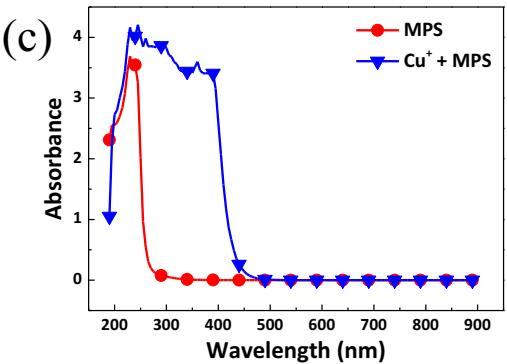

(e)  
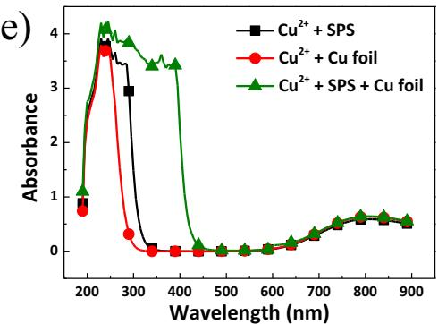

Fig. 4(a) shows the absorption spectra of a mixture of MPS and $\mathrm { C u } ^ { 2 + }$ ions. The typical absorption band of $\mathrm { C u } ^ { 2 + }$ ions is located between 700 nm and 900 nm, whereas MPS alone shows negligible absorption. A strong absorption peak in the range 300–450 nm was observed in the presence of both MPS and $\mathrm { C u ^ { 2 + } }$ ions with a significant decrease in the absorption by $\mathrm { C u } ^ { 2 + }$ ions (700–900 nm). This peak is related to Cu(I) (thiolate) formed by the reaction between $\mathrm { C u ^ { 2 + } }$ and MPS via Eq. (1). In this reaction, the oxidative dimerization of MPS to SPS in the presence of $\mathsf { C u } ^ { 2 + }$ leads to the formation of Cu(I)(thiolate) complex. It has been reported that the oxidative dimerization of MPS reduces $\mathrm { C u } ^ { 2 + }$ to $\mathrm { { C u } ^ { + } }$ simultaneously and the reduction product $\left( \mathsf { C u } ^ { + } \right)$ form Cu(I)(thiolate) complex with either MPS or SPS $[ 1 0 , 2 6 ]$ . In contrast, SPS rarely forms Cu(I)(thiolate) complex with $\mathrm { C u } ^ { 2 + }$ ; the UV–vis spectrum of a mixture of $\mathrm { C u } ^ { 2 + }$ and SPS is just a simple sum of each spectrum of $\mathrm { C u } ^ { 2 + }$ and SPS (Fig. 4(b)). This result corresponds well with the observation by ${ \bf G } .$ Cardona et al. [18]. SPS forms Cu(I)(thiolate) complex with $\mathrm { { C u } ^ { + } }$ instead. CuCl itself hardly dissolves in water owing to its low solubility $( 4 . 7 \times 1 0 ^ { - 4 } \mathrm { M }$ at 20 °C) [27]. However, as shown in Fig. 4(c) and (d),

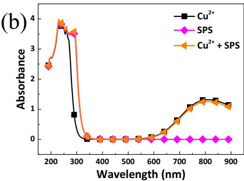

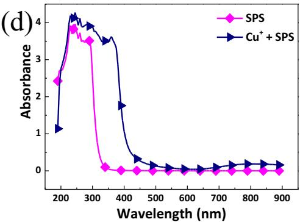  
Fig. 4. UV–visible spectra of solutions of (a) CuSO (0.1 M) and MPS (0.1 M), (b) CuSO (0.1 M) and SPS (0.05 M), (c) MPS (0.1 M) and CuCl (0.05 M), (d) SPS (0.05 M) and CuCl (0.05 M), and (e) CuSO (0.05 M) and SPS (0.05 M) with Cu foil. All components were dissolved in 0.25 M $\mathrm { H } _ { 2 } S 0 _ { 4 }$

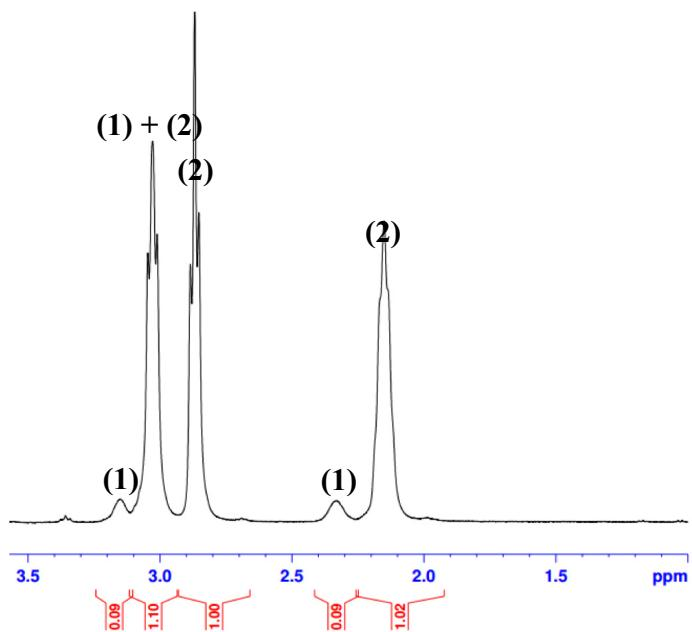  
Fig. 5. 1H NMR spectra of the solution comprising 0.05 M SPS and 0.05 M CuCl after formation of Cu(I)(thiolate) complex, (1) Cu(I)(thiolate) and (2) SPS. SPS and CuCl were dissolved with 0.25 M $\mathrm { D } _ { 2 } \mathrm { S O } _ { 4 }$ in deuterated phosphate bufer.

Table 2  
Electrochemical half-cell reactions in Cu electrodeposition with either SPS or MPS.

<table><tr><td>Half-cell reactions</td><td>Reduction potential (V vs. SHE)</td></tr><tr><td> $Cu^{2+} + e^{-} \leftrightarrow Cu^{+}$ </td><td>0.159 (Ref. [15])</td></tr><tr><td> $Cu^{+} + e^{-} \leftrightarrow Cu$ </td><td>0.521 (Ref. [15])</td></tr><tr><td> $Cu^{2+} + 2e^{-} \leftrightarrow Cu$ </td><td>0.340 (Ref. [15])</td></tr><tr><td> $Cu^{2+} + MPS + e^{-} \leftrightarrow Cu(I)(thiolate) + H^{+}$ </td><td>0.367</td></tr><tr><td> $2Cu^{+} + SPS + 2e^{-} \leftrightarrow 2Cu(I)(thiolate)$ </td><td>0.361</td></tr><tr><td> $Cu(I)(thiolate) + H^{+} + e^{-} \leftrightarrow Cu + MPS$ </td><td>0.313</td></tr><tr><td> $SPS + 2H^{+} + 2e^{-} \leftrightarrow 2MPS$ </td><td>0.153</td></tr></table>

the dissolution of a considerable amount of CuCl was observed in the presence of either MPS or SPS, because of the formation of Cu(I) (thiolate) complexes. These results support that MPS is able to form Cu (I)(thiolate) complex with both $\mathsf { C u } ^ { 2 + }$ and $\mathrm { { C u } ^ { + } }$ , whereas SPS forms the complex with only $\mathrm { { C u } ^ { + } }$

In the conventional CuSO –based Cu electrodeposition solution, major Cu species in the electrolyte is $\mathsf { C u } ^ { 2 + }$ , not $\mathrm { { C u } ^ { + } }$ . At this situation, there are two possible mechanisms for the formation of Cu(I)(thiolate) in the presence of SPS. One is that SPS is reduced to MPS and then reacts with $\mathrm { C u } ^ { 2 + }$ +. The other mechanism proposes that SPS forms Cu(I) (thiolate) complex with $\mathrm { { C u } ^ { + } }$ formed via Eq. (4). However, many studies have shown that Cu(I)(thiolate) complex is formed via the latter mechanism, rather than the former [8,14]. Our UV–vis spectroscopy study also showed the same result (Fig. 4(e)). When $\mathrm { C u S O _ { 4 } }$ solution was mixed with the equivalent concentration of SPS in the presence of Cu foil fragment (2 mm × 2 mm), a strong absorption was observed in the range between 300 nm and 450 nm, related to Cu(I)(thiolate). In contrast, the solution containing SPS and $\mathrm { C u } ^ { 2 + }$ without Cu foil did not show the complex formation, supporting that Cu(I)(thiolate) is dominantly formed via Eq. (2).

The cell potentials of the two pathways for the formation of Cu(I) (thiolate) were then obtained. As Eq. (1) is expressed by combining Eqs. (2) and $^ { ( 3 ) , }$ and the reduction of ${ \mathsf { C u } } ^ { 2 + } { \mathsf { t o } } { \mathsf { C u } } ^ { + }$ , the cell potential of Eq. (1) can be calculated if the cell potential of Eq. (2) is known. Therefore, the cell potential of Eq. (2) was obtained first. 1H NMR and UV–vis spectroscopies were used to measure the steady-state concentrations of the reactants and products in $\operatorname { E q . }$ (2). 1H NMR spectrum of the reaction mixture at the steady state is shown in Fig. 5; peaks (1) and (2) represent the characteristic peaks of Cu(I)(thiolate) and SPS, respectively. The steady-state concentrations of SPS and Cu(I)(thiolate) were measured as 45.5 mM and 9.1 mM, respectively. Since 1H NMR spectroscopy cannot detect either ${ \mathrm { C u } } ^ { 2 + }$ or Cu+, UV–vis spectroscopy was introduced for the measurement of $\mathrm { C u } ^ { 2 + }$ concentration. With the molar attenuation coeficient of $\mathbf { C } \mathbf { u } ^ { 2 + } \ ( 1 3 . 2 \mathbf { m o l } ^ { - 1 } { \cdot } \mathbf { c m } ^ { - 1 } )$ and the absorbance of $\mathrm { C u ^ { 2 + } }$ at 800 nm at the steady state $( \mathrm { F i g . ~ } 4 ( \mathsf { d } ) \colon \mathsf { C u } ^ { + } \mathrm { ~ + ~ } \mathsf { S P S } )$ , the steadstate concentration of $\mathrm { C u ^ { 2 + } }$ was calculated as 14 mM. The concentration may consist of ${ \mathrm { C u } } ^ { 2 + }$ originating from CuCl because CuCl is easily oxidized in the air. As the CuCl used in this study contains 0.5% of ${ \mathrm { C u } } ^ { 2 + }$ , the concentration of $\mathrm { C u } ^ { 2 + }$ originating from $\mathrm { C u C l } _ { 2 }$ was estimated as $0 . 4$ mM in our experiment. This value was relatively small compared to the measured concentration. The steady-state concentration of $\mathrm { { C u } ^ { + } }$ was considered as 0.47 mM on the assumption that CuCl dissolves up to its solubility limit $( 4 . 7 \times 1 0 ^ { - 4 } \mathrm { M }$ at 20 °C) because the direct measurement of free $\mathrm { { C u } ^ { + } }$ concentration was not possible. The major concern of this assumption is the existence of $\mathrm { C l } ^ { - }$ − in the system (Eq. (2)). The introduction of $\mathtt { C l } ^ { - }$ is inevitable and may cause some errors in the calculation if Eq. (2) were strongly afected by Cl−.

The $\mathrm { K } _ { \mathrm { e q } 2 }$ was then calculated as $7 . 0 1 \times 1 0 ^ { 6 } \mathrm { M } ^ { - 1 }$ , corresponding to 0.202 V of the cell potential. Combining it with the measured formal potential of SPS and the standard reduction potential of $\mathrm { C u } ^ { 2 + }$ to $\mathrm { { C u } ^ { + } }$ the cell potential of Eq. (1) was 0.214 V. Inversely, using the Nernst equation (Eq. (9)) with the potential value, the $\mathrm { K _ { e q 1 } }$ is 5 × 103 M, which corresponds well with the previously reported value $( 1 0 ^ { 3 . 3 } \mathbf { M } )$ [13,18]. This indicates indirectly that the assumption used in the estimation of free $\mathrm { { C u } ^ { + } }$ concentration is acceptable. The positive cell potentials of Eqs. (1) and (2) indicate that they are thermodynamically favorable. This supports the spontaneous formation of Cu(I)(thiolate) complex and its catalytic function in accelerating Cu deposition process [8]. G.-Cardona et al. obtained $5 . 2 \times 1 0 ^ { - 3 } \mathrm { M } ^ { - 1 }$ for $\mathrm { K } _ { \mathrm { e q } 2 }$ [18], which is diferent with our result. According to their result, the cell potential of Eq. (2) should be −0.067 V, implying that Eq. (2) is not spontaneous. This does not correspond to the generally known mechanism of Cu(I)(thiolate) formation in solution chemistry [8–11].

The thermodynamic information of half-cell reactions occurring in Cu electrodeposition electrolyte containing either SPS or MPS is listed in Table 2. We believe that the thermodynamic data obtained in this study will assist the mechanistic study of Cu electrodeposition.

## 4. Conclusions

The formal reduction potential of SPS was first determined by using thiol–disulfide interchange reaction with ME and Lip. The calculated formal reduction potential of SPS under the standard condition was 0.153 V (vs. SHE) in aqueous solution. The cell potential of the formation of Cu(I)(thiolate) complexes, which is the key reaction to explain the accelerating mechanism, was also estimated based on the formal reduction potential of SPS. The cell potential of Cu(I)(thiolate) formation between $\mathrm { { C u } ^ { + } }$ and SPS was 0.202 V, and the reaction between ${ \mathrm { C u } } ^ { 2 + }$ and MPS was 0.214 V. We believe that the thermodynamic values obtained in this study would be helpful in understanding or developing industrial Cu electrodeposition involving SPS.

## Acknowledgement

This work was supported by the Technology Innovation Program (10043789) funded by the Ministry of Knowledge Economy (MKE, Korea). This research was also supported by the Basic Science Research Program through the National Research Foundation of Korea (NRF) funded by the Ministry of Education (2014R1A1A2057136).

## References

[1] T.P. Mofat, D. Wheeler, W.H. Huber, D. Jossell, Superconformal electrodeposition of copper, Electrochem. Solid-State Lett. 4 (2001) C26–C29.

[2] D.P. Barkey, Acceleration efect, in: K. Kondo, R.N. Akolkar, D.P. Barkey, M. Yokoi (Eds.), Copper Electrodeposition for Nanofabrication of Electronics Devices, Springer, New York, 2014, pp. 45–61.

[3] M. Tan, J.N. Harb, Additive behavior during copper electrodeposition in solutions containing Cl−, PEG, and SPS, J. Electrochem. Soc. 150 (2003) C420–C425.

[4] Y. Jin, Y. Sui, L. Wen, F. Ye, M. Sun, Q. Wang, Competitive adsorption of PEG and SPS on copper surface in acidic electrolyte containing Cl−, J. Electrochem. Soc. 160 (2013) D20–D27.

[5] M.J. Willey, A.C. West, SPS adsorption and desorption during copper electrodeposition and its impact on PEG adsorption, J. Electrochem. Soc. 154 (2007) D156–D162.

[6] M.L. Walker, L.J. Richter, T.P. Mofat, Potential dependence of competitive ad sorption of PEG, Cl-, and SPS/MPS on Cu: an in situ ellipsometric study, J. Electrochem. Soc. 154 (2007) D277–D282.

[7] Y.S. Ham, S.K. Cho, J.J. Kim, Cu seed layer damage caused by insoluble anode in Cu electrodeposition, Korean J. Chem. Eng. 34 (2017) 1490–1494.

[8] S.K. Cho, H.C. Kim, M.J. Kim, J.J. Kim, Voltammetric observation of transient catalytic behavior of SPS in copper electrodeposition-its interaction with cuprous ion from comproportionation, J. Electrochem. Soc. 163 (2016) D428–D433.

[9] H.-M. Chen, S.J. Parulekar, A. Zdunek, Interactions of chloride and 3-mercapto-1- propanesulfonic acid in acidic copper sulfate electrolyte, J. Electrochem. Soc. 155 (2008) D349–D356.

[10] J.P. Healy, D. Pletcher, M. Goodenough, The chemistry of the additives in an acid copper electroplating bath: part II. The instability 4,5-dithiaoctane-1,8-disulphonic acid in the bath on open circuit, J. Electroanal. Chem. 338 (1992) 167–177.

[11] A. Frank, A.J. Bard, The decomposition of the sulfonate additive sulfopropyl sulfonate in acid copper electroplating chemistries, J. Electrochem. Soc. 150 (2003) C244-C250.

[12] J.J. Kim, S.K. Kim, Y.S. Kim, Catalytic behavior of 3-mercapto-1-propane sulfonic acid on Cu electrodeposition and its efect on Cu film properties for CMOS devic metallizationJ. Flectroanal Chem 542 (2003) 61-66

[13] P.M. Vereecken, R.A. Binstead, H. Deligianni, P.C. Andricacos, The chemistry of additives in damascene copper plating, IBM J. Res. Dev. 49 (2005) 3–18.

[14] C.C. Hung, W.H. Lee, S.C. Chang, K.W. Chen, Y.L. Wang, Suppression efect of low

concentration bis-(3-sodiumsulfopropyl disulfide) on copper electroplating, J. Electrochem. Soc. 155 (2008) D133–D136.

[15] A.J. Bard, R. Parsons, J. Jordan, Standard Potentials in Aqueous Solution, CRC Press, New York. 1985, p. 292

[16] P.K. Glasoe, F.A. Long, Use of glass electrodes to measure acidities in deuterium oxide, J. Phys. Chem. 64 (1960) 188–190.

[17] W.J. Lees, G.M. Whitesides, Equilibrium constants for thiol-disulfide interchange reactions: a coherent, corrected set, J. Org. Chem. 58 (1993) 642–647.

[18] E. G-Cardona, E.H. Wong, D.P. Barkey, NMR spectral studies of interactions between the accelerants SPS and MPS and copper chlorides, J. Electrochem. Soc. 158 (2011) D143–D148.

[19] R. Singh, G.M. Whitesides, Thiol-disulfide interchange, in: S. Patai, Z. Rappoport (Eds.), The Chemistry of Sulphur-Containing Functional Groups, Wiley, New York, 2010, pp. 633–658 (Supplement S).

[20] P.C. Jocelyn, Biochemistry of the SH Group: The Occurrence, Chemical Properties, Metabolism and Biological Function of Thiols and Disulphides, Academic Press, London. 1972

[21] H.F. Gilbert, Molecular and cellular aspects of thiol-disulfide exchange, in: A. Meister (Ed.), Advances in Enzymology and Related Areas of Molecular Biology, vol. 63, Wiley, New York, 2006, pp. 69–172.

[22] J.M. Wilson, R.J. Bayer, D.J. Hupe, Structure-reactivity correlations for the thiol disulfide interchange reaction, J. Am, Chem, Soc, 99 (1977) 7922–7926.

[23] P.C. Jocelyn, The standard redox potential of cysteine-cystine from the thiol-disulfide exchange reaction with glutathione and lipoic acid, Eur. J. Biochem. 2 (1967) 327-331.

[24] D.L. Rabenstein, K.H. Weaver, Kinetics and equilibria of the thiol/disulfide ex change reactions of somatostatin with glutathione, J. Org. Chem. 61 (1996) 7391–7399.

[25] S. Choe, M.J. Kim, H.C. Kim, S.K. Cho, S.H. Ahn, S.-K. Kim, J.J. Kim, Degradation of bis(3-sulfopropyl) disulfide and its influence on copper electrodeposition for feature filling, J. Electrochem. Soc. 160 (2013) D3179–D3185.

[26] R.G. Brennan, M.M. Phillips, L.-Y.O. Yang, T.P. Mofat, Characterization and pur ification of commercial SPS and MPS by ion chromatography and mass spectrometry, J. Electrochem. Soc. 158 (2011) D178–D186

[27] J.M. Berger, R. Winand, Solubilities, densities and electrical conductivities of aqueous copper(I) and copper(II) chlorides in solutions containing other chlorides such as iron, zinc, sodium and hydrogen chlorides, Hydrometallurgy 12 (1984) 61–81.