# The synergistic effects of additives on the micro vias copper filling

Zhihua Tao a,⇑,1, Zhiyuan Long a, Linjie Tengxu a, Guanting Liu a,2, Xuefei Tao

a School of Materials and Energy, University of Electronic Science and Technology of China, Chengdu 610054, China

b Jiangxi Vocational College of Finance and Economics, Jiujiang 332000, China

## A R T I C L E I N F O

Keywords: Leveler Copper Electroplating Microvia Cracked Plating

## A B S T R A C T

A nitrogen-containing heterocyclic compound N-(3-(5-Mercapto-1H-tetrazol-1-yl) phenyl) acetamide (named L) was investigated as a new leveler to develop the microvias Cu filling with or without cracked plating in blind via. The synergistic effects of L with other plating additives were investigated by galvanostatic measurements (GMs) and cyclic voltammetry (CV) measurements. The GMs show that the Δη values (Potential difference at different speeds of Cu rotating disk electrode) are approximately 24 mV which usually suggests better Cu filling performance for the corresponding electrolyte additives. In addition, the optical microscope (OM) measurements indicated that microvias cracked plating was more likely to occur when there is no accelerator in the copper plating solution. The results of OM experiments also show that the microvia super-filling would not appear although the copper plating rate at the bottom of the blind hole is higher than that of the outer copper layer of the blind hole if there is no air agitation in the copper plating solution. The finest copper electroplating formula made up of the virgin acid solution (VAS) only added the PEP, L, SPS, Cl− was found and applied to carry out superfilling of microvias.

## 1. Introduction

Over recent years, the nano or micro-scale blind vias copper filling by electroplating has become one of the most practical methods for the fabrication of integrated circuit packaging substrates and circuit boards (PCBs) [1–6]. To achieve high-reliability interconnection by Cu filling blind holes between layers of electronic products is a long term and formidable task with high-density interconnection (HDI) technology. The superfilling of blind holes is commonly regarded as an efficient way and high performance with no void or seam during the microvia metallization process [7–8]. The superfilling mode means the electrocrystallization rate speed of copper at the bottom of the blind via is much faster than that at the surface of the PCBs so called bottom-up deposition [9–10]. However, cracked plating that grows from the side and bottom of the blind hole penetrates the copper layer at the corners of the blind holes. It is often found as a serious fault in PCB industrial production, as shown in Fig. 1.

Cracked plating is an important reliability failure type of copper electroplating. It is manifested as copper cohesive cracks appearing at the corner locations of the microvias and will result in failures in electric and heat conductivity. The greater harm of the cracked plating phenomenon lies in its concealment. The conductivity of the copper layer for PCBs with cracked plating is usually the same as that of a normal printed circuit board at the early stages, so it is difficult to be detected in electrical testing. However, some problems such as signal interruption and the sudden crash will occur and cause huge economic losses when the electronic devices and products smooth running for a period of time. Hence, there are urgent demands for developing processing guidelines for cracked plating that will lead to stable electroplating structures.

In order to ensure product qualified reliability, many chemical additives have been applied in superfilling process, including an accelerator (bis(3-sulfopropyl) disulfide, SPS), a suppressor (polyethylene glycol, PEG or PEP(propylene oxide-ethylene oxide-propylene oxide)), and a leveler (Janus Green B, JGB) [11–15]. Among them, leveler ha important effects with regard to the asymmetric electroplating due to its capability of adsorbing at a high electric field for the cathode sur face, which increase the overpotential of copper deposition and strongly inhibits copper deposition in high current density regions [16–18]. According to the literature [19,20], commonly used levelers for copper electroplating are organic compounds and their derivatives such as quaternary ammonium surfactants, dyestuff substances, nitrogen-containing heterocyclic compounds, and many others. The widely used levelers such as JGB, tricyclazole (TCA), 2-Mercaptopyridine, and 2-amino-4-methylbenzothiazole (AMBT) play an essential role in greatly hindering the deposition of Cu ion and smooth the surface of the deposited copper film [21–28]. In consideration of electroplating additives degradation (such as macromolecular can be broken down into small molecular) in acid solution, and the distinct advantages for small molecules such as L (as shown in Fig. 2) with nitrogen-containing heterocyclic and the discovery has shown that no study has focused on this issue so far. The synergistic inhibition effect of L and other additives in plating solution were investigated by the different kinds of electrochemical methods.

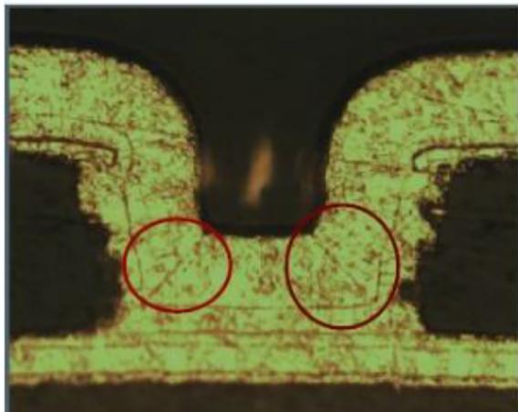

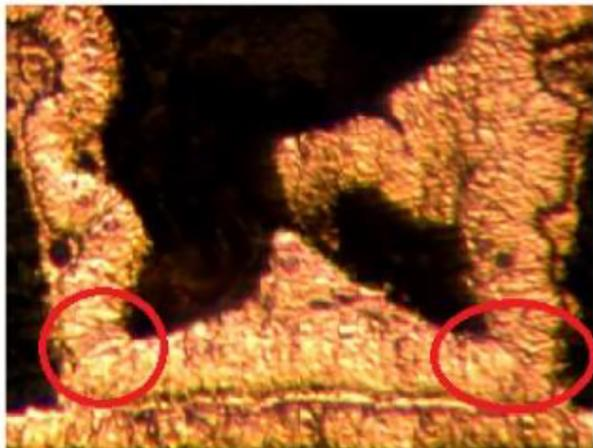  
Fig. 1. The circuit board copper interconnection engineering diagram of cracked plating.

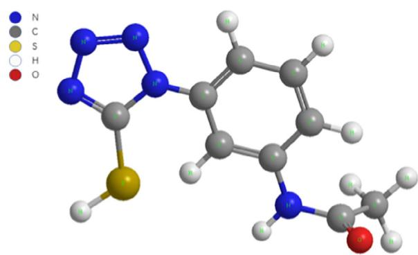  
Fig. 2. Molecular structure of N-(3-(5-Mercapto-1H-tetrazol-1-yl) phenyl) acetamide.

## 2. Results and discussion

## 2.1. The $Q / Q _ { O }$ values and Cl − concentrations dependence

A method to optimize the concentration of Cl− has been established based on cyclic voltammetry (CV) tests at a rotation speed of 1000 rpm, as shown in Fig. 3a. It is usually considered that $\mathrm { C l } ^ { - } \ \mathrm { i } s$ the depolarizer of the metal deposition process. When the increase of Cl− in VAS containing SPS, PEP and $\mathbf { L } ,$ all of these CV plots indicate a clear synergistic inhibitory effect between $\mathrm { { C l } ^ { - } }$ and other additives. The previous research revealed that the $\mathtt { C l } ^ { - }$ played a crucial role in the suppressor of PEP and its synergistic inhibitory effect on copper ion deposition. It could be seen from Fig. 3a that the anode copper dissolution peak current gradually decreases with the amount of Cl− increasing from 0 ppm to 120 ppm. The phenomenon indicated that the copper (copper ions) became more and more difficult to dissolve (deposit) due to the anchoring effect of Cl− leading to more PEP molecules adsorbing on the electrode surface [29–30]. The Q was the integral area value of Cu stripping peaks as a function of $\mathrm { { C l } ^ { - } }$ concentrations measured by CV tests as shown in Fig. 3b, where $Q _ { 0 }$ stands for the integrated area value of Cu stripping peaks without $\mathrm { { c l } ^ { - } }$ , and the smaller $\mathbf { Q } / \mathbf { Q } _ { 0 }$ value means more obvious inhibitory effect for the copper ion deposition. The $\mathbf { Q } / \mathbf { Q } _ { 0 }$ value decreases sharply with the increase of the $\mathtt { C l } ^ { - }$ first and then slowly shifts to a steady state. It is very important to evaluate the optimal $\mathrm { { C l } ^ { - } }$ concentration for the application and development of the microvias filling technology. The deposition potential of $\mathsf { C u } ^ { 2 + }$ negatively shifts with adding $\mathrm { { C l } \mathrm { { \Omega } - } }$ in the electroplating solution, as shown in Fig. 4. The results of Galvanostatic analyses of ${ \bf C l } ^ { - }$ and CV analyses are consistent. Considering there is ${ \bf C l } ^ { - }$ over-saturated theory leads to multilayer adsorption of PEP and the larger $\Delta \mathfrak { n }$ means better Cu filling performance [28,29,31]. Therefore, the optimal Cl − concentration was 60 ppm and $\Delta \mathfrak { n }$ maximum size had already reached 20 mV.

## 2.2. The ${ Q } / { Q } _ { O }$ values and PEP concentrations dependence

Fig. 5a shows the CV experiment with different concentrations of PEP in the electroplating solution. The strength of suppression of PEP could be evaluated by the integrated area value Q in VAS with a constant concentration of other electroplating additives. Fig. 5b showed the piecewise linear fitting result of the integrated area value $\mathrm { Q } / \mathrm { Q } _ { 0 }$ of the anode copper dissolution peak. Generally, the smaller Q/ $Q _ { 0 }$ value means the higher suppression intensity of copper ion deposition. Fig. 5b shows that the ${ \bf Q } / { \bf Q } _ { 0 }$ value decreases dramatically first and then evolves toward an approximate steady-going value with the PEP increased. Thus, the change rate of ${ \bf Q } / { \bf Q } _ { 0 }$ is divided into two areas, including the linear increase area (PEP concentration less than 10 ppm) and the stable area (PEP concentration greater than 20 ppm). In fact, a critical transition point of Cu stripping peaks occurred when the suppressor concentration was 9.61 ppm, as shown in Fig. 5b. In other words, the 9.61 ppm PEP were adequate to achieve the critical adsorption on the cathode when assumed PEP molecules only constitute a monolayer [32].

## 2.3. The ${ Q } / { Q } _ { O }$ values and SPS concentrations dependence

The CV measured in the electroplating solution with different concentrations of SPS is shown in Fig. 6. It is usually believed that PEP has a small diffusion coefficient in VAS, but it can quickly adsorb adsorbed on the Cu surface through the cooperation of Cl− [33]. On the contrary, SPS has a large diffusion coefficient and it is strongly adsorbed on active sites in weak convection conditions [34]. The adsorption of SPS on the electrode surface promotes the reduction of copper ions on the cathode surface and accelerates the Cu deposition rate [35]. The peak current and the $\mathbf { Q } / \mathbf { Q } _ { 0 }$ values of anode copper dissolution gradually increase with increasing SPS, as shown in Fig. 6a and b, respectively. The experimental results showed that the copper dissolution became more and more serious with the increase in SPS concen tration. Taking this $\Delta \mathfrak { n }$ value larger means a good filling performance, the GMs measured in the electroplating solution with different concentrations of SPS at two different spinning speeds are shown in Fig. 7. So, the optimal SPS was 6 ppm and Δη is equal to 24 mV when the electroplating bath system contains VAS, 200 ppm PEP, 10 ppm L.

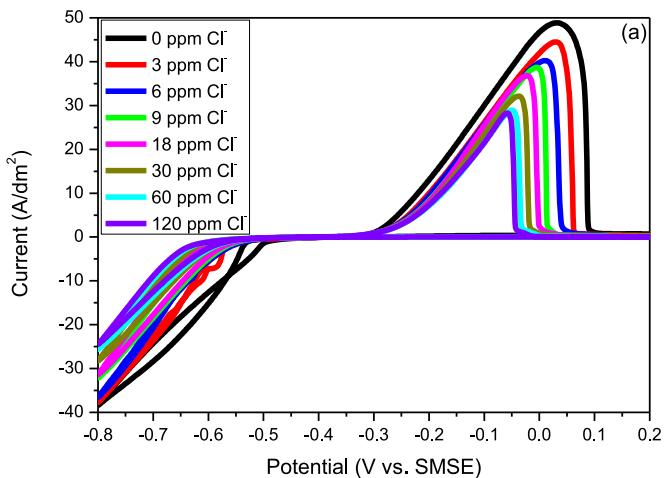

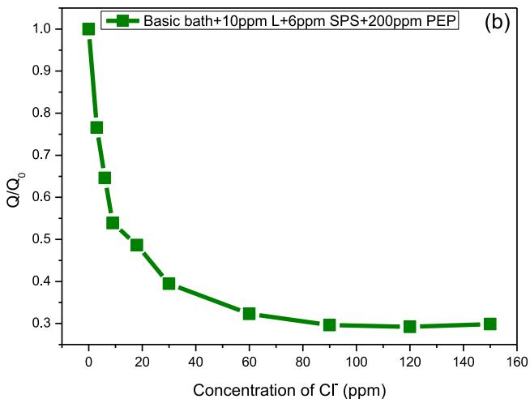  
Fig. 3. CV measured in basic electrode containing 200 ppm PEP, 6 ppm SPS, 100 ppm L, and different concentrations of $\mathrm { C l } ^ { - } \colon ( \mathsf { a } ) \ \mathrm { C V }$ plots with different concentrations of $\mathbf { C l } ^ { - } ; ( \mathbf { b } )$ The $\mathrm { Q } / \mathrm { Q } _ { \mathrm { C } }$ as a function of Cl− in 0.88 M $\mathrm { C u S O _ { 4 } }$ and 0.54 M $\mathrm { H } _ { 2 } S 0 _ { 4 }$ solution with different electroplating additives.

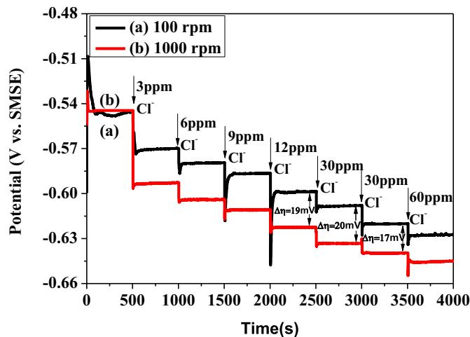  
Fig. 4. GMs measured in VAS containing 200 ppm PEP, 6 ppm SPS, 10 ppm L, and different concentrations of $\mathrm { { C l } ^ { - } }$ at different rotation speeds: 100 and 1000 rpm.

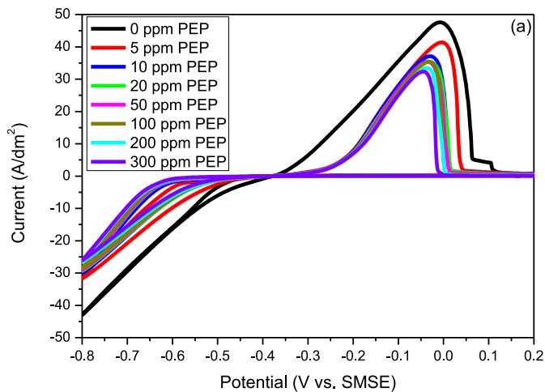

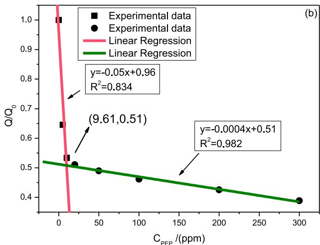  
Fig. 5. CV measured in VAS containing 60 ppm Cl−, 6 ppm SPS, 10 ppm L, and different concentrations of PEP: (a) CV plot of copper deposition and stripping with different concentrations of PEP; (b) The $\mathrm { Q } / \mathrm { Q } _ { 0 }$ values and PEP concentrations dependence.

## 2.4. Dependence of $Q / Q _ { o }$ values on L concentrations

The stripping peak potential shifted to lower values and the anodic dissolution integrated area dropped with the increase of leveler, as shown in Fig. 8. Q is the integral area value of Cu stripping peaks as a function of L concentrations measured by CV tests. $Q _ { 0 }$ stands for the integrated area value of Cu stripping peaks without the leveler.

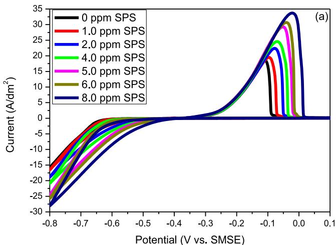

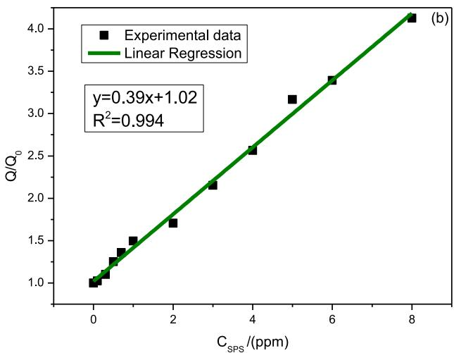  
Fig. 6. CV measured in VAS containing 60 ppm $\mathbf { C l } ^ { - }$ , 200 ppm PEP, 10 ppm $\mathbf { L } ,$ and different concentrations of SPS: (a) CV of copper deposition and stripping with different concentrations of SPS; (b) The $\mathrm { Q } / \mathrm { Q } _ { 0 }$ values and SPS concen trations dependence.

The $\mathbf { Q } / \mathbf { Q } _ { 0 }$ value decreases dramatically first and then evolves toward an approximate steady-going value with the leveler increased in Fig. 8b. In other words, the $\mathbf { Q } / \mathbf { Q } _ { 0 }$ value was not changed significantly with the leveler of L increased (more than 1 ppm), which may be attributed to the critical adsorption of the leveler on the copper surface. The $\Delta \mathfrak { n }$ obtained from GMs experiment were shown in Fig. 9. The $\Delta \mathfrak { n }$ increases first and then keep stable with the increasing L. Taking the Δη biggest one and suppression strength of L into account, the optimal L was 10 ppm and Δη was equal to 24 mV when the other additives were fixed concentration in electroplating solution. The $\Delta \mathfrak { n }$ biggest one obtained from Fig. 7 experiment and Fig. 9 experiment were in good agreement.

## 2.5. Galvanostatic analyses of L and its interactions with other additives

Fig. 10 shows the potential-time curves of GMs in basic solution (the virgin acid solution (VAS) included 0.88 M $\mathrm { C u S O _ { 4 } }$ and 0.54 M $\mathrm { H } _ { 2 } S 0 _ { 4 } )$ with the addition of different additives on a copper working electrode at two different rotation speeds. As shown in Fig. 10, $\Delta \mathfrak { n } ,$ defined by $\Delta \mathfrak { \eta } = \mathfrak { \eta } 1 _ { \mathtt { ( 1 0 0 ~ r p m ) } } - \mathfrak { \eta } 2 _ { \mathtt { ( 1 0 0 0 ~ r p m ) } }$ can be used to estimate Cu filling performance for the corresponding electrolyte additives on the basis of convection-dependent adsorption (CDA) theory [2]. It can be seen from Fig. 10a and b that when adding 200 ppm PEP and 60 ppm $\mathtt { C l } ^ { - }$ to the VAS solution, the electrode potential rapidly shifts to more negative values whether the working electrode speed is

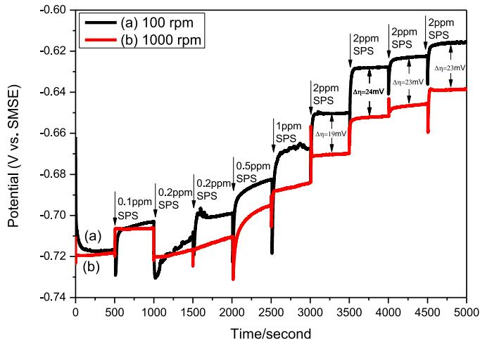  
Fig. 7. GMs measured in VAS containing 60 ppm $\mathbf { C l } ^ { - }$ , 200 ppm PEP, 10 ppm $\mathbf { L } ,$ and different concentrations of SPS at different rotation speeds: 100 and 1000 rpm.

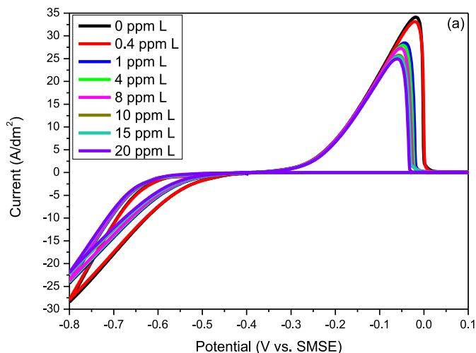

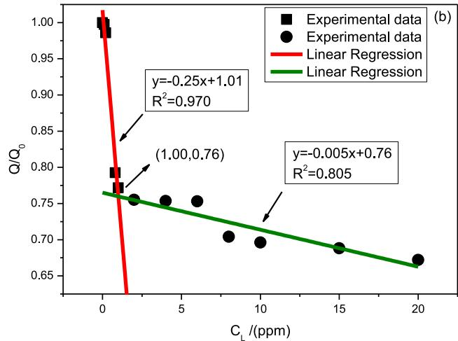  
Fig. 8. CV measured in VAS containing 60 ppm $\mathbf { C l } ^ { - }$ , 6 ppm SPS, 200 ppm PEP, and different concentrations of L: (a) CV of copper deposition and stripping with different concentrations of L; (b)Q Dependence of $\mathrm { Q } / \mathrm { Q } _ { 0 }$ values on L concentrations.

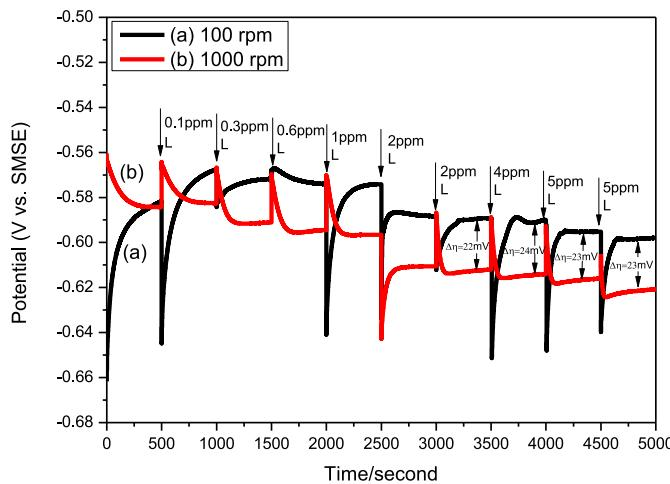  
Fig. 9. GMs measured in VAS containing 60 ppm Cl−, 200 ppm PEP, 6 ppm SPS, and different concentrations of L at different rotation speeds: 100 and 1000 rpm.

100 rpm or 1000 rpm. This result shows that suppressor and chloride ion have an inhibitory effect on copper ion deposition and so it is consistent with those reported [36]. The $\Delta \mathfrak { n }$ of the plating solution containing Cl−, PEP and SPS remains zero indicating that the microvia filling plating processes regardless of the solution flow rate. It can be seen from Fig. 10a that when 10 ppm L was added to the plating solu tion, the corresponding electrode potential changed and the Δη value was 24 mV. This $\Delta \mathfrak { n }$ value was larger, meaning a good filling performance [37]. After the injection of L into the test bath, the electrode potential of $\boldsymbol { \eta } \mathbf { 1 } _ { ( 1 0 0 \mathrm { r p m } ) }$ negatively shifts first and then slowly positively shifts again, the corresponding electrode potential of $\boldsymbol { \eta } 2 _ { ( 1 0 0 0 \mathrm { ~ r p m } ) }$ will negatively move at a faster rate, and the final stable electrode potential is more negative. The experimental phenomena show that L has hardly any inhibited the deposition of copper ions when the convection intensity in the electrolyte is weak. However, further studies have indicated that the corresponding electrode potential slightly positively shifts when the L was added to the VAS solution. It can be seen from Fig. 10e that the L as depolarizing agents was very obvious no matter whether forced convection was weak or strong. It is usually believed that the depolarizing effect for SPS and MPS refers to the sulfonate group that is able to transfer $\mathrm { C u } ^ { 2 + }$ ions to the copper surface. 39Considering the molecular structure characteristics of leveler L, the depolar izing effect of L may be attributed to its nitrogen groups in the heterocyclic ring in copper plating. After injection of 60 ppm chloride ion, the cathodic potential negatively shifted and the $\Delta \mathfrak { n }$ of the electrolyte changed from a negative value $( \Delta \mathfrak { n } = - 5 \mathrm { m V } )$ to a positive value $( \Delta \eta = 2 3 \ : \mathrm { m V } )$ , as shown in Fig. 10e. Namely, the added chloride ion prompted the additive concentration gradient distribution and maintained the current density gradient along the via [38,39]. Considering the flow rate of plating solution at the bottom of the blind hole was lower than the outlet orifice of the blind hole. Thus, the synergistic effect of $\mathrm { C l - , ~ } \mathrm { P E P , ~ } \mathrm { S P S , ~ } \mathrm { L } ,$ and the convective process led to signifi- cantly reduced Cu deposit speed at strong convection, as shown in Fig. 10a. In other words, the significant reduction of Cu deposit speed around the outlet orifice of the blind hole will realize overall manufacturing easily.

On the contrary, as shown in Fig. 10b, cathode potential slightly negatively shifted after L was injected into the acid solution including VAS, Cl − and PEP. In other words, slight inhibitory effect on copper deposition in the presence of L when the acid solution included VAS, Cl − and PEP, the results indicating that L can increase the inhibitory effect of $\mathrm { P E P \mathrm { - } C l ^ { - } }$ to a greater degree. The L has hardly any inhibition effect on the deposition of copper ions when the convection intensity in the electrolyte is weak, as shown in Fig. 10a, in part probably due to the L playing the balancing role between the depolarization with weak convection and inhibitory effect with $\mathrm { P E P \mathrm { - } \thinspace C l ^ { - } }$

In addition, as shown in Fig. 10b, the cathode potential positively shifted and the $\Delta \mathfrak { n }$ increased to positive values as expected after SPS was added into the electroplating solution, indicating that the SPS can accelerate the nucleation when the convection is weaker and the electroplating formula is capable of achieving a bottom-up filling for microvias [39].

The electrode potential became more negative after PEP was added into the bath, as shown in Fig. 10c. Moreover, the $\Delta \mathfrak { n }$ value and the

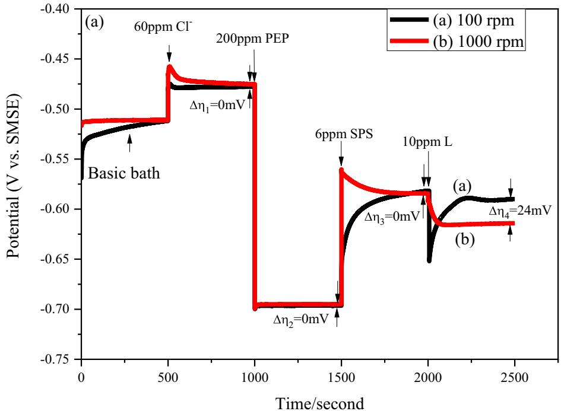  
Fig. 10. The cathodic potentials and potential differences of the electrolyte with the different injection orders of additives.

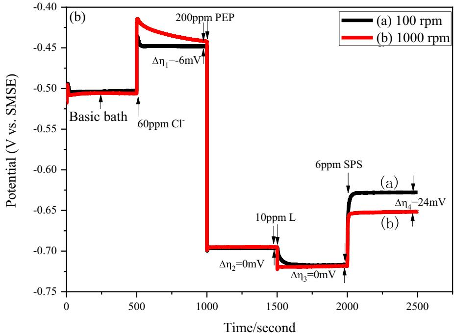

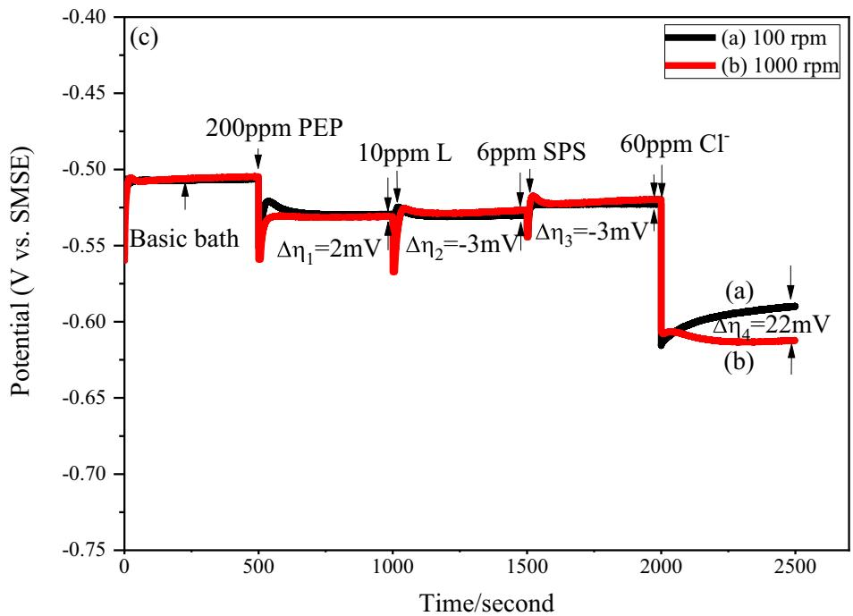  
Fig. 10 (continued)  
indicating that there is no significant convection dependent adsorption effect between SPS and L. However, the cathodic potential intensely negatively shifted after added PEP and the $\Delta \mathfrak { n }$ increased to a positive 20 mV. The obtain results similar to the previous ones [40,41]. Com pared with the widely used leveler of JGB, the L has typically small molecular weight and it has a depolarizing function in VAS, as shown in Fig. 10e. In addition, the cathodic potential of 1000 rpm negatively shifted from −0.497 V to −0.521 V after the PEP was injected into the VMS containing L in Fig. 10e. The cathodic potential of 1000 rpm shifted from −0.505 V to −0.531 V after PEP was injected into the VMS without L, as shown in Fig. 10c. It is indicated that there is no significant synergic inhibition effect between L and PEP. The Δη value reached 23 mV after L, PEP, and SPS and Cl-were subsequently added

cathodic potential were almost unchanged when L and SPS were sub sequently injected into the plating solution. The phenomenon indicates that only the L and SPS cannot obviously affect the inhibitory function of PEP. In other words, only the Cl − and PEP have an obvious synergic inhibition effect for the Cu electroplating process in VAS. It can be found that the Cu-RDE potential negatively shifted and the Δη increased to positive values (22 mV) after 60 ppm Cl − was added into the solution, indicating that the convection-dependent adsorption (CDA) behavior occurred and the composition of the plating bath is capable of achieving a bottom-up filling for microvias.

The working electrode potential has a slow depolarization by add ing chloride ionic, as shown in Fig. 10d, and the Δη value had no obvi ous change after L and SPS were subsequently added into the bath, into VAS with the current density of 2 ASD, indicating that the com bined additives formula is capable of achieving a microvias bottom up filling.

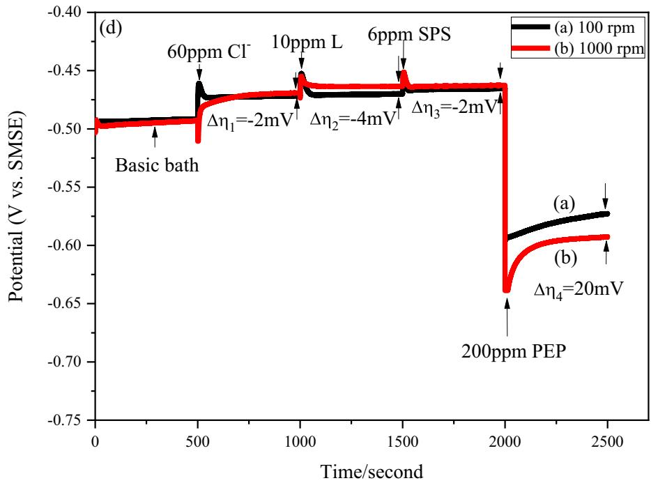

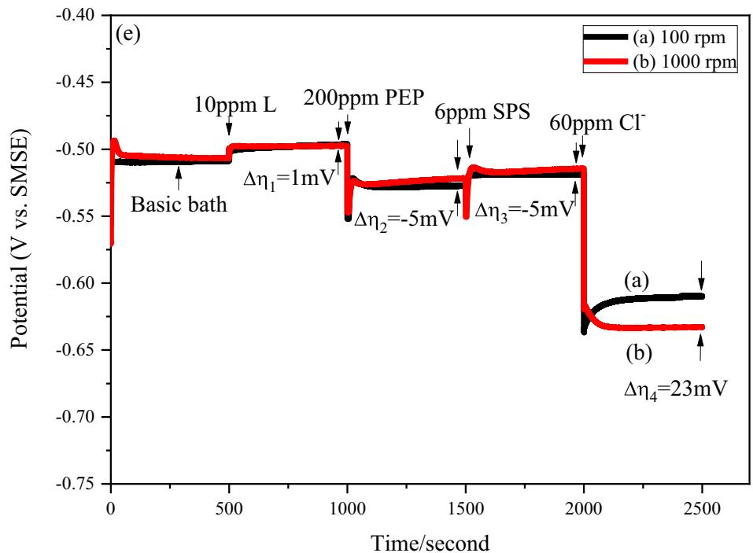  
Fig. 10 (continued)

## 2.6. Adsorption behavior of L and nucleation mechanisms of copper

In order to understand the adsorption behavior of L in the electrolytes, CV tests data with different concentrations of L were used to calculate the $\mathrm { Q } / \mathrm { Q } _ { 0 }$ values. In other words, the surface coverage(θ) values have been evaluated from the integral area values of Cu stripping peaks as a function of L concentrations based on the CV tests, as shown in Fig. 8. The adsorption of the leveler for Cu-RDE can affect the deposition and stripping rate of copper because of the physisorption or chemisorption process. The Langmuir adsorption equation of L on the Cu surface is given as Equation (1).

$$
\frac {Q}{Q _ {s}} = \theta = \frac {\mathrm{KC} _ {\mathrm{L}} ^ {n}}{1 + \mathrm{KC} _ {\mathrm{L}} ^ {n}}\tag{1}
$$

where $Q _ { s }$ represent the saturated Q value, θ represent surface coverage were determined as a function ofQ, K stand for adsorption equilibrium constant of $\mathrm { L } , \mathrm { C _ { L } }$ represent L concentration, and n stand for the kinetic order of L adsorption. Equation (1) can be converted into Equation (2) as follows:

$$
\frac {1}{Q} = \frac {1}{Q _ {s} K} \frac {1}{C _ {L} ^ {n}} + \frac {1}{Q _ {s}}\tag{2}
$$

The correlation coefficient $( R ^ { 2 } )$ is one of the important parameters to the comprehensive evaluation of the optimal n value for Equation (2). The curve fitting equation with different leveler concentrations is shown in Fig. 11a, n approximately equal to 0.19. Equation (2) can be converted into Equation (3) as follows:

$$
Q = \frac {Q _ {s} K C _ {\mathrm{L}} ^ {0 . 1 9}}{1 + K C _ {\mathrm{L}} ^ {0 . 1 9}}\tag{3}
$$

The value of K and $Q _ { s }$ to comprehensive evaluation by the gradient $\scriptstyle ( { \frac { 1 } { Q _ { s } \mathrm { K } } } )$ and intercept $( \textstyle { \frac { 1 } { Q _ { s } } }$ )of Langmuir equation fitted data as Equation (2), the Langmuir linear equation of L concentrations in VAS containing 200 ppm PEP, 60 ppm $\mathbf { C l } ^ { - }$ and 6 ppm SPS as presented in Fig. 11b. Through linear fitting and calculation, get the results that theQ was 0.535C and K was approximately equal $\mathrm { ~ t o ~ } - 1 ~ \mathrm { p p m } ^ { - 1 }$ . Therefore, Equation (2) could be expressed as:

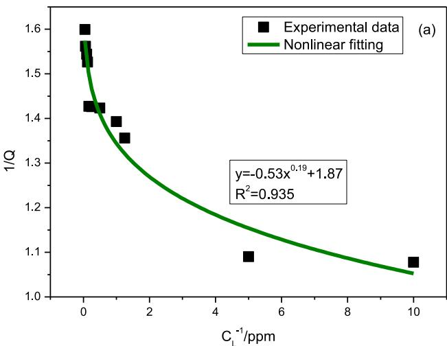

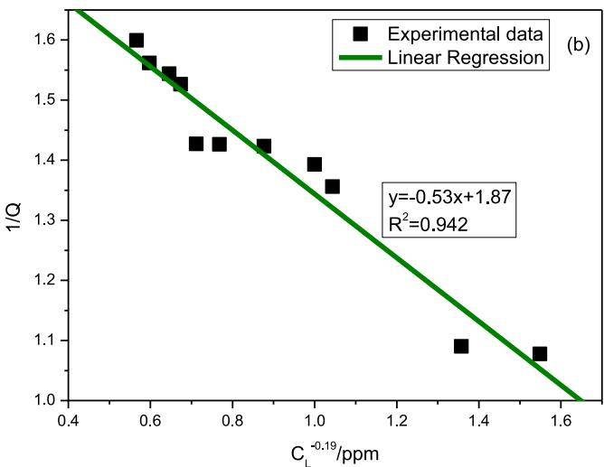  
Fig. 11. Simulation of the Langmuir model for fitting of the kinetic order according to the anodic-peak in CV with different L concentration: (a) Non Linear Curve Fitting; (b) Linear fitting curve.

$$
\frac {1}{Q} = - 0. 5 3 \frac {1}{C _ {\mathrm{L}} ^ {0 . 1 9}} + 1. 8 7\tag{4}
$$

The K value showed a negative number representing that a rise in L concentration will result in a decline in electrochemical deposition rate.

The standard free energy of adsorption $( \Delta G _ { \mathrm { a d s } } ^ { 0 } )$ could be obtained from the following formula:

$$
K = \frac {1}{5 5 . 5} \exp (- \Delta G _ {\mathrm{ads}} ^ {0} / R T)\tag{5}
$$

In which T and R stand for the experiment temperature and universal gas constant, respectively. TheΔ $G _ { \mathrm { a d s } } ^ { 0 } ~ \leq ~ - ~ 4 0$ kJ $\mathrm { m o l } ^ { - 1 }$ usually involves the process of chemisorption. The $\Delta G _ { \mathrm { a d s } } ^ { 0 }$ approximately equal 40.6 kJ mol−1 were related to mainly chemical adsorption processes [42].

Generally, the chronoamperometry experiment can provide nucleation and growth information for a new phase's formation and the kinetics of the Cu deposition process. The progressive and/or instantaneous nucleus growth mechanisms were reported according to Scharifker–Hills model (SH) [43,44]. The three-dimensions (3D) growth theoretical current transients of the instantaneous and the progressive nucleus, it could be described as follows:

Instantaneous nucleation:

$$
\left(I / I _ {m}\right) ^ {2} = \frac {1 . 9 5 4 2}{t / t _ {m}} \{1 - \exp [ 1. 2 5 6 4 (t / t _ {m}) ] \} ^ {2}\tag{6}
$$

Progressive nucleation:

$$
\left(I / I _ {m}\right) ^ {2} = \frac {1 . 2 2 5 4}{t / t _ {m}} \left\{1 - \exp \left[ 2. 3 3 6 7 (t / t _ {m}) ^ {2} \right] \right\} ^ {2}\tag{7}
$$

where I stand for the current density and t is time, $I _ { \mathrm { m } }$ stand for the maximum current transients density and $t _ { \mathrm { m } }$ is the corresponding time.

The active sites are activated simultaneously on the limited active electrodeposition surface for instantaneous nucleation, and nuclei rapidly form and slowly grow. In comparison, the number of formed nuclei increases rapidly during the deposition time for progressive nucleation. Therefore, the electrocrystallization surface can achieve a more uniform size through instantaneous nucleation. Chronoamperometry was performed to study the nucleation mechanism of Cu deposited, as shown in $\mathrm { F i g . }$ 12a. The theory of the progressive and instantaneous nucleation model proposed by Scharifker-Hills is presented in Fig. 12b. It can be seen from Fig. 12b that the experimental data of current were higher than the theoretical instantaneous current value. When $\mathrm { ~ t ~ } > \mathrm { ~ t _ { m } , ~ }$ the non-dimensional plots of Fig. 12b deviate from the theoretical instantaneous curve because of the reduction of protons during electrocrystallization, which may take place with the electrodeposition of metal ions in aqueous solutions [45,46]. The Cu electrodeposition nucleation could be considered as a three-dimensional instantaneous nucleation mechanism during the Cu deposition process for the initial few seconds due to the non-dimensional plots were close to the instantaneous curves [46].

## 2.7. Copper cracked plating and microvias filling in HDI board

Fig. 13 shows the schematic diagram and typical cross-section images of the microvia filling after copper electroplating using differ ent plating solutions. The diagrams of the characteristic change of the electroplating system and additive distribution based on microvias filling were also presented in Fig. 13a, c, and e. It is usually considered that the fluid flow velocity can be used to estimate Cu filling performance base on the CDA theory. Fig. 13b shows that the microvia of HDI can be fully filled with plating solution containing 60 ppm $\mathrm { { c l } ^ { - } }$ , 200 ppm PEP, 6 ppm SPS and 10 ppm L under strong convection intensity. The filling rate of micro via is closer to 98 % with the 0.13 mm diameter and 0.11 mm depth. The Cu surface roughness was obtained

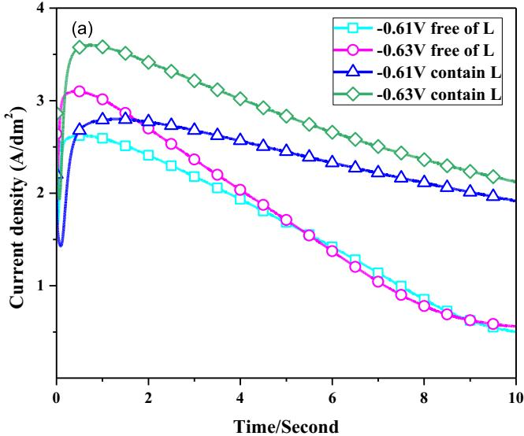

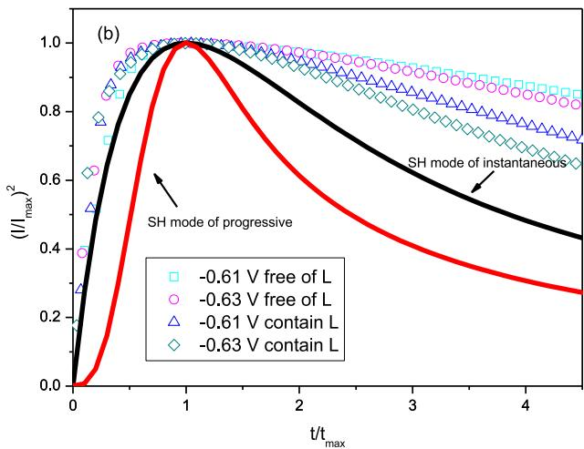  
Fig. 12. The current transients curves at different potentials for Cu deposition (a) and the non-dimensional plots for Cu electrodeposition in the L-free and L containing (b): The analysis electrolyte is composed of VAS. Cl –. SPS and PEP.

by the probe moving accordingly to the profile on the surface. These movements are converted into electric signals, refined in the main processor as Ra and Rz values and displayed by the surface roughness tester. The roughness of metal surfaces at the outside of the microvia was detected as shown in Fig. 14. Before electroplating, the surface roughness Ra and Rz were about 0.35um and 2.43um respectively. After the filling experiment, the electrodeposited Cu surface morphology had lower average surface roughness(Ra and Rz were around 0.16um and 0.93um respectively) at the outside of the microvia, as mentioned above, the Cu electrodeposition nucleation surface can achieve a more uniform size through instantaneous nucleation as shown in Fig. 13h by SEM. The copper ion reduction was inhibited by Cl− and PEP, as shown in Fig. 10a. When SPS and L were injected into the solution containing Cl− and PEP, the Δη up to 24 mV with different stirring rates, indicating that the forced convection on the Cu-RDE surface is able to improve the inhibition of copper deposition by L with fixed other additives. Fig. 13a illustrates the schematic diagram of the electroplating process under strong convection intensity. Another interesting note in Fig. 13d was that the thickness of deposited copper for the bottom of the microvia was larger than the outside of the orifice deposited copper after 45 min electroplating without stirring. However, the microvia was not fully filled and almost no cracked plating effect. Considering the bottom-up filling for microvias base on the convectiondependent adsorption (CDA) theory, it is incapable of filling microvia completely under the uniform distribution of electroplating additive and the schematic diagram is illustrated in Fig. 13c. In fact, SPS can accelerate the Cu plating rate when the convection is weaker in an electrolyte containing VAS, Cl−, PEP, L, and the electroplating formula is capable of achieving a bottom-up filling for microvias [47]. However, the microvia was not filled fully in Fig. 13d. So, SPS has no obvious bottom-up accelerated effect of deposited copper when the homogeneous concentration distribution of additive on the outside and the bottom of the microvia is caused without stirring. Considering the curvature-enhanced accelerator coverage (CEAC) principle [48], the accelerator concentration increased and the blind hole volume reduced with the increasing reaction time of deposited copper. Thus, the SPS has an accelerated effect of deposited copper on the bottom of the microvia due to the concentration gradient distribution on the bottom of the microvia. However, PEP was consumed regardless of at the outside or the bottom of the microvia. Considering the distance was larger from bulk solution to the bottom of the hole, and PEP had a large molecular weight led to the relatively difficult diffusion. Accumulations of suppressor molecule on the outside of the blind hole lead to further enhancement of the inhibitory effect of deposited copper. Thus, the thickness of deposited copper for the bottom of the microvia was larger than the outside, as shown in Fig. 13d.

The cracked plating of microvia is the main reason for PCBs inter connect faults. This paper further investigates the effect of additives on the cracked plating process based on VAS containing 200 ppm PEP, 60 ppm $\mathbf { C l } ^ { - }$ and 10 ppm L under strong convection intensity. It can be seen from Fig. 13f that the microvia was not fully filled and the electroplated coating appeared cracked phenomenon. The results of copper electroplating showed a good agreement compared with the electrochemical experiments (see Fig. 10b). It is usually believed that the accelerator is to increase the cathode current density, control the rate of crystal nucleation and improve the filling ability of the microvias [49,50]. From Fig. 13f, we can see fractures and microcracks at the corners of the blind holes. The microcracks or fractures can be caused by the neighboring stress field due to the lack of SPS. So, the severe plastic deformation occurred on the copper plating surface [51]. The cracked plating also revealed that a diagonal line across the bottom of microvia at the corners of the blind holes, as shown in Fig. 13g. Fig. 13e showed the schematic diagram for the cracked plating without SPS in forced convection. The cracked plating appeared diagonal lines could be attributed to the mechanism: 1)PEP had a large molecular weight led to the relatively difficult diffusion from the bulk solution to the bottom of the hole; 2) The copper ion deposition rate also significantly retarded and the residual stress increased in electrodeposition process without SPS; 3) The additives concentration distribution on the sides and bottom of the microvia is not uniform. The synergistic effect of the gradient distribution of concentration results in the increased residual stress for the deposited copper film and eventually forms a crack at the junction of the electroplated interfaces.

## 3. Conclusions

A new nitrogen-containing heterocyclic compound N-(3-(5-Mercapto-1H-tetrazol-1-yl) phenyl) acetamide was found as a leveler for microvias filling in HDI board. The $\Delta G _ { \mathrm { a d s } } ^ { 0 }$ shown that the L adsorption on the Cu surface was associated with mainly chemical adsorption processes. The optical microscope measurements indicated that the cracked plating was more likely to occur in a diagonal line across the bottom of the microvia at the corners of the blind holes when there is no accelerator in the copper plating solution. The thickness of deposited copper for the bottom of the microvia was larger than the outside without stirring, and this association may be attributed to PEP concentration non-uniform distribution on the sides and bottom of the microvia. Chronoamperometry tests indicate that the Cu electrodeposition nucleation could be considered as an instantaneous mechanism for the initial few seconds. An optimal copper plating solution composed of the virgin acid solution (VAS) only added the PEP, L, and SPS was found and applied to carry out superfilling of microvias.

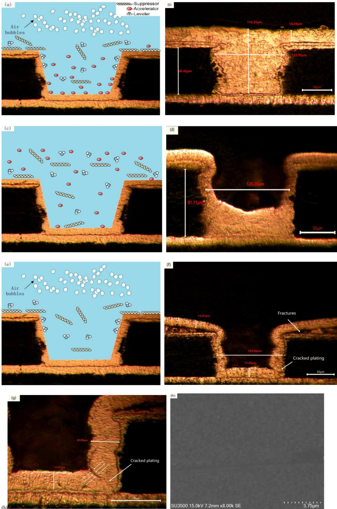  
Fig. 13. Schematic diagram and cross-sectional views of microvias after electroplating for 45 min using the OM test. The electrolytes were composed of VAS, 60 ppm Cl− and (a)(b) 200 ppm PEP + 6 ppm SPS + 10 ppm L with flowing air;(c) (d) 200 ppm PEP + 6 ppm $\mathrm { S P S } + 1 0$ ppm L without flowing air; (e) (f) (g) 200 ppm $\mathrm { P E P } + 1 0 $ ppm L with flowing air; (g) was partially magnified schematic images of cracked plating and (h)was SEM micrograph of (b) for copper layer surface after electroplating;

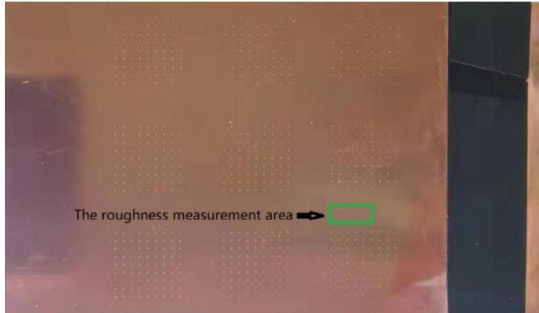  
Fig. 14. The sample measurement area range at the outside of the microvia for PCB by SEM or TR220 roughness tester.

## 4. Experimental and methods

## 4.1. Electrochemical details

The electrochemical measurements were carried out with an elec trochemical workstation CHI 760E(Auto-Lab) equipped a standard three-electrode cell containing 250 mL electrolyte. A platinum rotating disk electrode (Pt-RDE) with a diameter of 5 mm was used as the work ing electrode (WE). The counter electrode (CE) was a copper bar placed in a hollow glass pipe filled with base electrolyte. Moreover, the reference electrode (RE) used the mercurous sulfate electrode (SMSE). All the potential values involved in this work are referred to SMSE scale. The galvanostatic measurements (GM) were used to investigate the adsorption of additives and evaluate the filling ability of the plating solution. Before GM tests, a layer of copper with the thickness of about 500 nm was pre-plated on the platinum rotating disk electrode for 5 min to transform Pt-RDE into Cu-RDE. During the galvanostatic measurements, the spinning speeds of the WE were taken at 100 and 1000 rpm to simulate the bottom and surface of the microvias, respectively. The electrolyte was controlled at a constant temperature of 298 K and the current density was $2 . 0 \ \mathrm { A } / \mathrm { d } \mathrm { m } ^ { 2 }$ . The inhibiting effect of copper plating was analyzed by cyclic voltammetry (CV) tests with a rotation speed of 1000 rpm. CV tests were conducted with the Pt-RDE as a working electrode and the scan rate is 5 mV/s while the frequency range is from 0.3 V to − 0.8 V. Chronoamperometry (CA) tests were conducted by the glassy carbon working electrode for a 3 mm diameter. All the experiments mentioned above must be carried out three times under the same conditions to ensure good repeatability.

## 4.2. Microvia copper electroplating

Electroplating experiments were performed in a 1500 mL Harring cell. The PCBs fragments by $\mathrm { C O } _ { 2 }$ laser ablation were used as a tested board for microvia filling experiments. The dimensions of the tested board with many microvias were 50 mm \* 150 mm. The diameter and depth of the blind microvias were 0.13 mm and 0.08 mm, respectively. Two parallel phosphorus-containing copper boards were used as the anode with the size of 5 cm \* 15 cm and placed at a distance of 20 cm in the Harring cell. To ensure better conductivity between the plated copper and the inner copper, smear of the microvias on the tested board were cleaned through a desmear process before the plating. The electroplating test was carried out at a room temperature of 298 K and the current density was kept at $2 . 0 \mathrm { A } / \mathrm { d } \mathrm { m } ^ { 2 }$ for 45 min. To enhance the mixing of the plating solution and good mass transfer, continuously flowing air bubbles were applied to constantly agitate the plating solution throughout the whole electroplating process.

In the electroplating process, the virgin acid solution (VAS) included 0.88 M CuSO4 and 0.54 M $\mathrm { H } _ { 2 } S 0 _ { 4 } .$ . Formulas of plating baths are $\mathtt { C l } ^ { - }$ from NaCl, PEP with a molecular weight of 2650 (BASF) employed as a suppressor, SPS used as an accelerator and L as studied leveler. The filling performance of microvias were observed by the cross-sections images using optical microscopy (OM). SEM pictures of the Cu electroplating surface were tested using a high vacuum at 15 keV by the Hitachi SU3500 SEM instrument. The Cu surface roughness was obtained by a digital surface roughness tester of TIME TR220. Ra stands for getting arithmetic mean value for absolute values of vertical coordinates in one sampling length. Rz represents the sum of maximal profile peak height and maximal profile peak valley depth in one sampling length.

## CRediT authorship contribution statement

Zhihua Tao: Conceptualization, Methodology, Validation. Zhiyuan Long: Data curation. Linjie Tengxu: Visualization, Investigation. Guanting Liu: Supervision, Validation. Xuefei Tao: Resources, Software.

## Declaration of Competing Interest

The authors declare that they have no known competing financial interests or personal relationships that could have appeared to influence the work reported in this paper.

## Acknowledgments

The authors gratefully acknowledge the support of National Natural Science Foundation of China (No.61841401) and the Natural Science Foundation of Jiangxi Province of China (No. 20212BAB204046).

## References

[1] C. Chang, X. Lu, Z. Lei, Z. Wang, C. Zhao, 2-Mercaptopyridine as a new leveler for bottom-up filling of micro-vias in copper electroplating, Electrochim. Acta 208 (2016) 33 38, https://doi.org/10.1016/j.electacta.2016.04.177.

[2] B. Chen, J. Xu, L. Wang, L. Song, S. Wu, Synthesis of quaternary ammonium salts based on diketopyrrolopyrroles skeletons and their applications in copper electroplating, ACS. Appl. Mater, Interfaces 9 (8) (2017) 7793 7803, https:/ doi.org/10.1021/acsami.6b1540010.1021/acsami.6b15400.s001.

[3] Z. Chen, Y. Peng, H. Cheng, Z. Yang, M. Chen, Void-free and high-speed filling of through ceramic holes by copper electroplating, Microelectron. Reliab. 75 (2017) 171 177.

[4] S.K. Cho, M.J. Kim, H.-C. Koo, O.J. Kwon, J.J. Kim, Low-resistivity Cu film electrodeposited with 3-N, N-dimethylaminodithiocarbamoyl-1-propanesulfonate for the application to the interconnection of electronic devices, Thin Solid Films 520 (2012) 2136–2141.

[5] A. Chrzanowska, R. Mroczka, M. Florek, Effect of interaction between dodecyltrimethylammonium chloride (DTAC) and bis(3-sulphopropyl) disulphide (SPS) on the morphology of electrodeposited copper, Electrochim. Acta 106 (2013 49–62.

[6] Y. Dai, M. Zhang, F. Qin, P. Chen, T. An, Effect of silicon anisotropy on interfacial fracture for three dimensional through-silicon-via (TSV) under thermal loading, Eng, Fract, Mech, 209 (2019) 274–300.

[7] C.E. Ho, C.C. Chen, L.H. Hsu, M.K. Lu, Electron backscatter diffraction characterization of electrolytic Cu deposition in the blind-hole structure: Curren density effect. Thin Solid Films 584 (2015) 78-84

[8] T.D.A. Jones, A. Bernassau, D. Flynn, D. Price, M. Beadel, M.P.Y. Desmulliez, Copper electroplating of PCB interconnects using megasonic acoustic streaming Ultrason, Sonochem, 42 (2018) 434–444

[9] C.-Y. Lee, P.-C. Lin, C.-H. Yang, C.-E. Ho, Significantly improving the etching characteristics of electroplated Cu films through microstructure modification, Surf. Coat. Technol. 386 (2020) 125471, https://doi.org/10.1016/ j.surfcoat.2020.125471

[10] H.-B. Lee, K.-L. Chen, J.-W. Su, C.-Y. Lee, The use of surfactants and supercritical CO assisted processes in the electroless nickel plating of printed circuit board with blind via, Mater. Chem. Phys. 241 (2020) 122418, https://doi.org/10.1016 j.matchemphys.2019.122418.

[11] Z. Tao, W. He, S. Wang, X. He, C. Jiao, D. Xiao, Synergistic effect of different additives on microvia filling in an acidic copper plating solution, J. Electrochem. Soc. 163 (8) (2016) D379–D384.

[12] Z. Lei, L. Chen, W. Wang, Z. Wang, C. Zhao, Tetrazole derived levelers for filling electroplated Cu microvias: electrochemical behaviors and quantum calculations, Electrochim. Acta 178 (2015) 546–554.

[13] J. Li, J. Xu, X. Wang, X. Wei, J. Lv, L. Wang, Novel 2,5-bis(6-(trimethylamonium) hexyl)-3,6-diaryl-1,4-diketopyrrolo[3,4-c]pyrrole pigments as levelers for efficient electroplating applications, Dyes Pigm. 186 (2021) 109064, https://doi.org/ 10.1016/j.dyepig.2020.109064.

[14] C. Liao, S. Zhang, S. Chen, Y. Qiang, G. Liu, M. Tang, B. Tan, D. Fu, Y. Xu, The effect of tricyclazole as a novel leveler for filling electroplated copper microvias, J. Electroanal. Chem. 827 (2018) 151–159.

[15] C.-C. Lin, C.-C. Hu, Y.-T. Lu, R.-H. Guo, Reconsider the depolarization behavior of copper electrodeposition in the presence of 3-mercapto-1-propanesulfonate, Electrochem. Commun. 91 (2018) 75–78.

[16] E.R. Mamleyev, F. Falk, P.G. Weidler, S. Heissler, S. Wadhwa, O. Nassar, C.N. Shyam Kumar, C. Kubel, C. Woll, M. Islam, D. Mager, J.G. Korvink, Polyaramidbased flexible antibacterial coatings fabricated using laser-induced carbonization and copper electroplating, ACS Appl. Mater. Interfaces 12 (2020) 53193–53205.

[17] R. Manu, S. Jayakrishnan, Effect of organic dye on copper metallization of high aspect ratio through hole for interconnect application, Mater. Chem. Phys. 135 (2012) 425–432.

[18] J.-H. Moon, J. Shin, T.-H. Kim, DongHoon Song, EunAe Cho, Improving accuracy of filling performance prediction in microvia copper electroplating, J. Electroanal. Chem. 871 (2020) 114318, https://doi.org/10.1016/j.jelechem.2020.114318.

[19] H. Shen, H.C. Kim, M. Sung, T. Lim, J.J. Kim, Thermodynamic aspects of bis(3- sulfopropyl) disulfide and 3-mercapto-1-propanesulfonic acid in Cu electrodeposition, J. Electroanal. Chem. 816 (2018) 132–137.

[20] MinJae Sung, S.-H. Kim, H.-J. Lee, T. Lim, J.J. Kim, Working mechanism of iodide ions and its application to Cu microstructure control in through silicon via filling, Electrochim. Acta 295 (2019) 224 229

[21] I. Volov, X. Sun, G. Gadikota, P. Shi, A.C. West, Electrodeposition of copper tin film alloys for interconnect applications, Electrochim. Acta 89 (2013) 792–797.

[22] F. Wang, K. Zhou, Q. Zhang, Y. Le, W. Liu, Y. Wang, F. Wang, Effect of molecular weight and concentration of polyethylene glycol on through-silicon via filling by copper, Microelectron. Eng. 215 (2019) 111003, https://doi.org/10.1016/j. mee.2019.111003.

[23] N. Xiao, D. Li, G. Cui, N. Li, D. Tian, Q. Li, G. Wu, An effective triblock copolymer as a suppressor for microvia filling via copper electrodeposition, Electrochim. Acta 109 (2013) 226–232.

[24] J. Xu, B. Chen, J. Lv, D. Chang, D. Niu, S. Hu, X. Zhang, Z. Xin, L. Wang, Aryl modification of diketopyrrolopyrrole-based quaternary ammonium salts and their applications in copper electrodeposition, Dyes Pigm. 170 (2019) 107559, https:/ doi.org/10.1016/j.dyepig.2019.107559.

[25] M.H. Lee, M.J. Kim, J.J. Kim, Competitive adsorption between bromide ions and bis (3-sulfopropyl)-disulfide for Cu microvia filling. Electrochim. Acta 370 (2021 137707. https://doi.org/10.1016/i.electacta.2020.137707.

[26] J. Li, G. Zhou, Y. Hong, C. Wang, W. He, S. Wang, Y. Chen, Z. Wen, Q. Wang, Copolymer of pyrrole and 1.4-butanediol diglvcidyl as an efficient additive leveler for through-hole copper electroplating, ACS Omega 5 (10) (2020) 4868–4874.

[27] A.-Y. Wang, B. Chen, L. Fang, J.-J. Yu, L.-M. Wang, Influence of branched quaternary ammonium surfactant molecules as levelers for copper electroplating from acidic sulfate bath, Electrochim. Acta 108 (2013) 698–706

[28] W.-P. Dow, H.-H. Chen, M.-Y. Yen, W.-H. Chen, K.-H. Hsu, P.-Y. Chuang, H. Ishizuka, N. Sakagawa, R. Kimizuka, Through-hole filling by copper electroplating, J. Electrochem. Soc. 155 (12) (2008) D750, https://doi.org/10.1149/1.2988134.

[29] N. Xiao, D. Li, G. Cui, N. Li, Q. Li, G. Wu, Adsorption behavior of triblock copolymer suppressors during the copper electrodeposition. Electrochim. Acta 116 (2014) 284–291.

[30] J.-J. Yan, L.-C. Chang, C.-W. Lu, W.-P. Dow, Effects of organic acids on throughhole filling by copper electroplating, Electrochim. Acta 109 (2013) 1–12.

[31] Y.-D. Chiu, W.-P. Dow, Accelerator Screening by Cyclic Voltammetry for microvia filling by copper electroplating, J. Electrochem. Soc. 160 (12) (2013) D3021–D3027.

[32] Q.S. Zhu, X. Zhang, C.Z. Liu, H.Y. Liu, Effect of reverse pulse on additives adsorption and copper filling for through silicon via, J. Electrochem. Soc. 166 (1) (2019) D3006–D3012.

[33] J. Li, N. Dimitrov, NTBC and MTT Reduction Electrochemistry: Impact on Cu superconformal plating for fabrication of glass interposers, J. Electrochem. Soc. 166 (1) (2019) D3120–D3128.

[34] K. Haubner, T. Fischer, H. Brunner, L. Pohlmann, C. Donner, Aspects and modeling of oscillatory acid copper electroplating, J. Electrochem. Soc. 166 (1) (2019) D3110–D3119.

[35] Y.-H. Chang, P.-L. Tseng, J.-C. Lin, J.-C. Chen, M.-C. Huang, H.-Y. Lin, S. Pollard, P. Mazumder, Communication-defect-free filling of high aspect ratio through vias in ultrathin glass, J. Electrochem. Soc. 166 (1) (2019) D3155–D3157.

[36] S. Zhao, K. Pang, X. Wang, N. Xiao, Function of Sulfhydryl (–HS) Group During Microvia Filling by Copper Plating, J. Electrochem. Soc. 167 (11) (2020) 112502, https://doi.org/10.1149/1945-7111/aba00c

[37] Z. Tao, W. He, J. Li, S. Wang, Y. Chen, K. Ai, Y. Peng, Y. Hong, Tetraoxadiphosphaspiro derivative as suppressor for microvia filling by copper electroplating in acidic solution. J. Electrochem. Soc. 164 (14) (2017) D1034–D1041

[38] Schmitt KevinG, Schmidt Ralf, Gaida Josef, A. Andrew, Gewirth., Chain length variation to probe the mechanism of accelerator additives in copper electrodeposition. Phys, Chem. Chem. Phys. 21 (2019) 16838

[39] W.-P. Dow, Y.-D. Chiu, M.-Y. Yen, Microvia filling by Cu electroplating over a Au seed layer modified by a disulfide, J. Electrochem. Soc. 156 (4) (2009) D155, https://doi.org/10.1149/1.3078407

[40] W.-P. Dow, C.-C. Li, M.-W. Lin, G.-W. Su, C.-C. Huang, Copper Fill of Microvia using a thiol-modified Cu seed layer and various levelers, J. Electrochem. Soc. 156 (8) (2009) D314, https://doi.org/10.1149/1.3147273.

[41] L. Yang, A. Radisic, J. Deconinck, P.M. Vereecken, Modeling the bottom-up filling of through-silicon vias through suppressor adsorption/desorption mechanism, J. Electrochem. Soc. 160 (12) (2013) D3051 D3056.

[42] Z.H. Tao, G.T. Liu, Y.X. Li, H. Su, Electrochemical and analytical study of electroplating additive in copper plating solution for microvia filling, Circuit World 45 (2019) 124–131.

[43] C. Osarinmwian, I.M. Mellor, E.P.L. Roberts, Electro-deoxidation modelling of titanium dioxide to titanium. Electrochim. Acta 209 (2016) 95–101

[44] M.R. Majidi, K. Asadpour-Zeynali, B. Hafezi, Reaction and nucleation mechanisms of copper electrodeposition on disposable pencil graphite electrode, Electrochim. Acta 54 (2009),1119–1126

[45] Guannan, Y.; Xian, Z.；Pengyu，W.; Chao, L.; Guangdong, X.; Zhen, L.; Jiye, L.; Yu, Z.; Chengqiang C., Size Refinement of Copper Nanoparticles: A Perspective from Electrochemical Nucleation and Growth Mechanism, ChemElectroChem, 8 (2021)819–828.

[46] T. Wenyu, H. Hanwei, G. Ying, P. Yizhi, D. Xiaomei, Nucleation and growth mechanisms of an electrodeposited Ni–Se–Cu coating on nickel foam, J. Colloid Interface Sci. 600 (2021) 492–502.

[47] K. Zhu, C. Wang, J. Wang, Y. Hong, Y. Chen, W. He, J. Zhou, H. Miao, Q. Chen, Convection-Dependent Competitive Adsorption between SPS and EO/PO on Copper Surface for Accelerating Trench Filling, J. Electrochem. Soc. 166 (4) (2019) D93-D98

[48] C. Dehchar, I. Chikouche, A. Sahari, A. Zouaoui, Early stages of copper microparticles electrodeposition on polypyrrole film, Composites, Communications 11 (2019) 52–55.

[49] T.M. Braun, D. Josell, M. Silva, J. Kildon, T.P. Moffat, Effect of chloride concentration on copper deposition in through silicon vias, J. Electrochem. Soc. 166 (1) (2019) D3259–D3271

[50] W.-P. Dow, M.-Y. Yen, S.-Z. Liao, Y.-D. Chiu, H.-C. Huang, Filling mechanism in microvia metallization by copper electroplating, Electrochim. Acta 53 (2008) 8228–8237.

[51] L.-N. Ji, Y. Gong, Z.-G. Yang, Failure investigation on copper-plated blind vias in PCB. Microelectron. Reliab. 50 (2010) 1163–1170.