# Five-membered heterocyclic small molecule compounds as novel levelling agents for blind-hole copper plating

Tao Zhang a,b,c, Chaojie Zheng a,b,c, Haidi Li a,b,c, Shiqi Song a,b,c, Wei Huang d, Qiaoxia Li a,b,c, Yulin Min a,b,c, Xixun Shen a,b,c, Qunjie Xu a,b,c,e,\*

a Shanghai University of Electric Power, Shanghai 200090, China

b Shanghai Key Laboratory of Materials Protection and Advanced Materials in Electric Power, Shanghai 200090, China

c Shanghai Engineering Research Center of Energy-Saving in Heat Exchange Systems, Shanghai 200090, China

d Shanghai Meadville Electronics Co., Ltd., Shanghai 201613, China

e Shanghai Institute of Pollution Control and Ecological Security, Shanghai 200090, China

## A R T I C L E I N F O

Keywords: Printed circuit board Copper plating Levelling agent Small molecule five-membered heterocyclic compound Blind hole supperfilling

## A B S T R A C T

A defect free copper interconnect is crucial for ensuring the electrical connection and transmission of high density interconnect printed circuit boards. Leveling agent is a key regulatory factor for achieving dense cop per super filling from bottom to top in blind holes during the electroplating process of high-density interconnect boards. Here, two small molecule five-membered heterocyclic compounds with different side chains, namely 3- amino-5-mercapto-1,2,4-triazole (AMT) and 2–5-methyl-1,3,4-thiadiazole (MMT), were selected to be as levelling agents to study their effect on the copper filling behavior on blind holes. Electrochemical tests including cyclic voltammetry solvation (CV) and linear sweep voltammetry (LSV) were firstly used to analyze the inhibitory effect of two leveling agents on copper deposition and it was indicated that the MMT has a more significant inhibitory effect on the copper deposition than the AMT. Subsequently, the influence of different concentrations of MMT on the inhibition of copper deposition and the blind hole filling performance were also further analyzed by LSV, CV, and constant current measurement (GM), where an optimal concentration of 7 ppm was obtained for the maximum inhibitory ability on the copper deposition accompanied by the best blind hole filling ability. The characterization analysis from the field emission scanning electron microscopy (FE-SEM), atomic force microscopy (AFM), and X-ray diffraction (XRD) also illuminates that the MMT leveling agent can effectively reduce the surface roughness of copper filled with micropores and promote the selective growth of copper coatings along the (11 1) crystallographic plane. The adsorption behavior of the levelling agent on the cathode surface during electrodeposition was further also studied by the quantum chemical calculations and molecular dynamics sim ulations combined with the in situ electrochemical surface enhanced Raman spectroscopy (EC-SERS) experiments. It has been suggested that the thiol, sulfur, and alkyl groups in the leveling agent MMT molecule are nucleophilic groups, providing preferred active sites for adsorption reactions and thus generating effective inhibition ability on copper deposition formation. Thermal shock experiments based on tin immersion showed the copper layer obtained under the addition of the levelling agent MMT has excellent reliability. The comprehensive results indicated that 2-mercapto-5-methyl-1,3,4-thiadiazole (MMT) was an effective levelling agent for the blind hole supperfilling.

## 1. Introduction

Blind hole copper electroplating is the primary technology used in the connectivity manufacturing process for printed circuit boards (PCB), semiconductor integrated circuit (IC) chips, and IC packaging substrates [1–3]. The issue of achieving complete filling of high-quality plated copper has become increasingly essential in light of the progress made in integrated and miniaturized electronic devices. This is particularly relevant as high-density interconnect printed circuit boards (PCBs) are transitioning towards through-hole and micro-hole designs with larger depth-to-diameter ratios [4]. In the process of copper plating on such PCB micro vias with a larger depth-to-diameter ratio, there is a very significant difference between a current’s density distribution inside and on the surface of the micro vias. In such an environment, the copper electrodeposition rate in the pore area will be significantly greater than that in the micropores’ bottom region, which will result in the coppe layer covering and sealing the pore area in a preferential manner, leading to internal defects in the pores. In order to achieve bottom-up superfilling of the micropores, a synergistic effect of different addi tives is required, namely accelerators, inhibitors, levelling agents and chloride ions. Accelerators are generally small molecule organic sul phides containing specific functional groups of (-S–S-), sulfhydryl (-SH) and sulphonic acid $\left( - S O _ { 3 ^ { - } } \right)$ groups, which typically preferentially adsorb at the micropore’s bottom and can hasten the electrodeposition of copper at the hole’s bottom. SPS and MPS are both common accelerator $[ 5 , 6 ]$ . During copper electrodeposition, the inhibitor is usually adsorbed on the cathode surface and interacts with chloride ions to increase the overpotential, thereby achieving the inhibitory effect on the surface deposition of copper, Inhibitors are mainly macromolecular polyether or polyols [7]. The most prevalent inhibitors are polyethylene glycol (PEG), but in addition to PEG there are also polypropylene glycol (PPG) and triblock copolymers of PEG and PPG [8–10]. Levelling agents can be added in very small amounts compared to inhibitors to achieve a strong inhibiting effect and rapid deactivation, leaving the surface flat and smooth. Meantime, levelling agents also show an inhibiting effect o copper deposition but there is no substitute for inhibitors, which can be compared to short-acting inhibitors, while inhibitors show a moderate inhibiting effect and deactivate slowly, and throughout the plating process, the levelling agent gradually covers the copper surface, domi nating the completion of superconformal deposition [4,7]. Traditiona levelling agents such as Janus Green B (JGB), Diazine Black (DB) Methylene Blue (MB), Alsin Blue (ABPV) [11–14]. However, these dye conventional levelling agents are prone to decomposition at high tem peratures, which makes the plating process not easy to control increasing the cost and also leading to copper plating quality problems. In response to the above problems, researchers have continued t develop new environmentally friendly high-performance small molecul copper plating levelling agents, such as benzyl quaternary ammonium containing compounds phenylacetyl chloride (BZC) [15], 2,2-dithiodi pyridine (DTDP) [16], 4,6-dimethyl-2-mercaptopyrimidine (DMP) [17], tricyclazole (TCA) [18], 1-(4-hydroxyphenyl)-2-tetrazole-5-thion (HPTT) [19]. Synthetic macromolecule polymers such as copolyme synthesized with pyrrole and 1,4-butanediol diglycidyl ether (PBDGE) copolymer, synthesized with imidazole and 1 4-butanediol diglvcidy ether (IBDGE), copolymer synthesized with 1-vinyl imidazole and 1,4 butanediol diglycidyl ether (VIBDGE) [20 22] and so on. These new copper plating levelling agents are phenotyped with good levelling properties. Further studies on the core functional groups and chemica bonds in the leveling agent molecules are needed to investigate thei mechanism of action in the copper electrodeposition process. It has been reported that sulfhydryl groups are the main adsorption sites in com pounds containing sulfhydryl (-SH) functional groups for example Zhao filling of micro via with copper plating. In a previous work, Zhou et al [24] came to the conclusion that the thiadiazol-based main unit com pound 5-amino-1,3,4-thiadiazole-2-thiol could function as an efficien leveling agent and identified the primary adsorption sites as the nitrogen atoms and the side-chain sulfhydryl groups in the thiadiazol ring. Ac cording to the above example, it can be seen that the sulfhydryl (-SH) functional group in the leveling agent molecule is capable of being efficiently absorbed on copper s surface, and nitrogen-nitrogen double bond (-N––N-) and sulfur atoms in the thiadiazol ring have a certain leveling ability. In addition, Hasan F Alesary et al. [25 27] studied the effect of additives on the electrodeposition of metals in deep eutectic solvents (DESs), studied the effect of sodium bromide on the electro deposition of tin, copper, silver and nickel, and found that the curren efficiency of the metal coating was increased when the electrolyte containing sodium bromide was deposited. A method of electroplatin

Zn-Ni alloy-modified deep eutectic solvent (DES) was introduced. The electrodeposition of Cu from acetylene 200 DES at $7 0 ~ ^ { \circ } \mathrm { C }$ with different concentrations of niacin as an additive was studied in detail. So, in the present study, the additives were selected from the point of view of effective functional groups. Two inexpensive, high-performance and environmentally friendly compounds (AMT and MMT) were selected as leveling agents for the screening of small-molecule five-membered heterocyclic compounds. In this paper, two small molecule fivemembered heterocyclic compounds with different side chains, namely 3-amino-5-mercapto-1,2,4-triazole (AMT) and 2-mercapto-5-methyl-1,3,4-thiadiazole (MMT), were selected as electroplated copper levelling agents to study their effect on copper deposition and blind hole filling performance, a variety of electrochemical analytical methods including $\mathrm { C V } ,$ LSV and GM were used to study the inhibitory effect of small molecular five-membered heterocyclic compounds with two different side chains on copper ion deposition and their interaction behavior with other additives. Subsequently, to further study the impact of copper filling blind holes electroplated with MMT acting as a leveling agent, the blind hole filling test was carried out. Thermal shock testing also further verified the reliable performance of the plating. With the help of FE-SEM and XRD, the surface morphology and crystal structure of the copper layer were examined. The investigation focused on the adsorption behavior of MMT molecules at the surface interface using EC-SERS. Furthermore, an investigation was conducted to determine the distribution of the levelling agent on the copper surface and its adsorption capacity. This was accomplished by the utilization of quan tum chemistry calculations and molecular dynamics simulations.

The molecular structures of two small-molecule five-membered heterocyclic compounds are shown in Fig. 1.

## 2. Experimenta

## 2.1. Electrochemical testing

The electrochemical tests such as CV, LSV and GM performed in this study were carried out using a rotating disk and a CHI 660C electrochemical workstation. 250 ml of plating solution in a glass container and room temperature electrochemical tests were performed. The threeelectrode test system employed had a platinum rotating disc electrode (Pt-RDE) with a 5 mm diameter as the working electrode (WE), a saturated calomel electrode as the reference electrode (RE) and a platinum wire electrode as the counter electrode (CE). Here, the base solution was 220 $\mathbf { g } / \mathrm { L C u S O } _ { 4 } { \cdot } 5 \mathrm { H } _ { 2 } \mathrm { O }$ (technical grade), 55 g/L H2SO4 (98 %, analytical reagent, AR) and 60 ppm Cl- (37 % HCl, AR), the accelerator used in this study was Bis-(3-sulfopropyl) disulfide (SPS), the inhibitor was polyethylene glycol (PEG ), and the levelling agent was two small molecule five-membered heterocyclic compounds, namely AMT (99 %+, Adamas, Shanghai) and MMT (98 %, Adamas, Shanghai). The concentration of accelerator SPS was 0.1 ${ \mathfrak { g } } / { \mathrm { L } } ,$ the concentration of inhibitor PEG was $1 0 \ : \mathrm { g / L } ,$ , and Both the levelling agent (AMT、MMT) had a 0.1 g/ L concentration. In the electrochemical tests, the speed of the working electrode (WE) was adjusted to 1600 rpm and 100 rpm, respectively (1600 rpm and 100 rpm simulate strong and weak convection in the blind aperture, respectively) [28]. Cyclic voltammetric curve over a voltage range of 1 $\mathrm { ~ V ~ t 0 ~ } { - } 0 . 2 5 \mathrm { ~ V ~ }$ was performed with a negative sweep, sweeping at 0.01 $\mathrm { V } / s ,$ and 2 sweep segments. At a sweep rate of 0.02 V/s, LSV curves were swept from 0 to −0.3 V. Constant current measurement (GMs) curves required preplating at 1000 rpm at a voltage of −0.15 V for

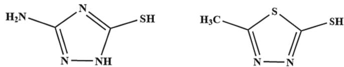  
Fig. 1. Molecular structure of AMT and MMT.

300 $s ,$ thus depositing the copper layer at a set current density of 1.5 A/ $\mathrm { d m } ^ { 2 }$ on the working electrode. The measurement is carried out at 1.5 A/ $\mathrm { d m } ^ { 2 }$ by adding inhibitors (PEG), accelerators (SPS) and levelling agents (AMT, MMT) to the base bath in sequence.

## 2.2. Electrodeposition

There are two types of PCBs, each with a different size blind hole (the hole size and depth were 120 μm $\textbf { x } 7 5$ μm and 100 μm x 125 μm, respectively) were employed in the blind hole electroplating filling experiment. Before electroplating, the copper plate containing $0 . 0 4 \% \sim$ 0.065 % phosphorus is wrapped in a filter bag as the anode, and the surface oxide of the copper plate containing phosphorus is polished off with 1000 mesh and 2000 mesh sandpaper before use. After rinsed off the sanding with deionized water, the surface oxide is activated with 1 mol/L sulfuric acid for 3 min, and the surface oxide is completely removed. Ensure that the anode plate can fully react during the plating process, and rinse the residual sulfuric acid with deionized water after removal. Before use, the filter bag is activated in 1 mol/L sulfuric acid for 3 min, and then washed with deionized water. Finally, the treated phosphorus-containing copper plate is placed into the treated filter bag and placed into the electrolytic cell. The cathode PCB board should be etched in an acidic solution for 5 min. Then rinse it off with deionized water. After the etched PCB is washed with alcohol and deionized water, it is bonded to the surface of the stainless-steel support plate with conductive adhesive, insulating adhesive, transparent adhesive, etc., so as to ensure that only the PCB board can contact the plating solution. Before electroplating, the PCB board needs to be micro-etched in an acid solution for five minutes. After the etched PCB is washed with alcohol and deionized water, it is adhered to the surface of the stainless-steel support plate using conductive adhesive, insulating adhesive, and transparent adhesive. For electroplating, the electrolyte composition consists of $2 2 0 \mathrm { g / L C u S O _ { 4 } { \cdot } 5 H _ { 2 } O } ,$ 55 $g / \mathrm { L } \mathrm { H } _ { 2 } S \mathrm { O } _ { 4 } ,$ 60 ppm Cl , 1 ppm SPS, 200 ppm PEG and ${ 1 \sim 9 }$ ppm levelling agent (AMT/MMT). The electroplating filling experiment was carried out, the current density was controlled to $1 . 5 \mathsf { A } / \mathsf { d m } ^ { 2 }$ by DC regulated power supply and good mass transfer was guaranteed by magnetic stirrer. In performing the electro deposition experiments, the pH of the electrodeposition electrolyte was $_ { 0 . 7 }$

## 2.3. Characterization tests

To assess the filling capabilities of the additives, cross-sectional photographs of the micropores after plating were observed utilizing an optical microscope, namely the Olympus BX53 M. The cross-section of the PCB board after electroplating is polished with 1000 mesh \~ 5000 purpose sandpaper to the cross-section of the blind hole Center position, and then observe the filling of the blind hole. The surface and cross sectional morphology of blind hole filled copper were observed using an FE-SEM (Hitachi S-4800). SPM-9700HT instrument was used to measure the surface roughness of the coating, and Gwyddion software was used to analyze the data. The crystal structure of blind hole filled copper was tested using XRD (Bruker D8 ADV ANCE X) in the range of 30 $\_ 8 0 ^ { \circ }$ . The effect of additives on copper crystallisation can be analyzed by means of XRD testing, which allows the crystal orientation of the electroplated copper layer to be determined.

## 2.4. Reliability test

The reliability of the quality of copper plating in blind holes is detected by thermal stress test; firstly, the oven is set to $1 2 5 ~ ^ { \circ } \mathrm { C }$ baking for $^ { 6 \mathrm { h } , }$ followed by high-temperature immersion in tin $2 \sim 6$ times, the tin furnace is set to a temperature of $2 8 8 ^ { \circ } \mathsf { C } ,$ , and the immersion time is 10 s each time, and the blind holes are observed with an optical microscope to see if there is any separation of the wall of the holes, and if there are any hole corners that are broken. Tang et al [17]. Verified that the coating obtained with 4, 6-Dimethyl-2-Mercaptopyrimidine (DMP) as the levelling agent has good stability through a reliability test (tin immersion experiment).

## 2.5. In situ surface-enhanced Raman

Conventional Raman spectroscopy (Raman) was performed on a solid leveler (MMT) sample pressed on a slide using a Horiba LabRAM HR Raman spectrometer model with a power of 0.625 Mw and an excitation wavelength of $\lambda = 6 3 3$ nm, and the EC-SERS using a Horiba LabRAM. The working electrode was a 6 mm copper electrode, the reference electrode utilized in the experiment was a mercury oxide electrode, while the counter electrode employed was a platinum wire electrode. Prior to the measurement, the working electrode was first polished to a mirror finish with metallurgical sandpaper and ${ \tt { \alpha } } { \cdot } { \tt { A l } } _ { 2 } { \tt { O } } _ { 3 }$ polishing powder (1, 0.3 and 0.05 µm), from coarse to fine. The test device underwent ultrasonication in ultrapure water for a duration of ten minutes, followed by thorough rinsing with ultrapure water. Subsequently, the equipment was subjected to drying in an oven and subsequently set aside. The electrochemical Raman cell, electrodes, solution bottle and peristaltic pump were assembled together through Teflon tubing in turn, the peristaltic pump was turned on to control the flow rate of the solution, and the air in the electrochemical Raman cell was drained and ensured to be filled with the solution, then the electrochemical Raman cell was placed horizontally on a carrier table and connected to an electrochemical workstation, and a laser source was illuminated vertically on the surface of the electrodes, and a constant current of $1 . 5 ~ \mathrm { A } / \mathrm { d } \mathrm { \dot { m } } ^ { 2 }$ was applied by turning on the electrochemical workstation and applying a constant current of $1 . 5 \mathrm { A } / \mathrm { d } \mathrm { m } ^ { 2 }$ . During the experiment, in order to enhance the Raman signal, the concentration of the base plating solution was reduced in the same proportion $( 2 . 2 ~ \ g / \mathrm { L }$ $\mathrm { C u S O _ { 4 } { \cdot } 5 H _ { 2 } O } + 0 . 5 5 \mathrm { g } / \mathrm { L } \mathrm { H } _ { 2 } S O _ { 4 } ) $ , and the concentration of the additive MMT was 0.1 ${ \bf g } / { \bf L } ,$ and at the same time, the Raman laser intensity is increased to 100 % to improve the signal intensity of the Raman spectrum, and then the signal acquisition was carried out to study the adsorption of additives on copper surfaces in the process of plating through the change of the characteristic peaks of the levelling agent in the Raman signal.

## 2.6. Quantum chemical calculations and molecular dynamics simulations

Quantum chemical calculations and molecular dynamics simulations were performed using the Visualizer, Forcete and Dmol modules of the Material Studio (MS) software. The electron density, electrostatic potential and molecular orbitals of molecular MMT are optimized and calculated in quantum chemical calculations using the Dmol3 module. For the simulations, the force field is selected from COMPASS, DFT generic functional theory, and the density distributions of the highest occupied molecular orbitals (HOMO), lowest unoccupied molecular orbitals (density distributions of the highest occupied molecular orbitals (LUMO) and the energy gaps $( \Delta \mathrm { E } = \mathrm { E _ { L U M O } } \mathrm { - } \mathrm { E _ { H O M O } } )$ , and the electrostatic potentials (ESP) are calculated.

The molecular dynamics simulation started with importing copper crystals, cutting $^ { ( 1 , 1 , 1 ) }$ faces with a cut thickness of 8.0, optimization using the Forcete module, simulation using the COMPASS force field, followed by supercellularization and vacuum addition, and then plotting the leveler molecules and water molecules with structural optimization where the density of the water molecules was set to $0 . 2 \ : \mathrm { g } / \mathrm { c m } ^ { 3 }$ , and 500 water molecules were and one levelling agent molecule were combined in a box. The copper layer was then assembled in said box and simulations of fixed and unfixed copper layers were performed. 400,000 steps of fixed copper layer simulations were performed and finally the adsorption energy was calculated as $\mathrm { E _ { a b s o r p t i o n } = E _ { T o t a l ^ { - } } \ E _ { c u ^ { - } } \ E _ { L e v e l e r } , }$ where $\mathbf { E _ { a b s o r p o r a t i o n } }$ is the entire energy of the simulation’s interaction between the leveler and copper molecule.

## 3. Results and discussion

## 3.1. Electrochemical properties of two leveling agents are compared

First, using cyclic voltammetric stripping, which was carried out in a base solution with SPS and PEG, SPS, PEG, and MMT/AMT, respectively, at two rotational speeds of 100 rpm and 1600 rpm, the effect of two types of five-membered heterocyclic compounds with different side chains on the electrodeposition behavior of copper was investigated. The findings are depicted in Fig. 2. The observation of Fig. 2 reveals that the dissolution peaks of copper obtained from electroplating solutions containing two kinds of small molecule five membered heterocyclic compounds additives are significantly smaller than those obtained from the base plating solution whether at the 100 rpm or at the 1600 rpm. The results of the aforementioned inquiry suggest that the introduction of two small molecules consisting of five-membered heterocyclic compounds can effectively enhance cathodic polarization and prevent the deposition of copper. Moreover, it was further observed that the copper dissolution peak was smaller when 5 ppm MMT was added than when 5 ppm AMT was added. This means that the additive MMT is superior to AMT in inhibiting copper deposition through levelling agents.

The effects of the two levelling agents on copper electrodeposition were explored further using linear scanning voltammetry (LSV), and the findings are displayed in Fig. 3. From this, we can see when 5 ppm AMT and 5 ppm MMT are added whether in weak or strong convection, Copper’s deposition potential significantly shifts towards the negative direction, which is consistent with the results obtained from CV, indicating that the addition of AMT and MMT both can inhibit copper electrodeposition. Moreover, Copper’s deposition potential attained in the plating solution containing MMT shifts to the negative direction to the greatest extent, indicating that the additive MMT has a greater ability to suppress copper deposition compared to the additive AMT.

## 3.2. Electrochemical analysis of the additive MMT

Based on the above results that the MMT levelling agent exhibits a greater inhibitory ability to copper deposition compared with the AMT, Further research has been done to investigate how MMT levelling agent interacts with other additives. Initially, a constant current test was conducted at a rotational speed of 1600 rpm to investigate the effects of different concentrations of MMT additives on the inhibitory properties of copper deposition. As depicted in Fig. 4 displays the curves represent the relationship between potential and time. From Fig. 4, 200 ppm inhibitor PEG was added at 200 s, 1 ppm accelerator SPS was added at 500 s, and 1 ppm levelling agent MMT was first added at 1000 s. When 1 ppm

MMT was added, the deposition potential was negatively shifted at 1000 s and the cathodic polarization was increased, which indicated that MMT inhibited the deposition of copper. The deposition potentials at a total of 7 ppm MMT and 9 ppm MMT were essentially the same, so the optimum concentration of levelling agent MMT was tentatively concluded to be 7 ppm.

Furthermore, the objective of this research is to examine the impact of various concentrations of MMT additive on the inhibition of copper deposition behavior by the utilization of cyclic voltammetric solvation analysis. The findings are presented in Fig. 5. As depicted in Fig. $^ { 5 , }$ at 1600 rpm, the copper dissolving peak displayed a trend toward decreasing behavior as the levelling agent MMT concentration was raised from zero to 7 ppm. The copper dissolving peak did not further diminish when the MMT additive concentration was raised to 9 ppm; rather, it essentially remained the same as the copper dissolution peak attained at 7 ppm. Therefore, it can be determined that the optimal concentration of the leveling agent MMT with the strongest copper inhibition ability is 7 ppm, which is consistent with the results obtained from the constant flow rate experiment.

To find out the inhibitory impact of MMT at the ideal concentration on copper deposition in blind holes’ bottoms and surfaces (i.e., in the strong convection environments and the weak convection intensity), here CV and LSV experiments were also further performed at two different rotational speeds to analyze the differences in the inhibitory behavior of MMT with the optimal concentration on the copper deposition. Fig. 6 shows the cyclic voltammetric dissolution curves for 7 ppm MMT at different speeds. As shown in the figure, the peak of copper dissolution under strong convection (i.e., at 1600 rpm) conditions is significantly smaller than that under weak convection conditions (i.e., at 100 rpm). This indicates that the magnitude of convective significantly influences the inhibitory efficacy of MMT additives on the process of copper electrodeposition; the stronger the convection, the greater the inhibitory ability of MMT on copper deposition. The efficacy of the MMT additive to suppress copper deposition is dependent on its convective strength, as demonstrated by the LSV experimental results presented in Fig. 7. As depicted in Fig. 7, Copper’s deposition potential obtained from the optimum concentration of MMT plating solution under strong convection conditions was significantly shifted in a more negative direction as compared to the copper deposition potential under a weak convection environment, which indicates that MMT has a stronger ability to inhibit copper deposition under strong convection environment. According to previous reports [29–31], such strong convection dependent suppression behavior is suitable for bottom-up electroplated copper overfilling of blind holes.

In order to conduct a more comprehensive analysis of the blind hole filling capacity of MMT, GMs experiments were conducted at two different speeds, 100 rpm and 1600 rpm, and the effect of MMT additives on the copper deposition behavior at the bottom and surface of the blind hole was compared to the traditional levelling agent JGB. The corresponding curve of potential versus time attained from GM experiments is shown in Fig. 8. From Fig. 8, as could be noticed, after the addition of 200 ppm PEG at 200 s, it was observed that the cathodic potential at this time decreased dramatically due to the formation of a complex $\mathrm { P E G - C u ^ { + } { - } C l } ^ { \cdot }$ -, which can be adsorbed rapidly on the cathode by intermolecular forces, thus inhibiting the reduction of copper ions [32,33]. Subsequently, the cathode potential was maintained at a relatively stable level of approximately 0.275 v at both low and high speeds, $\mathrm { i . e , }$ polyethylene glycol $\Delta \mathfrak { n }$ Basically close to zero, which means that CDA behavior cannot be formed in the presence of inhibitors alone. After adding SPS accelerator at 500 s, the cathodic potential gradually increased again, indicating that the reduction and deposition rate of copper ions increased again. Moreover, after the addition of accelerator, a certain potential difference is formed at low and high speeds, which means that the addition of accelerator SPS leads to changes in the surface adsorption behavior of inhibitor PEG. Subsequently, upon the introduction of 7 ppm of JGB and MMT, individually, at the 1000-second mark, a notable and fast decline in potential was seen, coinciding with an augmentation in cathodic polarization. The cathodic potential difference $\Delta \mathfrak { \eta } = 2 0 . 8 \mathrm { m v } ,$ , which was obviously larger than that (11.8 mv) of JGB. During the test, $\Delta \eta = \eta _ { 1 0 0 \mathrm { ~ r p m } } \cdot \eta _ { 1 6 0 0 \mathrm { ~ r p m } } ,$ it is usually used to quantitatively evaluate the overfilling ability of additives in blind hole copper electroplating [28,34]. A larger potential difference usually means that the additive exhibits a favorable inhibitory impact on the process of copper electrodeposition when subjected to intense convective conditions. $( \mathrm { i . e . , }$ The rate of copper deposition at the mouth of a microporous hole is less than that at the bottom of the microporous hole) and then can achieve the perfect filling of the micro via. This means that MMT has a stronger inhibitory effect under high-speed rotational con ditions, which is consistent with the conclusions reached by CV and LSV above, so MMT can be selected as a levelling agent for blind hole filling.

(a)  
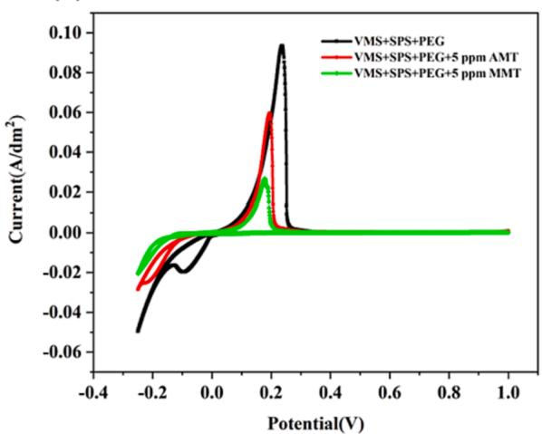

(b)  
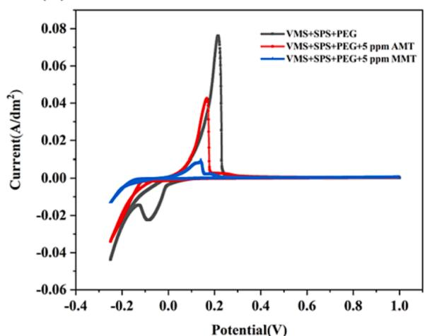  
Fig. 2. Cyclic voltammetric stripping curves of two additives at different speeds (a) 100 rpm, (b) 1600 rpm

(a)  
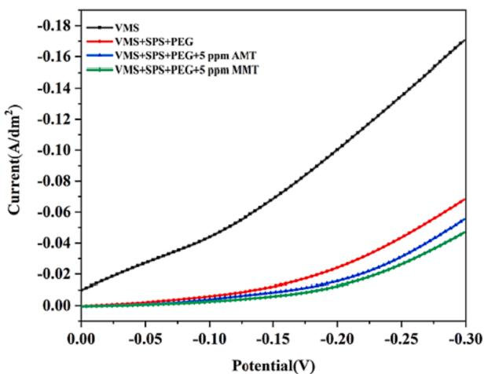

(b)  
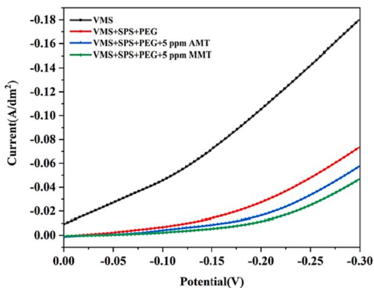  
Fig. 3. Linear scanning voltammetric curves for two additives at different speeds (a) 100 rpm, (b) 1600 rpm.

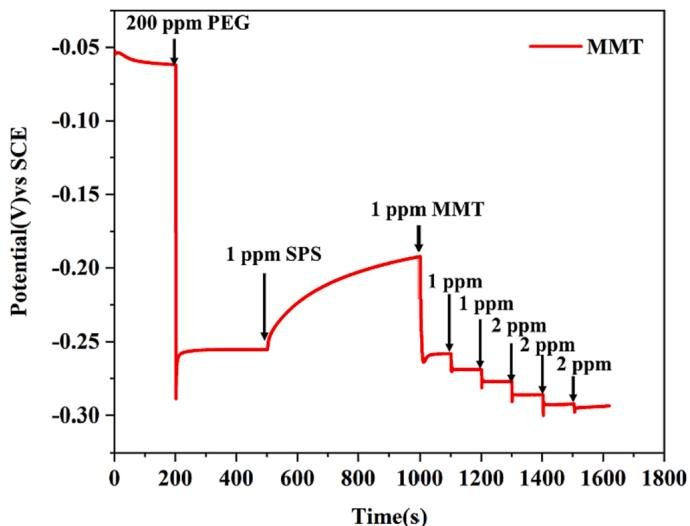  
Fig. 4. MMT constant current measurement at 1600 rpm.

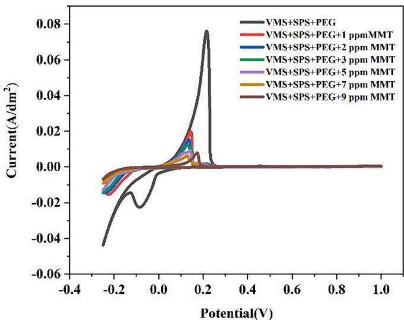  
Fig. 5. Cyclic voltammetric stripping curves for different concentrations of MMT at 1600 rpm.

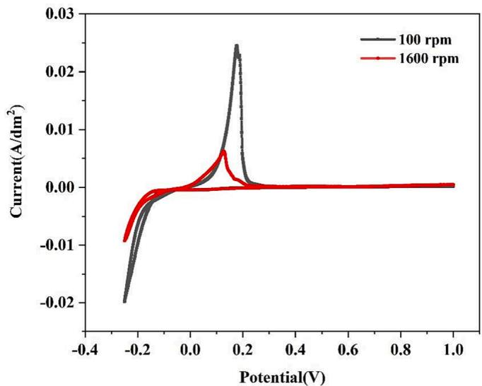  
Fig. 6. Cyclic voltammetric stripping curves for 7 ppm MMT at different speeds.

(a)  
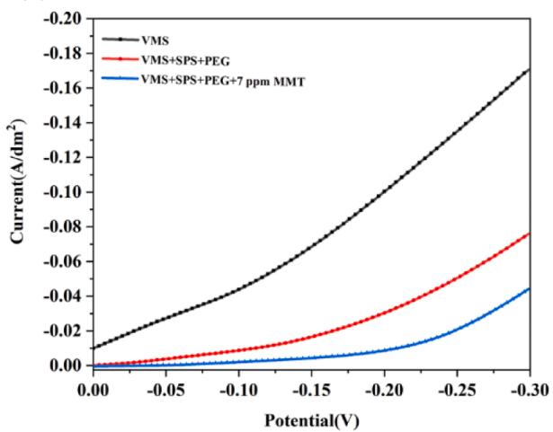

(b)  
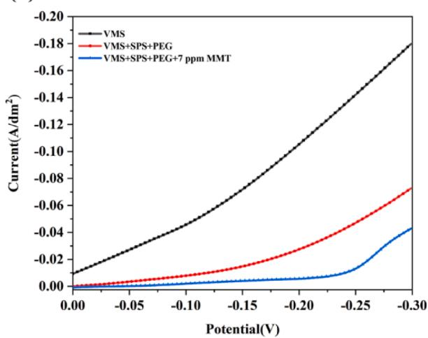  
Fig. 7. Linear scanning voltammetric curves of 7 ppm MMT at different speeds (a) 100 rpm, (b) 1600 rpm.

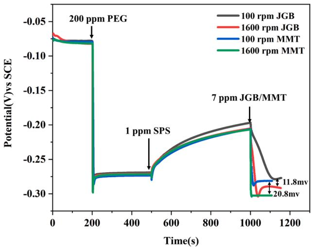  
Fig. 8. Constant flow measurement curves for the same concentration of MMT and JGB.

## 3.3. Electroplating

To further demonstrate MMT’s levelling ability and the impact of its addition concentration on the effect of blind hole super-filling copper, two types of PCB boards with varying blind hole sizes were utilized. (i.e., 75 μm x 120 μm and 125 μm x 100 μm in depth and width, respectively) also used here to carry out blind hole filling copper tests. The current density is set to $1 . 5 \mathrm { A } / \mathrm { d } \mathrm { m } ^ { 2 }$ . Fig. 9 shows the cross-sectional view of blind hole filling copper at different concentrations of MMT. As shown in Fig. 9(a) without the addition of the leveling agent MMT, there are large defects inside the blind holes. With the additive MMT added to the plating solution for plating, the findings are shown in Fig. 9 (b-g). From ${ \mathrm { F i g . ~ } } 9 \left( \mathbf { b } \right) ,$ , when 1 ppm MMT is applied the blind holes have a tendency to be filled from the bottom up although there are still large defects inside the blind holes. From Fig. 9 (c), when 2 ppm is added, the filling from the bottom up is more obvious. From Fig. 9 (e), with 5 ppm addition, the blind holes are basically filled without defects. As depicted in ${ \mathrm { F i g . ~ } } 9 \left( \mathbf { f } \right) ,$ , when 7 ppm is added, the perfect filling of the blind hole is realized. As shown in Fig. 9 (g), when 9 ppm MMT was added, pore defects appeared inside the blind hole, which may be related to competitive adsorption. Excessive MMT not only forms adsorption on the surface of PCB blind holes but also diffuses into the interior of the blind holes, leading to an imbalance between accelerators and inhibitors inside the holes, resulting in a stronger inhibitory effect on copper deposition inside the holes, thereby affecting the acceleration effect of SPS. In conclusion, it can be shown that 7 ppm MMT as levelling agent can achieve perfect filling of blind holes. Similarly, plating experiments were carried out in blind hole sizes with higher depth to width ratio (1.25:1), as shown in Fig. 10 (a-f), and plating was carried out with the addition of 7 ppm MMT, and Fig. 10 depicts the plating results and demonstrates that flawless filling of blind holes is still possible at larger depth to width ratios.

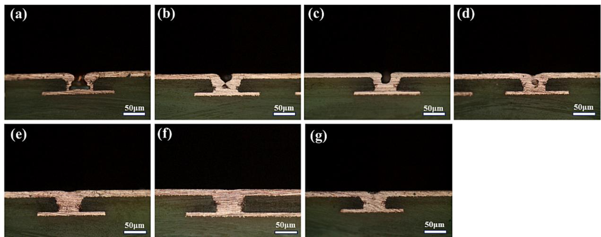  
Fig. 9. Hole filling results for different formulations (a) base plating solution + 1 ppm SPS + 200 ppm PEG; (b) 1 ppm MMT; (c) 2 ppm MMT; (d) 3 ppm MMT; (e) 5 ppm MMT; (f) 7 ppm MMT; (e) 9 ppm MMT. plating for 1 h.

At the same time, blind hole plating experiments were carried out under the same conditions using AMT as a levelling agent and the corresponding plating results are shown in Figs. 11 and 12, respectively. It can be seen that when a certain amount of AMT was added sequentially to the blind hole plating experiments, defects appeared inside the blind holes and there was no tendency to fill the holes from the bottom up. This result shows that the inhibition effect of the additive AMT on copper deposition is weaker than that of the additive MMT, which is the same as that shown in the electrochemical test. Subsequently, the obtained plated filled PCB boards were also immersed in molten tin for thermal stress testing to further investigate the reliability of the blind hole copper plating layer obtained under the optimum formulation system. The results are shown in Fig. 13. As shown in Fig. 13, the copper layer in the blind holes did not show any delamination, hole wall sep aration or fracture after several immersion tests in tin. This indicate that the copper layer plated under the optimum formulation system meets the practical needs.

investigated by field emission scanning electron microscopy (FE-SEM) and the associated outcomes are displayed in Fig. 14. We can find that when the copper layer’s surface attained from the basic plating solution without any organic additives were very rough and uneven and presents a cluster structure with raised mountain peak shape. When a concentration of 1 ppm MMT was introduced into the electroplating solution, as depicted in Fig. 14(b), A noticeable decrease in surface roughness of the copper layer was found when comparing it to the copper layer formed in the base plating solution. However, despite this improvement, the surface still did not achieve the desired level of flatness. Additionally, the presence of raised growth structures on the surface indicated a potential insufficiency in the concentration of the leveler. The concentration of MMT was seen to have an immediate effect on the copper plating layer’s quality. As depicted in Fig. 14(c-e), an increase in the MMT concentration resulted in a steady improvement in the flatness and smoothness of the copper plating layer. Notably, the surface of the copper layer obtained from the electroplating solution containing 7 ppm MMT exhibited the highest level of smoothness and flatness. Upon increasing the MMT concentration to 9 ppm, as depicted in Fig. 14(g), it was observed that the copper plated layer exhibited unevenness once again. This observation suggests that the synergistic effect on the copper surface will be destroyed if the concentration of MMT is high. Based on the examination of the surface condition of the coating, it is evident that the most favorable concentration of MMT additive introduced into the plating solution is 7 ppm, as it yields a polished and level copper coating.

The effect of electroplating solutions containing different concen trations of MMT on the surface morphology of the copper layer was also

The AFM images of the sample surface before and after the addition of unadded and added compounds MMT are shown in Fig. 15. As shown in Fig. 15(a), the average roughness Ra and Root Mean Square Rough ness Rq for the plated layer attained from the base plating solution without the addition of MMT were 56.17 nm and 67.31 nm, respectively.

## 3.4. Morphological analysis

The addition of MMT results in a decrease in the roughness of the obtained copper coating. As shown in Fig. 15, when 3 ppm MMT was added, the Ra and Rq of the copper layer were 42.86 nm and 53.36 nm, respectively. When 7 ppm MMT was added, the Ra and Rq of the copper layer were 20.37 nm and 28.23 nm, respectively. But when the amount of MMT added increased to 9 ppm, the roughness value of the copper coating increased again, with Ra and Rq of 38.04 nm and 41.66 nm, respectively. This indicates that excessive MMT is actually not conducive to the levelling of the coating.

## 3.5. Structural analysis

The X-ray diffraction (XRD) technique is employed to investigate the

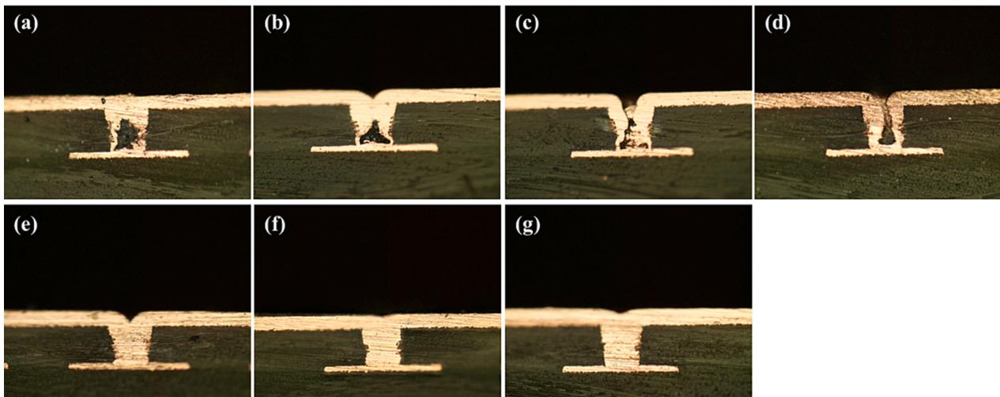  
Fig. 10. Hole filling results for different formulations (a) base plating solution + 1 ppm SPS + 200 ppm PEG, (b) 1 ppm MMT; (c) 2 ppm MMT; (d) 3 ppm MMT; (e) 5 ppm MMT; (f) 7 ppm MMT (g) 9 ppm MMT. plating for 90 min.

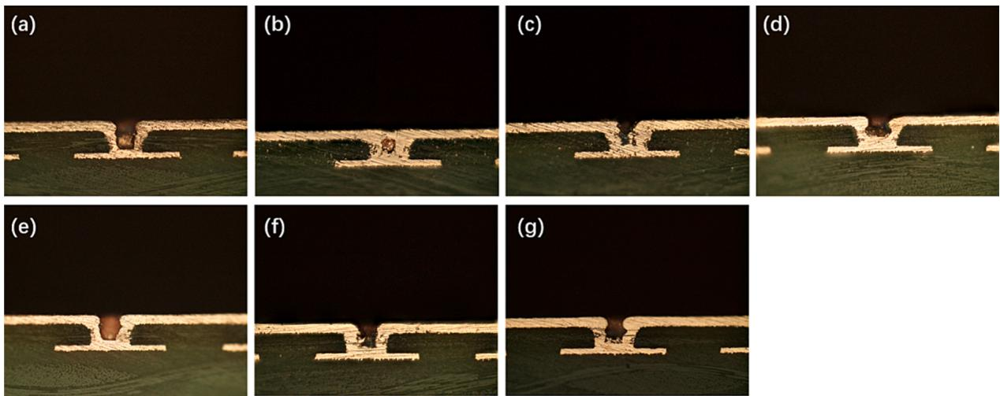  
Fig. 11. Hole filling results for different formulations (a) base plating solution + 1 ppm SPS + 200 ppm PEG, (b) 1 ppm AMT; (c) 2 ppm AMT; (d) 3 ppm AMT; (e) 5 ppm AMT; (f) 7 ppm AMT (g) 9 ppm AMT. plating for 1 h.

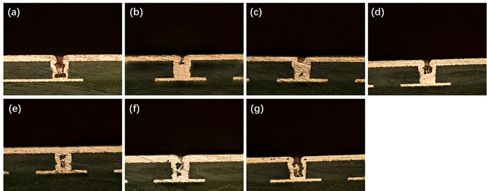  
Fig. 12. Hole filling results for different formulations (a) base plating solution + 1 ppm SPS + 200 ppm PEG, (b) 1 ppm AMT; (c) 2 ppm AMT; (d) 3 ppm AMT; (e) 5 ppm AMT; (f) 7 ppm AMT (g) 9 ppm AMT. plating for 90 min.

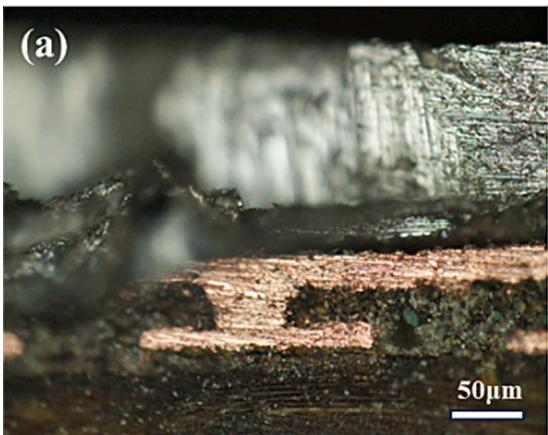

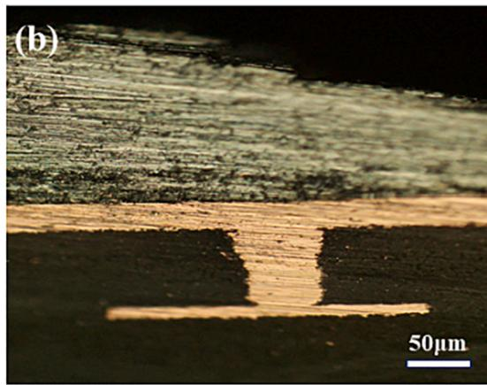  
Fig. 13. Optical microscope images of the cross-section of the blind holes (a) blind hole size of 75 μm × 120 μm; (b) blind hole size of 125 μm × 100 μm.

crystal structure of the copper layer that is formed in the electrolyte with varying concentrations of leveler. Fig. 16 depicts the XRD patterns of the copper layer acquired using an electroplating solution containing varying concentrations of MMT. The observation of Fig. 16 reveals that the copper layers obtained from the base solution without MMT show a face centered cubic crystal structure with a very strong diffraction peaks corresponding to the crystallographic plane $( 2 2 0 ) \mathrm { a t } 2 \Theta = 7 3 . 8 ^ { \circ }$ and two very weak diffraction peaks corresponding to the crystallographic plane (1 1 1) at $2 \boldsymbol { \Theta } = 4 2 . 8 ^ { \circ }$ and the crystallographic (2 0 0) at $2 \theta = 5 0 . 0 ^ { \circ } ,$ , which suggests that the copper coating grows preferentially along the (220)

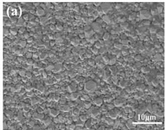

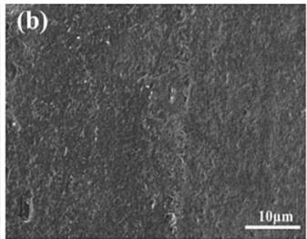

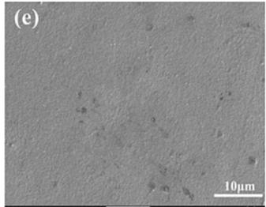

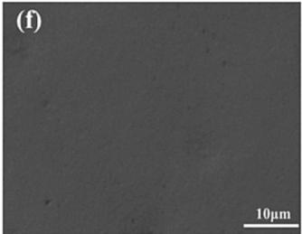

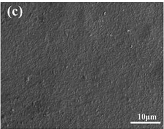

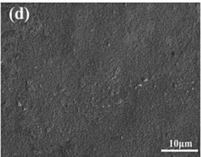

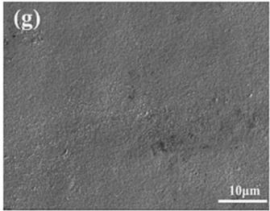  
Fig. 14. FE-SEM images of copper plating obtained from electrolytes containing different concentrations of MMT: magnification 2000x. (a) base plating solution, (b) 1 ppm MMT; (c) 2 ppm MMT; (d) 3 ppm MMT; (e) 5 ppm MMT; (f) 7 ppm MMT; (g) 9 ppm MMT.

(a)  
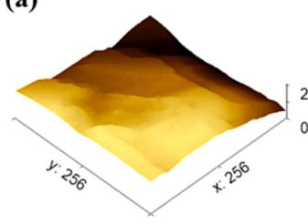

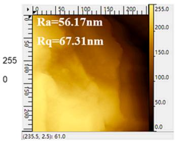

(b)  
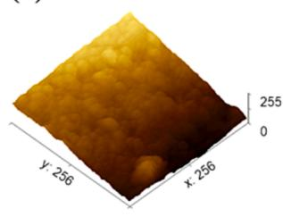

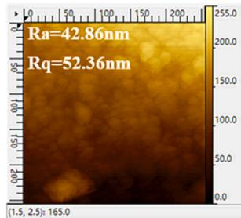

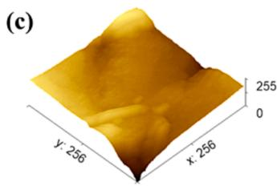

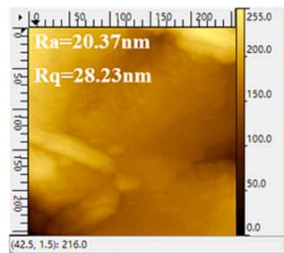

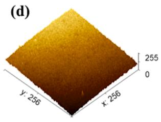

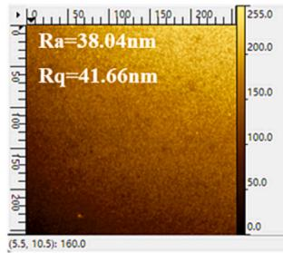  
Fig. 15. Atomic force microscope diagram. (a) base plating solution + 1 ppm SPS + 200 ppm PEG; (b) 3 ppm MMT; (c) 7 ppm MMT; (d) 9 ppm MMT. Plating 1 h.

crystal plane. The incorporation of MMT levelling agent induces a notable alteration in the favored orientation of copper coatings’ growth. As shown in Fig. 16, as the concentration of MMT levelling agent increases, the strength of the diffraction peak associated with the (2 2 0) crystal plane of the copper coating exhibits a progressive decline. While the diffraction peak of (1 1 1) diffraction crystal plane gradually increases, indicating that MMT levelling agent can inhibit the growth of the crystal plane (2 0 0) of copper crystal and promote the formation of copper crystals preferentially along the crystal plane (1 1 1).

## 3.6. In situ Raman spectroscopy analysis

In this study, we performed in-situ electrochemical Raman spectroscopy experiments to investigate the adsorption behavior of the additive MMT on the surface of copper plating during the electrochemical blind hole filling copper electroplating process. Furthermore, to better identify the adsorption bonds of MMT additives in electrochemical processes, the characteristic absorption peaks of the structural bonds of MMT were first analyzed through traditional Raman spectroscopy. Fig. 17 displays the conventional Raman spectra (Raman) and EC-SERS of the additive MMT. The observation of Fig. 17(a) reveals that the typical characteristic peaks from chemical bonds of MMT including the bending vibration peak of the S–C bond at $4 3 2 ~ \mathrm { c m } ^ { - 1 }$ , the bending vibration and vibrations associated of the C–N bond in the thiadiazol ring located at $6 5 8 ~ \mathrm { c m } ^ { - 1 }$ and $1 5 5 3 ~ \mathrm { c m } ^ { - 1 }$ , The antisymmetric deformation vibration of the thiadiazol ring is located at 745 cm− 1, the antisymmetric deformation vibration of the C–S bond linked to the thiadiazol ring at $1 0 4 5 ~ \mathrm { c m } ^ { - 1 } ;$ , stretching vibration of the $\mathrm { c - c }$ bond linked to the thia diazol ring at 1134 cm− 1 and 1272 cm , vibrations related to symmetric deformation of the CH group at 1379 $\mathrm { c m } ^ { - 1 }$ and $1 4 5 0 \mathrm { c m } ^ { - 1 }$ and stretching vibrations of the $\mathrm { C - H }$ bond in the CH3 group at $2 9 1 5 ~ \mathrm { c m } ^ { - 1 }$ appear at the conventional Raman spectra. From Fig. 17(b) shows in EC-SERS at different electrodeposition process. The observation of Fig. 17 (b) reveals that the chemical bond characteristic peaks of MMT molecules on the electrode surface change in intensity and quantity with the progress of electrodeposition. When electrodeposited for ${ 5 0 } s ,$ there was no obvious characteristic peak of MMT on the electrode surface, which may be related to the diffusion of MMT levelling agent in the electroplating solution and the time required for adsorption on the electrode surface. When the electrodeposition lasted for 100 s, relatively weak

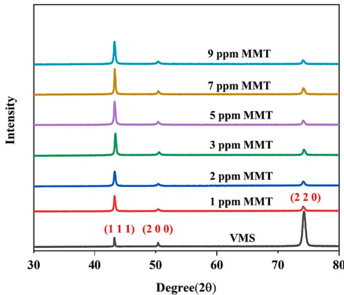  
Fig. 16. XRD spectra of copper plating layers with different concentrations of MMT.

characteristic peaks involving the bending vibration of the $\mathrm { c - N }$ bond in the thiadiazol ring located at 690 $\mathrm { c m } ^ { - 1 }$ and the $\mathrm { C H } _ { 3 }$ group symmetric deformation related vibrations at 1379 cm-1were detected from the electrode surface, indicating that the MMT levelling agent formed a certain adsorption on the electrode surface at this time. As the deposi tion time further prolonged, as shown in the Raman spectra corre sponding to the electrodeposition time of 200 s, 300 s, and 400 s in Fig. 17(b), except that the characteristic peaks of the bending vibration of the C–N bond and that of the CH group symmetric deformation were significantly enhanced, Vibrational characteristic peaks of $4 3 2 ~ \mathrm { c m } ^ { - 1 }$ (bending vibration peak of C–S bond), 799 $\mathrm { c m } ^ { - 1 }$ (anti-symmetric deformation vibration of thiadiazol ring), and $1 4 5 0 ~ \mathrm { c m } ^ { - 1 }$ (vibration related to symmetric deformation of $\mathrm { C H _ { 3 } }$ group) also appeared on the electrode surface. Additionally, it is noteworthy to notice that compared with the conventional Raman spectrum of levelling agent MMT 658 $\mathrm { c m } ^ { - 1 } \left( \mathrm { C } ^ { - } \mathrm { N } \right.$ bond bending vibrations in the thiadiazol ring), $7 4 5 ~ \mathrm { c m } ^ { - 1 }$ (thiadiazol ring antisymmetric deformation vibration of the thiadiazol ring) in the in-situ surface-enhanced Raman spectrum shifted to 690 $\mathrm { c m } ^ { - 1 }$ and $7 9 9 ~ \mathrm { c m } ^ { - 1 }$ , which may be due to the effect of the role of the stress caused by the peaks shifted. After the electrodeposition time reaches 500 s and 600 s, the characteristic absorption peak intensity detected on the electrode surface slightly decreases, which may be related to the desorption of MMT molecules during the electrodeposition process. According to the in-situ Raman spectroscopy analysis mentioned above, it can be concluded that during the electroplating process, MMT molecules may preferentially adsorb onto the electrode surface through $\scriptstyle \mathrm { C - } S , \mathrm { C - N } , \mathrm { N = N }$ bonds, and CH3 forming a preferential adsorption.

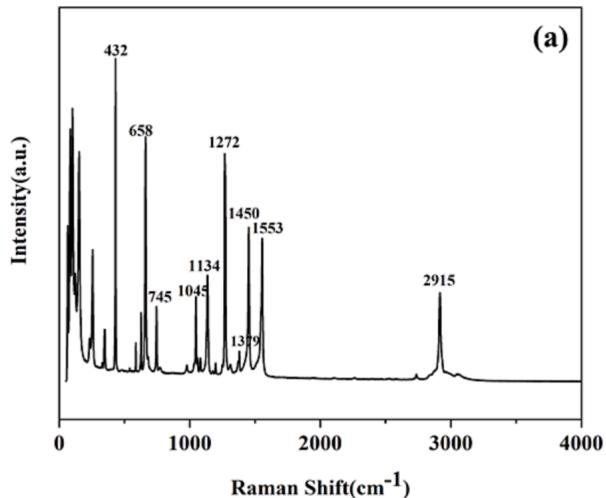

## 3.7. Theoretical calculations

## 3.7.1. Quantum chemical calculations

To gain a deeper comprehension of the inhibition behavior of MMT, here quantum chemical calculations are also applied to obtain physical information including electronic orbitals and electronic properties of the levelling agent to predict the active sites of MMT molecules and to explain their adsorption mechanisms. The molecular dynamics simulation software Material Studio (MS) is used to perform the quantum chemistry calculations to attain a series of property parameters including the highest occupied molecular orbital (HOMO), the lowest unoccupied molecular orbital (LUMO), the energy gap $( \Delta \mathrm { E } = \mathrm { E } _ { \mathrm { L U M O } } \cdot$ EHOMO) and the electrostatic potential (ESP). ELUMO closely related to the molecule’s ability to accept electrons and $\mathrm { E _ { H O M O } }$ to the molecule’s correlates with the ability to give electrons [16]. ΔE represents the adsorption strength of the molecule at the copper interface, the smaller ΔE indicates that the additive molecule is more stable and has a stronger adsorption capacity on the surface. Fig. 18 shows the distribution of LUMO and HOMO in the MMT molecule, and it can be seen that the density distribution is mainly located in the sulfur, nitrogen, and carbon atoms, which can indicate that the DTDP molecule can be tightly adsorbed on the surface of copper by providing the lone pair of electrons from these heteroatoms to the unoccupied orbitals of the copper. The calculated $\mathtt { E } _ { \mathrm { L U M O } }$ value of MMT molecular is −2.142 (ev), the $\mathrm { \Delta E _ { H O M O } = }$ -5.871 (ev) and the $\Delta \mathrm { E } = \mathrm { E } _ { \mathrm { L U M O } } \cdot \mathrm { E } _ { \mathrm { H O M O } } = 3 . 7 2 9 ~ ( \mathrm { e v } )$ . The EHOMO of MMT (-5.871 ev) is close to the EHOMO of the commercial additive JGB (- $5 . 6 8 9 \mathrm { e V } )$ , and the $\mathtt { E } _ { \mathrm { L U M O } }$ of MMT (-2.142 ev) is smaller than the ELUMO of the commercial additive JGB (-3.635 eV) [35].

The molecular electrostatic potential (ESP) is a useful tool for providing visualization of reaction sites and predicting the properties of some molecules [36]. Fig. 19 shows the distribution of molecular electrostatic potential (ESP) of MMT molecular structure, where the blue region of the ESP map is the negative region that represents the low electron density region, and the red region is a positive region and represents the high electron density region. It has been implied by molecular electrostatic potential analysis that the high electron density regions of the MMT molecule located in a large range covering the S

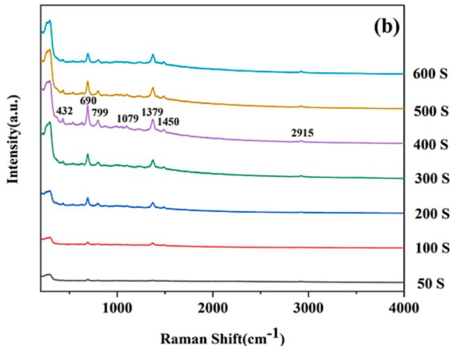  
Fig. 17. (a) Conventional Raman spectrum of levelling agent MMT; (b) In-situ surface enhanced Raman spectrum of levelling agent MMT in acidic copper sulphate. Plating solution: Basic electrolyte $\mathrm { ( C u S O _ { 4 } { \cdot } 5 H _ { 2 } O + H _ { 2 } S O _ { 4 } + C l ^ { - } ) + 7 }$ ppm MMT.

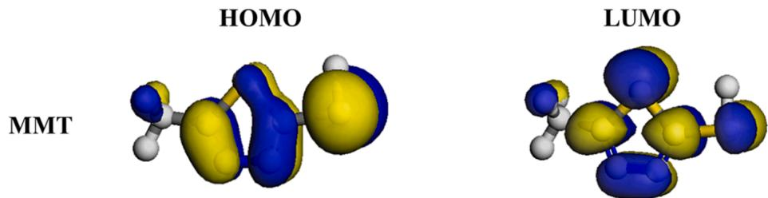  
Fig. 18. HOMO distribution and LUMO distribution of the levelling agent MMT molecule.

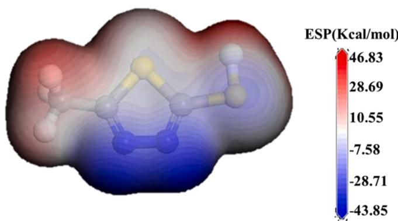  
Fig. 19. Electrostatic potential (ESP) of levelling agent MMT molecules.

atom, side chain $- \mathrm { C H } _ { 3 }$ and side chain -SH on the thiadiazol ring and its low electron density regions mainly distributed near -N––N- bonds. The electrophilic reactions associated with the blue region and nucleophilic reactions associated with the red region [37]. The nucleophilic sites in the high electron density region have strong coordination and adsorption properties, and this region can provide electrons to the empty orbitals on the copper surface to form coordination/covalent bonds [38,39]. So, it may be roughly speculated that the thiol groups, sulfur bonds, and alkyl groups in the molecular structure of MMT are the preferred adsorption sites for interaction with the copper surface.

## 3.7.2. Molecular dynamics simulations

The simulation of MMT molecule adsorption on Cu (111) crystal surfaces was conducted using Material Studio (MS) software to examine the adsorption sites and adsorption energy of MMT molecules at the interface. The outcomes of the simulations are depicted in Fig. 20. The observation of Fig. 20. reveals that the MMT molecule has an adsorption site and the calculated adsorption energy at the interface is $\mathbf { E _ { a b s o r p t i o n } = }$ ETotal- $\cdot \mathrm { E } _ { \mathrm { C u } ^ { - } } \mathrm { E } _ { \mathrm { L e v e l e r } } = - 3 2 . 4 8$ Kcal/mol, the $\mathrm { E _ { a b s o r p t i o n } } < 0$ indicates that MMT molecules prefer spontaneous adsorption. Fig. 20 (a-b) shows that the additive MMT diffuses first in the system. The observations made in $2 0 ( \mathsf { c } \cdot \mathsf { e } )$ reveal that the methyl, and sulfur bonds, and sulfhydryl groups of the additive MMT form adsorption sites with the copper surface. The preferential adsorption behaviors of these chemical bonds analyzed by molecular dynamics simulations are the same as those predicted by the calculations obtained from quantum chemical calculations. In addition, the MMT molecules may eventually adsorb on the copper surface in parallel as a result of the nitrogen-nitrogen bond, which belongs to the low electron density region, adhering on the copper surface by electrostatic adsorption with the copper substrate. This will have the effect of effectively inhibiting the deposition of copper. The effectiveness of the additive MMT as a levelling agent is further supported by the aforementioned quantum chemistry calculations and molecular dynamics simulations.

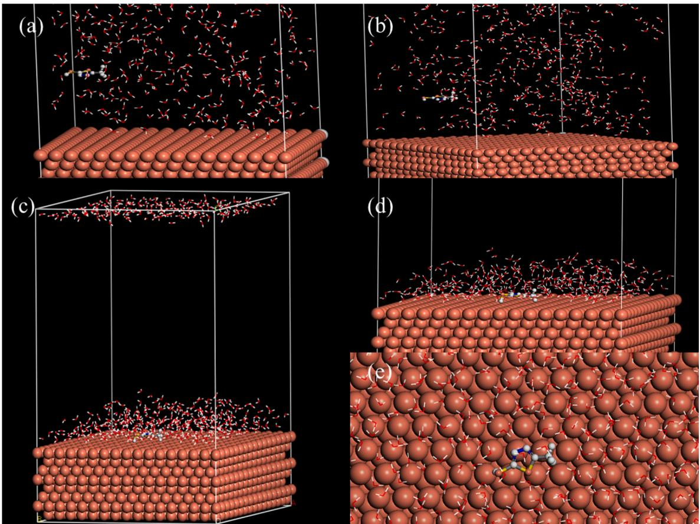  
Fig. 20. Molecular dynamics simulation of MMT molecules

## 4. Conclusion

In summary, two small five-membered heterocyclic compounds with different side chains, namely AMT and MMT, were selected as electroplated copper levelling agents in this paper. The electrochemical anal ysis of CV, LSV, and GM showed that MMT has greater inhibitory ability in inhibiting copper deposition behavior compared to AMT. An optima concentration (7 ppm) of MMT added for effectively suppressing copper deposition was obtained by electrochemical analysis from the CV, LSV, and GM experiments based on the addition of different concentrations of MMT additives. The blind hole filling experiment further demonstrates that such an optimal addition concentration for MMT can achieve cop per overfilling in high aspect ratio PCB blind holes. Characterization analyses from FE-SEM, AFM, and XRD also further demonstrate that the coating obtained at this optimal concentration of MMT has the densest and smoothest surface with a typical 111 texture preferential growth. The thermal shock experiment based on tin immersion indicates that the copper layer obtained using MMT as a leveling agent has good reli ability. It is indicated by in-situ Raman spectroscopy analysis that the adsorption of MMT molecules on the electrode surface is a time dependent process and the C–S, C–N, N––N, and - CH bonds are preferentially adsorbed on the electrode surface. The smaller energy gap value (ΔE = 3.729 (ev)) for the MMT molecule calculated by quantum chemistry further indicates that suggest that the MMT molecules have strong adsorption capacity. Furthermore, Quantum chemical calcula tions based on the electronic potential energy of the MMT molecula structure indicate that the thiol group, sulfur bond, and alkyl groups from the MMT molecular belong to nucleophilic groups and provides the preferred adsorption reaction active sites for interaction with the copper surface, which is consistent with the results from the in situ electrochemical enhanced Raman spectroscopy. The adsorption of these nucleophilic groups on the copper surface effectively inhibits copper deposition and thereby achieving bottom-up copper overfilling in blind holes. These results from the electrochemical analysis and theoretical calculations fully demonstrate that MMT is an effective levelling agent for PCB blind hole filling.

## CRediT authorship contribution statement

Tao Zhang: Writing – original draft. Chaojie Zheng: Software. Haidi Li: Supervision. Shiqi Song: Supervision. Wei Huang: Validation, Supervision. Qiaoxia Li: Writing – review & editing. Yulin Min: Writing – review & editing. Xixun Shen: Writing – review & editing. Qunjie Xu: Writing – review & editing.

## Declaration of competing interest

The authors declare that they have no known competing financial interests or personal relationships that could have appeared to influence the work reported in this paper.

## Acknowledgements

This work was financially supported by the National Natural Science Foundation of China (No. 21972090) and the Science and Technology Commission of Shanghai Municipality (No.19DZ2271100).

## References

[1] L. Zan, Z. Liu, Z. Yang, et al., A synergy effect of 2-MBT and PE-3650 on the bottom-up filling in electroless copper plating, Electrochem. Solid St. 14 (12) (2011) D107–D109.

[2] T.D.A. Jones, A. Bernassau, D. Flynn, et al., Copper electroplating of PCB interconnects using megasonic acoustic streaming, Ultrason. Sonochem. 42 (2018) 434–444.

[3] X. Wang, Y. Cheng, Y. Dong, A Wideband PCB-Stacked Air-Filled Luneburg Lens Antenna for 5G Millimeter-Wave Applications, IEEE Antennas Wirel. Propag. Lett. 20 (3) (2021) 327 331.

[4] M. Tomie, T. Akita, M. Irita, et al., Transitional Additive Adsorption with Co Addition of Suppressor and Leveler for Copper TSV Filling, J. Electrochem. Soc. 167 (8) (2020) 082513.

[5] R. Kimizuka, H. Toda, T. Eda, et al., Influence of SPS Decomposition Product 1,3- Propane Disulfonic Acid on Electrolytic Copper Via Filling Performance, J. Electrochem. Soc. 162 (12) (2015) D584–D588.

[6] J. Luo, Z. Li, M. Shi, et al., Effects of Accelerator Alkyl Chain Length on the Microvia Filling Performance in Copper Superconformal Electroplating, J. Electrochem. Soc. 166 (4) (2019) D104 D112.

[7] F. Wang, Q. Zhang, W. Liu, et al., Interaction effect of suppressor concentration and current density on the copper deposition rate in TSV filling process, Microelectron. Eng. 216 (2019) 111022.

[8] J.W. Gallaway, M.J. Willey, A.C. West, Copper Filling of 100 nm Trenches Using PEG, PPG, and a Triblock Copolymer as Plating Suppressors, J. Electrochem. Soc. 156 (8) (2009) D287 D295

[9] N. Xiao, D. Li, G. Cui, et al., An effective triblock copolymer as a suppressor for microvia filling via copper electrodeposition, Electrochim. Acta 109 (2013) 226–232.

[10] T.Y. Kim, S. Choe, J.J. Kim, Decomposition of polyethylene glycol (PEG) at Cu cathode and insoluble anode during Cu electrodeposition, Electrochim. Acta 357 (2020) 136803.

[11] B. Bozzini, C. Mele, L. Duezo, et al., An electrochemical and in situ SERS study of Cu electrodeposition from acidic sulphate solutions in the presence of 3-diethylamino-7-(4-dimethylaminophenylazo)-5-phenylphenazinium chloride (Janus Green B), J. Appl. Electrochem. 36 (9) (2006) 973–981.

[12] W.P. Dow, C.C. Li, M.W. Lin, et al., Copper Fill of Microvia Using a Thiol-Modified Cu Seed Layer and Various Levelers, J. Electrochem. Soc. 156 (8) (2009) D314–D320.

[13] W.P. Dow, C.C. Li, Y.C. Su, et al., Microvia filling by copper electroplating using diazine black as a leveler, Electrochim. Acta 54 (24) (2009) 5894–5901

[14] T.P. Moffat, D. Wheeler, S.K. Kim, et al., Curvature enhanced adsorbate coverage mechanism for bottom-up superfilling and bump control in damascene processing, Electrochim. Acta 53 (1) (2007) 145–154.

[15] Y.M. Meng, M.M. Zhou, W. Huang, et al., Benzyl-containing quaternary ammonium salt as a new leveler for microvia copper electroplating, Electrochim. Acta 429 (2022) 141013.

[16] X. Wang, S. Zhang, S. Chen, et al., Effects of 2,2-Dithiodipyridine as a Leveler for Through-Holes Filling by Copper Electroplating, J. Electrochem. Soc. 166 (13) (2019) D660 D668.

[17] M. Tang, S. Zhang, Y. Qiang, et al., 4,6-Dimethyl-2-mercaptopyrimidine as a potential leveler for microvia filling with electroplating copper, RSC Adv. 7 (64) (2017) 40342 40353.

[18] C. Liao, S. Zhang, S. Chen, et al., The effect of tricyclazole as a novel leveler for filling electroplated copper microvias, J. Electroanal. Chem. 827 (2018) 151–159.

[19] X. Teng, Z. Tao, Z. Long, et al., 1-(4-Hydroxyphenyl)-2H-tetrazole-5-thione as a leveler for acid copper electroplating of microvia, RSC Adv. 12 (25) (2022) 16153 16164.

[20] J. Li, G. Zhou, Y. Hong, et al., Copolymer of Pyrrole and 1,4-Butanediol Diglycidyl as an Efficient Additive Leveler for Through-Hole Copper Electroplating, ACS Omega 5 (10) (2020) 4868 4874.

[21] N.T.M. Hai, J. Furrer, E. Barletta, et al., Copolymers of imidazole and 1, 4-butandiol diglycidyl ether as an efficient suppressor additive for copper electroplating, J. Electrochem. Soc. 161 (9) (2014) D381–D387.

[22] L. Zheng, W. He, K. Zhu, et al., Investigation of poly (1-vinyl imidazole co 1, 4- butanediol diglycidyl ether) as a leveler for copper electroplating of through-hole, Electrochim. Acta 283 (2018) 560–567.

[23] S.H. Zhao, N.K. Panj, X.J. Wang, et al., Function of Sulfhydryl (-HS) Group During Microvia Filling by Copper Plating, J. Electrochem. Soc. 167 (11) (2020) 112502.

[24] M. Zhou, Y. Meng, J. Ling, et al., 5-Amino-1,3,4-thiadiazole-2-thiol as a new leveler for blind holes copper electroplating: Theoretical calculation and electrochemica studies, Appl. Surf. Sci. 606 (2022) 154871.

[25] H.F. Alesar, H.K. Ismail, A. Hameid Odda, et al., Influence of different concentrations of nicotinic acid on the electrochemical fabrication of copper film from an ionic liquid based on the complexation of choline chloride-ethylene glycol, J. Electroanal. Chem. 897 (2021) 115581.

[26] H.F. Alesar, A.F. Khuhair, S.Y. Rfaish, et al., Effect of Sodium Bromide on the Electrodeposition of Sn, Cu, Ag and Ni from a Deep Eutectic Solvent-Based Ionic Liquid, Int. J. Electrochem. Sci. 14 (8) (2019) 7116 7132.

[27] C. Lei, H.F. Alesar, F. Khan, et al., Gamma-phase Zn-Ni alloy deposition by pulseelectroplating from a modified deep eutectic solution, Surf. Coat. Technol. 403 (2020) 126434.

[28] Z. Tao, W. He, J. Li, et al., Tetraoxa-Diphosphaspiro Derivative as Suppressor fo Microvia Filling by Copper Electroplating in Acidic Solution, J. Electrochem. Soc. 164 (14) (2017) D1034 D1041

[29] W.P. Dow, H.S. Huang, M.Y. Yen, et al., Influence of Convection-Dependent Adsorption of Additives on Microvia Filling by Copper Electroplating, J. Electrochem. Soc. 152 (6) (2005) C425–C434.

[30] W.P. Dow, M.Y. Yen, S.Z. Liao, et al., Filling mechanism in microvia metallization by copper electroplating, Electrochim. Acta 53 (28) (2008) 8228 8237.

[31] T.P. Moffat, D. Wheeler, S.K. Kim, et al., Curvature Enhanced Adsorbate Coverage Model for Electrodeposition, J. Electrochem. Soc. 153 (2) (2006) C127 C132.

[32] M. Nagar, A. Radisic, K. Strubbe, et al., The effect of polyether suppressors on the nucleation and growth of copper on RuTa seeded substrate for direct copper plating, Electrochim. Acta 127 (2014) 315–326.

[33] P. Ren, M. An, P. Yang, et al., Unveiling the synergistic inhibition of Cl− copper plating: Pivotal roles of adsorption and desorption, J. Electroanal. Chem. 898 (2021) 115624.

[34] X. Lu, L. Yao, S. Ren, et al., A study of bottom-up electroplated copper filling by the potential difference between two rotating speeds of a working electrode, J. Electroanal. Chem. 712 (2014) 25–32.

[35] Z. Lai, S. Wang, C. Wang, et al., A comparison of typical additives for copper electroplating based on theoretical computation, Comput. Mater. Sci 147 (2018) 95–102.

[36] X. Wang, K. Wang, J. Xu, et al., Quinacridone skeleton as a promising efficient leveler for smooth and conformal copper electrodeposition, Dyes Pigm. 181 (2020) 108594.

[37] Y. Feng, J. He, Y. Zhan, et al., Insight into the anti-corrosion mechanism Veratrum root extract as a green corrosion inhibitor, J. Mol. Liq. 334 (2021) 116110

[38] J. Lv, X. Zhao, X. Jie, et al., Fatty Acid Quaternary Ammonium Surfactants Based on Renewable Resources as a Leveler for Copper Electroplating, ChemElectroChem 6 (13) (2019) 3254 3263.

[39] Z. Lai, S. Wang, C. Wang, et al., Computational analysis and experimental evidence of two typical levelers for acid copper electroplating, Electrochim. Acta 273 (2018) 318–326.