# Molecular structure with adsorption behavior of butynediol and its effects on cobalt electrodeposition

Lei Jin a,\* , Yu-Jie Lv a, Ting-Ting Ran a, Die He a, Fang-Zu Yang

a Chongqing Key Laboratory of Extraordinary Bond Engineering and Advance Materials Technology (EBEAM), School of Materials Science and Engineering, Yangtze Normal University, Chongqing 408100, China

b State Key Laboratory of Physical Chemistry of Solid Surfaces, Engineering Research Center of Electrochemical Technologies of Ministry of Education, Department of Chemistry, College of Chemistry and Chemical Engineering, Xiamen University, Xiamen, Fujian 361005, China

## A R T I C L E I N F O

Keywords: Molecular structure Adsorption Butynediol DFT Electrodeposition

## A B S T R A C T

Cobalt electrodeposition is the core technology in chip manufacturing. Butynediol (BD) is the key component in cobalt electrodeposition. In this work, the molecule structure and adsorption ability of BD are successfully revealed by density functional theory (DFT) calculations. The number of transferred electrons (ΔN) value near 0, and the interaction between oxygen atom not alkynyl group in BD and cobalt, demonstrating that BD is physically adsorbed on the cobalt surface. The adsorption energy of BD on hexagonal closepacked (hcp)(101) is −0.67 eV, which is the highest adsorption energy among crystal faces, manifesting that (101) may be a potential preferred orientation. Then the effects of BD on the electroreduction behavior of cobalt is revealed by electro chemical experimental techniques. BD can inhibit the electroreduction of cobalt ions based on kinetics and decreases the diffusion coefficient from 3.43 × 10− 6 to 1.33 × 10− 6 cm2/s, but the reaction is irreversible with diffusion control whether it contains BD or not. BD can make the charge transfer resistance increase from 241 Ω/cm2 to 496 Ω/cm2. BD has some effects on the cobalt electroreduction kinetics, it does not change the instantaneous nucleation mechanism. Finally, the morphology, composition and structure of the cobalt coating are characterized by scanning electron microscope (SEM) with energy dispersive spectroscopy (EDS) and X-ray diffraction (XRD). BD can refine the grains and improving the uniformity of the cobalt coating. Although the properties of the mixed crystals have not changed, the preferred orientation has changed due to the addition of BD. A new peak of hcp(101) arises resulted from the adsorption of BD to form a retained surface, which are consistent with the calculation results. And the relatively positive values of stress change indicates that BD causes the internal stress of cobalt coating to be tensile stress.

## 1. Introduction

Electrodeposition plays a vital role in advanced chip manufacturing as it is a key technology for electrical interconnects. With the rapid development of technology, the length of metal wiring inside the chip has been significantly extended, at the same time, the number of layers inside the chip has also continued to increase. To improve energy efficiency and performance, the size of transistors and metals must continue to shrink [1–4]. However, this process inevitably exacerbates the size effect (grain boundary and interface diffusion of electrons in metals), significantly increases the current load and resistance, and causes serious RC delay and thermal damage to chip performance. Metal cobalt has a small mean free path and low size effect, making it an ideal metal

[5].

Metal cobalt interconnect layer is mainly prepared by electrodeposition technology. In the process of metal cobalt electrodeposition, additives are key components that can adjust the cobalt deposition rate in via and trench, improve the uniformity of the deposited cobalt film, and thus improve chip performance [6–9]. However, due to the confidentiality of the technology, there are relatively few related studies and reports, but this does not affect its importance and application prospects. Li et al. [10] introduced that dye molecule Nitrotetrazolium Blue chloride could refine cobalt grains and achieve microvia superconformal filling. Huang et al. [11,12] showed that dimethylglyoxime had a strong suppression effect and made cobalt a three-dimensional nucleation. Wu et al. [13] discovered that Akyne-PEG4-amine could be used as an inhibitor to achieve nanometer scale superfilling of cobalt electrode position. Kiruba et al. [14] presented that butynediol (BD) would change the interfacial pH to regulate and control the formation of cobalt. It is worth noting that BD as a typical type-II brightener has attracted much attention among the many cobalt additives. Jeyabharathi et al. [15] deemed that BD would cause electrochemical oscillation due to the hydrogenation of BD during cobalt electrodeposition. Pan et al. [16] showed that BD and saccharin together could decrease the microhard ness of cobalt deposits as a result of increased grain size. Although it is well known that BD can be used as an additive, the effect of its molecular structure on the interface of cobalt electrodeposition has not been elucidated at a molecular level. Therefore, it is necessary to carry out relevant research. This study demonstrates the adsorption state of BD on cobalt surface and the effects of adsorption on crystal growth and orientation. This enriches the understanding of the role of additives in the cobalt electrodeposition process, revealing that BD achieves uniformity and compact film morphology through interactions with the cobalt surface, which is conducive to promote the development of high-performance chip interconnection technology.

In this work, the molecule structure, adsorption ability and electrochemical property of BD are revealed through density functional theory (DFT) calculation and electrochemical analyses. The effect of BD on the morphology, composition and structure of the cobalt coating were clarified by scanning electron microscopy (SEM) with energy dispersive spectroscopy (EDS) and X-ray diffraction (XRD).

## 2. Experimental

## 2.1. Reagents

$\mathrm { C o S O _ { 4 } { \bullet } 7 \ H _ { 2 } O , H _ { 3 } B O _ { 3 } }$ and $\mathrm { C o C l } _ { 2 } { \cdot } 6 \ \mathrm { H } _ { 2 } 0$ were purchased from Chron Chemicals $\mathrm { C o . , }$ Ltd. (China). Butynediol and $\mathrm { H _ { 2 } S O _ { 4 } }$ were purchased from Macklin $\mathrm { C o . }$ , Ltd. (China). All the reagents used were analytical grade.

## 2.2. Electrochemical analyses

Electrochemical analyses were performed using CHI electrochemical workstation (CHI760, China). The basic electrolyte composed of 0.3 M $\mathrm { C o S O 4 ^ { \bullet 7 } }$ H2O, 0.16 M $\mathrm { H _ { 3 } B O _ { 3 } }$ and 0.02 M CoCl ⋅6 H O. The concentration of additive BD was 0.12 mM. The pH of the electrolyte was adjusted by 5 % $\mathrm { H _ { 2 } } S O _ { 4 }$ aqueous solution and stabilized to $3 \sim 4 .$ The temperature of electrolyte was 303 K. A glassy carbon electrode (GCE) with 3 mm diameter, a H $\mathrm { [ g / H g _ { 2 } S O _ { 4 } }$ electrode (saturated $\mathrm { K _ { 2 } S O _ { 4 } }$ solution, SMSE) and a platinum sheet were acted as the working electrode, reference electrode and counter electrode, respectively. Before experiments, the GCE was firstly polished with 300 nm and 50 nm $\mathrm { { A l } _ { 2 } \mathrm { { O } _ { 3 } } }$ respectively, further ultrasonically cleaned in absolute ethanol and ultrapure water $( 1 8 . 2 \mathrm { M } \Omega \mathrm { c m } ^ { - 1 } )$ . The value of the OCP is about −0.21 V and the stability time is 120 s.

## 2.3. Electrodeposition and characterization details

The cobalt electrodeposition experiments were carried out in baths (0.3 M CoSO •7 H O, 0.16 M $\mathrm { H _ { 3 } B O _ { 3 } }$ and 0.02 M $\mathrm { C o C l } _ { 2 } { \cdot } 6 \ \mathrm { H } _ { 2 } \mathrm { O } )$ without and with BD at the temperature of 303 K and the pH of 3–4. The current density was 10 mA/cm2. The electrodeposition time was 10 min. The anode material is cobalt plate (area: $5 \times 5 ~ \mathrm { c m } ^ { 2 }$ , thickness:1 cm), and cathode material is copper sheet (area: $4 \times 2 \mathrm { c m } ^ { 2 } ,$ , thickness: 50 μm). The distance between anode and cathode is 6 cm. The morphology of the cobalt coating was characterized by SEM (Zeiss) with an accelerating voltage of 10 kV. Coupled EDS was used to measure the composition. The structure of the cobalt coating was characterized by XRD (Rigaku) with Cu Kα target and wavelength of 0.15406 nm.

## 2.4. Calculations

The DFT calculations of BD molecule were conducted by Gaussian 09 program package [17]. Basis sets of 6–311 $+ + \mathbf { G } ^ { * } \ast ^ { * }$ for H, C and O atoms was employed with B3LYP functional [18]. The solvent effect of water was included by integral equation formalism polarizable continuum model (IEFPCM). The electrostatic potential (ESP) and average local ionisation energy (ALIE) were calculated by using the Multiwfn package [19–22].

The adsorption of BD on cobalt surface at different faces was investigated using the slab model DFT calculations with the generalized Perdew–Burke–Ernzerhof (PBE) [23], and the projector augmented-wave (PAW) pseudopotential plane-wave method on the VASP code [24–28]. $\mathbb { A } 2 \times 2 \times 1$ Monkhorst-Pack k-point grid was used for all on geometry optimization calculations. The plane-wave energy cutoff was set to 500 eV. The convergence criterion for the total energy tolerance per atom was $1 \times 1 0 ^ { - 6 }$ eV/atom, and the maximum force tolerance was $0 . 0 2 \ : \mathrm { e V } { \cdot } \mathring { \mathrm { A } } ^ { - 1 }$

## 3. Results and discussion

## 3.1. Number of transferred electrons and frontier molecular orbits

The work function of metal and the highest occupied molecular orbital (HOMO) of molecule can be used to evaluate the electron transfer and the adsorption ability. The work function of cobalt is about 4.70 eV [29], meaning that the Fermi level of cobalt is about −4.70 V (Assumption: the vacuum energy level is 0). The energy of the highest occupied molecular orbital (EHOMO) of $\mathrm { \bf B D i s } - 7 . 5 5 \mathrm { e V }$ . If the Fermi level of the metal is close to the HOMO level of the molecule, the driving force for electrons to transfer from the molecule to the metal surface will decrease. This means that electrons are more likely to transfer between metal and molecule, thereby enhancing the interaction between molecule and metal surface. Obviously, the Fermi level value of cobalt is quite different from the HOMO level value of BD, and the interaction between them is relatively weak. The number of transferred electrons (ΔN) can further analyze the ability of the electron transfer between metal and molecule. when the value of ΔN is close to $^ { 0 , }$ it means that the electron transfer is not obvious, indicating that the interaction is physical adsorption [30]. The value of ΔN can be obtained by a series of physical quantities including the EHOMO, the energy of the lowest unoccupied molecular orbital $\left( E _ { \mathrm { L U M O } } \right)$ , ionization potential (IE), the electron affinity (EA), the absolute electronegativity $\left( \chi \right)$ and the absolute hardness $\left( \eta \right)$ . The relevant formulae are as follows [31,32]. Thereinto, the values of $\chi _ { \mathbf { C o } }$ and $\eta _ { \mathrm { C o } }$ are 4.3 eV and $3 . 6 \mathrm { e V } ,$ , respectively [32].

$$
I E = - E _ {H O M O}\tag{1}
$$

$$
E A = - E _ {L U M O}\tag{2}
$$

$$
\chi = \frac {E A + I E}{2}\tag{3}
$$

$$
\eta = \frac {I E - E A}{2}\tag{4}
$$

$$
\Delta N = \frac {\chi_ {C o} - \chi_ {a d}}{2 (\eta_ {C o} + \eta_ {a d})}\tag{5}
$$

To obtained the corresponding physical quantities, the DFT calculations are carried out. Fig. 1 shows the $E _ { \mathrm { H O M O } }$ and $E _ { \mathrm { L U M O } }$ values of BD. The HOMO and LUMO of BD are both primarily localized the whole molecule, preliminarily speculating the above regions are vulnerable to the nucleophilic attack and the electrophilic attack. The value of EHOMO and $E _ { \mathrm { L U M O } }$ are −7.55 and −0.48 eV. The corresponding values of IE, EA, $\chi _ { \mathrm { a d } }$ and ηad are 7.55, 0.48, 4.02 and 3.54 $\mathbf { e V } ,$ , respectively. Based on the formula (5), the value of ΔN is 0.020 (near 0). The results manifest that BD may be physical adsorption on the metal surface.

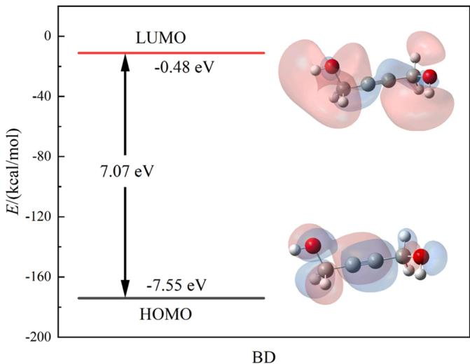  
Fig. 1. EHOMO and ELUMO values of BD (H white, C gray, O red).

## 3.2. Electrostatic potential and average local ionisation energy

Adsorption can be divided into physical adsorption and chemical adsorption, which are related to the electrostatic effects and the reactivity of molecule, respectively. To expound the electrostatic effects of BD, the colored isopleth maps of the ESP and the area distribution of ESP spacings on the equivalent surface for BD are displayed in Fig. 2. The red region and blue region represent the higher and lower ESP, respectively. The maximum and minimum values of ESP are expressed by orange and cyan spheres, respectively. As shown in Fig. 2a, it can be seen that the lower ESP is mainly distributed on the oxygen atoms on both sides, and the higher ESP is mainly located in the hydrogen atoms on both sides, indicating that the electrons are mainly concentrated on the oxygen atoms on both sides, and the holes are primarily distributed in the hydrogen atoms on both sides. The highest and lowest ESP values are 52.67 and −43.90 kcal/mol. This uneven distribution of ESP can easily lead to a strong electrostatic effect [33]. Fig. 2b presents the histogram of the area distribution at different ESP intervals for BD. Obviously, BD has a relatively high percentage of area in the low (< −30) and high (>10) regions of ESP. The results again manifest that BD can be adsorbed on metal substances in a strong electrostatic interaction [33], and is mainly physically adsorbed by oxygen atoms.

To clarify the reactivity of BD, the ALIE is completed and the results are presented in Fig. 3. The lower the value of ALIE is, the stronger the reactivity is. The cyan spheres represent the lower points of ALIE, which means that these points are easy to attack by electrophilic reaction [33]. The highest and lowest ALIE values are 268.89 and 203.39 kcal/mol. Obviously, the reactive sites are mainly located in the alkynyl group, that is, these regions are prone to chemical adsorption. Moreover, the more spheres there are in the blue regions, the more chemically active the molecule is, and the easier it is to chemically adsorb. Therefore, it can be seen that BD is also prone to chemical adsorption, and the active sites are mainly concentrated at alkynyl group.

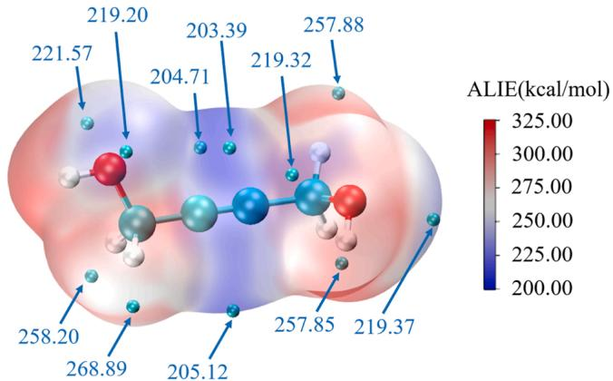  
Fig. 3. ALIE mapped van der Waals surface of BD.

## 3.3. Adsorption on cobalt surface

Based on the ESP and ALIE results, it can be found that BD may be chemical and physical adsorption, and the adsorption regions are concentrated at the alkynyl group and the oxygen atoms on both sides, respectively. To further understand the adsorption type of BD, the adsorption structure of BD and its adsorption energy on different crystal faces are completed. Cobalt possesses face centered cubic (fcc) and hexagonal closepacked (hcp) structures. Fig. 4 presents the adsorption behavior of BD on different fcc and hcp crystal faces. Table 1 and Table 2 show the energy values of the different structures and the corresponding adsorptions, respectively. As shown in Fig. 4, regardless of crystal faces, BD is adsorbed exothermically. At the co-adsorbed structure, there are interactions between oxygen atom in BD and cobalt, verifying that BD is physically adsorbed on the surface of cobalt metal. Furthermore, the adsorption energy of BD on fcc(111), fcc(200), fcc(220), hcp(002), hcp (100) and hcp(101) are −0.34, −0.37, −0.44, −0.38, −0.08 and −0.67 eV, respectively. The results indicate that BD is easily adsorbed on the surface of hcp(101), forming a retention surface, which eventually makes (101) a potential preferred orientation.

## 3.4. Electrochemical behaviors

Electrochemical analyses help reveal the effects of BD on the elec troreduction mechanism of cobalt ions. The electrolyte is composed of

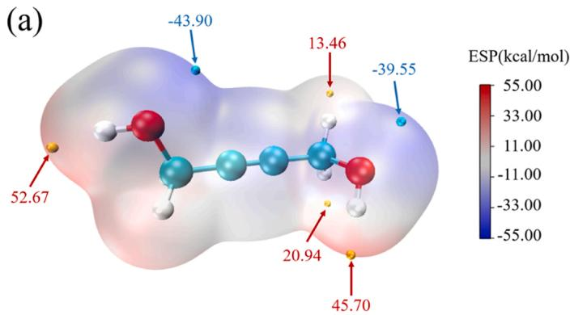

(b)  
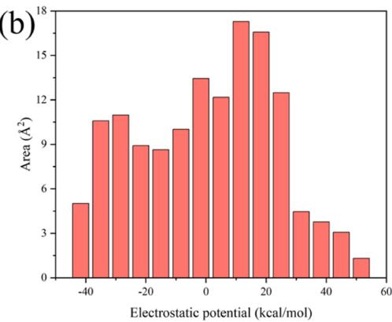  
Fig. 2. Electrostatic effects of BD: (a) ESP mapped van der Waals surface and (b) area distribution at different ESP intervals.

Table 1  
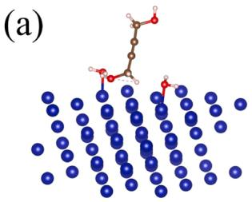

(b)  
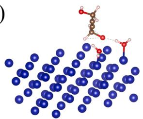

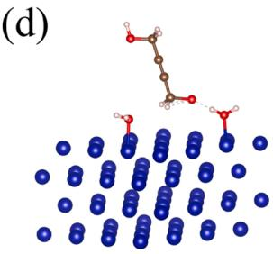

(e)  
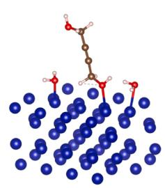

(f)  
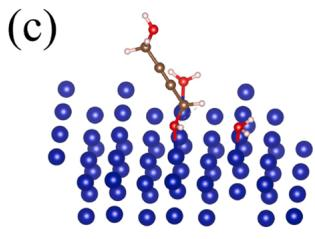

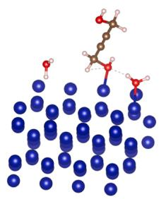  
Fig. 4. Adsorption behavior of BD on different crystal faces: (a) fcc (111), (b) fcc (200), (c) fcc (220), (d) hcp (002), (e) hcp (100) and (f) hcp (101)

Energy values of the different structures.

<table><tr><td>Structures</td><td>Energies/eV</td></tr><tr><td>fcc(111)- $H_2O$ </td><td>-439.66</td></tr><tr><td>fcc(200)- $H_2O$ </td><td>-431.00</td></tr><tr><td>fcc(220)- $H_2O$ </td><td>-415.49</td></tr><tr><td>hcp(002)- $H_2O$ </td><td>-438.26</td></tr><tr><td>hcp(100)- $H_2O$ </td><td>-434.41</td></tr><tr><td>hcp(101)- $H_2O$ </td><td>-434.11</td></tr><tr><td>fcc(111)- $H_2O$ -BD</td><td>-509.05</td></tr><tr><td>fcc(200)- $H_2O$ -BD</td><td>-500.41</td></tr><tr><td>fcc(220)- $H_2O$ -BD</td><td>-484.97</td></tr><tr><td>hcp(002)- $H_2O$ -BD</td><td>-507.68</td></tr><tr><td>hcp(100)- $H_2O$ -BD</td><td>-503.53</td></tr><tr><td>hcp(101)- $H_2O$ -BD</td><td>-503.83</td></tr><tr><td>BD</td><td>-69.04</td></tr></table>

Table 2  
Energy values of the corresponding adsorptions.

<table><tr><td>Adsorptions</td><td>Energies/eV</td></tr><tr><td>BD on fcc(111)</td><td>-0.34</td></tr><tr><td>BD on fcc(200)</td><td>-0.37</td></tr><tr><td>BD on fcc(220)</td><td>-0.44</td></tr><tr><td>BD on hcp(002)</td><td>-0.38</td></tr><tr><td>BD on hcp(100)</td><td>-0.08</td></tr><tr><td>BD on hcp(101)</td><td>-0.67</td></tr></table>

0.3 M $\mathrm { C o S O _ { 4 } { \bullet } 7 \ H _ { 2 } O , 0 . 1 6 \ M \ H _ { 3 } B O _ { 3 } }$ and 0.02 M ${ \mathrm { C o C l } } _ { 2 } { \cdot } 6 { \mathrm { H } } _ { 2 } 0 .$ . The potential is negatively scanned from the open circuit potential (OCP) to −1.2 V, then positively to 1.0 V, and finally back to the OCP. Fig. 5 presents the cyclic voltammetry (CV) curves at scanning rate of 50 mV/s on GCE in electrolyte without and with BD. It can be observed that the cathodic peak potentials are −0.92 V and −0.91 V without and with BD, which both attributes to the electroreduction of cobalt ions. The results suggest that, based on thermodynamics, BD may have little effect on the electroreduction reaction. It is worth noting that the cathodic peak currents are − $1 . 9 8 ~ \mathrm { m A } / \mathrm { c m } ^ { 2 }$ and − $1 . 3 0 \mathrm { m A } / \mathrm { c m } ^ { 2 }$ without and with BD, indicating that based on kinetics, BD can inhibit the electroreduction of cobalt ions. On account of the above results, BD has the ability to inhibit the occurrence of cathodic reactions. Moreover, in the more positive potential range $( 0 . 5 \sim 1 . 0 \mathrm { V } ) ,$ , the current increases sharply, indicating that metal cobalt is oxidized. The anodic current with BD is less than that without BD, which may be due to the adsorption of BD, hindering the dissolution of cobalt.

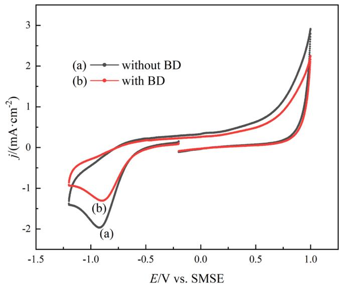  
Fig. 5. CV curves at scanning rate of 50 mV/s on GCE in electrolyte composed of 0.3 M CoSO •7 H O, 0.16 M $\mathrm { H _ { 3 } B O _ { 3 } }$ and 0.02 M CoCl ⋅6 H O: (a) without BD and (b) with BD.

To further elucidate the kinetics of cathodic cobalt electroreduction, CV experiments at different scan rates are performed. Fig. 6 displays the CV curves at different scanning rates on GCE in electrolyte without and with BD. When the scan rate increases, the cathodic peak potential moves toward a negative value and the cathodic peak current increases, indicating that the reaction is in irreversible. Accordingly, the scan rate and potential satisfy the following $\operatorname { E q . }$ (6) [34,35]. If the reaction is diffusion controlled, the current density and scan rate satisfy the following Eq. (7) [36,37]

$$
E _ {p} = K - (1. 1 5 R T / \alpha n F) \log \nu\tag{6}
$$

$$
j _ {p} = 0. 4 9 8 5 (n F) ^ {3 / 2} A C _ {0} \nu^ {1 / 2} (\alpha n D / R T) ^ {1 / 2}\tag{7}
$$

Where $E _ { \mathrm { p } }$ is the peak potential, R is the gas constant, F is the Faraday constant, n is the number of electrons transferred in the reaction, α is the transfer coefficient, v is the scan rate, $j _ { \mathrm { p } }$ is peak current density, $C _ { 0 }$ is the concentration of cobalt ions and D is the diffusion coefficient.

Fig. 7 presents the fitting curves of $E _ { \mathrm { p } }$ and ${ \log } \nu , \boldsymbol { j } _ { \mathrm { p } }$ and $\nu ^ { 1 / 2 } . \mathsf { A } s$ shown in Fig. 7a, whether or not it contains BD, the relationship between $E _ { \mathrm { p } }$ and logv is linear, demonstrating that the electroreduction of cobalt ion is in irreversible. Based on the Eq. (6), the values of αn are 0.33 and 0.38 without and with BD, respectively. As displayed in $\mathrm { F i g . 7 b , }$ regardless of whether it contains BD, the relationship between $j _ { \mathrm { p } }$ and $\nu ^ { \top 2 }$ is also linear, indicating that the electroreduction of cobalt ion is controlled by diffusion. On the basis of Eq. (7), the values of D are $3 . 4 3 \times 1 0 ^ { - 6 }$ and $1 . 3 3 \times 1 0 ^ { - 6 } \mathrm { c m } ^ { 2 } / \mathrm { s }$ s without and with BD, respectively. The introduction of BD decreases the diffusion coefficient, which also is consistent with the above results in Fig. 5. The decrease in diffusion coefficient also confirms that BD can inhibit the electroreduction of cobalt ions.

(a)  
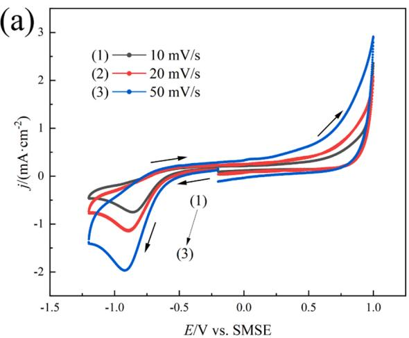

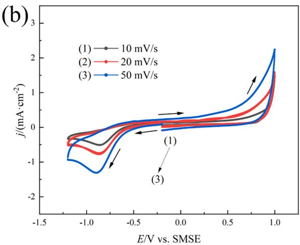  
Fig. 6. CV curves at different scanning rates on GCE in electrolyte composed of 0.3 M $\mathrm { C o S O 4 ^ { \bullet 7 } }$ H2O, 0.16 M $\mathrm { H _ { 3 } B O _ { 3 } }$ and 0.02 M $_ \mathrm { C o C l _ { 2 } { \cdot } 6 H _ { 2 } O } \colon$ (a) without BD and (b) with BD.

(a)  
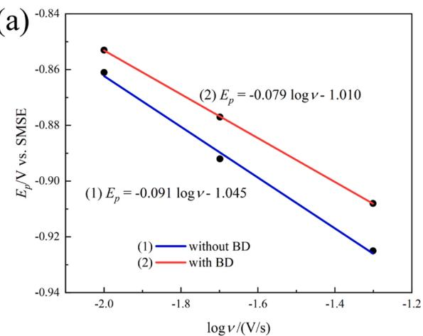

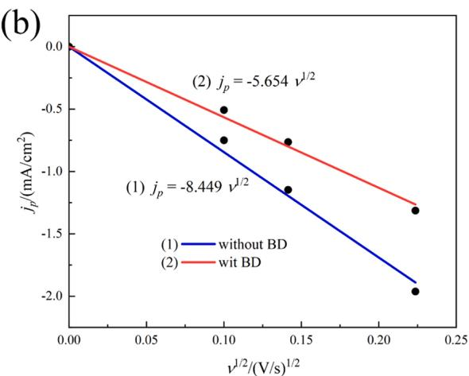  
Fig. 7. Relationship of peak potential and peak current density with scan rate: (a) $E _ { \mathrm { p } }$ and logv and (b) $| j _ { \mathrm { p } }$ and $\nu ^ { 1 / 2 } .$ . Curves 1 and 2 represent the electrolyte without and with BD, respectively.

Fig. 8 presents the electrochemical impedance spectroscopy (EIS) curves at frequencies ranging from $1 0 ^ { 5 }$ Hz to 0.01 Hz with an amplitude of 5 mV/s on GCE in electrolyte without and with BD. When there is no BD in the electrolyte, the charge transfer resistance is 241 $\Omega / { \mathrm { c m } } ^ { 2 } .$ . When the electrolyte contains BD, the charge transfer resistance is $4 9 6 \Omega / \mathrm { c m } ^ { 2 }$ The above results show that BD can inhibit the electroreduction process of cobalt ions.

The chronoamperometric experiments are conducted under different step-potentials to study the cobalt electro-crystallization process. Fig. 9 shows the chronoamperometric curves on GCE in electrolyte without and with BD, respectively. When a certain step potential is applied, a large current is generated in a very short time and then decreases rapidly, which is attributed to the instantaneous charging of the double electric layer. With the extension of time, the current density first increases to a peak value $( j _ { \mathrm { { m } } } ,$ corresponding to the time $t _ { \mathrm { m } } ) _ { \mathrm { : } }$ , and then gradually decreases until it tends to be stable. This is due to the continuous formation and growth of crystal nuclei, and the current density gradually increases, then the number of crystal nuclei continues to increase, the crystal nucleus diffusion area continues to overlap, and the current density reaches a peak value, finally after the diffusion area completely overlaps, there is no nucleation site for new nuclei to generate, only crystal nuclei grow, and the current density gradually decreases until it tends to be stable. If there is no peak current density in the curve, cobalt may grow epitaxially along the substrate. Obviously, there is a nucleation process of cobalt on the cathode surface. Furthermore, the more negative the step-potential, the shorter the time corresponding to the nucleation peak current density, which indicates that the more negative the potential (increase in overpotential) is, the more conducive the cobalt nucleation behavior occurs.

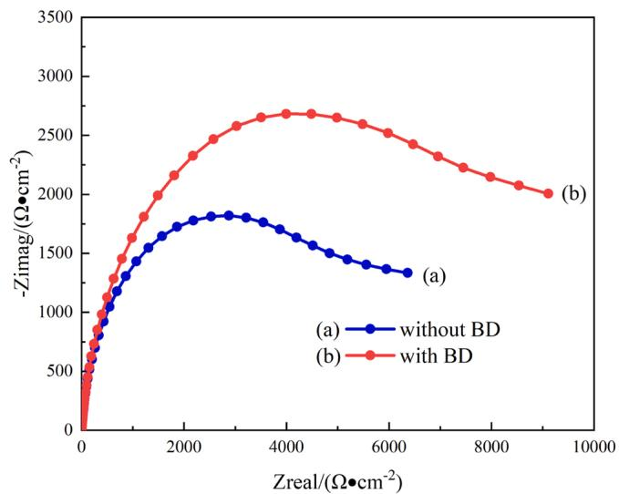  
Fig. 8. EIS curves on GCE in electrolyte composed of 0.3 M $\mathrm { C o S O } _ { 4 } { \bullet } 7 \mathrm { H } _ { 2 } 0 ,$ 0.16 M $\mathrm { H _ { 3 } B O _ { 3 } }$ and 0.02 M CoCl 6 H O: (a) without BD and (b) with BD

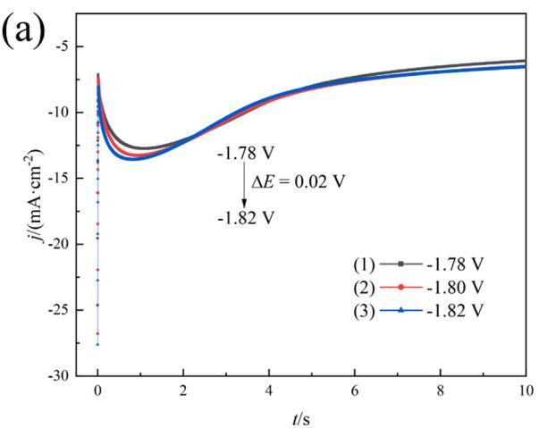

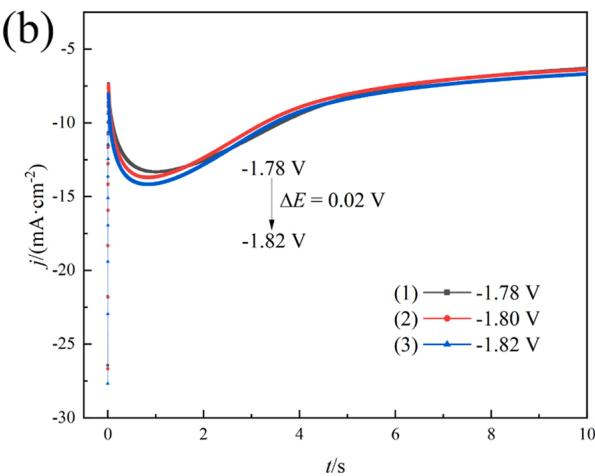  
Fig. 9. Chronoamperometry curves on GCE in electrolyte composed of 0.3 M CoSO4•7 H2O, 0.16 M $\mathrm { H _ { 3 } B O _ { 3 } }$ and 0.02 M $\mathrm { C o C l _ { 2 } { \cdot } 6 \ H _ { 2 } O { : } \left( a \right) }$ without BD and (b) with BD. Curves 1, 2 and 3 for step-potentials of −1.78 V, −1.80 V and −1.82 V, respectively.

In order to study the nucleation law of cobalt, the above chronoamperometric curves are further processed and analyzed. According to the Scharifker-Hills (SH) model [38], when metal nucleation is controlled by the diffusion of electroactive ions, there are two mechanisms of instantaneous nucleation and progressive nucleation, and the corresponding Eq. (8) and Eq. (9) are as follows.

$$
\left. \left(\frac {j}{j _ {m}}\right) ^ {2} = 1. 9 5 4 2 \left(\frac {t}{t _ {m}}\right) \left\{1 - \exp \left[ - 1. 2 5 6 4 \left(\frac {t}{t _ {m}}\right) \right] \right\} ^ {2} \right.\tag{8}
$$

$$
(\frac {j}{j _ {m}}) ^ {2} = 1. 2 2 5 4 (\frac {t}{t _ {m}}) \left\{1 - \exp \left[ - 2. 3 3 6 7 (\frac {t}{t _ {m}}) ^ {2} \right] \right\} ^ {2}\tag{9}
$$

Fig. 10 shows the dimensionless $( j / j _ { \mathrm { m } } ) ^ { 2 } { \cdot } t / t _ { \mathrm { m } }$ relationship curves of the cobalt electro-crystallization experiments and the theoretical curves of the instantaneous and progressive nucleation. The negative shift of the step-potential hardly changes the cobalt nucleation mode, and the cobalt in in electrolyte without and with BD tends to be instantaneous nucleation. The above results demonstrate that, although BD has some effects on the electroreduction kinetics, it does not change the nucleation mechanism of cobalt.

## 3.5. Morphology and structure of coating

The cobalt electrodeposition at current density of $1 0 \mathrm { m A } / \mathrm { c m } ^ { 2 }$ is performed in electrolytes (0.3 M $\mathrm { C o S O } _ { 4 } { \bullet } 7 \mathrm { H } _ { 2 } 0$ , 0.16 M $\mathrm { H _ { 3 } B O _ { 3 } }$ and 0.02 M $\mathrm { C o C l } _ { 2 } { \cdot } 6 \ \mathrm { H } _ { 2 } \mathrm { O } )$ without and with BD at the temperature of 303 K and the pH of 3–4. The selection of this current density $1 0 \mathrm { m A } / \mathrm { c m } ^ { 2 }$ is based on the actual electrodeposition process and the chronoamperometric curve. First, in the process of cobalt electrodeposition, by selecting $1 0 \mathrm { m A } / \mathrm { c m } ^ { 2 } ;$ , a uniform and dense coating can be obtained. Secondly, according to the chronoamperometric curve, it can be seen that the curve at around $1 0 \mathrm { m A } / \mathrm { c m } ^ { 2 }$ is stable, which is consistent with instantaneous nucleation. Instantaneous nucleation can generate a large number of crystal nuclei in a short time, reduce secondary nucleation, reduce the growth size of grains, and make the microstructure of the deposited coating relatively finer. The corresponding results of SEM, size distribution and EDS for cobalt coating without and with BD are shown in Fig. 11 and Fig. 12. As displayed in Figs. 11a and 11b, it can be observed that the particle size distribution is very uneven and coarse, ranging from approximately 200 nm to 700 nm, and the average particle size d is $3 6 2 . 7 \pm 1 0 4 . 8$ nm. In Figs. 12a and $^ { 1 2 \mathbf { b } , }$ it can be seen that the particle distribution is relatively uniform and fine with a size of about 150–250 nm, and the average particle size d is $2 0 1 . 7 \pm 2 1 . 6 \ : \mathrm { n m }$ . The results indicate that BD has the effect of refining grains and improving the uniformity of the cobalt coating due to the adsorption of BD on the cathode surface, which is consistent with the results (inhibition effect) of the above CV curves in Fig. 5. In addition, EDS characterization of the obtained cobalt coating is shown in Fig. 11c and Fig. 12c. When there is no additive, $\mathrm { C o } , \mathrm { C } ,$ and O atoms are detected on the cobalt coating. Their contents are 94.0 % in Co, 5.06 % in C and 0.94 % in $^ { 0 , }$ respectively. The presences of O and C may be resulted from the testing environment. When containing BD, Co, C, and O atoms can be also detected. Their contents are 95.27 % in Co, 4.33 % in C and 0.40 % in $^ { 0 , }$ respectively. The above results demonstrate that the obtained cobalt is pure, and the introduction of BD is not included in the coating.

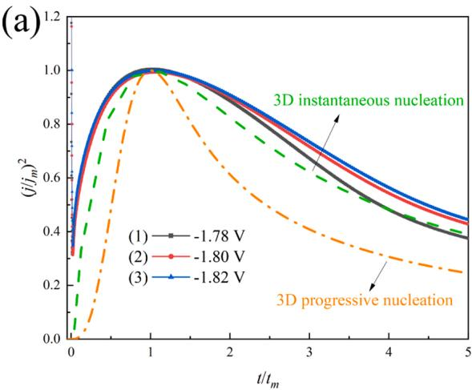

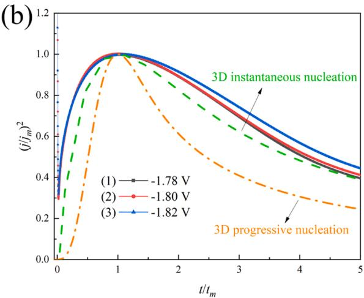  
Fig. 10. Theoretical curves of instantaneous and progressive nucleation and experimental curves of cobalt electro-crystallization on GCE in electrolyte composed of 0.3 M CoSO 7 H O, 0.16 M $\mathrm { H _ { 3 } B O _ { 3 } }$ and 0.02 M CoCl 6 H O: (a) without BD and (b) with BD. Curves 1, 2 and 3 for step-potentials of 1.78 V, 1.80 V and 1.82 V, respectively.

The XRD results of the cobalt coating without and with BD are presented in Fig. 13. In Fig. 13a, when there is no BD in the electrolyte, the crystal faces of the obtained cobalt coating is hcp(100), fcc(111) and fcc (220), which indicates that the obtained cobalt is mixed crystal. In Fig. 13b, when the electrolyte contains BD, the crystal faces of the obtained cobalt coating is hcp(100), hcp(101) and fcc(220). Although the properties of the mixed crystals have not changed, the preferred orientation has changed. The introduction of BD results in a new peak of hcp(101), which was caused by the adsorption of BD to form a retained surface. The above results are consistent with the calculation results in Fig. 4b

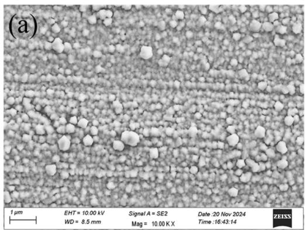

For the coating with internal stress, the diffraction line is the superposition result of a series of diffraction lines of each grain that are displaced from each other. The variation of microcosmic internal stress can be expressed as follows.

$$
\Delta \sigma = \frac {E [ b _ {2} (h k l) - b _ {1} (h k l) ]}{K R \tan \theta_ {h k l}}\tag{10}
$$

Where E (about $2 1 1 0 0 \mathrm { k g / m m ^ { 2 } ) }$ is the elastic modulus of cobalt coating, K is a constant (4, the stress is distributed by Gaussian law), b1(hkl) is the width at half maximum of the diffraction peak generated by the crystal face when there is no additive (radian, rad), b (hkl) is the width at half maximum of the diffraction peak generated by the crystal face in the presence of additive (rad), R is the distance from the center of the sample to the detector of the diffractometer (150 mm), and Δσ is the variation of microcosmic internal stress $( \mathrm { k g / m m ^ { 2 } } )$ . The shape, size and distribution of grains, the change of atomic arrangement caused by deformation and the orientation relationship between grains are not considered. The related parameters are shown in Table 3. It can be discovered that the stress change values of hcp(100) and fcc(111) crystal faces caused by BD are −0.169 and −0.477 kg/mm2, showing compressive stress. The stress change values of hcp(101) and fcc(220) crystal faces caused by BD are 1.331 and 0.046 kg/mm2, showing tensile stress. Comprehensive analysis shows that BD causes the internal stress of cobalt coating to be tensile stress.

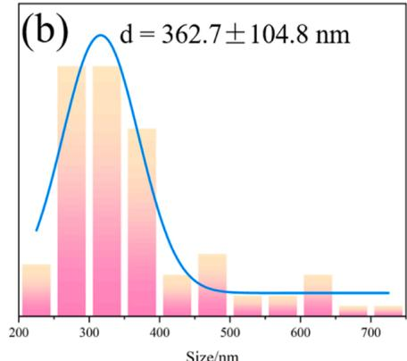

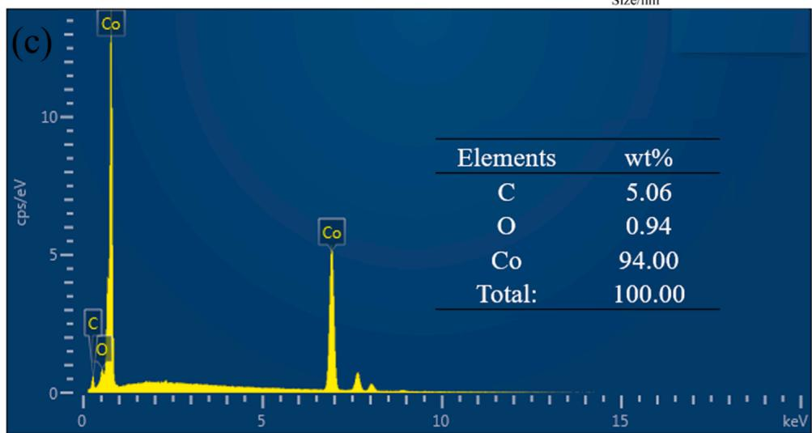  
Fig. 11. Cobalt coating obtained from the electrolyte (0.3 M CoSO •7 H O, 0.16 M $\mathrm { H _ { 3 } B O _ { 3 } }$ and 0.02 M $\mathrm { C o C l } _ { 2 } { \cdot } 6 \ \mathrm { H } _ { 2 } \mathrm { O } )$ without BD at the current density of 10 mA/ cm2, the temperature of 303 K and the pH of 3–4: (a) SEM, (b) particle size distribution and (c) EDS.

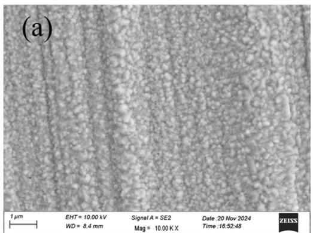

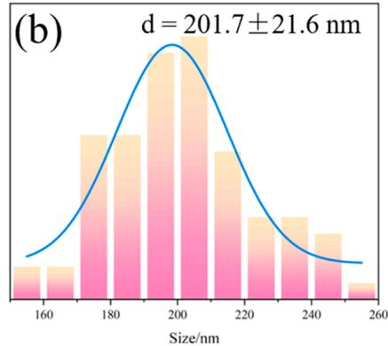

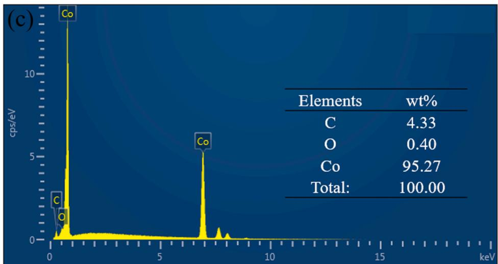  
Fig. 12. Cobalt coating obtained from the electrolyte (0.3 M $\mathrm { C o S O 4 ^ { \bullet 7 } }$ H O, 0.16 M $\mathrm { H _ { 3 } B O _ { 3 } }$ and 0.02 M $\mathrm { C o C l } _ { 2 } { \cdot } 6 \ \mathrm { H } _ { 2 } \mathrm { O } )$ with BD at the current density of 10 mA/cm2, the temperature of 303 K and the pH of 3–4: (a) SEM, (b) particle size distribution and (c) EDS.

Table 3  
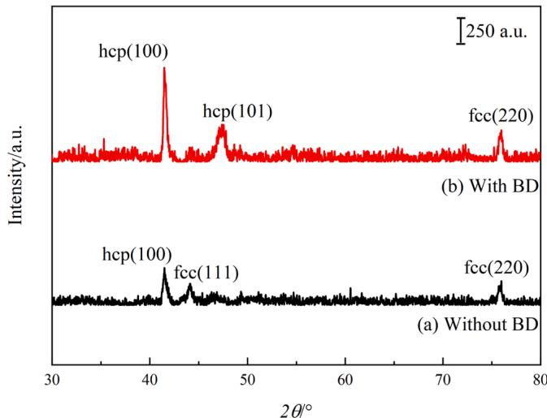  
Fig. 13. Cobalt coating obtained from the electrolyte (0.3 M $\mathrm { C o S O } _ { 4 } { \bullet } 7 \mathrm { H } _ { 2 } 0 ,$ 0.16 M $\mathrm { H _ { 3 } B O _ { 3 } }$ and 0.02 M CoCl ⋅6 H O) at the current density of 10 mA/cm2, the temperature of 303 K and the pH of 3–4: (a) without BD and (b) with BD.

## 4. Conclusions

In this work, the molecule structure, adsorption ability and electrochemical property of BD are clarified by using DFT calculation and electrochemical analyses, and the impact on morphology, composition and structure of cobalt coating caused by BD are characterized by SEM combined with EDS and XRD. This work is undoubtedly beneficial to understanding the structural characteristics of BD itself and the effects on electroreduction mechanism of cobalt at a molecular level, and further developing and improving the cobalt electrodeposition process and high-performance chip interconnection technology.

Structural parameters of the cobalt crystal face.

<table><tr><td>Cobalt crystal faces</td><td> $b_{2}-b_{1}$ </td><td> $2\theta/^{\circ}$ </td><td> $\theta/^{\circ}$ </td><td> $\Delta\sigma/(kg/mm^{2})$ </td></tr><tr><td>hcp(100)</td><td>-0.10</td><td>41.683</td><td>20.842</td><td>-0.169</td></tr><tr><td>fcc(111)</td><td>-0.30</td><td>44.216</td><td>22.108</td><td>-0.477</td></tr><tr><td>hcp(101)</td><td>0.90</td><td>47.568</td><td>23.784</td><td>1.331</td></tr><tr><td>fcc(220)</td><td>0.05</td><td>75.853</td><td>37.927</td><td>0.046</td></tr></table>

## CRediT authorship contribution statement

Lv Yu-Jie: Methodology, Investigation, Formal analysis. Jin Lei: Writing – review & editing, Writing – original draft, Supervision, Investigation, Conceptualization. He Die: Writing – original draft, Validation. Ran Ting-Ting: Visualization, Investigation. Yang Fang-Zu: Writing – review & editing.

## Declaration of Competing Interest

The authors declared that they have no known competing financial interests or personal relationships that could have appeared to influence the work reported in this paper.

## Acknowledgements

The authors are all thankful for the financial supports from the Science and Technology Research project of Chongqing Education Commission (KJQN202401423), Scientific Research Grants of Yangtze Normal University (010730153).

## Data availability

Data will be made available on request.

## References

[1] L.-J. Wei, Z.-H. Zhou, Y.-W. Wu, M. Li, S. Wang, Research progresses of cobalt interconnect and superfilling by electroplating in chips, J. Electrochem. 28 (2022) 12.

[2] P.C. Andricacos, Copper on-chip interconnections: a breakthrough in electrodeposition to make better chips, Electrochem. Soc. Interface 8 (1999) 32.

[3] W. Steinhogl, ¨ G. Schindler, G. Steinlesberger, M. Engelhardt, Size-dependent resistivity of metallic wires in the mesoscopic range, Phys. Rev. B 66 (2002) 075414.

[4] X. Ma, Y. Ma, A.M. Nolan, J. Bai, W. Xu, Y. Mo, H. Chen, Understanding the polymorphism of cobalt nanoparticles formed in electrodeposition─ an in situ XRD study, ACS Mater. Lett. 5 (2023) 979–984.

[5] M. He, X. Zhang, T. Nogami, X. Lin, J. Kelly, H. Kim, T. Spooner, D. Edelstein, L. Zhao, Mechanism of Co liner as enhancement layer for Cu interconnect gap-fill, J. Electrochem. Soc. 160 (2013) D3040–D3044.

[6] J. Kang, M. Sung, J. Byun, O.J. Kwon, J.J. Kim, Superconformal cobalt electrodeposition with a hydrogen evolution reaction suppressing additive, J. Electrochem. Soc. 167 (2020).

[7] J. Kang, M. Sung, J. Byun, O.J. Kwon, J.J. Kim, Proton sensitive additive for cobalt electrodeposition, J. Electrochem. Soc. 167 (2020).

[8] M.A. Rigsby, L.J. Brogan, N.V. Doubina, Y. Liu, E.C. Opocensky, T.A. Spurlin, J. Zhou, J.D. Reid, The critical role of ph gradient formation in driving superconformal cobalt deposition, J. Electrochem. Soc. 166 (2018) D3167–D3174.

[9] Y. Li, X. Ma, J. Zhang, P. Yang, M. An, Research progress of metal interconnection technology and related theory in chip fabrication, Surf. Technol. 50 (2021) 24–43.

[10] Y. Li, X. Ma, C. Li, R. Li, J. Zhang, P. Yang, X. Liu, P. Broekmann, B. Wang, W. Lv, Investigation of novel suppressor Nitrotetrazolium Blue chloride on cobalt superconformal growth, J. Manuf. Process. 101 (2023) 15 24.

[11] Y. Hu, Q. Huang, Effects of dimethylglyoxime and cyclohexane dioxime on the electrochemical nucleation and growth of cobalt, J. Electrochem. Soc. 166 (2018) D3175 D3181.

[12] Q. Huang, T.W. Lyons, W.D. Sides, Electrodeposition of cobalt for interconnect application: effect of dimethylglyoxime, J. Electrochem. Soc. 163 (2016) D715 D721.

[13] Y.T. Tong, D.W. Lai, Y. Li, T. Hang, M. Li, Y.W. Wu, Inhibitor alkyne-PEG4-amine contributes to cobalt superfilling, Acs Appl. Electron. Mater. 6 (2024) 5712–5719.

[14] M. Kiruba, N. Lakshminarasimhan, C. Jeyabharathi, Butynediol’s role beyond brightening additive during electrodeposition of cobalt, J. Electrochem. Soc. 169 (2022).

[15] M. Kiruba, C. Jeyabharathi, Discerning the oscillatory electrochemical response during electrodeposition of cobalt in the presence of but-2-yne-1,4-diol, J. Solid State Electr. 24 (2020) 2997–3002.

[16] B. Pan, Q. Zhang, Z. Liu, Y. Yang, Influence of butynediol and tetrabutylammonium bromide on the morphology and structure of electrodeposited cobalt in the presence of saccharin, Mater. Chem. Phys. 228 (2019) 37–44.

[17] M. Frisch, G. Trucks, H. Schlegel, G. Scuseria, M. Robb, J. Cheeseman, G. Scalmani, V. Barone, B. Mennucci, G. Petersson, Gaussian 09, Revision D. 01, Gaussian, Inc, Wallingford CT, 2009. 〈http://www.gaussian. com〉.

[18] J. Tirado-Rives, W.L. Jorgensen, Performance of B3LYP density functional methods for a large set of organic molecules, J. Chem. Theory Comput. 4 (2008) 297 306.

[19] T. Lu, F. Chen, Quantitative analysis of molecular surface based on improved Marching Tetrahedra algorithm, J. Mol. Graph. Model. 38 (2012) 314 323.

[21] T. Lu, S. Manzetti, Wavefunction and reactivity study of benzo [a] pyrene dio epoxide and its enantiomeric forms, Struct. Chem. 25 (2014) 1521–1533.

[22] T. Lu, F. Chen, Multiwfn: a multifunctional wavefunction analyzer, J. Comput. Chem. 33 (2012) 580 592.

[23] C. Adamo, V. Barone, Toward reliable density functional methods without adjustable parameters: The PBE0 model, J. Chem. Phys. 110 (1999) 6158–6170.

[24] G. Kresse, J. Furthmüller, Efficiency of ab-initio total energy calculations for metals and semiconductors using a plane-wave basis set, Comp. Mater. Sci. 6 (1996) 15–50.

[25] G. Kresse, J. Furthmüller, Efficient iterative schemes for ab initio total-energy calculations using a plane-wave basis set, Phys. Rev. B 54 (1996) 11169.

[26] G. Kresse, D. Joubert, From ultrasoft pseudopotentials to the projector augmented wave method, Phys. Rev. b 59 (1999) 1758.

[27] P.E. Blochl, ¨ Projector augmented-wave method, Phys. Rev. B 50 (1994) 17953

[28] J.P. Perdew, K. Burke, M. Ernzerhof, Generalized gradient approximation made simple, Phys. Rev. Lett. 77 (1996) 3865.

[29] J.A. Dean, Lange’s Handbook of Chemistry, 1999.

[30] P. Geerlings, F. De Proft, Chemical reactivity as described by quantum chemical methods, Int. J. Mol. Sci. 3 (2002) 276 309.

[31] L. Jin, Z.-Y. Wang, Z.-Y. Cai, J.-Q. Yang, A.-N. Zheng, F.-Z. Yang, D.-Y. Wu, D. Zhan, 1-(2-Pyridylazo)-2-naphthol as a synergistic additive for improving throwing power of through hole copper electronic electroplating, J. Ind. Eng Chem. 125 (2023) 269–276.

[32] R.G. Pearson, Absolute electronegativity and hardness: application to inorganic chemistry, Inorg. Chem. 27 (1988) 734–740

[33] X. Li, P. Zou, X. Chen, L. Wang, Quantum chemical calculations and molecula dynamics simulations to investigate the mechanism of interaction of six dye levelers with copper surface, J. Electroanal. Chem. 961 (2024) 118230.

[34] R.S. Nicholson, I. Shain, Theory of stationary electrode polarography. Single scan and cyclic methods applied to reversible, irreversible, and kinetic systems, Anal. Chem. 36 (1964) 706 723.

[35] A.J. Bard, L.R. Faulkner, Electrochemical methods: fundamentals and applications, Surf, Technol, 20 (1983) 91–92

[36] Y. Xiaowei, A. Maozhong, Z. Yunwang, Z. Lin, Electrochemical behavior of gold (III) in cyanide-free bath with 5, 5′-dimethylhydantoin as complexing agent, Electro Acta 58 (2011) 516–522.

[37] L. Jin, Z.-H. Liang, J.-Q. Yang, A.-N. Zheng, Z.-Y. Wang, F.-Z. Yang, D.-Y. Wu, Z.- Q. Tian, D. Zhan, Insights into the DMH tautomeric structures and its effects on the electro-reduction of Au (DMH) 4− coordination ions, Electro Acta 437 (2023) 141494.

[38] B. Scharifker, G. Hills, Theoretical and experimental studies of multiple nucleation, Electro Acta 28 (1983) 879–889.