Full Length Article

# The effect of introducing $- S O _ { 2 }$ fragments into the structure of polydimethyldiallylammonium (PD) on through-hole copper plating performance: A theoretical and experimental study

Qiao Ding , Ning Li , Bo Wu , Qing Cheng , Qi Zhao , Tong Liu , Rui Wang \*, Deyu Li

School of Chemistry and Chemical Engineering, Harbin Institute of Technology, Harbin 150001, China

## A R T I C L E I N F O

Keywords: Copper electrodeposition Microvias filling Leveler Theoretical calculation Synergistic suppressing

## A B S T R A C T

In this study, SO was used to chemically modify the commonly used leveling agent polydimethyldiallylammonium (PD) in through-hole electroplating, resulting in a more effective leveling agent, PDS, which improved the throwing power (TP), leading to through-hole circuit boards with better metal coverage in difficult-to-reach areas. Furthermore, theoretical and experimental studies were conducted to understand how the −SO structure influences the leveling ability of the leveling agent. The study demonstrates that the −SO - modified additive significantly enhances the copper plating process, resulting in thicker and more uniform deposits in through-holes, which are critical for ensuring high-quality circuit boards.Additionally, this study elu cidates the mechanism of action of the leveling agent on the copper surface, providing theoretical support for the development of copper plating leveling agents. The leveling ability differences between the leveling agents PD and PDS were investigated using Cyclic Voltammetry, constant current method, and Electrochemical Impedance Spectroscopy. Additionally, the optimal concentrations of the additives were determined. Quantum chemical calculations were employed to analyze the electrostatic potential, HOMO/LUMO orbitals, and differential charge density on the Cu (111) surface for both leveling agents. These theoretical analyses provided insights into the reasons behind the differing leveling abilities of the two agents.

## 1. Introduction

With the rapid development of the electronics industry, an increasing number of consumer products, such as computers, electronic watches, wearable devices, smartphones, and communication equipment, are becoming more intelligent, lightweight, and miniaturized[1–3]. In these advanced electronic products, the Printed Circuit Board (PCB) is a critical component, serving as the main conduit between various electronic elements, enabling them to connect and work together in a coordinated manner. The metallization of PCBs, which enables the interconnection of electronic components, is particularly crucial[4,5]. Through-hole electroplating plays a vital role in this process, with copper electroplating emerging as the mainstream choice for PCB interconnection due to its excellent conductivity and low cost[6]. However, current copper electroplating technology faces challenges in meeting the ever-increasing demands of PCB manufacturing, which has become a bottleneck limiting the improvement of PCB performance [7,8].Therefore, the preparation of high-quality through-hole plating and high-density interconnect circuit boards holds significant industrial and economic importance[9].

Currently, the most widely used technology in the through-hole plating process of circuit boards is acid copper plating, which typically involves a conventional acid copper plating solution containing copper sulfate, sulfuric acid, and trace amounts of plating additives[10]. Traditional electroplating additives can be categorized into suppressors, accelerators, and levelers[11–13]. In the context of through-hole electroplating, the key substance capable of enhancing the TP value is the leveler, which, as a crucial component in the acid copper plating solution, requires only a small addition to effectively increase the TP value [14,15]. As a critical metric for assessing the performance of throughhole copper plating, the TP value is calculated as the ratio of the copper thickness on the surface to the copper layer thickness inside the hole [16]. The traditional calculation method is divided into six-point method[17,18], and the specific measurement method is described in detail later.

Li et al.[19] designed and synthesized a copolymer of pyrrole and

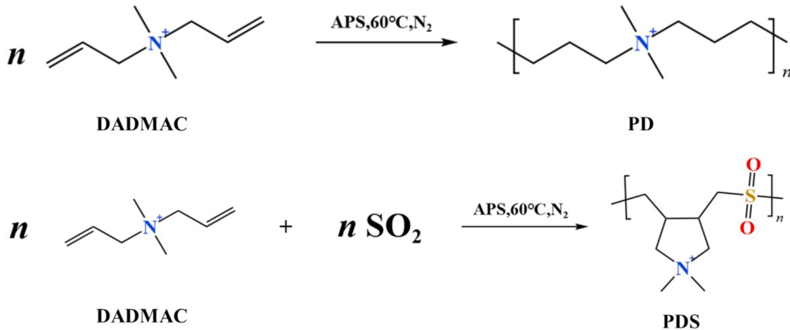  
Fig. 1. Structures and synthetic pathways of PD and PDS molecules.

1,4-butanediol diglycidyl ether (PBDGE) as a leveling agent, which improved the TP value of through-hole plating by 17.9 %. Quantum chemical calculations of the HOMO/LUMO orbitals and molecular dy namics simulation methods were employed to explain the synergistic interaction between PBDGE and Cl- on the electrode surface, investi gating the reasons behind its ability to enhance cathodic polarization. Zheng et al.[2,20] copolymerized 1-vinyl imidazole with 1, 4-butanediol diglycidyl ether to obtain poly (1-vinyl imidazole co 1, 4-butanediol diglycidyl ether) (VIBDGE). Electroplating experiments confirmed that at the optimal VIBDGE concentration, the TP of through-hole plating increased by 43.62 %. Quantum chemical calculations indicated that VIBDGE has a strong electron-donating ability, allowing it to provide electrons to low-energy vacant orbitals during the copper deposition process, thereby forming covalent bonds. Molecular dynamics simulations showed that VIBDGE possesses the highest adsorption energy, with the largest molecular size, resulting in the highest surface coverage of copper after adsorption and the most pronounced steric hindrance effect.

Currently, research on leveling agents for through-hole copper plating mainly focuses on synthesizing new, highly efficient leveling agents, and utilizing methods such as quantum chemical calculations to explain their active sites and reaction mechanisms[18,21,22]. However, the related research is relatively scattered, and the structures of the leveling agents in published papers vary significantly. There is limited research on the relationship between the molecular structure of indi vidual leveling agent molecules and their leveling performance.

This study primarily investigates the mechanism of −SO ’s impact on the leveling agent molecule PD, analyzing the reasons behind the differences in leveling capabilities between the PD and PDS molecules. Electrochemical experiments were conducted to compare the leveling capabilities of the two additive molecules, and their optimal working concentrations were determined. Finally, the influence mechanism of the $S O _ { 2 }$ structure on leveling capability was analyzed through SEP calculations and HOMO/LUMO orbital calculations.

## 2. Experiment

## 2.1. Materials and equipment

The leveling agents PD and PDS used in this experiment were purchased from Shanghai Aladdin Biochemical Technology Co., Ltd. Polyethylene glycol (PEG) with a molecular weight of approximately 8000 (CAS No.: 25322–68-3) and Bis-(sodium sulfopropyl)-disulfide (SPS) (CAS No.: 27206–35-5) were sourced from Dow Chemical. Copper sulfate pentahydrate $( \mathrm { C u S O } _ { 4 } { \bullet } \mathrm { 5 H } _ { 2 } \mathrm { O } )$ and sulfuric acid $\mathrm { ( H _ { 2 } S O _ { 4 } ) }$ were also obtained from Shanghai Aladdin Biochemical Technology Co., Ltd. All chemicals and reagents were of analytical reagent (AR) grade. Deionized water (resistivity: 18.3 MΩ⋅cm) was used to prepare the electroplating solutions. The structures of the relevant polymers are illustrated in Fig. 1. DADMAC can polymerize with $\mathrm { { S O } _ { 2 } }$ to form the copolymer PDS under the following conditions: temperature of $6 0 ^ { \circ } \mathrm { C } ,$ , using water as the solvent, with ammonium persulfate as the initiator. The reaction is conducted under nitrogen protection for 2–4 h.

## 2.2. Electrochemical testing

Electrochemical tests were conducted using a three-electrode system. The working electrode was a Pt disc electrode with an area of 0.785 cm2, the counter electrode was a Pt sheet electrode with an area of 1 $\mathrm { c m } ^ { 2 } ,$ and the reference electrode was a Mercurous sulfate electrode (MSE). Cyclic voltammetry tests were conducted within a potential range o $\mathrm { \Omega } \mathrm { f } - 0 . 8 \mathrm { V }$ to 0.6 V, with a scan rate of 20 $\mathrm { { \ m V / s } } ,$ and an electrode rotation speed of 1000 rpm[23]. A total of five cyclic voltammetry cycles were performed, and data from the last stable cycle were collected. Chronopotentiometry curves were measured under conditions of $2 \mathrm { \ A } / \mathrm { d } \mathrm { m } ^ { 2 }$ current with elec trode rotation speeds of 1000 rpm and 100 rpm[24]. Additives were introduced into the test solution every 500 s to observe changes in the system’s potential. In the VMS, 100 mg/L of different leveling agents were added, and AC impedance tests were conducted under open-circuit potential conditions of −0.1 V and −0.2 V. The testing frequency range was from $1 0 ^ { - 2 }$ to ${ 1 0 } ^ { 6 }$ Hz[25].

## 2.3. Electroplating process

The basic solution for electroplating consisted of 70 $g / \mathrm { L }$ $\mathrm { C u S O } _ { 4 } { \cdot } 5 \mathrm { H } _ { 2 } 0$ , 200 g/L $\mathrm { H } _ { 2 } \mathrm { S O } _ { 4 } ,$ and 50 mg/L Cl-. Electroplating was conducted in a Hull cell using a direct current power supply. The anode was a phosphor copper anode, and the cathode was a flexible circuit board with a copper-coated surface. The current was set at $2 \mathrm { A } / \mathrm { d } \mathrm { m } ^ { 2 }$ and the electroplating duration was 60 min[26].

## 2.4. Characterization

## 2.4.1. Surface morphology testing

The surface morphology of copper layers obtained under different concentrations of leveling agents was characterized using a scanning electron microscope (SEM, JEM-ARM200F) with an accelerating voltage of 20 kV in secondary electron imaging mode.

A three-dimensional white light interferometer (NewView7100) was used to measure the surface roughness and step height of the copper layers plated with PD and PDS additives at optimized concentrations.

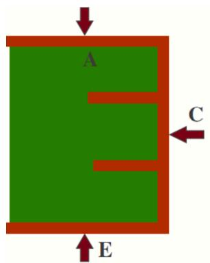

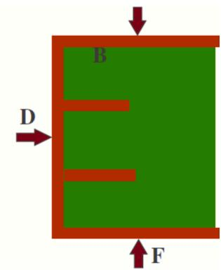  
Fig. 2. Schematic diagram of the six-point method for testing the TP value of through-hole copper plating.

## 2.4.2. Structure characterization

The phase structure of copper layers and substrate was analyzed by X-ray diffraction (XRD, D/max-γβ) with Cu Kα radiation at 40 kV and 40 mA $( \lambda = 0$ .1546 nm), while 2θ ranged from 10◦ to 90◦ with a scan rate of 0.05◦ $s ^ { - 1 }$ . The data were processed using Jade 5, with background subtraction performed, and the size of the copper crystallites was calculated using the Scherrer equation.

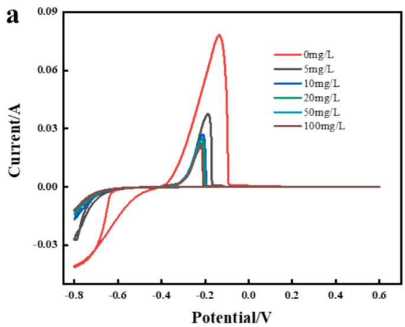

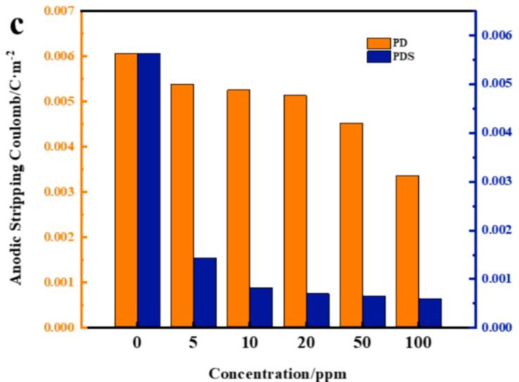

## 2.4.3. TP value calculation

The electroplated through-hole circuit board was cut, embedded, polished, and etched. The cross-sectional copper deposition was observed using a three-dimensional depth optical microscope (KS-X1000). A schematic of the results is shown in Fig. 2.The formula for calculating the TP value is:

$$
T P (\%) = \left(\frac {C + D}{2}\right) \div \left(\frac {A + B + E + F}{4}\right)
$$

In the formula, ABCDEF represent the thickness of the copper deposition layers on both sides of the through-hole[27].

## 2.5. Quantum chemical calculations

Density Functional Theory (DFT) calculations were performed using the Material Studio software. The dmol3 module within Material Studio was used, employing the BPE functional for the optimization of the molecular structures of the additives[28]. Details of the optimized structures can be found in the supplementary information. Based on the optimization results, the electrostatic potential surfaces, HOMO/LUMO

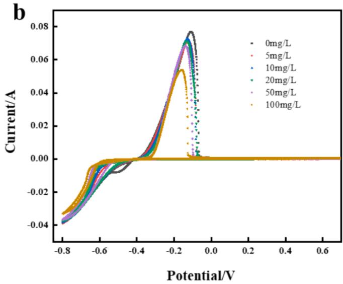  
Fig. 3. CVS test results for leveling agent molecules at different concentrations: a) PDS; b) PD; c) Comparison of the leveling capabilities of the two leveling agent molecules.

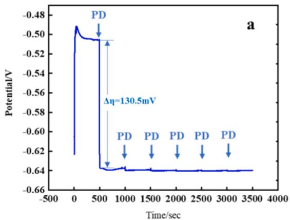

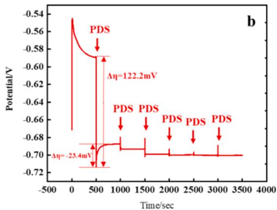

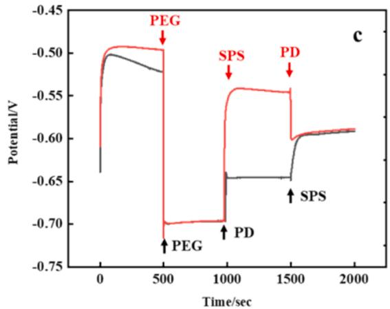

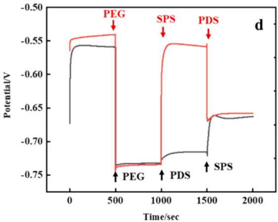  
Fig. 4. Chronopotentiometry test results for the two leveling agents. a) PD; b) PDS.

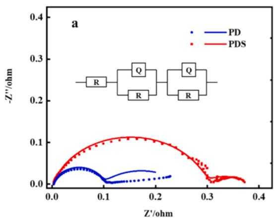

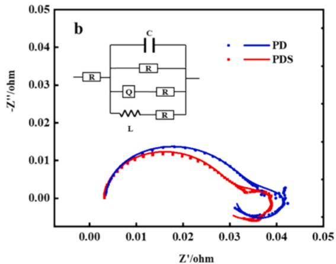  
Fig. 5. AC impedance curves for the two leveling agents under different potential conditions. a) Equilibrium potential −0.1 V (vs. SSE); b) Equilibrium potential −0.2 V (vs. SSE).

orbitals, and Fukui functions were calculated. The CASTEP module was utilized to calculate the differential charge density of DADMAC and DS molecules on the Cu(111) crystal surface[29]. Detailed computational methods, including theoretical frameworks, parameters, and model construction, are provided in the Supporting Information.

## 3. Results and Discussion

## 3.1. Electrochemical tests

## 3.1.1. Cyclic voltammetry stripping tests

Cyclic Voltammetry Stripping (CVS) tests record the current response in the solution by applying changes in voltage[30]. The leveling agent reduces the current response by slowing down the deposition process, resulting in a decrease or reduction of the current in the CVS curve. By observing the changes in the current–voltage curve, the concentration and effectiveness of the additives in the plating solution can be indirectly characterized. CVS were conducted in VMS with varying concentrations of PDS to analyze the effect of its concentration. It was observed that as the concentration of PDS increased, the anodic strip ping coulombs continuously decreased. The results are shown in Fig. 3.

The research has shown that both PD and PDS act as suppressors in the deposition of copper, reducing the area of the copper dissolution peak during the anodic process. In the VMS without the addition of any leveling agent, the anodic stripping coulombs reached $0 . 6 0 7 \mathrm { C } \mathrm { c m } ^ { - 2 }$ and 0.564C $\mathrm { c m } ^ { - 2 } ,$ , respectively. After adding 5 mg/L of PDS, the value decreased to $0 . 1 4 3 \mathrm { C } \ \mathrm { c m } ^ { - 2 }$ , representing an inhibition capability of 74.65 %. As the concentration of PDS increased, the anodic stripping coulombs continued to decrease; however, once the concentration reached 50 mg/L, the decrease in anodic stripping coulombs became less pronounced. This suggests that the leveling action of the leveling agent had reached its limit.

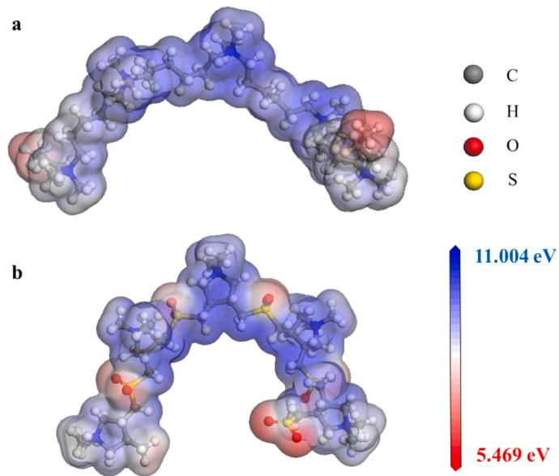  
Fig. 6. ESP calculation results for the two leveling agent molecules. (a)PD; (b)PDS.

After adding different leveling agents in the VMS, the degree of polarization in the copper ion deposition process increases rapidly. As the amount of the additive increases, this polarizing effect becomes more pronounced. Research into the effects of the two leveling agents on the trend of anodic stripping coulombs reveals that PD does not polarize the crystallization of copper ions as significantly as PDS. Compared to PDS, the addition of PD results in a lesser reduction in anodic stripping coulombs. Additionally, the saturation concentrations of the two agents differ. Once the concentration of PDS reaches 50 mg/L, further increases in the additive do not significantly enhance the polarizing effect, indicating that the leveling action of PDS has reached its limit at this concentration. Even at a PD concentration of 100 mg/L, the anodic stripping coulombs remain lower than those of PDS, indicating that its inhibitory ability is weaker. The specific values of anodic stripping coulombs at different concentrations are shown in Fig. 3.c.This can be further corroborated by chronopotentiometry curves.

## 3.1.2. Chronopotentiometry analysis

At 1000 rpm, chronopotentiometry tests were conducted in VMS with varying concentrations of PDS[31]. The results of these tests are shown in Fig. 4.

After adå〈fiding 10 mg/L of PD to the VMS, there is a rapid decrease in the solution’s potential. Continuing to add PD to the solution also results in a decrease in potential, but the extent of the decrease is not significant. At this point, the maximum value of $\Delta \mathfrak { n }$ is 130.5 mV. When PD is added to the solution up to a concentration of 50 mg/L, the potential of the solution essentially ceases to decrease, indicating that the

Table 1  
Calculated values of the HOMO and LUMO orbitals for the two molecules.

<table><tr><td></td><td>HOMO</td><td>LUMO</td><td> $E_{LUMO}-E_{HOMO}$ </td></tr><tr><td>PD</td><td>-0.5719</td><td>-0.3358</td><td>0.2361</td></tr><tr><td>PDS</td><td>-0.5499</td><td>-0.3812</td><td>0.1687</td></tr></table>

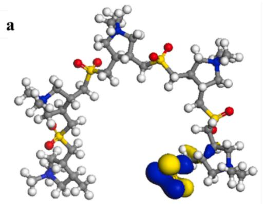

b  
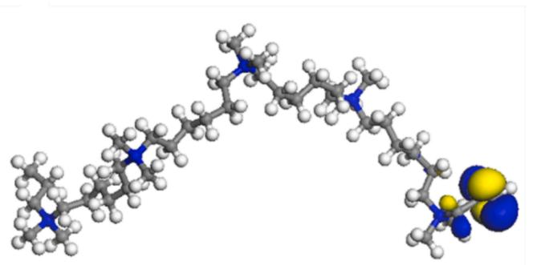

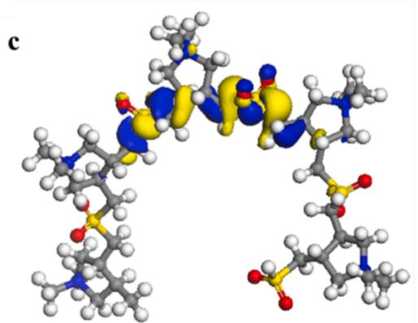

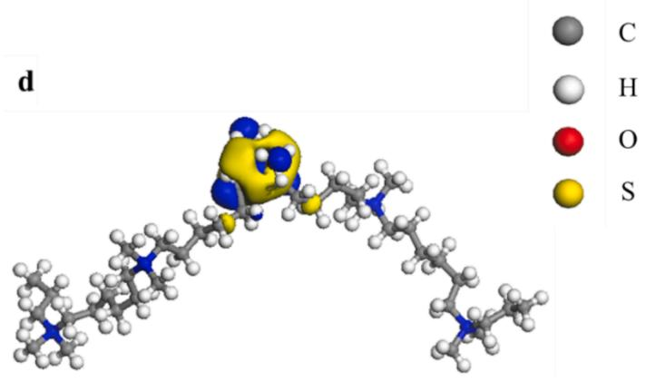  
Fig. 7. Calculation results of the HOMO/LUMO orbitals for the two leveling agent molecules. (a)HOMO for PDS;(b)HOMO for PD;(c)LUMO for PDS;(d)LUMO for PD.

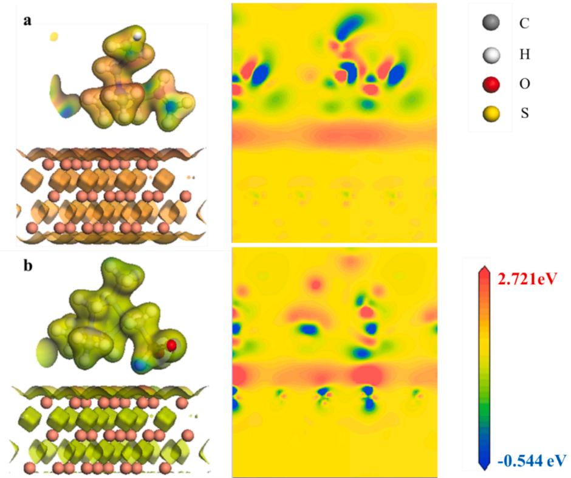  
Fig. 8. Calculation results of the differential charge density for the two leveling agent molecules. (a)PD;(b)PDS.

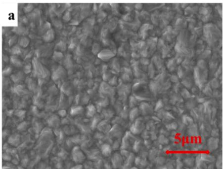

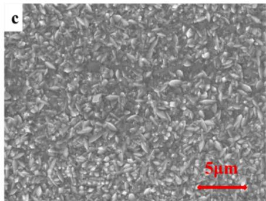

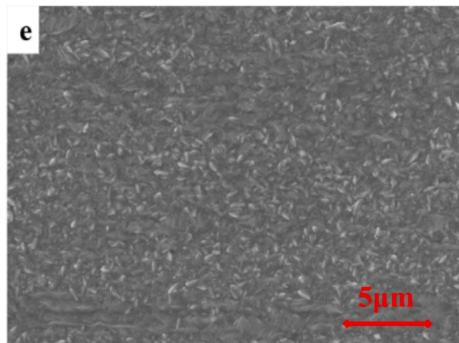

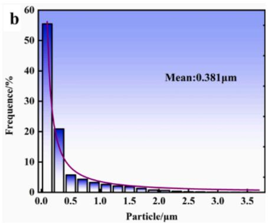

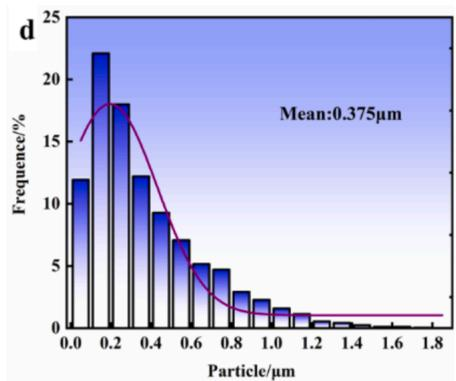

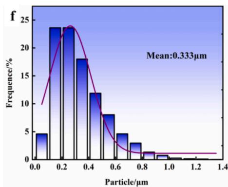  
Fig. 9. SEM images of the surface copper layers and grain size distribution under the influence of different additives. (a, b) No additives; (c, d) PD; (e, f) PDS.

amount of the additive has reached its saturation concentration.

The trend of the potential-time curve obtained by adding PDS is very similar to that of PD, with its final saturation concentration being 100 mg/L. However, each time PDS is added, there is an instantaneous rise in potential, which quickly returns to a stable state. This indicates that under the influence of the sulfur atom, PDS does more than simply inhibit the deposition of copper ions. The introduction of the $- s 0 _ { 2 }$ structure allows the molecule to interact more intensely with the copper surface, enabling more adsorption sites on the surface, which results in a temporary increase in potential[32].

At 500 s, when 100 mg/L of PDS is added to the solution, the potential in the VMS instantaneously drops to −0.72 V. As the solution system is stirred, the potential slowly rises, which is due to the gradual even distribution of the additive in the solution and the stabilization of the system. As indicated by Curve 1, when 20 mg/L of SPS is added to the system at 1000 s, the potential of the solution rapidly rises to −0.58 V, demonstrating that SPS strongly promotes the deposition of copper ions. At 1500 s, when 100 mg/L of PDS is added to the solution, the potential drops to −0.68 V, indicating that PDS has a strong inhibitory effect on the deposition of copper ions. However, Curve 2 shows that when 100 mg/L of PDS is added to a VMS containing PEG at 1000 s, the potential of the solution actually rises. From the chronoamperometry curves, it can be observed that the addition of both PD and PDS leads to a rise in the potential of the PEG-containing plating solution. This suggests that both additives antagonize PEG and promote the deposition of Cu2+. However, the potential increase caused by PDS is less pronounced compared to PD. Based on differential charge density calculations, PDS introduces new interaction sites without disrupting the adsorption of PEG, resulting in weaker competition with PEG. In contrast, PD simply adsorbs onto the Cu surface, disrupting the existing PEG adsorption layer.

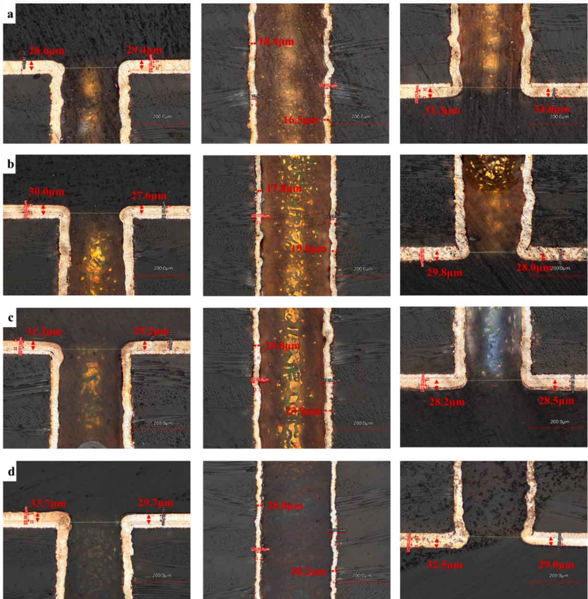  
Fig. 10. Optical microscopy images of the cross-sections of through-holes obtained using different leveling agents. (a)No Additives;(b)PD;(c)PDS;(d) Enthone ST-2000.

## 3.1.3. Electrochemical impedance Spectra analysis

AC impedance tests were carried out on different additives at different potentials[33], and the test results are shown in Fig. 5.

When the cathodic overpotential is low, research has found that the capacitive loop of the leveling agent PDS is significantly larger compared to PD, indicating that PDS has a stronger inhibitory effect on the deposition of copper ions and can provide a better leveling performance[34]. As the cathodic overpotential increases further, the size of the impedance arcs of the two additives tends to converge, indicating that the inhibitory effects of both leveling agents on the deposition of copper ions are at the same level under these conditions. However, for PD molecules, when in the high-frequency current region, the inductive loop exhibits significant instability. Combined with the analysis of the chronopotentiometry curves, this instability suggests that the adsorption state of the leveling agent molecule PD on the electrode surface is unstable, exhibiting strong adsorption–desorption phenomena. Stability is only achieved when the frequency is further increased.

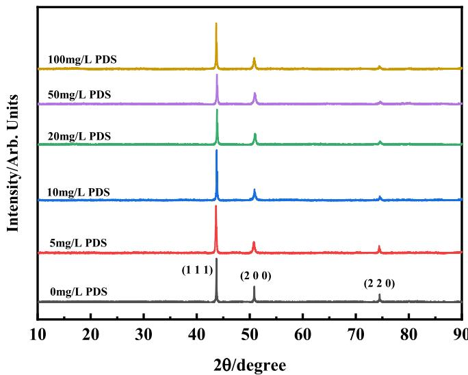  
Fig. 11. XRD test results at different PDS concentrations.

Grain sizes of the electroplated copper interconnect layers at different PDS concentrations.

<table><tr><td rowspan="2">Concentration /mg·L-1</td><td colspan="4">Grain size /nm</td></tr><tr><td>(111)</td><td>(200)</td><td>(220)</td><td>Average</td></tr><tr><td>0</td><td>66.54</td><td>64.43</td><td>59.89</td><td>63.62</td></tr><tr><td>5</td><td>35.54</td><td>21.80</td><td>27.83</td><td>28.39</td></tr><tr><td>10</td><td>42.43</td><td>20.49</td><td>24.53</td><td>29.15</td></tr><tr><td>20</td><td>38.95</td><td>20.92</td><td>20.27</td><td>26.72</td></tr><tr><td>50</td><td>37.40</td><td>19.68</td><td>21.76</td><td>26.28</td></tr><tr><td>100</td><td>40.84</td><td>21.54</td><td>27.03</td><td>29.81</td></tr></table>

## 3.2. Quantum chemical calculations

3.2.1. Comparison of the effects of molecular structures on the interaction with copper ions

The Electrostatic Potential (ESP) is used to describe the electrostatic potential energy in the space around a molecule resulting from its charge distribution[35]. It can help analyze the charge distribution and elec trostatic interactions between leveling agent molecules and the metal surface, revealing the adsorption sites, adsorption strength, and selectivity of the leveling agent[36]. Additionally, it can identify the electrophilic and nucleophilic reactive sites on the molecule[32].After structural optimization, the results of the electrostatic potential mapped surfaces for the PDS and PD molecules are displayed in Fig. 6.

After the geometric optimization of the two molecules, it can be observed that the introduction of $\mathbf { t h e } \ { - S } O _ { 2 }$ structure causes the PDS molecule to become more compact. Since both PDS and PD molecules carry a positive charge, the overall electrostatic potential (ESP) of the molecules is positive, which further facilitates the adsorption of these molecules on the cathodic surface. The electrostatic potential (ESP) of the PD molecule shows local minima near its end groups. However, for the PDS molecule, due to the influence of the $- S O _ { 2 }$ structure, the ESP distribution across the molecule is uneven. Areas containing the S structure exhibit local minima, making these parts more prone to interact with $\mathrm { C u ^ { 2 + } }$ and $\mathrm { H ^ { + } }$ ions. The calculations reveal that the mini mum ESP value of PD is 6.231 eV, while that of PDS is 5.496 eV, indi cating that the PDS molecule is more prone to interact with $\mathrm { { C u } ^ { 2 + } }$

Using Density Functional Theory (DFT), the HOMO and LUMO orbitals of the PDS and PD molecules were calculated[37]. The results are shown in Fig. 7.

The DFT calculation results reveal that the HOMO orbitals for both molecules are located near the double bonds at the end groups of the molecules, indicating that these areas are the primary sites for electrophilic attacks.

Compared to the PD molecule, new LUMO orbitals appear near the sulfur atom in the PDS molecule, indicating that the − ${ \bf - } S 0 _ { 2 }$ group introduces new nucleophilic reactive sites to the leveling agent[38]. This indicates that the presence of sulfur atoms in the molecules influences their preferred sites for nucleophilic reactions, differing between the two types. Additionally, since the LUMO orbitals are prone to accepting electrons from the metal’s $\pi ^ { * }$ orbitals to form π back-donation orbitals, they create active sites for metal adsorption.

The calculated results for the HOMO and LUMO orbitals of PDS and PD molecules are shown in Table 1.

Calculations show that the energy gap ΔE between the LUMO and HOMO orbitals of the PDS molecule is smaller than that of the PD molecule. This suggests that the PDS molecule is likely to exhibit higher reactivity during the copper crystallization process.

3.2.2. The adsorption state of leveling agent molecules on the surface of the copper electrode

Difference charge density helps reveal how leveling agent molecules engage in electron exchange or interact with the copper surface, thereby explaining the adsorption, surface modulation, and behavior during the electroplating process[39]. Difference charge density can reveal which functional groups or atoms in the leveling agent molecules undergo significant charge exchange or interaction with the copper surface, thus identifying the active sites of the leveling agent[40].The differential charge density of the two leveling agent molecules on the Cu(111) crystal surface was calculated using the CASTEP module, and the results are shown in Fig. 8.

The differential charge density calculations reveal that the PD molecule does not significantly affect the distribution of differential charge density on the Cu (111) surface, with only local minima in differential charge density near its corresponding hydrogen atoms. This suggests that the interaction between the PD molecule and the Cu surface is weak, primarily involving mere adsorption onto the metal surface.

The PDS molecule shows a maximum in differential charge density near the sulfur atoms, significantly affecting the distribution of differential charge density on the Cu surface. There is evident distortion of the electron cloud in the charge density near the atoms and the copper surface, indicating that the presence of sulfur atoms allows the molecule to form bonding interactions with the copper surface. This indicates that the incorporation of the $- s 0 _ { 2 }$ structure effectively enhances the in teractions of the leveling agent with the copper surface, achieving a better inhibitory effect[1].

The stronger inhibitory effect of PDS compared to PD can be attributed to the presence of $\mathbf { t h e } - S \mathbf { O } _ { 2 }$ functional group, which enhances molecular adsorption and introduces additional interaction sites on the copper surface. Differential charge density calculations suggest that PDS forms a more stable adsorption layer, reducing $\mathrm { { C u } ^ { 2 + } }$ accessibility while maintaining compatibility with other additives like PEG. In contrast, PD lacks these structural features, resulting in weaker surface interactions and less effective inhibition.

## 3.3. The effect of leveling agents on the surface of the copper plating layer

## 3.3.1. Surface morphology test

Electroplating was performed using the Hull cell with different additives at the optimal concentration determined previously. To enable a parallel comparison of the performance of the additives, no suppressions or brighteners (such as PEG and SPS) were added to the electrolyte. The surface morphology and grain size distribution of the resulting specimens are shown in Fig. 9.

According to the SEM analysis, it can be observed that when no additives are used, the surface crystals of the copper plating are the coarsest, with an average size of 0.381 μm. Additionally, many large crystalline particles are distributed across the surface of the copper layer. However, after the addition of leveling agents, the size of the copper crystals decreases. Especially when PDS is used as the leveling agent, the average crystal size of copper decreases to 0.333 μm, and the largest copper crystalline particles are smaller than 1.4 μm. When PD is used as the leveling agent, large particles with a size of 1.8 μm are still present on the surface, indicating that PDS is more effective in reducing the size of copper crystals and exhibits better leveling performance.

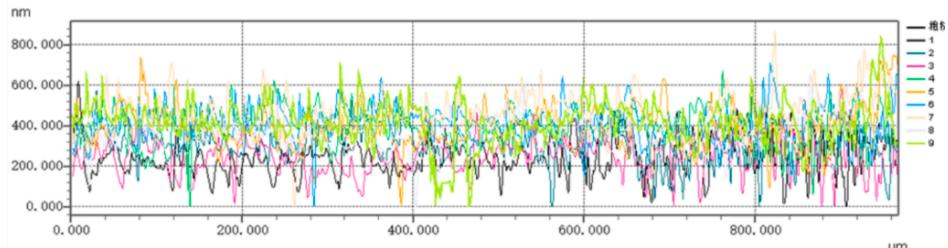

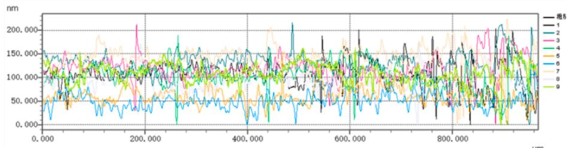

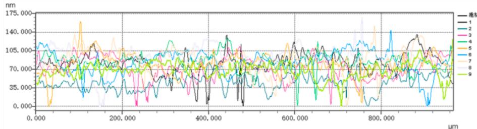  
Fig. 12. Test results of surface roughness for copper layers obtained with different leveling agents. (a)No Additives;(b)PD;(c)PDS.

## 3.3.2. Measurement of the copper plating thickness inside through-holes

Following the previously described conditions, different concentrations of leveling agent were added during electroplating in a Hull cell. The resulting circuit boards were cut, encapsulated, and polished. The metallurgical samples thus prepared were observed using a threedimensional profilometer microscope, and the condition of the copper layer inside the through-holes is shown in Fig. 10.

When no leveling agent is added, the average copper layer thickness on both sides of the through-hole is 12.25 µm, resulting in a through hole plating TP value of only 56.61 %. After adding 10 mg/L of PDS, the average thickness of the copper layer inside the through-hole increases to $2 2 . 3 5 \mu \mathrm { m } ,$ raising the TP value to 76.28 %. This represents an increase of $^ { 1 9 . 6 7 }$ % in the TP value. Additionally, after adding 10 mg/L of PD, the TP value increases to 60.20 %. Compared to the through-hole sample without any leveling agent, this represents a slight increase in the TP value, indicating that PD has a moderate inhibitory effect. However, the inhibitory effect of PD is less pronounced compared to PDS, which is consistent with the results of the electrochemical tests. To further determine whether the leveling performance of PDS meets the requirements, a comparison was made with a commercially available through-hole copper plating additive (Enthone ST-2000). The study found that under the same conditions, the TP value obtained with the commercial additive was 65.65 %, which did not reach the level achieved with PDS. This indicates that PDS has the potential to become a new type of copper plating leveling agent.

## 3.3.3. Measurement of the plated layer’s crystal orientation and crystallite size

X-ray Diffraction (XRD) tests were conducted to analyze the crys tallographic structure of the copper layer surfaces plated at different PDS concentrations. The results are displayed in Fig. 11. The XRD test results show peak positions at 43.69, 50.84, and 74.53, which corre spond to the typical characteristic peaks of copper. These peaks respectively correspond to the (110), (200), and (220) crystal planes. As the concentration of PDS increases, the peak intensity of the (220) crystal plane decreases, indicating that the presence of PDS inhibits the formation of the Cu (220) crystal plane. Additionally, using the Scherrer formula, the grain size of the copper interconnect layer under the influence of varying concentrations of PDS was calculated, as shown in Table 2. After adding 5 mg/L of PDS, the grain size rapidly decreases from 63.62 to 28.39. Subsequent increases in the concentration of PDS do not result in significant changes in grain size, indicating that PDS acts to refine the grain structure.

## 3.3.4. Measurement of the surface roughness of the copper plating layer

An white light interferometer was used to test the surface roughness of copper-plated samples without leveling agents and those treated with PD and PDS. The copper thickness was measured parallel to the surface of the samples to characterize their surface evenness. The results are shown in Fig. 12.

Compared to samples without a leveling agent, the inclusion of a leveling agent significantly smooths the surface of the copper layer, markedly reducing roughness. The peak roughness of the copper surface decreases from 800 nm to below 200 nm. Combining the grain size obtained from XRD testing, it is evident that the effect of the leveling agent on surface roughness is not only due to the reduction in crystal size but also due to a decrease in the number of copper particles agglomerating within the clusters. This contributes to the increased evenness of the surface.

## 4. Conclusion

This study improves the common leveling agent PD used in acid copper plating by incorporating $\mathrm { { S O } _ { 2 } }$ and investigates the leveling performance of both leveling agents through CVS, GMs, EIS testing, and more. The introduction of the − ${ \bf - } S 0 _ { 2 }$ structure effectively enhances the leveling capability of the leveling agent and creates new active sites on the Cu surface. The enhancement of leveling capabilities by the intro duction of the $- s 0 _ { 2 }$ structure was further substantiated through differential charge density calculations. Additionally, electrochemical experiments confirmed that the optimal concentration for both PD and PDS is 100 mg/L. SEM observations of the copper layers plated at this concentration revealed a significant reduction in porosity, indicating that both additive molecules effectively decrease the porosity of the plating layer. Observations from the profilometer showed that the copper layers were smoother and the crystallization more refined. This study demonstrates that the introduction of the − ${ \bf - } S O _ { 2 }$ functional group into PD leveling agents significantly improves their leveling performance. Theoretical calculations reveal that the $- S O _ { 2 }$ group enhances molecular adsorption and introduces additional interaction sites, leading to a more uniform adsorption layer and stronger inhibition of $\mathrm { C u } ^ { 2 + }$ deposition.Furthermore, comparative experiments show that the $S O _ { 2 ^ { - } }$ modified PD exhibits superior leveling efficiency and deposit uniformity compared to commercially available leveling agents. These findings highlight the potential o $\dot { \mathbf { \eta } } - \mathbf { S } \mathbf { O } _ { 2 }$ modification as a novel approach for designing next-generation copper plating additives.

## CRediT authorship contribution statement

Qiao Ding: Writing – review & editing, Writing – original draft, Software, Conceptualization. Ning Li: Resources. Bo Wu: Methodology. Qing Cheng: Project administration. Qi Zhao: Resources. Tong Liu: Resources. Rui Wang: Writing – review & editing, Supervision. Deyu Li: Supervision.

## Declaration of competing interest

The authors declare that they have no known competing financial interests or personal relationships that could have appeared to influence the work reported in this paper.

## Acknowledgements

Computational resources from the School of Chemistry and Materials Science, Heilongjiang University, are gratefully acknowledged.

## Data availability

No data was used for the research described in the article.

## References

[1] Y. Li, P. Ren, Y. Zhang, et al., The influence of leveler Brilliant Green on copper superconformal electroplating based on electrochemical and theoretical study[J], Journal of Industrial and Engineering Chemistry (seoul, Korea) 118 (2023) 78 90.

[2] L. Zheng, W. He, K. Zhu, et al., Investigation of poly (1-vinyl imidazole co 1, 4- butanediol diglycidyl ether) as a leveler for copper electroplating of through-hole [J], Electrochim. Acta 283 (2018) 560 567.

[3] C. Wang, J. Zhang, P. Yang, et al., Electrochemical behaviors of Janus Green B in through-hole copper electroplating: an insight by experiment and density functional theory calculation using Safranine T as a comparison[J], Electrochim. Acta 92 (2013) 356 364

[4] Y. Zhang, M. An, P. Yang, et al., Recent advances in electroplating of through-hole copper interconnection[J], Electrocatalysis 12 (2021) 619–627.

[5] L. Jin, Z. Wang, Z. Cai, et al., 1-(2-Pyridylazo)-2-naphthol as a synergistic additive for improving throwing power of through hole copper electronic electroplating[J], J. Ind. Eng. Chem. 125 (2023) 269–276.

[6] A.A. Kosarev, A.A. Kalinkina, S.S. Kruglikov, et al., Effect of the macro-and microthrowing power of the electrolyte on the uniformity of distribution of electroplated copper in through-holes for PCB[J], J. Solid State Electrochem. 25 (2021) 1491–1501.

[7] Z. Wang, P. Su, Y. Peng, et al., Towards void-free copper filling of low-aspect-ratio heat dissipation through holes in packaging substrate with high H2SO4 concentration electroplating system[J], J. Ind. Eng. Chem. (2024).

[8] Sun Z, He G, Zhao Z, et al. Research Progress of Electroplated Micropore fo Interconnection TechnologyIOP Publishing, 2023:12011.

[9] L. Xiao, Q. Li, H. Zeng, et al., Investigation of azathioprine and its local-structure molecules as levelers for through-holes copper electroplating[J], Surf. Interfaces (2024).

[10] T. Kobayashi, J. Kawasaki, K. Mihara, et al., Via-filling using electroplating fo build-up PCBs[J], Electrochim. Acta 47 (1–2) (2001) 85–89.

[11] W. Dow, M. Yen, W. Lin, et al., Influence of molecular weight of polyethylene glycol on microvia filling by copper electroplating[J], J. Electrochem. Soc. 152 (11) (2005) C769–C775.

[12] M.A. Pasquale, L.M. Gassa, A.J. Arvia, Copper electrodeposition from an acidi plating bath containing accelerating and inhibiting organic additives[J], Electrochim. Acta 53 (20) (2008) 5891–5904.

[13] W. Dow, H. Huang, M. Yen, et al., Influence of convection-dependent adsorption of additives on microvia filling by copper electroplating[J], J. Electrochem. Soc. 152 (6) (2005) C425–C434.

[14] L. Ji, S. Wang, C. Wang, et al., Improved uniformity of conformal through-hole copper electrodeposition by revision of plating cell configuration[J], J. Electrochem. Soc. 162 (12) (2015) D575.

[15] P. Dixit, J. Miao, Aspect-ratio-dependent copper electrodeposition technique for very high aspect-ratio through-hole plating[J], J. Electrochem. Soc. 153 (6) (2006) G552.

[16] C. Chen, C. Lu, S. Huang, et al., Effects of supporting electrolytes on copper electroplating for filling through-hole[J], Electrochim. Acta 56 (17) (2011) 5954–5960.

[17] Z. Chen, Y. Peng, H. Cheng, et al., Void-free and high-speed filling of through ceramic holes by copper electroplating[J], Microelectron. Reliab. 75 (2017) 171–177.

[18] Z. Lai, S. Wang, C. Wang, et al., Computational analysis and experimental evidence of two typical levelers for acid copper electroplating[J], Electrochim. Acta 273 (2018) 318–326.

[19] J. Li, G. Zhou, Y. Hong, et al., Copolymer of pyrrole and 1, 4-butanediol diglycidyl as an efficient additive leveler for through-hole copper electroplating[J], ACS Omega 5 (10) (2020) 4868 4874.

[20] L. Zheng, C. Wang, Y. Huang, et al., Hydroquinone oriented growth control to achieve high-quality copper coating at high rate for electronics interconnection[J], J. Taiwan Inst. Chem. Eng. 112 (2020) 130–136.

[21] Z. Li, B. Tan, J. Luo, et al., Structural influence of nitrogen-containing groups on triphenylmethane-based levelers in super-conformal copper electroplating[J], Electrochim. Acta 401 (2022) 139445

[22] X. Li, X. Chen, P. Zou, et al., Synthesis and application of anthraquinone quaternary phosphonium salt electroplating copper leveler based on expanded electrostatic adsorption area strategy and physicochemical salt bridge mechanism[J], Appl. Surf. Sci. 664 (2024) 160259.

[23] Y. Li, P. Ren, Y. Zhang, et al., Investigation of novel leveler Rhodamine B on copper superconformal electrodeposition of microvias by theoretical and experimenta studies[J], Appl. Surf. Sci. 615 (2023) 156266.

[24] Z. Tao, Z. Long, L. Tengxu, et al., The synergistic effects of additives on the micro vias copper filling[J], J. Electroanal. Chem. 918 (2022) 116456.

[25] S. Parida, S. Das, A. Mallik, An experimental study of copper electroplating by electrochemical impedance spectroscopy (EIS) at room temperature[J], Mater. Today Proc. 66 (2022) 544 547.

[26] Z. Wang, L. Jin, G. Li, et al., Electrochemical and in situ FTIR spectroscopic studies of gentian violet as a novel leveler in through-holes metallization for printed circuit board applications[J], Electrochim. Acta 410 (2022) 140018.

[27] B. Yuan, W. Zhou, X. Li, et al., Investigation of synthesized carbazole derivative Cz-BPDB as a high-performance leveler for copper electroplating[J], Surf. Coat. Technol. 463 (2023) 129526.

[28] G. Kresse, J. Furthmüller, Efficiency of ab-initio total energy calculations for metals and semiconductors using a plane-wave basis set[J], Comput. Mater. Sci 6 (1) (1996) 15–50.

[29] L. Yang, T. Frauenheim, E. Ganz, Properties of the free-standing two-dimensional copper monolayer[J], J. Nanomater. 2016 (1) (2016) 8429510.

[30] H. Wei, T. Tan, R. Liu, et al., Prediction and effect verification of thiamine as a leveling agent in chip wafer electroplating[J], ACS Omega 8 (48) (2023) 45495 45501.

[31] Z. Peng, Z. Li, Y. Jiao, et al., Manipulating adsorbate configurations in copper electroplated low aspect-ratio via fill in redistribution layers[J], Nano Mater. Sci. (2024).

[32] W. Zhou, B. Yuan, X. Li, et al., Investigation on synthesis and mechanism of a Sudan I copper electrodeposition leveler based on influencing ion diffusion strategy [J], Dyes Pigm. 227 (2024) 112156.

[33] C. Liao, S. Zhang, S. Chen, et al., The effect of tricyclazole as a novel leveler for filling electroplated copper microvias[J], J. Electroanal. Chem. 827 (2018) 151–159.

[34] M. Verrucchi, A. Comparini, M. Bonechi, et al., Electrochemical spectroscopic analysis of additives in copper plating baths by DRT and multivariate approach[J], J. Electroanal. Chem. 954 (2024) 118045.

[35] Y. Wang, H. Jiang, C. Tan, et al., 3-((2-ethoxyethanethioyl) thio) propane-1-sodium sulfonate as a new accelerator for copper electroplating: electrochemical and theoretical calculation studies[J], Mater. Today Commun. 39 (2024) 108905.

[36] N. Zhang, Z. Li, R. Wang, et al., Ad/desorption mechanism of amine-terminated polyoxypropylene suppressor in advanced acid copper electroplating, IEEE (2023) 1–6.

[37] Y. Li, P. Ren, R. Li, et al., A novel bright additive for copper electroplating electrochemical and theoretical study[J], Ionics 29 (1) (2023) 363–375.

[38] C. Peng, Y. Zhai, X. Chen, et al., Structure performance correlation of Nheterocyclic oligomer leveler for acid copper plating of advanced interconnects[J], Molecules 28 (6) (2023) 2783.

[39] A. Kumar, V.Q. Bui, J. Lee, et al., Modulating interfacial charge density of NiP2–FeP2 via coupling with metallic Cu for accelerating alkaline hydrogen evolution[J], ACS Energy Lett. 6 (2) (2021) 354–363.

[40] A. P´erez Paz, A. Rubio, Hydrated alkali atoms on copper (111): a density functional theory study[J], J. Phys. Chem. C 125 (7) (2021) 3868–3879.