# Evaluating copper plating process for filling micro vias with thin surface Cu by the 1-(4-carboxyphenyl)-5-mercapto-1H-tetrazole additive

Zewei. Lin a,b, Xuefei Tao a,\*, Lingjie Tengxu b, Zhihua Tao b

a Jiangxi Vocational College of Finance and Economics, Jiujiang 332000, China

b School of Materials and Energy, University of Electronic Science and Technology of China, Chengdu 610054, China

## A R T I C L E I N F O

Keywords: Leveler Copper Electroplating Microvia Electrodeposit Current Density

## A B S T R A C T

The 1-(4-carboxyphenyl)-5-mercapto-1 h-tetrazole (CMHT) as a novel leveler for the overfilling of micro-blind vias was investigated in acidic copper electroplating. The synergistic effect between CMHT and other additives were confirmed through chronoamperometry, cyclic voltammetry and electrochemical impedance spectroscopy. The results showed a convection-dependent interaction between the CMHT and suppressor (propyleneoxide (PO)-ethylene oxide (EO)-propylene oxide (PO), named PEP). Metallographic section testing demonstrated that the CMHT not only have excellent microvia filling performances, but also only have 19.1 μm thin surface Cu for micro blind vias with a diameter of 150 µm and a depth of 80 µm by the electrodepositing 60 min of 2 A/dm2. The quantum chemical calculations experiments revealed also that the CMHT parallel orientation of the benzene ring and tetrazole heterocycle can enhance the effective adsorption area. The obtained results from electrochemical test and quantum chemical calculations were in reasonably good agreement

## 1. Introduction

Copper plating process is widely applied in PCB and TSV industries due to its excellent conductivity properties and low cost. Currently, several important electronic interconnection applications encompass processes such as electroless copper plating, blind via plating, and through-hole plating. A significant issue associated with blind via plating is the relatively thick copper layer on the surface, which prevent effective and complete filling of the blind vias. On the other hand, the miniaturization requirements of 3D packagings force manufacturers to adopt multiple layers wiring interconnection structure to reducing the interconnect line length and corresponding signal loss. In other words, the vertical copper interconnection without void or seam can improve the signal transmission rate and saving the installation components area for PCB miniaturization [1–4].

In order to achieve high filling performance by CuSO -based elec trolyte systems, the leveler have become the fundamental choice for via fill applications due to it can prevent premature sealing of holes [5–8]. Typically, when using amine-containing glycidyl ethers as leveler, ad vantages such as improved surface appearance and void-free filling of blind vias are observed. However, these levelers are associated with a slower copper filling rate and can result in excessively thick copper layers on the surface. For example, the depth of the diameter of micro blind is about 100um and the surface copper is generally 20 \~ 25 μm, which is not easy to prepare fine circuit. In contrast, compounds such as imidazole and polyepoxides, when utilized as levelers, have demon strated advantages including a rapid filling rate for blind vias and a thinner copper layer on the surface [5–10]. The CMHT has a relatively small molecular weight and it contains thiol groups (−SH) and nitrogencontaining heterocycles. Considering the structure of CMHT tetrazoles is similar to imidazole as shown in Fig. 1, therefore, it is necessary to study the conditions for obtaining excellent blind hole filling effect by controlling the plating temperature, selecting appropriate current density and time, and making the additives in the plating solution have a high synergistic effect.

## 2. Experimenta

## 2.1. Electrochemical details

The electrochemical measurements were conducted using a CHI 760E electrochemical workstation from CH Instruments, Inc. This workstation was equipped with a standard three electrodes with a 100 mL three-electrode cell. The original supplemental electrolyte (OSE)

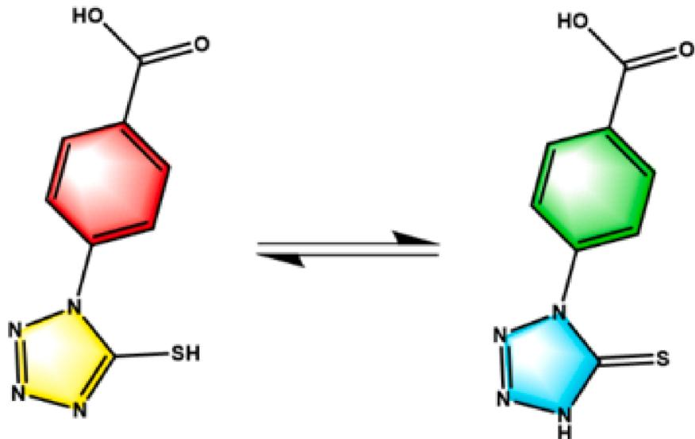  
Fig. 1. Chemical structures of CMHT.

solution contained 200 $\mathrm { g / L C u S O _ { 4 } { \cdot } 5 H _ { 2 } O }$ and 50 $g / \mathrm { L } \ : \mathrm { H } _ { 2 } S \mathrm { O } _ { 4 } .$ A platinum rotating disk electrode (Pt-RDE) with a diameter of 5 mm was employed as the working electrode, while a copper strip with a diameter of 4 mm was served as the counter electrode. The reference electrode used the mercurous sulfate electrode (SMSE). The deposition potential at different current densities was investigated to evaluate the filling properties while plating a minimal amount of copper on the cathode surface through galvanostatic measurements (GMs).

Prior to the GM test, it should be pointed out that the pre-plating step was carried out, during which a 500 nm layer of copper was deposited on the platinum spinning disk electrode to convert Pt-RDE to Cu-RDE. The electrolyte temperature was held constant at 293 ± 1 K by water bath throughout the experiment. The cyclic voltammetry (CV) was utilized with Pt-RDE as the working electrode to analyze the copper electroplating process. Similarly, the Pt electrode was pre-plated with a layer of copper before conducting the CV test. The CV test scan rate was set to 5 mV/s and the Pt-RDE rotation speed was fixed at 1000 rpm. Finally, Nyquist diagrams were plotted with an amplitude of 5 mV over a frequency range of 100 kHz–0.01 Hz at a steady potential of −0.65 V versus SMSE.

## 2.2. Cross section analysis of OM

Test panels with a via diameter of 140–150 µm were used during the measurement. The thickness of the test panels was 1 mm, while the via depth ranged from 80 to 100um.

All the plating processes took place in a Haring cell with a capacity of 1.5 L. The ratio of curing agent to resin used in the subsequent production of metallographic sections is 3:1. A cathode area measuring 50 mm × 50 mm was immersed in the plating solution. The test boards were cleaned with a series of decontamination processes prior to plating in order to ensure better electrical conductivity between the copper plating and the inner copper. The specific operation process is as follows: acid cleaning agent → deionized water rinse → micro-etching → deionized water rinse → acid dipping → copper electroplating in an acid bath. The electroplating test was carried out at room temperature and the current density was remained at $1 . 0 , 2 . 0 , 3 . 0 \mathrm { A } / \mathrm { d } \mathrm { m } ^ { 2 }$ for distinct plating times. The plating solution is continuously stirred by flowing air bubbles with a solution flow rate of 2.0 L per minute in order to fully mix the plating solution and maintain good mass transfer in the Haring cell. The plating solution included 200 $\mathbf { g } / \mathrm { L } \mathrm { C u } S 0 _ { 4 } { \cdot } 5 \mathrm { H } _ { 2 } \mathrm { O }$ and 50 $g / \mathrm { L } \ \mathrm { H } _ { 2 } S \mathrm { O } _ { 4 } ,$ , 100 mg/L PEP, 3 mg/L bis-(3-sulfopropyl) disulfide (SPS), 60 mg/L Cl− and 6 mg/L CMHT.

## 2.3. Calculation methods

The molecular structures of CMHT and its isomer were optimized using the B3LYP/6-31G(d,p) method with Gaussian 9 software. This optimization was performed in accordance with front-line molecular orbital theory [11,12], taking into account both the lowest unoccupied molecular orbital (LUMO) and the highest occupied molecular orbital (HOMO) [13,14,15]. The Forcite module was adopted to investigate the interaction between the Cu (1 1 1) surface and CMHT using Material Studio Software. In addition, molecular dynamics properties such as radius of gyration, radial distribution function and diffusion coefficient were analyzed for CMHT in the aqueous phase at a temperature of 298 K. The COMPASS II force field was utilized to optimize the size and simulate the adsorption process of CMHT. The kinetic parameters were set to include canonical ensemble with a time step of 1.0 fs and total simulation time of 500 ps containing 500 water molecules which added to the box.

## 3. Results and discussion

## 3.1. Electrochemical evaluation

In this section, the electrochemical properties of the CMHT organic compound were first investigated to provide data support for its selection as a leveler.

The CV test in Fig. 2 shows the Cu electrode potentialcurrent variations with the various concentrations of CMHT were added to the OSE solution that containing 60 mg/L Cl− , 100 mg/L PEP, and 3 mg/L SPS. The peak current density at the anode was negatively correlated with the increasing CMHT concentration as shown in Fig. 2(a), the highest peak current density at the anode was 15.55 $\mathrm { \sf A } / \mathrm { d } \mathrm { m } ^ { 2 }$ in the absence of the leveler, while the peak current density was $1 2 . 6 8 ~ \mathrm { \ A } / \mathrm { d } \mathrm { m } ^ { 2 }$ with continuing to add 12 mg/L CMHT to the OSE solution, this phenomenon indicators that CMHT has effective inhibition of copper deposition in OSE solution including 100 mg/L PEP, 3 mg/L SPS. To further determine the optimal concentration range of CMHT for the best filling performance, GM was employed using an electroplating solution that contained the leveling agent. At rotation speeds of 100 rpm and 1000 rpm of the rotating disk electrode, a specific concentration of CMHT was added every 500 s, while maintaining a current density of 2 $\mathrm { { A / c m ^ { 2 } } } .$ . The obtained potential-time curves are shown in Fig. 2(b). The potential difference $\Delta \mathfrak { \eta } = \mathfrak { \eta } ( 1 0 0 \mathrm { r p m } ) - \mathfrak { \eta } ( 1 0 0 0 \mathrm { r p m } )$ ) was defined, where a larger Δη value indicates a greater difference in copper deposition rate inside and outside the blind hole, typically suggesting better filling performance $[ 1 6 , 1 7 ]$ . The electrode potential decreases continuously with increasing concentrations of the leveling agent, demonstrating its polarization effect on the cathode. Notably, Δη reaches a maximum value of 18 mV at a CMHT concentration of 6 mg/L, indicating that the optimal concentration of CMHT for achieving excellent blind hole filling performance is 6 mg/L.

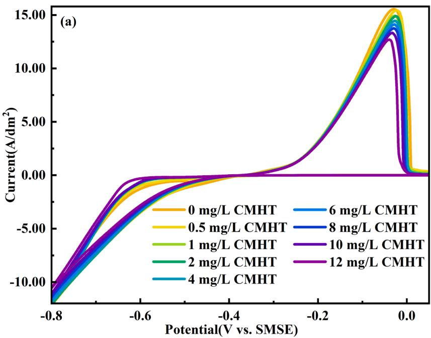

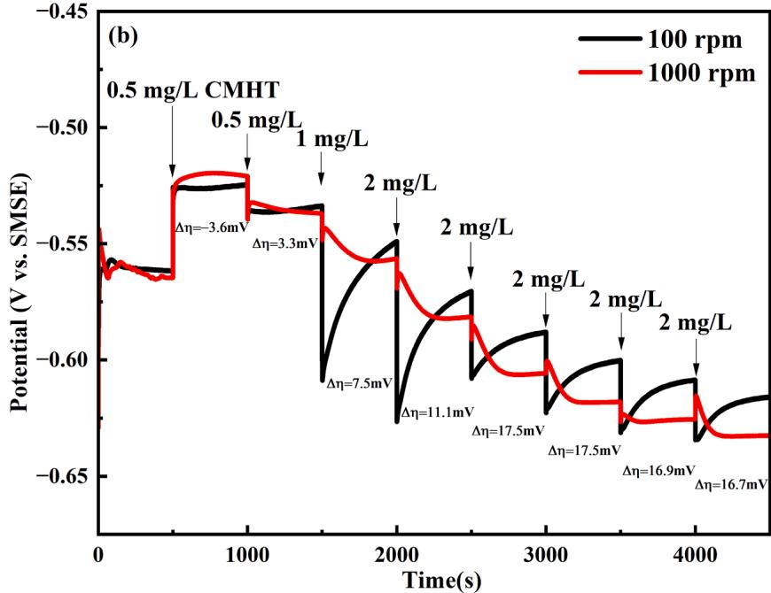  
Fig. 2. CV (a) and GM (b) obtained by gradually adding CMHT to the base plating solution.

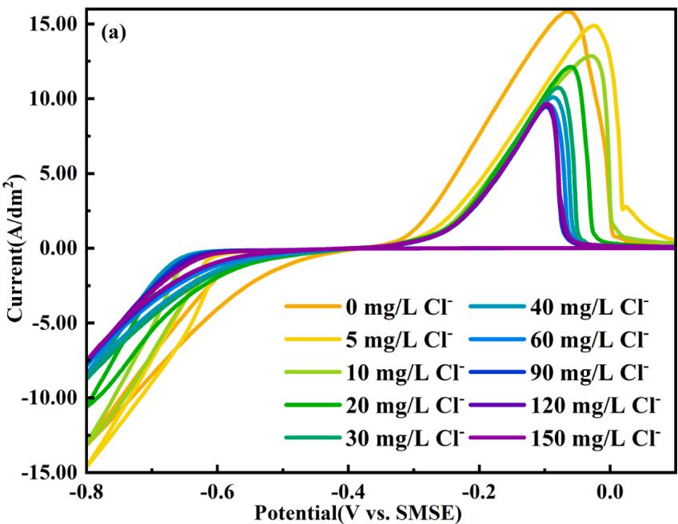

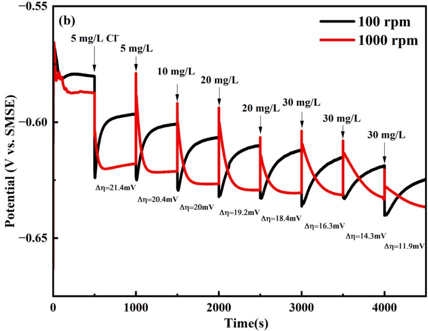  
Fig. 3. CVs and GMs obtained by gradually adding different additives(a,b for Cl-; c,d for PEP; e,f for SPS) to the base plating solution.

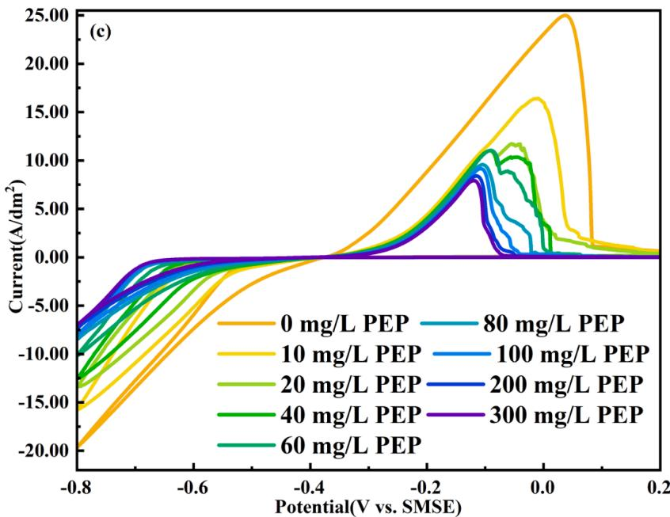

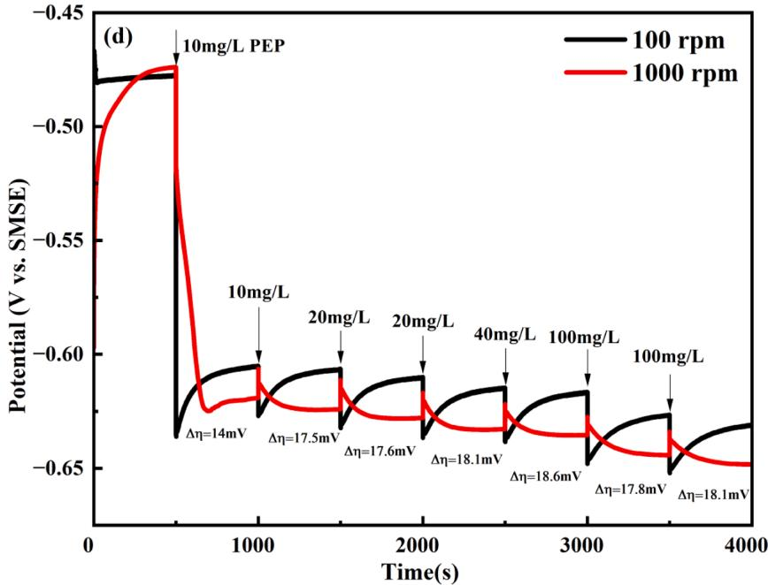  
Fig. 3. (continued).

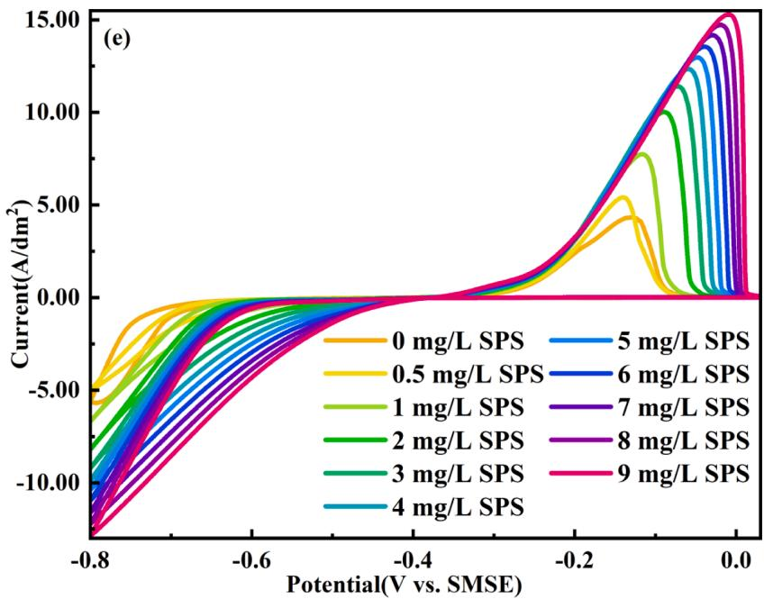

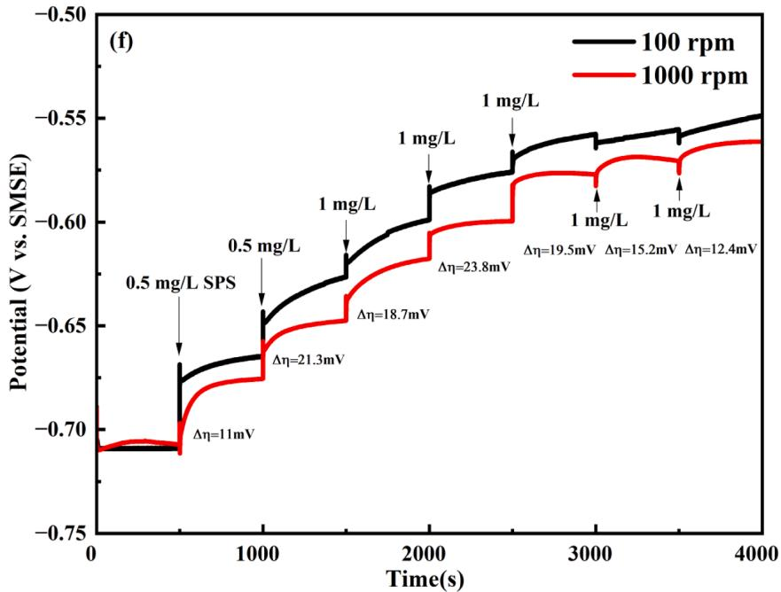  
Fig. 3. (continued).

In order to determine the optimal formulation for plating additive and understand the synergistic effect, CV and GM tests were conducted on the remaining additives of SPS and PEP as shown in Fig. 3. It can be observed from Fig. 3a that the anode peak current density could reach $1 5 . 8 \ \mathrm { A } / \mathrm { d } \mathrm { m } ^ { 2 }$ in the absence of $\mathrm { C l ^ { - } }$ . However, the anode peak current density decreases with the continuous addition of Cl− which primarily due to the synergistic effect of $\mathrm { C l ^ { - } }$ with the inhibitor PEP [18,19]. The change in peak current density is no longer significant when the Cl− concentration reaches 40 mg/L, This phenomenon means that the synergistic inhibitory effect of Cl− with PEP has reached saturation and the peak current density reaches its minimum value of $9 . 6 \ \mathrm { A } / \mathrm { d } \mathrm { m } ^ { 2 } .$ The corresponding deposition potential is −0.602 V (vs. SMSE) in the absence of Cl− with the current density of 2 $\mathrm { \sf A } / \mathrm { d } \mathrm { m } ^ { 2 }$ for the electroplating solution. The polarization effect is most pronounced with a deposition potential of −0.693 V (vs. SMSE) for the $\mathrm { C l ^ { - } }$ concentration in the range of 30–60 mg/L, the result suggesting that the optimal Cl− concentration range is 30–60 mg/L in the case of fixed amounts of other additives. When the Cl− concentration is between 5–40 $\mathbf { m g } / \mathrm { L } ,$ Fig. 3(b) shows that the change in $\Delta \mathfrak { n }$ is in the ranging of 18–20 mV. The deposition potential is most negative at a Cl− concentration of 60 mg/L, indicating the outer hole copper deposition during electroplating is more challenging, the strongest synergistic inhibitory effect between $\mathrm { C l ^ { - } }$ and PEP which leading to a thinner copper surface. The value of $\Delta \mathfrak { n }$ rapidly decrease with the $\mathrm { C l ^ { - } }$ concentration exceeds 60 $\mathrm { { \ m g / L } }$ indicating a gradual weakening of the hole-filling performance and making it unsuitable for blind hole filling in the electroplating solution.

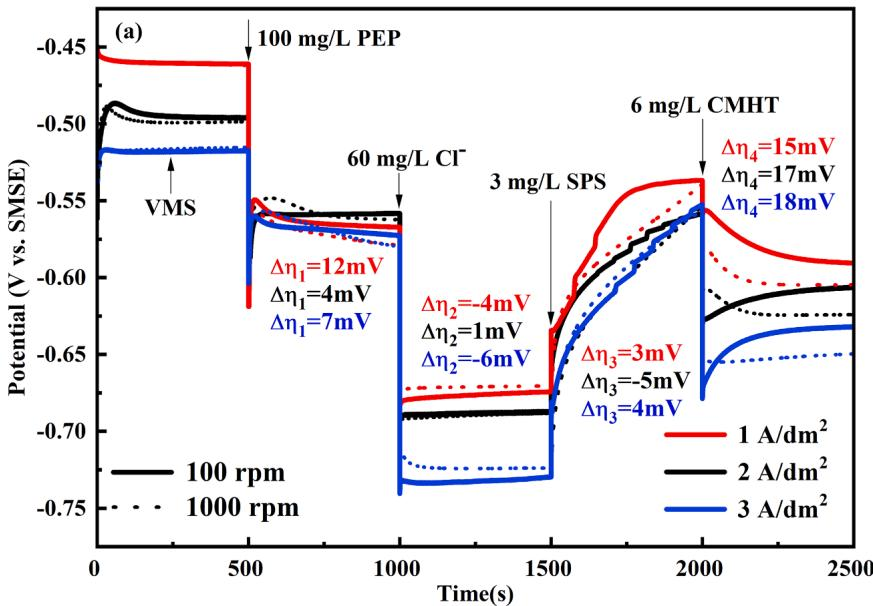

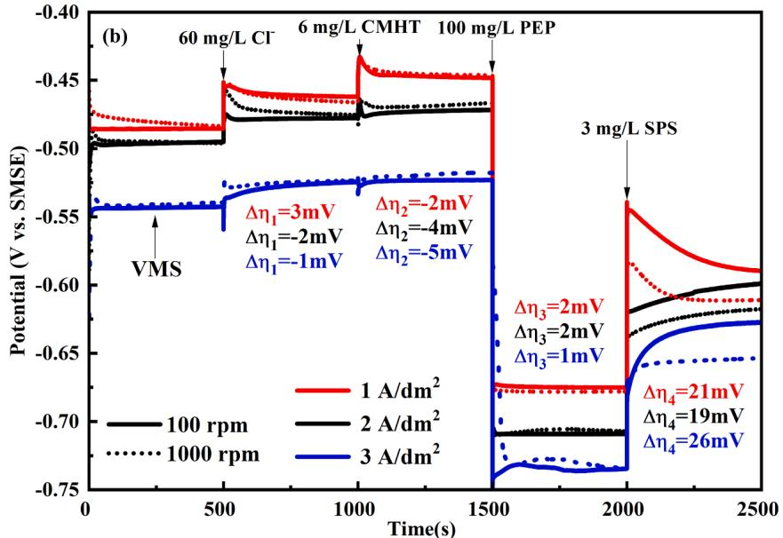  
Fig. 4. GMs with the successive addition of various additives at different rotation speeds and current densities.

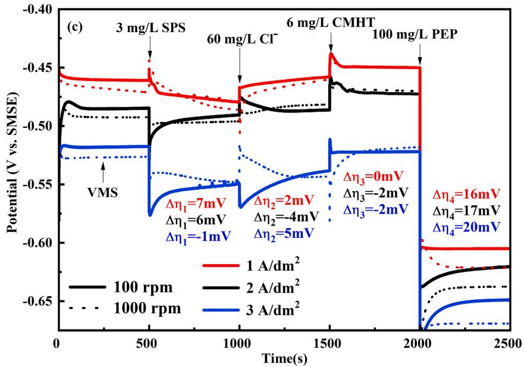

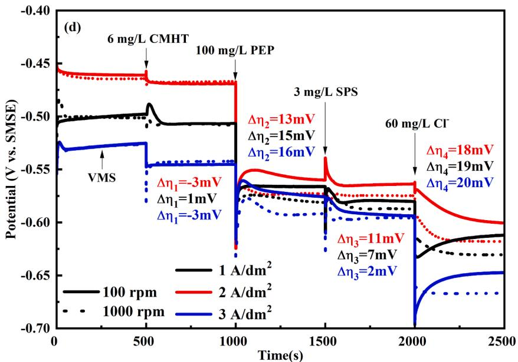  
Fig. 4. (continued).

The anode peak current density is $2 5 \mathrm { A } / \mathrm { d m } ^ { 2 }$ in the absence of PEP in the electroplating solution as shown in Fig. 3(c). Comparatively, the peak current density rapidly decreases with the addition of PEP could be attributed to a strong inhibitory effect of PEP on copper deposition. However, the change in anode peak current density is no longer signif icant when the PEP concentration reaches 40 mg/L, this result indi cating that the adsorption of PEP has reached a critical value. The appropriate concentration of PEP should be equal to or greater than 40 mg/L based on the inhibitor increasing further will not have a significant impact on copper deposition. The corresponding deposition potential without PEP $\mathrm { i } s - 0 . 5 4 6 \mathrm { \Delta V }$ for a current density of $2 \ \mathrm { A } / \mathrm { d } \mathrm { m } ^ { 2 }$ in the electroplating solution, the further research also indicates that the polarization curve shifts towards a more negative direction with the continuous addition of PEP and it is found that the maximum negative direction to be −0.716 V at a PEP concentration of 200–300 mg/L. The change in Δη corresponding to CMHT are small with the 20–100 mg/L of PEP concentration as shown in Fig. 3(d) at the ranging of 18–19 mV. The potential difference at different speeds of Cu-RDE is largest at a PEP concentration of 100 mg/L indicating the good hole filling ability in the plating solution. By integrating CV and GM tests and considering that inhibitors are continuously consumed during the actual production process, the optimal concentration of PEP was determined to be 100 mg/ L.

Fig. 3(e) shows that the anode peak current density is positively correlated to SPS concentration, and it has a minimum of $4 . 3 3 \mathrm { A } / \mathrm { d } \mathrm { m } ^ { 2 }$ and a maximum of $1 5 . 2 9 \mathrm { A } / \mathrm { d } \mathrm { m } ^ { 2 }$ with the SPS concentration ranges from 0 to 9 mg/L. This result suggests that SPS can enhance the reduction rate of copper ions on the electrode surface, thereby expediting the copper deposition process. At a current density of $2 \mathrm { A } / \mathrm { d } \mathrm { m } ^ { 2 } ,$ , the corresponding deposition potential shifts from −0.760 V to −0.651 V as the SPS concentration increases from 0 to 9 mg/L. The result demonstrates also that SPS can reduce cathodic polarization and accelerate the reduction of copper ions. Fig. 3(f) shows that the electrode potential continues to rise as the SPS concentration increased. The maximum value of Δη is achieved with the values of 24 mV at an SPS concentration of 3 mg/L. In summary, the optimal electroplating solution formulation is determined to be: 6 mg/L CMHT, 60 mg/L Cl− , 3 mg/L SPS, and 100 mg/L PEP.

In order to further understand the mechanism of CMHT during electroplating and to propose a filling mechanism model, the synergistic interactions between additives have investigated.

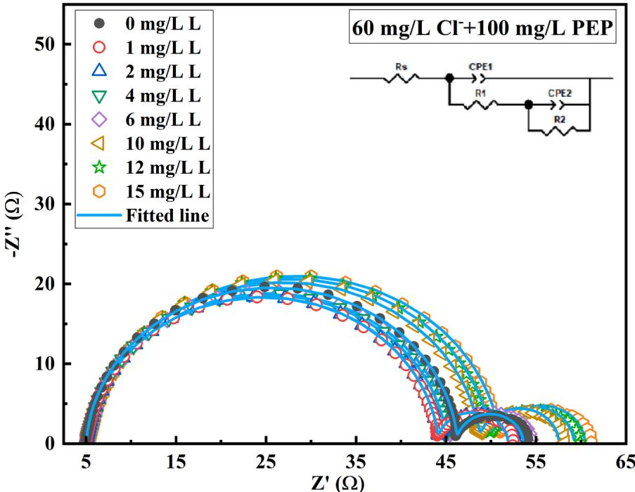  
Fig. 5. Nyquist was carried out at −0.65 V with OSE solution containing 60 mg/L Cl− , 100 mg/L PEP and CMHT in different concentrations.

Electrochemical impedance parameters in plating solution in the presence and absence of L.

<table><tr><td>c (mg/L)</td><td> $R_s$ (Ω cm2)</td><td>CPE1(μF cm-2)</td><td>n1</td><td>R1(Ω cm2)</td><td>CPE2(μF cm-2)</td><td>n2</td><td>R2(Ω cm2)</td></tr><tr><td>0</td><td>1.00</td><td>91.1</td><td>0.9660</td><td>8.089</td><td>7.7755</td><td>1</td><td>1.435</td></tr><tr><td>1</td><td>1.00</td><td>21.3</td><td>0.9587</td><td>7.675</td><td>6.6378</td><td>1</td><td>1.510</td></tr><tr><td>2</td><td>1.00</td><td>21.9</td><td>0.9578</td><td>7.693</td><td>6.8418</td><td>1</td><td>1.535</td></tr><tr><td>4</td><td>1.01</td><td>22.6</td><td>0.9575</td><td>7.830</td><td>7.0408</td><td>1</td><td>1.546</td></tr><tr><td>6</td><td>1.02</td><td>23.3</td><td>0.9557</td><td>7.928</td><td>6.6429</td><td>1</td><td>1.615</td></tr><tr><td>8</td><td>1.04</td><td>24.8</td><td>0.9526</td><td>8.536</td><td>6.1173</td><td>1</td><td>1.703</td></tr><tr><td>10</td><td>1.05</td><td>25.3</td><td>0.9504</td><td>8.753</td><td>5.6735</td><td>1</td><td>1.798</td></tr><tr><td>12</td><td>1.06</td><td>25.8</td><td>0.9481</td><td>8.945</td><td>5.5561</td><td>1</td><td>1.833</td></tr></table>

The GM curves obtained by sequentially adding various electroplating additives at two rotational speeds of 100 rpm and 1000 rpm, and testing at three current densities of 1 $\mathrm { A } / \mathrm { d } \mathrm { m } ^ { 2 } , 2 \mathrm { A } / \mathrm { d } \mathrm { m } ^ { 2 } ,$ , and $3 \mathrm { \ A } / \mathrm { d } \mathrm { m } ^ { 2 } .$ . It can be observed from Fig. 4 that the higher of the current density for electrodeposition, the more negative the cathode potential within the current range of 1–3 $\mathbf { A } / \mathrm { d } \mathbf { m } ^ { 2 } .$ The electrode potential decreased slightly after adding 100 mg/L of PEP to the OSE solution as shown in Fig. 4(a), suggesting that PEP has a mild inhibitory effect on copper deposition in the absence of $\mathrm { C l ^ { - } }$ [20,21]. It is generally believed that the diffusion coefficient of PEP polymer in aqueous solutions is small. Considering the difference in diffusion distance between the inside and outside of the micropores, the introduction of forced convection greatly enhances the amount of PEP adsorbed on cathode surface containing micropores within unit time and inhibiting the reduction of $\mathrm { C u } ^ { 2 + } / \mathrm { C u } ^ { + }$ . It is usually considered that $\mathrm { P E P , }$ chloride ions and cuprous ions form $\mathrm { P E P - C u ^ { + } - C l ^ { - } }$ complexes, where $\mathrm { C l ^ { - } }$ serves as an anchor point for PEP $\mathbf { \cdot } \mathbf { C u } ^ { + }$ adsorption, strongly inhibiting the reduction process of copper ions [22]. SPS ex hibits stronger acceleration effect compared to PEP inhibition effect of electrodeposition in the absence of CMHT as shown in Fig. 4(a), the result is attributed to the gradual replacement of PEP by SPS on the plated surface weakens their inhibitory effect and leading to excessive copper plating [23]. On the other hand, the internal space of the blind hole continuously shrinks over time, leading to a reduction in the surface area available for copper deposition according to the curvature adsorption enhancement mechanism with fixed additive of chloride ions, inhibitors and accelerators. In other words, the significant increasing accelerators adsorbed quantity per unit area inside the blind hole which leading to an increase in the copper deposition rate inside the blind hole. The accelerators usually cannot be replaced by inhibitors ultimately leading to overfilling at the pore opening when the filling completed [24]. Finally, there was a decrease in deposition potential and the stabilization of the three curves was obtained with 8 mg/L of CMHT to solution as shown in Fig. 4(a), indicating that the adsorption of CMHT on the electrode surface prevented the continuous replacement of inhibitors. The values at the three current densities were 15 mV, 17 mV, and 18 mV, respectively. Notably, copper deposition rates under weak convection intensity were higher than those under strong convection intensity, thereby facilitating the super-filling of the blind hole base on the characteristics of convection-dependent adsorption [6]. By comparing the segments from 1500-2000 s in Fig. 4(b), 1000–1500 s in Fig. 4(c), and 500–1000 s in Fig. 4(d), it can be observed that CMHT exerts an inhibitory effect in OSE solution. However, when both CMHT and $\mathrm { C l ^ { - } }$ are present simultaneously, they promote the reduction of copper ions. Furthermore, no significant interaction is observed between CMHT and SPS. By comparing the segments from 500-1000 s in Fig. 4(a) and from 1000 to 1500 s in Fig. 4(d), it can be observed that the Δη value of the electroplating solution increased when both CMHT and PEP were present simultaneously, what needs to be emphasized is that the increase exceeded the Δη value of OSE solution that contained only CMHT or only PEP, indicating a good synergistic effect between CMHT and PEP. This synergistic effect can enhance the adsorption of CMHT and PEP in the high convection intensity region, while having a weaker impact on the low convection intensity region as shown in Fig. 4, ultimately resulting in an increase in the $\Delta \mathfrak { n }$ value.

The adsorption of thiol occurs through the formation of Cu-S bond base on the mechanism of molecular interface chemistry, enhancing the adsorption stability on the copper metal surface [25]. The adsorption behavior is related to the concentration of the leveler. It is generally believed that leveler selectively adsorb at high current densities or high convection intensities, such as edges and corners, to prevent overdeposition of copper in these areas. In order to investigate the the adsorption layer resistance linked to the $\mathrm { C u } ^ { + } { \to } \mathrm { C u } ^ { 0 }$ reaction. It can be seen from Table 1 that the solution resistance (R ) increases with the increasing concentration of CMHT. It is commonly believed that sulfurcontaining heterocyclic compounds affect the viscosity of the entire electroplating solution, thereby alternately changing the rheological properties of copper ions [30]. The increase in the viscosity of the electroplating solution leads to a decrease in ion mobility and ionic conductivity. Additionally, the rate constant $\mathtt { R } _ { 1 }$ decreases and then increases with the increasing concentration of CMHT. R1 only exceeds the initial value when the concentration of CMHT is 8 mg/L. This indicates that the concentration of CMHT in the PEP-Cl-OSE system needs to be greater than or equal to 8 mg/L to inhibit the $\mathrm { C u } ^ { 2 + } { \to } \mathrm { C u } ^ { + }$ reaction. The value of ${ \mathrm { R } } _ { 2 }$ is positively correlated with the concentration of CMHT as shown in Fig. $^ { 5 , }$ indicating that the addition of leveler can gradually inhibit the $\mathrm { C u } ^ { + } { \to } \mathrm { C u } ^ { 0 }$ reaction. As can be seen from the data in Table 1, the PEP-Cl-OSE system began to inhibit the ${ \mathrm { C u } } ^ { 2 + } { \to } { \mathrm { C u } } ^ { 0 }$ reaction at concentrations of CMHT greater than or equal to 6 mg/L.

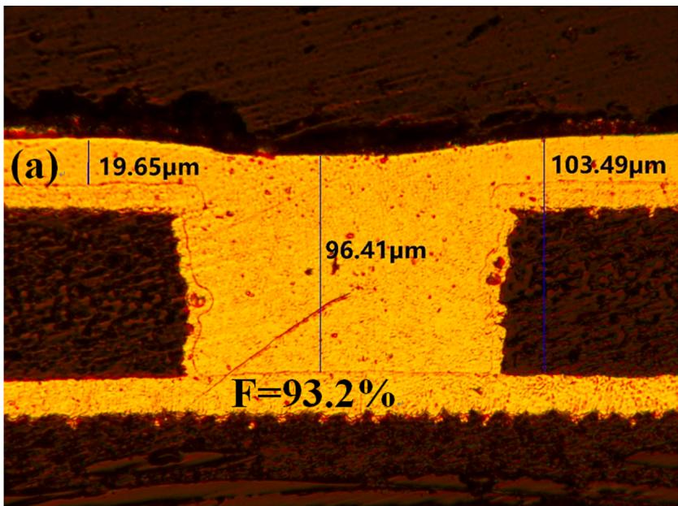

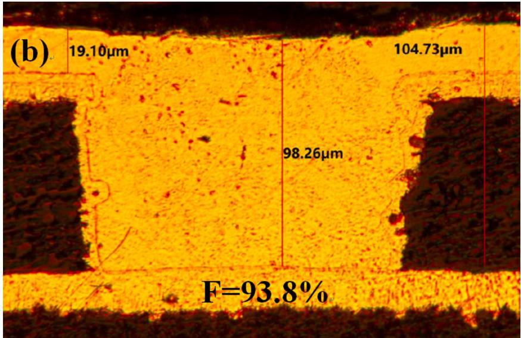  
Fig. 6. Cross-section images of microvias with diameters of: (a) 120 min with CMHT at $1 \mathrm { A } / \mathrm { d } \mathrm { m } ^ { 2 } ,$ (b) 60 min with CMHT at $2 \mathrm { A } / \mathrm { d } \mathrm { m } ^ { 2 } ,$ (c) 40 min with CMHT at 3A/ dm2, the plating solution is composed of OSE solution, 60 mg/L Cl− , 100 mg/L PEP, 3 mg/L SPS and 6 mg/L CMHT; (d) 60 min with JGB at $2 \mathrm { A } / \mathrm { d } \mathrm { m } ^ { 2 }$ [30]; (e) 60 min with 2 mg/L CMHT at 2A/dm2, (f) 60 min with 8 mg/L CMHT at 2A/dm2, the plating solution is composed of OSE solution, 60 mg/L Cl− , 100 mg/L PEP, 3 mg/L SPS.

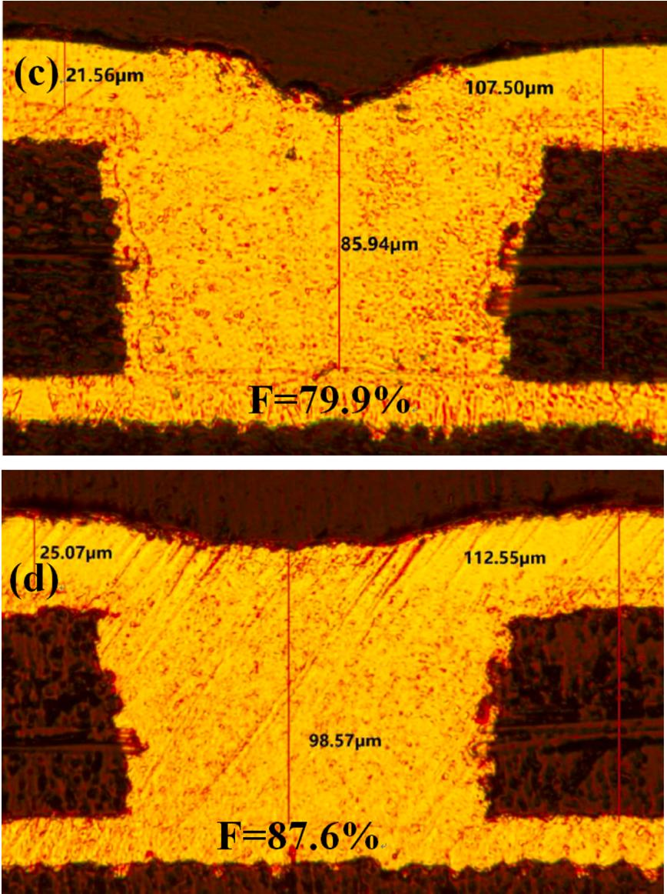  
Fig. 6. (continued).

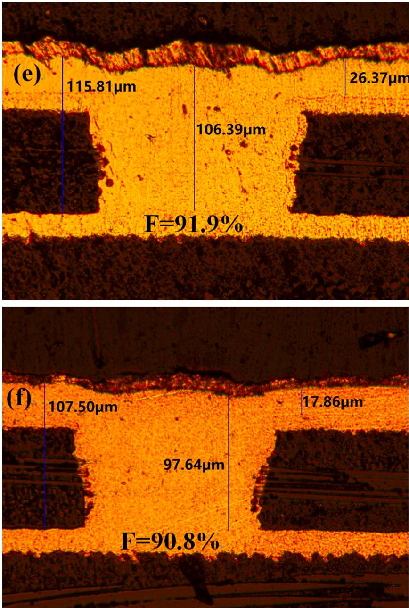  
Fig. 6. (continued).  
adsorption behavior of the CMHT in an electroplating solution without SPS, electrochemical impedance spectroscopy (EIS) was conducted at a stable potential of −0.65 V to study the deposition of copper. The Nyquist curve recorded in OSE solution containing 60 mg/L Cl− and 100 mg/L PEP is shown in Fig. 5. The curve consists of two parts: a capacitive loop in the high-frequency (HF) range and a capacitive loop in the lowfrequency (LF) range. According to literature reports $[ 2 6 - 2 9 ]$ , the highfrequency capacitive loop represents the $\mathrm { C u } ^ { 2 + } \to \mathrm { C u } ^ { + }$ reaction, while the low-frequency capacitive loop is associated with the relaxation process of $\mathrm { P E P - C u ^ { + } - C l ^ { - } }$ and the $\mathrm { C u } ^ { + } \to \mathrm { C u } ^ { 0 }$ reaction. The radius of the highfrequency capacitive loop initially decreases and then increases with the addition of CMHT as shown in Fig. 5, the result indicates that at low concentrations CMHT cannot inhibit the $\mathsf { C u } ^ { 2 + } { \to } \mathsf { C u } ^ { + }$ reaction. The electrochemical parameters derived from the equivalent circuit are detailed in Table 1. $\mathrm { R } _ { s }$ represents the solution resistance in this equivalent circuit, $\mathrm { C P E _ { 1 } }$ stands for the double-layer capacitance, ${ \mathrm { R } } _ { 1 }$ denotes the charge transfer resistance associated with the $\mathsf { C u } ^ { 2 + } { \to } \mathsf { C u } ^ { + }$ reaction, $\mathrm { C P E } _ { 2 }$ represents the capacitance of the adsorption layer, and ${ \mathrm { R } } _ { 2 }$ signifies

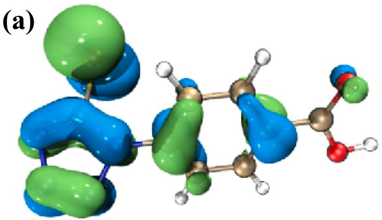

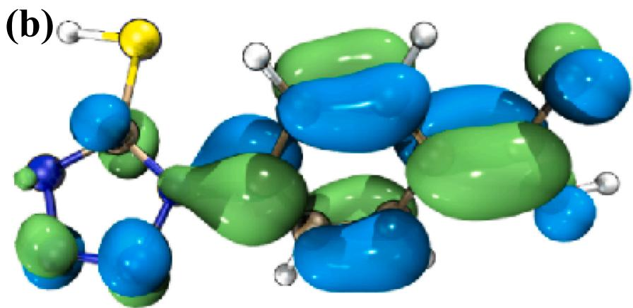  
Fig. 7. The frontier molecular orbitals: HOMO of (a) CMHT, (c) CMHT-iso; LUMO of (b) CMHT, (d) CMHT-iso. ESP mapped molecular vdW surface of (e) CMHT, (f) CMHT-sio(dark blue: N, gold: C, red: O, yellow: S, white: H). (For interpretation of the references to colour in this figure legend, the reader is referred to the web version of this article.)

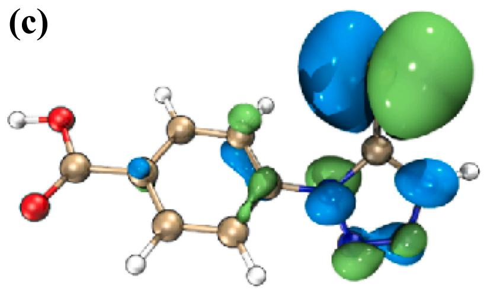

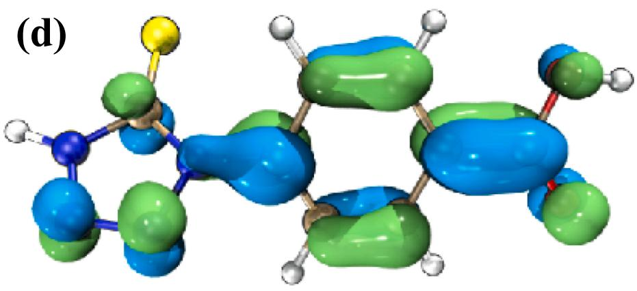  
Fig. 7. (continued).

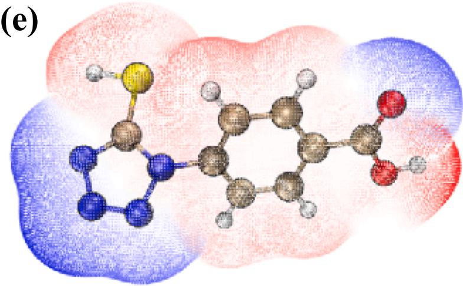

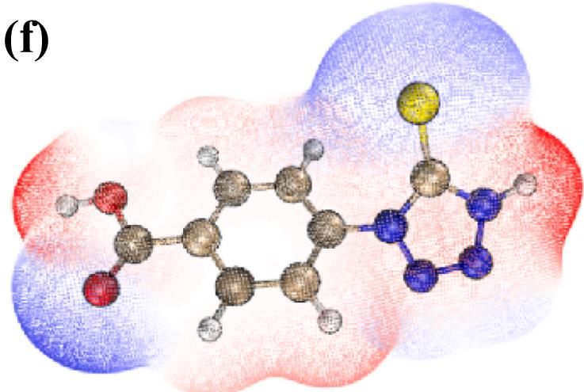  
Fig. 7. (continued).

Table 2  
Some molecular properties of L and L-iso calculated using DFT.

<table><tr><td></td><td>EHOMO (eV)</td><td>ELUMO (eV)</td><td>ΔE (eV)</td></tr><tr><td>L</td><td>-7.082</td><td>-1.767</td><td>5.315</td></tr><tr><td>L-iso</td><td>-6.702</td><td>-1.861</td><td>4.841</td></tr></table>

## 3.2. Electroplating experiments

It is necessary to verify the leveling performance of CMHT through blind hole filling experiments base on electrochemical test obtained the optimal formulation. The electroplating experiments were conducted at deposition current densities of $1 \ \mathrm { A } / \mathrm { d } \mathrm { m } ^ { 2 } , 2 \ \mathrm { A } / \mathrm { d } \mathrm { m } ^ { 2 }$ , and 3 $\mathbf { A } / \mathrm { d } \mathbf { m } ^ { 2 } .$ . The metallographic samples were hardened with epoxy resin after hole filling, followed by grinding, polishing, and examination under a metallographic microscope. The cross-sections of blind holes obtained at different current densities are shown in Fig. 6, which summarizes the hole filling rate and the copper thickness on the surface at each current density. CMHT exhibited the lowest filling rate and the highest copper thickness on the surface with the current density of $3 \mathrm { { A } / d m ^ { 2 } }$ as shown in Fig. 6. This phenomenon may be attributed to excessively high current densities can lead to a loose crystalline structure in the copper plating layer base on electroplating charring, weakening the adsorption capacity of additives and decreasing the performance of top-down hole filling [31]. Additionally, high current densities can significantly accelerate the consumption rate of copper ions within the holes, leading to a decrease in copper ion concentration and hydrogen evolution reaction occurs easily inside the blind holes. As a result, the copper ion diffusion rate control and there is little difference in copper deposition rates at the bottom and outside of the holes over an extended period. The result leads to a moderate decrease in the filling rate and an increase in surface copper thickness. At lower current densities, accelerators are more likely to replace inhibitors, which necessitates a longer time for each additive to reach adsorption equilibrium [32]. It can also be found in Fig. 6 that CMHT exhibited the best hole-filling performance (93.8 %) and the thinnest surface copper of 19.1um for blind holes with a radius of 150 μm and a depth of 80 μm at a current density of $2 \mathrm { A } / \mathrm { d } \mathrm { m } ^ { 2 }$

Under the same electroplating conditions, blind hole cross-sections obtained using the traditional leveler JGB are shown in Fig. 6(d). Electroplating at a current density of 2 $\mathrm { \sf A } / \mathrm { d } \mathrm { m } ^ { 2 }$ for 60 min resulted in a hole filling rate of 87.6 % and a surface copper thickness of 25.07 μm [30].

The electroplating experiments demonstrate that using CMHT as a leveler for blind hole electroplating can result in a thinner surface copper on plated parts and achieve a higher filling rate compared to the traditional leveler JGB.

To establish a correlation between the electroplating performance and the injection experimental results obtained from Fig. 2(c), we set up control groups with CMHT concentrations of 2 mg/L, 6 mg/L, and 8 mg/ L, while keeping the concentrations of other additives constant. Electroplating experiments were conducted for 60 min at a current density of 2 $\mathbf { A } / \mathrm { d } \mathrm { m } ^ { 2 } .$ The results are presented in Fig. 6(e), (b), and (f). It can be observed that when the concentration of CMHT is greater than or equal to 2 mg/L, the filling rate of blind holes exceeds 90 %. At a CMHT concentration of $2 \mathrm { m g } / \mathrm { L } ,$ , the coating is uneven, and the copper layer is relatively thick. At 6 mg/L as shown in Fig. 6(b), the coating remains uneven, while at 8 mg/L, the electroplating results are essentially similar to those obtained at 6 mg/L and showed a stronger inhibition. This in dicates that the electroplating outcomes are associated with Δη measured during the injection experiments; specifically, a larger value of Δη correlates with improved electroplating performance. This relationship suggests that the value of $\Delta \mathfrak { n }$ measured during the injection experiment serves as a reliable indicator for predicting the microhole filling results.

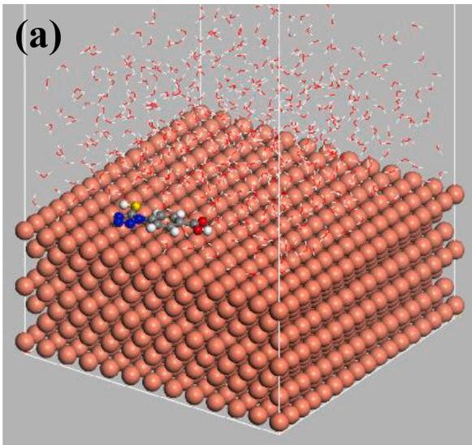

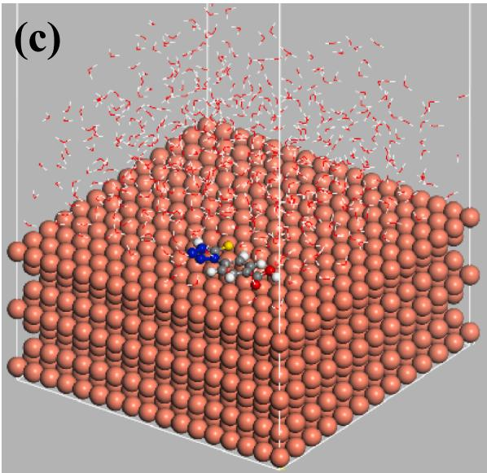

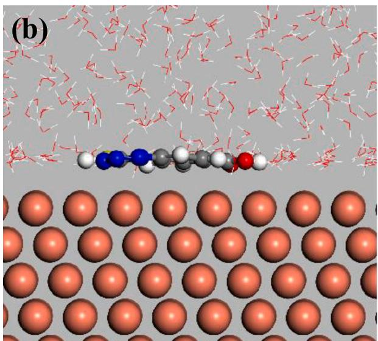

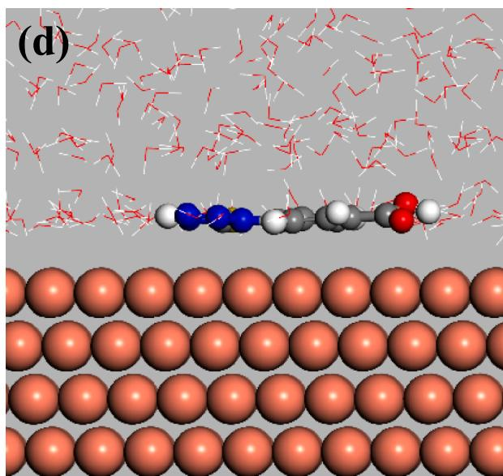  
Fig. 8. Molecular dynamics simulations of (a,b)CMHT and (c,d)CMHT-iso.

## 3.3. Quantum chemical calculations and molecular dynamics simulation

This study further investigated the molecular structure and electronic properties of CMHT through quantum chemical calculations. Based on frontier orbital theory, the highest occupied molecular orbital (HOMO) and lowest unoccupied molecular orbital (LUMO) have the most significant influence on the adsorption of organic molecules on metals [33]. A smaller $\mathtt { E } _ { \mathrm { L U M O } }$ (lowest unoccupied molecular orbital energy) value indicates a stronger electron acceptance ability, while a larger EHOMO (highest occupied molecular orbital energy) value indicates a stronger electron donation ability. A smaller energy gap (ΔE $= \mathrm { E _ { L U M O } - E _ { H O M O } } )$ suggests higher molecular reactivity and is favorable for the adsorption of levelers [34]. The frontier molecular orbitals of the leveler molecule and its tautomeric forms are shown in Fig. 7(a)–(d), with quantum chemical parameters listed in Table 2. It can be observed from Table 2 that the thioketone structure of CMHT is more likely to adsorb onto the copper surface compared to the thiol structure.

Electrostatic potential surface (EPS) maps provide a direct visualization of preferred reaction sites and serve as a powerful tool for predicting molecular properties. The red regions on the EPS map represent low electron density, while the blue regions represent high electron density. It is generally believed that atoms in high electron density regions have a greater affinity for metal surfaces. From Fig. 7(e) (thioketone), it can be seen that the thioketone structure of CMHT exhibits higher electron density at the sulfur atom. This suggests that L can donate electrons to the copper surface through the sulfur atom to form coordination bonds. In contrast, Fig. 7(f) illustrates that the thiol form allows the thiol structure of the leveler molecule to bind to the copper surface via the nitrogen atom. Additionally, the oxygen and nitrogen atoms in the leveler molecule, due to their high electron density, can attract $\mathrm { { C u } ^ { 2 + } }$ ions, thereby accelerating the deposition of copper to a certain extent. This finding is consistent with the results of

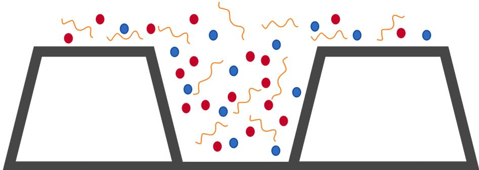  
(a)

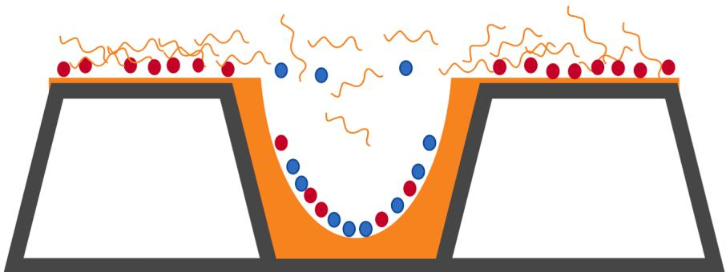  
(b)  
Fig. 9. The optimized adsorption model of CMHT on the cathode surface.

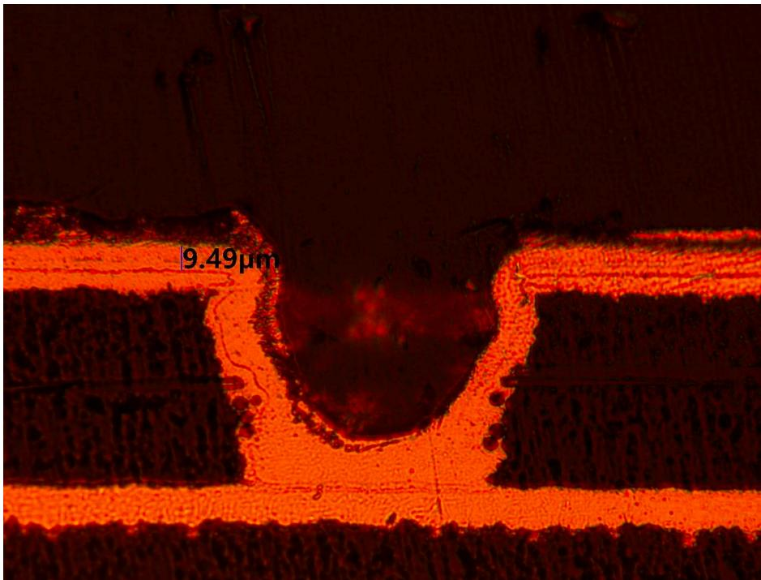  
(b1)

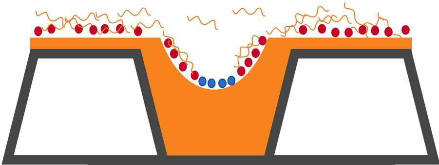  
(c)  
Fig. 9. (continued).

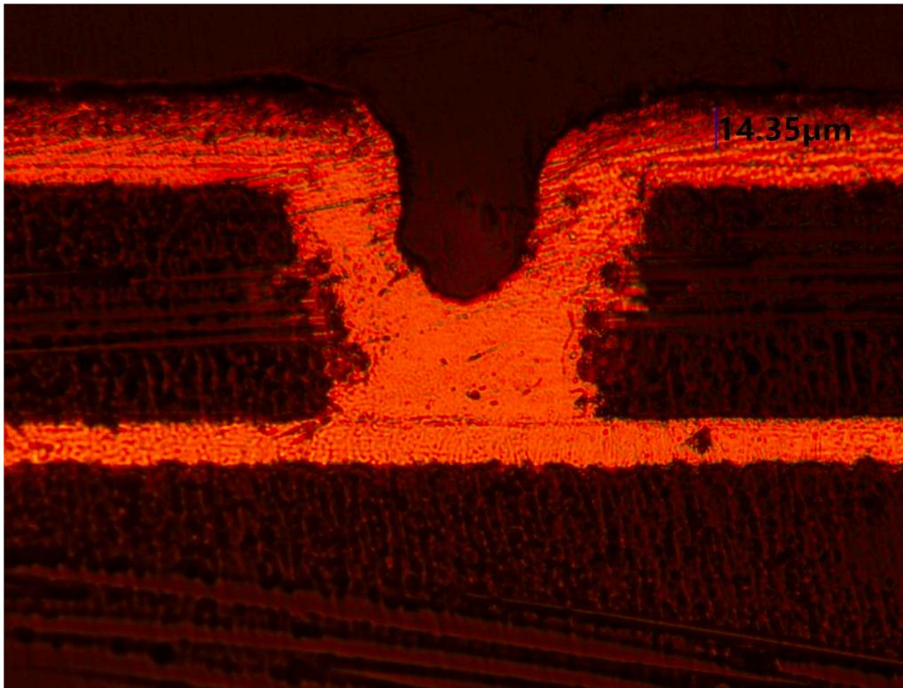  
(c1)

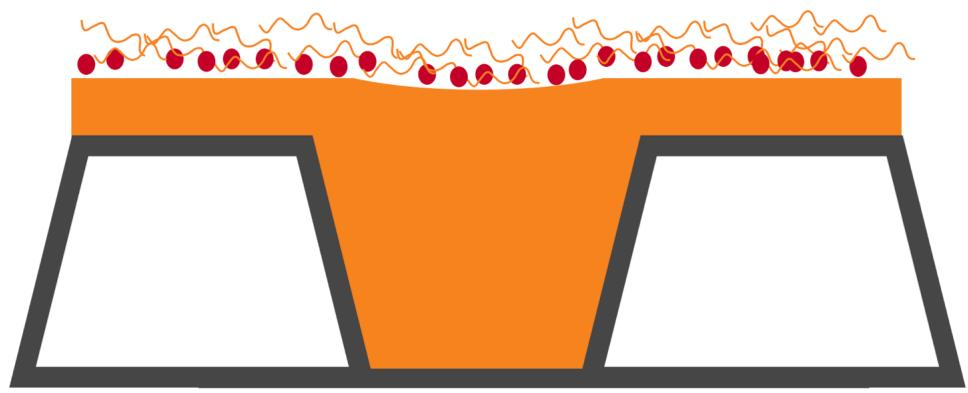

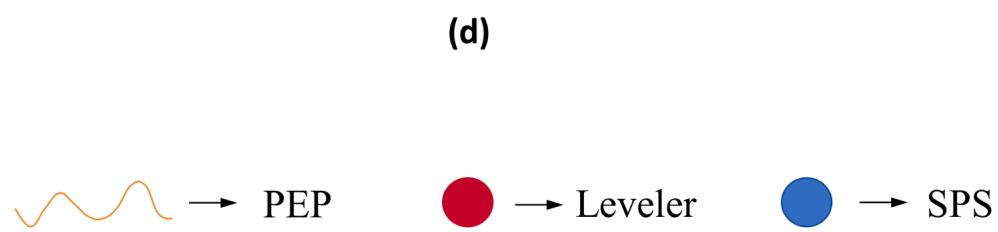  
Fig. 9. (continued).

electrochemical tests.

Molecular dynamics simulations were conducted to study the adsorption process of levelers and their tautomeric molecules on the Cu (111) surface to further understand the equilibrium state of levelers on the copper surface. The simulation results are shown in Fig. 8(a)-(d). It is evident that L and its tautomers are oriented parallel to the target surface. The parallel alignment of the benzene ring and tetrazole heterocycle maximizes the adsorption area between the leveler molecule and the metal surface. This helps reduce the electro-deposition activity of copper ions by covering reactive sites on the metal surface in the electroplating solution.

Electrochemical tests have shown that CMHT and PEP exhibit synergistic inhibition, suppressing the $\mathrm { C u } ^ { + } \to \mathrm { C u } ^ { 0 }$ reaction, and also demonstrate a certain degree of synergistic acceleration in the presence of Cl− . The electrochemical characteristics displayed by L may be attributed to the presence of thiol groups with adsorption capabilities, benzene rings that can expand the adsorption area, and high electron density groups that accelerate copper deposition. Considering the micropore filling from the bottom up based on the Curvature Enhanced Accelerator Covering (CEAC) and CDA theories [6,35,36], the rate of copper deposition at the bottom of the micro-pores is higher than that on the outer surface of the pores. Fig. 9(a)–(d) illustrates a schematic dia gram of the blind hole filling model. Fig. 9(b1) and (c1) present metallographic cross-sectional images obtained after electroplating for 20 min and 40 min, respectively, at a current density of $2 \mathrm { \ A } / \mathrm { d } \mathrm { m } ^ { 2 } .$ . It is generally believed that the polymer PEP primarily adsorbs in the high forced convection area; conversely, accelerators selectively adsorb at the bottom of the micro-pores, accelerating electroplating due to the rapid diffusion of sulfur-containing small molecules.

The electrochemical test results of this experiment indicate that the mechanism by which L enhances hole filling performance is likely by strengthening the inhibitory effect of PEP while simultaneously accelerating the deposition of copper ions at the bottom of the holes. After a period of electroplating, the noticeable gradient distribution of additives causes a change in the geometric shape of the holes. PEP and some levelers concentrate on the outer edges of the holes due to strong convection, resulting in rapid electroplating [37], as depicted in $\mathrm { F i g . ~ } 9 0 )$ (c). Eventually, when the bottom of the micro-pores aligns with the surface of the test panel, convection intensity becomes nearly uniform throughout. At this point, the synergistic effect of PEP and levelers prevails in strong convection, leading to the displacement of SPS and the cessation of bottom-up filling.

## 4. Conclusions

The electroplating solution was optimized and the complete flling of microvias can be achieved with the following formula: 6 mg/L CMHT, 60 mg/L Cl− , 3 mg/L SPS, and 100 mg/L PEP. Further electrochemical studies revealed a synergistic inhibition effect between CMHT and PEP-$\mathrm { C u ^ { + } { - } C l ^ { - } }$ −. Electrochemical impedance spectroscopy showed that CMHT in the Cl− -PEP-VMS electroplating solution can simultaneously inhibit the $\mathrm { C u } ^ { 2 + } { \to } \mathrm { C u } ^ { + }$ and $\mathrm { C u ^ { + } { \to } C u } ^ { 0 }$ processes.

Cross section analysis of OM demonstrated that the highest filling rate of 93.8 % and the lowest copper surface thickness of 19.1 μm at a current density of $2 \mathrm { \ A } / \mathrm { d } \mathrm { m } ^ { 2 }$ and a duration of 60 min using blind holes with a diameter of 150um and a depth of 80um as the filling object.

Quantum chemical calculations indicate that the sulfonyl structure of CMHT is more likely to adsorb on the copper surface than the thiol structure. The high electron density of oxygen (O) and nitrogen (N) atoms in CMHT molecules helps attract $\dot { \mathrm { C u } ^ { 2 + } }$ ions to accelerate the reduction of copper ions.

## CRediT authorship contribution statement

Zewei. Lin: Writing – original draft. Xuefei Tao: Funding acquisi tion. Lingjie Tengxu: Investigation. Zhihua Tao: Writing – review & editing.

## Declaration of competing interest

The authors declare that they have no known competing financial interests or personal relationships that could have appeared to influence the work reported in this paper.

## Acknowledgements

The authors gratefully acknowledge the support of the Science and Technology Project of Jiangxi Provincial Education Department (NO. GJJ224901) and the Natural Science Foundation of Jiangxi Province of China (No. 20212BAB204046).

## References

[1] C. Liao, S. Zhang, S. Chen, Y. Qiang, G. Liu, M. Tang, B. Tan, D. Fu, Y. Xu, The effect of tricyclazole as a novel leveler for filling electroplated copper microvias, J. Electroanal. Chem. 15 (827) (2018 Oct) 151–159.

[2] V. Kumari, M. Chandrakar, M.K. Majumder, Performance analysis of cylindrica through silicon via with interfacial crack. 2023 24th International Symposium on Quality Electronic Design (ISQED), 2023.

[3] W.P. Dow, C.C. Li, Y.C. Su, et al., Microvia filling by copper electroplating using diazine black as a leveler, Electrochim. Acta 54 (24) (2009) 5894–5901.

[4] T.B. Huang, H. Sharma, R. Manepalli, S. Kandanur, V. Sundaram, R.R. Tummala, Electroanalytical study of organic additive interactions in copper plating and their correlation with via fill behavior, J. Electron. Mater. 47 (2018 Dec) 7401 7408.

[5] J.H. Moon, J. Shin, T.H. Kim, D. Song, E. Cho, Improving accuracy of filling performance prediction in microvia copper electroplating, J. Electroanal. Chem. 15 (871) (2020 Aug) 114318.

[6] M.H. Lee, Y. Lee, J.A. Kim, et al., Quaternary ammonium-based levelers for highspeed microvia filling via Cu electrodeposition, Electrochim. Acta 419 (2022) 140389.

[7] Z. Tao, Z. Long, L. Tengxu, G. Liu, X. Tao, The synergistic effects of additives on the micro vias copper filling, J. Electroanal. Chem. 1 (918) (2022 Aug) 116456.

[8] M. Verrucchi, A. Comparini, M. Bonechi, I. del Pace, G. Zangari, W. Giurlani, M. Innocenti, Electrochemical spectroscopic analysis of additives in copper plating baths by DRT and multivariate approach, J. Electroanal. Chem. 1 (954) (2024 Feb) 118045.

[9] T. Zhang, C. Zheng, H. Li, S. Song, W. Huang, Q. Li, Y. Min, X. Shen, Q. Xu, Five membered heterocyclic small molecule compounds as novel levelling agents for blind-hole copper plating, J. Electroanal. Chem. 5 (2024 Feb) 118100.

[10] M. Zhou, Y. Meng, J. Ling, Y. Zhang, W. Huang, Y. Min, Q. Xu, 5-Amino-1, 3, 4- thiadiazole-2-thiol as a new leveler for blind holes copper electroplating: Theoretical calculation and electrochemical studies, Appl. Surf. Sci. 606 (2022) 154871.

[11] B. Yuan, W. Zhou, X. Li, et al., Investigation of synthesized carbazole derivative Cz-BPDB as a high-performance leveler for copper electroplating, Surf. Coat. Technol. 463 (2023) 129526.

[12] B. Yuan, X. Chen, Y. Zhao, et al., Unveiling the potential and mechanisms of 3, 3′- bicarbazole-based quaternary ammonium salts as levelers, Electrochim. Acta 471 (2023) 143345.

[13] T. Lu, F. Chen, Multiwfn: A multifunctional wavefunction analyzer, J. Comput. Chem. 33 (5) (2012 Feb 15) 580–592.

[14] J.I. Aihara, Reduced HOMO− LUMO gap as an index of kinetic stability for polycyclic aromatic hydrocarbons, Chem. A Eur. J. 103 (37) (1999 Sep 16) 7487–7495.

[15] Z. Lai, S. Wang, C. Wang, et al., Computational analysis and experimental evidence of two typical levelers for acid copper electroplating, Electrochim. Acta 273 (2018) 318–326.

[16] I. Volov, X. Sun, G. Gadikota, P. Shi, A.C. West, Electrodeposition of copper–tin film alloys for interconnect applications, Electrochim. Acta 1 (89) (2013 Feb) 792–797.

[17] F. Wang, K. Zhou, Q. Zhang, Y. Le, W. Liu, Y. Wang, F. Wang, Effect of molecular weight and concentration of polyethylene glycol on through–silicon via filling by copper, Microelectron. Eng. 15 (215) (2019 Jul) 111003.

[18] A.Y. Wang, B. Chen, L. Fang, J.J. Yu, L.M. Wang, Influence of branched quaternary ammonium surfactant molecules as levelers for copper electroplating from acidic sulfate bath, Electrochim. Acta 1 (108) (2013 Oct) 698 706.

[19] J. Li, G. Zhou, Y. Hong, C. Wang, W. He, S. Wang, Y. Chen, Z. Wen, Q. Wang, Copolymer of pyrrole and 1, 4-butanediol diglycidyl as an efficient additive leveler for through-hole copper electroplating, ACS Omega 5 (10) (2020 Mar 3) 4868 4874.

[20] Y. Yoon, M.J. Kim, J.J. Kim, Machine learning to electrochemistry: Analysis of polymers and halide ions in a copper electrolyte, Electrochim. Acta 399 (2021) 139424.

[21] P. Ren, M. An, P. Yang, J. Zhang, Unveiling the synergistic inhibition of Cl− copper plating: Pivotal roles of adsorption and desorption, J. Electroanal. Chem. 1 (898) (2021 Oct) 115624.

[22] Tao Z, He W, Wang S, He X, Jiao C, \*\*ao D. Synergistic effect of different additives on microvia filling in an acidic copper plating solution. Journal of The Electrochemical Society. 2016 May 25;163(8):D379.

[23] Wang ZY, \*\* L, Yang JQ, Li WQ, Wu DY, Zhan D, Yang FZ, Sun SG. A transferadsorption model for forward understanding the synergistic effects of additives in through-hole uniform copper thickening. Journal of Electroanalytical Chemistry. 2023 May 1;936:117373.

[24] T.P. Moffat, D. Wheeler, S.K. Kim, D. Josell, Curvature enhanced adsorbate coverage model for electrodeposition, Journal of the Electrochemical Society. 153 (2) (2006 Jan 11) C127.

[25] W.P. Dow, Y.D. Chiu, M.Y. Yen, Microvia filling by Cu electroplating over a Au seed layer modified by a disulfide, J. Electrochem. Soc. 156 (4) (2009 Feb 20) D155.

[26] Z. Tao, W. He, J. Li, S. Wang, Y. Chen, K. Ai, Y. Peng, Y. Hong, Tetraoxa diphosphaspiro derivative as suppressor for microvia filling by copper electroplating in acidic solution, J. Electrochem. Soc. 164 (14) (2017 Dec 28) D1034.

[27] Y. Li, P. Ren, Y. Zhang, et al., Investigation of novel leveler Rhodamine B on copper superconformal electrodeposition of microvias by theoretical and experimenta studies, Appl. Surf. Sci. 615 (2023) 156266.

[28] P. Ren, M. An, P. Yang, et al., Inhibition of multi-site adsorption of polyethylene glycol during copper via-filling process, Colloids Surf A Physicochem Eng Asp 652 (2022) 129823.

[29] H. Cao, T. Hang, H. Ling, M. Li, Behaviors of chloride ions in methanesulfonic acid bath for copper electrodeposition of through-silicon-via, J. Electrochem. Soc. 160 (4) (2013 Feb 5) D146.

[30] Z. Tao, L. Tengxu, Z. Long, X. Tao, Evaluating the via filling performance with thin surface Cu by the synergistic effect of different additives, Thin Solid Films 1 (757) (2022 Sep) 139390.

[31] K.L. Lin, S.Y. Chen, U.S. Mohanty, Effect of current density and plating time on the morphology of copper electrodeposits on an AFM tip, J. Electrochem. Soc. 155 (4) (2008 Jan 31) D251.

[32] M.H. Lee, M.J. Kim, J.J. Kim, Competitive adsorption between bromide ions and bis (3-sulfopropyl)-disulfide for Cu microvia filling, Electrochim. Acta 370 (2021) 137707.

[33] X. Li, P. Zou, X. Chen, L. Wang, Quantum chemical calculations and molecula dynamics simulations to investigate the mechanism of interaction of six dye levelers with copper surface, J. Electroanal. Chem. 29 (2024 Mar) 118230.

[34] Y. Qiang, S. Zhang, S. Xu, W. Li, Experimental and theoretical studies on the corrosion inhibition of copper by two indazole derivatives in 3.0% NaCl solution, J. Colloid Interface Sci. 15 (472) (2016 Jun) 52 59.

[35] T.P. Moffat, T.M. Braun, D. Raciti, et al., Superconformal film growth: from smoothing surfaces to interconnect technology, Acc. Chem. Res. 56 (9) (2023) 1004 1017.

[36] W.P. Dow, M.Y. Yen, C.W. Liu, C.C. Huang, Enhancement of filling performance of a copper plating formula at low chloride concentration, Electrochim. Acta 53 (10) (2008 Apr 1) 3610 3619.

[37] N. Xiao, N. Li, G. Cui, et al., Triblock copolymers as suppressors for microvia filling via copper electroplating, J. Electrochem. Soc. 160 (4) (2013) D188.