http://pubs.acs.org/journal/acsodf

# Study on the Efects of Additives on the Performance of Ni−Co−P Alloy Coatings Using Box−Behnken Design

Yuejun Shen, Yao Ding, Xuesong Sun,\* Dingfu Liu,\* Rengui Xiao, and Yuanfei An

Cite This: ACS Omega 2024, 9, 942−954

Read Online

ACCESS

Metrics & More

ABSTRACT: To understand the efects of additives on the performance of a Ni− Co−P alloy electroplated coating, this study, based on a single-factor experiment, utilized a Box−Behnken experimental design to optimize an additive that can enhance the electrodeposited Ni−Co−P alloy coating’s properties, including hardness, glossiness, and corrosion resistance. The study used tools such as a gloss meter, a Vickers hardness tester, and an electrochemical workstation to analyze the impact of diferent additives on the coating’s hardness and gloss. The optimal additive combination was determined. The results from the Box−Behnken experiment showed that when the concentrations of sodium dodecyl sulfate, thiourea, and sodium allyl sulfonate reached 0.10, 0.15, and 0.22 g/L, respectively, the resulting coating hardness was 475.4 $\mathrm { H V } _ { 0 . 5 } ,$ and the gloss level was 463.4 GU. Compared to the coatings without additives, the hardness increased by 90.34 $\mathrm { H V } _ { 0 . 5 } ,$ and the glossiness rose by 101.2 GU. The coating’s corrosion resistance also

Article Recommendations

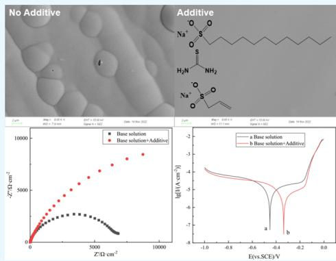

improved. This enhancement is attributed to the compounded additive, which significantly improved the surface morphology of the coating, making it smoother and more compact. The morphology and composition of the coatings with additives were analyzed through scanning electron microscopy and energy dispersive X-ray spectroscopy, and the composition of the coating contains 71.01 at % Ni, 20.65 at % Co, and 8.34 at % P. At the same time, the optimized coating exhibits a metallic luster similar to stainless steel, meeting industrial requirements.

## 1. INTRODUCTION

Chrome plating has been highly favored for its advantages (e.g., high hardness, excellent corrosion resistance, and wear resistance), whereas the environmental pollution and health hazards arising from hexavalent chromium in the plating solution have aroused rising attention.1,2 Electroplated Ni− Co−P alloy coatings have been considered a promising alternative to chrome plating for their prominent thermal stability, corrosion resistance, and wear resistance, as reported in existing research.3−6 However, several problems (e.g., severe hydrogen evolution at the cathode and unstable plating solution) during the electroplating process of Ni−W−B alloy coatings can trigger cracked coatings, lack of metallic luster, and inadequate decorative properties.7,8 Accordingly, the electroplating process of the Ni−W−B alloy should be investigated in depth.

Additives take on critical significance in electroplating, even though they are employed in small quantities. They exert notable efects on the performance exhibited by the plating solutions and coatings. Surfactants are capable of reducing the surface tension of the plating solution such that the plating solution can spread more smoothly on the substrate surface. Moreover, surfactants facilitate the release of hydrogen gas adsorbed on the cathode surface such that the occurrence of pinholes and pitting on the coating surface can be reduced and a smoother surface can be generated. Sodium dodecyl sulfate (SDS), i.e., a commonly used surfactant, can efectively hinder the formation of pinholes and pitting in coatings.9 However, excessive addition can lead to rough coatings. Song et al.10 investigated the efects exerted by three diferent surfactants on the performance of electroplated ${ \mathrm { N i - P } } { \mathrm { - } } { \mathrm { A l } } _ { 2 } { \mathrm { O } } _ { 3 }$ composite coatings. As indicated by the results, the addition of SDS leads to optimal stability in the plating solution, resulting in uniform coatings with improved hardness and corrosion resistance compared with coatings with cetyltrimethylammonium bromide (CTAB), sodium dodecylbenzenesulfonate (SDBS), or triethanolamine (TEOA). The addition of brighteners notably enhances the glossiness of the coatings, resulting in a mirrorlike surface. Moreover, it can enhance hardness, corrosion resistance, and other properties. Zhu et al.11 investigated the efects of thiourea, 1,4-butyne diol, and sodium saccharin on the electroplated tin−nickel−copper alloy coatings. To be specific, they determined the optimal additive formulation using response surface methodology (RSM), such that gun black tin−nickel−copper alloy coatings with excellent corrosion resistance, high hardness, and brightness were prepared. The use of appropriate additives can refine the grain structure of ${ \mathrm { N i } } { - } \mathrm { C o }$ alloy coatings, resulting in higher hardness. Furthermore, the addition of an appropriate amount of 1,4-butyne diol can produce uniform and bright Ni−W alloy coatings.13,14 However, the addition of 1,4-butyne diol can decrease the current eficiency. Adding a suitable amount of auxiliary brighteners to the plating solution has been considered to be a common method to facilitate the distribution of the plating solution and achieve diverse coating properties. Matsui et al.13 introduced sodium allyl sulfonate (ALS), sodium saccharin, and other additives to Ni−W alloy and identified improvements in properties $\left( \mathrm { e . g . } \right.$ , tensile elongation). The performance of the plating solution and coatings can be significantly enhanced by the addition of appropriate additives. 15−18

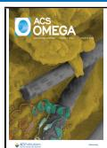

The efects of additives on $_ { \mathrm { N i - C o - P } }$ coatings in electroplating have rarely been investigated. In this study, the preliminary screening of surfactants and brighteners was conducted through single-factor experiments based on the basic formulation of the electroplated Ni−Co−P alloy. RSM was employed to design experiments and investigate the efects of additives $( \mathrm { e . g . , } \mathrm { S D S } ,$ thiourea, and ALS) on the hardness and glossiness of the coatings. Stable plating solutions and coatings with excellent performance were obtained through compre hensive analysis and optimization. This study aimed at providing more insights into the efects of process conditions and plating solution composition on the coating performance. It can lay a solid basis for in-depth research on $\mathrm { \bar { N i } { - } C o { - } P }$ and its composite coatings while providing a useful reference for the industrial production of electroplated Ni−Co−P compo site coatings.

## 2. MATERIALS AND CHEMICAL REAGENTS

The cathode material employed in the experiments was a brass plate with the dimensions of $6 5 . 0 0 \times 5 0 . 0 0 \times 0 . 2 0$ mm, and the anode material was a soluble nickel plate with the dimensions of $7 0 . 0 0 \times 5 0 . 0 0 \times 2 . 5$ mm.

The main reagents applied in the experiments comprised nickel sulfate (AR), cobalt sulfate (AR), sodium hypophosphite (AR), trisodium citrate (AR), sodium chloride (AR), boric acid (AR), SDS (AR), thiourea (AR), and 1,4-butyne diol (AR), as well as ALS (AR).

## 3. EXPERIMENTAL PROCEDURE

Preplating treatment: grinding (using 600, 800, and 1000 grit sandpaper sequentially) → alkaline chemical degreasing (ammonium citrate 10−20 $\mathbf { g } / \mathrm { L } ,$ sodium silicate 10−20 $\mathbf { g } / \mathrm { L } ,$ sodium carbonate 10−20 $\mathbf { g } / \mathrm { L } ,$ , OP-10 emulsifier 2−3 g/L, 70 ${ } ^ { \circ } \mathrm { C } ,$ 10−15 min) → etching (hydrochloric acid ${ \mathrm { 1 0 0 - 3 6 0 ~ g / L } } ,$ ambient temperature, 1 min) → activation (hydrochloric acid $2 0 0 { - } 3 0 0 ~ \mathrm { g / \bar { L } } ,$ ambient temperature, 1−2 min).

Preparation of the Ni−Co−P alloy coating samples: based on the composition of the basic plating solution and process conditions, the types and approximate concentration ranges of additives were preliminarily confirmed through single-factor experiments. Subsequently, a Box−Behnken response surface experiment with three factors and three levels was developed to optimize the combination of additives for the $\mathrm { N i { - } \mathrm { \bar { C } o { - } P } }$ coating. Last, the efect of the formulated additives on the coating was investigated through hardness, glossiness, and corrosion resistance tests as well as surface morphology and composition analysis. Table 1 presents the composition of the basic plating solution and process parameters for electroplating $_ \mathrm { N i - C o - P }$ alloy coatings.

Table 1. Basic Composition and Process Conditions

<table><tr><td>composition</td><td>operating conditions</td></tr><tr><td> $NiSO_{4} \cdot 6H_{2}O$  (g/L)</td><td>200</td></tr><tr><td> $CoSO_{4} \cdot 7H_{2}O$  (g/L)</td><td>15</td></tr><tr><td> $NaH_{2}PO_{2} \cdot H_{2}O$  (g/L)</td><td>10</td></tr><tr><td> $Na_{3}C_{6}H_{5}O_{7}$  (g/L)</td><td>80</td></tr><tr><td>NaCl (g/L)</td><td>20</td></tr><tr><td> $H_{3}BO_{3}$  (g/L)</td><td>30</td></tr><tr><td>temperature (°C)</td><td>60</td></tr><tr><td>current density (A/dm2)</td><td>2.5</td></tr><tr><td>pH</td><td>4.5</td></tr></table>

3.1. Characterization. 3.1.1. Hardness Testing. A JMHVS.1000AT precision digital microhardness tester was used to measure the microhardness of the coatings. The load was set at 500 g, with a loading time of 10 s. Four corners and the center of each coating sample were measured, and the average value of the five measurements was calculated.

3.1.2. Glossiness Testing. An MN60 gloss meter was used to measure the glossiness of the coatings. The incident angle for the measurement was set at 60°

3.1.3. Corrosion Resistance Testing. The electrochemical behavior of the prepared coating samples was examined by using a CHI760E electrochemical workstation. A threeelectrode system was employed with the coating sample, a saturated calomel electrode (SCE), and a platinum electrode as the working electrode, the reference electrode, and the auxiliary electrode, respectively. Before the start of the test, the coating sample was immersed in a 5.0% (mass concentration) NaCl electrolyte for 30 min to develop a stable open circuit potential (OCP). The parameters for Tafel polarization curve testing were as follows: a scanning range of −1 to 0 V (vs SCE) and a scanning rate of 10 mV/s. Corrosion potential $( E _ { \mathrm { c o r r } } )$ and corrosion current $\left( J _ { \mathrm { c o r r } } \right)$ were obtained by fitting the test results using the software provided with the electrochemical workstation. The parameters for impedance testing comprised a frequency range of 0.01 to 10,000 Hz and a scanning rate of 10 Hz/s.

3.1.4. Coating Morphology and Composition Analysis. The surface morphology of the prepared coating samples was analyzed using a Hitachi SU-1500 scanning electron micro scope, and the composition of the coatings was analyzed using the attached energy dispersive X-ray spectroscopy (EDS).

## 4. RESULTS AND DISCUSSION

4.1. Single-Factor Experiments. 4.1.1. Efect of Surfactant on Coating Hardness. The addition of the surfactant SDS to the plating solution was investigated to determine its efect on coating performance. The results, shown in Figure 1, indicate that as the SDS concentration increased, the porosity of the coating decreased and the hardness increased. When the SDS concentration reached 0.1 $\mathbf { g } / \mathrm { L } ,$ the coating exhibited the lowest porosity of 0.23 pores/ $\mathrm { c m } ^ { 2 }$ and the maximum hardness of $4 0 8 . 4 \mathrm { H V } _ { 0 . 5 } .$ However, further increasing the SDS concentration led to an increase in coating porosity and a decrease in hardness. The appropriate addition of SDS facilitated the forward shift of the nucleation potential and reduced cathodic polarization during deposition,19 which can contribute to coating formation. Moreover, it lowered the surface tension of the plating solution, thus facilitating the easy release of hydrogen gas generated during the hydrogen evolution reaction on the cathode surface. Thus, the formation of pinholes and pitting was reduced, resulting in a lower coating porosity and a denser coating structure, leading to an increase in hardness. However, excessive surfactant concentration can cause the aggregation of surfactant molecules, forming micelles, thus afecting the deposition process and resulting in decreased coating hardness and increased porosity.

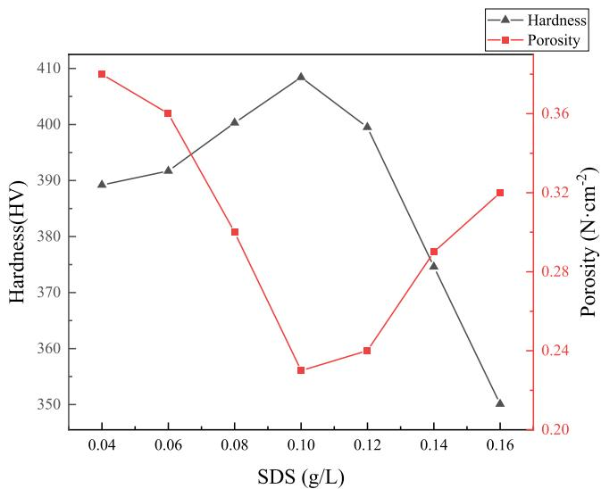  
Figure 1. Efect of SDS concentration on the hardness and porosity of the Ni−Co−P coating.

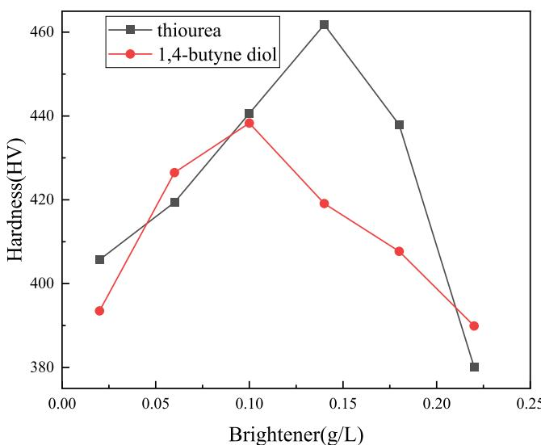  
Figure 2. Efect of thiourea and 1,4-butyne diol concentration on the hardness of $_ \mathrm { N i - C o - P }$ coating.

4.1.2. Efect of Brightener on Coating Hardness and Glossiness. The addition of brighteners significantly enhanced the glossiness of the coatings. In the experiment of this study, thiourea and 1,4-butyne diol were separately introduced to the plating solution to study their efects on the coating hardness and glossiness. The brightener that showed a significant improvement in the coating performance was selected for the plating solution system. Figures 2 and 3 present the efects of the two brighteners on the coating hardness and glossiness. As depicted in Figures 2 and 3, with the addition of the brighteners, the coating hardness and glossiness were significantly increased. The efect of thiourea and 1,4-butyne diol on the coating hardness and glossiness varied, and the optimal concentrations of the additives for achieving the maximum hardness and glossiness difered. When the thiourea concentration was increased to 0.14 g/L, the coating reached its maximum hardness of $4 6 1 . 8 \mathrm { H V } _ { 0 . 5 } ,$ and the glossiness value was 407GU. As the concentration further increased to 0.18 g/

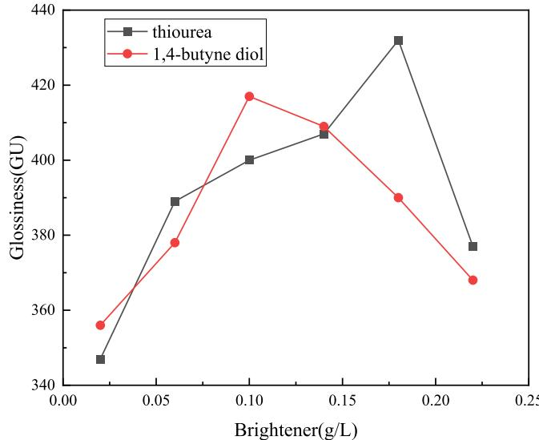

Figure 3. Efect of thiourea and 1,4-butyne diol concentration on the gloss of Ni−Co−P coating.  
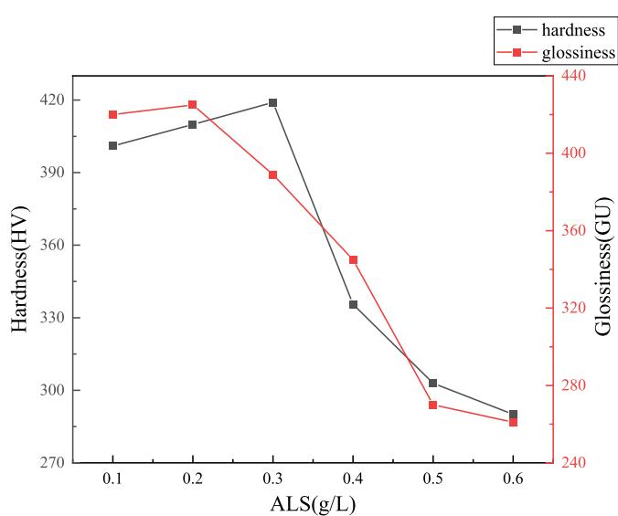  
Figure 4. Efect of the Na allyl sulfonate concentration on the hardness and gloss of the Ni−Co−P coating.

Table 2. Factors and Levels of Box−Behnken Test

<table><tr><td>horizontal encoding</td><td colspan="3">factor</td></tr><tr><td></td><td>A: SDS (g/L)</td><td>B: thiourea (g/L)</td><td>C: ALS (g/L)</td></tr><tr><td>-1</td><td>0.1</td><td>0.2</td><td>0.1</td></tr><tr><td>0</td><td>0.3</td><td>0.5</td><td>0.2</td></tr><tr><td>+1</td><td>0.5</td><td>0.8</td><td>0.3</td></tr></table>

Table 3. Design Scheme and Results of Box−Behnken Test

<table><tr><td>serial number</td><td>A: SDS (g/L)</td><td>B: thiourea (g/L)</td><td>C: ALS (g/L)</td><td>Y1: hardness ( $HV_{0.5}$ )</td><td>Y2: glossiness (GU)</td></tr><tr><td>1</td><td>0.1</td><td>0.1</td><td>0.3</td><td>448.7</td><td>375</td></tr><tr><td>2</td><td>0.1</td><td>0.1</td><td>0.1</td><td>443.7</td><td>430</td></tr><tr><td>3</td><td>0.1</td><td>0.14</td><td>0.2</td><td>472.6</td><td>452</td></tr><tr><td>4</td><td>0.1</td><td>0.14</td><td>0.2</td><td>476.8</td><td>455</td></tr><tr><td>5</td><td>0.08</td><td>0.18</td><td>0.2</td><td>445.1</td><td>474</td></tr><tr><td>6</td><td>0.12</td><td>0.18</td><td>0.2</td><td>455.5</td><td>455</td></tr><tr><td>7</td><td>0.1</td><td>0.14</td><td>0.2</td><td>474.9</td><td>464</td></tr><tr><td>8</td><td>0.1</td><td>0.14</td><td>0.2</td><td>474.3</td><td>464</td></tr><tr><td>9</td><td>0.12</td><td>0.14</td><td>0.1</td><td>454.4</td><td>413</td></tr><tr><td>10</td><td>0.12</td><td>0.1</td><td>0.2</td><td>443</td><td>443</td></tr><tr><td>11</td><td>0.12</td><td>0.14</td><td>0.3</td><td>456.9</td><td>426</td></tr><tr><td>12</td><td>0.1</td><td>0.14</td><td>0.2</td><td>475.7</td><td>452</td></tr><tr><td>13</td><td>0.08</td><td>0.14</td><td>0.1</td><td>449.2</td><td>421</td></tr><tr><td>14</td><td>0.08</td><td>0.14</td><td>0.3</td><td>458.7</td><td>435</td></tr><tr><td>15</td><td>0.1</td><td>0.18</td><td>0.3</td><td>453.6</td><td>469</td></tr><tr><td>16</td><td>0.08</td><td>0.1</td><td>0.2</td><td>445.6</td><td>430</td></tr><tr><td>17</td><td>0.1</td><td>0.18</td><td>0.1</td><td>452</td><td>396</td></tr></table>

Table 4. Variance Analysis Chart of Surface Hardness Modela

<table><tr><td>source of variation</td><td>sum of squares</td><td>degree of freedom</td><td>mean square</td><td>F-value</td><td>P-value</td><td>significance</td></tr><tr><td>model</td><td>2403.26</td><td>9</td><td>267.03</td><td>115.83</td><td>&lt;0.0001</td><td>significant</td></tr><tr><td>A-SDS</td><td>15.68</td><td>1</td><td>15.68</td><td>6.80</td><td>0.0350</td><td></td></tr><tr><td>B-thiourea</td><td>79.38</td><td>1</td><td>79.38</td><td>34.43</td><td>0.0006</td><td></td></tr><tr><td>C-sodium allyl sulfonate</td><td>43.24</td><td>1</td><td>43.24</td><td>18.76</td><td>0.0034</td><td></td></tr><tr><td>AB</td><td>42.25</td><td>1</td><td>42.25</td><td>18.33</td><td>0.0037</td><td></td></tr><tr><td>AC</td><td>12.25</td><td>1</td><td>12.25</td><td>5.31</td><td>0.0546</td><td></td></tr><tr><td>BC</td><td>2.89</td><td>1</td><td>2.89</td><td>1.25</td><td>0.2998</td><td></td></tr><tr><td> $A^2$ </td><td>521.59</td><td>1</td><td>521.59</td><td>226.26</td><td>&lt;0.0001</td><td></td></tr><tr><td> $B^2$ </td><td>1136.61</td><td>1</td><td>1136.61</td><td>493.05</td><td>&lt;0.0001</td><td></td></tr><tr><td> $C^2$ </td><td>335.77</td><td>1</td><td>335.77</td><td>145.65</td><td>&lt;0.0001</td><td></td></tr><tr><td>residual error</td><td>16.14</td><td>7</td><td>2.31</td><td></td><td></td><td></td></tr><tr><td>loss of fit term</td><td>6.24</td><td>3</td><td>2.08</td><td>0.8418</td><td>0.5379</td><td>nonsignificant</td></tr><tr><td>error</td><td>9.89</td><td>4</td><td>2.47</td><td></td><td></td><td></td></tr><tr><td>total</td><td>2419.40</td><td>16</td><td></td><td></td><td></td><td></td></tr></table>

$$
R ^ {2} = 0. 9 9 3 3;
$$

$$
R _ {\mathrm{Adj}} ^ {2} = 0. 9 8 4 8;
$$

$$
R _ {\text { Pred }} ^ {2} = 0. 9 5 2 3;
$$

$\scriptstyle { \mathrm { { L } } , }$ the glossiness reached its maximum value of $4 3 2 \mathrm { G U } ,$ while the hardness progressively decreased to $4 3 7 . 9 \mathrm { H V } _ { 0 . 5 } .$ The efects of $^ { 1 , 4 }$ -butyne diol on the coating hardness and glossiness are similar to the efects of thiourea. The addition of brighteners such as thiourea or $^ { 1 , 4 \cdot }$ -butyne diol reduces or adsorbs onto the cathode surface, forming a tightly adsorbed layer. They also complex with metal ions in the solution. The surface complexes formed by the cathodic adsorption of the additives hinder the discharge of metal ions, increasing the overpotential for the reaction and promoting nucleation. This results in finer grain size and denser coatings, leading to increased hardness and glossiness.14 However, at higher concentrations of brighteners in the plating solution, the metal ions are greatly afected or complexed by a large number of brightener molecules during the discharge process, severely hindering the normal deposition process. This intensifies the hydrogen evolution reaction and leads to a decrease in coating hardness and glossiness.20−22 In accordance with the comparative analysis, thiourea, which showed a greater improvement in coating hardness and glossiness, served as the brightener for the plating solution system.

4.1.3. Efect of ALS Concentration on Coating Hardness and Glossiness. The efect of ALS on coating hardness and glossiness is presented in Figure 4. A small amount of ALS addition enhances the hardness and glossiness of the coating. As the ALS concentration was increased from 0.1 to 0.3 $\mathbf { g } / \mathrm { L } ,$ the coating hardness tended to increase, reaching its maximum value of 4 $. 1 9 \mathrm { H V } _ { 0 . 5 }$ at a concentration o ${ \mathrm { : 0 . 3 ~ g / L } } _ { \mathrm { : } }$ , after which the hardness decreases. Likewise, as the ${ \tt A L S }$ concentration was increased from 0.1 to 0.2 $\mathbf { g } / \mathrm { L } ,$ the glossiness of the coating progressively increased, reaching its maximum value of 425GU at a concentration of 0.2 $\mathrm { g / L } ,$ , after which the glossiness declined. ALS, with its unsaturated groups, exhibits certain brightening properties. It also improves the distribution of the plating solution, further enhancing the coating’s density. Therefore, an appropriate addition of ALS efectively enhances the hardness and glossiness of the coating. However, excessive addition leads to a sharp decrease in coating hardness and glossiness.

4.2. Box−Behnken Experimental Results and Analysis. Based on the previous single-factor experiments, a Box− Behnken design was employed with three factors at three levels: A-SDS, B-thiourea, and C-ALS. The three levels were encoded as $+ 1 , - 1 ,$ and 0, representing high, low, and medium levels. respectively. The details of the factors and levels are listed in Table 2.

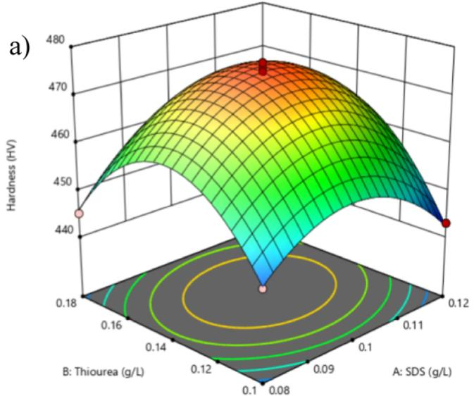

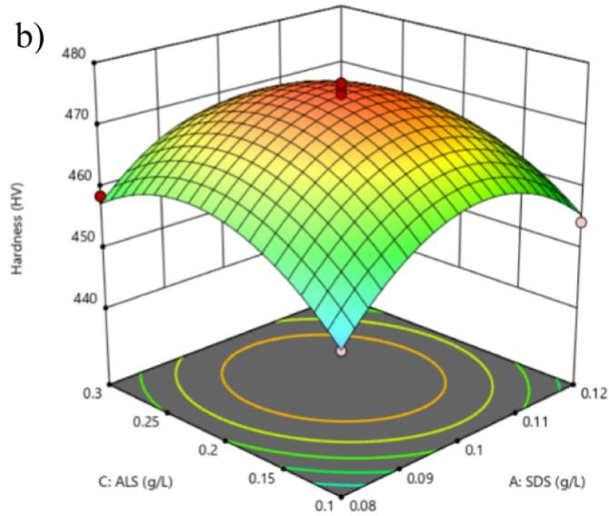

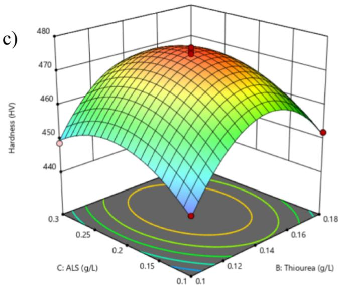  
Figure 5. Response surface plot of the efect of each additive on the hardness of the coating. (a) Interaction between SDS and thiourea; (b) interaction between SDS and ALS; and (c) interaction between thiourea and ALS;.

Table 5. Variance Analysis Chart of Glossiness Modela

<table><tr><td>source of variation</td><td>sum of squares</td><td>degree of freedom</td><td>mean square</td><td>F-value</td><td>P-value</td><td>significance</td></tr><tr><td>model</td><td>11,349.79</td><td>9</td><td>1261.09</td><td>49.47</td><td>&lt;0.0001</td><td>significant</td></tr><tr><td>A-SDS</td><td>66.13</td><td>1</td><td>66.13</td><td>2.59</td><td>0.1513</td><td></td></tr><tr><td>B-thiourea</td><td>1682.00</td><td>1</td><td>1682.00</td><td>65.98</td><td>&lt;0.0001</td><td></td></tr><tr><td>C-sodium allyl sulfonate</td><td>253.13</td><td>1</td><td>253.13</td><td>9.93</td><td>0.0161</td><td></td></tr><tr><td>AB</td><td>256.00</td><td>1</td><td>256.00</td><td>10.04</td><td>0.0157</td><td></td></tr><tr><td>AC</td><td>0.2500</td><td>1</td><td>0.2500</td><td>0.0098</td><td>0.9239</td><td></td></tr><tr><td>BC</td><td>4096.00</td><td>1</td><td>4096.00</td><td>160.67</td><td>&lt;0.0001</td><td></td></tr><tr><td> $A^2$ </td><td>0.4447</td><td>1</td><td>0.4447</td><td>0.0174</td><td>0.8986</td><td></td></tr><tr><td> $B^2$ </td><td>182.02</td><td>1</td><td>182.02</td><td>7.14</td><td>0.0319</td><td></td></tr><tr><td> $C^2$ </td><td>4676.02</td><td>1</td><td>4676.02</td><td>183.42</td><td>&lt;0.0001</td><td></td></tr><tr><td>residual error</td><td>178.45</td><td>7</td><td>25.49</td><td></td><td></td><td></td></tr><tr><td>loss of fit term</td><td>27.25</td><td>3</td><td>9.08</td><td>0.2403</td><td>0.8645</td><td>nonsignificant</td></tr><tr><td>error</td><td>151.20</td><td>4</td><td>37.80</td><td></td><td></td><td></td></tr><tr><td>total</td><td>11,528.24</td><td>16</td><td></td><td></td><td></td><td></td></tr></table>

aAnnotation: $R ^ { 2 } = 0 . 9 8 4 5 ;$ ${ R _ { \mathrm { A d j } } } ^ { 2 } = 0 . 9 6 4 6 ;$ ${ R _ { \mathrm { p r e d } } } ^ { 2 } = 0 . 9 4 1 7 ;$ Adeq precision = 25.6298.

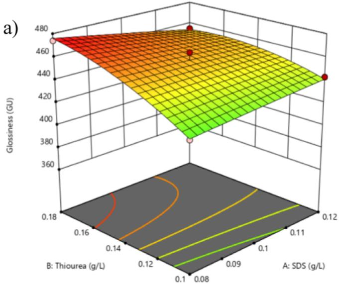

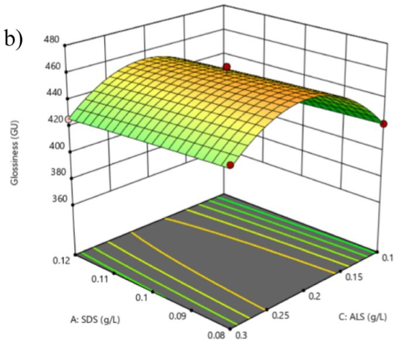

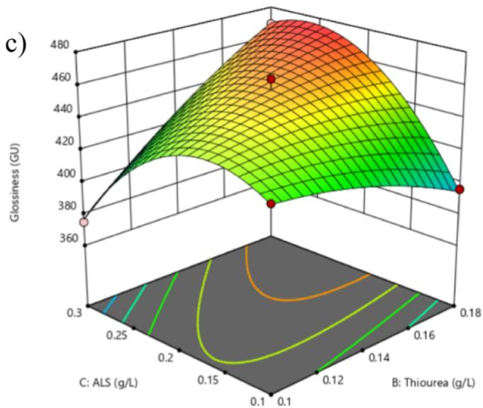  
Figure 6. Response surface plot of the efect of each additive on the glossiness of the coating. (a) Interaction between SDS and thiourea; (b) interaction between SDS and ALS; and (c) interaction between thiourea and ALS;.

4.2.1. Experimental Design and Results. The efects of the additives at diferent levels on coating hardness and glossiness were investigated by using them as response variables. The detailed experimental design and response values (Y1 for hardness and Y2 for glossiness) are listed in Table 3.

4.2.2. Hardness Value (Y1) Analysis. The experimental results were analyzed using Design-Expert 13 software such that a quadratic regression model equation was provided, describing the correlation between coating hardness and the concentrations of the additives. Equation 1 is as follows

$$
\begin{array}{r l} \mathrm{Y1} & = 4 7 4. 8 6 + 1. 4 0 A + 3. 1 5 B + 2. 3 3 C + 3. 2 5 A B - 1. 7 5 A C \\ & - 0. 8 5 B C - 1 1. 3 A ^ {2} - 1 6. 4 3 B ^ {2} - 8. 9 3 C ^ {2} \end{array} \tag {1}
$$

This model’s reliability and accuracy were assessed using analysis of variance (ANOVA) in Design-Expert 13 software. The ANOVA table for the coating hardness model is presented in Table 4. The reliability of the model can be assessed based on the magnitude of the correlation coeficient $\left( R ^ { 2 } \right)$ , which indicates the degree of fit between the regression model and the experimental values. $R ^ { 2 }$ values range from 0 to $^ { 1 ; }$ the closer the value to 1, the smaller the deviation between the constructed model and the practical values. In the experiment of this study, the $R ^ { 2 }$ value for the model reached 0.9933, which approached 1, suggesting a high degree of consistency between the model and the experimental data, such that the correlation between coating hardness and the concentrations of the additives can be indicated efectively.

The p-value represents the probability of discarding the nul hypothesis and reflects the correlation between the factor and the response variable. It is an important parameter for evaluating the reliability of the model. A smaller p-value indicated a higher significance of the variable in the model When the p-value was less than 0.05, the variable was considered significant in the model; if the p-value exceeded $0 . 0 5 ,$ the variable was considered nonsignificant. As depicted in Table $^ { 4 , }$ the model was highly significant $\left( p < 0 . 0 0 0 1 < 0 . 0 5 \right)$ , and the lack-of-fit term did not achieve significance $( p \ =$ $0 . 5 3 7 9 > 0 . 0 5 )$ . The adeq precision value was 27.9606, which

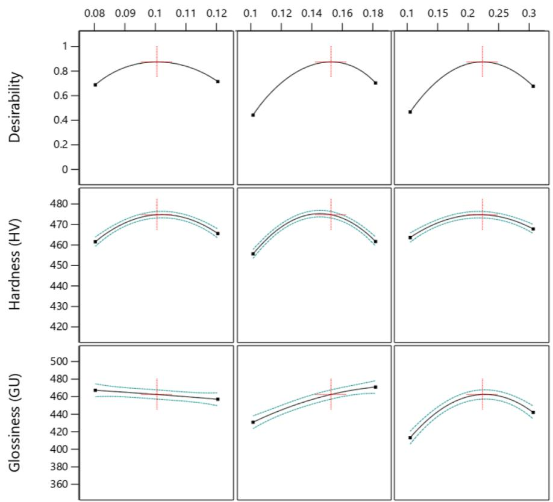

Figure 7. Efect of specific optimization parameters on coating degree and glossiness.  
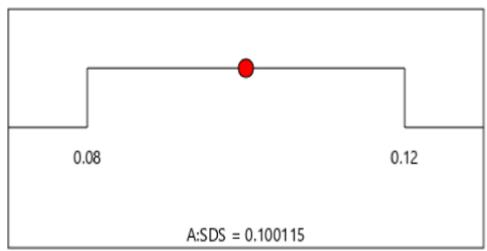

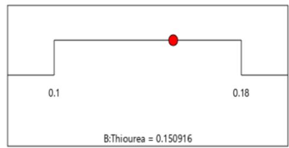

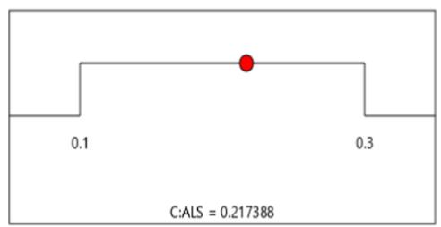

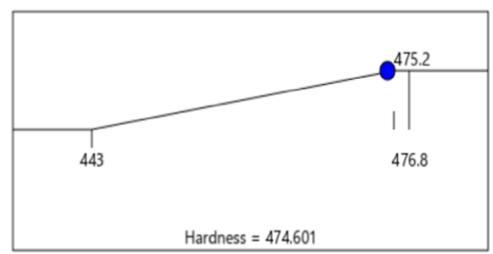

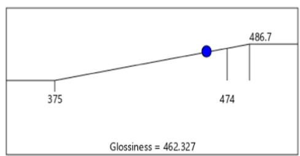  
Figure 8. Recommended optimal value for the combined optimization of each influencing factor.

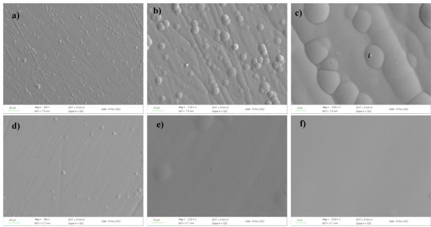  
Figure 9. SEM images of Ni−Co−P coating at 500, 2000, and 8000× under diferent plating solution conditions $[ ( \mathsf { a } , \mathsf { b } , \mathsf { c } )$ are basic plating solution coatings; (d,e,f) are plating solution coatings with additives].

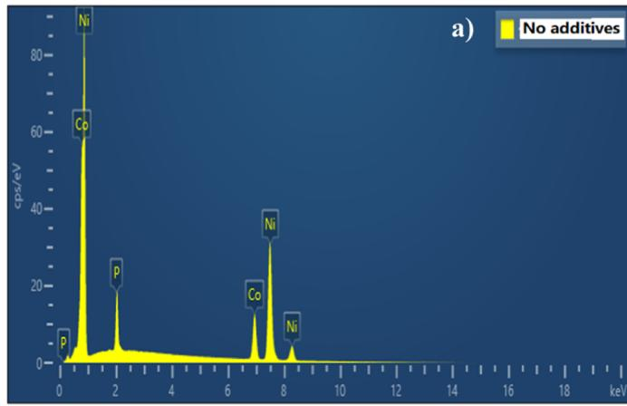

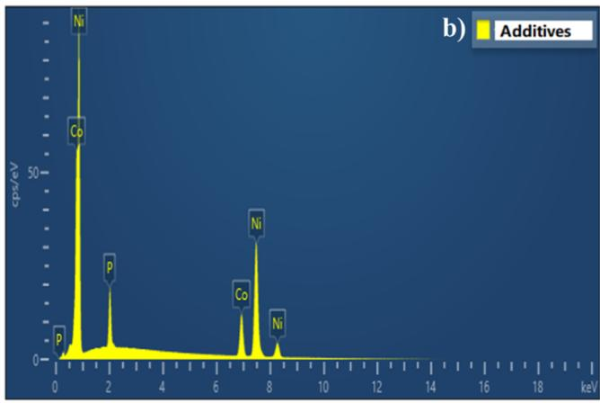

<table><tr><td>Element</td><td>At%</td></tr><tr><td>P</td><td>8.13</td></tr><tr><td>Co</td><td>23.48</td></tr><tr><td>Ni</td><td>68.03</td></tr></table>

<table><tr><td>Element</td><td>At%</td></tr><tr><td>P</td><td>8.34</td></tr><tr><td>Co</td><td>20.65</td></tr><tr><td>Ni</td><td>71.01</td></tr></table>

Figure 10. EDS plots of Ni−Co−P coatings under diferent plating solution conditions and the content of each element [(a) are basic plating solution coatings; (b) are plating solution coatings with additives].

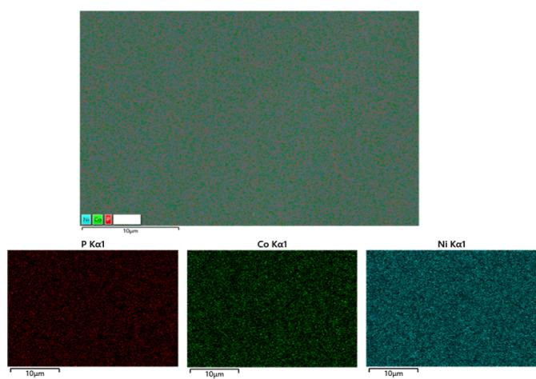  
Figure 11. EDS Mapping of $_ \mathrm { N i - C o - P }$ coatings with an additive bath.

Table 6. Hardness of Ni−Co−P Coatings $( \mathbf { H V _ { 0 . 5 } } )$

<table><tr><td>sample</td><td colspan="6">test point</td></tr><tr><td></td><td>1</td><td>2</td><td>3</td><td>4</td><td>5</td><td>average value</td></tr><tr><td>base formulation coating</td><td>382.2</td><td>388.3</td><td>392.4</td><td>376.2</td><td>386.2</td><td>385.06</td></tr><tr><td>coating with additive plating solution</td><td>478.9</td><td>473.6</td><td>475.8</td><td>474.6</td><td>474.1</td><td>475.4</td></tr></table>

Table 7. Glossiness of Ni−Co−P Coatings (GU)

<table><tr><td>sample</td><td colspan="6">test point</td></tr><tr><td></td><td>1</td><td>2</td><td>3</td><td>4</td><td>5</td><td>average value</td></tr><tr><td>base formulation coating</td><td>379</td><td>359</td><td>354</td><td>350</td><td>371</td><td>362.6</td></tr><tr><td>coating with additive plating solution</td><td>462</td><td>465</td><td>466</td><td>460</td><td>464</td><td>463.4</td></tr></table>

b)  
Table 8. Hardness Compared with Previous Work

<table><tr><td>plating</td><td>treatment condition</td><td>hardness/HV</td><td>glossiness/GU</td><td>refs</td></tr><tr><td>Ni-Co-P</td><td>SDS + thiourea + sodium allyl sulfonate; pH 4.5; T = 60°C</td><td>475.4 (Co: 20.65 wt %)</td><td>463.4</td><td>this work</td></tr><tr><td>Ni-Co-P</td><td>pH 4.5; T = 60°C</td><td>385.06</td><td>362.2</td><td>this work</td></tr><tr><td>Ni-Co-P</td><td>ammonium sulfate; pH 7; T = 80°C</td><td>238</td><td></td><td>23</td></tr><tr><td>Ni-Co-P</td><td>T = 60°C</td><td>634.9 (Co: 47.66 wt %)</td><td></td><td>24</td></tr><tr><td>Ni-Co-P</td><td>pH 9; T = 80–90°C</td><td>280</td><td></td><td>25</td></tr><tr><td>Ni-Co-P</td><td>T = 60°C</td><td>656.2 (Co: 41.09 wt %)</td><td></td><td>26</td></tr></table>

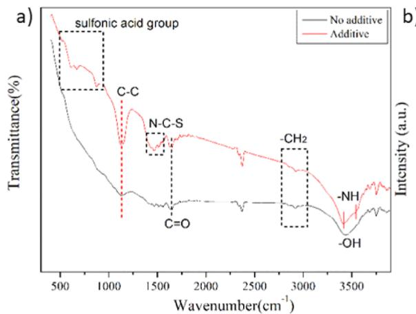

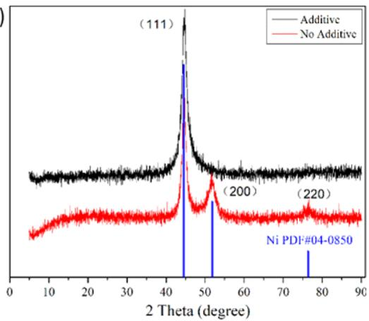  
Figure 12. Infrared and (b) XRD comparison of coatings with and without additives

Table 9. Calculated Crystallite Size by Scherrer’s Equation of Ni−Co−P Alloy Coatings

<table><tr><td>sample</td><td> $2\theta$  (deg)</td><td> $\theta$  (deg)</td><td>hklplane</td><td>fwhm</td><td>average/D nm</td></tr><tr><td>additive</td><td>44.689</td><td>22.3445</td><td>(111)</td><td>2.07718</td><td>4.0916</td></tr><tr><td>no additive</td><td>44.566</td><td>22.283</td><td>(111)</td><td>1.52128</td><td>5.1665</td></tr></table>

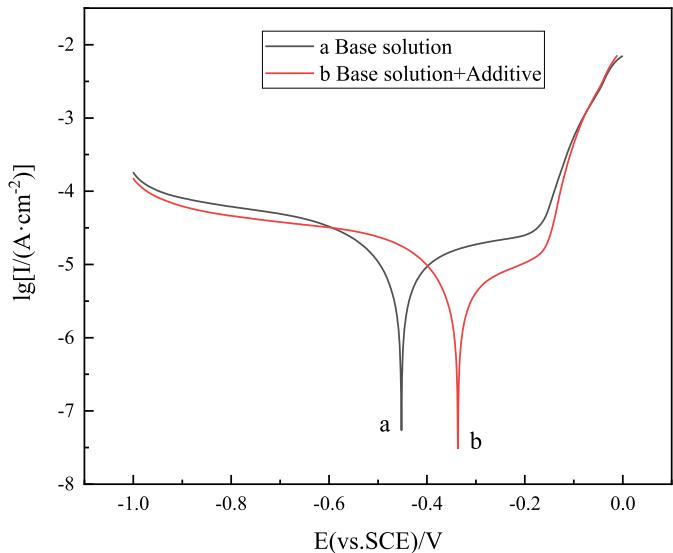  
Figure 13. Tafel polarization curves of $_ \mathrm { N i - C o - P }$ coatings under diferent plating solutions.

exceeded 4, suggesting a high reliability of the regression model equation. Thus, the optimization model established based on coating hardness as the response variable is reasonable. In the model, the p-value for factor B is ${ \ll } 0 . 0 5 ,$ suggesting its high significance in the model; the p-value for factor A is $0 . 0 3 5 < 0 . { \bar { 0 } } 5$ , and the p-value for factor C is 0.0034 $< 0 . 0 5 ,$ suggesting the significance of factors A and C in the model. Furthermore, the order of influence for the single factors conformed to $B > C > A$

Table 10. Corrosion Potential and Corrosion Current of Ni−Co−P Coatings under Diferent Plating Solution Conditions

<table><tr><td>sample</td><td> $E_{\text{corr}}$  (V)</td><td> $I_{\text{corr}}$  (A·cm-2)</td></tr><tr><td>base solution</td><td>-0.452</td><td> $5.44 \times 10^{-8}$ </td></tr><tr><td>base solution + additive</td><td>-0.337</td><td> $3.07 \times 10^{-8}$ </td></tr></table>

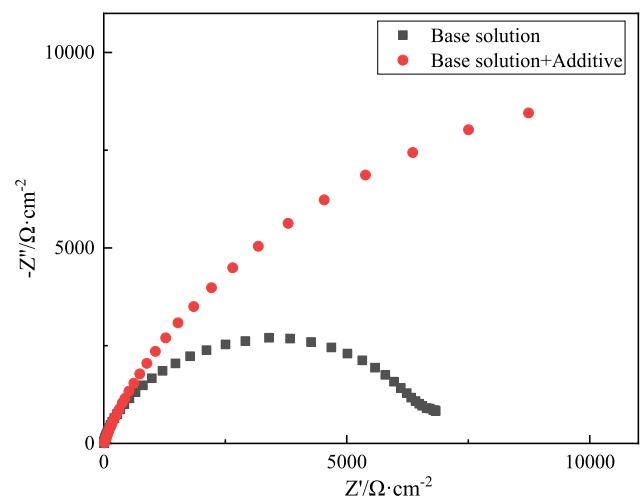  
Figure 14. Electrochemical impedance spectra of $_ \mathrm { N i - C o - P }$ coating under diferent plating solution conditions.

To better understand the efects of diferent additives on coating hardness, 3D response surface plots depicting the interaction efects of the additives on coating hardness were constructed, as shown in Figure 5. Under the ALS concentration of 0.2 $\mathbf { g } / \mathrm { L } ,$ the interaction efects of diferent concentrations of SDS and thiourea on coating hardness are shown in Figure 5a. For various concentrations of thiourea, the efect of the SDS concentration on coating hardness is consistent, and the fluctuation in coating hardness is minimal. As the SDS concentration was increased from 0.08 to $0 . 1 2 { \mathrm { g } } / \mathrm { L } ,$ the coating hardness initially increased slightly and then decreased. For diferent concentrations of SDS, the efect of thiourea on coating hardness follows a similar pattern but with larger fluctuations in coating hardness. When the thiourea concentration was increased from 0.1 to 0.18 $\mathrm { g / L }$ , the coating hardness first increased significantly and then decreased. The addition of an appropriate amount of SDS reduces the surface tension of the plating solution, allowing it to spread better on the cathode, resulting in a tighter bond between the coating and substrate and reducing the formation of coating defects. The addition of an appropriate amount of thiourea forms an adsorption layer on the cathode surface and forms complexes with metal cations in the solution, making it more dificult for the metal ions to discharge and increasing the overpotential of the deposition reaction, thereby promoting nucleation and refining the coating’s crystalline structure. The combined action of appropriate concentrations of SDS and thiourea reduces the surface tension of the plating solution, promotes nucleation, and enhances the coating hardness. However, excessive amounts of SDS and thiourea can lead to dificulties in the discharge of metal ions and increased hydrogen evolution, resulting in a decrease in the coating hardness.

Figure 5b presents the interaction efects of diferent concentrations of SDS and ALS on coating hardness under a thiourea concentration of 0.14 $\mathrm { g / L }$ . The concentration of ALS on coating hardness was not significantly efect, but the concentration of SDS has a significant efect on the hardness of the coating. Under a wide range of SDS concentrations, coating hardness tended to be first increased and then decreased with the increase of the ALS concentration. When the ALS concentration was increased from 0.1 to 0.3 $\mathbf { g } / \mathrm { L } ,$ coating hardness progressively increased to a peak and then decreased. The efect of SDS on coating hardness is generally the same for diferent concentrations of $\operatorname { A L S } ;$ as the SDS concentration was increased from 0.08 to 0.12 $\mathbf { g } / \mathrm { L } ,$ coating hardness initially increased slightly and then progressively decreased. ALS, as an auxiliary brightener that improves the distribution of the coating, possesses certain brightening properties. In combination with SDS, which reduces the surface tension of the plating solution, the coating becomes denser, resulting in an increased coating hardness. However, when the amount exceeds the optimal concentration, the opposite efect occurs, leading to a decrease in the coating hardness.

Under the SDS concentration of 0.1 $\mathbf { g } / \mathrm { L } ,$ the interaction efects of diferent concentrations of thiourea and ALS on coating hardness are shown in Figure 5c. The surface exhibits a steeper inclination with the rise of the thiourea concentration, while the surface associated with the ALS concentration is relatively flat, suggesting a more significant efect of the thiourea concentration on the response value. Under diferent gradients of thiourea concentration, coating hardness signifi cantly increases as the thiourea concentration is increased but then decreases significantly after reaching a certain value. Under diferent gradients of thiourea concentration, coating hardness initially increases and then decreases with the increase of the ALS concentration, with relatively small fluctuations. The addition of thiourea increases the overpotential of the reaction and promotes nucleation. ALS exhibits similar properties and improves the distribution of the coating. These factors contribute to the refinement of the coating’s crystalline structure, resulting in a tighter bond between the coating and the substrate and higher coating hardness.

In conclusion, by analyzing the interaction efects of the factors on coating hardness and utilizing Design-Expert 13 software for data analysis and processing, the optimal additive formulation for achieving the highest coating hardness was determined to be SDS 0.101 $\mathbf { g } / \mathrm { L } ,$ , thiourea 0.143 $\mathbf { g } / \mathrm { L } ,$ and ALS 0.212 $\mathsf { g / L } .$

4.2.3. Glossiness Value (Y2) Analysis. Using Design-Expert 13 software, a multivariate regression fit was applied to the experimental results, resulting in a quadratic regression model equation for the correlation between the coating glossiness and the concentrations of the additives. Equation 2 is as follows

$$
\begin{array}{r l} \mathrm{Y2} & = 4 5 7. 4 0 - 2. 8 7 A + 1 4. 5 0 B + 5. 6 3 C - 8 A B - 0. 2 5 \\ & A C + 3 2 B C - 0. 3 2 5 A ^ {2} - 6. 5 7 B ^ {2} - 3 3. 3 3 C ^ {2} \end{array}\tag{2}
$$

The reliability and accuracy of this model were assessed by using ANOVA in Design-Expert 13 software. Table 5 lists the ANOVA table for the coating glossiness model. $R ^ { 2 }$ value for the model reached 0.9845, which approached 1, suggesting a high degree of consistency between the model and the experimental data, such that the correlation between coating glossiness and the concentrations of the additives can be well indicated. As depicted in Table $^ { 5 , }$ the model was highly significant $\left( p < 0 . 0 0 0 1 < 0 . 0 5 \right)$ , and the lack-of-fit term was not significant $\left( p = 0 . 8 6 4 5 > 0 . 0 5 \right)$ . The adeq precision value was 25.6298, which exceeded $^ { 4 , }$ suggesting a high reliability of the regression model equation. Thus, the optimization model established based on coating glossiness as the response variable is reasonable. In the model, the p-value for factor B is < 0.0001 $< ~ 0 . 0 5 ,$ , suggesting its high significance in the model, and thiourea has a significant influence on coating glossiness. The p-value for factor $C \mathrm { ~ \ i s ~ \ } 0 . 0 1 6 1 \mathrm { ~  ~ { ~ < ~ \ } ~ } 0 . 0 5$ , suggesting the significance of factor C (ALS) in the model, as it significantly afects coating glossiness. However, the p-value for factor A is $0 . 1 5 1 3 > 0 . 0 \dot { 5 } ,$ , suggesting that factor $A$ (SDS) did not achieve significance in the model, suggesting that SDS has a relatively minor efect on coating glossiness. Overall, the order of influence for the single factors is $B > C > A .$

To better illustrate the efects of the additives on coating glossiness, 3D response surface plots depicting the interaction efects of the additives on coating glossiness were constructed, as shown in Figure 6. Under a constant concentration of ALS, the interaction efects of diferent concentrations of SDS and thiourea on the coating glossiness are shown in Figure 6a. When SDS concentration was at a low level, coating glossiness significantly increased with the rise in thiourea concentration. However, when SDS concentration was at a high level, coating glossiness increased with the rise in thiourea concentration but with a smaller magnitude. When thiourea was at a low level, increasing SDS concentration led to a slight increase in coating glossiness. However, when thiourea was at a high level, increasing SDS concentration progressively decreased coating glossiness. The addition of thiourea forms a tightly adsorbed layer on the cathode surface, increasing the dificulty of metal ion discharge, enhancing the overpotential of the reaction, and promoting nucleation. Meanwhile, thiourea facilitates hydrogen evolution. When SDS concentration was at a low level, the reduction in surface tension of the plating solution improved the detachment of hydrogen gas from the cathode surface, resulting in finer coating grains and reduced defects such as pinholes, leading to a significant increase in coating glossiness. However, when SDS concentration was at a high level, the normal deposition of metal ions was somewhat afected, resulting in a smaller increase in coating glossiness. When thiourea concentration was at a low level, the hydrogen evolution phenomenon did not achieve significance, and increasing SDS concentration led to a slight increase in coating glossiness. However, when thiourea concentration was at a high level, increasing SDS concentration favored hydrogen evolution, which afects the deposition of metal ions, resulting in a gradual decrease in coating glossiness.

Under a constant thiourea concentration, the interaction efects of diferent concentrations of SDS and ALS on the coating glossiness are shown in Figure 6b. With the rise in SDS concentration, coating glossiness only slightly increases across various gradients of ALS concentration. With the rise of the ALS concentration under diferent SDS concentrations, coating glossiness initially increases until reaching a certain value, after which it progressively decreases. ALS, containing an allyl group in its structure, possesses certain brightening properties. A moderate addition of ALS can increase coating glossiness. In the variance analysis of the regression model, the p-value for SDS variable is $0 . 1 5 1 3 > 0 . 0 5$ , suggesting that SDS does not significantly afect coating glossiness, and the p-value for the quadratic term AC (SDS and ALS) is $0 . 9 2 3 9 > 0 . 0 5 ,$ suggesting that the interaction between SDS and ALS did not achieve significance in the model.

Figure 6c presents the interaction efects of diferent concentrations of thiourea and ALS on the coating glossiness under a constant SDS concentration. The steep inclination of the surface indicated a significant efect of the interaction between thiourea and ALS on coating glossiness. The p-value for the quadratic term AC in Table 5 was $< 0 . 0 0 0 1 < 0 . 0 5 ,$ confirming the high significance of AC in the model. When ALS concentration was at a low level, increasing the thiourea concentration tended to decrease coating glossiness. However, when ALS concentration was at a high level, increasing the thiourea concentration first significantly increased the coating glossiness, reaching a certain value, and then progressively declined. When thiourea concentration was at a low level, increasing the ALS concentration led to a slight increase, followed by a significant decrease in coating glossiness. When thiourea concentration was at a high level, increasing the ALS concentration first significantly increased the coating glossiness until it reached a certain value, and then declined. The addition of an appropriate amount of thiourea and ALS notably enhanced coating glossiness. However, excessive amounts hindered the discharge of metal ions, increased coating brittleness, and might lead to self-reduction in low current density regions, resulting in dificulties in the deposition of metal ions on recessed parts of the substrate and a decrease in coating glossiness.

In brief, the optimal additive formulation for achieving the highest coating glossiness was determined to be SDS 0.08 $\mathbf { g } / \mathrm { L } ,$ thiourea 0.18 $\mathbf { g } / \mathrm { L } ,$ and ALS 0.257 g/L by analyzing the interaction efects of the factors on coating glossiness and utilizing Design-Expert 13 software for data analysis and processing.

4.2.4. Comprehensive Optimization Analysis. A threefactor, three-level response surface experiment was set up to analyze variation of the response values Y1 (hardness) and Y2 (glossiness) with the concentrations of the three additives. Two combinations of additives were obtained: one for optimal hardness and the other for optimal glossiness. A suitable additive combination was expected to achieve high levels of both coating hardness and glossiness through a comprehensive study of these two combinations.

A comprehensive analysis of the factors influencing coating hardness and glossiness was conducted using Design-Expert software under equal importance (equal weights) for coating hardness and glossiness. The specific efect of the optimization parameters on hardness and glossiness is shown in Figure $^ { 7 , }$ where the red cross represents the corresponding results of each factor with hardness and glossiness at the maximum desirability. Figure 8 represents the hardness and glossiness at the recommended optimal values of the comprehensive optimization of the factors.

An additive combination that achieved high coating hardness and glossiness was obtained by optimizing the additive combination. The optimal combination is presented as follows: SDS concentration of 0.10 g/L, thiourea concentration of $0 . 1 5 \mathrm { g } / \mathrm { L } ,$ and ALS concentration of 0.22 g/L. The predicted values for coating hardness and glossiness under these additive combination conditions reached $4 7 4 . 6 0 1 \mathrm { H V } _ { 0 . 5 }$ and 462.327GU, respectively.

4.3. Efect of Additives on Coating Surface and Performance. The surface morphology of the coatings obtained with the additive-containing plating bath was identified and analyzed by using SEM and compared with the morphology of coatings obtained without additives. Figure 9 presents the results. As depicted in Figure 9, the coating surface obtained without additives had numerous grain-like protrusions, and even pinholes could be identified at 8000 times magnification. In contrast, the coating surface obtained with the additive-containing plating bath had fewer grain-like protrusions and no identified defects $( \mathrm { e . g . } ,$ pinholes). The coating surface was smooth, flat, and dense, suggesting that the addition of additives can significantly enhance the smoothness and compactness of the coating, contributing to the enhance ment of the coating performance.

EDS analysis was conducted on the coatings obtained from the additive-containing plating bath and compared with the coatings obtained without additives. The results are presented in Figure 10. After adding additives to the plating bath, the elemental composition in the coating was Ni 71.01 at %, Co 20.65 at %, and P 8.34 at %. The Ni content in the coating increased, while the Co content decreased slightly compared with the coating obtained from the plating bath without additives. The P content did not show a significant change. The possible reason for the above result is the anomalous codeposition behavior of nickel and cobalt. The standard electrode potential of $\mathrm { N i } ^ { 2 + }$ was −0.250 V, while that of ${ \mathrm { C o } } ^ { 2 + }$ was −0.277 V. ${ \mathrm { C o } } ^ { 2 + }$ shows a more negative potential and tends to deposit preferentially. The addition of additives can increase the overpotential of the reaction, making the discharge of metal ions more dificult while afecting the preferential deposition of ${ \mathrm { C o } } ^ { 2 + }$ , leading to a slight decrease in the cobalt content in the coating. Figure 11 presents EDS mapping of the $_ { \mathrm { N i - C o - P } }$ coating obtained from the additive-containing plating bath, demonstrating the uniform distribution of Ni, Co, and P elements throughout the coating.

The additive combination obtained after comprehensive optimization was introduced to the base plating bath to obtain a Ni−Co−P coating. The hardness and glossiness of the coating were examined, as listed in Tables 6 and $^ { 7 , }$ respectively. After addition of the combination of additives, the hardness and glossiness of the coating significantly increased. The hardness reached $4 7 5 . 4 \mathrm { H V } _ { 0 . 5 } ,$ and the glossiness was 463.4GU. Compared with the coating obtained from the plating bath without additives, the hardness increased by $9 0 . 3 4 \mathrm { H V } _ { 0 . 5 } ,$ and the glossiness increased by 101.2GU. Moreover, the measured values were close to the predicted values of the model, which were $4 7 4 . 6 0 1 \mathrm { H V } _ { 0 . 5 }$ for hardness and 462.327GU for glossiness. Compared with the previous work (Table 8), the addition of additives greatly improved the hardness and luster of the coating.

As can be seen from Figure 12a, after adding sodium dodecyl cycloate, thiourea, and sodium allyl sulfonate, new infrared characteristic peaks appeared, and the main characteristic peaks of sulfonic acid infrared appeared at 609, 673, 883, and $\bar { 5 } 2 0 ~ \mathrm { { c m } ^ { - 1 } }$ positions. The stretching vibration peak of $_ { \mathrm { N - C - S } }$ in thiourea appeared at $1 4 6 7 ~ \mathrm { { c m } ^ { - 1 } }$ , and the amino characteristic double peak appeared between 3400 and $3 6 0 0 ~ \mathrm { c m } ^ { - 1 } ,$ which also indicated the existence of −OH. At $1 1 3 2 ~ \mathrm { c m } ^ { - 1 }$ is the C−C stretching vibration peak on the carbon chain, and the addition of additives makes the C−C stretching vibration peak more obvious. The double peaks at 2855 and 2928 cm−1 are the characteristic peaks of −CH on the carbon chain. 1650 cm−1 is the characteristic peak of the C�O double bond in sodium citrate.

It can be seen from Figure 12b that the main growth crystal surface of Ni and Co elements in the Ni−Co−P alloy coating is (111), and its main structure is a face-centered cubic structure. In addition, with the addition of additives, the difraction spectrum of $_ \mathrm { N i - C o - P }$ alloy coating shows a certain broadening, which indicates that the addition of additives plays a certain refining role in the formation of Ni metal grains. The grain size was calculated using the Schemer formula.27 As shown in Table 9, the grain size obtained after adding additives is 4.0916 nm, and the grain size of the coating without adding additives is 5.1665 nm. This is consistent with the observation results of the surface morphology of Ni−Co−P alloy coatings. The smaller the grain size, the higher the hardness.

$$
D = \frac {K \lambda}{\beta \cos \theta}
$$

Tafel polarization curve test results for the coatings are shown in Figure 13, and $E _ { \mathrm { c o r r } }$ and $I _ { \mathrm { c o r r } }$ of the coatings are presented in Table 10. It can be clearly seen that after adding additives, $E _ { \mathrm { c o r r } }$ of the coating shifted in the positive direction from −0.452 to −0.337 V compared with the coating obtained from the base plating bath. $I _ { \mathrm { c o r r } }$ density decreased from 5.44 × $1 0 ^ { - 8 }$ to $3 . 0 7 \ \bar { \times } \ 1 0 ^ { - \bar { 8 } }$ A·cm−2, suggesting enhanced corrosion resistance of the coatings with the addition of additives.

Electrochemical impedance spectroscopy (EIS) graph of the coatings is shown in Figure 14. The size of the capacitive arc radius in the graph represents the magnitude of the charge transfer resistance. A larger capacitive arc radius can represent a larger charge-transfer resistance, suggesting greater dificulty in charge-transfer and better corrosion resistance of the material.28 It can be clearly identified that the addition of additives to the plating bath resulted in a significant increase in the capacitive arc radius of the coating, suggesting improved corrosion resistance.

## 5. CONCLUSIONS

Through the Box−Behnken experiment for additive formula tion, the optimal additive combination was determined to be an SDS concentration of 0.10 g/L, thiourea concentration of 0.15 $\mathrm { g / L }$ , and ALS concentration of 0.22 $\mathbf { g } / \mathrm { L }$ . The coatings obtained under these optimized additive conditions exhibited a hardness of $4 7 5 . 4 \mathrm { H V } _ { 0 . 5 } ,$ which was $9 0 . 3 4 \mathrm { H V } _ { 0 . 5 }$ higher than that of the coating without additives. The glossiness of the coating was 463.4GU, which increased by 101.2GU compared with the coating without additives. The corrosion resistance of the coatings was also improved. The addition of additives improved the surface morphology of the coatings, making them smoother and more compact. The addition of the optimized additive combination significantly improved the coating performance, resulting in coatings with a metallic luster similar to stainless steel, which meets industrial requirements.

## ■ AUTHOR INFORMATION

## Corresponding Authors

Xuesong Sun − Guizhou Space Appliance $C o _ { \cdot } ,$ Ltd, Guiyang 550025, PR China; orcid.org/0009-0002-8415-3452; Email: 99101042@qq.com

Dingfu Liu − School of Chemistry and Chemical Engineering, Guizhou University, Guiyang 550025, PR China; Email: liuxiao8989@163.com

## Authors

Yuejun Shen − Guizhou Space Appliance Co., Ltd, Guiyang 550025, PR China

Yao Ding − Guizhou Space Appliance Co., Ltd, Guiyang 550025, PR China

Rengui Xiao − School ofChemistry and Chemical Engineering, Guizhou University, Guiyang 550025, PR China

Yuanfei An − Guizhou Space Appliance $C o _ { \cdot } ,$ Ltd, Guiyang 550025, PR China

Complete contact information is available at:

https://pubs.acs.org/10.1021/acsomega.3c06301

## Notes

The authors declare no competing financial interest.

## ACKNOWLEDGMENTS

This work was financially supported by Guizhou Space Appliance $\mathrm { C o . }$ , Ltd, and the authors thank Guizhou University for providing technical assistance and advice.

## ■ REFERENCES

(1) Guan, $S . ;$ Zhang, $\mathrm { Q . } ;$ Hu, R. Recent Development of Chromium Electrodeposition. Mater. Prot. 2000, 33 (03), 1−3.

(2) Sheng-da, Z.; Xue-hong, T.; Ru-xing, W. The Status and Development of Hard-Chrome Plating Technique. Surf. Technol. 2000, 29 (06), 6−8.

(3) Ignatova, K.; Kozhukharov, S.; Alakushev, M. Barrier ability and durability of Ni-Co-P coatings in accordance to the content of ${ \mathrm { H } } _ { 3 } { \mathrm { P O } } _ { 3 }$ and ${ \mathrm { N a H } } _ { 2 } { \mathrm { P O } } _ { 2 }$ as phosphorus sources. Mater. Chem. Phys. 2018, 219, 175−181.

(4) Li, N. J.; Li, M. M.; Li, N. W. The Study on Preparation and Apply of Ni-Co-P Alloy Coating. Adv. Mater. Res. 2013, 690−693, 2145−2148.

(5) Sarkar, S.; Baranwal, R. K.; Biswas, $\mathrm { C . } \mathrm { \mathrm { j } }$ Majumdar, $\mathrm { G } . ;$ Haider, J. Optimization of process parameters for electroless Ni-Co-P coating deposition to maximize micro-hardness. Mater. Res. Express 2019, 6 (4), 046415.

(6) Wang, X.; Lv, B.; Hu, Z.; Xu, B. Corrosion Resistance in Sodium Chloride Solution of Ni-Co-P Electro-Brush Amorphous Coatings to Replace Hard Chromium Coatings. Phys. Procedia 2013, 50, 191− 198.

(7) Lew, K. S.; Raja, M.; Thanikaikarasan, S.; Kim, T.; Kim, Y. D.; Mahalingam, T. Effect of pH and current density in electrodeposited Co-Ni-P alloy thin films. Mater. Chem. Phys. 2008, 112 (1), 249−253.

(8) Tury, B.; Radnóczi, G.; Radnóczi, G.; Varsányi, M. Microstructure properties of pulse plated Ni-Co alloy. Surf. Coat. Technol. 2007, 202 (2), 331−335.

(9) Peng, C.; Yin, Z.-W.; Wang, X.; Liu, Y.; Chen, H.; Zhang, X.-H. Mechanism of sodium lauryl sulfate and 1.4-butynediol in electro depositing Ni-W alloys. Mater. Sci. Eng. Powder Metall. 2011, 16 (02), 167−174.

(10) Song, Y. T.; Min, M.; Yi, Y.; Zhao, T.; Zhang, X.; Li, Z. L. Effect of Surfactant on Properties of Electrodeposited Ni-P-Al O Coatings. Mater. Prot. 2018, 51 (11), 66−69.

(11) Zhu, Y.; Dingfu, L. Preparation of New Tin-Nickel-Copper Alloy Electroplating Additives Based on RSM-BBD. Surf. Technol. 2021, 50 (2), 338−346.

(12) El-Feky, H.; Negem, M.; Roy, S.; Helal, N.; Baraka, A. Electrodeposited Ni and Ni-Co alloys using cysteine and conventional ultrasound waves. Sci. China Chem. 2013, 56 (10), 1446−1454.

(13) Matsui, I.; Takigawa, Y.; Uesugi, T.; Higashi, K. Effect of Additives on Tensile Properties of Bulk Nanocrystalline Ni-W Alloys Electrodeposited from A Sulfamate Bath. Mater. Lett. 2013, 99, 65− 67.

(14) Wu, Y.; Chang, D. y.; Kim, D.-s.; Kwon, S. c. Effects of 2- Butyne-1,4-Diol on Structures and Morphologies of Electroplating Ni W Alloy. Surf. Coat. Technol. 2003, 162 (2−3), 269−275.

(15) Nan, P.; Ji, C.; Yan-wei, S. U. N.; Zhi-xian, X. U.; Xiao-ming, C.; Xiao, H. A. N. Effect of 1,4- Butynediol Additive on Microstructure and Corrosion Resistance of ectrodeposited Nanocrystalline Nickel Coating. Mater. Prot. 2015, 48 (02), 5.

(16) Zhi-ping, L. I. N.; Xin-min, H.; Xia, S. H. U.; et al. Effect of Surfactants on Ni-SiC Composite Plating. Met. Funct. Mater. 2008, 15 (5), 20−23.

(17) Huang, W. J.; Xue, Y. Effect of Surfactants on Electroless Plating Ni-P-SiC Composite Coating on Magnesium Alloy. J. Mater. Eng. 2010, 1, 23−27.

(18) Kan, H. m.; Meng, Y. y.; Reddy, R. G. Influence of Particle Size and Surfactants on Uniformity and Quantity of Silicon Carbide Particles in Electrodeposited Nickel-silicon Carbide Coatings. J. Cent. S. Univ. 2021, 28 (6), 1627−1636.

(19) Wen-zhu, X. U. The Application of Surfactants in Electroplating. J. Filtr. Sep. 2014, 24 (04), 40−46.

(20) Ye-feng, L. A. N.; Fu-bin, L. I.; Wen-jun, Z.; et al. Influences of Saccharin Sodium and 1,4-Butynedio on Electrodeposited Nickel Coating Morphology. Plat. Surf. Finish. 2015, 37 (6), 10−13.

(21) Fu-ming, S.; Ming-hu, H.; Jin-ning, C. Influence of Saccharin Sodium on Performance and Microstructure of Nanocrystalline Nickel Coating Obtained by Direct Current Electrodeposition. Mater. Prot. 2010, 43 (09), 4−5.

(22) Jun, Z.; He-zhong, P. E. I.; Guo-liang, Z. Effect of Brighteners on Microstructure and Properties of Electroformed Ni-Co Alloy Coating. Mater. Prot. 2009, 42 (04), 33−35.

(23) Yu, Z.; Yan, J.; Jin, Y. The Effect of Process of Electroless Plating Ni-Co-P Alloy on Coating Properties. Corros. Prot. 2007, 28, 73.

(24) Zhang, Y.; Kang, M.; Nyambura, S. M.; Yao, L.; Jin, M.; Zhu, J. Fabrication of Ni-Co-P alloy coatings using jet electrodeposition with varying reciprocating sweep speeds and jet gaps to improve wear and seawater corrosion resistance. Coatings 2020. 10 (10). 924.

(25) Karrab, S. A.; Aboraia, M. S.; Doheim, M. A.; et al. Efect of Electroless Ni-Co-P and Co-P Coatings on Cavitation Erosion Resistance. Proceedings of the TMS Middle East�Mediterranean Materials Congress on Energy and Infrastructure Systems (MEMA 2015); Springer International Publishing, 2016; pp 87−97.

(26) Zhang, Y.; Mbugua, N. S.; Jin, H.; Chen, L. Preparation and Investigation of Ni-Co-P Alloy Coatings Using Jet Electrodeposition with Varying Pulse Parameters. Crystals 2023, 13 (2), 303.

(27) Ji, L.; Chen, F.; Huang, H.; Sun, X.; Yan, Y.; Tang, X. Preparation of nickel-graphene composites by jet electrodeposition and the influence of graphene oxide concentration on the morphologies and properties. Surf. Coat. Technol. 2018, 351, 212− 219.

(28) Liao, J.; Yang, J.; Fan, W.; Li, Q.; Zhang, Q.; Zhao, X. Influence of Ni-Sn-P Electroless Plating on Anticorrosion Performance of CF Steel. Int. J. Electrochem. Sci. 2016, 11 (2), 899−905.