# Influence of PUB2 on the Leveling Efect of Chip Copper Connection Electroplating: Mechanism and Applications

Lanfeng Guo, Renlong Liu,\* Zhaobo He, Shaoping Li, Tong Tan, and Changyuan Tao

Cite This: ACS Omega 2024, 9, 14092−14100

Read Online

ACCESS

Metrics & More

Article Recommendations

ABSTRACT: The copper connectivity technique is essential for achieving electrical interconnection in wafer level packaging (WLP), system in packaging (SiP), and 3D packaging. The essential processing material for copper connectivity is a copper sulfate electroplating solution in which organic additives play a crucial role in the regularity of copper electrodeposition. In this study, electrochemical tests, X-ray difraction, 3D profiling, and scanning electron microscopy were used to investigate the leveling efect and mechanism of polyquaternary ammonium urea-containing polymer (PUB2) in the process of copper electrodeposition on-chip copper connections. PUB2 has excellent polarization ability on the target surface, remains unafected by the sulfur additive SPS and poly(ethylene glycol), and displays a strong ability to regulate the copper deposition rate of through-holes and surface wiring. The waviness of the wafer surface wiring was reduced from 130 to approximately 70 nm after optimizing the PUB2 concentration, and the surface roughness was reduced from 10 to approximately 7 nm. The coating was dispersed evenly, and the rate of through-hole filling was improved by 57%. This study not only examined PUB2 leveling performance and mechanisms but also devised a research method and system for electroplating additives to facilitate the development and application of new electroplating additives.

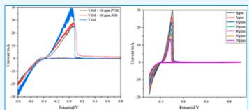

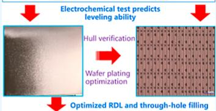

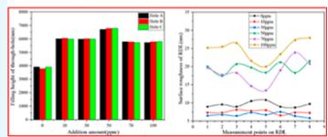

## 1. INTRODUCTION

Microchip technology has entered the post-Moore era, and chip packaging technology has continually evolved. Transitioning from two-dimensional packaging, such as the double-line inline and square flat packaging of the last century, we have now entered an era ofultrahigh-density three-dimensional packaging. Compared to two-dimensional packaging, three-dimensional packaging enables higher chip density, shorter transmission distances, and lower chip power consumption.1,2 Copper is used as an interconnecting material based on its low resistivity and strong electromigration resistance. In comparison to traditional aluminum interconnects, the electromigration resistance of copper interconnects is improved by 2 orders of magnitude, significantly enhancing the reliability of integrated circuits (ICs).3 Copper electroplating stands as a fundamental technology for interconnecting devices, including ICs, IC packaging substrates, and printed circuit boards (Table 1).

However, copper sulfate plating solutions often cause problems such as uneven coating, defects, and faults during microhole plating. Therefore, plating solutions often contain various additives for auxiliary plating, including Cl−, accelerators, inhibitors, and leveling agents to improve the plating performance of copper sulfate plating solutions and meet the plating requirements of diferent scales and diferent conditions to obtain an ideal copper plating layer.4−7 Research at home and abroad mainly focuses on organic additives, such as accelerators and inhibitors. Additionally, dye leveling agents such as Jenner green B (JGB) have been studied extensively and organic amine leveling agents are novel leveling agents that have started attracting significant attention.8−11 Dow et al. considered that the convection-dependent adsorption behavior of a plating solution can be used as an indicator to determine whether the plating solution is suitable for micropore filling12 and Chang et al.13 studied the leveling efect of 2-mercaptopyridine. It was determined that 2-mercaptopyridine has a stronger inhibitory efect on Cu deposition than JGB. Considering the complexity and broad variety of chip processes, there are diferences between the plating solutions used for diferent plating processes, plating machines, and semiconductor manufacturers. As a result, plating solutions are typically customized develop ment products. However, there are three main issues associated with the research on leveling agents both domestically and internationally. First, current research mostly uses theoretical calculations, electrochemical methods, and electroplating experiments to investigate the mechanisms and efects of electroplating additives. Unlike traditional electrodeposition, chip copper interconnection involves precise deposition in a narrow space or surface at the micronano level. The morphology and uniformity of the copper deposition layer have a direct impact on the electrical performance of the copper interconnection line, thereby influencing the overall chip performance.14,15 Its characteristics mainly include small electroplating dimensions, dificulty in filling microholes with uneven current density, and high coating quality requirements. However, there is a distinct lack of comprehensive research on electroplating with structured wafers, which renders most research results unable to be applied in practice. Second, copper sulfate electroplating leveling agents are primarily composed of dye organic polymers such as JGB, which tend to generate significant pollution. With the development of wafer-level, system-level, and 3D packaging, the performance ofelectroplating additives is facing increased scrutiny and evaluation. As a result, the industry is urgently requiring the development of novel electroplating leveling agents. Third, the majority of the existing research is focused on developing independent research models for wafer surface wiring and through-hole filling. However, in practical IC manufacturing, through-hole filling and wiring are performed concurrently, which causes a gap between study findings and application.16−18 Therefore, it is crucial to develop an application-based screening and evaluation strategy for electroplating additives.

Table 1. Experimental Materials and Specifications Used

<table><tr><td>reagent name</td><td>manufacturer</td><td>quality grade</td></tr><tr><td> $CuSO_{4} \cdot 5H_{2}O$ </td><td>Hubei Sinophorus Electronic Materials Co., Ltd.</td><td>electroplating grade</td></tr><tr><td>96%  $H_{2}SO_{4}$ </td><td>Hubei Sinophorus Electronic Materials Co., Ltd.</td><td>electronic grade</td></tr><tr><td>PEG-2000</td><td>Shanghai Aladdin Co., Ltd.</td><td>AR</td></tr><tr><td>SPS</td><td>Shanghai Aladdin Co., Ltd.</td><td>AR</td></tr><tr><td>JGB</td><td>Shanghai Aladdin Co., Ltd.</td><td></td></tr><tr><td>HCI</td><td>Hubei Xingrui Silicon Materials Co., Ltd.</td><td>AR</td></tr><tr><td>PUB2</td><td></td><td>AR</td></tr></table>

To address these concerns, the efects of PUB2 on the electrochemical behavior of copper electrodeposition in a copper sulfate environment were investigated through cyclic voltammetry (CV) and chronopotentiometry (CP) experiments in this study. X-ray difraction (XRD) analysis was utilized to determine the crystal orientations of electrodeposited copper layers and assess the leveling process facilitated by PUB2. Additionally, Hull and Haring cell electroplating tests were performed to validate the mechanisms and efects of PUB2 leveling.

## 2. EXPERIMENTAL SECTION

2.1. Primary Chemicals. JGB, PUB2, ultrapure water, concentrated sulfuric acid, and copper sulfate pentahydrate were used in our experiments. Cl−, JGB, and PUB2 leveling agents were introduced with the aid of hydrochloric acid. Additionally, 55 g/L sulfuric acid, 50 mg/L Cl−, and 220 g/L copper sulfate pentahydrate comprised the virgin makeup solution (VMS) (Table 1).

Throughout the entire experimental process, in order to eliminate the uncertainty caused by experimental errors, each set of experimental data was obtained through three repeated experiments, and the average ofthe three sets ofdata was used as the experimental value in this study.

2.2. Tests Involving Electrochemistry. A spinning disk platinum electrode, phosphorus copper $( \mathrm { C u } _ { 3 } \bar { \mathrm { P } } )$ electrode serving as the working electrode, mercury sulfate electrode serving as the reference electrode, and auxiliary electrode were all used in our experiments. The diameter ofthe disc electrode is 5 mm. Shanghai Chenhua Instrument Company’s CHI760E electrochemical workstation was used to measure CV and CP curves. The CV test had a scanning range of 0.8 to 0.8 V and a scanning rate of 0.01 V/s. The electrodes were polished and cleaned with ultrapure water prior to the experiments.

2.3. Hull Cell Plating Tests. Hull cell experiments were conducted to examine the efect of various PUB2 additive concentrations on the morphology of electroplated copper. A copper plate served as the cathode, and phosphorus copper served as the anode. The primary solution had a current density of 1 ASD and contained the following ingredients: 220 g/L $\mathrm { C u S O _ { 4 } } , \mathrm { 5 5 ~ g / L ~ H _ { 2 } S O _ { 4 } } ,$ additive inhibitor polyethylene glycol (PEG)-2000 at 100 ppm, accelerator SPS at 4 ppm, and Cl− at 50 ppm. Electroplating tests were conducted with PUB2 additives at concentrations of 0, 10, 30, 50, 70, and 100 ppm.

2.4. Haring Cell Plating Tests. The leveling efects of the PUB2 additive on wafer surface wiring and through-hole filling were verified through the use of a Haring cell. The anode comprised phosphorus copper, while the cathode consisted of a wafer with a through-hole structure. Preplating was conducted for 1 min at a current density of 1 ASD, followed by 8 min of electroplating at the same current density.

2.5. Wafer Filling and Wiring Tests. For this analysis, phosphorus copper served as the anode and a wafer served as the cathode. The plating mixture was 220 g/L $\mathrm { C u S O _ { 4 } } ,$ 55 g/L ${ \mathrm { H } } _ { 2 } S { \mathrm { O } } _ { 4 } ,$ 100 ppm of PEG-2000 additive inhibitor, 4 ppm of SPS accelerator, and 50 ppm of Cl. Wafer plating tests were conducted with PUB2 additives at concentrations of 0, 10, 30, 50, 70, and 100 ppm. The wafer slice dimensions were 3 × 3 mm with anode and cathode spacing values of 10 mm and a current density of 1 ASD.

2.6. Analysis and Testing Procedure. The crystal structure of the copper layer was studied by using an XRD device (Shimadzu XRD) after Hull cell plating. Following the completion of Haring cell wafer plating, the surface coatings of wafers plated with varying concentrations ofPUB2 were studied microscopically, and the surface conditions, thickness, rough ness, and through-hole filling height were observed and assessed. A metallographic microscope was used to examine the wafer surface wiring and through-hole filling. Additionally, a 3D profiler (SNEOFAR Sneox) was used to analyze the wafer local wiring and through-hole filling efect and characterize coating performance parameters such as wiring height, roughness, waviness, and through-hole filling height. Scanning electron microscopy (SEM, Zeiss SIGMA 500) was used to investigate the microstructures ofthe coated surfaces and grain structures of the coatings.

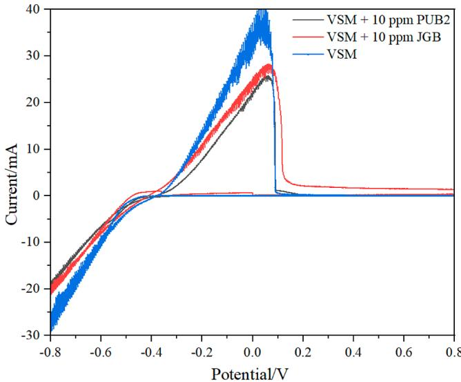  
Figure 1. Comparison of the CV curves ofJGB and PUB2 additives.

## 3. RESULTS AND DISCUSSION

3.1. JGB and PUB2 Additive Electrochemical Behaviors in Electroplated Copper. The CV curves for the JGB and PUB2 additives are presented in Figure 1. It is clear that the basic copper sulfate solution’s oxidation peak area is lowered by additives and that PUB2 addition reduces the solution’s redox peak area to its minimum value. The amount of copper being deposited is represented by the oxidation peak areas in the CV curves.19 It can be concluded that PUB2 has a better inhibitory efect than JGB in terms of preventing the precipitation of $\mathrm { C u } ^ { 2 + } .$

The CV curves depicting diferent PUB2 concentrations in a VMS-Cl system are shown in Figures 4 and 5. The area of the stripping peak shows a notable reduction upon the addition of PUB2. Upon increasing the PUB2 concentration to 30 ppm, subsequent increments in the PUB2 concentration did not lead to a significant reduction in the area of the stripping peak, suggesting that the polarization of PUB2 does not markedly increase with its concentration.

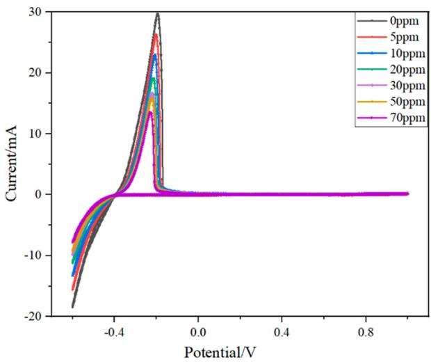  
(a)

As shown in Figures 2 and 3, 0 to 100 ppm of $\mathrm { P U B } 2 ^ { 2 0 }$ was injected into VMS-Cl systems rotating at speeds of 100 and 1000 rpm, respectively, to examine the through-hole filling capacity of the PUB2 additive. Without PUB2, the results indicate that the copper deposition rate on the wafer surface is higher than the through-hole filling rate without additives and that the amount of copper deposition at 1000 rpm (i.e., integral area of the stripping peak) is higher than that at 100 rpm.

The results are reversed when PUB2 is added, and the copper deposition rate on the wafer surface is lower than the through hole filling rate, demonstrating that PUB2 has a stronger inhibitory efect on the copper deposition rate on the wafer surface than that in the through-holes. This inhibitory efect increases as the PUB2 content increases, and the growth rate gradually slows after the PUB2 content reaches 50 ppm. The PUB2 concentration in the through-holes is significantly lower than that on the surface of the coating as a result of PUB2’s strong adsorption on the surface of Cu and slow difusion into the microchannels of through-holes. 19,21−23

The CP curves measured at various rotation speeds are presented in Figure 4. The potential is significantly reduced, and strong polarization occurs when PUB2 is added at $3 0 0 \ s , \mathrm { C l ^ { - } }$ is added at $8 0 0 s , S \mathrm { P S }$ is added at 1300 s, and PEG is added at 1800 s at both high and low speeds. Overall, rotational speed appears to have minimal to negligible impact on system potential, indicating that PUB2 acts solely on the electrodeposition process.24 Following the addition of $\mathrm { C l } ^ { - } ,$ , SPS, and PEG successively, the curve potential stabilizes at approximately −0.71 V. The cathode potential negative shift rate and amplitude are essentially the same after adding PUB2 at high and low speeds, further indicating that PUB2 primarily controls the kinetics of the electrodeposition process.25 Furthermore, in the presence of PUB2, the deposition potential at 100 rpm is lower than that at 1000 rpm, indicating a reduced cathode overpotential at the center of the through-holes compared to that on the surface after times > 1800 s. This condition is more favorable for achieving uniform through-hole electrodeposition.

The copper coating crystal orientation has a significant impac on how well the coating resists corrosion. Low energy, strong corrosion resistance, and high density are properties of the copper (111) crystal plane. As a result, the performance and dependability of electroplated copper coating are optimal when the most prominent crystal plane is the (111) crystal plane.26−28 The copper plating layer XRD patterns for the $\mathrm { V M S } + \mathrm { C l } + \mathrm { S P S }$ + PEG +JGB, VMS + Cl + SPS + PEG + PUB2, VMS + Cl + SPS + PUB2, and VMS + Cl systems are presented in Figure 5. These results indicate that following the addition ofthe PUB2 solution, the peak of the Cu(111) crystal plane grows steadily stronger than that observed for the JGB solution. The most prominent crystal plane for the copper plating layer using the VMS + Cl + SPS + PEG + PUB2 system is the crystal plane (111), which suggests that PUB2 has a positive impact on crystal regulation.

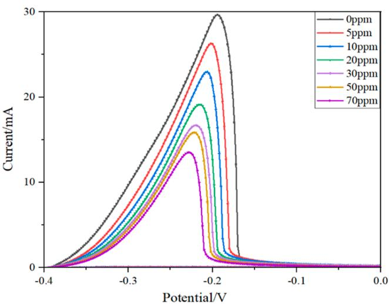  
(b)  
Figure 2. CC curves of diferent concentrations of PUB2 in a VMS system with a rotation speed of 100 rpm.

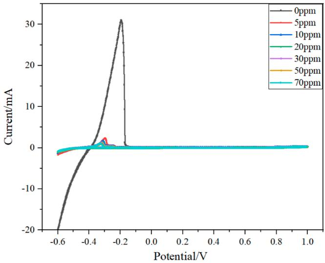  
(a)

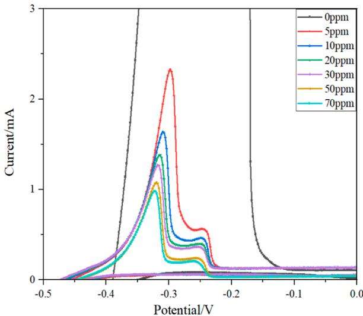  
(b)

Figure 3. CV curves of diferent concentrations of PUB2 in a VMS system with a rotation speed of 1000 rpm.  
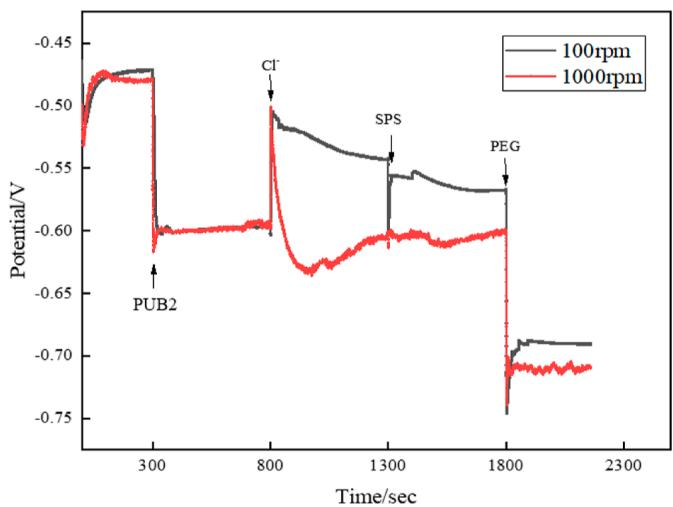  
Figure 4. CP curve diagram for diferent PUB2 solutions.

3.2. PUB2 Additive Efects in a Hull Cell Electroplating Test. In general, a metal surface’s reflecting capacity increases with its flatness and smoothness. By examining the brightness of a metal plating surface layer, we can infer the flatness of the surface. As shown in Figure 6, regardless ofthe amount ofPUB2 additive, the coating gradually becomes brighter as the distance between the hull groove and phosphorus copper increases (polar distance), which corresponds to an increasing current density.

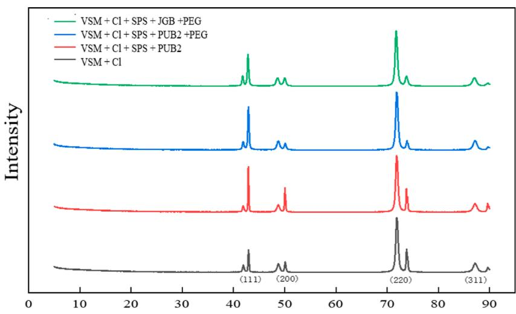  
Figure 5. XRD analysis of electroplated copper coatings with diferent electroplating liquid systems.

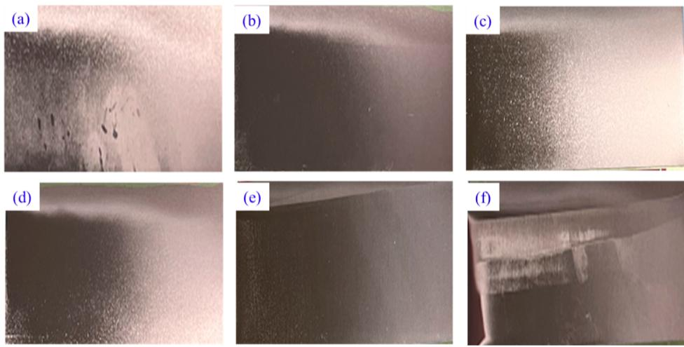

Figure 6. Electroplated hull cell test pieces at diferent PUB2 concentrations: (a) 0, (b) 10, (c) 30, (d) 50, (e) 70, and (f) 100 ppm.  
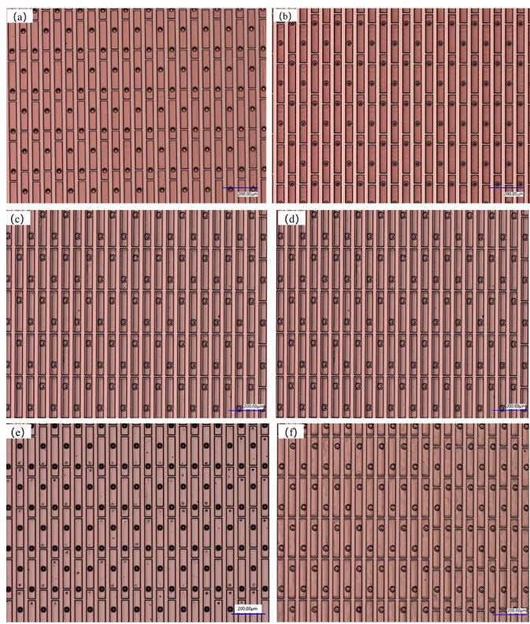  
Figure 7. Metallography of electroplated wafer slices at diferent PUB2 concentrations: (a) 0, (b) 10, (c) 30, (d) 50, (e) 70, and (f) 100 ppm.

Without PUB2 addition, the entire coating has a burnt appearance with obvious faults that improve with increasing pole spacing. The surface flatness and brightness of the coating are significantly enhanced by the addition of PUB2 and these properties improve with an increasing concentration up to a certain point. The optimal efect is achieved when the PUB2 additive is diluted to between 30 and 50 ppm. The brightness and flatness ofthe coating rapidly decrease as the PUB2 additive concentration increases beyond this point. When the PUB2 additive concentration reaches 100 ppm, the coating develops flaws at small electrode spacing values and loses brightness.

The main causes ofrough coating, pinholes, and other defects in the high-current-density areas ofa hull cell are that the current density is too high, the metal copper deposition rate is too fast, which increases concentration polarization, and the cathode hydrogen evolution is aggravated.29,30 As the current density decreases, copper is deposited at a slower pace; concentration polarization slows, and coating deposition becomes denser and less flaky as the electrode gap gradually widens. The PUB2 additive is quickly adsorbed onto the surface of the copper layer on the cathode after being added. This blocks the active point, prevents copper ions from difusing from the solution onto the cathode surface, and lowers the rate at which copper ions are deposited. The coating develops pinholes and unevenness when the amount ofPUB2 additive is too high, which further slows the deposition rate of copper ions.

3.3. Efects of Diferent Concentrations of PUB2 Additives on Wafer Filling and Wiring. As illustrated in Figure 7, the flaws and roughness of the wafer slice coating are significantly reduced with the addition ofPUB2; however, as the PUB2 continuously increases, stripes begin to develop in the wiring of the through-hole attachment, particularly when the concentration reaches 100 ppm.

Figure 8 indicates that the PUB2 additive enhances the plating impact on the wafer surface and significantly increases the regularity ofthrough-hole filling. When PUB2 is not applied, the wiring edge has burrs, protrusions, and unevenness and the through-holes and closed holes have uneven filling. Wiring roughness and homogeneity significantly improve as the PUB2 additive concentration increases. The optimal efect is achieved when the PUB2 additive concentration is between 30 and 50 ppm. When the PUB2 additive concentration increases further, the coating becomes uneven and develops pinholes. Addition ally, the rate of through-hole filling slows considerably, leading to unsatisfactory outcomes.

The height of the wiring and height diferences between wires of the same type were measured to analyze the uniformity of the wafer surface wiring further. Figure 9a reveals that the wiring height decreases from approximately 4250 to 3000 nm with the inclusion ofPUB2. However, the wiring height steadily increases as the PUB2 concentration rises. The wiring height reaches the original value of 4750 nm when the concentration of PUB2 reaches 50 ppm. Figure 11b reveals that the height diference between the high and low planes of the same type of wire is smaller without the addition of PUB2. The height diference between the high and low planes is between 250 and 320 nm when the PUB2 concentration is 30 ppm and is relatively stable. The height diference between the high and low planes grows and varies significantly as the PUB2 concentration increases above 50 ppm. The height diference is extreme and varies widely when the concentration reaches 100 ppm.

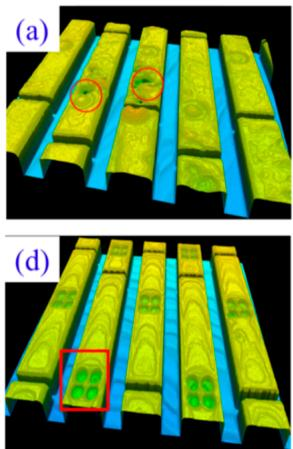

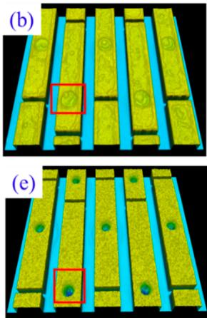

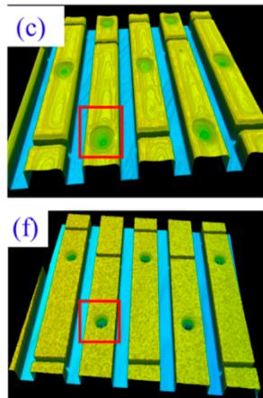  
Figure 8. Redistribution layer and through-hole plating efects at diferent concentrations of PUB2: (a) 0, (b) 10, (c) 30, (d) 50, (e) 70, and (f) 100 ppm.

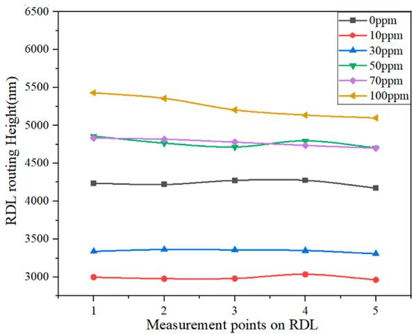  
(a)

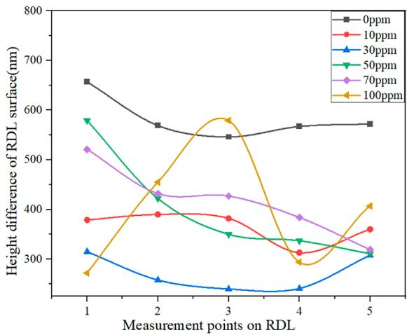  
(b)

Figure 9. Impact of various PUB2 concentrations on the uniformity and height disparity of the wire.  
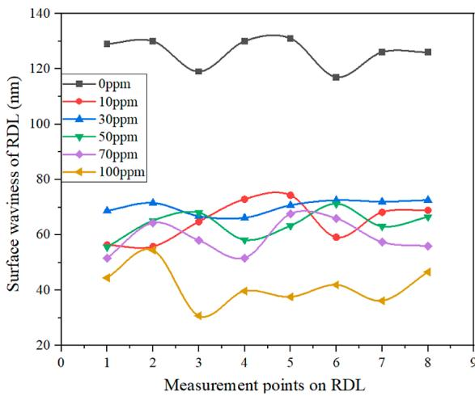  
(a)

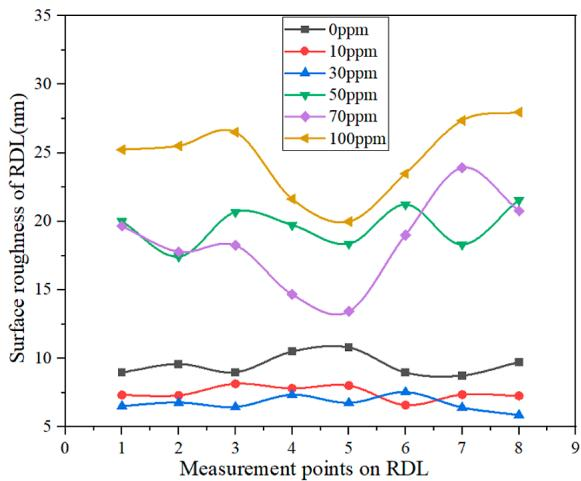  
(b)  
Figure 10. Effects of different concentrations of PUB2 on the roughness and waviness of the redistribution laver surface

The waviness of the wafer surface wiring decreases significantly upon the addition of PUB2, and the fluctuation amplitude decreases with higher PUB2 concentrations. This efect is notably pronounced when the concentration approaches 100 ppm, as illustrated in Figure 10a. The wafer surface wiring roughness curve is presented in Figure 12b. When 0 to 30 ppm of PUB2 is added, roughness is low and stability is good. However, as the PUB2 concentration increases, the roughness increases rapidly and fluctuates significantly. These results indicate that the best wafer surface wiring uniformity is achieved when the PUB2 concentration is between 10 and 30 ppm.

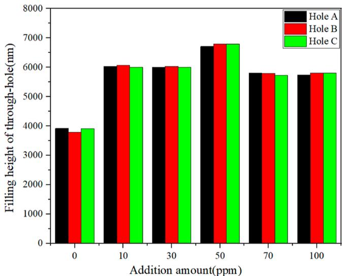  
Figure 11. Influence of diferent concentrations of PUB2 on the filling height of through-holes.

The filling height of a single hole grew from approximately 3800 to 6000 nm with the addition of PUB2, representing an increase of 57%. One can observe that adding PUB2 efectively reduces the electroplating electrodeposition speed on the coating surface, which benefits through-hole electrodeposition and enhances through-hole filling uniformity.

With the addition of PUB2, the flaws in wafer surface wiring and its morphology rapidly decrease, and the surface brightness and flatness are significantly enhanced, as indicated by the comparisons in Figures 12 and 13. This efect is optimized at a concentration of 30 ppm, where the grain distribution is flat, dense, bulge-free, and crisp. However, as the amount of PUB2 additive increases continuously, the wafer surface wiring exhibits signs of grit collection and coarsening and the surface flatness gradually decreases.

## 4. CONCLUSIONS

The electrochemical behavior and leveling mechanisms of PUB2 during the copper electrodeposition process were comprehensively investigated in this study. The leveling performance and efects of PUB2 were validated and adjusted through practical applications combined with Hull cell and Haring cell wafer electroplating tests, providing theoretical support for the use of PUB2 as a leveling agent. Building on this foundation, a research method and screening and evaluation system for electroplating additives were established, providing support for the develop ment and application of new electroplating additives. The main findings of our study can be summarized as follows:

(1) The rate of copper electrodeposition can be controlled by PUB2 through its adsorption onto the surface of Cu(111), a process found to be independent of PUB2 mass transfer, as indicated by the results of electro chemical tests and XRD analysis. Conversely, PUB2 selectively influences the crystal shape of Cu electro deposition.

(2) The incorporation of PUB2 significantly enhances through-hole filling and wafer wiring efects. This is primarily due to PUB2 inhibiting the deposition rate of Cu atoms, refining the grain size, and promoting a more uniform grain distribution. The wafer surface waviness decreases from approximately 130 to 70 nm, the surface roughness decreases from approximately 10 to 7 nm, and the through-hole filling rate increases by 57% when the concentration of PUB2 ranges from 10 to 30 ppm.

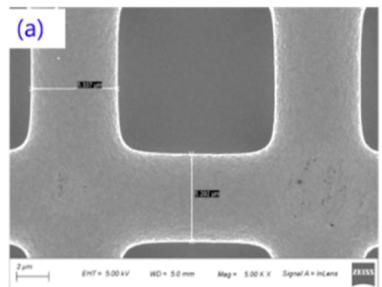

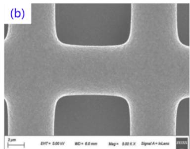

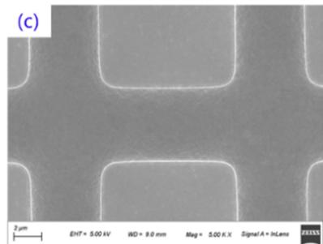

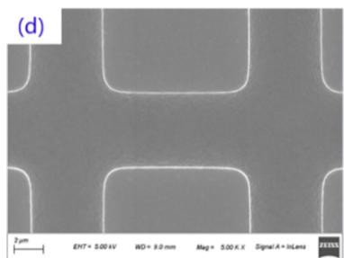

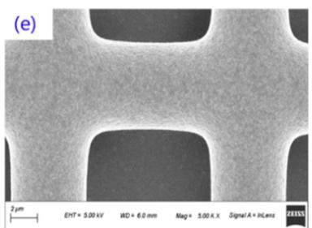

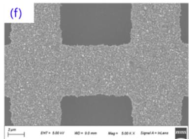  
Figure 12. SEM images of redistribution layers with diferent PUB2 concentrations: (a) 0, (b) 10, (c) 30, (d) 50, (e) 70, and (f) 100 ppm.

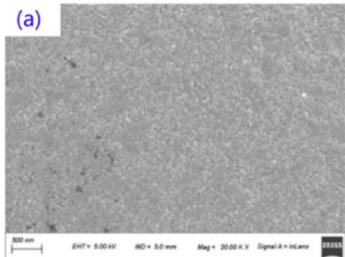

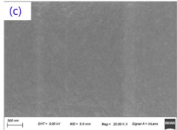

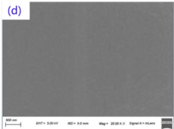

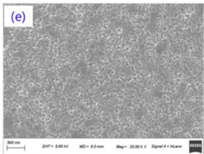

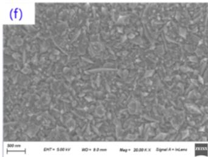  
Figure 13. SEM images of coatings with diferent PUB2 concentrations: (a) 0, (b) 10, (c) 30, (d) 50, (e) 70, and (f) 100 ppm.

## ■ AUTHOR INFORMATION

## Corresponding Author

Renlong Liu − School ofChemistry and Chemical Engineering, Chongqing University, Chongqing 400044, China; orcid.org/0009-0004-9591-9331; Phone: 023- 65678935; Email: lrl@cqu.edu.cn

## Authors

Lanfeng Guo − School ofChemistry and Chemical Engineering, Chongqing University, Chongqing 400044, China; Hubei Sinophorus Electronic Materials $C o _ { \cdot } ,$ , Ltd., Hubei 443007, China

Zhaobo He − Hubei Sinophorus Electronic Materials Co., Ltd., Hubei 443007, China

Shaoping Li − Hubei Sinophorus Electronic Materials Co., Ltd., Hubei 443007, China

Tong Tan − School of Chemistry and Chemical Engineering, Chongqing University, Chongqing 400044, China

Changyuan Tao − School of Chemistry and Chemical Engineering, Chongqing University, Chongqing 400044, China

Complete contact information is available at: https://pubs.acs.org/10.1021/acsomega.3c09548

## Notes

The authors declare no competing financial interest.

## ■ ACKNOWLEDGMENTS

This work was supported by the National Key Research and Development Program of China (grant no. 2019YFC1905802) and National Natural Science Foundation of China (U1802255).

## ■ REFERENCES

(1) $\mathrm { T u } ,$ K. N. Reliability Challenges in 3D IC Packaging Technology. Microelectron. Reliab. 2011, 51 (3), 517−523.

(2) Cao, H.; Hang, T.; Ling, H.; Luo, W.; Feng, X.; Li, M. Study on the Behaviors of Cu Filling in Special Through-Silicon-Vias by the Simulation of Electric Field Distribution. Microelectron. Eng. 2014, 116, 1−5.

(3) Carpio, R.; Jaworski, A. Review-Management of Copper Damascene Plating. J. Electrochem. Soc. 2019, 166 (1), D3072−D3096.

(4) Kim, B.; Sharbono, C.; Ritzdorf, T.; Schmauch, D. Factors Afecting Copper Filling Process within High Aspect Ratio Deep Vias

for 3D Chip Stacking. 56th Electronic Components and Technology Conference 2006, 2006..

(5) Yang, Y.; Zeng, H.; Wang, D.; Wu, Y.; Chen, J.; Huang, Y.; Wang, P.; Feng, W. Fractal Growth of Quasi Two-Dimensional Copper Dendrites by Template-Free Electrodeposition. Langmuir 2023, 39 (8), 3045−3051.

(6) Beica, R.; Sharbono, C.; Ritzdorf, T. Through Silicon via Copper Electrodeposition for 3D Integration. 2008 58th Electronic Components and Technology Conference, 2008; pp 577−583..

(7) Barbosa, L. L.; de Almeida, M. R. H.; Carlos, R. M.; Yonashiro, M.; Oliveira, G. M.; Carlos, I. A. Study and Development of an Alkaline Bath for Copper Deposition Containing Sorbitol as Complexing Agent and Morphological Characterization of the Copper Film. Surf. Coat. Technol. 2005, 192 (2−3), 145−153.

(8) Li, Y.-B.; Wang, W.; Li, Y.-L. Adsorption Behavior and Related Mechanism of Janus Green B during Copper Via-Filling Process. J. Electrochem. Soc. 2009, 156 (4), D119.

(9) Taephaisitphongse, P.; Cao, Y.; West, A. C. Electrochemical and Fill Studies of a Multicomponent Additive Package for Copper Deposition. J. Electrochem. Soc. 2001, 148 (7), C492−C497.

(10) Dow, W.-P.; Yen, M.-Y.; Lin, W.-B.; Ho, S.-W. Influence of Molecular Weight of Polyethylene Glycol on Microvia Filling by Copper Electroplating. J. Electrochem. Soc. 2005, 152 (11), C769.

(11) Wang, C.; Zhang, J.; Yang, P.; An, M. Electrochemical Behaviors ofJanus Green B in Through-Hole Copper Electroplating: An Insight by Experiment and Density Functional Theory Calculation Using Safranine T as a Comparison. Electrochim. Acta 2013, 92, 356−364.

(12) Dow, W.-P.; Li, C.-C.; Su, Y.-C.; Shen, S.-P.; Huang, C.-C.; Lee, C.; Hsu, B.; Hsu, S. Microvia Filling by Copper Electroplating Using Diazine Black as a Leveler. Electrochim. Acta 2009, 54 (24), 5894−5901.

(13) Chang, C.; Lu, X.; Lei, Z.; Wang, Z.; Zhao, C. 2- Mercaptopyridine as a New Leveler for Bottom-up Filling of Micro Vias in Copper Electroplating. Electrochim. Acta 2016, 208, 33−38.

(14) Bhat, R. S.; Shetty, S. M.; Kumar, N. A. Electroplating of Zn-Ni Alloy Coating on Mild Steel and Its Electrochemical Studies. J. Mater. Eng. Perform. 2021, 30 (11), 8188−8195.

(15) Bhat, R. S.; Shet, V. B. Development and Characterization of Zn-Ni, Zn-Co and Zn-Ni-Co Coatings. Surf. Eng. 2020, 36 (4), 429−437.

(16) Liao, C. Research on Levelers for Filling Electroplated Copper Microvias in Printed Circuit Board Industry; Chongqing University, 2021.

(17) Li, J.; Zhou, G.; Hong, Y.; Wang, C.; He, W.; Wang, S.; Chen, Y.; Wen, Z.; Wang, Q. Copolymer ofPyrrole and 1,4-Butanediol Diglycidy as an Efficient Additive Leveler for Through-Hole Copper Electroplating. ACS Omega 2020, 5 (10), 4868−4874.

(18) Zheng, L.; He, W.; Zhu, K.; Wang, C.; Wang, S.; Hong, Y.; Chen, $\mathrm { Y . } _ { \mathrm { j } }$ Zhou. $\mathrm { G } . ;$ Miao, H.; Zhou, J. Investigation of Poly (1-Viny

Imidazole Co 1, 4-Butanediol Diglycidyl Ether) as a Leveler for Copper Electroplating of through-Hole. Electrochim. Acta 2018, 283, 560−567.

(19) Lai, Z.; Wang, S.; Wang, C.; Hong, Y.; Chen, Y.; Zhang, H.; Zhou, G.; He, W.; Ai, K.; Peng, Y. Computational Analysis and Experimental Evidence of Two Typical Levelers for Acid Copper Electroplating. Electrochim. Acta 2018, 273, 318−326.

(20) Qiang, Y.; Zhang, S.; Yan, S.; Zou, X.; Chen, S. Three Indazole Derivatives as Corrosion Inhibitors of Copper in a Neutral Chloride Solution. Corros. Sci. 2017, 126, 295−304.

(21) Li, J.; Zhou, G.; Wang, J.; Hong, Y.; He, W.; Wang, S.; Wang, C.; Chen, Y.; Yang, W.; Ma, C.; Miao, H.; Zhou, J.; Chen, Q. Nickel-Nanoparticles-Assisted Direct Copper-Electroplating on Polythiophene Conductive Polymers for PCB Dielectric Holes. J. Taiwan Inst. Chem. Eng. 2019, 100, 262−268.

(22) Xu, Y.; Zhang, S.; Li, W.; Guo, L.; Xu, S.; Feng, L.; Madkour, L. H. Experimental and Theoretical Investigations of Some Pyrazolo-Pyrimidine Derivatives as Corrosion Inhibitors on Copper in Sulfuric Acid Solution. Appl. Surf. Sci. 2018, 459, 612−620.

(23) Tang, M.; Zhang, S.; Qiang, Y.; Chen, S.; Luo, L.; Gao, J.; Feng, L.; Qin, Z. 4,6-Dimethyl-2-Mercaptopyrimidine as a Potential Leveler for Microvia Filling with Electroplating Copper. RSC Adv. 2017, 7 (64), 40342−40353.

(24) Zheng, L. Investigation on Electrochemical Performance and Tuning Property of the Organic-Additive-System for Copper Electrodeposition; University of Electronic Science and Technology of China, 2021.

(25) Wang, Z.-Y.; Jin, L.; Li, G.; Yang, J.-Q.; Li, W.-Q.; Zhan, D.; Jiang, Y.-X.; Yang, F.-Z.; Sun, S.-G. Electrochemical and in Situ FTIR Spectroscopic Studies ofGentian Violet as a Novel Leveler in Through-Holes Metallization for Printed Circuit Board Applications. Electrochim. Acta 2022, 410, 140018.

(26) Yung, K. C.; Wang, J.; Yue, T. M. Surface Characterization of Pre-Treated Copper Foil Used for PCB Lamination. J. Adhes. Sci. Technol. 2007, 21 (5−6), 363−377.

(27) Kelly, J. J.; West, A. C. Copper Deposition in the Presence of Polyethylene Glycol: I. Quartz Crystal Microbalance Study. J. Electrochem. Soc. 1998, 145 (10), 3472−3476.

(28) Taei, M.; Hasanpour, F.; Dehghani, E. Electrodepositing of Copper Nanowires on Layered Double Hydroxide Film Modified Glassy Carbon Electrode for the Determination of Doxorubicin. J. Taiwan Inst. Chem. Eng. 2015, 54, 183−190.

(29) Zheng, L.; Wang, C.; Li, J.; Chen, Y.; Li, Y.; Peng, Y.; Xiao, D.; Tan, Z.; He, W. Investigation of Benzoquinone as a New Type of Cu Electroplating Additive. 2017 12th International Microsystems, Packaging, Assembly and Circuits Technology Conference (IMPACT), 2017; pp 231−233..

(30) Millán-Ocampo, D. E.; Porcayo-Calderón, J.; Álvarez-Gallegos, A.; Solís-Pérez, J. E.; Hernández-Pérez, J. A.; Silva-Martínez, S. Electrochemical Deposition of Copper Using a Modified Electrode with Polyaniline Film: Experimental Analysis and ANN-Based Prediction. J. Taiwan Inst. Chem. Eng. 2021, 123, 272−283.