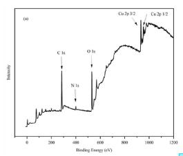

https://doi.org/10.5796/electrochemistry.24-00024 https://doi.org/10.50892/data.electrochemistry.25609638 Data

Article

Electrochemistry, 92(5), 057002 (2024)

Synthesis of Quinacridone Derivatives and Their Application as High Performance Levelers in Electroplating

Peikun ZOU, Chunyu XIANG, Xuyang LI, Nayun ZHOU, Binbin FAN, and Limin WANG\*

Shanghai Key Laboratoryfor Functional Materials Chemistry and Institute of Fine Chemicals, School of Chemistry and Molecular Engineering East China University of Science and Technology, 130 Meilong Road, Shanghai 200237, P. R. China

\* Corresponding author: wanglimin@ecust.edu.cn

## ABSTRACT

A series of quaternary ammonium salts base on quinacridone aromatic ring were synthesized using 2,9-quinacridone as the parent material, and their leveling performance were evaluated using constant-current chronoamperometry addition curves. Additionally, the adsorption abilities of the leveler molecules on copper surfaces were investigated through quantum chemical calculations and molecular dynamics simulations, and their specific adsorption sites on the copper surface were investigated by XPS, then the efect of concentration on the leveling performance was probed by through-hole plating, and the copper surface was characterized by XRD and SEM. Among four quinacridone aryl quaternary ammonium salts, DCQA-C -MI exhibits optimal leveling efects, serving as an excellent leveler with outstanding performance. This study expands the application scope of quinacridone aromatic heterocyclic quaternary ammonium salts and ofers insights for exploring eficient organic additives for copper electrodeposition.

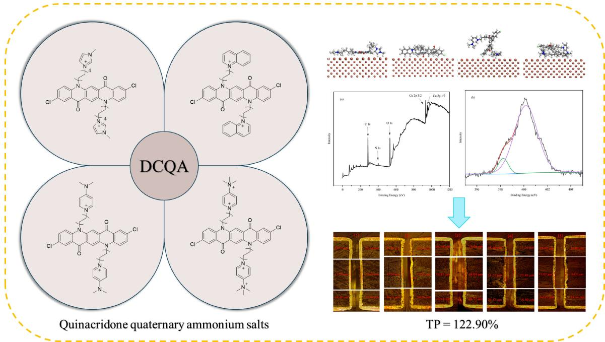

© The Author(s) 2024. Published by ECSJ. This is an open access article distributed under the terms of the Creative Commons Attribution-NonCommercial-ShareAlike 4.0 License (CC BY-NC-SA, http://creativecommons.org/licenses/by-nc-sa/4.0/), which permits non-commercial reuse, distribution, and reproduction in any medium by share-alike, provided the original work is properly cited. For permission for commercial reuse, please email to the corresponding author. [DOI: 10.5796/electrochemistry,24-00024]

Keywords : Quinacridone Quaternary Ammonium Salt, Acid Copper Plating, Through-hole Filling, Electroplating Leveler

## 1. Introduction

With the rapid advancement of the semiconductor industry and electronic information technology, there is a growing demand for miniaturization, lightweight, and high stability in various intelligent devices and communication equipment.1 Consequently, the manufacturing of printed circuit boards (PCBs) and integrated circuits (ICs), as well as the large-scale integration of chips, assumes paramount importance.2,3 Copper metal, owing to its high electrical conductivity, robust thermal conductivity, excellent ductility, and stable chemical properties, finds extensive application in electronic chemical manufacturing.4,5 Copper plating technology holds a crucial position in the production of PCBs, integrated circuits, and other electronic chemicals.6

To meet the high-performance requirements of electronic products, the filling of microvias with copper plating is imperative to achieve seamlessness or gap-free structures, referred to as “superfilling” or “bottom-up filling,” thereby posing a challenge to the copper plating process.7,8 Presently, the copper plating process encounters dificulties in actual production due to the edge efect, wherein the local current density at the aperture opening surpasses that of other hole regions, leading to the formation of defective cavities.9,10 Moreover, there exists a certain lack of copper layer flatness, diminishing the quality and reliability of copper interconnections and impacting the service life of electronic chemicals. Consequently, further investigation into plating additives is warranted.11

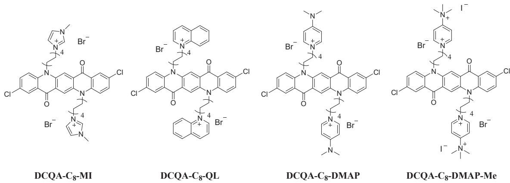  
Fi 1 Molecular structures of DCQA levelers.

Plating additives utilized in acid copper sulfate plating predominantly encompass inhibitors, accelerators, and levelers, each playing pivotal roles in the copper plating process through distinct mechanisms.12,13 Inhibitors form a polymer film on the plating surface, curtailing copper deposition, commonly comprising poly ether chain compounds like polyethylene glycol (PEG).14,15 Accelerators expedite copper deposition in conjunction with chloride ions, typically represented by sulfonate compounds such as sodium polydithiodipropane sulphonate (SPS).16 Among these additives, levelers assume paramount importance and are extensively researched for their ability to selectively impede copper deposition during plating, thus optimizing copper filling in vias and achieving a flat copper layer.17–19 Presently, common levelers predominantly consist of organic dye molecules like Janus Green B (JGB) and DPP.20,21 However, limitations such as planarity issues afecting adsorption performance and incomplete understanding of underlying mechanisms highlight the need for further research in this area.22,23

The unique structure of the quinacridone molecule, characterized by a conjugated five-membered ring and strong electronegative groups like the carbonyl and $\mathsf { s p } ^ { 2 }$ hybridized N atoms, makes it highly suitable for electrode surface adsorption and efective charge dispersion.24–26 This inherent potential motivated the present study to synthesize a series of quinacridone aromatic heterocyclic quaternary ammonium salts from 2,9 dichloroquinacridone, and these compounds were analyzed and tested to explore their properties in terms of electroplating.

## 2. Experimental Method

## 2.1 Synthesis and characterization

The adsorption capacity of quaternary ammonium salt leveler molecules primarily relies on their positively charged regions. It is proposed that synthesizing quaternary ammonium salts from nitrogen-containing heterocyclic molecules with conjugated structures could enhance adsorption eficiency, thereby improving the leveling efect. Quinacridone quaternary ammonium salts were synthesized using N-methylimidazole, quinoline, and 4-dimethyl aminopyridine. Furthermore, methylation of the quaternary ammonium salt derived from 4-dimethylaminopyridine was conducted to introduce four charges, aiming to investigate the impact of charge density on leveling eficacy. Thus, this study involved the synthesis of quinacridone aromatic heterocyclic quaternary ammonium salts, as depicted in Fig. 1, and elucidated their mechanism. The synthesis pathway is outlined in Scheme 1.

## 2.1.1 General procedure for the synthesis of compound DCQA-C8

2,9-dichloroquinacridone (Pigment Red P.R.202) served as the substrate, while 1,8-dibromooctane was employed as the alkylation reagent in the initial step of the alkylation reaction. The synthesis entailed the utilization of NaH as a base and tetrabutylammonium bromide (TBAB) as a phase transfer catalyst, facilitating the reaction between 2,9-dichloroquinacridone and 1,8-dibromooctane in a tetrahydrofuran solution under reflux conditions at $7 0 ^ { \circ } \mathrm { C }$ for 24 hours. Subsequent to the reaction, the quinacridone alkylated product was isolated via column chromatography, yielding 32 %.

2.1.2 General procedure for the synthesis of compound

$$
\begin{array}{l} \text {DCQA - C_{8} - MI, DCQA - C_{8} - QL, DCQA - C_{8} - DMAP, DCQA-} \\ \text {C_{8} -DMAP - Me} \end{array}
$$

The alkylated quinacridone compounds underwent reflux reactions with N-methylimidazole, quinoline, and 4-dimethylaminopyridine in acetonitrile at $8 0 ^ { \circ } \mathrm { C }$ for 16 hours, resulting in the separation of three aromatic heterocyclic quaternary ammonium salts via column chromatography. Subsequently, the quaternary ammonium derivative of 4-dimethylaminopyridine was methylated using iodomethane in DMF at $8 0 ^ { \circ } \mathrm { C }$ for 5 hours, followed by precipitation of the dark red solid in ethyl acetate. After extraction and filtration, the product was dissolved in a mixture of methylene chloride and methanol to obtain a dry sample, with the methylation product separated by column chromatography. The yield of the quinacridone aromatic heterocyclic quaternary ammonium salt ranged between 44% and 70 %.

## 2.2 Electrochemical analysis

All electrochemical analyses were performed using the PGSTAT302N Auto-Lab electrochemical workstation with a standard three-electrode system. A 3 mm diameter platinum rotating disc electrode (Pt-RDE) served as the working electrode (WE), a 2 mm diameter Pt rod as the counter electrode (CE), and a silver/ silver chloride (Ag/AgCl/sat KCl) electrode as the reference electrode (RE). The Virgin Make-up Solution (VMS) comprised 0.376 mol/L $\mathrm { C u S O _ { 4 } , }$ 1.875 mol/L ${ \mathrm { H } } _ { 2 } { \mathrm { S O } } _ { 4 } ,$ and 50 ppm Cl¹. Inhibitors and promoters included polyethylene glycol (PEG, MW = 10000) and bis-(sodium sulfopropyl)-disulfide (SPS). For cyclic voltammetry (CV), the scan range was 1.57 ³ ¹0.20 V with a constant rate of $5 0 \mathrm { m V / s } .$ Prior to each linear sweep voltammetry (LSV), the Pt-RDE underwent a 120 s pretreatment to form Pt-RDE-Cu. Potentiodynamic polarization tests used a constant scan rate of $2 0 \mathrm { m V } / \mathrm { s }$ and a scan potential range of $0 \sim - 0 . 8 \mathrm { V } .$ Galvanostatic measurements (GMs) were conducted at a fixed current density of $1 . 5 \mathrm { A } / \mathrm { d } \mathrm { m } ^ { 2 }$

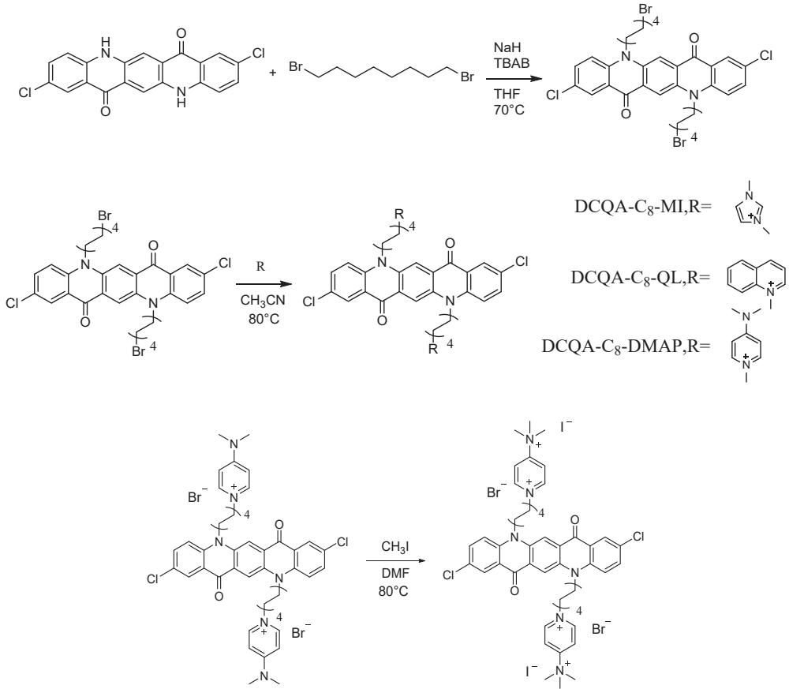  
Scheme 1 Synthesis route of DCQA levelers.

## 2.3 Computational details

Theoretical calculations were conducted using the Gaussian 09 program package, employing density functional theory (DFT) with the B3LYP/6-311G method. Structural optimization and frequency calculations were carried out for all compounds, and the highest occupied molecular orbital (E ) and lowest unoccupied molecular orbital $\left( \mathrm { E } _ { \mathrm { L U M O } } \right)$ energies were computed. Molecular orbitals, electrostatic potential (ESP) were analyzed and plotted using the Multiwfn and VMD packages. Molecular dynamics (MD) simulations were performed using the Forcite module in Materials Studio.27–31

## 2.4 Electroplating experiment

Copper-clad plates featuring double-sided and multiple vias were utilized as plating samples, with dimensions of $1 5 \times 5 \mathrm { c m } ^ { 2 }$ . The through-holes had a diameter of 300 µm and a depth of 3 mm. Prior to plating experiments, the plates underwent degreasing with a degreasing agent, followed by washing with deionized water and acid-washing using $1 0 \% \quad \mathrm { H } _ { 2 } \mathrm { S O } _ { 4 } .$ Plating experiments were conducted in a 1500 mL Harring cell, positioning the plating plate at the center as the cathode and two phosphorus-containing copper plates on both sides of the cell as the anode. Throughout the plating process, a constant current density of $1 . 5 \mathrm { A } / \mathrm { d } \mathrm { m } ^ { 2 }$ was maintained for 75 minutes. An air pump was employed to ensure continuous flow of bubbles, facilitating efective mass transfer within the system. The plating solution composition remained consistent with the formulation used in the electrochemical analysis.

## 2.5 Physical properties of copper deposition

The thickness of the copper plating layer in the middle and outside of the through-hole was observed by metallographic microscopy to calculate the TP values for diferent formulations. In printed circuit board manufacturing, the TP value refers to “Throwing Power”, which is a parameter used to describe the uniformity of copper deposition in diferent locations during copper plating. The TP values were calculated as shown in Fig. 2. In addition, the roughness of the plated surface was observed using scanning electron microscopy (SEM, Sigma 300) when diferent plating solutions were used. The meritocratic orientation of the plated surface with diferent plating solutions was revealed using xray difraction (XRD, Bruker D2 Phaser).

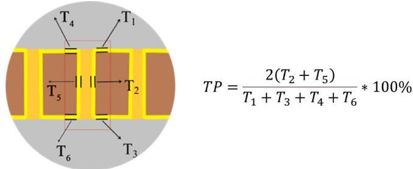  
Fi 2 The through hole diagram and the calculation formula of TP value.

## 3. Results and Discussion

## 3.1 Electrochemical analysis

## 3.1.1 Cyclic voltammetry measurements

Cyclic voltammetry (CV) was used to evaluate the inhibition capacity of synthesized quinacridone aryl quaternary ammonium salts.32,33 In cyclic voltammetry curves, the positive potential region corresponds to the oxidation of copper to ions, while the negative potential region corresponds to the reduction of copper ions to copper metal. The magnitude of the peak area in the positive potential region reflects the extent of copper oxidation, whereas the magnitude of the negative potential region indicates the quantity of copper deposition, with a positive correlation existing between the amount of copper oxide formed and the amount of reduced copper. Consequently, the peak area in the positive potential region can efectively represent the quantity of copper deposition subsequent to the introduction of the compound. The cyclic voltammetry curves depicted in the figure represent their respective second cycles.

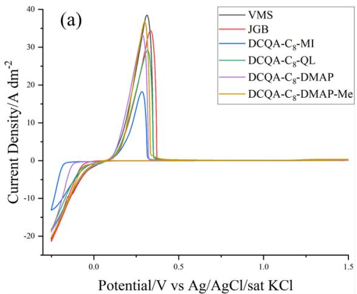

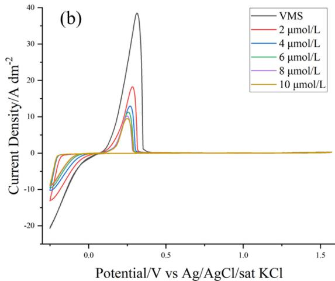

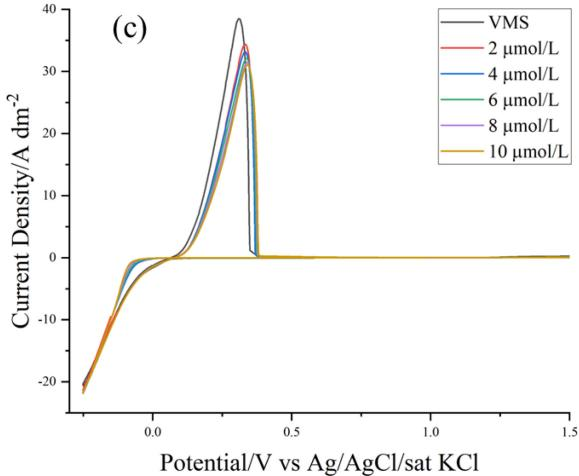  
Fi 3 Cyclic voltammetry curves with (a) 2 µmol/L of diferent leveler molecules; (b) diferent concentrations of $\operatorname { D C Q A - C } _ { 8 ^ { - } } \mathrm { M I } ;$ (c) different concentrations of JGB.

Results showed a decrease in current density upon adding quaternary ammonium salts, indicating inhibition ability in Fig. 3. Notably, $\mathrm { D C Q A - C _ { 8 } \mathrm { - M I } }$ demonstrated significant inhibition, dropping peak current density to $1 8 . 1 8 \mathrm { A } / \mathrm { d } \mathrm { m } ^ { 2 }$ compared to $3 4 . 3 6 \mathrm { A } / \mathrm { d } \mathrm { m } ^ { 2 }$ with JGB. $\mathrm { D C Q A - C _ { 8 } \mathrm { - Q I } }$ L and $\mathrm { D C Q A  – C _ { 8 } – D M A P }$ showed inhibition similar to JGB. However, DCQA- $\mathbf { \cdot C _ { 8 } { \mathrm { - D M A P - M e } } }$ , obtained after methylation reaction, displayed less pronounced inhibition, with a peak current density of $3 6 . 5 8 \mathrm { A } / \mathrm { d } \mathrm { m } ^ { 2 }$ , suggesting poorer performance.

Exploration of diferent concentrations of quaternary ammonium salts showed that increasing $\mathrm { D C Q A - C _ { 8 } \mathrm { - M I } }$ concentration significantly enhanced inhibition ability, while increasing JGB concentration had minimal efect. This suggests the potential of $\mathrm { \Delta D C Q A - C _ { 8 ^ { - } } }$ MI as a highly eficient plating leveler.

## 3.1.2 Potentiodynamic polarization

The polarization curve depicts the relationship between electrode potential and polarization current density, reflecting the kinetics of copper atom deposition on the cathode surface.34 In Fig. 4, after adding JGB and the four quinacridone azetidinium quaternary ammonium salts, the deposition potentials of copper ions shifted positively compared to the basic plating solution. Notably, three quaternary ammonium salts exhibited higher deposition potentials than JGB, except for $\operatorname { D C Q A - C _ { 8 } - D M A P } .$ This indicates that quinacridone azetidinium quaternary ammonium salts efectively reduce the copper atom deposition rate on the cathodic surface. The significantly higher deposition potentials of $\mathrm { D C Q A - C _ { 8 } \mathrm { - M I } }$ and $\operatorname { D C Q A - C _ { 8 } - Q I }$ align with their superior inhibition ability observed in cyclic voltammetry tests, underscoring their potential as eficient electroplating levelers.

Examining the impact of additive concentration on the polarization curve for $\mathrm { D C Q A - C _ { 8 } \mathrm { - M I } }$ in Fig. 4, the deposition potential of copper ions shifted positively with concentration, albeit with a modest rise and no clear linear relationship. Beyond $8 \mu \mathrm { m o l / L }$ concentration, further increases showed minimal change in the polarization curve. This suggests that the stronger inhibition efect of $\mathrm { D C Q A - C _ { 8 } \mathrm { - M I } }$ may have saturated the negative charges on the cathode surface bilayer, limiting further enhancement in electrochemical polarization. Combining Figs. 3 and $^ { 4 , }$ it is apparent that a singular increase in the leveler’s concentration does not linearly enhance its inhibitory capacity.

## 3.1.3 Galvanostatic measurements

The Galvanostatic measurements simulates diferent liquid flow rates during through-hole plating by adjusting the rotational speed of the rotating disc electrode. It sequentially adds inhibitor, accelerator, and leveler at constant intervals to analyze their interactions and the leveling ability of leveler molecules through potential changes.35 In through-hole plating, the flow rate of plating solution at the hole’s

Potential/V vs Ag/AgCl/sat KCl

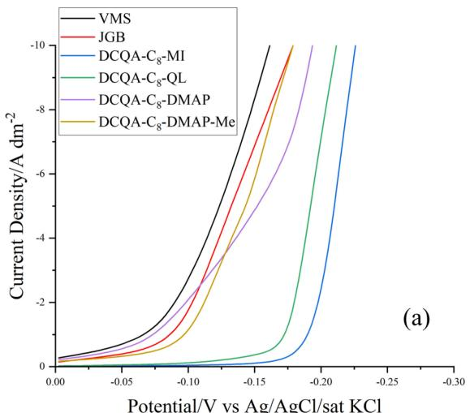

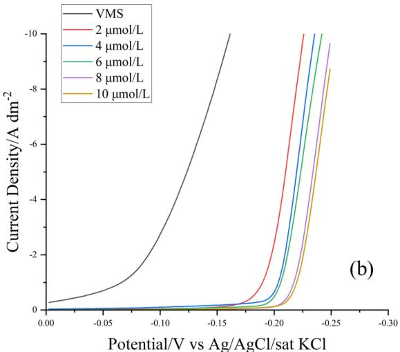  
Fi 4 Potentiodynamic polarization curve with (a) 2 µmol/L of diferent leveler molecules; (b) $\mathrm { D C Q A - C _ { 8 } \mathrm { - M I } }$ with diferent concentrations.

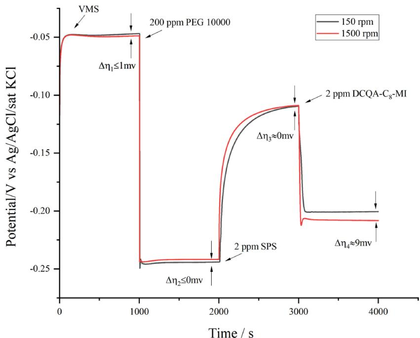  
Fi 5 GMs of $\mathrm { D C Q A ^ { - } C _ { 8 } }$ -MI at 150 rpm and 1500 rpm with 2 ppm.

mouth is higher than inside, so 1500 rpm simulated the mouth’s convection, while 150 rpm simulated inside, with the diference in deposition potentials denoted as ¦G.

Using $\mathrm { D C Q A - C _ { 8 } \mathrm { - M I } }$ with superior suppression capability, galvanostatic polarization was tested and the current density was $1 . 5 \mathrm { A } / \mathrm { d } \mathrm { m } ^ { 2 }$ . In Fig. 5, with the base plating solution, $\Delta \mathfrak { n } \approx 0$ at high and low rotational speeds, indicating satisfactory copper ion difusion rate, maintaining constant current density. At 1000 s, adding 200 ppm inhibitor PEG 10000, rapid decrease in cathode potential occurred due to PEG adsorption hindering copper ion migration, increasing concentration polarization. At high rotational speed, smaller concentration polarization was observed due to faster copper ion convection. At 2000 s, adding 2 ppm brightener SPS reduced PEG molecules on the cathode, replaced by SPS, facilitating copper atom deposition. SPS’s sulfonate groups preferentially adsorb inside the hole, resulting in slightly higher concentration polarization at low rotational speeds. Adding 2 ppm $\mathrm { D C Q A \mathrm { - } C _ { 8 } \mathrm { - } M I }$ at 3000 s rapidly decreased cathode potential due to its inhibitory efect. However, ¦G was larger, reaching 9 mV, indicating convection-dependent adsorption. $\mathrm { D C Q A  – C _ { 8 } – M I ^ { 3 } s }$ positive charge made it more adsorbed at the hole’s opening, resulting in stronger inhibition at the opening and weaker inside, achieving uniform layer thickness and leveling efect inside and outside the hole.

## 3.2 Theoretical calculation

The inhibition efectiveness of pigment-derived levelers depends on their charge dispersion and adsorption onto electrode surfaces. In this chapter, we employ density-functional theory (DFT) calculations and molecular dynamics (MD) simulations to explore how four quinacridone aromatic heterocyclic quaternary ammonium salt molecules interact with copper surfaces. By analyzing energy band gaps, electron densities, and adsorption behaviors, we aim to understand the diferences in inhibition eficacy among these molecules.

## 3.2.1 Density functional theory calculation

According to the frontier molecular orbital theory, the highest occupied orbital (HOMO) of a molecule acts as an electron donor, while the lowest unoccupied orbital (LUMO) acts as an electron acceptor, and their interaction is crucial. The energy diference between these orbitals $( \Delta \mathrm { E } = \mathrm { E } _ { \mathrm { L U M O } } - \mathrm { E } _ { \mathrm { H O M O } } )$ is key to characterizing the adsorption capacity of organic molecules on metal surfaces.

In Fig. 6 and Table 1, we observe that the energy orbitals and level diferences of the four quaternary ammonium salts are similar due to the strong conjugation of 2,9-dichloroquinacridone molecules. This conjugation concentrates the HOMO and LUMO orbitals within the conjugation plane of the parent molecule. Additionally, the longer $C _ { 8 }$ alkyl chains have a minimal impact on the electrostatic properties of the parent molecule, resulting in similar orbital energies among the molecules. This suggests that the large planar conjugated structure of quinacridone meets the basic requirements as a leveler parent. Furthermore, the combination of the large conjugated parent and the long alkyl chain minimizes the influence of the positively charged center of the donor unit on the molecular orbital energy. Instead, molecule adsorption on metal surfaces relies more on molecular electrostatic potential and binding energy.

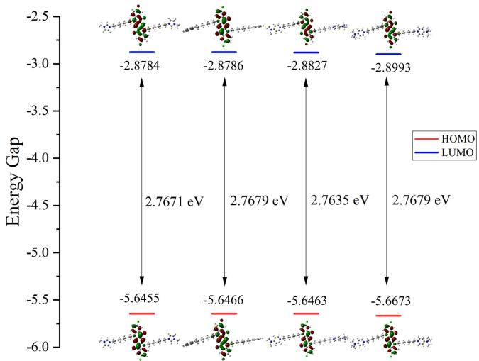  
Fi 6 HOMO and LUMO orbital distribution and orbital energy of quinacridone aromatic heterocyclic quaternary ammonium salts.

T bl 1 Orbital energy of quinacridone aromatic heterocyclic quaternary ammonium salts.

<table><tr><td>No.</td><td>Levelers</td><td>EHOMO (eV)</td><td>ELUMO (eV)</td><td>ΔE (eV)</td></tr><tr><td>1</td><td>DCQA-C8-MI</td><td>-5.6455</td><td>-2.8784</td><td>2.7671</td></tr><tr><td>2</td><td>DCQA-C8-QL</td><td>-5.6466</td><td>-2.8787</td><td>2.7679</td></tr><tr><td>3</td><td>DCQA-C8-DMAP</td><td>-5.6464</td><td>-2.8828</td><td>2.7636</td></tr><tr><td>4</td><td>DCQA-C8-DMAP-Me</td><td>-5.6673</td><td>-2.8994</td><td>2.7679</td></tr></table>

The electrostatic potential (ESP) for the four compounds was calculated and plotted in Fig. 7. The dark blue region signifies the positive charge-rich area of the molecule, which tends to adsorb onto the copper plate surface, aiding in charge dispersion to enhance cathodic electrochemical polarization. N-methylimidazole, with the strongest alkalinity, exhibits the highest positive charge after quaternary ammonium salt formation, reaching an ESP of 0.211 eV. This indicates stronger adsorption capability and charge accommodation ability. Quinoline and 4-dimethylaminopyridine, both pyridine derivatives, form large O-systems due to benzene ring and pyridine O-electron overlap. Quinoline’s alkalinity is slightly lower than that of pyridine, reflected in its ESP of 0.189 eV. The ESP of the quaternary ammonium salt of 4-dimethylaminopyridine is at 0.183 eV. Upon methylation of 4-dimethylaminopyridine to obtain 4-trimethylaminopyridine salt, an additional positive charge is introduced. This significantly increases the electrostatic potential to 0.339 eV. However, with two positive charge centers, the charge dispersion is relatively dispersed, and molecular stability may be compromised. This could explain why $\mathrm { D C Q A \mathrm { - } C _ { 8 } \mathrm { - } D M A P \mathrm { - } M e }$ exhibited poor inhibition performance in electrochemical tests.

## 3.2.2 Molecular dynamics simulation

Molecular dynamics simulation is employed to assess the adsorption state of additives on copper crystal surfaces, determining their adsorption dificulty through calculated binding energies. In Fig. 8, quaternary ammonium salt molecules exhibit non-flat adsorption on the copper plate due to intramolecular charge repulsion and site resistance. However, $\mathrm { D C Q A - C _ { 8 } \mathrm { - M I } }$ achieves nearly flat spreading on the copper plate, with its quinacridone parent partially parallel to surface copper atoms. This optimal adsorption distinguishes $\mathrm { D C Q A \mathrm { - } C _ { 8 } \mathrm { - } M I } ,$ while $\operatorname { D C Q A - C _ { 8 } - Q I }$ also demonstrates good adsorption due to its larger quinacridone ring, despite hindered flat spreading. Conversely, $\mathrm { D C Q A  – C _ { 8 } – D M A P }$ and $\mathrm { D C Q A \mathrm { - } C _ { 8 } \mathrm { - } D M A P \mathrm { - } M e }$ display chaotic adsorption states, hindered by increased site resistance from the dimethylamino substituent on the pyridine ring. This limits their charge adsorption ability, particularly for $\mathrm { D C Q A \mathrm { - } C _ { 8 } \mathrm { - } D M A P \mathrm { - } M e }$ , which has the most positive charges, resulting in the weakest inhibition efect.

Binding energy, essential for overcoming attraction between mutually attractive parts of a system, underscores adsorption capacity. Using molecular dynamics simulations, $\mathrm { E _ { t o t a l } }$ (the energy of the adsorption system as a whole), $\mathrm { E _ { s u r f a c e } }$ (the energy of the surface of the copper layer), and $\mathrm { E _ { o r g a n } }$ (the energy of the structureoptimized molecules themselves) were calculated separately. The energy of the adsorption system as a whole minus the other two energies is $\mathrm { { E } _ { i n t e r a c t i o n } }$ (the adsorption energy of the molecules on the copper surface). It can be expressed by the equation $\mathrm { { E } _ { \mathrm { { i n t e r a c t i o n } } } = }$ $\mathrm { E _ { t o t a l } - E _ { s u r f a c e } - E _ { o r g a n } . }$ As shown in Table 2, $\mathrm { D C Q A - C _ { 8 } \mathrm { - M I } }$ exhibits binding energy second only to $\mathrm { D C Q A \mathrm { - } C _ { 8 } \mathrm { - } D M A P \mathrm { - } M e , }$ indicating strong adsorption capacity. This, combined with its higher electrostatic potential energy, highlights $\mathrm { D C Q A  – C _ { 8 } – M I ^ { 3 } s }$ superior leveling performance compared to other quaternary ammonium salts, owing to its efective flat spreading and adsorption on the copper plate surface.

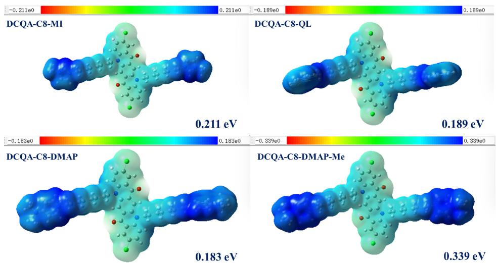  
Fi 7 Distribution of electrostatic potential of quinacridone aromatic heterocyclic quaternary ammonium salts

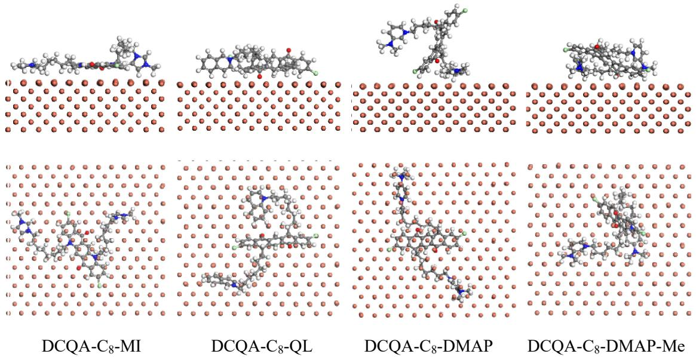  
Figure 8 Adsorption state of quinacridone aromatic heterocyclic quaternary ammonium salts on the surface of copper plate.

Table 2 Binding energies of quinacridone aromatic heterocyclic quaternary ammonium salts on the surface of copper plates (energy units in kcal/mol).

<table><tr><td>No.</td><td>Levelers</td><td> $E_{total}$ </td><td> $E_{surface}$ </td><td> $E_{organ}$ </td><td> $E_{interaction}$ </td></tr><tr><td>1</td><td>DCQA-C8-MI</td><td>-99294.690</td><td>-99004.691</td><td>99.587</td><td>-389.586</td></tr><tr><td>2</td><td>DCQA-C8-QL</td><td>-98958.843</td><td>-98853.548</td><td>245.100</td><td>-350.395</td></tr><tr><td>3</td><td>DCQA-C8-DMAP</td><td>-99095.892</td><td>-98924.225</td><td>117.048</td><td>-288.715</td></tr><tr><td>4</td><td>DCQA-C8-DMAP-Me</td><td>-99271.792</td><td>-98864.905</td><td>303.565</td><td>-710.452</td></tr></table>

## 3.2.3 X-ray photoelectron spectroscopy (XPS) analysis

Electrochemical tests and quantum chemical calculations identify $\mathrm { D C Q A - C _ { 8 } \mathrm { - M I } }$ as a potential eficient electroplating leveler. Subsequently, X-ray photoelectron spectroscopy (XPS) was utilized to analyze its adsorption state on copper plate surfaces. The copper plates were prepared by cutting into 2 cm long squares, followed by washing of the antioxidant film and immersion in $\textbf { a } 2 \mu \mathrm { m o l } / \mathrm { L }$ $\mathrm { D C Q A - C _ { 8 } \mathrm { - M I } }$ aqueous solution for 45 min. Subsequently, the samples were dried in an infrared oven for 30 min prior to testing. In Fig. 9, the distinct N 1s binding peak near 400 eV reveals the presence of $\mathbf { \dot { D C Q A - C _ { 8 } { - } M I } }$ on the surface of the copper plate. Further analysis in Fig. 9 displays two characteristic peaks at 398.21 eV and $4 0 0 . 1 6 \mathrm { e V } ,$ corresponding to the quinacridone amide nitrogen atom and the nitrogen atom in N-methylimidazole, respectively. This indicates that the adsorption is predominantly driven by the electrostatic interaction of the imidazole ring, while the quinacridone parent exhibits relatively minimal adsorption on the copper plate surface. Consequently, the imidazole ring directly accommodates charge on the cathode surface, enhancing its inhibition efect.

## 3.3 Copper electroplating

Based on the electrochemical tests and quantum chemical calculations, $\mathrm { D C Q A - C _ { 8 } \mathrm { - M I } }$ demonstrates superior electrochemical performance and efective adsorption on the electrode surface, allowing it to selectively inhibit the deposition of copper ions on the cathode. Consequently, in this section, $\mathrm { D C Q A - C _ { 8 } \mathrm { - M I } }$ was employed as a leveler in practical copper plating experiments on micro-through holes to evaluate its actual leveling ability. The filling eficiency and uniformity of the plated copper layer were observed using metallurgical microscopy, while scanning electron microscopy and X-ray difractometer were utilized to characterize the surface micromorphology and crystal orientation of the plated copper layer.36,37

## 3.3.1 Through-hole plating experiment

Under constant plating ambient temperature, duration, and current density, various concentrations of $\mathrm { D C Q A - C _ { 8 } \mathrm { - M I } }$ were added to the basic plating solution along with an inhibitor (PEG 10000) and a brightening agent (SPS). Five diferent plating solution formulations were devised, and the concentrations of the additives are shown in the Table 3.

Analyzing Table 3 and Fig. 10, when plating with the base solution without additives (formulation 1), the plated layer inside the through-hole is much thinner compared to the surface layer, with a TP value of only 49.26 %. Formulation 2, with the addition of 200 ppm PEG 10000 and 2 ppm SPS, resulted in a slight decrease in surface layer thickness and only minor change in through-hole thickness, with a TP value of 50.69 %. Formulation 3, with an additional 0.1 ppm $\mathrm { D C Q A \mathrm { - } C _ { 8 } \mathrm { - } M I }$ , exhibited increased through-hole thickness and decreased surface layer thickness, achieving a TP value of 71.88 %. Increasing the leveler concentration to 0.3 ppm in formulation 4 significantly inhibited copper atom deposition on the surface, reducing layer thickness and enhancing through-hole thickness, resulting in a TP value exceeding 100 % at 113.31 %. However, further increasing $\mathrm { D C Q A ^ { - } C _ { 8 } ^ { \phantom { + } } }$ -MI concentration to 0.5 ppm did not significantly reduce surface layer thickness or increase through-hole thickness, leading to a TP value of 122.90 %. This indicates that excessive leveler concentration may hinder surface plating thickness, making it challenging to meet practical application needs.

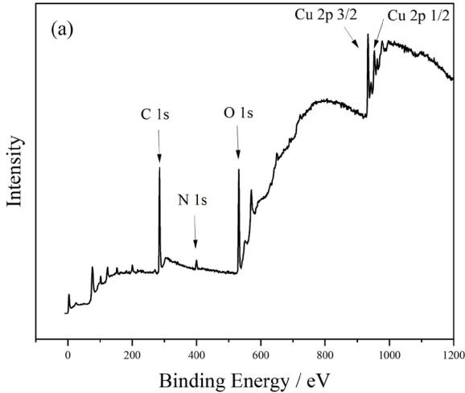

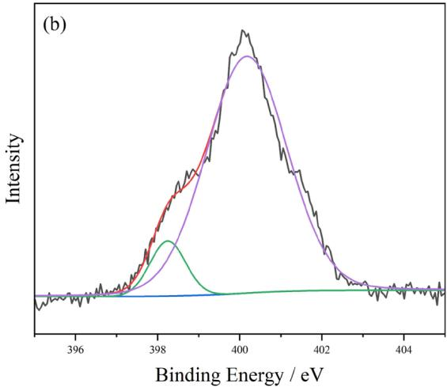  
Figure 9 (a) XPS general spectrum of $\mathrm { D C Q A ^ { - } C _ { 8 } ^ { \phantom { - } } }$ MI adsorbed on the surface of copper plate; (b) high-resolution spectrum of N 1s.

T bl 3 Additive formulations and TP values.

<table><tr><td>Formula</td><td>1</td><td>2</td><td>3</td><td>4</td><td>5</td></tr><tr><td>DCQA-C8-MI (ppm)</td><td>0</td><td>0</td><td>0.1</td><td>0.3</td><td>0.5</td></tr><tr><td>PEG 10000 (ppm)</td><td>0</td><td>200</td><td>200</td><td>200</td><td>200</td></tr><tr><td>SPS (ppm)</td><td>0</td><td>2</td><td>2</td><td>2</td><td>2</td></tr><tr><td>Cl-(ppm)</td><td>50</td><td>50</td><td>50</td><td>50</td><td>50</td></tr><tr><td>TP value (%)</td><td>49.26</td><td>50.59</td><td>71.88</td><td>113.31</td><td>122.90</td></tr></table>

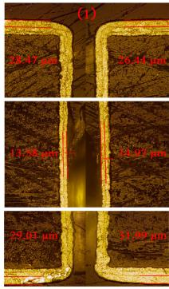  
TP=49.26%

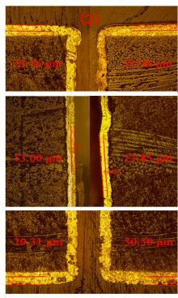  
TP=50.69%

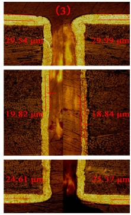  
TP=71.88%

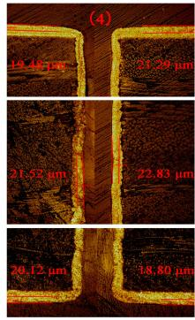  
TP=113.31%

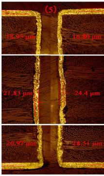  
TP=122.90%  
Figure 10 Cross-sections of THs for plating using formulations 1–5.

Through-hole plating experiments demonstrated that 0.3 ppm DCQA- ${ \bf \Gamma } . { \bf C } _ { 8 } – { \bf M } { \bf I }$ as a leveler efectively enhanced through-hole filling eficiency, outperforming the commercially available JGB leveler, which achieved only 99.60 % TP value with 1 ppm concentration. This better performance with lower addition concentration reduces costs and residue in the plating layer, minimizing its impact on layer performance compared to previous pigment derivative levelers and literature reports.

## 3.3.2 Characterization of copper layer morphology

In PCB plating, maintaining smooth and flat layers is crucial to avoid rough or dendritic formations that can compromise stability. SEM and XRD analyses were conducted to evaluate surface micro morphology and crystal orientation.38,39

Figure 11 displays samples 1–5 plated with formulations 1–5, respectively, at 1000© SEM magnification. Sample 1, plated without additives, exhibits a rough surface with spiral bumps and a (220) crystal orientation, indicating rapid deposition along this plane. After adding inhibitor and accelerator, cathodic potential remained lower, indicating slower copper atom deposition compared to sample 1, resulting in a flatter surface still dominated by (220) orientation. Upon adding 0.1 ppm $\mathrm { D C Q A - C _ { 8 } \mathrm { - M I } }$ , the plated layer becomes smooth with enhanced (111) crystal surface and few (100) orientations. This is because after the addition of 0.1 ppm DCQA-$\mathbf { C } _ { 8 } { \mathrm { - } } \mathbf { M } \mathbf { I }$ , the molecules preferentially adsorb on the raised portion of the copper layer surface due to the tip-discharge efect, thus selectively inhibiting the deposition of copper here. On a macroscopic level, uniform deposition of copper is observed. Moreover, the addition of $\mathrm { D C Q A - C _ { 8 } \mathrm { - M I } }$ in small amounts changes the crystal orientation of copper, resulting in an increase in the proportion of (111) crystalline surfaces, and ultimately in a flat copper layer.

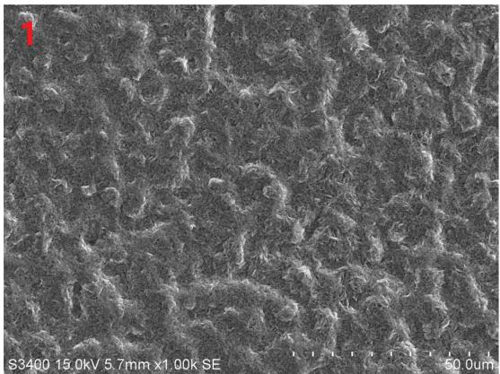

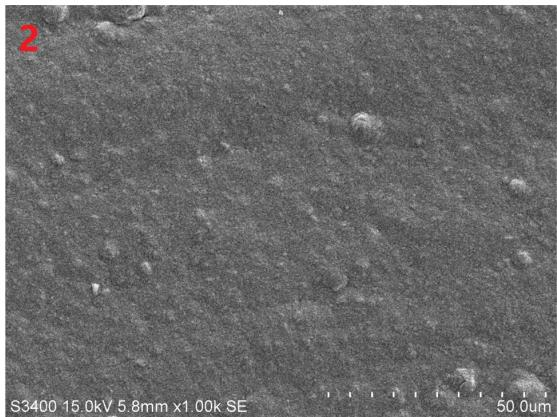

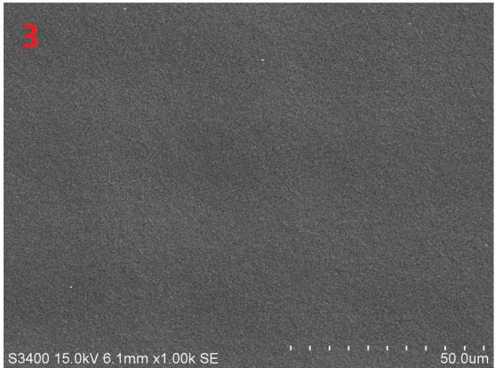

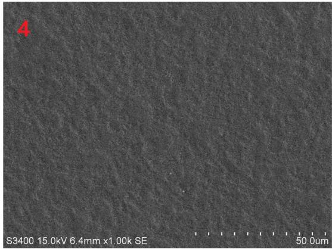

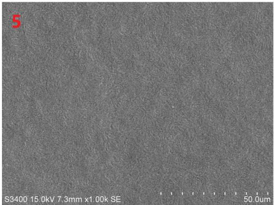

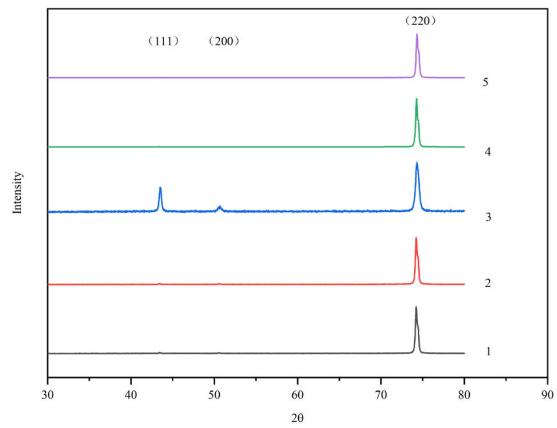  
Fi 11 SEM images and XRD analysis of the surface plating after through-hole electroplating. (1–5 corresponds to Table 3)

However, increasing $\mathrm { D C Q A - C _ { 8 } \mathrm { - M I } }$ concentration led to rougher surfaces in samples 4 and 5, with a single (220) orientation, possibly due to excessive inhibition causing concentration polarization. This results in slower copper atom deposition near the cathode surface, leading to uneven coating formation. While $\mathrm { D C Q A - C _ { 8 } \mathrm { - M I } }$ improves through-hole filling, its strong inhibition can compromise plated layer flatness, limiting its application in high-performance PCB plating. Nevertheless, the (220)-oriented single crystal plated layer ofers superior thermal and electrical properties compared to polycrystalline copper, suggesting potential use in single-crystal copper foil electrodeposition.

## 4. Conclusion

In summary, four aryl heterocyclic quaternary ammonium salts containing quinacridone core $\mathrm { ( D C Q A  – C _ { 8 }  – M I , \partial D C Q A  – C _ { 8 }  – Q L }$ $\mathrm { D C Q A \mathrm { - } C _ { 8 } \mathrm { - } D M A P , D C Q A \mathrm { - } C _ { 8 } \mathrm { - } D M A P \mathrm { - } M e ) }$ were synthesized featuring positively charged centers for improved charge loading and cathode surface adsorption as potential electroplating levelers. Evaluation involved cyclic voltammetry and polarization curve tests, identifying $\mathrm { D C Q A - C _ { 8 } \mathrm { - M I } }$ as the most efective. It exhibited superior leveling and adsorption properties compared to the commercial agent JGB, indicating potential as a highly eficient leveler. Density functional theory calculations revealed $\mathrm { D C Q A ^ { - } C _ { 8 } ^ { \phantom { + } } }$ MI’s enhanced charge dispersion capability, with molecular dynamics simulations confirming preferential adsorption onto copper plate surfaces. Through-hole plating experiments using $\mathrm { D C Q A - C _ { 8 } \mathrm { - M I } }$ demonstrated eficient leveling, achieving a uniform layer with a TP value of 113.31 % at 0.3 ppm additive concentration, highlighting its eficacy as a leveler. Meanwhile, the adsorption mechanism of heterocyclic quaternary ammonium salts have been investigated ofering guidance for the exploration of eficient organic additives for copper electrodeposition.

## Acknowledgment

This research was financially supported by the National Natural Science Foundation of China (21772039, 21272069) and Sinopec Seeding Program (ZC0607-0869), and we gratefully acknowledge financial support from the Central Universities and Science and Technology Commission of Shanghai Municipality (21DZ2305000). Support from the Fundamental Research Funds for the Central Universities (SLA13223001).

## CRediT Authorship Contribution Statement

Peikun Zou: Data curation (Lead), Methodology (Lead), Project administration (Lead), Validation (Lead), Visualization (Lead), Writing – original draft (Lead), Writing – review & editing (Lead)

Chunyu Xiang: Data curation (Equal), Methodology (Equal), Writing – review & editing (Equal)

Xuyang Li: Methodology (Equal), Validation (Supporting)

Nayun Zhou: Data curation (Supporting), Visualization (Supporting)

Binbin Fan: Data curation (Supporting), Writing – review & editing (Supporting)

Limin Wang: Funding acquisition (Lead), Supervision (Supporting), Writing – review & editing (Equal)

## Data Availability Statement

The data that support the findings of this study are openly available under the terms of the desi nated Creative Commons License in J-STAGE Data listed in D1 of References.

## Conflict of Interest

The authors declare no conflict of interest in the manuscript.

## Funding

National Natural Science Foundation of China: 21772039, 21272069

Sinopec Seeding Program: ZC0607-0869

Central Universities and Science and Technology Commission of Shanghai Municipality: 21DZ2305000

Fundamental Research Funds for the Central Universities: SLA13223001

## References

D1. P. Zou, C. Xiang, X. Li, N. Zhou, B. Fan, and L. Wang, J-STAGE Data, https:// doi.org/10.50892/data.electrochemistry.25609638, (2024).

1. R. Miyamoto, K. Tamahashi, T. Inami, Y. Sasajima, and J. Onuki, J. Electrochem. Soc., 166, D137 (2019).

2. C. Peng, Y. Zhai, X. Chen, C. Wang, Y. Hong, Y. Chen, W. He, G. Zhou, and B. Liu, Molecules, 28, 2783 (2023).

3. T. P. Mofat, T. M. Braun, D. Raciti, and D. Josell, Acc. Chem. Res., 56, 1004 (2023).

4. J. W. Zhang, X. Chen, C. H. Qian, B. B. Fan, and L. M. Wang, J. Phys. Chem. C,

127, 1633 (2023).

5. E. Sezer, B. Ustamehmetoğlu, and R. Katirci, Turk. J. Chem., 38, 701 (2014).

6. A. Jaworski, H. Wikiel, and K. Wikiel, Electroanalysis, 31, 318 (2019).

7. Y. Li, P. Ren, Y. Zhang, R. Li, J. Zhang, P. Yang, A. Liu, G. Wang, and M. An, Appl. Surf. Sci., 615, 156266 (2023).

8. M. Tomie, T. Akita, M. Irita, and M. Hayase, J. Electrochem. Soc., 167, 082513 (2020).

9. X. Li, X. Yin, J. Li, B. Yuan, C. Xiang, P. Zou, and L. Wang, Electrochim. Acta, 437, 141541 (2023).

10. Z. Zhang, Y. Wu, Y. Zhang, T. Hang, A. Hu, H. Ling, and M. Li, J. Electrochem Soc., 166, D577 (2019).

11. T. Akita, Y. Otsuka, and M. Hayase, J. Electrochem. Soc., 167, 162515 (2020).

12. Z. Li, B. Tan, J. Luo, J. Qin, G. Yang, C. Cui, and L. Pan, Electrochim. Acta, 401, 139445 (2022).

13. Y. Hoshi, Y. Ito, T. Kato, I. Shitanda, and M. Itagaki, Electrochemistry, 83, 142 (2015).

14. P. Ren, M. An, P. Yang, and J. Zhang, J. Electroanal. Chem., 898, 115624 (2021).

15. Z. Lai, C. Wang, Y. Huang, Y. Chen, S. Wang, Y. Hong, G. Zhou, W. He, X. Su, Y. Sun, Y. Tao, and X. Lu, Mater: Today Commun., 24, 100973 (2020)

16. C. D. Bandas, R. T. Rooney, A. Kirbs, C. Jaeger, R. Schmidt, and A. A. Gewirth. J. Electrochem. Soc., 168, 042501 (2021).

17. L. Tan, S. Han, S. Chen, T. Hang, H. Ling, Y. Wu, and M. Li, J. Electrochem. Soc., 168, 062504 (2021).

18. M. H. Lee, Y. Lee, M. Sung, S. K. Cho, Y. G. Kim, and J. J. Kim, J. Electrochem. Soc., 167, 102505 (2020).

19. B.-G. Park, S. G. Kim, and J. S. Ko, Int. J. Precis. Eng. Manuf., 20, 437 (2019).

20. T.-G. Woo and I.-S. Park, Korean J. Met. Mater., 59, 404 (2021).

21. J. Li, J. Xu, X. Wang, X. Wei, and L. Wang, Appl. Surf. Sci., 569, 150982 (2021)

22. B. Yuan, X. Chen, Y. Zhao, W. Zhou, X. Li, and L. Wang, Electrochim. Acta, 471, 143345 (2023)

23. L. Jin, W.-Q. Li, Z.-Y. Wang, J.-Q. Yang, A.-N. Zheng, F.-Z. Yang, D. Zhan, D.-Y. Wu, and Z,-O. Tian, ACS Sustainable Chem. Eng., 10, 14204 (2022)

24. X. Wang, K. Wang, J. Xu, J. Li, J. Lv, M. Zhao, and L. Wang, Dyes Pigm., 181, 108594 (2020).

25. Y. Saito, S. Iwamoto, N. Hontama, Y. Tanaka, and T. Endo, Cellulose, 27, 3153 (2020).

26. G. Zhao, Y. Fan, C. Huo, H. Bian, W. Song, J. Zhang, and Y. Wang, Chin. Sci. Bull., 54, 1677 (2009)

27. Z. Liu, X. Wang, T. Lu, A. Yuan, and X. Yan, Carbon, 187, 78 (2022).

28. J. Zhang and T. Lu, Phys. Chem. Chem. Phys., 23, 20323 (2021)

29. T. Lu and S. Manzetti, Struct. Chem., 25, 1521 (2014).

30. T. Lu and F. W. Chen, J. Mol. Graphics Model., 38, 314 (2012)

31. T. Lu and F. W. Chen, J. Comput. Chem., 33, 580 (2012).

32. X. Teng, Z. Tao, Z. Long, G. Liu, and X. Tao, RSC Adv., 12, 16153 (2022).

33. Y. Yoon, Y. S. Ham, T. Y. Kim, S. Choe, and J. J. Kim, J. Electrochem. Soc., 165. H213 (2018).

34. Y. C. Meng, M. M. Zhou, W. Huang, Y. L. Min, X. X. Shen, and Q. J. Xu, Electrochim. Acta, 429, 141013 (2022)

35. N. T. M. Hai, J. Furrer, F. Stricker, T. M. T. Huynh, I. Gjuroski, N. Luedi, T. Brunner, F. Weiss, A. Fluegel, M. Arnold, I. Chang, D. Mayer, and P. Broekmann, J. Electrochem. Soc., , D3116 (2013).

36. M. A. Rigsby, L. J. Brogan, N. V. Doubina, Y. Liu, E. C. Opocensky, T. A. Spurlin, J. Zhou, and J. D. Reid, J. Electrochem. Soc., 166, D3167 (2018).

37. M. Hayase and M. Nagao, J. Electrochem. Soc., 160, D3216 (2013).

38. D. A. Brown, S. Morgan, V. Peldzinski, and R. Brüning, J. Cryst. Growth, 478, 220 (2017).

39. U. S. Mohanty, B. C. Tripathy, P. Singh, A. Keshavarz, and S. Iglauer, J. Appl. Electrochem., 49, 847 (2019).