pubs.acs.org/JPCC

# Study of 5‑Alkynylpyrimidines as Cobalt Superfilling Inhibitors

Haidi Li, Tao Zhang, Shiqi Song, Qian Li, Rongze Han, Qiaoxia Li, Yulin Min, Lina Qiu, Xixun Shen,\* and Qunjie Xu\*

Cite This: J. Phys. Chem. C 2025, 129, 232−243

Read Online

ACCESS

Metrics & More

ABSTRACT: Electrodeposition technology is the key core technology for achieving micro/nanoscale interconnection in high-end chip manufacturing. Recently, cobalt interconnect structures have been the ideal choice for constructing electronic pathways in process nodes below 14 nm due to the fact that cobalt has a smaller electron mean free path compared to copper; thus, studying the electroplating filling behavior of cobalt in micronano scale space has become a hot topic in the field of chip manufacturing. In this article, an electroplating solution containing a new 5-alkynylpyrimidine (5-EP) as an inhibitor is designed for electrochemical tests, including cyclic voltammetry and linear sweep voltammetry. The results indicate that the 5-EP significantly inhibits cobalt electrodeposition. The change in the nucleation mode of cobalt in an electroplating solution with the inhibitor (5-EP) was revealed by chronoamperometry, where cobalt atoms nucleate in a three-dimensional continuous manner instead of three-dimensional instantaneous nucleation. In situ enhanced Raman spectroscopy is used to further analyze the adsorption of the inhibitor (5-EP) molecules on the cobalt surface during the electroplating process from a spectroscopic perspective. The energy gap value of the additive molecule obtained through quantum chemical calculations is $\begin{array} { r } { \triangle E = E _ { \mathrm { L U M O } } - \bar { E _ { \mathrm { H O M O } } } = 3 . 3 0 2 ~ \mathrm { e V } , } \end{array}$ indicating that the additive molecule has high reactivity and higher adsorption strength at the metal interface. The calculated electrostatic potential (ESP) values of the molecule range from a minimum of −47.29 kJ/mol to a maximum of 70.89 kJ/mol. Lower ESP values imply higher electron density. Molecular dynamics simulations calculate the adsorption energy of the additive molecule (5-EP) on Co(100) to be −133.96 kcal/mol, indicating that the 5-EP molecule has good adsorption capability. Electroplating experiments reveal that the addition of 6 ppm 5-EP to the plating solution enables defect-free filling of blind holes. Finally, it is also revealed by characterization tests (scanning electron microscopy/atomic force microscopy/X-ray difraction) that the inhibitor (5-EP) efectively reduces the surface roughness of the cobalt coating and, meantime, promotes the preferential growth of cobalt along the 100 and 110 crystal planes.

Article Recommendations  
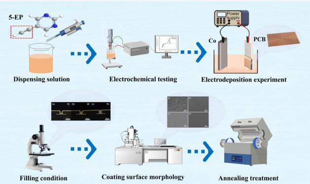

## 1. INTRODUCTION

Damascene copper plating technology has remained the best choice for metal interconnects in logic chips and memory chips.1 As semiconductor processes advance toward 10 nm and below, the use of copper as a conductor material begins to encounter issues with RC delay, which severely impacts the interconnect performance of chips. This has led to bottlenecks in process technology at the 10- and 7-nanometer nodes,2,3 necessitating the search for new alternative interconnect materials. Researchers have found that metals such as Co, Ni, Mo, and Nb show greater potential than Cu.4 However, when considering other parameters such as process and material costs, only Co is highlighted as a promising material. It has been reported that Co has already been used in the contact interconnect layers at the 10 nm node and is also considered suitable for use as a conductor in higher metal layers.5 Compared to copper, cobalt has a shorter mean free path for electrons and a higher melting point. At the nanoscale, cobalt interconnects exhibit minimal size efects and superior resistance to electromigration.6 The deposition quality of chip interconnect materials has a crucial impact on the final performance of the chip, directly afecting the chip’s yield, reliability, and stability. This places higher demands on the chip interconnect process. Electroplating technology is the primary technique for forming micro and nano interconnect structures.7 In this complex process, additives play a critical role in regulating the deposition quality and behavior of metals.8 Similar to the traditional Damascene copper interconnect process, the cobalt interconnect plating system also requires additives that can increase the metal deposition overpotential to achieve void-free superfilling in micro and nano structures.9 The cobalt superfilling additives reported to date often contain unsaturated carbon bonds, nitrogencontaining functional groups, or a combination of both. The nitrogen-containing functional groups exist in the forms of amines $( - \mathrm { N H } _ { 2 } , \mathsf { \Gamma } - \mathrm { N H } )$ , oxime groups $( - \mathrm { C = N - O H } )$ and nitrogen-containing heterocycles. Utilizing the S-shaped negative diferential resistance (S-NDR) mechanism for ultraconformal deposition, Mofat et al.10 observed bottom up filling of cobalt in 8 μm × 56 μm silicon through-holes. They achieved this by utilizing polyethylenimine (PEI) as an inhibitor. Jungkyu Kang et al.11,12 found that void-free filling could be achieved even in low aspect ratio trenches in the presence of benzimidazole (BZI) and 2-mercaptobenzimida zole (MBI). An et al. demonstrated the potential application of nitrogen-containing organic heterocyclic molecules, nitro blue tetrazolium chloride (NBT)13 and malachite green (MG),14 as inhibitors. Their research found that the heterocyclic structures of the additive molecules preferentially adsorb on the cathode surface, serving as a mechanism to inhibit cobalt deposition. Huang et al.15−17 utilized electrochemical methods such as EQCM and cyclic voltammetry to investigate the inhibitory properties of oxime-containing compounds, including cyclo hexanedione dioxime (CHD), furandione dioxime (FD), and dimethylglyoxime (DMG), on cobalt electrodeposition. However, the actual pore-filling performance and the micro scopic mechanisms involved still require further exploration He et al.18,19 studied the inhibitory efects of polyvinylpyrro lidone (PVP) using cyclic voltammetry and other electro chemical methods, finding that PVP efectively inhibited cobalt electrodeposition, and that Cl− enhanced this inhibitory efect. In the field of cobalt interconnects, due to cobalt’s lower reduction potential compared to hydrogen’s evolution potential, hydrogen evolution reactions are inevitably occurring during the cobalt deposition process.20 To mitigate this side reaction, researchers have employed additives with hydrogen evolution reaction (HER) inhibition capabilities,20 including alkynyl/alkenyl additives. Pan et al.21 suggested that brightener butynediol may adsorb on the Co metal surface and be reduced by adsorbed hydrogen produced by the side reaction. Kiruba et al.22 extracted organic products from cobalt plating solutions containing butynediol and confirmed via Raman spectroscopy that butynediol was catalytically converted into butenediol on the cobalt surface. Wu et al.23 investigated alkynol additives such as 1,4-butynediol (BYD), 1,4-butenediol (BED), and ethylene glycol (EG), which contains only −OH functional groups, to elucidate the potential mechanisms of unsaturated carbon bonds in cobalt electrodeposition. However, research on the application of alkynyl/alkenyl additives in bottom-up cobalt filling is scarce. This study selected 5-ethynylpyrimidine (5-EP), a compound containing unsaturated carbon bonds, as a novel inhibitor for cobalt electrodeposition. The study utilized electrochemical techni ques, namely cyclic voltammetry (CV) and linear sweep voltammetry (LSV), to examine the inhibitory impact of the ethynyl group $( - \mathrm { C } \mathrm { \equiv } \mathrm { C } - )$ on cobalt electrodeposition and to assess its efects on cobalt deposition. Chronoamperometry (I−T) tests and fitting were conducted to analyze the nucleation process of cobalt during the plating process. Characterization techniques such as scanning electron microscopy (SEM), X-ray difraction (XRD), and atomic force microscopy (AFM) were utilized to study the efects of 5-

EP on crystal morphology and orientation, and the resistivity of annealed cobalt coatings was calculated. Computational and simulation methods, combined with in situ Raman spectroscopy, were used to study the adsorption of the inhibitor (5-EP) molecules at the cobalt interface. The wettability of inhibitor (5-EP) on plated layers at diferent deposition times was investigated using a contact angle test.

## 2. EXPERIMENTAL SECTION

2.1. Chemical Reagents. In this experiment, the basic electrolyte solution consisted of 100 $\mathrm { g / L } \mathrm { C o S O } _ { 4 } { \cdot } 7 \mathrm { H } _ { 2 } \mathrm { O }$ (99.5%, MACKLIN, AR), 40 g/L H BO (99.5%, MACKLIN, AR), and 10 $\mathrm { g / L }$ NaCl (≥99.9%, GENERAL-REAGENT, AR), along with 1 mol/L ${ \mathrm { H } } _ { 2 } { \mathrm { S O } } _ { 4 }$ (premium grade, Shanghai Reagent, GR). The inhibitor used was 0.1 g/L 5-EP.

2.2. Electrochemical Testing. The electrochemical experiments utilized a three-electrode setup. The experiment used a platinum electrode with a rotating disk (Pt-RDE) as the working electrode (WE), which had a diameter of 5 mm. The reference electrode (RE) was a mercury-mercurous sulfate electrode, and the counter electrode (CE) was a platinum wire electrode. To control the electrochemical experiments, the CHI660C electrochemical workstation was employed.

During the electrochemical tests, the rotation speed of the working electrode (WE) was adjusted to two diferent values: 2000 rpm, representing a high level of convection at the mouth of the blind hole, and 200 rpm, representing a lower level of convection at the bottom of the blind hole. The cyclic voltammetry (CV) test was performed over a voltage range of 0.4 to −1.6 V at a scan rate of 100 mV/s. The scan consisted of two segments. The linear sweep voltammetry (LSV) was conducted in the voltage range from −1.1 to −1.6 V with a scan rate of 0.01 V/s.To perform the nucleation curve test, a layer of cobalt was deposited on a rotating platinum electrode (Pt-RDE). The deposition time for this layer was set at 400 s.

2.3. In Situ Electrochemical Surface-Enhanced Raman Spectroscopy. To investigate newly developed additives, this work utilized the Horiba LabRAM HR Raman spectrometer to perform conventional Raman spectroscopy and in situ electrochemical surface-enhanced Raman spectroscopy (EC SERS). The power utilized throughout the testing process was 0.625 mW, with an excitation wavelength of λ = 633 nm. The experiment used a printed circuit board with the length of 1.2 cm and the width of 1.2 cm as the working electrode. The printed circuit boards were electrodeposited for 2 h to ensure uniform cobalt deposition on their surfaces. The reference electrode (RE) was made of silver/silver chloride, while the counter electrode (CE) was made of platinum. The test setup underwent a 10 min ultrasonic cleaning in ultrapure water, followed by thorough rinsing with ultrapure water. It was then dried in an oven and stored. The in situ Raman electrolytic cell, solution bottle, and peristaltic pump were connected using Teflon tubes. The plating solution was composed of 10 g/L $\mathrm { C o S O _ { 4 } { \cdot } 7 H _ { 2 } O , 4 \ g / \bar { L } H _ { 3 } \bar { B } O _ { 3 } , 1 \ g / L \ N a C l , }$ and 0.1 g/L 5-EP. By decreasing the concentration of the base plating solution in the same proportion while keeping the concentration of the inhibitor 5-EP unchanged, the detection sensitivity of the inhibitor 5-EP can be enhanced in the test. A peristaltic pump was utilized to pass the plating solution into the in situ Raman electrolyzer at a flow rate of 32 mL/min to ensure that all air was removed from the electrolyzer and that the plating solution was replenished. The electrochemical Raman cell was positioned horizontally on the stage and connected to the electrochemical workstation. The potential was systematically adjusted in increments ranging from −1.1 to $- 1 . 6 \mathrm { ~ V } ,$ while maintaining a constant pH value of 2.

2.4. Blind Hole Filling Experiment. In the electroplating process, a high-purity cobalt plate $( \mathrm { C o } ~ \ge ~ 9 9 . 9 9 \% )$ with dimensions of 1 mm × 100 mm × 100 mm was used as the anode. The PCB board with blind hole diameter of 100 $\mu \mathrm { m }$ and blind hole depth of 100 μm was activated and washed with alcohol in a 1 mol/L ${ \mathrm { H } } _ { 2 } { \mathrm { S O } } _ { 4 }$ solution, then connected with conductive adhesive and attached to the back of a stainless steel plate, serving as the cathode. The plating process was carried out in an electrolyzer with a length of 18 cm, a width of 7 cm and a height of 12 cm. During the electroplating process, the current density was maintained at 1 $\mathrm { A } / \mathrm { d } \mathrm { m } ^ { \hat { 2 } } .$ . A 1 L cobalt plating solution was prepared, and the pH of the solution was adjusted to 2 using 1 mol/L ${ \mathrm { H } } _ { 2 } { \mathrm { S O } } _ { 4 }$ during the plating process. The plating times were set at $3 , 4 ,$ and ${ \bar { \mathsf { S h } } } ,$ respectively, with the specific composition of the plating solution as shown in Table 1. After electroplating, the samples were dried in an oven and then observed for cobalt filling in the blind holes using a metallurgical microscope (Olympus53M).

Table 1. Concentrations of Each Component

<table><tr><td></td><td>concentration (g/L)</td><td>electroplating addition amount</td></tr><tr><td> $CoSO_{4} \cdot 7H_{2}O$ </td><td>100</td><td>100 g/L</td></tr><tr><td> $H_{3}BO_{3}$ </td><td>40</td><td>40 g/L</td></tr><tr><td>NaCl</td><td>10</td><td>10 g/L</td></tr><tr><td>5-alkynylpyrimidine (5-EP)</td><td>0.1</td><td>6 ppm</td></tr></table>

2.5. Theoretical Calculations and Simulations. The inhibitor (5-EP) was subjected to density functional theory (DFT) calculations using Gaussian software at the B3LYP/6- 311G level in this investigation. The energy density distribution of the frontier orbitals (highest occupied molecular orbital (HOMO) and lowest unoccupied molecular orbital (LUMO)) was plotted, and the energy gap was determined using the formula $^ { \alpha } \Delta E = E _ { \mathrm { L U M O } } - \bar { E _ { \mathrm { H O M O } } } ^ { \mathbf { \alpha } } ,$ . The Gaussian software was used to determine the molecule electrostatic potential (ESP), which was then displayed using Multiwfn and VMD.

(a)  
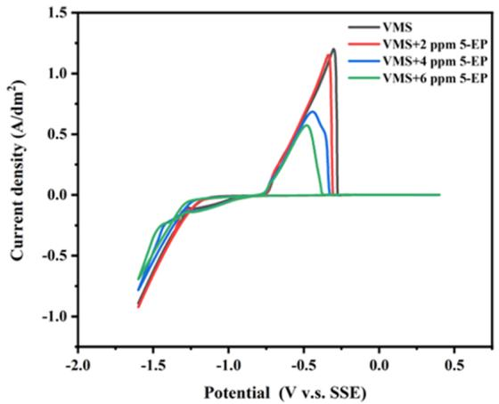

The interaction between the inhibitor molecule (5-EP) and the ${ \mathrm { C o } } ( 1 0 0 )$ surface was investigated using molecular dynamics (MD) simulations performed with the Forcite module in Material Studio 6.9 software. The simulation box consisted of one inhibitor molecule, 800 water molecules, and ten layers of cobalt. The cobalt layers were immobilized to enable unrestricted contact between the adsorbed molecules and the metal surface. The simulation employed the COMPASS force field, operated at a temperature of 298 $\mathrm { K } ,$ and used an NVT ensemble. The time interval was set to 1 fs (fs), and the simulation was conducted for a duration of 500 ps (ps).The adsorption energy $^ { \omega } E _ { \mathrm { C o - } 5 - \mathrm { E P } } ^ { } \stackrel { \gg } { }$ between the cobalt layer and the inhibitor (5-EP) was calculated through the simulation.

2.6. Characterization Tests. The copper layer’s surface was analyzed using AFM, SEM, and XRD. The surface roughness of the coating was assessed using the SPM9700-HT, while the cobalt coating was examined using the Czech TESCAN MIRA LMS scanning electron microscope. An investigation was conducted to assess the impact of the inhibitor (5-EP) on the growth of cobalt grains. This analysis was performed using the Smartlab SE instrument, which utilizes an X-ray tube with a copper target and a tube voltage ranging from 20 to 60 kV, along with a tube current ranging from 2 to 60 mA. The analysis was conducted within the range of $2 \theta = 3 0 { - } 9 0 ^ { \circ }$ . An assessment was conducted to measure the resistivity of the cobalt coating. The Co film underwent annealing at a temperature of $3 0 0 ~ ^ { \circ } \mathrm { C }$ for a duration of 10 h. This process was carried out using a vacuum annealing equipment and was conducted in an argon environment to avoid oxidation. Following the annealing process, the film was subsequently cooled to the ambient temperature, and its resistivity was determined using a four-point probe apparatus.

## 3. RESULTS AND DISCUSSION

3.1. Electrochemical Testing. 3.1.1. Cyclic Voltammetry. The inhibitory efect of the inhibitor (5-EP) on the reduction of ${ \mathrm { C o } } ^ { 2 + }$ was studied using cyclic voltammetry (CV) under two diferent rotation speeds of 2000 and 200 rpm that simulates strong convection at the bottom of the blind hole and weak convection at the surface of the blind hole, respectively and the CV results are shown in Figure 1 and the corresponding

(b)  
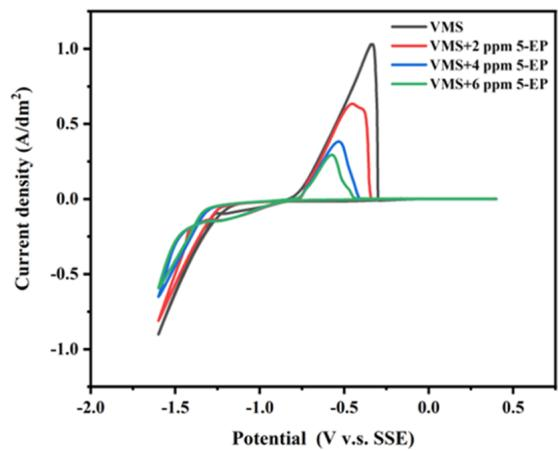  
Figure 1. Cyclic voltammetry tests; (a) diferent concentrations of inhibitor (5-EP), 200 rpm; (b) diferent concentrations of inhibitor (5-EP), 2000 rpm.

Table 2. Absolute Area of Cyclic Voltammetry Dissolution Peaks for Diferent Concentrations of 5-EP

<table><tr><td>rotation speed (rpm)</td><td>VMS</td><td>VMS + 2 ppm 5-EP</td><td>VMS + 4 ppm 5-EP</td><td>VMS + 6 ppm 5-EP</td></tr><tr><td>2000</td><td> $2.5804 \times 10^{-3}$ </td><td> $1.6487 \times 10^{-3}$ </td><td> $7.5943 \times 10^{-4}$ </td><td> $5.1170 \times 10^{-4}$ </td></tr><tr><td>200</td><td> $2.8867 \times 10^{-3}$ </td><td> $2.5871 \times 10^{-3}$ </td><td> $1.7771 \times 10^{-3}$ </td><td> $1.2296 \times 10^{-3}$ </td></tr></table>

(a)  
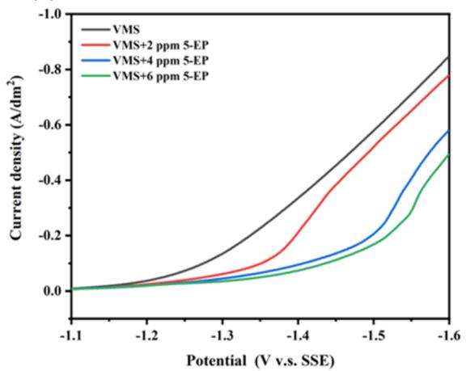

(b)  
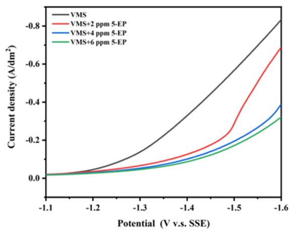  
Figure 2. Linear sweep voltammetry tests of the inhibitor (5-EP) at diferent concentrations: (a) at 200 rpm, (b) at 2000 rpm.

(a)  
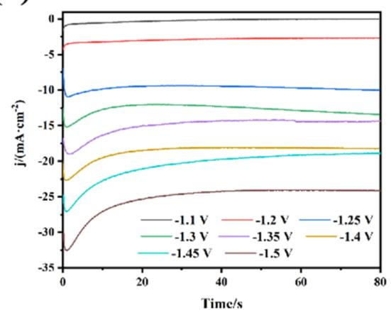  
(c)

(b)  
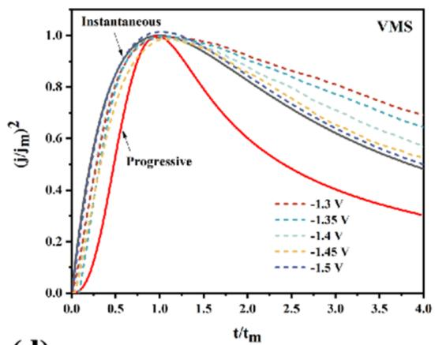  
(d)

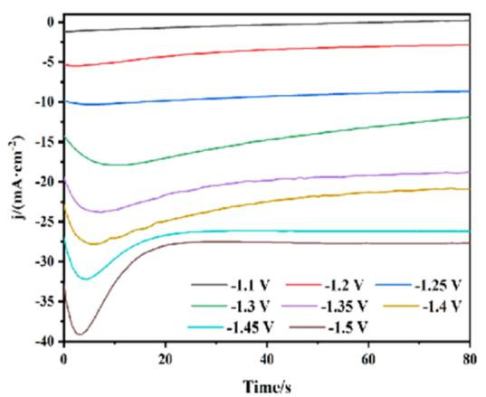

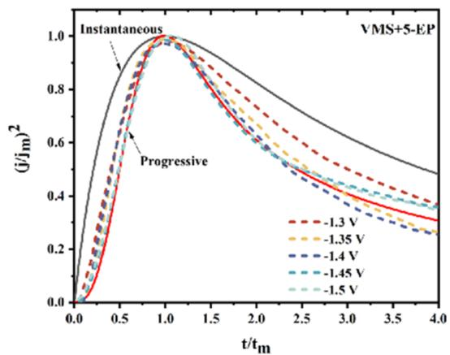  
Figure 3. (a) Current transient curves (VMS) at diferent deposition potentials; (b) dimensionless equation curves of I−t curves and dimensionless equation curves obtained from the SH model (VMS); (c) current transient curves (VMS + 5-EP) at diferent deposition potentials; (d) dimensionless equation curves of I−t curves and dimensionless equation curves obtained from the SH model (VMS + 5-EP).

attained absolute area of dissolution peaks of CV is summarized in Table 2. It can be seen from Figure 1 that regardless of the high or low rotation speed conditions, the dissolution peak of cobalt significantly decreased with the addition of the inhibitor 5-EP, indicating that 5-EP can efectively inhibit the deposition of cobalt, and 5-EP at 6 ppm has a strong ability to inhibit cobalt electrodeposition. Furthermore, it was also further observed that under various concentrations of 5-EP additives, the dissolution peak area of cobalt obtained under strong convection (2000 rpm) was all smaller than that under weak convection (200 rpm), indicating that strong convection conditions are not conducive to the deposition of cobalt. This means that the presence of 5-PE additive can efectively inhibit the deposition of cobalt on the surface of blind holes, which is beneficial for cobalt to achieve bottom-up superfilling.

(a)  
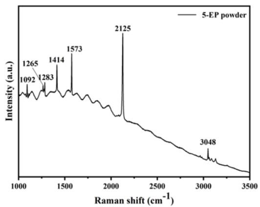

(b)  
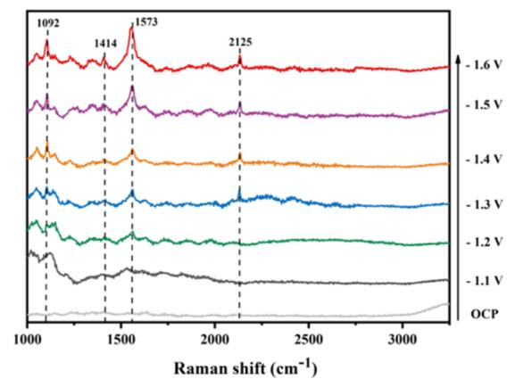  
Figure 4. (a) Conventional Raman spectrum of the inhibitor (5-EP); (b) In situ electrochemical surface-enhanced Raman spectrum with a potential step of 0.1 V.

3.1.2. Cathodic Polarization Curve. Linear scanning voltammetry (LSV) was used to evaluate the inhibitory efect of the inhibitor (5-EP) on the cobalt deposition process. The evaluation was carried out at two diferent rotational speeds: 2000 and 200 rpm. The relevant results are shown in Figure 2. With the addition of 5-EP, it can be noticed that the overpotential increases, and the additive adsorbs on the surface of the electrode, forming a film of material that causes the electrochemical reaction to take place on this film rather than on the electrode surface. In this case, the additives may occupy the active sites on the electrode surface, leading to a negative potential shift.24,25 Regardless of the rotational speed setting, it is found that the addition of 5-EP leads to a steady shift of the reduction potential in a negative direction. This suggests that the inhibitor (5-EP) increases the cathodic polarization and prevents the reduction of ${ \mathrm { C o } } ^ { 2 + }$ at the cathode. In addition, the ability of 5-EP to inhibit cobalt deposition was significantly higher at high speeds than at low speeds. This finding is consistent with the results of the CV analysis, suggesting that 5-EP has a significant ability to inhibit cobalt accumulation in the inner wall of the blind hole.

3.1.3. Analysis of Nucleation Process. investigate the influence of the inhibitor (5-EP) on the deposition kinetics and nucleation mechanism of cobalt electrodeposition process, the variation of transient current with time current transients under various potentials for the electrodeposition of cobalt from the electrolyte with and without the inhibitor in the range $\mathrm { o f \ - 1 . 1 \  t o \ - 1 . 5 \  V }$ is also analyzed and the corresponding current transients curves are shown in Figure 3.

Based on the observations from Figure 3a,c, it is evident that when the applied potential is −1.1 V, the current density starts to decrease toward a stable current density of approximately 0 $\mathrm { m A } / \mathrm { c m } ^ { 2 } ,$ , and there is no occurrence of a current peak. This suggests that the reduction of metal Co does not occur at this stage, and the initial decrease in current density is primarily caused by the double layer charging process. As the applied voltage decreases, the process of cobalt metal nucleation and growth initiates. As the size of the nucleation area expands, the current density steadily rises until it reaches its peak, at which point it gradually declines, indicating a process that is regulated by difusion. The addition of 5-EP enhances the first decrease in current density, potentially as a result of its robust adsorption properties.

The study found that this process conforms to the nucleation process described by the Cottrell equation. The Scharifer and Hills (SH) model16,26 was employed to investigate the cobalt electrodeposition process. This model simplifies the cobalt electrodeposition into two models

The three-dimensional progressive nucleation model

$$
\left(j / j _ {\mathrm{m}}\right) ^ {2} = 1. 2 2 5 4 t _ {\mathrm{m}} / t \times \left\{1 - \exp [ - 2. 3 3 6 7 (t / t _ {\mathrm{m}}) ^ {2} ] \right\} ^ {2}\tag{1}
$$

The three-dimensional instantaneous nucleation model

$$
(j / j _ {\mathrm{m}}) ^ {2} = 1. 9 5 4 2 t _ {\mathrm{m}} / t \times \left\{1 - \exp [ - 1. 2 5 6 4 (t / t _ {\mathrm{m}}) ] \right\} ^ {2}\tag{2}
$$

where

j�current density $( \mathrm { m A } { \cdot } \mathrm { c m } ^ { - 2 } ) ; j _ { \mathrm { m } } { - }$ �the maximum current density $( \mathrm { m A } { \cdot } \mathrm { c m } ^ { - 2 } ) ; t _ { \mathrm { m } } { - } \mathrm { t h e }$ time corresponding to the maximum current density (s), t�the test time (s).

The I−t curves were used to obtain the values corresponding to diferent potentials, and these were then plotted and compared with the curves represented by the two aforementioned formulas. The results, as shown in Figure 3c,d, indicate that the nucleation mode of cobalt metal in the basic electrolyte is a three-dimensional instantaneous nucleation process. However, in the presence of the inhibitor (5-EP) in the electrolyte, the nucleation mode of cobalt metal shifts to a three-dimensional progressive nucleation process.

3.2. In Situ Electrochemical Surface-Enhanced Raman Spectroscopy. To investigate the adsorption behavior of the inhibitor molecule (5-EP) on the cobalt surface, a combination of conventional Raman spectroscopy and in situ surfaceenhanced Raman spectroscopy was employed at diferent potentials. As shown in Figure 4a, the conventional Raman spectrum of the 5-EP molecule exhibits prominent Raman peaks at 1092, 1414, 1573, 2125, and $3 0 4 8 ~ \mathrm { { c m } ^ { - 1 } }$ . Among these, the peak at $1 0 9 2 ~ \mathrm { { c m } ^ { - 1 } }$ can be attributed to ring vibrations and $\mathrm { C - H }$ in-plane deformation shear vibrations, the peak at 1265 $\mathrm { c m } ^ { - 1 }$ is mainly due to C−H deformation vibrations, the peak at $1 2 8 3 ~ \mathrm { { c m } ^ { - 1 } }$ is primarily due to ring stretching and $\mathrm { C - H }$ deformation vibrations, the peak at $1 4 \mathrm { { i } 4 \ c m ^ { - 1 } }$ corresponds to the pyrimidine ring skeleton ${ \mathrm { N } } { = } { \mathrm { C } } { = } { \mathrm { N } }$ plane bending vibrations and some CH shear vibrations, the peak at 1573 $\mathrm { c m } ^ { - 1 }$ is associated with the overall deformation (bending) vibration of the pyrimidine ring skeleton and some C−H shear vibrations, the peak at $2 1 2 5 ~ \mathrm { { c m } ^ { - 1 } }$ has the highest intensity and can be attributed to the carbon−carbon triple bond $( { \mathrm { C } } { \equiv } { \mathrm { C } } )$ stretching vibration, and the peak at $3 0 4 8 ~ \mathrm { { c m } ^ { - 1 } }$ is due to C−H stretching vibrations. During the in situ Raman testing, no characteristic peaks of 5-EP were detected when applying −1.1 and $- 1 . 2 \mathrm { ~ V } ,$ as the adsorption of the additive molecules is potential-dependent. At certain potentials, the molecules may not adsorb or only weakly adsorb on the cobalt metal surface, thus no characteristic peaks can be detected. As the potentia changes and reaches a specific value, the additive molecules begin to significantly adsorb on the cobalt metal surface, allowing the detection of characteristic peaks. The appearance of the additive molecule’s characteristic peaks with the potential step indicates that the adsorption behavior of the additive molecules is regulated by the potential and can efectively adsorb on the metal surface at specific potentials, thus showing characteristic peaks in the SERS spectrum. As illustrated in Figure 4b, by observing the in situ surface enhanced Raman spectra at diferent potentials, it is evident that with potential steps, the peak intensities at $1 0 9 2 ~ \mathrm { { c m } ^ { - 1 } }$ (ring vibration, C−H in-plane deformation shear vibration), $\mathrm { i } 4 1 \overline { { 4 } } \mathrm { c m } ^ { - 1 }$ (pyrimidine ring skeleton ${ \mathrm { N } } { = } { \mathrm { C } } { = } { \mathrm { N } }$ plane bending vibration), ${ \hat { 1 } } { \dot { 5 } } 7 3 \ \mathrm { ~ c m } ^ { - 1 }$ (overall bending vibration of the pyrimidine ring skeleton), and $2 1 2 5 ~ \mathrm { { c m } ^ { - 1 } }$ (carbon−carbon triple bond $( { \mathrm { C } } { \bar { = } } { \mathrm { C } } )$ stretching vibration) are enhanced. This indicates that during the electroplating process, the inhibitor (5-EP) molecule primarily adsorbs onto the cobalt layer surface through these functional groups, thereby inhibiting the deposition of cobalt.

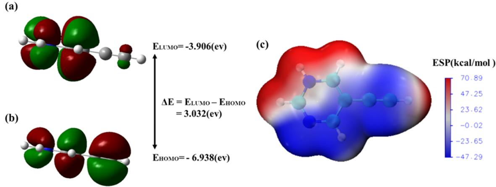  
Figure 5. (a) Distribution of the HOMO of the 5-EP molecule; (b) distribution of the LUMO of the 5-EP molecule; (c) ESP distribution of the 5- EP molecule.

3.3. Theoretical Calculations and Simulations. 3.3.1. Quantum Chemical Calculations. Quantum chemical calculations were employed to elucidate the adsorption process of the inhibitor (5-EP) and to predict its potential adsorption sites. The molecule was inserted into a Gaussian function for structural optimization and computation. The resulting data were then visualized using Multiwfn and VMD software.27,28 In accordance with the frontier molecular orbital theory, the energy levels of the HOMO and the LUMO play a crucial role in determining chemical reactions.29 The HOMO energy $\left( E _ { \mathrm { H O M O } } \right)$ reflects the molecule’s inclination to give away electrons, whereas the LUMO energy $\left( E _ { \mathrm { L U M O } } \right)$ reflects its inclination to receive electrons. A larger $E _ { \mathrm { H O M O } }$ value implies a greater capacity of the molecule to donate electrons, while a lower $E _ { \mathrm { L U M O } }$ value suggests a better ability to accept electron s.30,31 The computational results are depicted in Figure $\mathsf { S a } , \mathsf { b } .$ . The figure shows that the electron cloud density in the HOMO state is basically distributed over the entire molecular structure of 5-EP, while in the LUMO state, the electron cloud density is mainly distributed on the pyrimidine ring. According to the calculations, $E _ { \mathrm { L U M O } } = - 3 . 9 0 \bar { 6 } ~ \mathrm { e V } , E _ { \mathrm { H O M O } } = - 6 . 9 3 8 ~ \mathrm { e V } ,$ and the energy gap $\triangle E = E _ { \mathrm { L U M O } } - E _ { \mathrm { H O M O } } = 3 . 3 0 2 ~ \mathrm { e V . ~ A }$ smaller $\triangle E$ denotes greater reactivity of the chemical. The extremely small energy diference $( \triangle \dot { E } )$ between the lowest unoccupied molecular orbital $\left( E _ { \mathrm { L U M O } } \right)$ and the highest occupied molecular orbital $\left( E _ { \mathrm { H O M O } } \right)$ suggests that the additive molecules have a strong tendency to absorb and donate electrons at the electrode surface. The value of $\triangle E$ is directly related to the adsorption intensity of the additive molecules on the metal interface. A smaller $\bigtriangleup E$ value indicates a higher adsorption strength of the molecules at the metal interface, leading to stronger inhibitory efects on cobalt electro deposition.

The ESP results also elucidate the impact of the functional groups of the 5-EP molecule on cobalt electrodeposition, providing insights into the adsorption and polarization mechanisms of the additive. As shown in Figure 5c, the ESP calculation results can represent the electron density contributions of the groups, identifying potential chemical reaction sites. The ESP values of the molecule range from a minimum of −47.29 kJ/mol to a maximum of 70.89 kJ/mol. Lower ESP values indicate higher electron density. Therefore, the electron density distribution of 5-EP suggests that the acetylene group $( - \dot { \mathrm { C } } \equiv \mathrm { C } - )$ with its high electron density is a potential site for adsorption during cobalt electrodeposition. In summary, the 5-EP molecule, with its acetylene group $\left( - \mathrm { C } \equiv \right.$ C−), can efectively adsorb onto cobalt, thereby inhibiting the process of cobalt electrodeposition.

3.3.2. MD Simulation. Furthermore, we performed MD simulations using the Materials Studio software to examine the adsorption properties of the 5-EP molecule on the cobalt metal surface. The simulation results, illustrated in Figure $^ { 6 , }$ demonstrate that the 5-EP molecule adsorbs parallelly on the Co(100) surface. This adsorption behavior aligns with the findings of quantum chemical analysis. The aforementioned ESP study indicates that lower ESP values correspond to higher electron density. In the 5-EP molecule, regions of high electron density are mainly located at the alkyne group $( - \mathrm { C } \overline { { \equiv } }$ C−) and the functional groups on the pyrimidine ring (−N− C�C−). Due to the efect of these functional groups, the 5- EP molecule can adsorb parallelly onto the cobalt metal surface. The adsorption energy of the molecule on the Co(100) surface was calculated using the equation E $= E _ { \mathrm { t o t a l } } - E _ { \mathrm { C o } } - E _ { \mathrm { 5 - E P } } , ^ { 3 2 , 3 3 }$ yielding a value of −133.96 kcal/ mol. This negative adsorption energy indicates a favorable and strong adsorption capacity of the 5-EP molecule, which is consistent with its ability to inhibit cobalt electrodeposition.

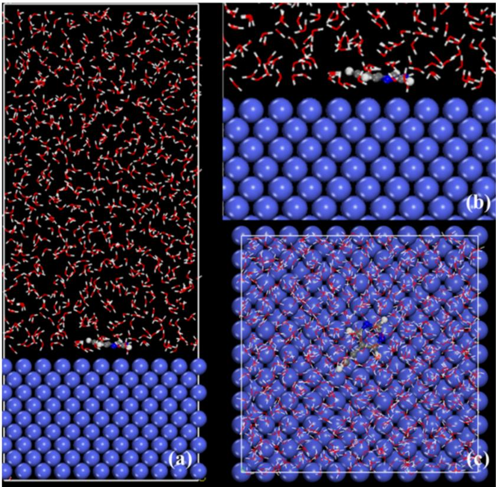

Figure 6. MD simulation of 5-EP molecule on Co(111) surface.  
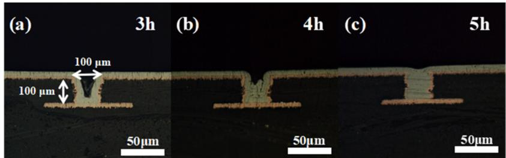  
Figure 7. Cross-sectional view of cobalt filling in blind holes. Blind hole dimensions: depth 100 μm, diameter 100 μm. Electrolyte composition: 100 $\mathrm { g / \mathrm { \check { L } } } \mathrm { C o S O _ { 4 } } \mathrm { \cdot } \mathrm { 7 H _ { 2 } O } + 4 0 \mathrm { g / L } \mathrm { H _ { 3 } B O _ { 3 } } + 1 0 \mathrm { g / \check { L } }$ NaCl + 6 ppm 5-EP. (a) 3 h of electroplating; (b) 4 h of electroplating; (c) 5 h of electroplating. pH $= 2 ;$ current density 1 A/dm2.

3.4. Blind Hole Filling Experiment. Based on the electrochemical experimental findings, it is anticipated that the inclusion of additives would enhance the electroplating and filling of cobalt in blind holes. Therefore, an experiment was conducted to examine the impact of the inhibitor molecule (5- EP) on blind hole filling with cobalt. Figure 7 illustrates the cross-sectional images of blind hole filled cobalt deposited at various time intervals. As depicted in Figure 7a, when 6 ppm of 5-EP was added to the electrolyte for electroplating, a Vshaped filling of cobalt deposition in the blind hole was observed after 3 h, due to convection and mass transfer efects. Figure 7b shows that with increased electroplating time, the cobalt layer in the blind hole exhibited a bottom-up filling trend, although superfilling was not yet achieved. As shown in Figure 7c, after 5 h of electroplating, the blind hole was completely filled without voids or gaps. This indicates that 5- EP initially adsorbs at the mouth of the blind hole during the electroplating process, inhibiting cobalt deposition at the entrance. Due to the relatively slow mass transfer rate of 5-EP from the solution to the micropores, the replenishment rate of 5-EP at the bottom is lower than its consumption rate, forming a concentration gradient, ultimately achieving bottom-up superfilling of the blind hole. The blind hole filling experiments further illuminates that the inhibitor (5-EP) is an excellent material for achieving cobalt superfilling.

Quality tests were performed on plated samples without inhibitor (5-EP) and plated samples containing six ppm inhibitor (5-EP) after five h of plating, and as shown in Figure 8, the mass of the plated layer without inhibitor was 0.04 g.

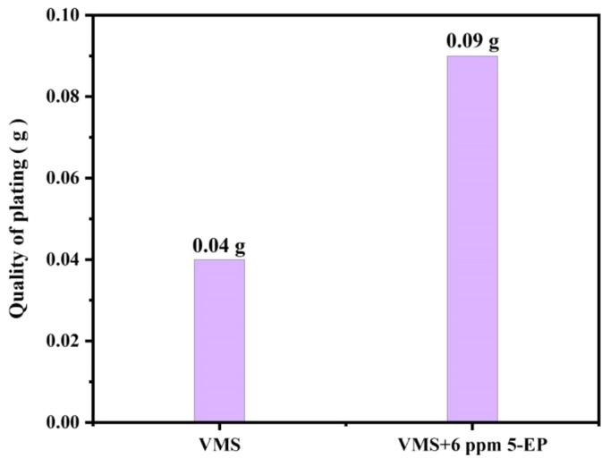  
Figure 8. Quality of plated layer without additives and with 6 ppm additives, 5 h of electroplating. $\mathrm { p H } = 2 ;$ current density 1 A/dm2.

The mass of the plated layer with the addition of the inhibitor was 0.09 g. This indicates that the current eficiency is increased when the inhibitor is added, and the quality of the plated layer obtained is also increased.

3.5. Characterization. 3.5.1. SEM/AFM Characterization. The surface morphology of the cobalt deposited from the electrolyte with diferent concentrations of the inhibitor (5- EP) was analyzed using SEM. The relevant SEM data are displayed in Figure 9. Figure 9a clearly shows that the cobalt coating obtained from the electroplating solution with additives has a rough and porous surface, characterized by the presence of massive growth clusters. The presence of the inhibitor (5-EP) clearly alters the micro morphology of the cobalt coating. As shown in Figure 8b−d, introducing an inhibitor (5-EP) can efectively improve the quality of the cobalt layer. When 2 ppm of inhibitor (5-EP) was added, the cobalt particle size decreased. When the concentration of inhibitor (5-EP) was increased to 4 ppm, the cobalt particle size was further reduced, and the surface of the plated layer was smooth. When the inhibitor (5-EP) is added up to 6 ppm, the cobalt grain size on the coated surface is minimized, and the coating is smooth and flat in the macroscopic state. This suggests that the inhibitor (5-EP) has the ability to significantly enhance the surface structure of the cobalt coating, resulting in increased density.

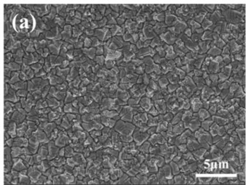

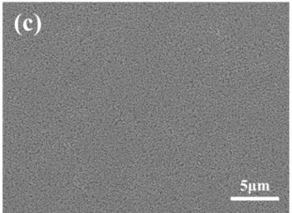

The efect of diferent concentrations of the inhibitor (5-EP) on the cobalt deposit under constant current conditions was studied using AFM.34 Figure 10 exhibits the results. Figure 10a,b demonstrate that the surface roughness, Sa, of the cobalt deposit in the basic electrolyte without the inhibitor (5-EP) measures 24.80 nm. Nevertheless, the presence of the inhibitor (5-EP) leads to a notable reduction in the surface roughness of the cobalt deposit. Figure 10c−g demonstrate that the addition of 6 ppm of 5-EP throughout the electroplating process results in a surface roughness of Sa = 2.15 nm for the cobalt deposit after completion. This suggests that the inhibitor (5-EP) has the ability to enhance the consistency of the cobalt layer throughout the process of cobalt electrodeposition.

3.5.2. XRD Characterization. The crystal structure of cobalt coatings deposited from electroplating solutions containing diferent concentrations of additives was also analyzed by XRD to study the efect of varying concentrations of inhibitor (5- EP) on the crystal structure and grain growth orientation of cobalt and Figure 11 displays the corresponding outcomes. The addition of EP inhibitors did not alter the crystal structure of cobalt, but significantly changed the preferred growth orientation of cobalt. The characteristic peaks of Co (hcp) were found at $2 \theta = 4 1 . 7 , \ 4 7 . 6 ,$ and 75.9°, corresponding to Co(100), (101), and (110), respectively. As depicted in Figure

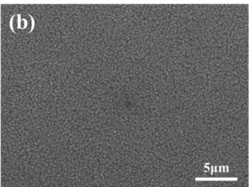

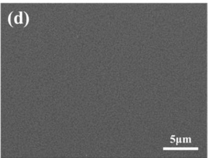  
Figure 9. SEM Characterization. (a) Basic electrolyte; (b) basic electrolyte +2 ppm 5-EP; (c) basic electrolyte +4 ppm 5-EP; (d) basic electrolyte +6 ppm 5-EP; 2000X; current density 1 A/dm2; electroplating duration 5 h.

(a)  
(b)  
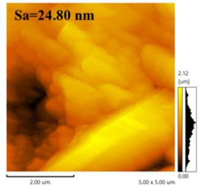

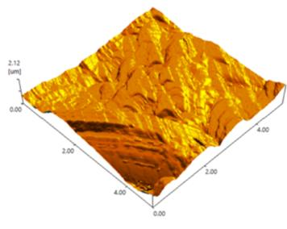  
(c)

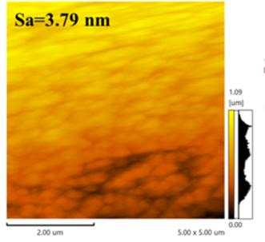

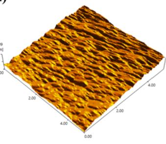  
(d)

(e)  
(f)  
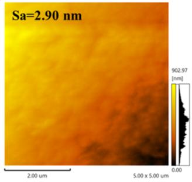

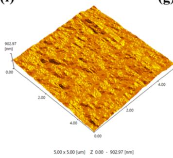  
(g)

(h)  
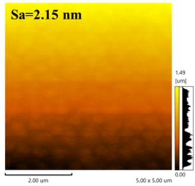

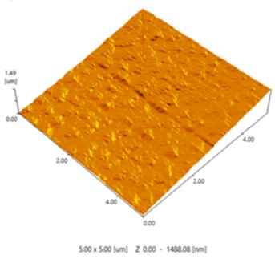  
Figure 10. AFM Characterization. (a, b) Basic electrolyte; (c, d) basic electrolyte +2 ppm 5-EP; (e, f) basic electrolyte +4 ppm 5-EP; (g, h) basic electrolyte +6 ppm 5-EP; current density 1 A/dm2; electroplating duration 5 h.

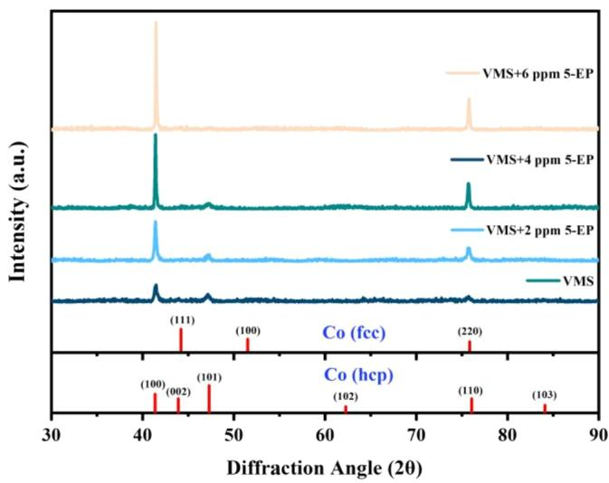  
Figure 11. XRD patterns of electroplated cobalt layers under diferent concentrations of inhibitor (5-EP) after 5 h of electroplating.

$^ { 6 , }$ there is a significant increase in the peaks for Co(100) and Co(110), and a notable weakening of the peak for Co(101) when the inhibitor concentration is raised from 0 to 6 ppm. This suggests that the utilization of inhibitor (5-EP) while electrodepositing cobalt encourages the growth of cobalt grains in the Co(100) and Co(110) orientations.

The Scherrer equation is utilized to estimate the grain size of cobalt crystals on various crystallographic planes. The outcomes are displayed in Table 3. It is evident that the inclusion of the additive 5-EP enhances the grain size in the Co(100) and (110) orientations. Larger grain sizes are advantageous for the material’s conductivity. Narrower peaks indicate better crystal quality with fewer defects.

Scherrer equation

Table 3. Grain Size Calculation Results

<table><tr><td></td><td>peak position (2θ)</td><td>fwhm</td><td>crystallite size D (nm)</td><td>D nm (average)</td></tr><tr><td rowspan="3">VMS</td><td>(100) 41.45</td><td>0.38</td><td>22.34</td><td>18.86</td></tr><tr><td>(101) 47.15</td><td>0.55</td><td>15.60</td><td></td></tr><tr><td>(110) 75.71</td><td>0.53</td><td>18.60</td><td></td></tr><tr><td rowspan="3">VMS + 2 ppm 5-EP</td><td>(100) 41.45</td><td>0.22</td><td>37.48</td><td>23.62</td></tr><tr><td>(101) 47.16</td><td>0.64</td><td>13.53</td><td></td></tr><tr><td>(110) 75.79</td><td>0.50</td><td>19.87</td><td></td></tr><tr><td rowspan="3">VMS + 4 ppm 5-EP</td><td>(100) 41.42</td><td>0.16</td><td>51.94</td><td>34.83</td></tr><tr><td>(101) 47.23</td><td>0.72</td><td>11.97</td><td></td></tr><tr><td>(110) 75.72</td><td>0.24</td><td>40.59</td><td></td></tr><tr><td rowspan="3">VMS + 6 ppm 5-EP</td><td>(100) 41.48</td><td>0.14</td><td>59.40</td><td>38.70</td></tr><tr><td>(101) 47.32</td><td>0.75</td><td>11.43</td><td></td></tr><tr><td>(110) 75.78</td><td>0.22</td><td>45.19</td><td></td></tr></table>

$$
D = \frac {K \gamma}{B \cos \theta}\tag{3}
$$

In the calculation, the Scherrer constant K is usually considered as 0.9.

The average thickness of the crystal grains in a direction perpendicular to the crystallographic plane is denoted as D and measured in nanometers (nm).

The full width at half-maximum (fwhm) of the difraction peak of the measured sample, denoted as $B ,$ needs to be converted to radians (rad) for the calculation.

The Bragg difraction angle, denoted as $\theta ,$ is measured in degrees.

The X-ray wavelength γ is typically 0.15406 nm for Cu kα. 3.5.3. Annealing. The reliability of the cobalt coating was verified through resistivity testing, with the results shown in Figure 12. It was observed that the resistivity of the cobalt coating without annealing treatment remained approximately at 12.4 μΩ·cm. After annealing at 300 °C for 10 h, the resistivity of the cobalt coating was maintained at around 10 μΩ·cm. The reported resistivity values for annealed electro plated cobalt in the literature are approximately $8 ^ { 3 5 }$ and $1 0 \mu \Omega \cdot$ cm.34 The test results are consistent with these values, indicating that the plating solution meets the design standards.

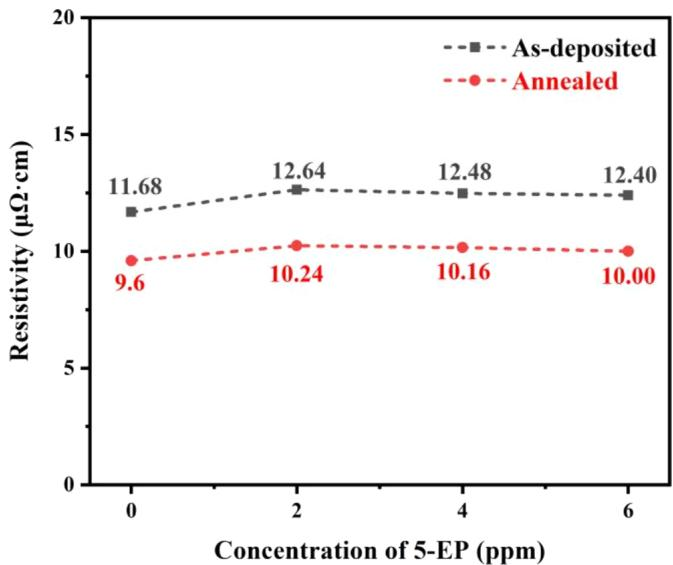  
Figure 12. Resistivity of cobalt coatings obtained under diferent concentrations of inhibitor (5-EP) after 5 h of electroplating.

3.5.4. Contact Angle Test. The wettability of the electrolyte to the electrode is an important parameter during electro deposition. Here the surface contact angle meter (Kruss K100- MK2) was used to measure the contact angle value of the plating solution containing a leveling agent on the surface of the plated layer after diferent plating times. The PCB boards with plating times of 1−5 h were prepared in advance and cleaned with deionized water, and $5 \mu \mathrm { L }$ droplets were dropped on their surfaces during the test and the images were instantly stored for measurement. Figure 13 shows the contact angle (CA) value of the droplets on the PCB with diferent deposition times. As shown in Figure 13, the contact angle of the blank control sample is greater than 30°, and with the increase of deposition time, the contact angle gradually becomes smaller, respectively, 76.1, 52.8, 34.4, 20.7, and $5 . 6 ^ { \circ } .$ . The small value of CA indicates that the interfacial energy between the electrolyte and the surface of the plated layer is higher, and the easier it is to be wetted. This result implies the inhibitor (5-EP) can significantly reduce the surface tension of the plating solution and improve its wettability. The reduction in the surface tension is also beneficial for removing the absorbed hydrogen during the cobalt plating process promptly and improving the quality of the plated layer.

## 4. CONCLUSIONS

In summary, this study employs 5-ethynylpyrimidine (5-EP) as an inhibitor for cobalt electrodeposition. Cyclic voltammetry (CV) and LSV reveal that 5-EP efectively suppresses the reduction of ${ \mathrm { C o } } ^ { 2 + }$ . Additionally, electrochemical tests indicate the significant role of the ethynyl functional group $( - \mathrm { C } \mathrm { \equiv } \mathrm { C } - )$ in the cobalt electrodeposition process. Further studies on the impact of 5-EP on cobalt nucleation showed that in th absence of 5-EP, cobalt nucleation occurred through a three dimensional instantaneous process, whereas the addition of 5- EP shifted the nucleation to a three-dimensional progressive process. 5-EP efectively reduced the surface roughness of the cobalt coating and promoted the growth of cobalt grains in the directions of Co(100) and Co(110). The resistivity of the cobalt coating remained essentially at 10 μΩ·cm. According to quantum chemical calculations and MD simulations, it was discovered that 5-ethynylpyrimidine (5-EP), which contains an ethynyl group $( - \mathrm { C } \mathrm { \equiv } \mathrm { C } - )$ , can efectively adsorb onto cobalt The adsorption energy of 5-EP was calculated to be −133.96 kcal/mol on the Co(100) surface, indicating its strong adsorption capability. Electroplating experiments showed that adding 6 ppm of 5-EP to the plating solution and electroplating for 5 h resulted in defect-free filling of blind holes. Finally, in situ enhanced Raman spectroscopy was employed to further analyze the adsorption of the inhibitor (5-EP) molecules on the cobalt surface during the electroplating process from a spectroscopic perspective. By observing in situ enhanced Raman spectra at different potentials. it was found that as the potential stepped, the peak intensities at $1 0 9 2 c m ^ { - 1 }$ (ring vibration, C−H in-plane deformation shear vibration), 1414 $\mathrm { c m ^ { - 1 } }$ (pyrimidine ring skeleton ${ \mathrm { N } } { = } { \mathrm { C } } { = } { \mathrm { N } }$ plane bending vibration), 1573 cm−1 (overall bending vibration of the pyrimidine ring skeleton), and $2 1 2 5 ~ \mathrm { { c m } ^ { - 1 } }$ (carbon−carbon triple bond $( { \mathrm { C } } { \equiv } { \mathrm { C } } )$ stretching vibration) increased. This indicates that during the electroplating process, the inhibitor (5-EP) molecules primarily adsorb onto the cobalt layer surface through these functional groups, thereby inhibiting the deposition of cobalt. The contact angle test showed that the contact angle of the plated surface decreased from 99.7 to $5 . 6 ^ { \circ }$ with the increase in deposition time, and the inhibitor (5-EP) significantly improved the wettability of the plating solution which helped to improve the quality of the plated layer. This can indicate the efectiveness of using 5-ethynylpyrimidine (5- EP) as a single inhibitor for cobalt electrodeposition.

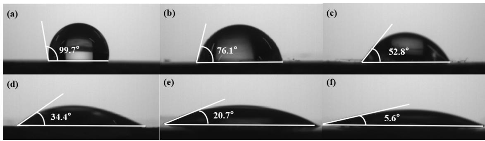  
Figure 13. Contact angle images of cobalt plated samples after plating 0 h (a), 1 h (b), 2 h (c), 3 h (d), 4 h (f), 5 h (g) with base plating solution +6 ppm 5-EP.

## ■ AUTHOR INFORMATION

## Corresponding Authors

Xixun Shen − Shanghai University ofElectric Power, Shanghai 200090, China; Shanghai Key Laboratory of Materials Protection and Advanced Materials in Electric Power, Shanghai 200090, China; Shanghai Engineering Research Center of Energy-Saving in Heat Exchange Systems, Shanghai 200090, China; Email: shenxixun@shiep.edu.cn

Qunjie Xu − Shanghai University of Electric Power, Shanghai 200090, China; Shanghai Key Laboratory of Materials Protection and Advanced Materials in Electric Power, Shanghai 200090, China; Shanghai Engineering Research Center of Energy-Saving in Heat Exchange Systems, Shanghai 200090, China; Shanghai Institute of Pollution Control and Ecological Security, Shanghai 200090, China; orcid.org 0000-0003-2363-4252; Email: xuqunjie@shiep.edu.cn

## Authors

Haidi Li − Shanghai University of Electric Power, Shanghai 200090, China; Shanghai Key Laboratory of Materials Protection and Advanced Materials in Electric Power, Shanghai 200090, China; Shanghai Engineering Research Center of Energy-Saving in Heat Exchange Systems, Shanghai 200090, China

Tao Zhang − Shanghai University of Electric Power, Shanghai 200090, China; Shanghai Key Laboratory of Materials Protection and Advanced Materials in Electric Power, Shanghai 200090, China; Shanghai Engineering Research Center of Energy-Saving in Heat Exchange Systems, Shanghai 200090, China

Shiqi Song − Shanghai University of Electric Power, Shanghai 200090, China; Shanghai Key Laboratory of Materials Protection and Advanced Materials in Electric Power, Shanghai 200090, China; Shanghai Engineering Research Center ofEnergy-Saving in Heat Exchange Systems, Shanghai 200090, China

Qian Li − Shanghai University of Electric Power, Shanghai 200090, China; Shanghai Key Laboratory of Materials Protection and Advanced Materials in Electric Power, Shanghai 200090, China; Shanghai Engineering Research Center of Energy-Saving in Heat Exchange Systems, Shanghai 200090, China

Rongze Han − Shanghai University of Electric Power, Shanghai 200090, China; Shanghai Key Laboratory of Materials Protection and Advanced Materials in Electric Power, Shanghai 200090, China; Shanghai Engineering Research Center of Energy-Saving in Heat Exchange Systems, Shanghai 200090, China

Qiaoxia Li − Shanghai University of Electric Power, Shanghai 200090, China; Shanghai Key Laboratory of Materials Protection and Advanced Materials in Electric Power, Shanghai 200090, China; Shanghai Engineering Research Center ofEnergy-Saving in Heat Exchange Systems, Shanghai 200090, China; orcid.org/0000-0003-1269-3150

Yulin Min − Shanghai University of Electric Power, Shanghai 200090, China; Shanghai Key Laboratory of Materials Protection and Advanced Materials in Electric Power, Shanghai 200090, China; Shanghai Engineering Research Center ofEnergy-Saving in Heat Exchange Systems, Shangha 200090, China; orcid.org/0000-0001-7192-4890

Lina Qiu − Shanghai University of Electric Power, Shanghai 200090, China; Shanghai Key Laboratory of Materials Protection and Advanced Materials in Electric Power,

Shanghai 200090, China; Shanghai Engineering Research Center of Energy-Saving in Heat Exchange Systems, Shanghai 200090, China

Complete contact information is available at: https://pubs.acs.org/10.1021/acs.jpcc.4c05741

## Author Contributions

H.L.: Writing�original draft. T.Z.: Software. S.S.: Supervision. Qian Li: Supervision. R.H.: Supervision. Qiaoxia Li: Writing� review and editing. Y.M.: Writing�review and editing. L.Q.: Writing�review and editing. X.S.: Writing�review and editing. Q.X.: Writing�review and editing.

## Notes

The authors declare no competing financial interest.

## ■ ACKNOWLEDGMENTS

This work was financially supported by the National Natural Science Foundation of China (No. 21972090) and the Science and Technology Commission of Shanghai Municipality (No. 19DZ2271100).

## ■ REFERENCES

(1) Andricacos, P. C.; Uzoh, C.; Dukovic, J. O.; Horkans, J.; Deligianni, H. Damascene copper electroplating for chip interconnections. IBM J. Res. Dev. 1998, 42, 567−574.

(2) Josell, D.; Brongersma, S. H.; Tőkei, Z. Size-dependent resistivity in nanoscale interconnects. Annu. Rev. Mater. Res. 2009, 39, 231−254.

(3) Gall, D. Electron mean free path in elemental metals. J. Appl. Phys. 2016, 119, No. 085101.

(4) Moon, J. H.; Jeong, E.; Kim, S.; Kim, T.; Oh, E.; Lee, K.; Han, H.; Kim, Y. K. Materials quest for advanced interconnect metallization in integrated circuits. Adv. Sci. 2023, 10, No. 2207321.

(5) Auth, C.; Aliyarukunju, A.; Asoro, M.; Bergstrom, D.; Bhagwat, V.; Birdsall, J.; Bisnik, N.; Buehler, M.; Chikarmane, V.; Ding, G.; Fu, Q.; Gomez, H.; Han, W.; Hanken, D.; Haran, M.; Hattendorf, M.; Heussner, R.; Hiramatsu, H.; Ho, B.; Jaloviar, S.; Jin, I.; Joshi, S.; Kirby, S.; Kosaraju, S.; Yeoh, A. A 10 nm High Performance and Lowpower CMOS Technology Featuring 3 rd Generation FinFET Transistors, Self-Aligned Quad Patterning, Contact Over Active Gate and Cobalt Local Interconnects. In 2017 IEEE International Electron Devices Meeting (IEDM); IEEE: San Francisco, CA, USA, 2017; pp 29−41.

(6) Dutta, S.; Beyne, S.; Gupta, A.; Kundu, S.; Van Elshocht, S.; Bender, H.; Jamieson, G.; Vandervorst, W.; Bömmels, J.; Wilson, C. J.; et al. Sub-100 nm 2 cobalt interconnects. IEEE Electron Device Lett. 2018, 39, 731−734.

(7) Banbur-Pawlowska, S.; Mech, K.; Kowalik, R.; Zabinski, P. Analysis of electrodeposition parameters influence on cobalt deposit roughness. Appl. Surf. Sci. 2016, 388, 805−808.

(8) Guo, L.; Li, S.; He, Z.; Fu, Y.; Qiu, F.; Liu, R.; Yang, G. Electroplated Copper Additives for Advanced Packaging: A Review. ACS Omega 2024, 9, 20637−20647.

(9) Wafula, F.; Wu, J.; Branagan, S.; Suzuki, H.; Gracias, A.; Van Eisden, J. Electrolytic Cobalt Fill of Sub-5 nm Node Interconnect Features. In 2018 IEEE International Interconnect Technology Conference (IITC); IEEE: Santa Clara, CA, USA, 2018; pp 123−125.

(10) Josell, D.; Silva, M.; Moffat, T. P. Superconformal bottom-up cobalt deposition in high aspect ratio through silicon vias. J. Electrochem. Soc. 2016, 163, D809.

(11) Kang, J.; Sung, M.; Byun, J.; Kwon, O. J.; Kim, J. J. Proton sensitive additive for cobalt electrodeposition. J. Electrochem. Soc. 2020, 167, No. 122510.

(12) Kang, J.; Sung, M.; Byun, J.; Kwon, O. J.; Kim, J. J. Superconformal cobalt electrodeposition with a hydrogen evolution reaction suppressing additive. J. Electrochem. Soc. 2020, 167, No. 162514.

(13) Li, Y.; Ma, X.; Li, C.; Li, R.; Zhang, J.; Yang, P.; Liu, X.; Broekmann, P.; Wang, B.; Lv, W.; An, M. Investigation of novel suppressor Nitrotetrazolium Blue chloride on cobalt superconformal growth. J. Manuf. Processes 2023, 101, 15−24.

(14) Ma, X.; Li, Y.; Yang, P.; Zhang, J.; An, M. Influence of suppressing additive malachite green on superconformal cobalt electrodeposition. J. Electroanal. Chem. 2022, 921, No. 116696.

(15) Lyons, T.; Huang, Q. Effects of cyclohexane-monoxime and dioxime on the electrodeposition of cobalt. Electrochim. Acta 2017, 245, 309−317.

(16) Hu, Y.; Lyons, T.; Huang, Q. Influence of furil dioxime on cobalt electrochemical nucleation and growth. J. Electrochem. Soc. 2020, 167, No. 022509.

(17) Huang, Q.; Lyons, T.; Sides, W. Electrodeposition of cobalt for interconnect application: Effect of dimethylglyoxime. J. Electrochem. Soc. 2016, 163, D715.

(18) Ni, X.; Wang, C.; Su, Y.; Luo, Y.; Ye, Y.; Su, X.; He, W.; Wang, S.; Hong, Y.; Chen, Y.; Zhou, G.; Liu, B. Effect of 3-mercapto-1- propane sulfonate sulfonic acid and polyvinylpyrrolidone on the growth of cobalt pillar by electrodeposition. Nanotechnol. Rev. 2022, 11, 1209−1218.

(19) Ni, X.; Chen, Y.; Jin, X.; Wang, C.; Huang, Y.; Hong, Y.; Su, X.; Zhou, G.; Wang, S.; He, W.; Chen, Q. Investigation of polyvinylpyrrolidone as an inhibitor for trench super-filling of cobalt electrodeposition. J. Taiwan Inst. Chem. Eng. 2020, 112, 232−239.

(20) Karimzadeh, A.; Aliofkhazraei, M.; Walsh, F. C. A review of electrodeposited Ni-Co alloy and composite coatings: Microstructure, properties and applications. Surf. Coat. Technol. 2019, 372, 463−498.

(21) Pan, B.; Zhang, Q.; Liu, Z.; Yang, Y. Influence of butynediol and tetrabutylammonium bromide on the morphology and structure of electrodeposited cobalt in the presence of saccharin. Mater. Chem. Phys. 2019, 228, 37−44.

(22) Kiruba, M.; Jeyabharathi, C. Discerning the oscillatory electrochemical response during electrodeposition of cobalt in the presence of but-2-yne-1, 4-diol. J. Solid State Electrochem. 2020, 24, 2997−3002.

(23) Wu, Y.; Ju, S.; Li, F.; Zhang, M.; Ren, X.; Li, M. Tailoring crystalline orientation of electrodeposited cobalt by alkynol additives. Electrochim. Acta 2024, 497, No. 144593.

(24) Josell, D.; Moffat, T.; Silva, M. Superconformal bottom-up cobalt deposition in high aspect ratio through silicon vias. ECS Trans. 2016, 75, 25−30.

(25) Lee, C. H.; Bonevich, J. E.; Davies, J. E.; Moffat, T. P. Superconformal electrodeposition of Co and Co−Fe alloys using 2- mercapto-5-benzimidazolesulfonic acid. J. Electrochem. Soc. 2009, 156, D301−D309.

(26) Scharifker, B.; Hills, G. Theoretical and experimental studies of multiple nucleation. Electrochim. Acta 1983, 28, 879−889.

(27) Frisch, M. J.; Trucks, G. W.; Schlegel, H. B.; Scuseria, G. E.; Robb, M. A.: Cheeseman, J. R.: Scalmani. G.; Barone, V.; Mennucci B.; Nakatsuji, H. Gaussian; Gaussian, Inc.: Wallingford, 2004.

(28) Humphrey, W.; Dalke, A.; Schulten, K. VMD: visual molecular dynamics. J. Mol. Graphics 1996, 14, 33−38.

(29) Xia, S.; Qiu, M.; Yu, L.; Liu, F.; Zhao, H. Molecular dynamics and density functional theory study on relationship between structure of imidazoline derivatives and inhibition performance. Corros. Sci. 2008, 50, 2021−2029.

(30) Li, Y.; Ren, P.; Li, R.; Zhang, Y.; Zhang, J.; Yang, P.; An, M. A novel bright additive for copper electroplating: electrochemical and theoretical study. Ionics 2023, 29, 363−375.

(31) Li, Y.; Ren, P.; Lu, X.; Zhang, J.; Yang, P.; Yang, X.; Wang, G.; Liu, A.; Wu, G.; An, M. Elucidating the role of P on Mn-and N-doped graphene catalysts in promoting oxygen reduction: Density functional theory studies. SusMat 2023, 3, 390−401.

(32) Li, R.; Li, Y.; Yang, P.; Ren, P.; Wang, D.; Lu, X.; Zhang, H.; Zhang, Z.; Yan, P.; Zhang, J.; An, M.; Wang, B.; Liu, H.; Dou, S. Key roles of interfacial OH- ion distribution on proton coupled electron transfer kinetics toward urea oxidation reaction. Small 2023, 19, No. 2302151.

(33) Li, R.; Li, Y.; Yang, P.; Ren, P.; Wang, D.; Lu, X.; Xu, R.; Li, Y.; Xue, J.; Zhang, J.; et al. Synergistic interface engineering and structural optimization of non-noble metal telluride-nitride electrocatalysts fo sustainably overall seawater electrolysis. Appl. Catal., B 2022, 318, No. 121834.

(34) Zhang, M.; Chang, P.; Chen, P.; Hang, T.; Li, M.; Wu, Y. Super-flat and uni-oriented cobalt film electrodeposited by modulating the crystal nucleation and growth behavior. Appl. Surf. Sci. 2024, 645, No. 158795.

(35) Kelly, J.; Kamineni, V.; Lin, X.; Pacquette, A.; Hopstaken, M.; Liang, Y.; Amanapu, H.; Peethala, B.; Jiang, L.; Demarest, J.; Shobha, H.; Raymond, M.; Haran, B. Annealing and impurity effects in Co thin films for MOL contact and BEOL metallization. J. Electrochem. Soc. 2018, 166, D3100.

CAS BIOFINDER DISCOVERY PLATFORMTM

STOP DIGGING THROUGH DATA —START MAKING DISCOVERIES

CAS BioFinder helps you find the right biological insights in seconds

Start your search