# Synthesis of coumarin derivatives as levelers for Through-Hole electroplating of copper in PCBs and a study on leveling mechanism of optimized leveler

Jingyu Xie 1, Xinpeng Yin 1, Fengyan Lu , Xuyang Li , Limin Wang

Shanghai Key Laboratory for Functional Materials Chemistry and Institute of Fine Chemicals, School of Chemistry and Molecular Engineering, East China University of Science and Technology, 130 Meilong Road, Shanghai 200237, PR China

## A R T I C L E I N F O

Keywords: Coumarin Structural modification Electroplating leveler Electrochemical analysis Electroplating additive interaction

## A B S T R A C T

In this paper, five coumarin-based quaternary ammonium salts, including a new highly efficient through-hole (TH) electroplating leveler, were synthesized from environmentally harmless coumarin compounds. The inhib itory properties of five coumarin-based quaternary ammonium salts were tested by electrochemical method, leading to the selection of the optimal leveler (C2). The adsorption capacity, adsorption state and adsorption sites of different coumarin-based quaternary ammonium salts on copper surface were systematically analyzed, and the reasons for the different inhibition capacity of five coumarin-based quaternary ammonium salts with different molecular structures were explained. The effect of C2 content on throwing power (TP) was studied, when C2 content was only 0.6 ppm, TP value was greater than 100 %. The adsorption behavior of C2 on copper cathode and the interaction between C2 and other additives were studied by the galvanostatic measurements (GMs). SEM and XRD tests were conducted to analyze the effects of different amounts of C2 on the copper plating surface.

## 1. Introduction

With the continuous improvement of the modern electronic indus try’s requirements for electronic components, the demand for electronic components such as electronic chips that achieve miniaturization and high efficiency has also increased. The realization of high-density interconnection between printed circuit boards (PCBs) through micropore connection is an important means to realize the miniaturization of electronic products, so as to obtain more excellent electrical conductivity and space performance [1–3]. Acid copper electroplating is a key technology for copper interconnects in through-holes (THs), and it is also an indispensable technology in the manufacturing process of PCB. In order to obtain a flat and smooth plating layer and efficient TH filling, electroplating additives need to be added to the electroplating solution [4,5].

Electroplating additives are generally divided into inhibitors (generally polyethylene glycol and other polyether compounds, such as polyethylene glycol, polypropylene glycol [6,7]), accelerators (generally containing S–H bonds or S–S sulfonate compounds, such as sodium 3,3′-dithiodipropane sulfonate, bis-(sodium sulfoethyl)-disulfide [8,9]) and levelers (generally N-containing compounds, such as Janus Green B, diketopyrrolopyrrole [10–16]).

In the process of copper plating, through the interaction of different plating additives, the microhole can be overfilled. In the current research on electroplating additives, electroplating levelers have attracted much attention due to their irreplaceable properties. The leveler is mainly adsorbed on the surface of TH and inhibits the deposition of copper ions on the surface of TH, but has less inhibition on the deposition of copper ions inside TH, so as to achieve the effect of conductive copper interconnection or bottom-up copper electroplating [17–19]. The current research on levelers mainly includes the research of new leveler molecules (small molecule compounds [20–22], quaternary ammonium compounds [23–26] and macromolecular polymers [27,28]), interaction of different electroplating additives [29] and the effect of leveler concentration on filling efficiency and copper electroplating surface morphology [30]. Among them, quaternary ammonium salts have received more attention as leveler due to their superior leveling performance. For example, Myung JunKim [31] synthesized choline-based quaternary ammonium salt levelers and used them in TSV (Through Silicon Via) electrodeposition copper, Jinge Lv [32] designed and synthesized three water-soluble naphthalimide derivatives (NPI) and used them as levelers for microporous electrodeposition. Van Quy Dinh [33] used sulfonated diallyl dimethyl ammonium bromide copol ymer to fill the TSV bottom-up electrodeposition for 5 min to achieve no gaps. These studies have shown that quaternary ammonium compounds have good application prospects in the field of electroplating levelers, but it is still a difficult task to develop electroplating levelers with small additive amount, good leveling effect and environmental friendliness.

In our previous work, we found that the large plane quaternary ammonium salt leveler has more efficient leveling performance than the general quaternary ammonium salts, when the concentration is 0.2 ppm (0.278 μmol/L), a very efficient leveling effect can be achieved [34]. Combining the previous work, and the working principle of the leveler −- the leveler molecules are adsorbed on the copper surface during the electrodeposition process to inhibit the electrodeposition of copper ions [14,34,35], we speculate that $^ { 4 , }$ 4-bipyridine can be used to connect rigid planar molecules to synthesize larger coplanar quaternary ammonium salts. If such large flat molecules can be adsorbed on copper surfaces, they have the potential to be effective levelers [15,34]. As a common natural product, coumarins (Fig. 1) are planar compounds with two conjugated six-membered rings, and its $^ { 7 }$ position is relatively electron-rich, indicating that its $^ { 7 }$ position is prone to electrophilic substitution reaction. When a hydroxyl group is present, it is easy to undergo substitution reaction with dibromoalkane, thereby further reacting with $^ { 4 , }$ 4-bipyridine to obtain a coumarin-based quaternary ammonium salt.

Herein, five coumarin-based quaternary ammonium salts were synthesized by connecting coumarin-based compounds with pyridine-like compounds, including the first synthesis of large plane dicoumarinbased pyridinium quaternary ammonium salt C2 through a four-step reaction. The results of cyclic voltammetry (CV) test and polarization curve test show that C2 can be used as the preferred leveler. The band gap and electron cloud density distribution of five coumarin-based quaternary ammonium salts were obtained by quantum chemistry calculation and molecular dynamics simulation, in order to study the relationship between the molecular structure and inhibitory ability of these levelers. The experimental results of TH copper plating show that in a certain range, the content of C2 has a positive correlation with the TP value of TH electroplating, and can make the surface morphology of copper plating layer more smooth, and optimize the orientation of the crystal surface of copper particles. GMs results show that C2 can exert inhibition alone and has strong convection-dependent adsorption (CDA) behavior. C2 has competitive adsorption with SPS, no interaction with Cl-, and synergistic inhibition with PEG to form stable PEG-C2 complexes. This study expanded the application of coumarin derivatives and the design range of electroplating leveler molecules, hoping to provide some reference ideas for the development of more efficient levele molecules in the future.

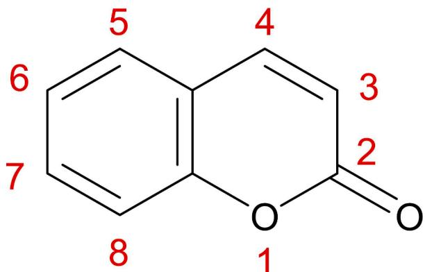  
Fig. 1. Molecular structure of coumarin.

## 2. Material and methods

## 2.1. Synthesis and structural characterization

The reagents used in this study are commercially available. Unless otherwise stated, they were used directly without further purification. In this work, five coumarin-based quaternary ammonium salts A1 − C2 (Fig. 2) were synthesized. The synthesis route and characterization are shown in the supporting information.

## 2.2. Electrochemical test

The electrochemical analysis in this study was carried out in a threeelectrode system using an electrochemical workstation (PGSTAT302N, Auto-Lab). All the electrochemical test conditions were consistent, and the concentration of e32 in the Virgin Make-up Solution (VMS) was 3.68 mo ${ \mathbf { \Omega } } / { \mathrm { L } } ,$ more details are included in the support information.

## 2.3. Quantum chemical calculations and molecular dynamics simulation

Density functional theory (DFT) calculations and molecular dynamics (MD) simulations were implemented to calculate the adsorption capacity and the adsorption state of compounds A1 − C2 on copper from a theoretical level. Quantum chemistry calculations were based on DFT, the B3LYP function and def2-SVP basis set. The Gaussian 09 program was used to optimize the species geometry. Vibrational frequencies were calculated to evaluate the nature of the optimized structures at the same level. Next, the contour surfaces of the highest occupied molecular or bitals (HOMOs) and lowest unoccupied molecular orbitals (LUMOs) were visualized with Avogadro program. Electrostatic potential (ESP) surfaces were generated by Multiwfn and VMD software.

MD simulation Based on Copper Surface (111). Material Studio was used to simulate the interaction of coumarin compounds (A1-C2) with the copper surface in MD. The thermodynamic temperature of the MD simulation was 298 $\mathrm { K , }$ 1000 water molecules and one coumarin quaternary ammonium salt molecule were placed in the initial configuration of the simulation box. MD simulation was carried out under the forcite module and the COMPASS II force field, with a simulation time of 300 ps.

## 2.4. TH electroplating and copper electroplating surface micro morphology

In this study, a 1.5 L Haring tank was used for TH electroplating experiments. The anode was a phosphorous copper plate, and a printed circuit board (PCB) with a certain number of THs was used as the cathode for electrodeposition. Sections of the PCB board after electro deposition were made into a metallographic section, and the throwing power (TP) of the copper boards was observed using a metallographic microscope (zeiss, Axio Observer A1m). The calculation method of TP value is shown in Equation (1) and Fig. 3[26,34,35].

$$
T P = \frac {2 (T _ {5} + T _ {6})}{T _ {1} + T _ {2} + T _ {3} + T _ {4}} \times 100\tag{1}
$$

The micro morphology of the copper-plated surface was observed by scanning electron microscope (SEM, Hitachi S-3400 N), the crystal plane orientation of the copper-plated layers was analyzed by X-ray diffractometer (XRD, Rigaku, 18KW/D/max 2550VB/PC). The diffraction patterns were recorded in the 2θ range of 30◦\~80◦, the change of each step was 0.02◦, and the scanning speed was 6◦/min.

## 3. Results and discussion

## 3.1. Cyclic voltammetry measurement

Cyclic voltammetry measured the copper deposition inhibition

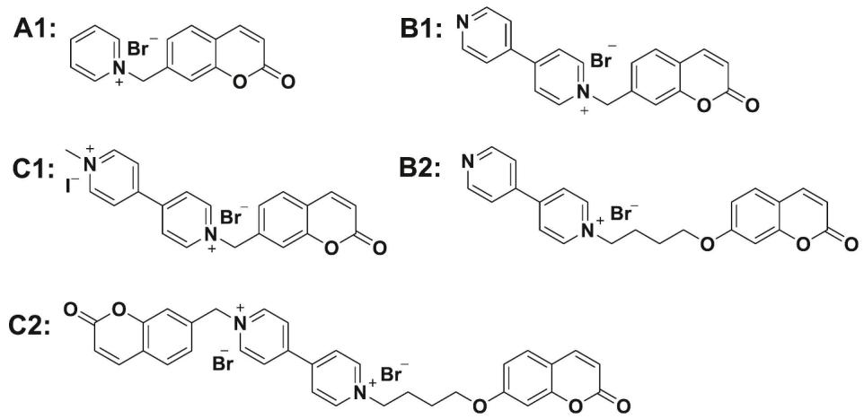  
Fig. 2. Five types of coumarin quaternary ammonium salt levelers.

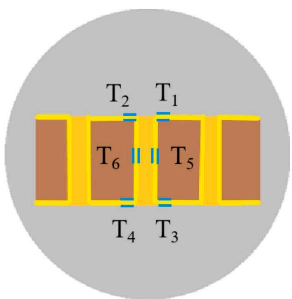  
Fig. 3. Schematic diagram of the metallographic cross-section of the PCB board.

ability of leveler molecules. Typical leveler JGB was used as comparison term, and VMS was used as blank term. The positive area in the CV diagram represents the stripping area of copper, which is positively correlated with the deposition amount of copper on the Pt working electrode [24,36].

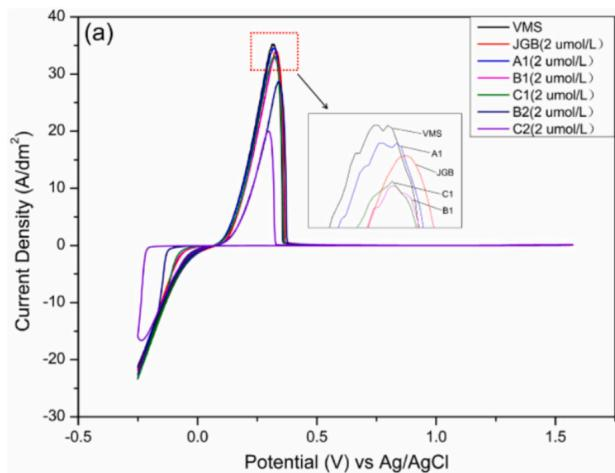

As shown in Fig. 4a, with the addition of levelers, the curve area decreases compared with VMS, which proved that the inhibition effect of C2 was the best, and the ability of six levelers to inhibit copper ion deposition is shown in the following order: $C 2 > \mathsf { B } 2 > \mathsf { B } 1 \approx \mathsf { C } 1 > \mathsf { J } \mathsf { G } \mathsf { B } >$ A1.

As shown in Fig. 4b, with the increasing of C2 concentration, the inhibition effect of C2 was also enhanced. When the concentration of C2 is increased to 8 μmol/L, the potential is close to 0 V, which means that C2 can completely cover the surface of the working electrode by adsorption, so that the deposition amount of copper ions is close to 0. Compared with the CV test of JGB (Fig. S1), the inhibitory ability of leveler C2 was much stronger than that of JGB at the same concentration, which further indicated the efficient inhibitory ability of leveler C2.

## 3.2. Potentiodynamic polarization curve measurements

The potentiodynamic polarization curves of levelers A1 − C2 were tested. In the test of potentiodynamic polarization curve, the turning point at which the current density rises rapidly represents the rapid deposition of copper ions. This turning point is the polarization potential of copper, the stronger the inhibition ability of the leveler, the greater the polarization potential measured in the initial plating solution, the absolute value of the polarization potential is proportional to the inhi bition ability of the leveler [32,34].

Six levelers were added to the VMS for polarization curve measurements in Fig. 5a. The results of polarization curve measurements were the same as that of CV measurements, C2 had the strongest inhibition ability, which was much stronger than other levelers. The current density represented by B2 starts to be higher than that of JGB, B1 and C1. The reason for this phenomenon may be that the poor maintenance ability of B2 to inhibit the deposition of copper ions. Once the polarization voltage is reached, the deposition of copper ions is greater than A1, B1 and C1.

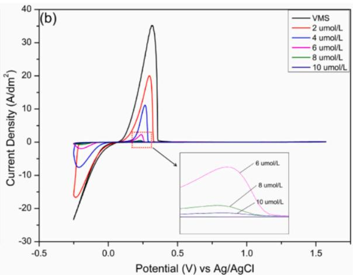  
Fig. 4. CV test curve: (a) CV curve of compounds A1 − C2 and JGB; (b) CV curve at different concentrations of compound C2

As shown in Fig. 5b, the polarization potential increases as the concentration of C2 increases. This is due to the fact that as the C2 concentration increases, the adsorption area of C2 on the working electrode surface also increases, resulting in a subsequent decrease in the adsorption position of copper ions on the working electrode surface and therefore an increasing potential required for copper ion deposition.

## 3.3. Quantum chemical calculation and MD simulation analysis

Quantum chemical calculations and molecular dynamics simulations are effective testing tools for developing new leveler molecules [13,37,38]. In this section, the energy band gap, electron density distribution and adsorption state on copper surface of quaternary ammo nium cations of five coumarin quaternary ammonium salts $\mathbf { A } \mathbf { 1 } ~ - ~ C 2$ were analyzed by quantum chemical calculations and molecular dynamics simulations, so as to analyze the reasons for the different inhibitory abilities of five coumarin quaternary ammonium salts.

Fig. 6 shows the optimization results of the geometric structure and electron cloud density of $\mathbf { A } 1 - C 2 ,$ . The highest occupied molecular orbitals (HOMO) of $\mathbf { A 1 } - C 2$ are mainly located in the coumarin region, which means that in the molecular structure of $\mathbf { A } 1 - C 2 ,$ , the coumarin region is more likely than other regions to give electrons to metal ions, thus forming ligand [13]. The lowest unoccupied molecular orbitals (LUMO) of $\mathbf { A } \mathbf { 1 } - C \mathbf { 2 }$ are mainly distributed in the pyridine/bipyridine region, which means that compared with other regions, the pyridine/ bipyridine region is more likely to obtain electrons from the copperplated cathode, thus adsorbing on the surface of the copper-plated cathode. Compared with the other four levelers, LUMO of C2 was distributed in more areas, and LUMO was also distributed in the coumarin region connected with alkoxy in C2 molecule, which repre sented more adsorption sites on C2 molecular structure.

In general, a higher $E _ { \mathrm { H O M O } }$ value means that a compound molecule has a higher electron-giving ability and a lower $E _ { \mathrm { L U M O } }$ value means that it has a higher electron-gaining ability, the adsorption ability of the leveler molecules on copper surfaces can be evaluated by the energy band gap ΔE $( \Delta E = E _ { \mathrm { L U M O } } - E _ { \mathrm { H O M O } } )$ [26,34]. When the $E _ { \mathrm { H O M O } }$ and ELUMO values are closer, the smaller the $\Delta E ,$ it means that it is easier to adsorb on the copper surface [38].

As shown in Table 1, according to the calculation results of the energy gap, it is inferred that the inhibitory capacity of five coumarinbased quaternary ammonium salts is $C 2 > \mathbf { C } \mathbf { 1 } > \mathbf { B } 2 > \mathbf { B } \mathbf { 1 } > \mathbf { A } \mathbf { 1 }$ in descending order, which is slightly different from the electrochemical measurement results $( C 2 > \mathbf { B } 2 > \mathbf { B } 1 \approx \mathbf { C } 1 > \mathbf { A } 1 )$ , and this phenomenon also exists in previous studies. This is because the electrochemical measurement was conducted in acidic copper sulfate solution, while the quantum chemical calculation was conducted in a vacuum environment, and only the influence of quaternary ammonium cation was considered, so there are certain differences [34].

In the electrochemical test of A1, B1 and B2, the content of Br ions is consistent, so the difference in electrochemical performance of these three levelers is mainly influenced by their quaternary ammonium cations. Compared with B1, C1 does not show a stronger persistence ability. Although C1 has 2 μmol/L more I ions than B1, the inhibition ability of methylated quaternary ammonium salt is weakened [39]. Overall, C1 shows similar electroplating inhibition as B1. In addition, double concentration of Br- ion may further enhance the inhibition capacity of C2 on copper ion, which explains the reason why C2 has the strongest inhibition capacity.

In order to further analyze the adsorption sites on the molecular structure of five levelers $\mathrm { { A } } 1 \mathrm { { ~ - ~ } } C 2 ,$ electrostatic potential energy (ESP) analysis was performed. As shown in Fig. 7, the red area represents the low electron density area, the blue area represents the high electron density area, and the depth of the color represents the degree of low electron density and high electron density. The main low electron regions of the levelers $\mathbf { A 1 } - C 2$ are concentrated at sites 3, 4 and 5 of the coumarin structure and the pyridine/bipyridine ring, indicating that levelers $\mathbf { A 1 } - C 2$ are mainly adsorb on the surface of Cu through the intramolecular coumarin group and pyridine/bipyridine group. This indicates that coumarin structure and pyridine/bipyridine structure are conducive to the adsorption of leveler molecules on copper surface.

The ESP diagram of A1 is Compared with that of B1, the low electron density region of bipyridine structure is significantly more than that of pyridine structure, so B1 has more adsorption sites than A1, which explains why B1 has stronger inhibition ability than A1. At the same time, it can be found from the ESP diagram of B1 and B2 that the $\mathrm { O C } _ { 4 } \mathrm { H } _ { 8 }$ alkoxy group in their molecular structure is also a region of low electron density, which can increase the adsorption sites and adsorption capacity of leveler on the copper surface, so B2 has stronger inhibition ability than B1. The bipyridine structure in C2 molecule has low electron cloud density, and the dicoumarin structure has more adsorption sites on the copper cathode surface, which is conducive to hinder the deposition of $\mathrm { C u } ^ { \overline { { 2 + } } }$ on the metal surface, so C2 has the strongest inhibition ability.

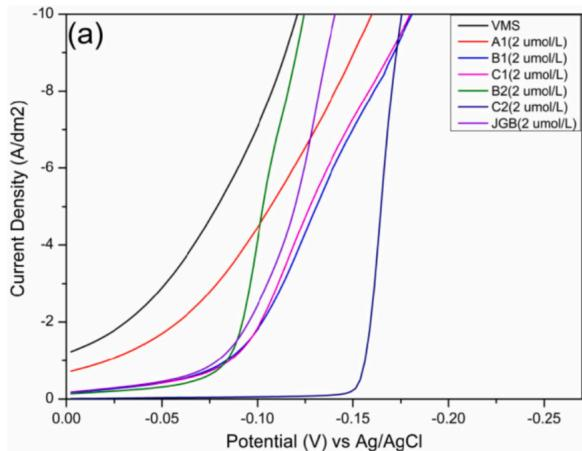

The equilibrium adsorption states of levelers $\mathbf { A } \mathbf { 1 } - C \mathbf { 2 }$ on the copper surface (111) were simulated by MD and the adsorption energies were calculated, the results are shown in Fig. 8 and Fig. 9. The stable adsorption state of A1 is not parallel to the surface of copper, and the pyridine ring in its molecular structure is not adsorbed on the copper surface (111), indicating that A1 has no good adsorption form on the copper surface (111). While the other four leveling agents have nearly parallel adsorption states on the surface of copper, in which the dicoumarin part of C2 can be well adsorbed on the surface of copper, so as to play an inhibitory role.

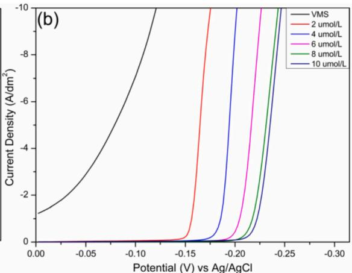  
Fig. 5. Polarization curve test: (a) polarization curve of compounds $\mathbf { A } \mathbf { 1 } - C \mathbf { 2 }$ and JGB; (b) polarization curve under different concentration of C2.

Table 1  
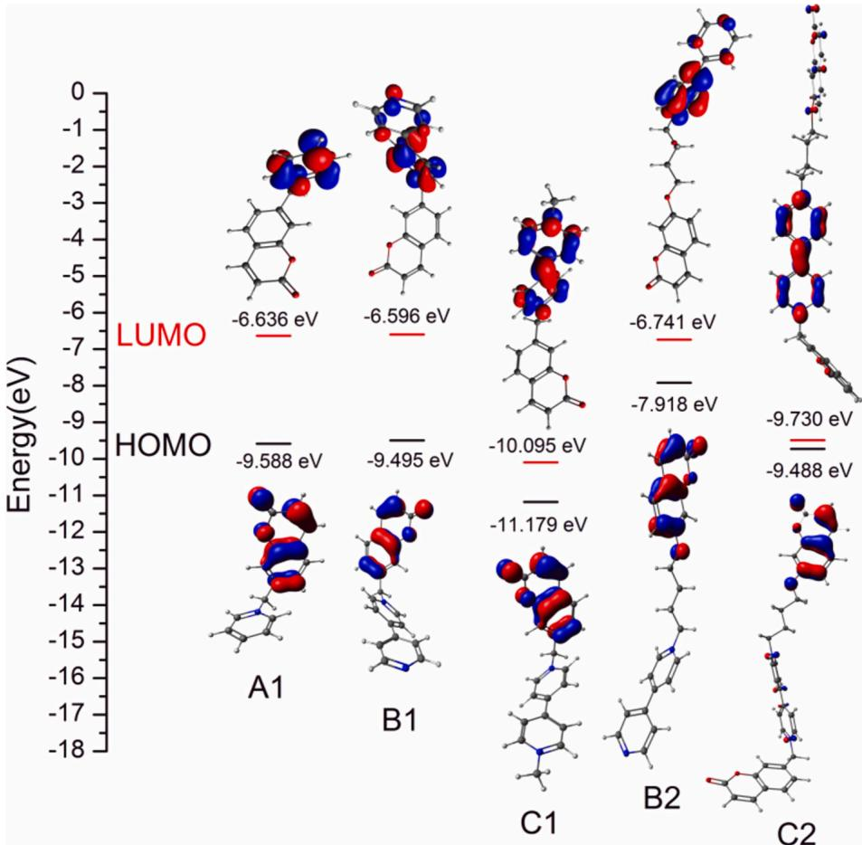  
Fig. 6. Distributions and orbital energy values of HOMO and LUMO of levelers A1 − C2.

Orbital energy of A1 − C2 (EHOMO, ELUMO, ΔE).

<table><tr><td></td><td> $E_{\text{HOMO}}$  (eV)</td><td> $E_{\text{LUMO}}$  (eV)</td><td> $\Delta E$  (eV)</td></tr><tr><td>A1</td><td>-9.588</td><td>-6.636</td><td>2.952</td></tr><tr><td>B1</td><td>-9.495</td><td>-6.596</td><td>2.899</td></tr><tr><td>C1</td><td>-11.179</td><td>-10.095</td><td>1.084</td></tr><tr><td>B2</td><td>-7.918</td><td>-6.741</td><td>1.177</td></tr><tr><td>C2</td><td>-9.730</td><td>-9.488</td><td>0.242</td></tr></table>

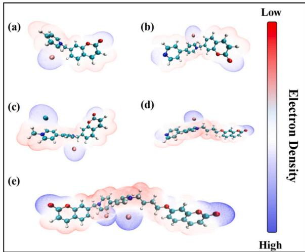  
Fig. 7. ESP diagram of levelers A1 − C2: (a): A1; (b): B1; (c): C1; (d): B2; (e): C2.

The higher the adsorption energy, the stronger the adsorption capacity of the levelers on the copper surface[11,15,30,40]. The adsorption capacities of the five leveler molecules on the copper surface (111) are $C 2 > \mathbf { B } 2 > \mathbf { C } 1 > \mathbf { B } 1 > \mathbf { A } 1$

The surface coverage can be measured by the numbers of copper atoms that covered by compounds. The results are listed in Table 2. The coverage is related to the size and number of conjugated groups.

The results of quantum chemical calculations and MD simulations show that leveler C2 has the strongest adsorption capacity on the Cu surface, explaining the reason why C2 possesses the strongest inhibition capacity during electrochemical tests.

## 3.4. PCB TH electroplating measurements

The five compounds were paired with 200 ppm PEG and 2 ppm SPS, respectively, and the results of TH electroplating are shown in Fig. 10.

Based on the above results, leveler C2 has the strongest copper plating inhibition ability, so C2 was selected as the preferred leveler for application in actual through-hole copper plating, and the effect of different additions of C2 on the filling ability was investigated.

Different concentrations of leveler C2, inhibitor (PEG 10000), and accelerator (SPS) were selected to be added to the VMS. The formula is shown in Table 3.

Fig. 11 shows the cross-section of through-holes obtained after plating with different additive formulations. The thickness of the seed layers is 25 μm and the image of the seed layer (before plating) is shown in Fig. S1. The TP value of “formula a” without any additives was 46.28 %, copper ions were mainly deposited on the surface of the through-hole where the plating solution had stronger convection and more rapid replenishment of copper ions. When PEG 10000 and SPS were added, the TP value increased, but it was far from the effect of a complete copper interconnect. Compared with “formulation a” and “formulation b”, the deposition of copper ions on the though-hole surface was more suppressed, which represents a good leveling effect of C2. The leveling effect increased with increasing concentration of compound C2. When 0.6 ppm C2 were added to VMS (“formulation e”), the TP value reached 102.24 %, which means that the copper ions in the middle of the through-hole are deposited faster than on the surface of the through hole with good filling effect,therefore a complete copper interconnection without voids can be achieved in through-hole electroplating. Fig. 12 demonstrates the good leveling ability of C2.

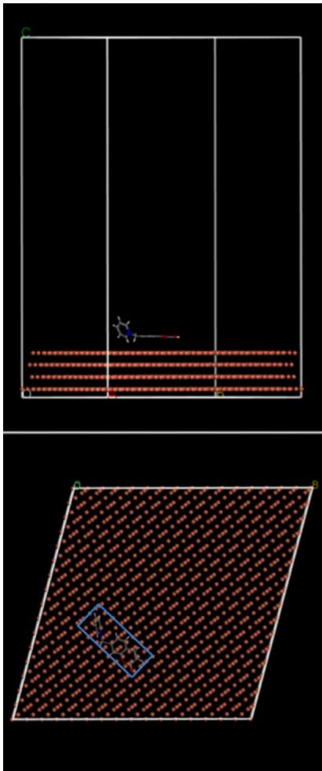  
-59.241 kcal/mol  
Al

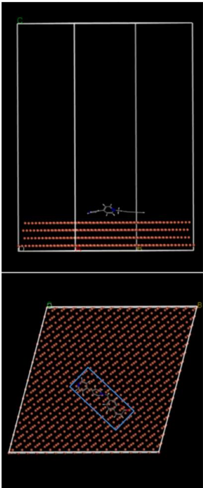  
-80.934kcal/mol B1

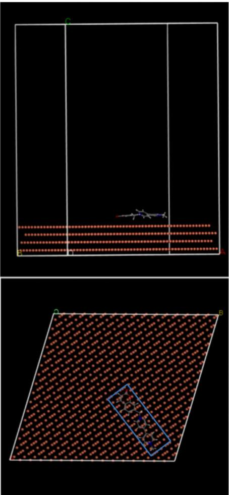  
-93.052 kcal/mol  
Cl  
Fig. 8. MD simulation of levelers A1 − C1 on copper surface.

## 3.5. Action mechanism of leveler C2

GMs can simulate the convection inside and on the surface of the though-hole during the actual through hole electroplating by rotating the disc electrode at different speeds, and test the potential difference after adding different additives to VMS, so as to analyze the effect of different additives and the interaction between additives. The potential difference between low speed and high speed under the same test conditions is defined as Δη $( \Delta \mathfrak { \eta } = \mathfrak { \eta } _ { \mathrm { L } } - \mathfrak { \eta } _ { \mathrm { H } } )$ [11,41].

As shown in Fig. 13(a), firstly, the VMS was run in constant current conditions for 1000 s, the potential difference was about 0, indicating that the VMS does not have overfill capacity. The potential decreased rapidly with the addition of PEG, representing the rapid adsorption of PEG, while the potential started to rise slowly with the addition of SPS at 2000 s, indicating that the adsorption of SPS is a slow process and its action rate controlled by its rate of adsorption [42]. At 3000 s, the decrease of potential indicates that the depolarization of SPS is inhibited and there is a competitive adsorption relationship between C2 and SPS. At high speed, the potential immediately decreases, indicating that SPS is rapidly replaced by C2 under strong convection. Δη1 was greater than 0, indicating that the addition of C2 can improve the filling capacity of electroplating solution, which is consistent with the result of throughhole electroplating.

Fig. 13(b) shows when C2 is added to chlorine-free VMS, the po tential at high speed decreased significantly, and no other additives were needed, indicating that C2 alone can exert copper plating inhibition and has strong CDA behavior, which is beneficial to the occurrence of through-hole overfilling. When C2 and Cl- are added, the potential showed no obvious and steady downward trend, indicating that there was no stable synergistic inhibition between C2 and Cl-. The addition of SPS does not result in depolarization, it can be concluded that the depolarization of SPS requires the presence of PEG. Because the competitive adsorption between PEG and SPS is based on the cathode being polarized to a certain extent by PEG. SPS can achieve depolarization effect by replacing PEG in PEG-Cu + -Cl- complex [42,43].

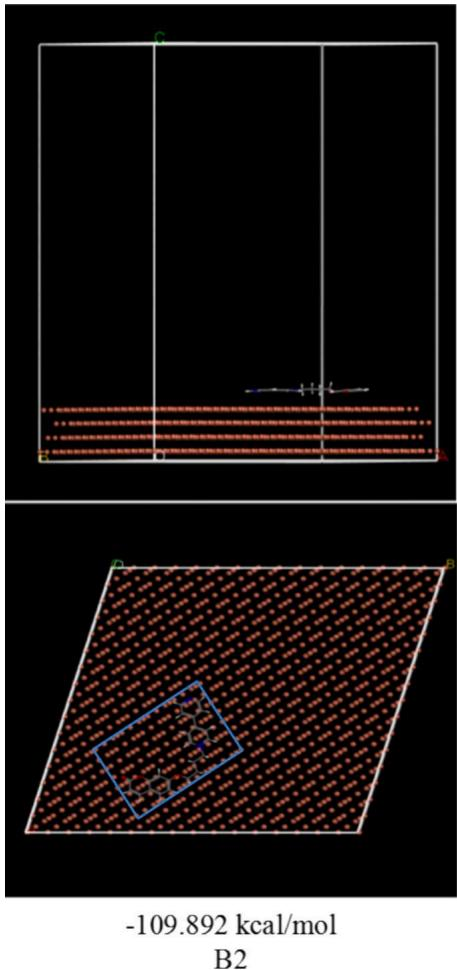

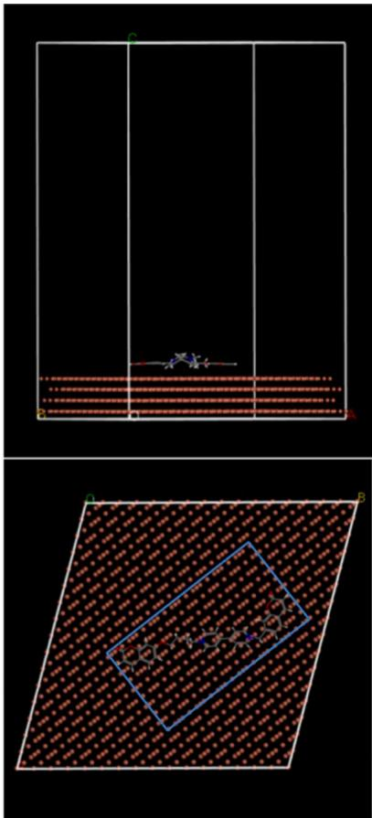  
C2  
-142.685 kcal/mol  
Fig. 9. MD simulation of levelers B2 and C2 on copper surface

Table 2  
Coverage of different molecules.

<table><tr><td></td><td>A1</td><td>B1</td><td>C1</td><td>B2</td><td>C2</td></tr><tr><td>Number of copper atoms</td><td>55</td><td>108</td><td>91</td><td>136</td><td>280</td></tr></table>

## 3.6. Effect of leveler C2 on the surface of copper electroplating layer

The surface morphology of the copper plating layer is also the focus of the PCB manufacturing process. SEM test and XRD test can well observe the microscopic surface morphology of the copper plating layer, and analyze the size of copper grains by testing the crystallographic plane orientation of the copper plating layer.

The test results are shown in Fig. 14. The surface of the copper plate electroplated with VMS (“formula a”) was very rough, and the copper particle diameter was over 10 μm when the magnification was 5000. Combined with XRD analysis, the crystallographic orientation of copper plating layer is mainly (220) crystallographic plane, which means the size of copper grains is larger and the copper surface flatness is lower. When using “formula b”, due to the presence of SPS and PEG 10000, the copper grains were refined, the (220) crystallographic plane orientation was suppressed, and the (200) and (111) crystallographic plane orientations were dominated, and the copper surface looked much flatter, but there were still some defects.

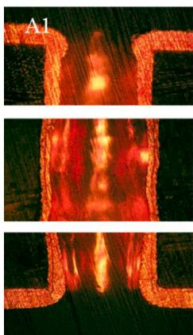  
TP=63.83%

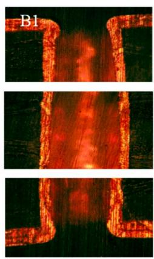  
TP=70.02%

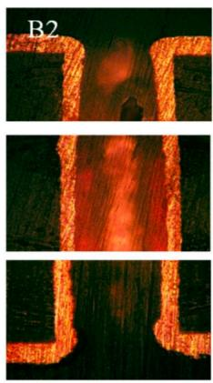  
TP=80.58%

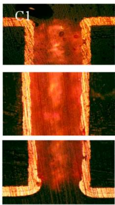  
TP=85.69%

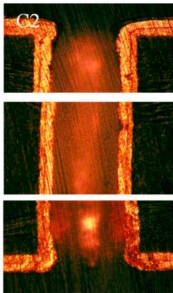  
TP=102.24%  
Fig. 10. Cross-sections of THs for TH electroplating using A1-C2.

Table 3 Additive ratio formula a-e.

<table><tr><td></td><td>Formula a</td><td>Formula b</td><td>Formula c</td><td>Formula d</td><td>Formula e</td></tr><tr><td>C2 (ppm)</td><td>0</td><td>0</td><td>0.2</td><td>0.4</td><td>0.6</td></tr><tr><td>PEG 10,000 (ppm)</td><td>0</td><td>200</td><td>200</td><td>200</td><td>200</td></tr><tr><td>SPS (ppm)</td><td>0</td><td>2</td><td>2</td><td>2</td><td>2</td></tr><tr><td>TP (%)</td><td>46.28 %</td><td>58.39 %</td><td>79.68 %</td><td>88.52 %</td><td>102.24 %</td></tr></table>

With the addition of 0.2 ppm C2 (“formula c”), the surface defects are improved, the surface of the copper layer becomes flatter, the copper particles become more refined, and the (111) crystallographic plane dominates, but there are still surface defects. When the addition amount of C2 was changed to 0.4 ppm and 0.6 ppm (“formula d” and “formula f”), the surface defects disappeared, the copper layer surface became bright and the copper particles became very fine. The (111) crystallo graphic plane orientation peak was continuously enhanced and far exceeded the (220) crystal orientation peak and (200) crystal orienta tion peak.

## 4. Conclusion

In summary, this study synthesized five coumarin-based quaternary ammonium salts and, for the first time, investigated their application as novel electroplating levelers in acid copper plating. Electrochemical measurements were used to analyze the copper plating inhibition ability of five coumarin-based quaternary ammonium salts, leveler C2 with double coumarin structure had the strongest inhibition performance. Quantum chemical calculation and MD simulation show that leveler C2 has the strongest adsorption capacity and the most adsorption sites on copper surface, which is the reason why C2 has the strongest inhibition ability. TH copper plating results show that the leveler C2 has good leveling performance, only need 0.6 ppm addition, can get 103.36 % through-hole TP value. The interaction between C2 and other additives and the mechanism of action were further explored by GMs test. The results of SEM and XRD show that the leveler C2 can make the surface of the copper plating layer smoother and optimize the orientation of the copper crystallographic plane. In this work, a new coumarin compound was synthesized for the first time and used as an electroplating leveler, which expanded the application range of coumarin compounds and the design field of molecular structure of electroplating leveler. It is hoped that it can be used as the basis for the development of efficient leveler molecules in the future.

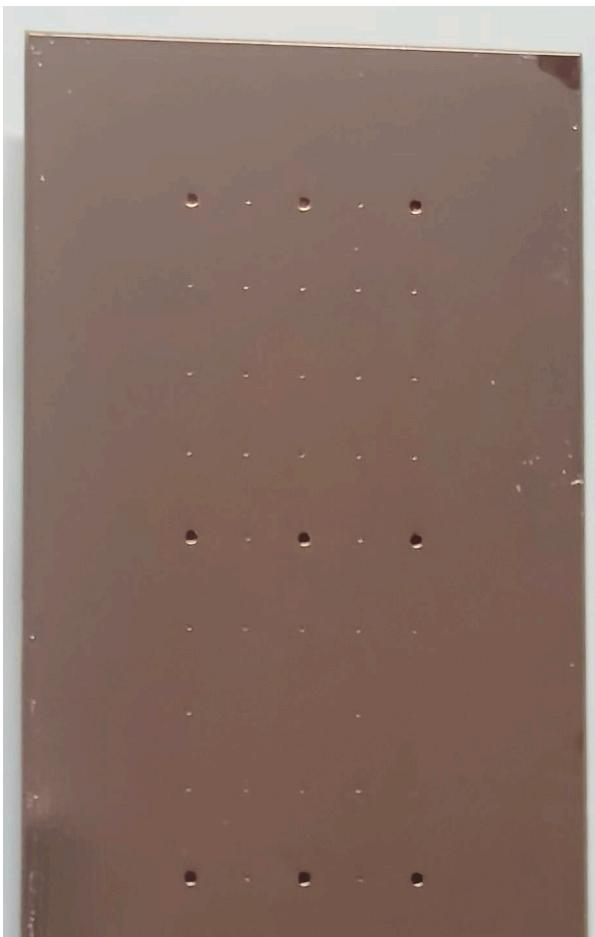  
Fig. 12. The surface of the PCB after electroplating using formula e.

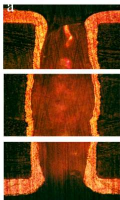  
TP=46.28%

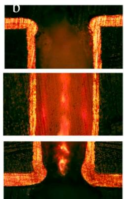  
TP=58.39%

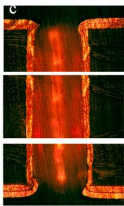  
TP=79.68%

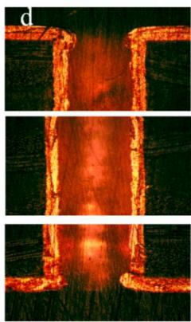  
TP=88.52%

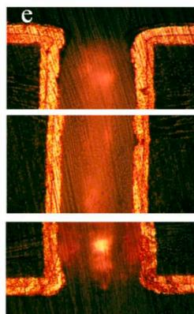  
TP=102.24  
Fig. 11. Cross-sections of THs for TH electroplating using formula a-e.

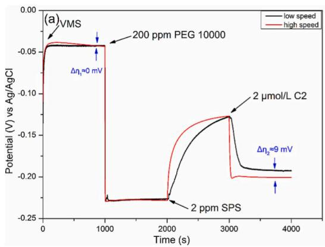

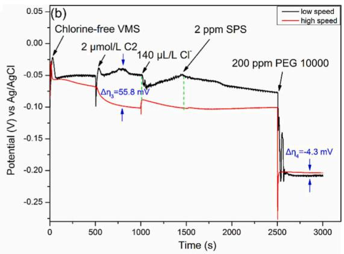  
Fig. 13. GMs curves of additives added in different sequences.

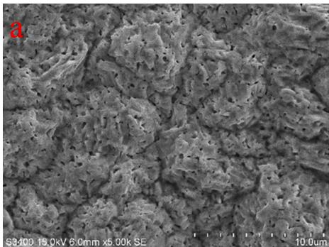

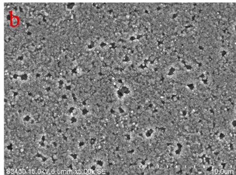

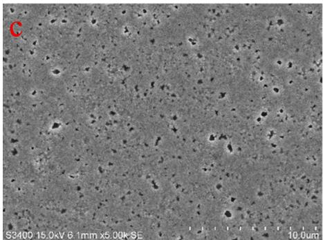

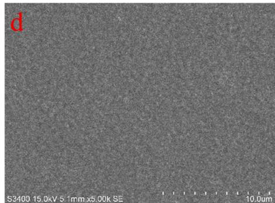

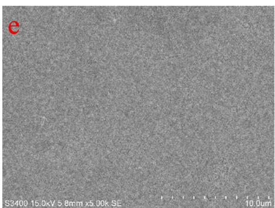

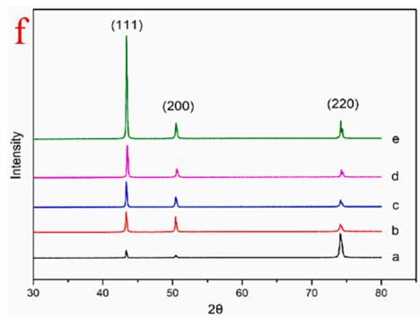  
Fig. 14. (a-e)The micro-morphology of “formula $\mathbf { a } - \mathbf { e } ^ { \mathfrak { r } }$ ；(f) XRD spectrum of the copper plate surface after TH electroplating with “formula $\mathbf { a } - \mathbf { e } ^ { \mathfrak { r } }$

## CRediT authorship contribution statement

Jingyu Xie: Writing – review & editing, Writing – original draft, Validation. Xinpeng Yin: Resources, Investigation, Data curation, Conceptualization. Fengyan Lu: Resources. Xuyang Li: Writing – re view & editing. Limin Wang: Supervision, Project administration.

## Declaration of competing interest

The authors declare that they have no known competing financial interests or personal relationships that could have appeared to influence the work reported in this paper.

## Acknowledgements

This research was financially supported by the National Natural Science Foundation of China (21772039, 21272069), and we gratefully acknowledge financial support from the Central Universities and Science and Technology Commission of Shanghai Municipality (21DZ2305000). Support from the Fundamental Research Funds for the Central Universities (SLA13223001).

## Appendix A. Supplementary data

Supplementary data associated with this article can be found, in the online version, at https://doi.org/10.1016/j.jelechem.2024.118851.

## References

[1] M. Tomie, T. Akita, M. Irita, M. Hayase, Transitional Additive Adsorption with Co-Addition of Suppressor and Leveler for Copper TSV Filling, J. Electrochem. Soc. 167 (2020) 2513, https://doi.org/10.1149/1945-7111/ab90ad.

[2] Z. Fan, X. Chen, Y. Liu, Y. Jiang, Y. Zhang, Effects of anisotropy on the reliability of TSV microstructure, Microelectron. Reliab. 114 (2020) 113745, https://doi.org/ 10.1016/j.microrel.2020.113745.

[3] L. Bamberg, A. Garcia-Ortiz, High-Level Energy Estimation for Submicrometric TSV Arrays, IEEE Trans. Very Large Scale Integr. VLSI Syst. 25 (2017) 2856–2866, https://doi.org/10.1109/TVLSI.2017.2713601.

[4] L. Liu, Y. Bu, Y. Sun, J. Pan, J. Liu, J. Ma, L. Qiu, Y. Fang, Trace bis-(3-sulfopropyl)- disulfide enhanced electrodeposited copper foils, J. Mater. Sci. Technol. 74 (2021) 237–245, https://doi.org/10.1016/j.jmst.2020.10.019.

[5] M.J. Kim, H.C. Kim, J.J. Kim, The Influences of Iodide Ion on Cu Electrodeposition and TSV Filling, J. Electrochem. Soc. 163 (2016) D434–D441, https://doi.org 10.1149/2.1111608jes.

[6] T.B. Huang, H. Sharma, R. Manepalli, S. Kandanur, V. Sundaram, R.R. Tummala, Electroanalytical Study of Organic Additive Interactions in copper electroplating and Their Correlation with Via Fill Behavior, J. Electron. Mater. 47 (2018) 7401 7408, https://doi.org/10.1007/s11664-018-6680-0.

[7] P. Ren, M. An, Pe. Yang, Ji. Zhang, Unveiling the synergistic inhibition of Cl− copper electroplating: Pivotal roles of adsorption and desorption, J. Electroanal. Chem. 898 (2021) 115624, https://doi.org/10.1016/j.jelechem.2021.115624.

[8] M.H. Lee, M.J. Kim, J.J. Kim, Competitive adsorption between bromide ions and bis(3-sulfopropyl)-disulfide for Cu microvia filling, Electrochim. Acta 370 (2021) 137707, https://doi.org/10.1016/j.electacta.2020.137707.

[9] Z. Li, B. Tan, M. Shi, J. Luo, Z. Hao, J. He, G. Yang, C. Cui, Bis-(sodium sulfoethyl)- disulfide: A Promising Accelerator for Super-conformal Copper Electrodeposition with Wide Operating Concentration Ranges, J. Electrochem. Soc. 167 (2020) 2508, https://doi.org/10.1149/1945-7111/ab7b85.

[10] C. Chang, X. Lu, Z. Lei, Z. Wang, C. Zhao, 2-Mercaptopyridine as a new leveler for bottom-up filling of micro-vias in copper electroplating, Electrochim. Acta 208 (2016) 33–38, https://doi.org/10.1016/j.electacta.2016.04.177.

[11] J. Xu, B. Chen, J. Lv, D. Chang, D. Niu, S. Hu, X. Zhang, Z. Xin, L. Wang, Aryl modification of diketopyrrolopyrrole-based quaternary ammonium salts and their applications in copper electrodeposition, Dyes Pigm. 170 (2019) 107559, https:// doi.org/10.1016/j.dyepig.2019.107559.

[12] J. Luo, Z. Li, B. Tan, C. Cui, M. Shi, Z. Hao, Communication—Triphenylmethane-Based Leveler for Microvia Filling in Copper Super-Conformal Electroplating, J. Electrochem. Soc. 166 (2019) D603 D605, https://doi.org/10.1149/ 2.0531913jes.

[13] Z. Lai, S. Wang, C. Wang, Y. Hong, Y. Chen, H. Zhang, G. Zhou, W. He, K. Ai, Y. Peng, Computational analysis and experimental evidence of two typical levelers for acid copper electroplating, Electrochim. Acta 273 (2018) 318–326, https://doi. org/10.1016/j.electacta.2018.04.062

[14] B. Chen, J. Xu, L. Wang, L. Song, S. Wu, Synthesis of Quaternary Ammonium Salts Based on Diketopyrrolopyrroles Skeletons and Their Applications in Copper Electroplating, ACS Appl. Mater. Interfaces. 9 (2017) 7793–7803, https://doi. org/10.1021/acsami.6b15400

[15] J. Li, J. Xu, X. Wang, X. Wei, L. Wang, Diketopyrrolopyrrole-based supramolecular nano-leveler for the enhancement of conformal copper electrodeposition, Appl. Surf. Sci. 569 (2021) 150982, https://doi.org/10.1016/j.apsusc.2021.150982.

[16] S. Yang, Z. Thacker, E. Allison, M. Bennett, N. Cole, P.J. Pinhero, Electrodeposition of Copper for Three-Dimensional Metamaterial Fabrication, ACS Appl. Mater. Interfaces 9 (2017) 40921–40929, https://doi.org/10.1021/acsami.7b04721.

[17] C. Wang, J. Zhang, P. Yang, B. Zhang, M. An, Through-Hole Copper Electroplating Using Nitrotetrazolium Blue Chloride as a Leveler, J. Electrochem. Soc. 160 (2013) D85 D88, https://doi.org/10.1149/2.035303jes.

[18] T. Akita, Y. Otsuka, M. Hayase, Microfluidic Device for In Situ Observation of Bottom-Up Copper Electrodeposition in a TSV-Like Structure, J. Electrochem. Soc. 167 (2020) 2515, https://doi.org/10.1149/1945-7111/abd453.

[19] O. Lühn, C.V. Hoof, W. Ruythooren, J.-P. Celis, Filling of microvia with an aspect ratio of 5 by copper electrodeposition, Electrochim. Acta 54 (2009) 2504–2508, https://doi.org/10.1016/j.electacta.2008.04.002.

[20] L. Tan, S. Han, S. Chen, T. Hang, H. Ling, Y. Wu, M. Li, The Influence of Leveler on the Impurity Behavior of Electroplated Cu Films During Laser Annealing,

J. Electrochem. Soc. 168 (2021) 2504, https://doi.org/10.1149/1945-7111 ac0550.

[21] M. Tang, S. Zhang, Y. Qiang, S. Chen, L. Luo, J. Gao, L. Feng, Z. Qin, 4,6-Dimethyl-2-mercaptopyrimidine as a potential leveler for microvia filling with electroplating copper, RSC Adv. 7 (2017) 40342–40353, https://doi.org/10.1039/c7ra06857c.

[22] C. Liao, S. Zhang, S. Chen, Y. Qiang, G. Liu, M. Tang, B. Tan, D. Fu, Y. Xu, The effect of tricyclazole as a novel leveler for filling electroplated copper microvias, J. Electroanal. Chem. 827 (2018) 151–159, https://doi.org/10.1016/j. jelechem.2018.08.042.

[23] W. Dow, C. Li, Y. Su, S. Shen, C. Huang, C. Lee, B. Hsu, S. Hsuc, Microvia filling by copper electroplating using diazine black as a leveler, Electrochim. Acta 54 (2009) 5894 5901, https://doi.org/10.1016/j.electacta.2009.05.053.

[24] A. Wang, B. Chen, L. Fang, J. Yu, L. Wang, Influence of branched quaternary ammonium surfactant molecules as levelers for copper electroplating from acidic sulfate bath, Electrochim. Acta 108 (2013) 698–706, https://doi.org/10.1016/j. electacta.2013.07.017.

[25] M.H. Lee, Y. Lee, M. Sung, S.K. Cho, Y.G. Kim, J.J. Kim, Structural Influence of Terminal Functional Groups on TEG-Based Leveler in Microvia Filling, J. Electrochem. Soc. 167 (2020) 2505, https://doi.org/10.1149/1945-7111/ ab98a9.

[26] K. Wang, J. Feng, J. Xu, J. Li, M. Mai, X. Wang, L. Wang, Engineering aromatic heterocycle strategy: Improving copper electrodeposition performance via tuning the bandgap of diketopyrrolopyrrole-based leveler, Tetrahedron 76 (2020) 130882, https://doi.org/10.1016/j.tet.2019.130882.

[27] N.T.M. Hai, J. Furrer, F. Stricker, Polyvinylpyrrolidones (PVPs): Switchable Leveler Additives for Damascene Applications, J. Electrochem. Soc. 160 (2013) D3116–D3125, https://doi.org/10.1149/2.019312jes

[28] L. Zheng, W. He, K. Zhu, C. Wang, S. Wang, Y. Hong, Y. Chen, G. Zhou, H. Miao, J. Zhou, Investigation of poly (1-vinyl imidazole co 1, 4-butanediol diglycidyl ether) as a leveler for copper electroplating of through-hole, Electrochim. Acta 283 (2018) 560–567, https://doi.org/10.1016/j.electacta.2018.06.132.

[29] H. Wu, Y. Wang, Z. Li, W. Zhu, Investigations of the electrochemical performance and filling effects of additives on electroplating process of TSV, Sci. Rep. 10 (2020) 9204, https://doi.org/10.1038/s41598-020-66191-7.

[30] J. Li, J. Xu, X. Wang, X. Wei, J. Lv, L. Wang, Novel 2,5-bis(6-(trimethylamonium) hexyl)-3,6-diaryl-1,4-diketopyrrolo[3,4-c]pyrrole pigments as levelers for efficient electroplating applications, Dyes Pigm. 186 (2021) 109064, https://doi.org 10.1016/j.dyepig.2020.109064.

[31] M.J. Kim, Y. Seo, H.C. Kim, Y. Lee, S. Choe, Y.G. Kim, S.K. Cho, J.J. Kim, Galvanostatic bottom-up filling of TSV-like trenches: Choline-based leveler containing two quaternary ammoniums, Electrochim. Acta 163 (2015) 174–181, https://doi.org/10.1016/j.electacta.2015.02.173.

[32] J. Lv, J. Xu, X. Zhao, J. Han, B. Chen, X. Wang, Y. He, J. Li, L. Wang, Interface adhesion enhancement by condensed aromatic ring expansion of naphthalene imide derivatives for microvia metallization by copper electroplating, Thin Solid Films 727 (2021) 138671, https://doi.org/10.1016/j.tsf.2021.138671.

[33] Q. Va, K. Dinh, V.H. Kondo, T. Hoang, Hirato, Communication–Bottom-Up TSV Filling Using Sulfonated Diallyl Dimethyl Ammonium Bromide Copolymer as a Leveler, J. Electrochem. Soc. 166 (2019) D505 D507, https://doi.org/10.1149 2.1021912jes.

[34] X. Wang, K. Wang, J. Xu, J. Li, J. Lv, M. Zhao, L. Wang, Quinacridone skeleton as a promising efficient leveler for smooth and conformal copper electrodeposition, Dyes Pigm. 181 (2020) 108594, https://doi.org/10.1016/j.dyepig.2020.108594

[35] X. Li, X. Yin, J. Li, B. Yuan, C. Xiang, P. Zou, L. Wang, Synthesis of coplanar quaternary ammonium salts with excellent electrochemical properties based on an anthraquinone skeleton and their application in copper plating, Electrochim. Acta 437 (2023) 141541, https://doi.org/10.1016/j.electacta.2022.141541.

[36] J. Lv, X. Zhao, J. Xu, J. Li, X. Wei, B. Chen, G. Hong, W. Wu, L. Wang, Fatty Acid Quaternary Ammonium Surfactants Based on Renewable Resources as a Leveler for Copper Electroplating, ChemElectroChem 6 (2019) 3254–3263, https://doi.org/ 10.1002/celc.201900116.

[37] C. Wang, J. Zhang, P. Yang, M. An, Electrochemical behaviors of Janus Green B in through-hole copper electroplating: An insight by experiment and density functional theory calculation using Safranine T as a comparison, Electrochim. Acta 92 (2013) 356 364, https://doi.org/10.1016/j.electacta.2013.01.064

[38] Z. Lai, S. Wang, C. Wang, Y. Hong, G. Zhou, Y. Chen, W. He, Y. Peng, D. Xiao, A comparison of typical additives for copper electroplating based on theoretica computation, Comput. Mater. Sci 147 (2018) 95–102, https://doi.org/10.1016/j. commatsci.2017.11.049.

[39] Z. Li, B. Tan, J. Luo, J. Qin, G. Yang, C. Cui, L. Pan, Structural influence of nitrogencontaining groups on triphenylmethane-based levelers in super-conformal copper electroplating, Electrochim. Acta 401 (2021) 139445, https://doi.org/10.1016/j. electacta 2021.139445

[40] C. Wang, M. An, P. Yang, J. Zhang, Prediction of a new leveler (N-butyl-methy piperidinium bromide) for through-hole electroplating using molecular dynamic simulations, Electrochem. Commun. 18 (2012) 104–107, https://doi.org/10.1016 j.elecom.2012.02.028

[41] W. Dow, C. Liu, Evaluating the Filling Performance of a copper electroplating Formula Using a Simple Galvanostat Method, J. Electrochem. Soc. 153 (2006) C190 C194, https://doi.org/10.1149/1.2165743

[42] R. Akolkar, U. Landau, A Time-Dependent Transport-Kinetics Model for Additive Interactions in Copper Interconnect Metallization, J. Electrochem. Soc. 151 (2004) C702 C711, https://doi.org/10.1149/1.1799431.

[43] W. Dow, M. Yen, W. Lin, S. Ho, Influence of Molecular Weight of Polyethylene Glycol on Microvia Filling by Copper Electroplating, J. Electrochem. Soc. 152 (2005) C769 C775, https://doi.org/10.1149/1.2052019.