OPEN ACCESS

# Electrodeposition of Cobalt for Interconnect Application: Effect of Dimethylglyoxime

To cite this article: Q. Huang et al 2016 J. Electrochem. Soc. 163 D715

View the article online for updates and enhancements.

## You may also like

Synthesis of glycolurils and theiranalogues Angelina N. Kravchenko, Vladimir V. Baranov and Galina A. Gazieva

Dimethylglyoxime modified swift heavyoxygen ions irradiated polyaniline/single walled carbon nanotubes composite electrode for detection of cobalt ions Harshada K Patil, Megha A Deshmukh, Gajanan A Bodkhe et al.

Effect of Dimethylglyoxime on Cobalt-Bottom-up Filling Yang Hu and Qiang Huang

## The New PAT-Cell-Solid!

Cycle Solid-State Batteries Under Controlled Pressure of up to 300 MPa (6 mm Diameter)!

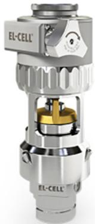

Adjust and measure a force of up to 9000 N on the cell stack! Force adjustment possible throughout the entire experiment

Built-in force, and temperature sensors! With optional gas pressure sensor and gas in- and outlet

PAT-Solid-Core for easy assembly and reproducible results! Press and cycle solid-state batteries with 6 or 10 mm electrode diameter

Cableless and highly sealed battery test cell! For precise long-term measurements of solid-state cell chemistries

Learn more on our product website:

Download the data sheet (PDF):

  
Scan me!

  
Scan me!

# Electrodeposition of Cobalt for Interconnect Application: Effect of Dimethylglyoxime

Q. Huang,a,b,∗,z T. W. Lyons,a and W. D. Sidesa,∗∗

aDepartment ofChemical and Biological Engineering, The University ofAlabama, Tuscaloosa, Alabama 35487, USA bCenter of Materials for Information Technology, The University of Alabama, Tuscaloosa, Alabama 35487, USA

The effect of dimethylglyoxime on Co electrodeposition was investigated with cyclic voltammetry, chronopotentiometry, quartz microbalance as well as electrochemical impedance. A potential dependent suppression effect was observed at low potential with a breakdown of the suppression at high potential, resulting in a hysteresis in CV. The addition of dimethylglyoxime not only causes a fast and strong suppression in potential transients but also modifies the impedance spectra. Additional capacitive loops and inductance loops emerged depending on the applied potential, suggesting a competitive adsorption between different surface adsorbed intermediates. A relaxation of suppression effect was observed in absence of agitation and a strong suppression was re-established upon agitation. A reverse relation between Co deposition rate and rotation rate was observed when the rotation rate is below a critical value, providing a path to enable the preferential deposition at the bottom of a small damascene feature. © The Author(s) 2016. Published by ECS. This is an open access article distributed under the terms of the Creative Commons Attribution Non-Commercial No Derivatives 4.0 License (CC BY-NC-ND, http://creativecommons.org/licenses/by-nc-nd/4.0/), which permits non-commercial reuse, distribution, and reproduction in any medium, provided the original work is not changed in any way and is properly cited. For permission for commercial reuse, please email: oa@electrochem.org. [DOI: 10.1149/2.1111613jes] All rights reserved. cc) BY-NC-ND

Manuscript submitted August 11, 2016; revised manuscript received September 28, 2016. Published October 10, 2016.

The state-of-the-art back-end-of-line (BEOL) interconnects are fabricated with copper, which replaced Aluminum in late 1990’s due to its lower resistivity and superior reliability.1,2 As the interconnect continues to scale, the critical dimension of the BEOL structures has approached the electron mean free path of copper. The copper resistivity in such nanostructures increases exponentially as the dimension further shrinks,3,4 posing tremendous challenges to the continuous scaling of copper interconnect for 7 nm technology and beyond. While the bulk resistivity of a metal is an intrinsic property of the material its resistivity in these small structures is largely determined by what happens to the electrons when they come across an interface, i.e., the surface of the metal structure in contact with the matrix materials, the boundaries between grains in the metal structure and the internal interface between metal and the embedded impurity species.5 Metals with shorter electron mean free path are less susceptible to the effect of scaling and may appear advantageous for the interconnect application. For example, transition metals including Ni, Co, Mo and Ru were predicted to be potential candidates to replace Cu.6

In addition to the advantage of a shorter mean free path, some of the candidate metals can potentially provide performance gain through innovative integration schemes. The overall resistance of an interconnect structure is a result of not only the copper but also other materials used in the interconnect structure for a variety of purposes. Such materials include diffusion barrier, adhesion layer, capping layer and sometimes additional elements as the seed layer for copper plating. Therefore, using metals that can serve dual or multiple purposes may allow more volume for the conducting metal and thus a lower overall resistance and an improved RC delay. Furthermore, new materials that enable better integration and lower defectivities can improve the overall performance as well. For example, chemical vapor deposited (CVD) and atomic layer deposited (ALD) Ru was previously studied to replace the Ta diffusion barrier – Cu seed stack.7–9

Co has recently gained more and more attention as a material to replace the traditional Ta liner.10,11 Compared with Ta, Co provides a better wettability of PVD Cu seed, enables a more conformal Cu seed coverage and therefore improves the extendibility of Cu electroplating in smaller dimensions.12 In addition, the enhanced grain growth of Cu electroplated on Co seed13 and the self-formation of a barrier layer enabled by the Mn diffusion through Co layer14 potentially provide additional performance gain on the reliability of the interconnect structures.

Recently, selectively electroless deposited Co has been demonstrated to partially or completely replace the Cu in the small vias to improve the via resistance.15 The bottom up fill of the via structures relied on the selectivity between the exposed underneath metal layer and the dielectrics for electroless deposition process. Electrolytic super conformal deposition of Co and Ni was reported using 2-mercapto-5-benzimidazolesulfonic acid (MBIS).16–19 A potential dependent adsorption, passivation and desorption of the additive was found to result in a negative differential resistance in cyclic voltammetry and therefore multiple steady states at certain potentials. Super conformal deposition of through silicon vias (TSV) was enabled by controlling the deposition at such potentials, where the bottom and top of a TSV are plated at two different states. Super conformal NiFe filling into sub-50 nm interconnect trenches was demonstrated with a two component additive system using a polymer suppressor and a monomer accelerator.20 More recently, three component commercial additive has been reported for the bottom up filling of Co for interconnect.21

Electrodeposition of cobalt and its alloys has been studied extensively in the past for their magnetic properties. Among them, CoNiFe22–25 and CoFe26–28 alloys were used in commercial hard disk drive writing heads for their low coercivities and high moments. The two additives commonly used in magnetic thin film plating, saccharin and thiourea, were studied with scanning tunneling microscope and were found to adsorb on Au(111) surface through physisorption and chemisorption respectively.29 The different sulfur incorporation behaviors resulted in different coercivities of the deposited films.

A group of additives including saccharin and thiourea were previously studied for their impacts on the NiFe alloy deposition toward superconformal filling.20 While polyethyleneimine (PEI) was found to show suppression effect, thiourea and benzenesulfinic acid showed only acceleration effect. In addition, mercapto-benezenimidazole and its sulfonic acid derivative showed suppression followed by acceleration effect. Comparing the molecular structures of these additives in Figure 1, it is clear that PEI only has paired amine groups, which are two CH groups apart. Thiourea and benzenesulfinic acid both have mercapto groups vie an isomerization and a disproportionation reaction,30 respectively. When both mercapto group and paired amine (or imine) groups are present in the molecules, such as mercaptobenezenimidazole and its sulfonic acid derivative, both suppression and acceleration effects were observed. In addition, when one of the paired amine nitrogen is replaced by oxygen in mercapto-benzoxazole, the suppression effect was significantly weakened and only acceleration effect was observed. Finally, when the mercapto group was removed and only a sulfonic group is present in saccharin, neither suppression nor acceleration was observed. Based on this previous work, it can be speculated that a pair of amine (imine) group is responsible for a suppression effect and a mercapto group for acceleration.

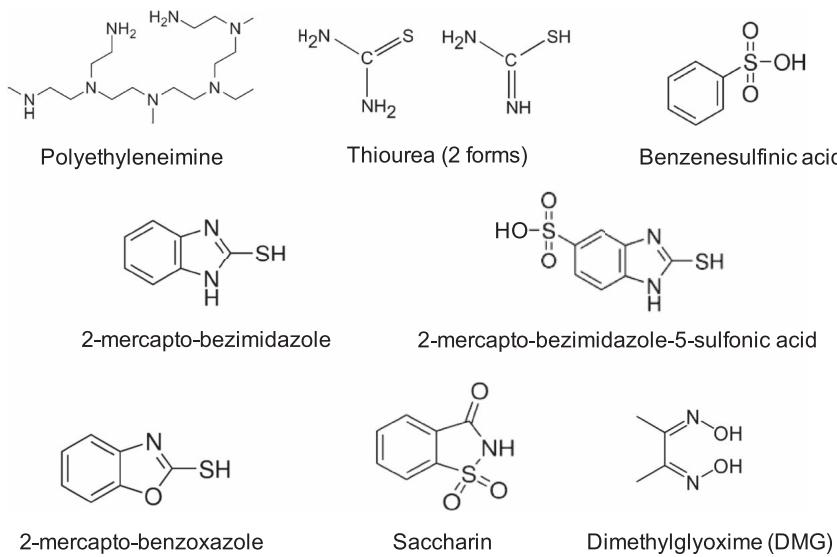  
Figure 1. Molecular structures of additives in super conformal filling studied for iron group metals20 as well as dimethylglyoxime studied in this paper.

In an effort to search for a suppressing additive for a onecomponent Co deposition chemistry, this paper presents a study of the effect of dimethylglyoxime (DMG) on the electrodeposition of cobalt. DMG and other dioxime have been previously used as an additive in Co electroless deposition,31 mainly as a stabilizer due to its strong complexing with $\dot { \mathrm { C o } } ^ { 2 + }$ . The structure of DMG, particularly in its complexed form with $\mathrm { C o } ^ { 2 + }$ , remotely mimics many of the molecules in Figure 1. However, DMG has only a pair of conjugated imine groups without any sulfur containing groups. The study of Co electrodeposition in presence of DMG is expected to shed light on the interactions between the conjugated pair of imine groups and the metal ions during the electrochemical reaction.

## Experimental

A three electrode cell with a glass frit separating the cathode and anode compartments was used for electrochemical studies. Saturated calomel electrode (SCE) was used as reference electrode in a reference compartment with a capillary to the cathode. All potential in this paper is with respect to SCE. A 99.95 wt% Co foil was used as the anode. Platinum rotating disk electrode (RDE) was used as the cathode in electrochemical studies. The rotation rate was fixed at 100 rpm unless stated otherwise.

The Co makeup solution contains 0.3 M $\mathrm { C o S O _ { 4 } } , 0 . 4 \mathrm { H _ { 3 } B O _ { 3 } }$ , and 0.1 g/L sodium dodecyl sulfate (SDS). The pH of Co solution was adjusted to 4.0 with H2SO4. DMG concentrate solution at 2 wt% (20,000 ppm, 1 ppm $\mathrm { D M G } = 8 . 6 \times 1 0 ^ { - 6 }$ M) was prepared using its sodium salt and was added into the makeup solution to make Co electrolytes with different amounts of DMG. A 0.2 M HCl solution was used to anodically strip the Co deposit on Pt. Metal free solutions was made with 0.4 M Na2SO4, 0.4 H3BO3, and 0.1 g/L sodium dodecyl sulfate (SDS) with a fixed pH of 4. All salts were at least ACS grade and deionized (DI) water with 18 MOhm was used for all solutions in this study.

The effect of DMG on Co deposition was studied with cyclic voltammetry (CV). A layer of Co was pre-plated on Pt RDE using the makeup electrolyte (DMG free). Potential was scanned from open circuit potential (OCP, typically about 0.48 V SCE) to 1.5 V with a scan rate of 5 mV/sec. The solution resistance was measured using impedance analysis at 0.65 V with a sinusoidal perturbation of 10 mV. It was found that the solution resistance does not change with the addition of DMG. Partial current densities of Co deposition was determined using the Co films deposited at different constant current densities. These films were then stripped at an anodic current density of 10 mA/cm2 in the HCl stripping solution using a rotation rate of

900 rpm. A sudden potential increase was observed once the Co film was completely stripped. The total charge before the potential increase was used to calculate the amount of Co deposited.

Potential transient studies during galvanostatic plating with injection of DMG were also conducted using Pt RDE rotating at 100 rpm. In these studies, small amount of DMG concentrate was injected at the vicinity of the cathode with the potential transients recorded. Gold quartz crystal microbalance (QCM) preplated with Co from a DMG free solution was used to study the current transients at fixed potentials in absence of agitation. Because of the tiny solution volume used in QCM Co electrolyte with double concentration of the desired DMG concentration was used in the injection of DMG. For example, 2 ml of Co solution with 200 ppm DMG was added into 2 ml DMG free Co solution in QCM cell to obtain the injection of 100 ppm DMG. The same chronoamperometry measurements were also carried out on pre-plated Pt RDE with changes in rotation rates. Electrochemical impedance spectra were acquired using Co pre-plated Pt RDE at 100 rpm. All electrochemical studies were conducted using an AutoLab electrochemical station with QCM and frequency analyzer modules.

## Results and Discussion

The effect of DMG on Co deposition was first examined with cyclic voltammetry (CV). A 100 nm layer of cobalt was deposited on Pt disc electrode in the additive free solution before each CV. A change of open circuit potential (OCP) from about 0.3 V to 0.48 V (both vs. SCE) was observed before and after this pre-plating. Potential was then swept from 0.48 V to 1.5 V with a sweep rate of 5 mV/sec. Figure 2 shows the CV curves with different amounts of DMG without and with ohmic drop correction. When no DMG was present in the solution, the cathodic deposition current started at 0.7 V and reached a current density of 2 mA/cm2 at 0.8 V and 4 mA/cm2 at 0.85 V. The forward and backward scans coincided with each other. The addition of 10 ppm DMG did not change the CV behavior. However, when 100 ppm DMG was added into the solution, the deposition was significantly polarized at low current range. The onset of the cathodic reaction did not occur until 0.9 V, after which a sudden jump of the cathodic reaction rate was observed. Furthermore, the suppressed cathodic current at low potential was not observed in the backward scan, resulting in a hysteresis in CV. Further increase of DMG concentration to 300 ppm resulted in stronger suppression of the cathodic current. This suppression was present regardless of the potential, causing a much diminished hysteresis. Figure 2b presents the same CV curves with the ohmic resistance of solution accounted for using impedance measurement. The sudden current increase in the case of 100 ppm DMG was so significant that the CV showed a S-shaped negative differential resistance after the ohmic correction.

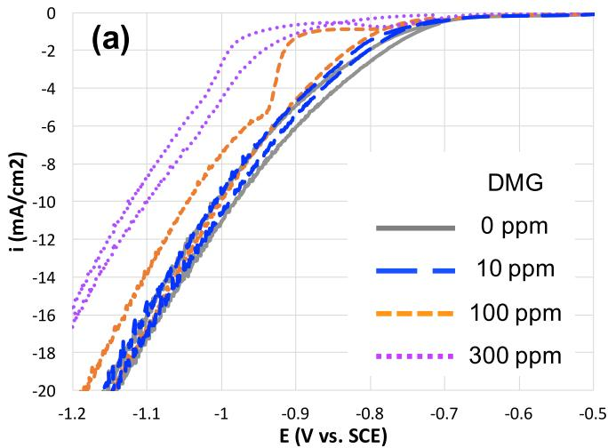

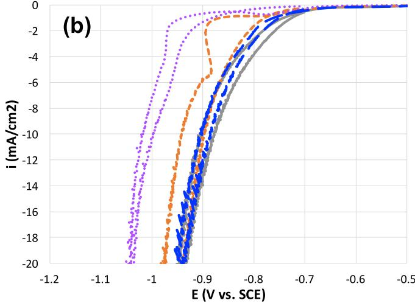  
Figure 2. Cyclic voltammtry (a) without and (b) with ohmic resistance correction of Co electrodeposition at different DMG concentrations.

This observation was very similar to the CV studies of mercaptobenzeneimidazole sulfonic acid (MBIS) for Ni and Co deposition,16,17 suggesting the suppression effect of MBIS and MBI was a result of the paired amine – imine groups. However, the DMG concentration needed to observe the current suppression effect in this study was much higher than that for MBIS.

In addition to CVs, potential transients during galvanostatic deposition was studied with injection of different amount of DMG at 100 rpm rotation and two current densities, 3 and 10 mA/cm2. It is evident from Figure 3 that the addition of DMG resulted in a fast and strong suppression effect. For example, the deposition potential $\mathrm { a t } - 3 \mathrm { m A } / \mathrm { c m } ^ { 2 }$ increased by 40 mV and 100 mV within 5 seconds after the injection of 10 ppm and 90 ppm DMG into the electrolyte, respectively. Although this potential rise was an overshoot due to the stagnant flow and the potential fell back upon further homogenization, the response time was in the same order of a typical suppressor in copper damascene chemistry,32 suggesting a fast action of DMG on Co deposition. While the additional injection of 200 ppm DMG (300 ppm in total) resulted in further suppression, experiments with DMG beyond 300 ppm showed that the suppression effect was saturated at 300 ppm. The transient at 10 mA/cm2 followed the same trend.

The suppression effect in potential transient experiments was consistent with the observation on CVs. The depolarization effect upon further injection of large amount of DMG was also observed in CV study. While the depolarization may relate to additional cathodic reactions that DMG introduces, its details are outside the scope of this paper, which focuses on the application in super conformal filling. Because DMG was added in the form of its sodium salt, electrolyte pH was changed from 4.0 to 4.12, 4.85, 5.25, and 6.08 with the addition of 10, 100, 300, and 1500 ppm DMG, respectively. In addition, DMG may also introduce additional side reaction mechanisms. Therefore, the effect on side reactions will have to be excluded to understand the true impact of DMG on Co deposition.

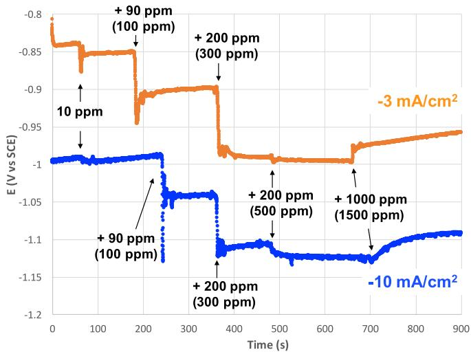  
Figure 3. Potential transients upon injection of different amount of DMG during galvanostatic Co deposition at 3 and 10 mA/cm2. The value in the parenthesis is the total amount of DMG in the solution. 1 ppm $\mathrm { D M G } = 8 . 6 \times$ $\dot { 1 } 0 ^ { - 6 } \mathbf { M }$

Figure 4 presents the CVs with the partial current densities of Co deposition and side reactions in presence of different concentrations of DMG. The electrolyte pH was fixed at pH 4 in this set of experiments. A comparison between the CVs in Figure 4 and Figure 2 showed that no difference was observed due to the different solution pHs and that the suppression effect upon the addition of DMG in Figure 2 was not related to the pH change.

The partial current density was plotted using the potentials obtained from the forward CV scan. The amount of the Co deposited on Pt RDE was obtained using electrochemical stripping method33–35 at a constant current density of 10 mA/cm2. A sudden potential increase was observed once the Co films were completely stripped. Co was stripped as $\mathrm { C o } ^ { 2 + }$ in a solution of 0.2 M HCl.33,36 Therefore, the current efficiencies as well as the side reaction rates can be computed based on the charges during stripping and the deposition. The stripping of pre-deposited Co layer was repeated 4 times to confirm the reproducibility. A current efficiency of 93.9% with a standard deviation of 0.3% were obtained for Co deposition at 10 mA/cm2 from a DMG free electrolyte. The stripping charge for this pre-deposited Co layer was subtracted from the total stripping charge of the Co films of interest.

As shown in Figure 4a, Co deposition was suppressed in the presence of 100 ppm DMG. The suppression was more pronounced as the DMG concentration increased from 100 to 300 ppm. Furthermore, the sudden current increase as well as the s-shaped negative differential resistance in CVs were proved to result from Co deposition. Side reaction current densities were presented in Figure 4b. The CVs in Co-free solutions with and without DMG were included for comparison. The side reaction current density in a DMG free electrolyte coincided with the total current density of Co-free solution. However, the side reaction rates at potentials more negative than 0.9 V significantly increased when DMG was added. On the other hand, the addition of DMG didn’t change the total current density of a metal free electrolyte. Because the Pt electrode was pre-coated with a layer of Co before all experiments, the increased side reaction is believed to be a result of additional side reaction mechanism that involves not only DMG but also Co(II). For example, a catalytic effect of Co (and Ni) was reported for the reduction of DMG.37 While the reduction of DMG into hydroxylamino-butane occurs at much higher cathodic potentials, the reduction of hydrogen in DMG molecule was found to be catalysed by the reduction of Co(II).

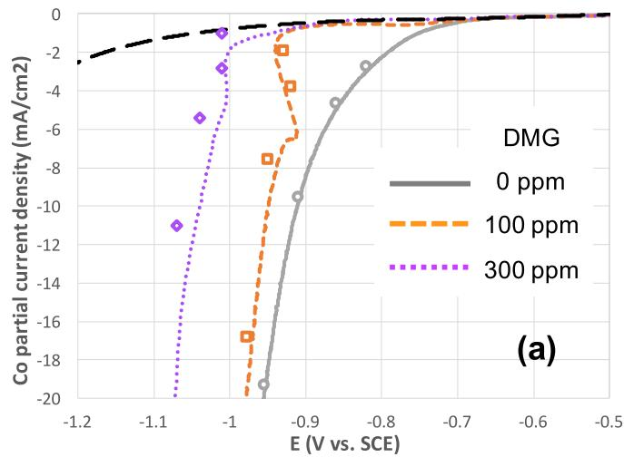

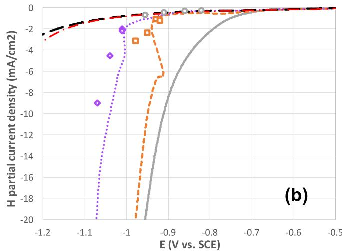  
Figure 4. Ohmic resistance corrected cylic voltammetry with (a) Co deposition and (b) side reaction partial current densities with different DMG concentrations. CVs of metal free electrolyte without (black long dash line) and with 300 ppm DMG (red dash-dot line) are included for comparison.

The degree of complexation of Co ions by DMG was calculated using literature38 stability constants for Ni(DMG) . The fractions of different forms of ligand and metal ions are presented in Figure 5. At pH of 4 or above, DMG is expected to be completely complexed with Co(II). However, even with 1500 ppm DMG and 0.3 M $\mathrm { \dot { C } o S O _ { 4 } } .$ more than 97% of Co(II) are presented in a non-complexed form regardless of solution pH. When less amount of DMG is used, the percentage of Co(II) in the non-complexed form is expected to be higher. In addition, even if Co(II) were complexed in the solution, this homogeneous complexation in the solution would not explain the potential dependent suppression effect in Co deposition.

Literatures suggested the reduction of Co(DMG)2 complex involves a surface adsorption intermediate step $\cdot ^ { 3 7 } \mathrm { ~ A ~ }$ Co surface covered by $[ \mathrm { C o } ( \mathrm { D M G } ) _ { 2 } ] _ { \mathrm { a d s } }$ is expected to behave differently for Co deposition. Furthermore, the deposition of non-complexed Co(II) may also involve an adsorbed Co(I) intermediate species.39–41 Competitive adsorption between different species can result in suppression of Co deposition. In this study, the complexed Co(II) has a very high stability constant.38 Therefore, the reduction of the $[ \mathrm { C o } ( \mathrm { D M G } ) _ { 2 } ] _ { \mathrm { a d s } }$ is believed to occur at a highly negative potential. Although the majority of Co(II) was present in the electrolyte in non-complexed form, the competition for the electrode surface due to the coverage by $[ \mathrm { C o } ( \mathrm { D M G } ) _ { 2 } ] _ { \mathrm { a d s } }$ is believed to result in the suppression effect.

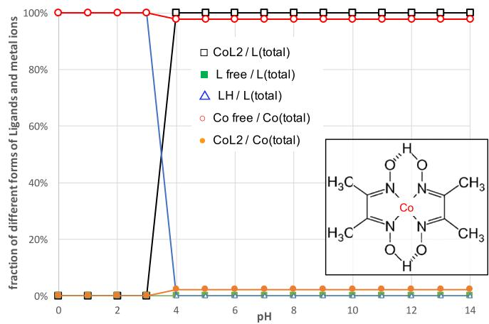  
Figure 5. Calculated fraction of ligands and Co ions in complexed and free forms. Insert is the diagram of $\mathrm { C o } ( \bar { \mathrm { D M G } } ) _ { 2 }$ planar complexed structure.

It is known that Co(DMG) forms a planar complex structure with the four sp2 hybridized N atoms in the two DMG molecules as shown in the insert in Figure 5. Co(III), if present, may be further complexed with chloride ion in the axial direction. Electrochemical experiments were also conducted in presence of up to 40 mM chloride ion. No effects were observed from chloride on the formation and breakdown of the suppression.

Electrochemical impedance spectrum (EIS) was used to further study the effects of DMG on Co electrodeposition kinetics. Figure 6a shows a comparison of three EIS on a pre-coated Co RDE at the same deposition potential of 0.85 V with different DMG concentrations. In a DMG free electrolyte, the Nyquist plot of EIS is close to a semicircle pattern representing the classic electrochemical double layer capacitive loop. At some low frequencies negative $- Z _ { \mathrm { i m g } }$ (positive

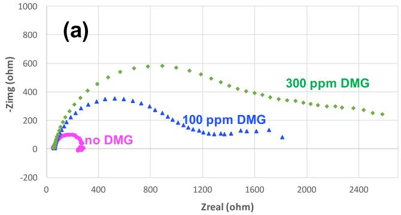

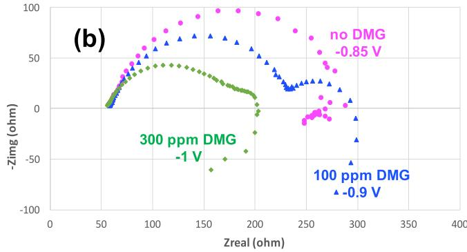  
Figure 6. Electrochemical impedance spectra of Co deposition with different DMG concentrations at (a) 0.85 V and (b) more negative potential, where the suppression effect breaks down.

$Z _ { \mathrm { i m g } } )$ values were observed, which could result from an inductive loop due to the adsorbed Co(I) intermediate species.39,42 When 100 ppm DMG was added into the electrolyte, the EIS was drastically changed. First, the double layer capacitive loop became much large, consistent with a much higher charge transfer resistance or a slower reaction. Second, at least one additional semicircle was clearly observed at a lower frequency range, suggesting additional charge transfer steps involved in the deposition. This additional EIS feature was elongated along the $\mathrm { { Z _ { r e a l } } }$ axis, indicative of possible multiple convoluted loops. Figure 6b shows the impedance in DMG-containing electrolytes at higher potentials, where the deposition was much faster. In these conditions, charge transfer resistance was much lowered. The two-step charge transfer process was much more pronounced than 6(a). In addition, an inductance loop was also clearly observed for both cases with 100 and 300 ppm DMG.

The emerge of additional charge transfer loops were reported previously for copper deposition in presence of surface adsorbed suppressors.43 The competition for surface sites between the intermediate metal species and the suppressors was found sufficient to explain the additional EIS features in copper deposition. In another detailed study on the impedance of NiFe anomalous co-deposition, the addition of Fe into Ni electrolyte was found to enhance the sensitivity of the inductance loop to deposition current.42,44 The competitive adsorption between the $\mathrm { F e ( I ) _ { a d s } }$ intermediate and $\mathrm { N i ( I ) _ { a d s } }$ intermediate resulted in a more pronounced inductance loop at certain conditions. A competitive adsorption between adsorbed species, such as $\mathrm { { C o } ( I ) _ { a d s } }$ and $[ \bar { \mathrm { C o } } ( \mathrm { D M G } ) _ { 2 } ] _ { \mathrm { a d s } }$ , is believed to relate to the inductance loop of Co deposition in this study.

An electrochemical quartz microbalance was used to study the electrodeposition as well as adsorption in absence of agitation. Figure 7a shows the current density and the QCM frequency at a constant voltage of 0.84 V. Upon the injection of 100 ppm DMG, the cathodic current dropped significantly from 2.3 to 1 mA/cm2. At the same time, the slope of the QCM frequency curve decreased significantly, indicating a slower metal deposition rate. A close look at the QCM frequency showed no sudden jump of the mass, which was observed upon injection of polyethylene glycol (PEG) during copper electrodeposition45 due to the strong fast adsorption of PEG onto Cu surface. This difference suggests that the suppressing intermediate is either more light-weighted or adsorbs more slowly than PEG in the copper case. Furthermore, the current density as well as the frequency slope kept increasing again after a maximum suppression effect. This relaxation of the suppression effect was interrupted by the replenishment of solution at electrode surface using a pipette, where a strong suppression effect was re-established suggesting a depletion and replenishment of a suppressing species at the surface.

Using the mass-frequency coefficient of the QCM, 12.3 $\mathrm { n g / c m ^ { 2 } / \bar { H } z } ,$ the partial current densities of Co deposition and side reactions were calculated and presented in Figure 7b. The total current in absence of additives (before t 60 sec) was mainly due to the deposition Co, which was consistent with the CVs in Figure 4. In addition, the cobalt deposition rate was suppressed and the side reaction rate was slightly increased upon the addition of 100 ppm DMG. While the side reaction rate remained constant as the deposition continued, Co deposition rate was gradually enhanced and doubled after 5 minutes. In addition, the current decrease upon the surface solution replenishment was confirmed to result from a strong suppression in Co deposition. The Co deposition current dropped to 0 mA/cm2 at the maximum suppression point, where the total current densities completely result from side reactions.

For a 700 sec long experiment in a solution with $0 . 3 \mathrm { ~ M ~ C o S O _ { 4 } }$ the maximum decay of a mass transport controlled Co deposition rate would result in a current down to 4 mA/cm2 based on the Cottrell’s equation46 with a typical diffusion coefficient of $1 0 ^ { - 5 } \mathrm { ~ c m } ^ { 2 } / \mathrm { s e c }$ . The current densities observed in this experiment is far below this value and therefore the depletion of Co is not believed to occur. This is also consistent with the constant Co deposition rate observed in additive free solution. When DMG was added into the electrolyte, the formation of a surface adsorbed species, for example [Co(DMG) ] , suppressed the Co deposition. However, the coverage of this adsorbed species appeared to decrease after reaching a maximum suppression effect. Therefore, this adsorbed species is believed to be broken down or be incorporated into the Co deposit. At a DMG concentration of 100 ppm the concentration of $\mathrm { C o } ( \mathrm { D M G } ) _ { 2 }$ in electrolyte was 0.4 mM with all DMG being complexed. As the surface concentration of Co(DMG)2 in electrolyte is depleted, the equilibrium between the adsorption and consumption of $[ \mathrm { C o } ( \mathrm { D M G } ) _ { 2 } ] _ { \mathrm { a d s } }$ was broken and its surface coverage decreases. However, a replenishment of $\mathrm { C o ( D M G ) } _ { 2 }$ in electrolyte at the electrode surface increased the surface coverage of $[ \mathrm { C o } ( \mathrm { D M G } ) _ { 2 } ] _ { \mathrm { a d s } }$ and reestablished the strong suppression effect. Considering the application of Co deposition in small high aspect ratio structures, this agitation dependent suppressing effect can be very useful to enable a preferential deposition at the bottom of a narrow feature, where the agitation is hard to reach.

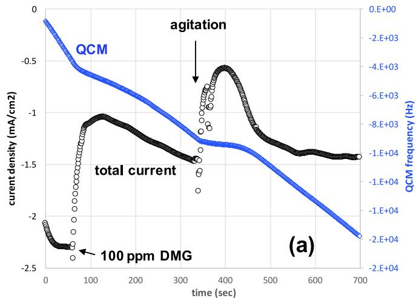

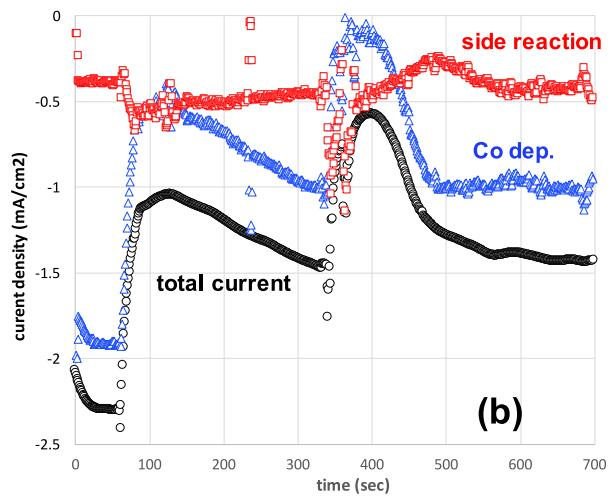  
Figure 7. (a) Current density and QCM frequency recorded during Co deposition at 0.84 V with the injection of DMG at $\mathrm { t } = 6 0$ sec and surface replenishment by pipette at $\mathrm { t } = 3 4 0$ sec; and (b) the same curves but with QCM frequency converted into the partial current densities of Co deposition and side reactions.

While a detailed study on the effect of agitation on this suppression is being conducted and will be published separately, Figure 8 shows an example of such studies $\operatorname { a t } { \bar { - } } 0 . 8 5 \operatorname { V } .$ Co electrolyte with 100 ppm DMG was used and the Pt RDE was coated with a layer of 100 nm Co. Upon the start of deposition without agitation, the deposition rate gradually increased from 0.23 m $\mathrm { A } / \mathrm { c m } ^ { 2 }$ to a steady state of 2.97 $\mathrm { \bar { m A } } / \mathrm { c m } ^ { 2 }$ . This current increase was repeatedly observed when a high rotation rate was switched off. A slight increase of the steady state current was observed as the experiment continued, which could be related to the surface roughness of the electrode. As discussed in the QCM study, the gradual increase of current can be attributed to the depletion of $\mathrm { C o ( D M G ) } _ { 2 }$ in electrolyte at the electrode surface, which causes a decrease of the surface coverage of $[ \mathrm { C o } ( \mathrm { D M G } ) _ { 2 } ] _ { \mathrm { a d s } }$ on electrode.

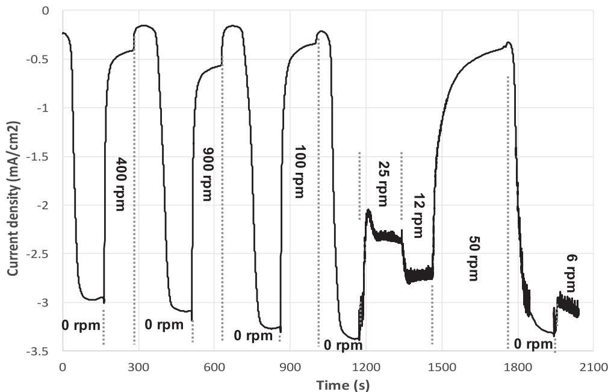  
Figure 8. Current density recorded during Co deposition at 0.85 V in the presence of 100 ppm DMG on a RDE with different rotation rates.

When a rotation rate of 400, 900, 100, and 50 rpm was applied, the current density dropped to about 0.5 mA/cm2. The higher the rotation rate, the faster the current drop. This observation was also consistent with the replenishment experiments in QCM study. A faster rotation rate results in a thinner diffusion boundary layer and a higher supply rate of $\mathrm { C o ( D M G ) } _ { 2 }$ to the electrode surface. The concentration of Co(DMG)2 at the vicinity of electrode starts to restore when excessive Co(DMG) was supplied to the electrode surface. Switching off these high rotation rates caused an immediate drop in current density followed by the gradual current increase as discussed above. The immediate current drop was probably due to the decrease of side reactions, which is under mass transport control or mixed control. A higher rotation rate before the switching caused a longer delay before the current increase. This trend can also be well explained by a higher surface concentration of $\mathrm { C o ( D M G ) } _ { 2 }$ in the electrolyte when a higher rotation rate was used. A longer time would be needed to deplete the excessive $\mathrm { C o ( D M G ) } _ { 2 }$ in the electrolyte resulted from the higher rotation rate.

In the particular case of 50 rpm, the current dropped extremely slowly when the rotation was switched on and the current drop immediate after the rotation was switched off almost disappeared. These observations suggested that the supply rate of $\mathrm { C o } ( \mathrm { D M G } ) _ { 2 }$ to the electrode at this rotation rate was approximately at equilibrium with its consumption rate on the electrode. Therefore there was no excessive $\mathrm { C o ( D M G ) } _ { 2 }$ accumulated at the vicinity of electrode and the surface coverage of $[ \mathrm { C o } ( \mathrm { D M G } ) _ { 2 } ] _ { \mathrm { a d s } }$ started to drop immediately after the rotation was stopped.

Based on the above discussion, any rotation rate below 50 rpm is expected to result in partial replenishment and partial suppression effect. Three rotation rates, 25, 12 and 6 rpm, were used and the observations confirmed the expectation. Among them, the highest rotation rate of 25 rpm resulted in the most replenishment and therefore the strongest suppression. In addition, the steady state current at these low rotation rates showed more noise than higher rotation rates because of the intrinsic small fluctuation in rotation control. As discussed above, the partial replenishment and $[ \mathrm { C o } ( \mathrm { D M G } ) _ { 2 } ] _ { \mathrm { a d s } }$ surface coverage are expected to be highly sensitive to the rotation rates.

For the application of Co deposition into deep and narrow damascene trenches (or vias), agitation at the top of trench is expected to be greater than at the bottom of trench. Super conformal deposition would be expected if the agitation at these two locations were controlled at above and below the critical rotation rate, 50 rpm in this case, respectively. Because the trench depth changes as the filling continues, the rotation rate may be engineered to enable the continuous deposition at the bottom while maintaining strong suppression at the top.

## Conclusions

Addition of dimethylglyoxime in a mild acid Co electrodeposition electrolyte suppressed the Co deposition rate and enhanced the side reaction. The potential dependent suppression effect resulted in an S-shape negative differential resistance in CV. A surface adsorbed species, for example $[ \mathrm { C o } ( \mathrm { D M G } ) _ { 2 } ] _ { \mathrm { a d s } }$ , was proposed to be responsible for the suppression. Additional capacitance and inductance loops were observed in impedance spectra upon the addition of DMG, which was consistent with the competitive adsorption between intermediate species, such as $\mathrm { { C o } ( I ) _ { a d s } }$ and $[ \mathrm { C o ( D M G ) } _ { 2 } ] _ { \mathrm { a d s } } ^ { - }$ A strong rapid suppression upon injection of DMG was observed in potential transients on a rotating disk electrode. However, this suppression effect was relaxed in absence of agitation. As the surface adsorbed species are consumed or decomposed along with deposition, the depletion of Co(DMG) in electrolyte at the electrode surface resulted in a decrease of $[ \mathrm { C o } ( \mathrm { D M G } ) _ { 2 } ] _ { \mathrm { a d s } }$ surface coverage. Replenishment of surface electrolyte re-establish the strong suppression, potentially enabling a preferential deposition at the bottom of narrow features in damascene electroplating.

This hypothesis was further confirmed with a chronoamperometry study on RDE with various rotation rates. A critical rotation rate was observed, below which $\mathrm { C o ( D M G ) } _ { 2 }$ in electrolyte was partially replenished and $[ \mathrm { C o } ( \mathrm { D M G } ) _ { 2 } ] _ { \mathrm { a d s } }$ surface coverage was partially rebuilt. In addition, higher deposition rate was observed at lower agitation, which is promising for application in damascene Co plating.

## Acknowledgments

Central analytical facility at The University of Alabama is greatly acknowledged for the training and access for the analytical facilities.

## References

1. D. Edelstein, J. Heidenreich, R. Goldblatt, W. Cote, C. Uzoh, N. Lustig, P. Roper, T. McDevitt, W. Motsiff, and A. Simon, Technical Digest of International Electron Devices Meeting, IEDM, 97, 773 (1997).

2. C.-K. Hu and J. Harper, Materials Chemistry and Physics, 52, 5 (1998).

3. W. Steinhogl, G. Schindler, G. Steinlesberger, and M. Engelhardt,¨ Physical Review B, 66, 075414 (2002).

4. W. Zhang, S. H. Brongersma, O. Richard, B. Brijs, R. Palmans, L. Froyen, and K. Maex, Microelectronic Engineering, 76, 146 (2004).

5. W. Zhang, S. H. Brongersma, Z. Li, D. Li, O. Richard, and K. Maex, Journal of Applied Physics, 101, 063703 (2007).

6. D. Gall, Journal of Applied Physics, 119, 085101 (2016).

7. M. Lane, C. Murray, F. McFeely, P. Vereecken, and R. Rosenberg, Appl. Phys. Lett., 83, 2330 (2003).

8. O. Chyan, T. N. Arunagiri, and T. Ponnuswamy, Journal of the Electrochemical Society, 150, C347 (2003).

9. T. P. Moffat, M. Walker, P. J. Chen, J. E. Bonevich, W. F. Egelhoff, L. Richter, C. Witt, T. Aaltonen, M. Ritala, M. Leskela, and D. Josell, Journal of the Electrochemical Society, 153, C37 (2006).

10. T. Nogami, M. He, X. Zhang, K. Tanwar, R. Patlolla, J. Kelly, D. Rath, M. Krishnan, X. Lin, and O. Straten, Proceedings of 2013 IEEE International Interconnect Technology Conference-IITC, pp. 1, Kyoto, Japan, 2013.

11. T. Nogami, J. Maniscalco, A. Madan, P. Flaitz, P. DeHaven, C. Parks, L. Tai, B. S. Lawrence, R. Davis, and R. Murphy, Proceedings of 2010 IEEE International Interconnect Technology Conference, pp. 1, 2010.

12. M. He, X. Zhang, T. Nogami, X. Lin, J. Kelly, H. Kim, T. Spooner, D. Edelstein, and L. Zhao, Journal ofThe Electrochemical Society, 160, D3040 (2013).

13. Q. Huang, B. C. Baker-O’Neal, C. Cabral, E. Simonyi, V. R. Deline, and M. Hopstaken, Journal ofThe Electrochemical Society, 160, D3045 (2013).

14. T. Nogami, B. D. Briggs, S. Korkmaz, M. Chae, C. Penny, J. Li, W. Wang, P. S. McLaughlin, T. Kane, and C. Parks, Proceedings of 2015 IEEE International Electron Devices Meeting (IEDM), pp. 8.1. 1-8.1. 4, 2015.

15. M. H. van der Veen, K. Vandersmissen, D. Dictus, S. Demuynck, R. Liu, X. Bin, P. Nalla, A. Lesniewska, L. Hall, and K. Croes, Proceedings of 2015 IEEE International Interconnect Technology Conference and 2015 IEEE Materials for Advanced Metallization Conference (IITC/MAM), pp. 25, 2015.

16. C. H. Lee, J. E. Bonevich, J. E. Davies, and T. P. Moffat, Journal ofthe Electrochemical Society, 156, D301 (2009).

17. C. H. Lee, J. E. Bonevich, J. E. Davies, and T. P. Moffat, Journal of The Electrochemical Society, 155, D499 (2008).

18. X. Zheng, Y.-N. Shi, and K. Lu, Journal ofThe Electrochemical Society, 162, D222 (2015).

19. X. Zheng, Y.-N. Shi, and K. Lu, Journal ofThe Electrochemical Society, 163, D349 (2016).

20. D. Liang, J. Liu, K. Reuter, B. Baker-O’Neal, and Q. Huang, Journal ofthe Electrochemical Society, 161, D301 (2014).

21. C.-C. Wei, E. Chou, S. Shih, and S.-M. Lin, Proceedings of 228th Electrochemica Society Meeting Abstract, pp. 949, AZ Phoenix, 2015.

22. T. Osaka, M. Takai, K. Hayashi, K. Ohashi, M. Saito, and K. Yamada, Nature, 392 796 (1998).

23. T. Osaka, M. Takai, K. Hayashi, Y. Sogawa, K. Ohashi, Y. Yasue, M. Saito, and K. Yamada, Ieee T Magn, 34, 1432 (1998).

24. I. Tabakovic, V. Inturi, and S. Riemer, Journal of the Electrochemical Society, 149, C18 (2002).

25. Y. Zhuang and E. Podlaha, Journal ofthe Electrochemical Society, 147, 2231 (2000).

26. T. Osaka, T. Yokoshima, D. Shiga, K. Imai, and K. Takashima, Electrochem Solid St, 6, C53 (2003).

27. F. Lallemand, L. Ricq, M. Wery, P. Bercot, and J. Pagetti, Surf Coat Tech, 179, 314 (2004).

28. E. I. Cooper, C. Bonhote, J. Heidmann, Y. Hsu, P. Kern, J. W. Lam,ˆ M. Ramasubramanian, N. Robertson, L. T. Romankiw, and H. Xu, IBM Journa ofResearch and Development, 49, 103 (2005).

29. T. Osaka, T. Sawaguchi, F. Mizutani, T. Yokoshima, M. Takai, and Y. Okinaka, Journal ofthe Electrochemical Society, 146, 3295 (1999).

30. S. Patai, Chemistry of sulphinic acids, esters and their derivatives, Wiley and Sons, New York (1990).

31. V. Paneccasio, Q. Chen, C. Valverde, N. Petrov, C. Witt, and R. Hurtubise, US (2005).

32. Q. Huang, B. C. Baker-O’Neal, J. J. Kelly, P. Broekmann, A. Wirth, C. Emnet, M. Martin, M. Hahn, A. Wagner, and D. Mayer, Electrochemical and Solid-State Letters, 12, D27 (2009).

33. J. Horkans, I. C. H. Chang, P. Andricacos, and E. J. Podlaha, Journal ofthe Electrochemical Society, 138, 411 (1991).

34. P. Andricacos, Journal ofthe Electrochemical Society, 142, 1824 (1995).

35. P. Andricacos, C. Arana, J. Tabib, J. Dukovic, and L. Romankiw, Journal of the Electrochemical Society, 136, 1336 (1989).

36. Q. Huang, D. Young, J. Chan, J. Jiang, and E. Podlaha, Journal of the Electrochemical Society, 149, C349 (2002).

37. L. A. Baxter, A. Bobrowski, A. M. Bond, G. A. Heath, R. L. Paul, R. Mrzljak, and J. Zarebski, Analytical chemistry, 70, 1312 (1998).

38. A. E. Martell and R. M. Smith, Critical stability constants, Springer, (1974).

39. N. Zech, E. Podlaha, and D. Landolt, Journal of the Electrochemical Society, 146, 2892 (1999).

40. Y. Zhuang and E. Podlaha, Journal ofthe Electrochemical Society, 150 (2003).

41. Q. Huang and E. Podlaha, Journal of the Electrochemical Society, 151, C119 (2004).

42. B. C. Baker and A. C. West, Journal of the Electrochemical Society, 144, 164 (1997).

43. J. Kelly and A. West, Journal ofThe Electrochemical Society, 145, 3477 (1998).

44. B. C. Baker and A. C. West, Journal of the Electrochemical Society, 144, 169 (1997).

45. J. Kelly and A. West, Journal ofThe Electrochemical Society, 145, 3472 (1998)

46. A. J. Bard, L. R. Faulkner, J. Leddy, and C. G. Zoski, Electrochemical methods: fundamentals and applications, Wiley, New York (1980).