# Simultaneously filling process and mechanism of through-hole and blind hole by copper electroplating

Yuhan Dai, Xiaonan Zhao, Jie Chen, Zhenyu Wang & Ning Xiao

To cite this article: Yuhan Dai, Xiaonan Zhao, Jie Chen, Zhenyu Wang & Ning Xiao (2025) Simultaneously filling process and mechanism of through-hole and blind hole by copper electroplating, Transactions of the IMF, 103:5, 246-253, DOI: 10.1080/00202967.2025.2521172

To link to this article: https://doi.org/10.1080/00202967.2025.2521172

Published online: 29 Jul 2025.

Submit your article to this journal

Article views: 362

View related articles

View Crossmark data

Check for updates

# Simultaneously filling process and mechanism of through-hole and blind hole by copper electroplating

Yuhan Dai , Xiaonan Zhao , Jie Chen , Zhenyu Wang and Ning Xiao

College of Chemical Engineering, Beijing University of Chemical Technology, Beijing, People’s Republic of China

## ABSTRACT

In this study, a traditional copper electroplating formula was used to fill microvias, which indicated that when the concentrations of Janus Green B (JGB) and bis-(sodium sulphopropyl) disulphide (SPS) were both controlled at 6 mg L−1, through-holes and blind holes can be simultaneously and perfect filled with deposited copper by regulating the convection intensity. As a result, the dimple at the mouth of through-hole was only 5 μm, and the filling performance of blind hole was 88%. Galvanostatic measurements (GMs) and computational fluid dynamics (CFD) were employed to study the microvia filling mechanism. It demonstrated that the plating solution in the centre of the through-hole was nearly stagnant under the weak convection, which resulted in the accelerator SPS being preferentially adsorbed and further enhanced the copper deposition here. It led to the formation of butterfly-like deposited copper layer in the through-hole and finally filled the through-holes and blind holes simultaneously.

ARTICLE HISTORY

Received 27 February 2025

Accepted 28 May 2025

KEYWORDS

Simultaneously filling;

through-hole; blind hole;

copper electroplating;

computational fluid

dynamics; PCB

## 1. Introduction

To meet the demands of modern electronic products for multifunctionality and miniaturisation, high-density interconnect (HDI) technology has been widely adopted in the advanced manufacturing of printed circuit boards (PCBs), particularly in fields such as 5G communications and wearable devices1–3. Currently, the integration of blind holes and through-holes plays a critical role in HDI for multilayer PCBs; the filling process of blind holes and through-holes is one of the key technologies for HDI4,5. Typically, there are two main methods for filling through-holes and blind holes. The first method involves filling the holes with insulating resin or conductive paste after the metallisation. However, due to diferences in the coeficients of thermal expansion (CTE) between the resin and copper, prolonged usage may compromise the reliability of the PCB6,7. The second method involves the complete filling of through-holes and blind holes with copper electroplating. This approach not only achieves electrical interconnection but also significantly shortens the PCB production cycle through a one-step holefilling process. Additionally, it markedly enhances the reliability, conductivity, thermal performance and mechanical properties of HDI8–10. Therefore, the copper electroplating for through-holes and blind holes has become the mainstream process to meet the requirements of HDI11.

For through-hole plating, the relatively complex pulse electroplating technique has been commonly employed12–14. Zhang et al.15 optimised the periodic reverse pulse plating process using numerical simulation methods, achieving conformal filling of through-holes with an aspect ratio of 10:1. Ning et al.16 utilised horizontal pulse copper electroplating technology to successfully achieve conformal thickening of high-aspect-ratio through-holes and super-filling of blind holes, ultimately obtaining a smooth copper layer. Compared to the complex pulse electroplating process, direct current (DC) copper electroplating ofers advantages such as lower equipment costs, simpler operational parameters and higher process stability. Liu et al.9 developed an electroplating solution formulation suitable for the simultaneous filling of through-holes and blind holes, which can be implemented using only a direct current (DC) power supply. Additionally, they optimised the process by improving the pattern plating method, thereby minimising the thickness of the surface copper. Zhao et al.17 employed 1-dodecyl-2-methyl-3-benzylimidazolium chloride (DMBI) as a leveller, successfully achieving conformal thickening in through-holes and void-free filling in blind holes. In situ ATR-SEIRAS spectroscopy and electrochemical experiments revealed that DMBI inhibits the electroreduction of copper ions by competing with SPS. Currently, the simultaneous electroplating process for through-holes and blind holes primarily focuses on achieving conformal thickening of through-holes. However, this conformal thickening approach may lead to reduced signal transmission reliability and insuficient thermal performance during the long-term use of HDI18–20. To address these issues, it is necessary to achieve complete filling of through-holes. Therefore, this study aims to develop an acidic sulphate copper plating process based on a low-voltage DC power supply to achieve simultaneous and complete filling of through-holes and blind holes.

In this study, the commonly used SPS and JGB were employed as the accelerator and leveller, respectively. Based on a clear understanding of the efects of convection intensity and additive concentration on the copper plating filling performance, a novel method of optimising the filling efect through gradient regulation of convection intensity was proposed. This approach successfully achieved simultaneous and flawless filling of through-holes and blind holes, significantly enhancing the metallisation eficiency of HDI.

## 2. Experimental

## 2.1. Electrochemical measurements

Galvanostatic measurements were carried out by using a CHI660D electrochemical workstation in a three-electrode cell containing 180 mL electrolyte at 298 K. A rotating platinum disk electrode (Pt-RDE) with a diameter of 5 mm was used as the working electrode (WE), the ${ \sf H 9 / H 9 _ { 2 } S O _ { 4 } }$ electrode (saturated ${ \sf K } _ { 2 } { \sf S } { \sf O } _ { 4 }$ solution, SMSE) was used as the reference electrode (RE), and a platinum plate was used as the counter electrode (CE). Before each testing, the Pt-RDE was placed in virgin makeup solution (VMS) containing $2 5 0 \mathfrak { g } \mathsf { L } ^ { - 1 }$ $\mathsf { C u S O } _ { 4 } { \cdot } 5 \mathsf { H } _ { 2 } \mathsf { O } , \mathsf { 5 } 4 \mathsf { g } \mathsf { L } ^ { - 1 } \mathsf { H } _ { 2 } \mathsf { S } \mathsf { O } _ { 4 }$ and 60 mg L−1 Cl− (this latter was added in the form of hydrochloric acid). It was electroplated at a current density of $1 . 0 \textrm { \textsf { A } } \dim ^ { - 2 }$ for $3 0 0 ~ \mathsf { s }$ to prepare a Cu-RDE. Subsequently, the Cu-RDE was used as the WE and placed in the various test plating solutions. The current density was maintained at $1 . 0 \mathsf { A } \mathsf { d m } ^ { - 2 }$ and the E-t curves were recorded at diferent rotation speeds. Based on the convection-dependent adsorption (CDA) $\scriptstyle { \mathrm { t h e o r y } } ^ { 2 1 , 2 2 }$ , the filling performance of the plating solution system was evalu ated by the potential diference (Δη) between high (1000 rpm or 10 rpm) and low rotation speeds (200 rpm or 0 rpm). The potential diference is defined as $\Delta \mathfrak { n } = \vee$ (average potential at lower rotation speed) – V (average potential at higher rotation speed).

## 2.2. Microvia filling by copper electroplating

A PCB with an efective plating area of $5 \times 8 \ c m ^ { 2 }$ was used as the cathode, featuring through-holes with a diameter of 100 μm and a depth of 120 μm, as well as blind holes with a diameter of 150 μm and a depth of 100 μm. A phosphorised copper plate (0.040%–0.065%) served as the anode. The plating solution was composed of VMS, 100 mg L−1 PEG8000 and varying concentrations of SPS and JGB. Before electroplating, the PCB was subjected to degreasing, microetching and ultrasonic activation pretreatments. Subsequently, the pretreated PCB and the phosphorised copper anode were placed in a Haring cell with a working volume of 1.5 L. The current density was maintained at $1 . 0 \mathsf { A } \mathsf { d } \mathsf { m } ^ { - 2 } ,$ and the electroplating was conducted for 1.5 h. Unless otherwise specified, the electroplating conditions were consistent with those described above. The convection intensity of the plating solution was adjusted by controlling the aeration. Under weak convection, no aeration was applied, while under strong convection, the aeration was set to 1 L min−1. After completing the electroplating experiments, metallographic cross-sections were prepared from three diferent regions on the cathode panel, and each electroplating exper iment was conducted at least three times.

## 2.3. Computational fluid dynamics

In this study, the FLUENT module in ANSYS was employed to simulate the velocity distribution of the plating solution inside and outside the through-hole. The dimensions of the solid were set to $1 \times 1 \times 0 . 1 2$ mm, with a through-hole diameter of 0.1 mm at the centre. The fluid regions on both sides measured $1 0 \times 1 \times 1 ~ \mathrm { { m m } }$ . The fluid was defined with a pressure inlet and the hole centre was defined with a pressure outlet. Gravity was defined as $9 . 8 \mathrm { ~ m ~ } \varsigma ^ { - 2 }$

## 3. Results and discussion

## 3.1. Filling performance efected by convection intensity

Generally, strong convection can eliminate concentration gradients in the plating solution, improving the quality of the deposited copper. Based on this, a microvia filling experiment was conducted under continuous strong convection and the results are shown in Figure 1.

It can be seen that a super conformal model had taken place in the blind hole, while the ‘butterfly-shaped’ filling model could not be achieved inside the through-holes, because, under strong convection, the plating solution flowed directly through the through-hole, which resulted in relatively strong convection in the centre of the through-holes like that on the PCB surface. Consequently, the distribution of additives inside and outside the through-hole was similar. According to the CDA model, the accelerator molecules could not accumulate in the centre of through-holes, which finally led to conforma copper deposition in through-holes. At this stage, the surface was relatively smooth. The copper deposition thickness inside the through-holes and on the PCB surface was approximately 15 μm, and the dimple at the mouth of the blind hole was 33 μm.

Given that the ‘butterfly-shaped’ filling model could not be achieved in the through-hole under continuous strong convection, the convection intensity was subsequently reduced to enhance the adsorption of accelerator molecules inside the hole. As shown in Figure. 2, copper electroplating for filling through-hole and blind hole were carried out under continuous weak convection.

As expected, the ‘butterfly-shaped’ copper layer was observed in the through-hole and led to good filling performance. In addition, the blind hole was also well filled by the deposited copper under continuous weak convection – an average depth of 17 μm at the mouth of the through-holes and a reduction to 15 μm at the blind holes. However, the PCB surface morphology exhibited nodules and vertical striations, indicating significant degradation, which could be attributed to the gradual depletion of surface copper ions and additives as the electroplating progressed. The resulting concentration gradients in the plating solution cannot be efectively eliminated through difusion, leading to a significant deterioration in surface morphology, resulting in the formation of vertical striations, nodules and other surface defects.

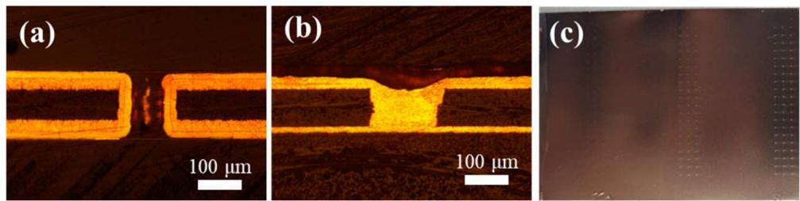  
Figure 1. Results of copper electroplating for filling through-holes and blind holes under continuous strong convection: (a) through-hole; (b) blind hole; (c) surface morphology of the PCB. The plating solution was composition of: VMS + 6 mg $\mathsf { L } ^ { - 1 } \mathsf { S P S } + 6$ mg $\lfloor ^ { - 1 } \rfloor \mathsf { G B } + 1 0 0$ mg L−1 PEG-8000.

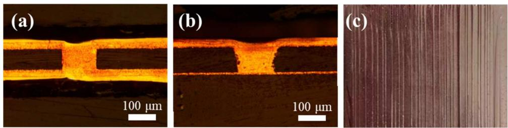  
Figure 2. Results of copper electroplating for filling through-holes and blind holes under continuous weak convection: (a) through-hole; (b) blind hole; (c) surface morphology of the PCB. The plating solution was composition of: VMS + 6 mg L−1 SPS + 6 mg L−1 JGB + 100 mg L−1 PEG-8000.

Based on the above results, the following microvia filling experiments were conducted by using a method of regulating the convection intensity gradient. For through-holes, once the ‘butterfly-shaped’ filling model had taken place and the ‘bridge’ was formed at the centre of the throughhole, it could be approximated as two symmetrical blindholes. To determine the ‘bridge’ time, microvia filling experiments were first conducted under weak convection.

As shown in Figure 3, a ‘butterfly-shaped’ filling trend emerged in the through-holes and a ‘bottom-up’ filling trend was observed in the blind holes. After 40 min of electroplating, the thickness of the copper layer on the PCB surface was 6 μm, while the copper layer thickness inside the through hole and the blind hole reached 42 and 15 μm, respectively. When the electroplating time reached 50 min, the surface copper thickness was 14 μm, the copper layers on both sides of the through-hole had bridged, and the copper thickness inside the blind hole reached 40 μm. Specifically, the copper deposition rates at the centre of the through-holes and the bottom of the blind holes were both higher than that on the surface. This copper deposition behaviour was beneficial for achieving void-free filling in both throughholes and blind holes. As shown in Figure 3(c1), after electroplating for 50 min, the deposited copper layer inside the through-hole successfully converged and formed the ‘bridge’. As a result, the through-hole was divided into two similar blind holes.

For blind holes, appropriately strong convection was facilitated to increase the diference of copper deposition rate between the PCB surface and the bottom. Therefore, after the ‘bridge’ was formed inside the through-hole, switching to strong convection could enhance the filling performance of both through-holes and blind holes as well as improve the surface morphology of the deposited copper layer. To determine the optimal convection intensity switching time, the microvia filling results obtained at diferent switching times were investigated, as shown in Figure 4.

After electroplating for 40 min, the ‘butterfly-shaped filling trend in the through-hole was apparent, but the ‘bridge’ in the through-hole had not yet occurred, let alone the complete filling of the through-hole. It indicated that switching the forced convection from weak to strong before the ‘bridge’ formation would hinder the completion of through-hole filling, even if the ‘butterfly-shaped filling trend emerged. This result can be attributed to the unique geometry of through-holes. In the through-hole, accelerator molecules were dificult to adsorb onto the inner surface of the through-hole under the strong convection, which prevented the formation of the ‘bridge’. It indicated that only after ‘bridging’ was complete in the through-hole and transformed it into two symmetrical blind holes, could switching to strong convection be facilitated to achieve perfect filling and obtain smooth deposited copper layer. In addition, it could be concluded from Figure 4 that the optimal electroplating process was first electroplating for 60 min under weak convection, then switching to strong convection and continue electroplating for

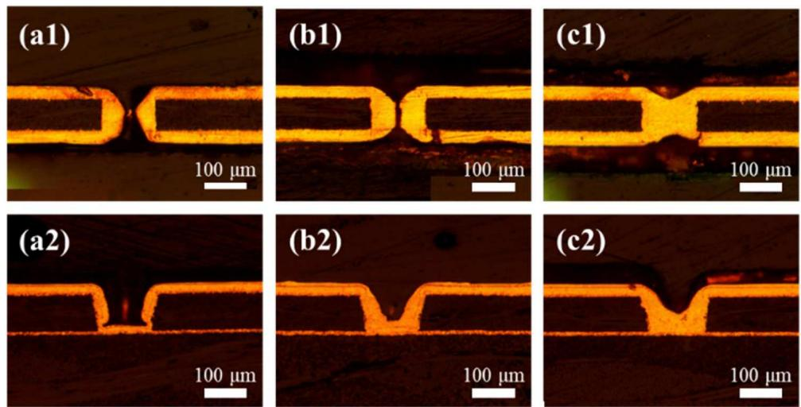  
Figure 3. Cross-sectional images of through-holes and blind holes after electroplating for diferent durations under weak convection: (a) 40 min; (b) 45 min; (c) 50 min. (a1)–(c1) through-holes, (a2)–(c2) blind holes. The plating solution was composition of: VMS + 6 mg L−1 SPS + 6 mg L−1 JGB + 100 mg $\mathsf { L } ^ { - 1 } \mathsf { P E G } \mathsf { - } 8 0 0 0 .$

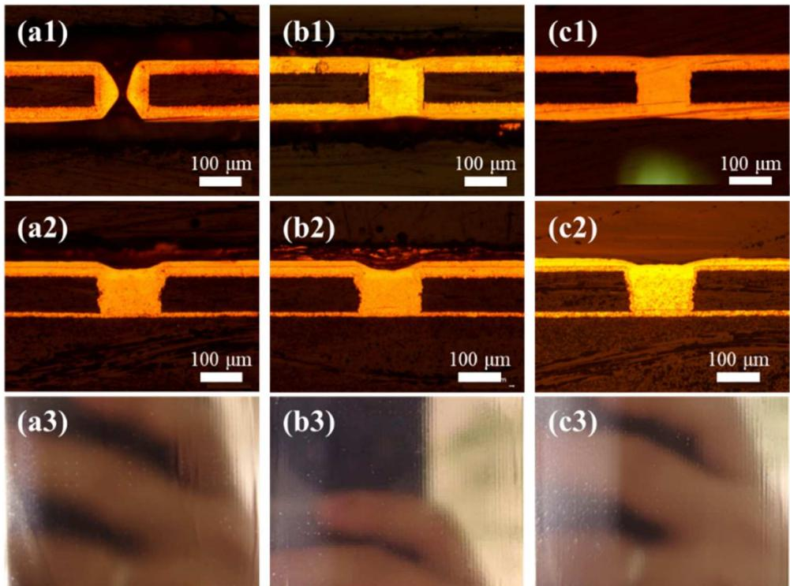  
Figure 4. Cross-sectional images of through-holes and blind holes, along with surface morphology images of the PCB, after switching convection intensity at diferent time points: (a) 40 min; (b) 50 min; (c) 60 min. The plating solution was composition of: VMS + 6 mg L−1 SPS + 6 mg L−1 JGB + 100 mg L−1 PEG-8000.

30 min. By using this method, both through-holes and blind holes could be perfect filled simultaneously. Specifically, the depth of the dimple at the mouth of the through-hole was only 5 μm and the blind hole filling performance reached as high as 88%.

## 3.2. Filling performance efected by JGB concentration

As an indispensable additive in copper electroplating, the concentration of JGB played a critical role in determining the filling performance of the plating solution. The Galvanostatic measurements (GMs) of the plating solution under high and low rotation speeds by using diferent JGB concentrations are shown in Figure 5. Under weak convection, 0 and 100 rpm were employed to simulate the convection intensities inside the hole and on the PCB surface, respectively. Under strong convection, 200 and 1000 rpm were used to simulate the convection intensities inside the hole and on the PCB surface, respectively.

According to Figure 5, the potential diferences (Δη) between high and low rotation speeds were calculated and listed in Table 1. This revealed that with the increase of JGB concentration, the Δη value showed a trend of first increasing and then decreasing under both weak and strong convection. The value of Δη reached maximum when JGB concentration was $6 \mathsf { m g } \mathsf { L } ^ { - 1 }$ . According to the CDA theory, the larger the Δη value was, the better the filling performance of the plating solution. Therefore, this concentration corresponded to the plating solution’s best filling capability.

In order to verify the above inference, microvia filling experiments were performed in the aforementioned plating solution by using the optimal electroplating process. Afte electroplating, the cross-sectional images of through-holes and blind holes along with the surface appearance of the PCB are shown in Figure 6. The dimple values for the through-holes and the filling performance for the blind holes are shown in Table 2.

It can be seen that all the plating solutions with diferent concentrations of JGB had the capability to fill through-holes and blind holes simultaneously, except Figure 6a,d,e. When the concentration of JGB was 6 mg ${ \mathsf { L } } ^ { - 1 }$ , the microvia filling performance was optimal. Specifically, the depth of the dimple at the mouth of the through-hole was only 5 μm and the blind hole filling performance was up to 88%. In addition, the surface of deposited copper layer was smoother and brighter than under other conditions.

## 3.3. Microvia filling mechanism

The GMs were carried out in the optimal electroplating solution under diferent rotation speeds and the results are shown in Figure 7. It could be noted that the copper deposition potential increased gradually with the increase of rotation speed, which could lead to decrease of the copper deposition rate. Under both weak and strong convection, the copper deposition rate at the centre of the throughhole and the bottom of the blind hole is faster than that on the PCB surface. This indicates that SPS showed stronger adsorption strength than that of JGB in these regions. Actually, according to CDA theory, SPS preferentially adsorbed onto the surface where the convection was relatively weaker, such as in the centre of the through-hole and on the bottom of the blind hole, thereby accelerating the copper deposition rate in these regions. It finally resulted in the ‘butterfly-shaped’ filling in through-holes and the ‘bottom-up’ filling in blind holes.

According to the electrochemical experimental results, the copper deposition process became increasingly dificult with the enhancement of convective intensity (electrode rotation speed).

(a1)  
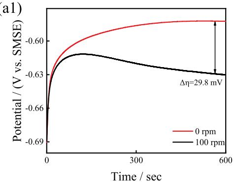

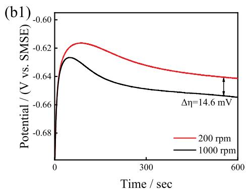

(a2)  
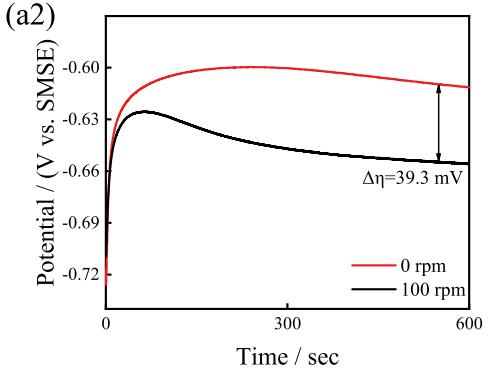

(b2)  
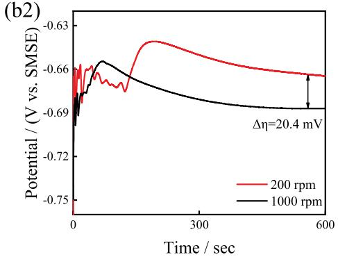

(a3)  
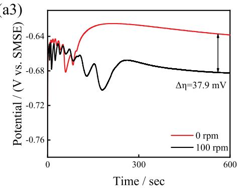

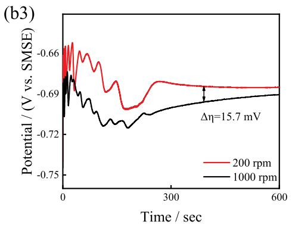

(a4)  
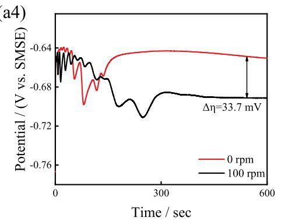

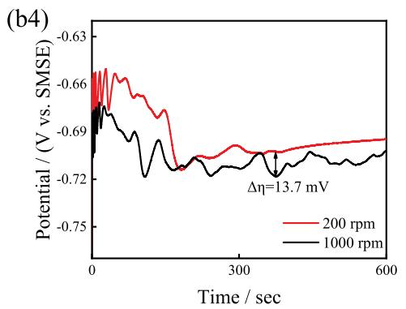

(a5)  
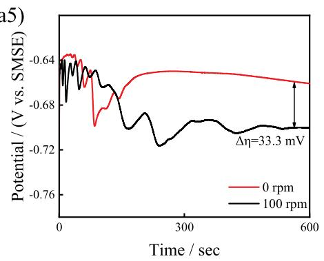

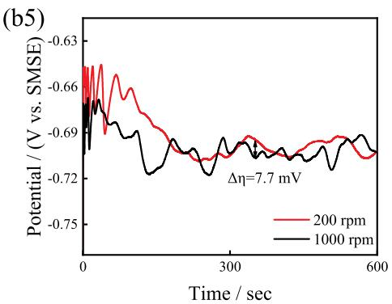  
Figure 5. GMs at diferent JGB concentrations: (a1)–(b1) 3 mg L−1; (a2)–(b2) 6 mg L−1; (a3)–(b3) 12 mg L−1; (a4)–(b4) 18 mg L $^ { - 1 } ; ( { \mathsf { a } } 5 ) { \mathsf { - } } ( { \mathsf { b } } 5 ) 2 4 \mathsf { m } { \mathsf { g } } { \mathsf { L } } ^ { - 1 }$ . The plating solution was composition of: VMS + 6 mg L−1 SPS + 100 mg L−1 PEG-8000.

Table 1. Δη values calculated under weak and strong convection based on Figure 5.

<table><tr><td rowspan="2">Concentration of JGB (mg L-1)</td><td colspan="2">Δη (mV)</td></tr><tr><td>Weak convection</td><td>Strong convection</td></tr><tr><td>3</td><td>29.8</td><td>14.6</td></tr><tr><td>6</td><td>39.3</td><td>20.4</td></tr><tr><td>12</td><td>37.9</td><td>15.7</td></tr><tr><td>18</td><td>33.7</td><td>13.7</td></tr><tr><td>24</td><td>33.3</td><td>7.7</td></tr></table>

Therefore, to clarify the velocity diferences between the inside and outside of the through-hole under weak convective during the initial stage of electroplating, and to reveal the formation mechanism of the ‘butterfly’ filling behaviour within the through-hole, computational fluid dynamics (CFD) were conducted on the through-hole structure. The simulation results are shown in Figure 8.

Figure 8a is a schematic diagram of the fluid simulation model. The calculation result is shown in Figure 8b. The red arrows indicate velocity vectors with higher speeds, while the blue arrows represent vectors with lower speeds.

Under the influence of the electric field, the solution flowed from the bulk towards the PCB surface, with the velocity concentrated outside the PCB surface. When the solution flowed into the through-hole, the velocity significantly increased at the hole entrance due to the diameter restriction and flow convergence. After entering the through-hole, the flow converged at the centre of the hole. Due to the spatial constraints inside the throughhole, the velocity vectors within the hole were nearly symmetrical, and their resultant vector approached zero. This indicates that the plating solution at the centre of the through-hole was almost stationary. This velocity distri bution pattern resulted in the flow rate outside the through-hole being significantly higher than that inside the through-hole. Combined with the electrochemical testing results, the copper deposition potential under stationary conditions is lower than that under weak convection. As a result, copper preferentially deposited at the centre of the through-hole, which led to the ‘butterflyshaped’ filling in the through-hole.

Table 2. Dimple values of the through-holes and filling performance of the blind holes based on Figure 6.

<table><tr><td>Concentration of JGB (mg L $^{-1}$ )</td><td>Dimple (μm)</td><td>Filling Performance (%)</td></tr><tr><td>3</td><td>55</td><td>38</td></tr><tr><td>6</td><td>5</td><td>88</td></tr><tr><td>12</td><td>17</td><td>73</td></tr><tr><td>18</td><td>19</td><td>59</td></tr><tr><td>24</td><td>-</td><td>57</td></tr></table>

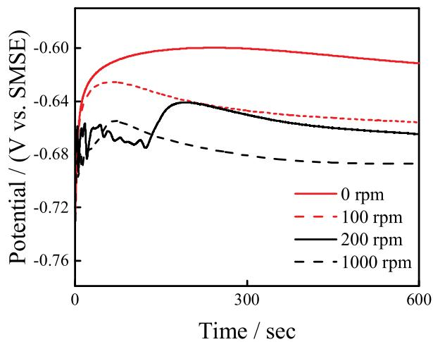  
Figure 7. GMs under diferent rotation speeds for the optimal electroplating formulation. The plating solution was composition of: VMS + 6 mg L−1 SPS + 6 mg $\mathsf { L } ^ { - 1 } \mathsf { J } \mathsf { G } \mathsf { B } + \mathsf { 1 } \dot { 0 } 0 \mathsf { m } \mathsf { g } \mathsf { L } ^ { - 1 } \mathsf { P } \mathsf { E } \mathsf { G } \mathsf { - } 8 0 0 0 .$

To further reveal the primary and secondary distribution of additives inside and outside the through-hole before and after switching the convection intensity, a model of the through-hole filling development process has been proposed based on electrochemical testing and fluid simulation results, as shown in Figure 9.

Figure 9a,b represent the distribution of additives during the initial stage of through-hole filling and the copper deposition development stage inside the through-hole, respectively. In the initial stage of electroplating; due to the large molecular weight of the suppressor and the very weak convection inside the through-hole, most of the suppressor molecules adsorbed onto the surface outside the through-hole, while JGB molecules with positive charge accumulated at the mouth of the through hole, suppressing copper deposition in this region. Inside the through-hole, the leveller and accelerator molecules were uniformly distributed, and the concentration of the suppressor was relatively low, which resulted in the copper deposition rate inside the through-hole being higher than that on the surface. As the electroplating progressed, the adsorption of the accelerator molecules became dominant at the centre of the through-hole because the convection intensity here was relatively weak. Thus, the copper deposition rate at the hole centre was significantly increased, which ultimately resulted in the ‘butterfly-shaped’ filling.

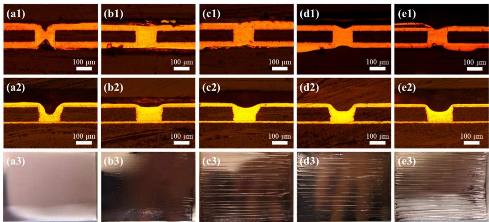  
Figure 6. Cross-sectional images of through-holes and blind holes, along with surface morphology images of the PCB, under diferent JGB concentrations: (a) 3 mg L−1; (b) 6 mg L−1; (c) 12 mg $\bar { \mathsf { L } } ^ { - 1 } ;$ (d) 18 mg ${ \mathsf { L } } ^ { - 1 } ;$ (e) 24 mg L−1. The plating solution was composition of: VMS + 6 mg $\mathsf { L } ^ { - 1 } \mathsf { S P S } + 1 0 0$ mg L−1 PEG-8000.

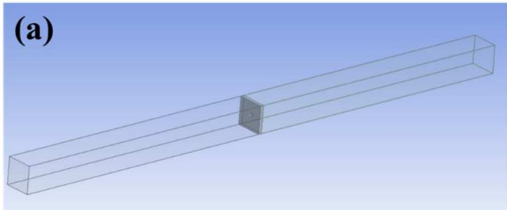

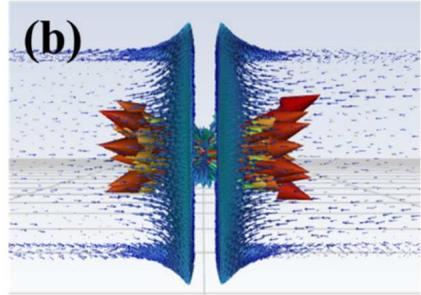  
Figure 8. Velocity vector distribution inside and outside the through-hole. (a) Schematic diagram of the model; (b) Velocity vector distribution

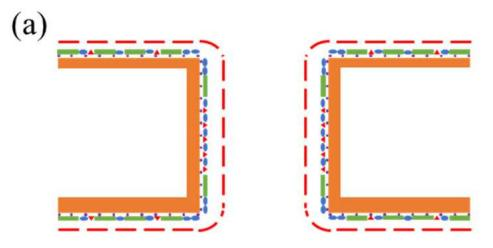

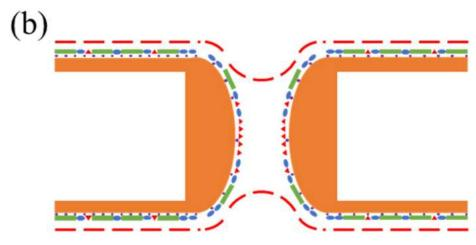

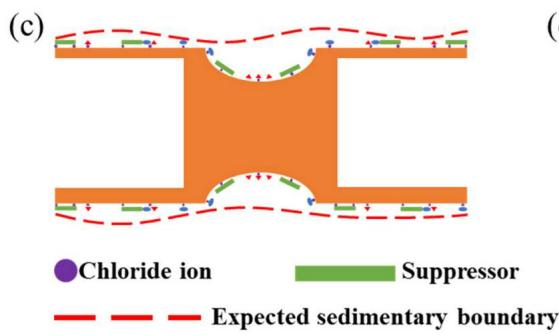

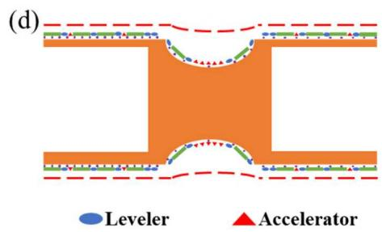  
Figure 9. Schematic diagram of the through-hole filling development process.

Figure 9c illustrates the copper deposition process under continuous weak convection. Because of the weak convection, chloride ions and additive molecules could only adsorb onto the PCB surface and inside the hole through difusion. As elec troplating progressed, chloride ions on the copper surface were consumed. Because difusion alone could not supply chloride ions to the copper surface in time, the leveller and suppressor gradually desorbed from the copper surface. This reduced the suppression and levelling abilities for copper deposition on the PCB surface, ultimately resulting in the uneven surface of the deposited copper layer.

Figure 9d illustrated the copper deposition process after achieving a ‘bridge’ inside the through-hole and switching to strong convection. At this stage, the ‘bridge’ had been achieved inside the through-hole and changed it into two symmetrical blind holes. Upon switching to strong convection, the concentration diferences of the components in the plating solution were eliminated, and chloride ions as well as additives on the copper surface were replenished and re-adsorbed. The accelerator preferentially adsorbed at the bottom of the blind holes, where the convection was weak. Meanwhile, the leveller and suppressor preferentially adsorbed on the surface and at the hole openings, where the convection was strong. This ultimately resulted in overfilling of the two symmetrical blind holes.

The distribution of additives during the blind hole filling process was similar to that of through-holes. The convection intensity being switched from weak to strong could efectively eliminate the concentration diferences in the plating solution. It promoted the additive molecules to re-adsorb uniformly onto the copper surface, finally producing a deposited copper layer which was smooth and bright.

## 4. Conclusion

This study demonstrated that simultaneous filling of throughholes and blind holes could not be achieved through continuous strong convection alone. While continuous weak convection enabled filling, it resulted in uneven copper deposition surfaces. These challenges were efectively resolved by implementing time-dependent convection control. Using the plating solution containing 6 mg L−1 bis(3-sulphopropyl)

disulphide (SPS) and 6 mg ${ \mathsf { L } } ^ { - 1 }$ Janus Green B (JGB), the optimised process involved initial electroplating under weak convection for 60 min to establish a characteristic ‘butterflyshaped’ filling pattern and central ‘bridge’ formation within through-holes. Subsequent switching to strong convection for 30 min yielded complete void-free filling with superior surface morphology. Specifically, the depth of the dimple at the mouth of the through-hole was maintained at 5 μm, while the blind hole filling eficiency reached 88%.

Electrochemical analysis coupled with CFD simulations enabled the development of a novel TH filling mechanism model. The model elucidated two critical phenomena: (1) a substantial convection gradient existed between the external and internal through-hole regions and (2) weak convection conditions promoted lower copper deposition potentials. These factors synergistically facilitated preferential copper deposition at the through-hole centre, initiating the charac teristic butterfly-shaped filling pattern. Following bridge for mation, the through-hole efectively transformed into two symmetrical blind holes, allowing subsequent strong convection to enhance both filling uniformity and surface quality.

## Disclosure statement

No potential conflict of interest was reported by the author(s)

## Funding

This work was financially supported by the Natural Science Foundation of China (Project ID 21902010) and Highnic Group (China).

## ORCID

Yuhan Dai http://orcid.org/0009-0008-2061-6466

Xiaonan Zhao http://orcid.org/0009-0001-8883-8697

Jie Chen http://orcid.org/0009-0007-2303-4368

Zhenyu Wang http://orcid.org/0009-0008-9477-1936

Ning Xiao http://orcid.org/0000-0001-8613-4517

## References

1. R. Song, X. Zhao, Z. Wang, H. Fu, K. Han, W. Qian, S. Wang, J. Shen, B. Mao and D. He: Adv. Eng. Mater., 2020, 22(10), 2000451.

2. Y. B. Zhang, T. Zhang, H. B. Shi, Q. Liu and T. Wang: Appl. Surf. Sci., 2021, 547, 149220.

3. L. Zheng, W. He, K. Zhu, C. Wang, S. X. Wang, Y. Hong, Y. M. Chen, G. Y. Zhou, H. Miao and J. Q. Zhou: Electrochim. Acta, 2018, 283(1), 560– 567.

4. O. Lühn, C. Van Hoof, W. Ruythooren and J. P. Celis: Electrochim. Acta, 2009, 54(9), 2504–2508.

5. C. Chang, X. B. Lu, Z. W. Lei, Z. L. Wang and C. Zhao: Electrochim. Acta, 2016, 208, 33–38.

6. G. Y. Lin, J. J. Yan, M. Y. Yen, W. P. Dow and S. M. Huang: J. Electrochem. Soc., 2013, 160(12), D3028–D3034.

7. F. Y. Shen, W. P. Dow, A. H. Liu, J. Y. Lin, P. H. Chang and S. M. Huang: Ecs Electrochem. Lett., 2013, 2(5), D23–D25.

8. W. P. Dow, D. H. Liu, C. W. Lu, C. H. Chen, J. J. Yan and S. M. Huang: Electrochem. Solid State Lett., 2011, 14(1), D13–D15.

9. J. Liu, J. D. Chen, Z. Zhang, J. L. Yang, W. He and S. J. Chen: Circuit World, 2016, 42(3), 141–151.

10. S. Kenny and B. Roelfs: ICEPT-HDP, 2009, 838-842.

11. B. Roelfs, N. Dambrowsky, C. Erben and S. Kenny: Circuit World, 2012, 38(3), 113–123.

12. W. Hansal: Trans. IMF, 2018, 96(3), 115–117.

13. C. Sherwin, S. Chakraborty, K. Raju, S. Bhat and S. P. Hebbar: Trans. IMF, 2023, 101(4), 189–195.

14. M. Y. Huang, M. Uhlemann, K. Eckert and G. Mutschke: Magnetochemistry, 2022, 8(7), 66.

15. Y. H. Zhang, M. Z. An, P. X. Yang and J. Q. Zhang: Colloids Surf. a Physicochem. Eng. Aspects, 2022, 655, 130238.

16. M. J. Ning, W. He, X. Z. Tang, Z. H. Tao, X. M. He, L. Xiang, Y. S. Hu, X. H. Su and S. G. Cheng, Ieee: 7thIMPACT, 2012.

17. Y. Zhao, Z. Y. Wang, L. Jin, J. Q. Yang, T. Song, F. Z. Yang and D. P. Zhan: Colloids Surf. a-Physicochem. Eng. Aspects, 2024, 695, 134239.

18. W. P. Dow and H. H. Chen: Circuit World, 2004, 30(3), 33–36.

19. F. Y. Shen, W. P. Dow, A. H. Liu, J. Y. Lin and S. M. Huang: ECS Electrochem. Lett., 2013, 2(5), D23–D25.

20. Z. Q. Yang, X. P. Ouyang, X. Zhang, R. Lu and J. Lin: Printed Circui Information, 2012, 1, 24–27.

21. W. P. Dow, H. S. Huang and Z. Lin: Electrochem. Solid-State Lett., 2003, 6(9), C134.

22. W. P. Dow, C. C. Li, Y. C. Su, S. P. Shen, C. C. Huang, C. Lee, B. Hsu and S. Hsu: Electrochim. Acta, 2009, 54(24), 5894–5901.