http://pubs.acs.org/journal/acsodf

# Prediction and Efect Verification of Thiamine as a Leveling Agent in Chip Wafer Electroplating

Hu Wei, Tong Tan, Renlong Liu,\* Lanfeng Guo, Changyuan Tao, and Xiang Qin

Cite This: ACS Omega 2023, 8, 45495−45501

Read Online

ACCESS

Metrics & More

ABSTRACT: Thiamine, a nitrogen-containing heterocyclic compound, is explored for the first time as a novel leveling agent in this study. Based on the density functional theory (DFT) calculations and molecular dynamics (MD) simulations of the adsorption process of thiamine and the commonly used leveling agent JGB, the average values of the binding energies after equilibrium of thiamine and JGB are similar, which indicates that the thiamine molecules have strong bonding ability with the surface of copper and can be adsorbed tightly on the surface of copper. By cyclic voltammetry (CV) curve, thiamine was found to inhibit copper deposition and the inhibition efect was stronger than JGB. The chrono potential curve (CP) test found that the potential diference $\triangle \eta = 8 7 > 5 0$ mV at high and low speeds of thiamine, which indicates that thiamine has the potential to be used as a leveling agent. Electrochemical impedance spectroscopy (EIS) testing found that thiamine inhibited copper precipitation by inhibiting the reactions of $\mathrm { C u } ^ { 2 + } \to \mathrm { C u } ^ { + }$ and $\mathrm { C u } ^ { + } $ Cu. According to electroplating experiments, thiamine has a leveling efect on wafer electroplating and can be used as a leveling agent because the copper layer on the wafer obtained by adding it has a smoother surface compared to the copper layer obtained without adding it. It was found that wafer electroplating does not require PEG, and only adding 55 mg/L Cl−, 6 mg/L SPS, and 4 mg/L thiamine as additives can achieve a good filling efect.

Article Recommendations  
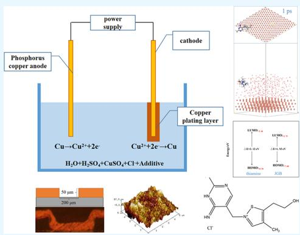

## 1. INTRODUCTION

Silicon through hole (TSV) technology, as one of the core technologies of 3D packaging, has been studied by a large number of scholars at present.1−3 TSV is the interconnection of diferent chips and wafers by filling them with conductive metal through microvia. Compared with most metals, copper has lower resistivity and better resistance to electromigration, so the conductive metal used in TSV technology is mainly copper.4 Direct use of the copper sulfate electroplating solution for microporous electroplating frequently results in issues, including uneven coating, flaws, and defects. Therefore, the electroplating solution often contains some additives for auxiliary electroplating, such as Cl−, accelerator, inhibitor, and leveling agent. The synergistic efect between appropriate additives can achieve better filling efect in microporous electroplating.5−7

Leveling agents, like inhibitors, have the same efect on inhibiting copper deposition.8 Currently, there is no complete consensus on the mechanism of action of leveling agents. According to reports, leveling agents can be roughly divided into two categories: quaternary ammonium cation or positively charged nitrogen-containing heterocyclic compound.9 JGB is one of the most studied leveling agents. As shown in Figure 1, JGB is a nitrogen-containing heterocyclic compound with a positive charge. Since JGB contains N+ during the electroplating process, it tends to adsorb in high charge density areas like plating raised points and microporous orifices and other locations to inhibit the copper from rising, while the depression adsorbs less leveling agent, by the inhibitory efect being less, and can therefore play the role of leveling. At present, many academics hold this belief.10 Thiamine is a positively charged quaternary ammonium cation macromolecule, and its molecular weight (300.5) is smaller than that ofJGB (510. 5), and its mass charge ratio is lower. Under the same volume, thiamine absorbs more in the high charge density area. If thiamine has the efect of inhibiting copper deposition, it may be easier to inhibit and level the efect relative to JGB.

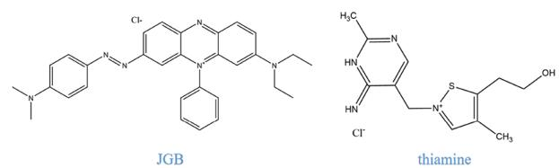  
Figure 1. Structural formula of the leveling agent.

Currently, there are few studies on the leveling efect of thiamine applied to electroplated copper deposition, and this study is the first study of the leveling efect of thiamine. Through electrochemical tests, quantum chemical theory calculations, molecular dynamics simulation, and other methods, we compared the properties of thiamine with those of the published leveling agent JGB and found that it has a better inhibition of copper electroplating deposition and a stronger adsorption capacity on the copper surface. In the wafer plating test, it was discovered that as compared to the plating solution without thiamine molecules, the plating solution including thiamine molecules plated the copper layer and greatly reduced the surface roughness of the wafer.

## 2. EXPERIMENT

2.1. Quantum Chemistry Calculation and Molecular Dynamics Simulation. Quantum chemistry calculation is a theoretical calculation method, which is widely used to explore the interactions and reactions between molecules.11,12 This simulation experiment uses the Gaussian 09W and GaussView, with $\mathrm { B } 3 \mathrm { L Y P } / \bar { 6 } { \cdot } 3 1 1 \mathrm { G } ( \mathrm { d } , \mathrm { p } )$ as the base group ,13,14 uses DFT as a calculation method, optimizes the structure of JGB and thiamine molecules, as well as calculates the highest occupied molecular orbital (HOMO), lowest unoccupied molecular orbital (LUMO) energy, and energy gap values of thiamine molecules ΔE $\left( \Delta E = \mathrm { \bar { \it E } _ { L U M O } } - \mathrm { \bar { \it E } _ { H O M O } } \right)$ , and this experiment analyzes the active site of thiamine molecule by obtaining the HOMO, the lowest altitude orbit, and the electron cloud density distribution map, infers the adsorption behavior on the copper layer surface,15,16 and compares it with the leveling agent JGB as the standard to determine the adsorption capacity of thiamine molecules. In this simulation method, the calculation formula for the interaction energy $\left( E _ { \mathrm { i n t e r a c t } } \right)$ is as follows:

$$
E _ {\mathrm{interact}} = E _ {\mathrm{tot}} - (E _ {\mathrm{subs}} + E _ {\mathrm{inh}}); E _ {\mathrm{adsorption}} = - E _ {\mathrm{interact}}
$$

$E _ { \mathrm { t o t } }$ represents the total energy of the system. $E _ { \mathrm { s u b s } }$ represents the energy of the copper crystal. $E _ { \mathrm { i n h } }$ represents the free energy of the thiamine molecule. $E _ { \mathrm { i n t e r a c t } }$ interaction energy is the total energy of the system, which is the energy of copper minus the energy of the copper crystal and the thiamine molecule, and $E _ { \mathrm { a d s o r p t i o n } }$ represents the adsorption energy of the thiamine molecule and the copper surface, which is the opposite of the collective energy in value.

MD simulation, which may be used to simulate and study molecular motion behavior, is widely employed in scientific simulation research.17,18 The Materials Studio used in this experiment creates a simulation box with periodic boundary conditions in the Forcite module $( 2 5 . 6 \times 2 \bar { 5 . 6 } \times 6 0 \mathrm { n m } ^ { 3 } )$ , and the simulation box contains one leveling agent molecule and 500 water molecules. Dynamics was selected and ensemble NTV was selected, with a simulation step of 1 fs and a total time of 500 ps. The force field Compass was used to predict the adsorption behavior of the studied molecules JGB and thiamine on the Cu(111) crystal plane. After waiting for the end of the run, the adsorption posture of the molecules on the copper surface in solution was analyzed and the magnitude of the adsorption energy was calculated, and this was used to predict the leveling capacity of the studied molecules.

2.2. Electrochemical Detection. The experiment uses a three-electrode system, with the mercury(I) sulfate electrode as the reference electrode, the Pt electrode/rotating disk Pt electrode as the working electrode, and the phosphorus copper electrode as the counter electrode. The CHI760E electro chemical workstation purchased by Shanghai Chenhua Instrument $\mathrm { C o . }$ , Ltd. is used to test the $\operatorname { C V } , \operatorname { C P }$ curves, and EIS tests. The CV test scan range is −0.8 to 0.4 V, the scanning speed is 0. 01 V/s, scanning is for 3 cycles, and the second cycle is selected as the usage data. CP is the potential diference between 100 and 900 rpm under the current density of 20 ${ \mathrm { m A } } / { \mathrm { c m } } ^ { 2 } .$ . The EIS test is conducted under the open circuit voltage, the frequency range is 0.01−100,000 $\mathbf { H z } ,$ and the amplitude is 5 mV. Before the test, the electrode needs to be polished and rinsed with ultrapure water. The Virgin Makeup Solution (VMS) used is a combination of 220 g/L copper sulfate pentahydrate and 55 g/L sulfuric acid. The Cl− used in the experiment is 55 mg/L, SPS is 6 mg/L, and PEG is 220 mg/L.

2.3. Copper Electroplating Experiment. This study is divided into two parts, for electroplating. First, copper sheets are used as cathodes for electroplating, and the surface roughness of copper obtained from electroplating in diferent solutions is observed through AFM testing. Second, wafers are used as electroplating samples, and the wafer specifications are shown in Figure 2. The depth of micropores in the

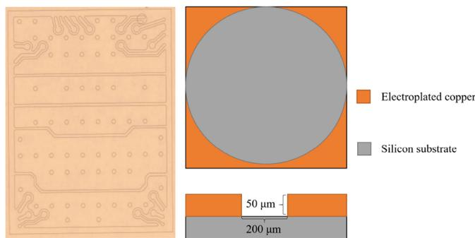  
Figure 2. Wafer structure diagram.

electroplating wafer is 50 $\mu \mathrm { m } ,$ and the diameter is 200 μm. During electroplating, the wafer fragments are placed in a container and stirred with a stirrer at a speed of 360 rpm. After electroplating, the wafer is placed in ethanol for ultrasonic 20 min to remove the photoresist on the surface and polished with a polishing machine. The cross-section is observed under a metallographic microscope (MIT500, China). The VMS used is a combination of 220 $\mathrm { g / L }$ copper sulfate pentahydrate and 55 $\mathbf { g } / \mathrm { L }$ sulfuric acid. The $\bar { \mathrm { C l } } ^ { - }$ used in the experiment is 55 mg/L, SPS is 6 mg/L, and PEG is 220 mg/L.

## 3. RESULTS AND DISCUSSION

3.1. Quantum Chemistry Calculation and Molecular Dynamics Simulation. As shown in Figures 3−5, the optimized structure schematic, HOMO energy diagram, and LUMO energy diagram of JGB and thiamine molecules were calculated using the software Gaussian 09W and GaussView. Among them, gray white represents H atoms, gray represents C atoms, red represents O atoms, dark blue represents N atoms, and yellow represents S atoms. It can be seen from Figures 4 and 5 show that the electron cloud in JGB is concentrated on the N atom and benzene ring, and the electron cloud is relatively uniform in general, which may be parallel adsorbed on the surface of the copper layer in a large area to provide large electrodeposition steric resistance; the electron cloud of the thiamine molecule is concentrated on $\mathrm { N ^ { + } } ,$ $\mathrm { N } ,$ S atoms and pyrimidine ring, which indicates that N+, N, S atoms and the pyrimidine ring in the thiamine molecule are the adsorption sites of the thiamine molecule adsorbed on the surface of the copper layer, and the thiamine molecule can be adsorbed on the surface of the copper layer by providing lone pair.

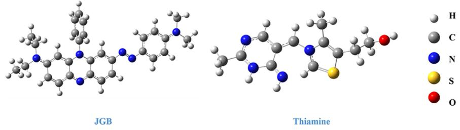  
Figure 3. Optimized leveling agent structure.

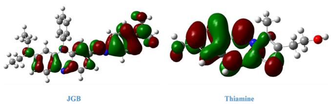  
Figure 4. HOMO energy diagram of the leveling agent.

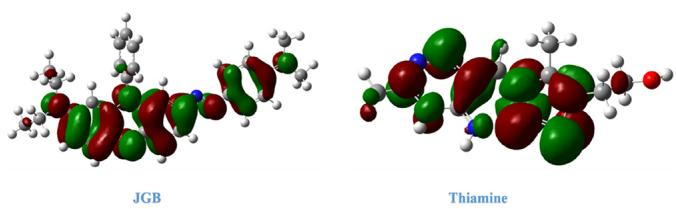  
Figure 5. Leveling agent LUMO energy diagram.

According to molecular front orbital theory, the ability of molecules to provide and receive electrons can generally be judged according to the energy gap of the HOMO and LUMO energies. The HOMO energy is higher; the ability to provide electrons is stronger. The lower the LUMO energy, the stronger is the ability to accept electrons. Therefore, the energy gap value, $\Delta E ,$ characterizes the adsorption capacity of organic molecules on metal surfaces. The lower the $\bar { \Delta } E ,$ the stronger the adsorption capacity.19−21 The ΔE of thiamine molecules in this experiment is $3 . { \dot { 1 } } 2 { \ \mathrm { ~ e V } } ,$ and the ΔE of JGB is 1.93 eV (Table 1). Although $\Delta E _ { \mathrm { t h i a m i n e } }$ is greater than $\Delta E _ { \mathrm { J G B } } , \Delta E _ { \mathrm { t h i a m i n e } }$ is less than some ΔE of leveling agents, such as ΔE tricyclazole is 6. 36 $\mathrm { e V . } ^ { 2 2 }$ Therefore, the energy gap of ΔE indicates that thiamine has an adsorption capacity.

Common copper crystal planes include (111), (200), and (220), among which the (111) crystal plane is the densest and its conductivity is the best. Currently, most scholars often use the (111) crystal plane for simulations in MD simulation.12,23−25 Figure 6 shows the MD simulation of thiamine

Table 1. Leveling Agent Energy Table

<table><tr><td></td><td> $E_{\text{HOMO}}$  (eV)</td><td> $E_{\text{LOMO}}$  (eV)</td><td> $\triangle E$  (eV) =  $E_{\text{LUMO}} - E_{\text{HOMO}}$ </td></tr><tr><td>thiamine</td><td>-8.56</td><td>-5.44</td><td>3.12</td></tr><tr><td>JGB</td><td>-7.68</td><td>-5.75</td><td>1.93</td></tr></table>

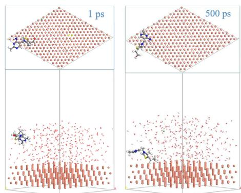  
Figure 6. Thiamine simulation box status.

molecules on the copper(111) crystal plane. From Figure $^ { 6 , }$ it can be seen that the thiamine molecules have a certain angle and distance from the surface of the copper layer in the initial stage. However, in the front view of the simulated final state adsorption, it can be seen that the thiamine molecules are almost tightly attached to the surface of the copper layer, and the distance is closer than the initial state. Based on theoretica calculations, it can be inferred that the thiazole ring of the thiamine molecule provides p electrons and lone pair electrons of heteroatoms to metal copper, thereby changing the adsorption state. In addition, from the top view, it can be observed that the thiamine molecule adheres parallel to the surface of the copper layer, which can hinder the adsorption of ${ \mathrm { C u } } ^ { 2 + }$ on the surface of the copper layer during the actual electroplating process. The leveling agent JGB was also subjected to simulations using identical conditions, and it was discovered that JGB likewise displays comparable behavior, as shown in Figure 7. Thiamine molecules, on the other hand, are substantially closer to the Cu surface than JGB, which suggests that they may create a denser layer on the Cu surface.

Moreover, in addition to the adsorption state that predicts the efect of thiamine molecules on $\dot { \mathrm { C u } } ^ { 2 + }$ precipitation during electroplating, the adsorption energy can also reflect the adsorption capacity of thiamine molecules on the copper surface.

Through calculation, the adsorption energy from the initial state to the final state is plotted in Figure 8. The average $E _ { \mathrm { a d s o r p t i o n } }$ after thiamine reaches equilibrium is about −535.8 kcal/mol, and the average $E _ { \mathrm { a d s o r p t i o n } }$ after JGB reaches equilibrium is about −559.8 kcal/mol, which indicates that the thiamine molecule, like the JGB, has a strong bonding ability with the copper surface, and the thiamine molecule can be closely adsorbed on the copper surface. Therefore, it can be

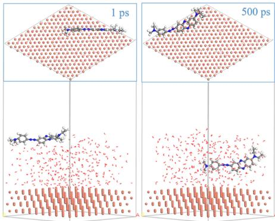

Figure 7. JGB simulation box status.

considered that the thiamine molecule is a potentially efective leveling agent.

3.2. Electrochemical Behavior Analysis. Figure 9 shows the CV testing experiments in the following four solutions: VMS, VMS + 55 mg/L Cl−, VMS + 55 mg/L $\mathrm { C l } ^ { - } + 4$ mg/L thiamine, and VMS + Cl− + 4 mg/L JGB. The peak area of the oxidation peak on the CV curve can represent the deposition amount of copper.24,25 It is easy to see that compared to the VSM solution, the peak area increases after the addition of Cl− ions, indicating that the addition of Cl− ions promotes copper precipitation. After adding JGB and thiamine, the CV oxidation peak area decreases, and the peak area of the solution is the smallest after adding thiamine. Therefore, it can be inferred that thiamine can inhibit ${ \mathrm { C u } } ^ { 2 + }$ precipitation, and the inhibitory efect is better than JGB3.

Figure 10 shows the CP curve tested at diferent rotational speeds. As shown in the figure, when 1 mg/L thiamine is added at 100 s, the overpotential of the solution begins to move negatively, and when thiamine continues to be added to the solution, the potential of the solution continues to move downward. Combined with Figure 9, it can be considered that thiamine achieves the inhibition efect of copper precipitation by making the potential of the copper electrode move negatively. Since the flow rate inside and outside of the micropore is diferent (the flow rate inside the micropore is lower and the flow rate outside the hole is higher), the potential diference under high and low rotational speeds can be used $\begin{array} { r } { \triangle _ { \eta } ( \triangle \eta = \eta _ { \mathrm { L o w \ s p e e d } } - \eta _ { \mathrm { H i g h \ s p e e d } } ) } \end{array}$ to study the ability of hole leveling and filling. Generally speaking, in the study of copper electroplating, the larger the $\triangle \eta ,$ the stronger the leveling ability of the additive, and the better the efect of microporous $\mathrm { { f l l i n g . } ^ { 2 6 } }$ As can be seen from the figure, the potential of the rotating disk at 900 rpm is lower than that at 100 rpm, indicating that the inhibition induced by thiamine inside the pore is not as good as that induced outside the pore. It has a small impact on the filling inside of the micropore and is conducive to the superconformal growth inside the micropore. Generally speaking, commercial leveling agents $\triangle \eta \geq 5 0$ mV. From the test results, it can be seen that for thiamine, $\triangle \eta = \eta _ { 1 0 0 \mathrm { r p m } } - \eta _ { 9 0 0 \mathrm { r p m } } = 8 7 > 5 0$ mV, which indicates the potential of thiamine as a commercial leveling agent.

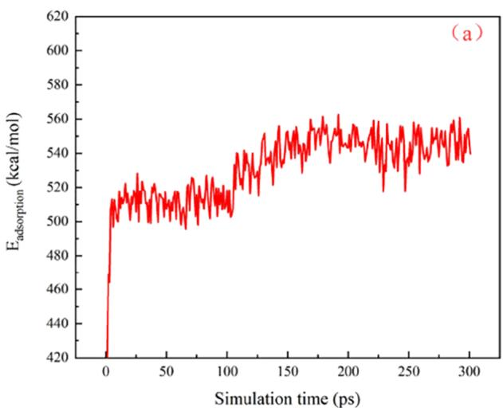

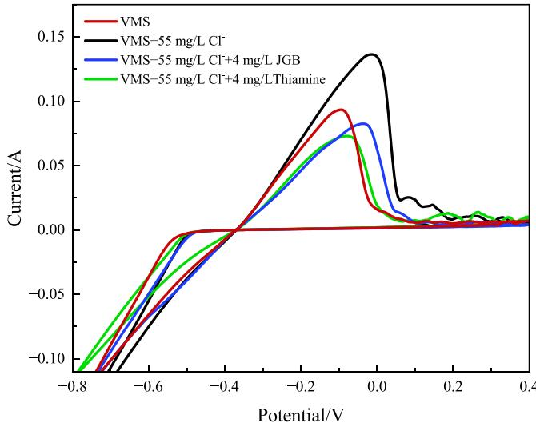  
Figure 9. Comparison of CV curves of diferent solutions

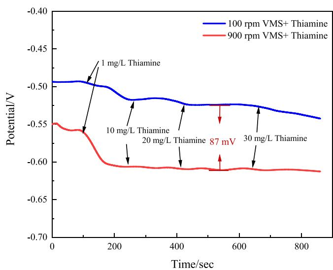  
Figure 10. CP test chart of the thiamine containing solution.

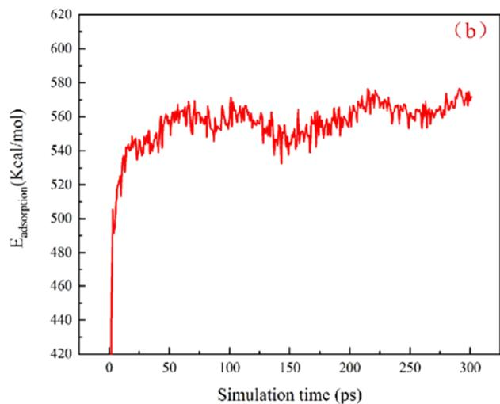  
Figure 8. Adsorption energy of the leveling agent on the copper(111) crystal surface (a) thiamine (b) JGB.

Figure 11 shows the Nyquist plot obtained from EIS testing of VMS containing diferent additives under an open circuit

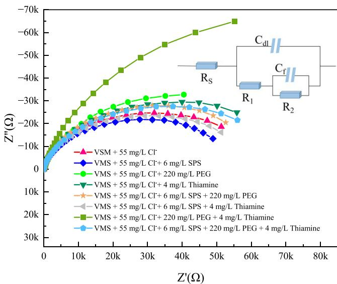  
Figure 11. EIS for copper in VMS with diferent concentration of inhibitors.

voltage. The diameter of the semicircle in the figure is related to the total resistance of the solution. The larger the resistance, the larger the diameter. As shown in the figure, after the addition of thiamine, the diameter of the semicircle increases, indicating that thiamine will hinder the deposition of copper. This is consistent with the CV and CP test results.

Figure 11 also shows the fitting circuit obtained by using experimental data, and the relevant parameters are listed in Table 2. In this circuit, $R _ { \mathrm { S } }$ represents the solution resistance, $C _ { \mathrm { d l } }$ is the double-layer capacitance, $C _ { \mathrm { f } }$ is the adsorption layer capacitance, $R _ { 1 }$ is the resistance value of the reaction $\mathrm { C u } ^ { 2 + } \xrightarrow { }$ $\bar { \mathrm { C u } ^ { + } }$ , and $R _ { 2 }$ is the resistance value of the reaction $\mathrm { C u } ^ { + } \to \mathrm { C u } . ^ { 2 7 }$ After addition of $S \mathrm { P S } , R _ { 1 }$ decreases, $R _ { 2 }$ increases, and $R _ { 1 } + R _ { 2 }$ decreases, indicating that SPS accelerates the $\mathrm { \underline { { C } } u ^ { 2 + } \to \ C u ^ { + } }$ reaction. After the addition of PEG, $R _ { 1 }$ decreases, $R _ { 2 }$ increases, and $R _ { 1 } + R _ { 2 }$ increases, indicating that PEG mainly inhibits the $\mathrm { { C u } ^ { + }  }$ Cu reaction. After adding thiamine, $R _ { 1 }$ increases, $R _ { 2 }$ increases, and $R _ { 1 } + R _ { 2 }$ increases, indicating that thiamine not only inhibits the $\mathrm { C u } ^ { 2 + } \to \mathrm { C u } ^ { + }$ reaction but also inhibits the ${ \mathrm { C u } } ^ { + }$ → Cu reaction. When various additives are added, it can be seen that SPS has an antagonistic efect on the inhibitory efect of thiamine in the reaction of $\mathrm { C u } ^ { 2 + } \to \mathrm { C u } ^ { + }$ and $\mathrm { C u } ^ { + } \to \mathrm { C u } ,$ , and PEG has an antagonistic efect on the inhibitory efect of thiamine in the reaction of ${ \bf C u } ^ { 2 + }  { \bf C u } ^ { + } ,$ , while PEG has a synergistic efect on the inhibitory efect of thiamine in the reaction of $\mathrm { C u } ^ { + } \to \mathrm { C u }$

3.3. Copper Electroplating Experiment. In this experi ment, the main solutions were 220 $\mathrm { g / L } \mathrm { C u S O _ { 4 } } , \mathrm { 5 5 } \mathrm { g / L } \mathrm { H } _ { 2 } \mathrm { S O _ { 4 } } ,$ 55 mg/L Cl−, 5 mg/L accelerator SPS, and 220 mg/L inhibitor PEG. By controlling the amount of additive thiamine, we studied whether thiamine had a leveling efect. Three concentrations of thiamine were used for electroplating testing in this experiment: 10, 30, and 50 mg/L. The current density is 2ASD, and the electroplating time is 20 min. AFM testing was performed on the electroplated copper sheet to obtain the AFM test graph and obtain the average roughness (R ) and root-mean-square roughness $( R _ { \mathrm { q } } )$ corresponding to diferent solutions. It can be observed from Figure 12 and Table 3 that without the addition of thiamine, the surface $R _ { \mathrm { a } }$ of the coating is 17.8 nm and $R _ { \mathfrak { q } }$ is 23.5 nm. After adding thiamine, the roughness of the coating was significantly improved. While at a dosage of 30 mg $/ \mathrm { L } ,$ the Ra roughness of the coating decreased to $7 . 7$ nm and $R _ { \mathrm { q } }$ decreased to 9.7 nm.

Figure 13 shows the cross-sectional view of wafer micropores obtained by electroplating in diferent electroplating solutions, with the highlighted part being copper obtained by electroplating. The electroplating solutions corresponding to (a−c) did not add thiamine, and it can be seen from the figures that there are diferent defects on the copper surface. (d−f) are obtained by electroplating in a solution with the addition of thiamine. From the figures, it can be seen that after the addition of thiamine, the bulge becomes less pronounced, indicating that thiamine has a leveling efect in wafer electroplating. There are protrusions and large gaps in the (d), indicating that adding only thiamine as an additive cannot achieve good electroplating results. The copper surface in the (e) is relatively flat and free from defects, indicating that the electroplating efect is good at this time. It can be seen from (f) that although the copper surface is flat, there are voids in the copper layer. Overall, it was found that under this aspect ratio of the wafer substrate, only 55 mg/L Cl−, 6 mg/L SPS, and 4 mg/L thiamine needed to be added to obtain better filling.

Table 2. Electrochemical Impedance Parameters of Diferent Solutions

<table><tr><td></td><td> $R_S$  ( $\Omega$  cm $^2$ )</td><td> $C_{dl}$  ( $10^{-5}$  F cm $^2$ )</td><td> $R_1$  ( $\Omega$  cm $^2$ )</td><td> $C_f$  ( $10^{-5}$  F cm $^2$ )</td><td> $R_2$  ( $\Omega$  cm $^2$ )</td></tr><tr><td>VMS + Cl $^-$ </td><td>1.46</td><td>7.09</td><td>38,760</td><td>7.82</td><td>23,487</td></tr><tr><td>VMS + Cl $^-$  + SPS</td><td>1.31</td><td>1.24</td><td>7.25</td><td>4.80</td><td>56,053</td></tr><tr><td>VMS + Cl $^-$  + PEG</td><td>1.3</td><td>9.24</td><td>375</td><td>4.29</td><td>87,570</td></tr><tr><td>VMS + Cl $^-$  + thiamine</td><td>1.42</td><td>7.56</td><td>40,106</td><td>6.55</td><td>32,176</td></tr><tr><td>VMS + Cl $^-$  + SPS + PEG</td><td>1.4</td><td>3.99</td><td>26.21</td><td>3.74</td><td>69,473</td></tr><tr><td>VMS + Cl $^-$  + SPS + thiamine</td><td>1.36</td><td>9.42</td><td>1.20</td><td>6.67</td><td>58,168</td></tr><tr><td>VMS + Cl $^-$  + PEG + thiamine</td><td>1.29</td><td>6.97</td><td>456.3</td><td>3.56</td><td>196,730</td></tr><tr><td>VMS + Cl $^-$  + SPS + thiamine+ PEG</td><td>1.45</td><td>6.74</td><td>2.84</td><td>6.45</td><td>70,134</td></tr></table>

(a): 0 mg/L thiamine + 55 mg/L Cl- + 6 mg/L SPS + 220 mg/L PEG; 2 ASD 20 min  
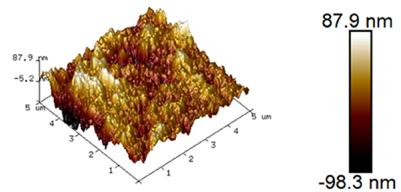

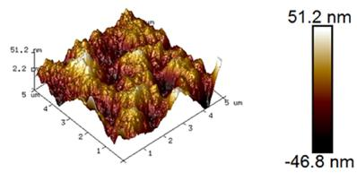  
(b): 10 mg/L thiamine + 55 mg/L Cl- + 6 mg/L SPS + 220 mg/L PEG; 2 ASD 20 min

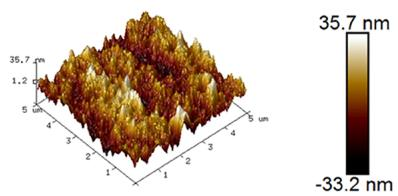  
(c): 30 mg/L thiamine + 55 mg/L Cl- + 6 mg/L SPS + 220 mg/L PEG; 2 ASD 20 min

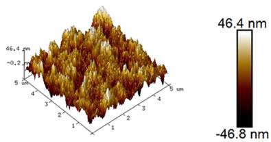  
(d): 50 mg/L thiamine + 55 mg/L Cl- + 6 mg/L SPS + 220 mg/L PEG : 2 ASD 20 min  
Figure 12. AFM diagram of the electroplated surface with diferent concentrations of thiamine (a) 0 mg/L thiamine, (b) 10 mg/L thiamine, (c) 30 mg/L thiamine, and (d) 50 mg/L thiamine.

Table 3. Surface Roughness of Electroplated Surface with Diferent Concentrations of Thiamine

<table><tr><td></td><td> $R_a$ </td><td> $R_q$ </td></tr><tr><td>0 mg/L</td><td>17.8 nm</td><td>23.5 nm</td></tr><tr><td>10 mg/L</td><td>10.8 nm</td><td>13.8 nm</td></tr><tr><td>30 mg/L</td><td>7.7 nm</td><td>9.7 nm</td></tr><tr><td>50 mg/L</td><td>10.4 nm</td><td>13.2 nm</td></tr></table>

## 4. CONCLUSIONS

In this experiment, through theoretical calculations and molecular dynamics simulations, the diference between thiamine and the leveling agent JGB was compared, and it was determined that the adsorption capacity and adsorption behavior of thiamine on the copper surface would inhibit the deposition of copper better. By conducting CV and CP tests on leveling agent JGB and new leveling agent thiamine, the study shows that the CV oxidation peak area obtained after adding thiamine is smaller than that of adding JGB, and the potential diference of thiamine at high and low rotational speeds $\triangle \eta = 8 7 ~ \mathrm { m V } > 5 0 ~ \mathrm { m V } ,$ suggesting its potential as a leveling agent. Through EIS testing, it was found that the addition of thiamine not only inhibited the $\mathrm { C u } ^ { 2 + } \to \mathrm { C u } ^ { + }$ reaction but also suppressed the $\mathrm { C u } ^ { + } \to \mathrm { C u }$ reaction. Through electroplating experiments, it was found that thiamine has a leveling efect on copper deposition and can be applied to wafer microhole electroplating. Moreover, in wafer electroplating, it was found that without adding inhibitors, only 55 mg/L Cl−, 6 mg/L SPS, and 4 mg/L thiamine as leveling agents can achieve a good filling efect.

## ■ AUTHOR INFORMATION

## Corresponding Author

Renlong Liu − College of Chemistry and Chemical Engineering, Chongqing University, Chongqing 400044, China; orcid.org/0009-0004-9591-9331; Email: lrl@ cqu.edu.cn

## Authors

Hu Wei − College of Chemistry and Chemical Engineering, Chongqing University, Chongqing 400044, China

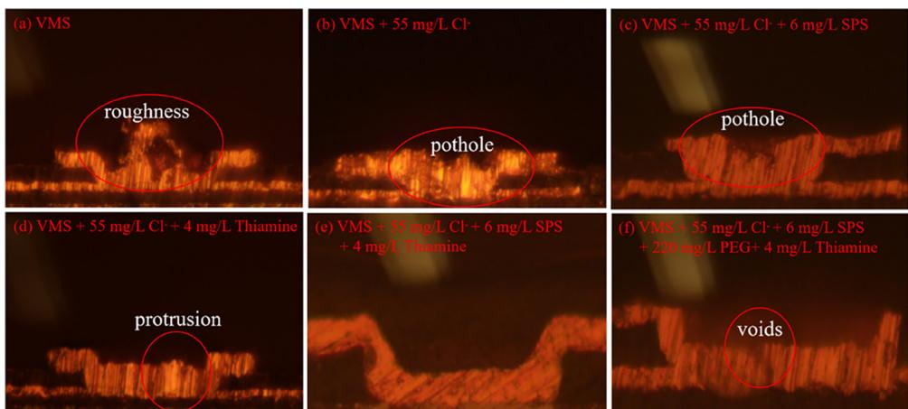  
Figure 13. Cross-section of wafer electroplated in diferent solutions (a) VMS, (b) VMS + 55 mg/L Cl− , (c) VMS + 55 mg/L Cl− + 6 mg/L SPS, (d) VMS + 55 mg/L Cl− + 4 mg/L thiamine, (e) VMS + 55 mg/L Cl− + 6 mg/L SPS + 4 mg/L thiamine, and (f) VMS + 55 mg/L Cl− + 6 mg/L SPS + 220 mg/L PEG + 4 mg/L thiamine

Tong Tan − College of Chemistry and Chemical Engineering, Chongqing University, Chongqing 400044, China

Lanfeng Guo − College of Chemistry and Chemical Engineering, Chongqing University, Chongqing 400044, China

Changyuan Tao − College of Chemistry and Chemical Engineering, Chongqing University, Chongqing 400044, China

Xiang Qin − Hubei Xingfu Electronic Materials Co., Ltd, Yichang 443007, China

Complete contact information is available at: https://pubs.acs.org/10.1021/acsomega.3c05248

## Notes

The authors declare no competing financial interest.

## ■ REFERENCES

(1) Zhao, Z.; Liu, Z.; Chen, L.; Sun, Q.; Liu, H.; Sun, Y. FEA study on the TSV copper filling influenced by the additives and electroplating process. Microelectron. Eng. 2023, 275, No. 111981.

(2) Wang, Y.; Zhu, W.; Li, X.; Wang, F. Parameters Analysis of TSV Filling Models of Distinct Chemical Behaviours of Additives. Electrochim. Acta 2016, 221, 70−79.

(3) Wu, H.; Wang, Y.; Li, Z.; Zhu, W. Investigations of the electrochemical performance and filling effects of additives on electroplating process of TSV. Sci. Rep 2020, 10 (1), 9204.

(4) Carpio, R.; Jaworski, A. Review�Management of Copper Damascene Plating. J. Electrochem. Soc. 2019, 166 (1), D3072− D3096.

(5) Jin, S.; Kim, S.-M.; Jo, Y.; Lee, W. Y.; Lee, S.-Y.; Lee, M. H. Unraveling Adsorption Behaviors of Levelers for Bottom-Up Copper Filling in Through-Silicon-Via. Electronic Materials Letters 2022, 18 (6), 583−591.

(6) Jin, S.; Seo, S.; Park, S.; Yoo, B. Through-silicon-via (TSV) filling by electrodeposition with pulse-reverse current. Microelectron. Eng. 2016. 156. 15–18.

(7) Xiao, H.; He, H.; Ren, X.; Zeng, P.; Wang, F. Numerical modeling and experimental verification of copper electrodeposition for through silicon via (TSV) with additives. Microelectron. Eng. 2017, 170, 54−58.

(8) Dow, W.-P.; Yen, M.-Y.; Lin, W.-B.; Ho, S.-W. Influence of Molecular Weight of Polyethylene Glycol on Microvia Filling by Copper Electroplating. J. Electrochem. Soc. 2005, 152 (11), C769.

(9) Kim, M. J.; Seo, Y.; Oh, J. H.; Lee, Y.; Kim, H. C.; Kim, Y. G.; Kim, J. J. Communication�Halide Ions in TEG-Based Levelers Affecting TSV Filling Performance. J. Electrochem. Soc. 2016, 163 (5), D185−D187.

(10) Wang, C.; Zhang, J.; Yang, P.; An, M. Electrochemical behaviors ofJanus Green B in through-hole copper electroplating: An insight by experiment and density functional theory calculation using Safranine T as a comparison. Electrochim. Acta 2013, 92, 356−364.

(11) Chen, B.; Xu, J.; Wang, L.; Song, L.; Wu, S. Synthesis of Quaternary Ammonium Salts Based on Diketopyrrolopyrroles Skeletons and Their Applications in Copper Electroplating. ACS Appl. Mater. Interfaces 2017, 9 (8), 7793−7803.

(12) Lai, Z.; Wang, S.; Wang, C.; Hong, Y.; Chen, Y.; Zhang, H.; Zhou, G.; He, W.; Ai, K.; Peng, Y. Computational analysis and experimental evidence of two typical levelers for acid copper electroplating. Electrochim. Acta 2018, 273, 318−326.

(13) Becke, A. D. Density-functional exchange-energy approximation with correct asymptotic behavior. Phys. Rev. A Gen Phys. 1988, 38 (6), 3098−3100.

(14) Lee, C.; Yang, W.; Parr, R. G. Development of the Colle Salvetti correlation-energy formula into a functional of the electron density. Phys. Rev. B Condens Matter 1988, 37 (2), 785−789.

(15) Manzetti, S.; Lu, T. The geometry and electronic structure of Aristolochic acid: possible implications for a frozen resonance. J. Phys. Org. Chem. 2013, 26 (6), 473−483.

(16) Xia, S.; Qiu, M.; Yu, L.; Liu, F.; Zhao, H. Molecular dynamics and density functional theory study on relationship between structure of imidazoline derivatives and inhibition performance. Corros. Sci. 2008, 50 (7), 2021−2029.

(17) Liu, A.; Guan, W.; Zhao, X.; Ren, X.; Liang, X.; Gao, L.; Li, Y.; Ma, T. Investigation on the interfacial behavior of polyorganic inhibitors on a metal surface by DFT study and MD simulation. Appl. Surf. Sci. 2021, 541, No. 148570.

(18) Lai, Z.; Wang, S.; Wang, C.; Hong, Y.; Zhou, G.; Chen, Y.; He, W.; Peng, Y.; Xiao, D. A comparison of typical additives for copper electroplating based on theoretical computation. Comput. Mater. Sci. 2018, 147, 95−102.

(19) Qiang, Y.; Zhang, S.; Yan, S.; Zou, X.; Chen, S. Three indazole derivatives as corrosion inhibitors of copper in a neutral chloride solution. Corros. Sci. 2017, 126, 295−304.

(20) Hari Kumar, S.; Karthikeyan, S. Torsemide and Furosemide as Green Inhibitors for the Corrosion of Mild Steel in Hydrochloric Acid Medium. Ind. Eng. Chem. Res. 2013, 52 (22), 7457−7469.

(21) Xu, Y.; Zhang, S.; Li, W.; Guo, L.; Xu, S.; Feng, L.; Madkour, L. H. Experimental and theoretical investigations of some pyrazolo pyrimidine derivatives as corrosion inhibitors on copper in sulfuric acid solution. Appl. Surf. Sci. 2018, 459, 612−620.

(22) Liao, C.; Zhang, S.; Chen, S.; Qiang, Y.; Liu, G.; Tang, M.; Tan, B.; Fu, D.; Xu, Y. The effect of tricyclazole as a novel leveler for filling electroplated copper microvias. J. Electroanal. Chem. 2018, 827, 151− 159.

(23) Dianat, A.; Yang, H.; Bobeth, M.; Cuniberti, G. DFT study of interaction of additives with Cu(111) surface relevant to Cu electrodeposition. J. Appl. Electrochem. 2018, 48 (2), 211−219.

(24) Li, J.; Zhou, G.; Hong, Y.; Wang, C.; He, W.; Wang, S.; Chen, Y.; Wen, Z.; Wang, Q. Copolymer of Pyrrole and 1,4-Butanediol Diglycidyl as an Efficient Additive Leveler for Through-Hole Copper Electroplating. ACS Omega 2020, 5 (10), 4868−4874.

(25) Zheng, L.; He, W.; Zhu, K.; Wang, C.; Wang, S.; Hong, Y.; Chen, Y.; Zhou, G.; Miao, H.; Zhou, J. Investigation of poly (1-vinyl imidazole co 1, 4-butanediol diglycidyl ether) as a leveler for copper electroplating of through-hole. Electrochim. Acta 2018, 283, 560−567.

(26) Wang, Z.-Y.; Jin, L.; Li, G.; Yang, J.-Q.; Li, W.-Q.; Zhan, D.; Jiang, Y.-X.; Yang, F.-Z.; Sun, S.-G. Electrochemical and in situ FTIR spectroscopic studies of gentian violet as a novel leveler in through holes metallization for printed circuit board applications. Electrochim. Acta 2022, 410, No. 140018.

(27) Teng, X.; Tao, Z.; Long, Z.; Liu, G.; Tao, X. 1-(4- Hydroxyphenyl)-2H-tetrazole-5-thione as a leveler for acid copper electroplating of microvia. RSC Adv. 2022, 12 (25), 16153−16164