# Electroplated Copper Additives for Advanced Packaging: A Review

Lanfeng Guo, Shaoping Li, Zhaobo He, Yanmei Fu, Facheng Qiu, Renlong Liu,\* and Guangzhou Yang

Cite This: ACS Omega 2024, 9, 20637−20647

Read Online

ACCESS

Metrics & More

ABSTRACT: Acid copper electroplating stands as a core technology in advanced packaging processes, facilitating the realization of metal interconnects, bumps, vias, and substrate wiring between transistors. The deposition quality of copper interconnect materials has a crucial impact on the final performance of chips, directly influencing their yield, reliability, and stability. In this intricate process, additives play a pivotal role in regulating the deposition quality and behavior of metal copper. This mini-review comprehensively summarizes the recent research progress in the field of electroplating copper additives for advanced packaging, both domestically and internationally, delving into the types and mechanisms of various additive molecules, including accelerators, inhibitors, and leveling agents. Through in-depth research on these additives, we gain a profound understanding of their specific roles in the electroplating process and the intricate

## Article Recommendations

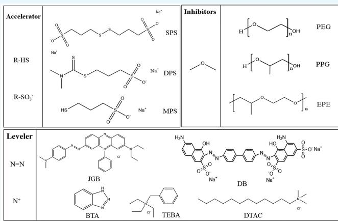

interaction mechanisms among them, providing theoretical support for optimizing the electroplating process. Furthermore, this minireview also delves into a thorough analysis of the current issues and challenges facing acid copper electroplating, exploring the key factors that constrain the further development of electroplating copper technology. Based on this analysis, we propose several potential solutions and research directions, ofering crucial references for the development and application of electroplating copper additives in advanced packaging. In conclusion, this mini-review aims to provide a comprehensive perspective and profound understanding of the development and application of electroplating copper additives through a review and analysis of recent research progress, ultimately aiming to promote the further advancement of advanced packaging technology.

## 1. INTRODUCTION

The dynamic evolution of the electronics and information industry since the 21st century has significantly propelled the swift progress of science and technology, the rapid development ofsociety, and the enhancement ofpeople’s living standards and quality. Moreover, knowledge centered on information technology is poised to emerge as the most vital strategic foundational resource. As modern electronic information products continue to evolve toward miniaturization, integration, functionality, and high reliability, there is a growing need for Printed Circuit Boards (PCBs) to transition toward High-Density Interconnect (HDI) technology. This shift aims to facilitate the interconnection of electronic components, functional units, and chips on the PCB, ensuring optimal electrical connectivity. Integrated circuit packaging technology is progressing beyond two-dimensional spatial connections and moving toward three-dimensional spatial stacking techniques. HDI boards incorporate micro vias and fine-line technology into printed circuit boards. By progressively layering circuit layers and insulation layers, they produce multilayered, thin, stable, and high-density printed circuit boards�capabilities beyond the reach of conventional multilayer boards. This addresses the ongoing need in modern electronic packaging technology to continually enhance packaging density. Three-dimensional packaging entails the vertical stacking of chips or structures with diverse functionalities through stacking techniques and micromachining technologies like through-hole interconnections on the substrate’s plane. This process creates threedimensional integration among chips and facilitates signal connectivity. Three-dimensional packaging has the capability to reduce system size, shorten interconnect lengths, minimize chip area to mitigate interconnect delay issues, permit higher operating speeds, lower power consumption, and notably enhance overall system performance.

Electroplating stands out as a newcomer in the electronic packaging industry, bridging two significant national strategic emerging industries-information electronics and new materials.

It strategically positions itself at the forefront of the manufacturing chain in the electronic information industry. It serves as the cornerstone and trailblazer for the downstream electronic component manufacturing and complete machine assembly industries. Its crucial supporting role extends to the design and performance enhancement of products across various fields, including information communication, consumer electronics, automotive electronics, industrial control, aerospace, and defense.

Electroplating is the method of supplying electrons to the electroplating solution, facilitating the conversion of metal ions into elemental metal. Based on the source of electrons, electroplating can be categorized into three forms: electrolytic plating (electrons supplied by a power source), chemical plating (electrons provided by reducing agents in the electroplating solution), and displacement plating (electrons furnished by the substrate metal to be plated). Due to the dificulties in controlling chemical plating and displacement plating, their low eficiency, expensive chemical additives, and the frequent need for plating solution renewal, production generally opts for electrolytic plating for metal deposition. Compared to the other two processes, electrolytic plating is more eficient and does not require complex processing equipment. Additionally, electrolytic plating operates at room temperature and atmospheric pressure, featuring relatively simple process conditions. It stands out as one of the more extensively utilized methods at present.

Copper is employed as interconnects due to its low electrical resistance and robust resistance to electron migration. Extensive practical evidence has afirmed the following advantages of copper interconnects over aluminum interconnects. Copper exhibits lower resistivity than aluminum, with copper’s resistivity at 1.7 uΩ·cm and aluminum’s at 2.7 uΩ·cm. The resistivity of copper is a mere 60% of aluminum, leading to a substantial decrease in power consumption for the corresponding interconnects. Compared to traditional aluminum intercon nects, copper interconnects demonstrate a two-order-ofmagnitude enhancement in resistance to electron migration, thereby significantly elevating the reliability of integrated circuits.1,2 Due to copper’s higher melting point compared to aluminum, copper interconnects can withstand higher current densities. This enables the reduction of interconnect lengths, a decrease in the number of wiring layers, an enhancement in integration density, and a reduction in the cost of integrated circuits.3 Therefore, copper is deemed an ideal interconnect material, and the transition to copper wiring replacing aluminum wiring represents a developmental trend.

## 2. DEVELOPMENT PROCESS OF THE ELECTROPLATING COPPER PROCESS

The utilization ofelectroplated copper for gap filling has become an essential technology. It is widely applied for metallization in high-density interconnects in integrated circuits, as well as for filling microvias in printed circuit boards and silicon vias in chip packaging. The copper electrodeposition method involves bottom-up filling within the hole to ensure gap-free coverage. This signifies that, during the electroplating process, the bottom of the hole exhibits the highest rate of copper deposition. As shown in Figure 1, the uneven distribution of primary and secondary currents results in lower current density at the bottom of the hole and higher current density at the mouth of the hole. The uneven distribution of local current density leads to less copper deposition at the bottom of the hole during the electroplating process, with more copper deposited at the mouth of the hole. This causes the gradual closure of the hole mouth, leading to the formation of voids or gaps in the middle of the hole.

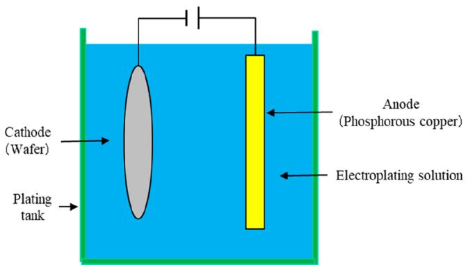  
Figure 1. Diagram illustrating direct current plating.

2.1. Categorization of Electroplating Copper Systems. Over the course ofseveral decades ofresearch and development, various electroplating copper systems have emerged. Each electroplating copper system possesses distinct characteristics, leading to variations in the performance of the resulting copper layers. The cyanide copper plating system yields coatings with fine-grained crystals, robust adhesion, excellent dispersing ability in the plating solution, high stability, a simple process, and minimal pretreatment requirements. However, due to the highly toxic nature of the plating solution and challenges in wastewater treatment, it has gradually fallen out offavo r.4−6 The copper plating solution in the pyrophosphoric acid system demonstrates exceptional dispersing ability. Nevertheless, the adhesion of the copper coating is poor, the plating solution is unstable, dificult to maintain, and wastewater treatment poses significant challenges.7,8 Currently, the widely used copper plating system in the electronics industry is the acidic sulfate copper plating system. In the acidic sulfate system, with the addition of suitable additives, a uniform, fine, and bright coating can be obtained.9,10 The system exhibits good dispersing and deep plating capabilities, and is cost-efective. Moreover, the electroplating solution has a simple composition, high current eficiency, and fast deposition rate.11

Copper plating can be classified into direct current plating and pulse plating based on the plating method used. In the early stages, copper plating primarily fell under the category of direct current plating. Direct current plating utilizes a direct current power source in the electroplating process, with fixed cathodes and anodes, ensuring a consistent direction of the electric field (as depicted in $\breve { \mathrm { F i g u r e } } \ \boldsymbol { 2 } ^ { 1 2 } )$ . Direct current plating is characterized by high plating eficiency, ease of operation, and afordability. However, in direct current plating, issues like “edge efect” and “geographical efect” may arise due to the shape of the plated object.13 Complex plated objects often pose challenges in obtaining a uniform coating. For example, each “anode” (“cathode”) has variations around, in the middle, and between the top and bottom surfaces, diferences between the board surface and inside holes and a gradient decrease from the hole mouth to the center of the hole, and so on. Pulse plating incorporates pause periods and/or reverse currents into the electroplating process. This enables controlled mass transfer during the electroplating process, optimizing deep plating capability and dispersing ability to a certain extent.14 However, adjusting the waveform of the pulse current is inconvenient, and it demands higher requirements for the plating tank and the

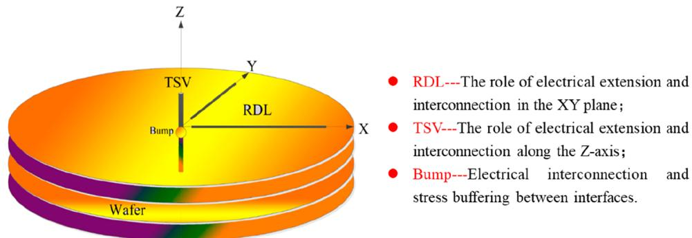

RDL---The role of electrical extension and interconnection in the XY plane

TSV---The role of electrical extension and interconnection along the Z-axis

Bump---Electrical interconnection and stress buffering between interfaces.

entire plating production line. Additionally, pulse equipment is relatively expensive, especially large-scale pulse power supplies.

2.2. Composition and Functions of Acid Copper Plating Solution. 2.2.1. Copper Sulfate. $\mathrm { C u S O } _ { 4 } { \cdot } 5 \mathrm { H } _ { 2 } \mathrm { O }$ serves as the primary salt in electroplating solutions, dissociating into copper ions in aqueous environments. These copper ions undergo reduction at the cathode, leading to the formation of a deposited copper layer. However, when the copper sulfate concentration is too high, the leveling ability of the plating solution decreases, and the deposition rate becomes too rapid, resulting in larger particles that adversely afect the uniformity of the plated layer. When the concentration of copper sulfate falls below the optimal level, the reduced availability of effective copper ions within the plating solution results in an inconsistent deposition of copper on the substrate’s surface. As a result, the plating’s glossiness is significantly reduced, and its leveling quality is compromised. Additionally, during high-current density plating, the intense current flow across the substrate surface demands a higher concentration of copper ions to sustain the electrochemical reaction. Nevertheless, with an insuficient concentration of copper sulfate, the supply of copper ions becomes inadequate to meet the high current demand, ultimately leading to localized overheating and subsequent charring of the substrate surface (Figure 3).

In the case of vias, the structural features eliminate the need for metal coverage on the surface ofthe circuit board. Therefore, since there is not a significant demand for copper sulfate in the system, a high-acid, low-copper system is adopted to enhance the plating solution’s leveling ability. In the case of microvias, simultaneous electroplating on the circuit board surface and inside the hole necessitates specific considerations for the consumption of copper in the system. Hence, opting for a highcopper, low-acid system ensures an abundant supply of copper ions to the system.

In the presence of direct current voltage, the reduction reaction of copper ions is

$$
\mathrm{Cu} ^ {2 +} + 2 \mathrm{e} \rightarrow \mathrm{Cu} \quad \mathrm{Cu} ^ {2 +} / \mathrm{Cu} = + 0. 3 4 \mathrm{V}
$$

$$
\mathrm{Cu} ^ {2 +} + \mathrm{e} \rightarrow \mathrm{Cu} ^ {+} \quad \mathrm{Cu} ^ {2 +} / \mathrm{Cu} ^ {+} = + 0. 1 5 \mathrm{V}
$$

$$
\mathrm{Cu} ^ {+} + \mathrm{e} \rightarrow \mathrm{Cu} \quad \mathrm{Cu} ^ {+} / \mathrm{Cu} = + 0. 5 1 \mathrm{V}
$$

When the reduction of ${ \mathrm { C u } } ^ { 2 + }$ is incomplete, partially monovalent copper ions are produced. The standard electrode potential of the side reaction indicates that the reduction of monovalent copper ions to copper is a more favorable reaction. Consequently, this results in an excessively rough plating layer, compromising the coating quality.15

Figure 2. Schematic diagrams of TSV, RDL, and Bump.  
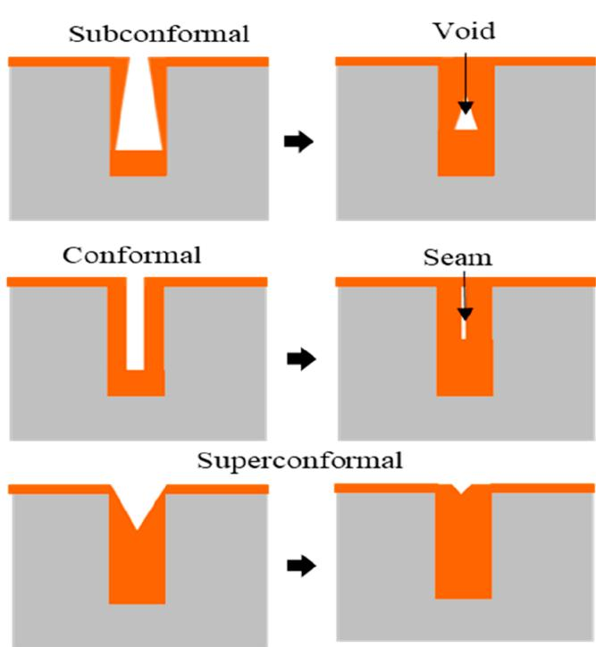  
Figure 3. Three modes of copper electrodeposition.

2.2.2. Sulfuric Acid. In electroplating solutions, $\mathrm { H } _ { 2 } \mathrm { S O } _ { 4 }$ primarily functions as an activator. The addition of sulfuric acid enhances the conductivity ofthe electroplating solution and suppresses the hydrolysis reaction of ${ \mathrm { C u } } ^ { 2 + }$ with OH− in water. There is a specific range of applicability for the concentration of $\mathrm { H } _ { 2 } \mathrm { S O } _ { 4 }$ in the plating solution. While high concentrations can impact the current eficiency of the electroplating solution, the advantage lies in expediting the dissolution of anodic phosphor copper. This, in turn, enhances the plating solution’s ability to cover the electrode surface and its dispersing capability, resulting in a more uniform coating. Extremely low concentrations can compromise the even dispersing capability of the plating solution system and the uniformity of the electroplated copper layer.

## 3. MODELS FOR FILLING THROUGH-HOLES AND MICROVIA

Printed circuit boards play a crucial role in the electronics industry, bridging various components. In multilayer PCBs, achieving interlayer connectivity stands out as the most critical challenge. Interlayer connectivity encompasses three primary forms: through holes (TH), microvia, and buried holes. The following section focuses on through-holes and microvia. Additives are essential components in copper electroplating to meet the demand for void-free filling.

The methods of electroplating copper to fill microvia mainly include superequivalent-angle deposition, equivalent-angle deposition, and subequivalent-angle deposition. Among these methods, superequivalent-angle deposition is considered the ideal filling approach (i.e., filling from the bottom up). The fundamental principle of superequivalent-angle filling lies in the alteration ofcurrent distribution inside and outside the hole due to the action of additives. This leads to a higher copper deposition rate at the hole’s bottom than outside, facilitating a bottom-up filling process. Hence, the occurrence of voids and cracks is minimized. In contrast, equivalent-angle deposition and subequivalent-angle deposition may lead to issues such as cracks and voids inside the holes, compromising the reliability of hole interconnection.

Concerning the mechanism of superequivalent-angle electroplating filling, both the Curvature-Enhanced Accelerator Coverage (CEAC) model and the Convection-Dependent Adsorption (CDA) model can provide reasonable explanations for the flawless bottom-up filling process ofmicrovias. However, each model has its limitations (Figure 4).

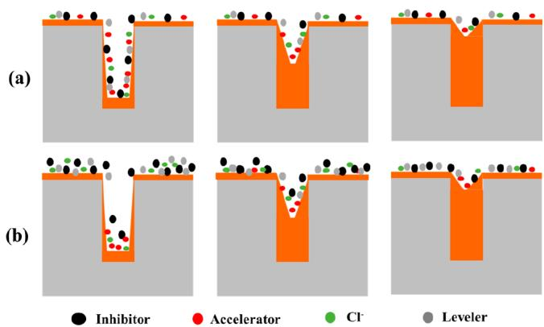  
Figure 4. Schematic diagrams of filling in CEAC (a) and CDA (b) models.

CDA model:16 It utilizes the convective intensity to influence the distribution of Cl− on the electrode surface in the plating solution, thereby determining the adsorption of additives. Specifically, strong convection increases the adsorption of Cl− on the electrode surface, thereby enhancing the adsorption of inhibitors and improving their inhibitory efect on the deposition of copper ions. In an environment with weak convection and low Cl− concentration, it is more conducive for the accelerator to enhance its depolarization efect, thereby expediting the deposition of copper. Consequently, there is a disparity in the copper deposition rates at the mouth and bottom of the hole, realizing the bottom-up filling of microvias.

CEAC model:17 This model emphasizes changes in the geometric shape of microvias rather than the interaction of various additives. With the progression of the electroplating process, the hole surface undergoes internal contraction, leading to a reduction in the hole bottom surface area and a corresponding increase in curvature. At this stage, a significant amount of accelerator is adsorbed at the bottom of the microvia with a large curvature, further expediting the deposition of copper inside the hole and achieving bottom-up filling of microvias.

Ho et al.18,19 conducted research on the filling process of microvias with diferent air flow rates and discovered that microvias filled in a butterfly pattern at an air flow rate of 70/ min. The filling process can be categorized into three stages: a. prefilling shape, b. shape-preserving equiangular deposition, c. burst filling period (formation of crosspoints). The common ality between filling through-holes and filling microvias is that, for filling through-holes, it is essential to first deposit a butterfly shaped “X-shaped” copper layer in the middle of the through hole. When the middle wings are closed, it is akin to electroplating two microvias simultaneously on opposite sides of the board in opposite directions, transitioning the electroplating from “X-shaped” to “V-shaped” filling. In practice, a comparable microvia filling process can be achieved by precovering the bottom of the through-hole with copper foil, filling it, and subsequently etching away the covered copper foil layer.

## 4. ELECTROPLATING ADDITIVES

In an acidic copper plating system without the participation of additives, the copper layer on the surface of the PCB and the copper layer at the bottom of the microvia will increase simultaneously during the copper plating process, making it challenging to achieve overfilling of vias. In an acidic copper plating solution without additives, the obtained copper layer has poor brightness performance, and it is challenging to improve the overall leveling ability and deep plating ability of the plating solution. Therefore, additives are the core of the acidic copper plating system. Thus, for the acidic sulfate copper plating system, the pursuit of an efective, nonpolluting, and cost-efective additive formula becomes crucial for the entire system (Table 1). Additives are a critical factor in copper electroplating for via filling, representing the core of commercial formulations for copper via filling. The electrochemical characteristics of additives are crucial in altering the current distribution inside and outside the vias. Presently, the market dominance in copper electroplating via filling formulations lies in the hands of foreign companies like Atotech, Rohm & Haas, JCU, MacDermid, and Schlotter. In China, companies such as Good Way, Zhengtian wei, Sinyang, and others have also emerged. However, there is still a significant gap in bargaining power and technological R&D capabilities compared to major foreign enterprises.

Table 1. Classification of Copper Sulfate Electroplating Additives

<table><tr><td>Additives</td><td>Classification</td><td>Common reagents</td><td>Function</td></tr><tr><td>Halide ions</td><td>-</td><td> $Cl^{-}/I^{-}$ </td><td>Synergistic effect with other additives</td></tr><tr><td>Accelerator</td><td>Sulfonates</td><td>SPS/MPS/DPS</td><td>Accelerate copper ion deposition while refining grain size</td></tr><tr><td>Inhibitors</td><td>Polyethers</td><td>PEG/EPE/PPG</td><td>Inhibit the deposition rate of copper metal</td></tr><tr><td rowspan="2">Leveler</td><td>Dye-based Leveler</td><td>JGB/DB/ABPV</td><td rowspan="2">Adsorption on the protruding area with higher cathode current density inhibits copper deposition to achieve leveling effect</td></tr><tr><td>Nondye-based Leveler</td><td>BTA/DTAC/DPP</td></tr></table>

In the current acidic plating solution system, the main components include one inorganic additive and three organic additives: chloride ions, accelerators, inhibitors, and leveling agents.20 The concurrent presence of various additives in the electroplating solution system enables improved filling of microvias, ensuring better coating quality and achieving interlayer interconnection. Additionally, additives can enhance current eficiency, simultaneously regulate the deposition rate of copper in high and low current density areas, refine grains, and improve crystal orientation. Thus, achieving a more uniform and smooth coating. Furthermore, there are reports of accomplish ing copper electroplating for via filling using a single organic additive. For instance, researchers have proposed that SH110 is a combination of an accelerator and an inhibitor or leveling agent. It can form an adsorption film on the copper surface, exemplifying the inhibitory action of inhibitors. This inhibitory efect is more likely to occur in the strong convection region of the cathode, while its promoting efect primarily occurs in the weak convection region of the cathode.

4.2. Accelerator. Accelerator (also known as brightener) adsorbs in low current density areas such as the bottom of the hole. Cl− induces depolarization, lowering the overpotential of ${ \mathrm { C u } } ^ { 2 + }$ and accelerating the deposition rate of copper at the bottom of the hole. Moreover, the accelerator accelerates the formation of crystal nuclei, ensuring a higher nucleation rate than the grain growth rate, leading to finer crystals and improving the smoothness of the coating surface. For example, in a plating solution without additives, copper atoms redeposit on existing crystal faces, generating new two-dimensional grains with a specific size, resulting in an overall layered structure. With the addition of SPS or SPS + Cl−, the resulting grains noticeably increase in size, with the deposition mode lying between preferred orientation and a layered structure.22 The accelerator is primarily a small molecule compound containing sulfur, usually consisting of two parts. One part comprises thiol or disulfide bonds, and the other part is a sulfonic acid salt group. The most extensively utilized accelerators in the industry include sodium 3-mercaptopropanesulfonate (MPS) and 3,3′-Dithiobis-1-Propanesulfonic Acid Disodium Salt (SPS). Their structures are depicted in Figure 5. The former can be viewed

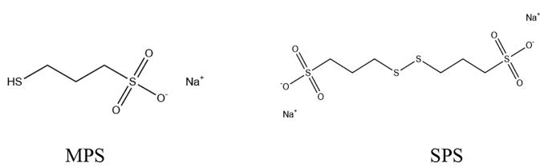  
Figure 5. Structures of accelerators MPS and SPS.

as a reduced derivative ofthe latter. The addition ofSPS or MPS lowers the overpotential of the copper cathode, forms complex ions with ${ \mathrm { C u + } } ,$ and accelerates the electrodeposition rate of copper. When used in conjunction with PEG, it can coordinate to control the deposition rate of copper. In the process of the accelerator molecule exerting its accelerating efect, the thiol group plays an adsorptive role, while the sulfonic acid group performs the accelerating function. If the terminal functional group $\mathrm { i } s - \mathrm { O H } , - \mathrm { C O O H } , \mathrm { o r } - \mathrm { C H } _ { 3 } ,$ instead $\mathrm { o f } - \mathrm { S O _ { 3 } } ^ { - }$ , there is no transfer and acceleration capability, thus failing to achieve the goal of accelerating copper deposition.23 The presence of chloride ions in the system accelerates the reaction rate of copper deposition by controlling the step of ${ \mathrm { C u } } ^ { + }$ generation, thereby expediting the copper deposition process. As accel erators, there are certain limitations on the content of SPS and MPS. If the content is too low, the acceleration efect is not noticeable, and holes are prone to form during the deposition process. An excessive amount can lead to an inconspicuous diference in concentration between the bottom and mouth of the hole, likewise failing to achieve the desired efect. In the majority of experiments, their concentration is generally a few ppm.

Garcia-Cardona et $\mathsf { a l . } ^ { 2 4 }$ pointed out through NMR that a Cu(I)-sulfonate complex is formed on the surface of the copper electrode. Since then, Cu(I)MPS has generally been recognized by the academic community as the substance that directly depolarizes the electrochemical interface in acid copper electroplating. Schmitt $\mathrm { e t } ~ \mathrm { a l . } ^ { 2 5 }$ also confirmed through electro chemical polarization and electroplating experiments that the concentration of $\mathrm { { C u } ( I ) M P S }$ is positively correlated with the copper electroplating rate. Through their research, Lan et al.26 have demonstrated that mercaptopropanesulfonic acid copper-(II) complex MA exhibits depolarization efects in acidic copper plating solutions. Compared to SPS, MA exhibits fewer side reactions and possesses a wider linear range in its standard curve, resulting in stronger analytical capabilities. Therefore, in practical electroplating production processes, MA enables better monitoring and more precise supplementation. Additionally, replacing SPS with MA does not alter the coating crystallization characteristics, indicating that MA is a promising accelerator for copper electroplating applications.

4.1. Halide Ions. Halide ions are an essential component in the plating solution of the acidic copper plating system, commonly dominated by chloride ions. It mainly exists in the form of sodium chloride or hydrochloric acid in the copper plating solution. Although its required content in the plating solution is relatively low, it plays a significant role. Chloride ions enhance the conductivity of the system, facilitate the dissolution of phosphor copper anodes, reduce the formation of “copper powder” due to incomplete anode dissolution, improve the brightness and leveling ability of the coating, and enhance coating quality. Chloride ions play a dual role: inducing the capture of copper ions by the inner layer electron transfer of the accelerator MPS sulfonate ${ \mathrm { R } } { - } S { \mathrm { O } } _ { 3 } ^ { - }$ , synergizing with the accelerator MPS to accelerate the deposition of copper ions on the cathode surface; also acting as an inhibitor, adsorbing on the cathode surface $\begin{array} { r l } { \mathsf { a s } \textbf { a } ^ { \infty } \mathbf { h o o l } \breve { \mathbf { k } ^ { \prime \prime } } } \end{array}$ to enable the inhibitor to function properly $( { \mathrm { F i g u r e } } \ 5 )$ . Chloride ions can also serve as a “chlorine bridge” between the electrode surface and $\boldsymbol { \mathrm { C u } } ^ { + }$ . This increases the concentration of subcopper ions on the electrode surface, reduces the double-layer capacitance, weakens polar ization, lowers nucleation rates, ultimately achieving favorable conditions for crystal nucleus growth. Research also suggests that certain leveling agents using I− as the counteranion exhibit significantly enhanced inhibitory capabilities compared to $\mathrm { C l ^ { - } }$ as the anion. The reason for this is the synergistic interaction between I− and the overall structure of the leveling agent, resulting in a potent inhibitory efect.21

4.3. Inhibitors. In electroplating additives, inhibitors achieve the suppression of surface copper deposition by adsorbing onto the copper surface, enhancing cathodic polarization, and inhibiting the deposition of copper on the surface. Inhibitors are generally polyether substances with a certain molecular weight. Common inhibitors include polyethylene glycol (PEG), polypropylene glycol (PPG), and a copolymer of ethylene glycol and 1, 2-Propanediol (EPE). The molecular weight of PEG is around 6000 to 10000. Inhibitors have a larger molecular weight and are easily consumed during the electrodeposition process. Therefore, during electroplating, inhibitors primarily exhibit a gradient distribution on the surface ofthe plated piece. For PCB electroplated copper pillars, the bottom of microblind holes is relatively distant from the bulk solution, leading to a reduced distribution of inhibitors in this area. The concentration of inhibitors at the opening of the hole is closer to the concentration of inhibitors in the bulk solution. Additionally, as these polyol substances are excellent surfactants, they also function as wetting agents in copper electroplating. When the amount of inhibitor added is too small, resulting in insuficient wetting of the board surface, it causes the surface to appear red and dull.

It is important to note that inhibitors can only exhibit efective inhibitory efects when Cl− is present in the electroplating solution. In the presence of chloride ions in the solution, PEG strongly inhibits the deposition of metallic copper, usually causing an increase of several hundred millivolts in the $\mathrm { { o f } \ C u . } ^ { 2 \mathord { \uparrow } }$ 12 deposition overpotential

4.4. Leveler. Leveling agents are typically nitrogencontaining heterocyclic compounds. With a positive charge in acidic solutions, they readily adsorb in strongly negatively charged areas, competing with divalent copper ions and impeding copper deposition. Leveling agents are crucial for achieving overfilling or bottom-up deposition.

4.4.1. Dye-Based Leveler. Leveler are categorized into dyebased leveling agents and nondye-based leveling agents. Presently, leveling agents on the market are predominantly organic dye-based leveling agents with quaternary ammonium cations and a halide ion, such as Janus green B (JGB), Diazine black (DB), Methylene blue (MB), and Alcian blue (ABPV). Although these leveling agents can achieve remarkable filling efects under specific conditions, they are not resistant to high temperatures and are prone to decomposition. This is disadvantageous for large-scale industrial production. Furthermore, these leveling agents are predominantly synthetic organic compounds or mixtures of various organic substances, resulting in high costs, notable toxicity, and pollution, along with certain quality and environmental concerns. Therefore, it is necessary to search for leveling agents that are inexpensive, less toxic, stable, and exhibit good electroplating efects.

4.4.2. Nondye-Based Leveler. Most commonly used nondye leveling agents are nitrogen-containing heterocyclic or nonheterocyclic aromatic compounds. The molecular chains of these leveling agents usually contain functional groups such as primary, secondary, tertiary, or quaternary amines, carrying one or more positive charges, making them readily adsorbable on the negatively charged cathode surface. Adsorption is more pronounced in high-current density regions, inhibiting copper deposition at the adsorption sites without afecting electrodeposition in low-current density areas, achieving a smooth coating.

A. Small Molecules Containing Nitrogen. Chang et $\mathrm { a l . } ^ { 2 8 }$ explored 2-mercaptopyridine as a novel leveling agent, aiming to leverage the thiol group on the accelerator for surface adsorption, as an alternative to JGB. It achieves flawless bottom-up copper electroplating filling with the minimum surface thickness. Experimental results demonstrate that 2- mercaptopyridine exhibits a stronger inhibitory efect on Cu deposition compared to JGB. It significantly enhances the filling capacity of the electroplating solution and efectively suppresses surface copper growth, reducing the surface Cu thickness from 16 to 10 μm.

$\mathrm { L i a o } ^ { 2 9 ^ { \prime } }$ selected the benzothiazole derivative tricyclazole (TCA) and compared it with 2-amino-4-methylbenzothiazole (AMBT), a compound with a structure resembling TCA (Figure $^ { 6 , }$ Table 2). It was discovered that TCA enables the bottom-up

(a)  
(b)  
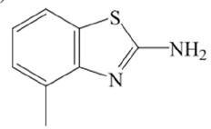

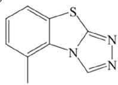  
Figure 6. Structures and quantum chemistry parameters of (a) AMBT and (b) TCA.  
Table 2. Quantum Chemistry Parameters of (a) AMBT and (b) TCA

<table><tr><td>Compound</td><td> $E_{\text{HOMO}}$  (eV)</td><td> $E_{\text{LOMO}}$  (eV)</td><td> $\Delta E$  (eV)</td><td> $\mu$  (D)</td></tr><tr><td>AMBT</td><td>-5.038</td><td>-1.182</td><td>3.856</td><td>2.1017</td></tr><tr><td>TCA</td><td>-5.603</td><td>-1.852</td><td>3.751</td><td>6.3563</td></tr></table>

filling of blind holes, whereas AMBT fails to fill blind holes with copper. Both AMBT and TCA can adsorb onto the copper surface, thus inhibiting the electrochemical dissolution process of the metal as the anode. Moreover, due to TCA’s lower E and ΔE values, higher μ value, and a parallel adsorption model, it exhibits stronger adsorption on the copper surface.

B. Polymer. Li et al.30 designed and synthesized a copolymer composed of pyrrole and 1,4-butanediol diglycidyl ether (PBDGE) as a leveling agent, which enhances the deep plating capability of through-hole electroplating by 35.5%. Similarly, Zheng31 used N-vinylimidazole and 1,4-butanediol diglycidy ether for copolymerization, resulting in the polymer VIBDGE (Figure 7). Quantum chemical calculations showed that its HOMO orbital energy closely aligns with the value ofJGB. It is evident that VIBDGE exhibits strong electron-donating capabilities, facilitating the provision of electrons to low-energy vacant orbitals during the copper deposition process, leading to the formation of covalent bonds. Simultaneously, molecular dynamics simulations indicate that VIBDGE has the highest adsorption energy. The VIBDGE molecule is the largest, resulting in the maximum coverage of copper after adsorption, with the steric hindrance efect being most pronounced. Experimental electroplating verified that at the optimal concentration of VIBDGE, the TP of through-holes increased by 43.62%.

C. Behenyl Trimethyl Ammonium Chloride. Chen et al.32 designed and synthesized four derivatives of dione-pyrrole and pyrrole (DPP) with quaternary ammonium salt centers, each possessing diferent carbon chain lengths, for use as leveling agents in copper electroplating (Figure 8). The introduction of quaternary ammonium groups was done to independently enhance the solubility of DPP derivatives and facilitate their adsorption on the cathode surface. The minimum surface tension ofDPP quaternary ammonium salt is 47.1 mN·m−1. The surface activity of additives is closely linked to their ability to inhibit copper electrodeposition. Compounds with the lowest surface tension suggest the most potent inhibitory efect on copper electrodeposition.

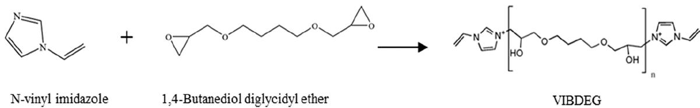  
Figure 7. Reaction equation for the synthesis of VIBDGE from N-vinyl imidazole and 1,4-butanediol diglycidyl ether.

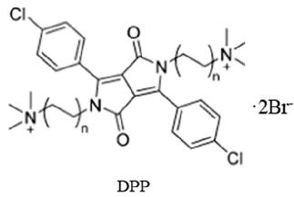  
Figure 8. Structure of DPP.

The phenyl group and two pyrrole rings on the DPP leveling agent do not lie in the same plane, leading to potential steric hindrance in rotational space. Consequently, during the electrodeposition process, it may lead to unstable anchoring interactions between the leveling agent and the metal surface. $\mathrm { W a n g } ^ { 3 3 }$ synthesized a series of quinacridone (QA) derivatives with quaternary ammonium groups, characterized by a linear pentacyclic framework with a fully conjugated, highly stable, and rigid planar structure (Figure 9). Strategies involving alkyl and

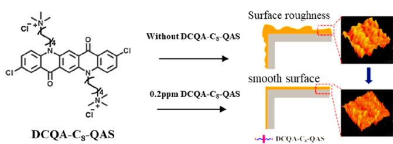  
Figure 9. Schematic diagram illustrating the molecular structure of quinacridone derivatives and their use as functional leveling agents.

aryl adjustments were utilized to enhance water solubility and reduce the molecular bandgap, respectively. It was discovered that the inhibitory efect of leveling agents on copper deposition is significantly influenced by the carbon chain length, with a chain length of 8 being the most suitable. Building on the optimized side chain length of 8, further aromatic modifications $\left( \mathbf { - H } , \mathbf { - C H } _ { 3 } , \mathbf { - C H } _ { 4 } , \mathbf { - C H } _ { 4 } \right)$ and -Cl) were applied to identify the optimal QA leveling agent for inhibiting copper deposition. All three leveling agents exhibit similarly potent inhibitory efects, with the quinacridone quaternary ammonium salt substituted with an electron-withdrawing group (-Cl) displaying superior inhibitory behavior.

4.4.3. Methods for Screening Leveling Agents. Electroplating copper technology is the foundation for achieving electrical interconnection in printed circuit boards, packaging substrates, and integrated circuits. In the present era of rapid development in the electronics and information industry, unprecedented challenges have emerged. Electroplating is presently the most direct and accurate experimental method for studying copper electroplating technology, albeit with a lengthy experimental cycle and high costs. The use of electrochemical analysis and numerical simulation methods allows for the prediction ofadditive performance, thereby saving experimental time. However, electroplating experiments remain the most accurate method to demonstrate the efectiveness of copper electroplating. Therefore, combining electroplating with electrochemical analysis and numerical simulation methods can be more efective in studying the efectiveness of copper electroplating and the characteristics of additives. Copper electroplating additives, needing only a few milligrams per liter, can achieve uniform plating, demonstrating substantial economic value. Moreover, leveling agents play a crucial role, making it of paramount importance to find an efective method for screening these agents.

Generally, leveling agents contain $\mathrm { N } ^ { + }$ ions, but not all $\mathrm { N } ^ { + }$ ions can serve as efective leveling agents. The following are some methods used by scholars to screen leveling agents, ofering valuable insights for our reference.

1. Some scholars have found that corrosion inhibitors and leveling agents share similar electrochemical properties, both capable of increasing reaction resistance and enhancing cathodic polarization. Therefore, it is possible to use the means of screening metal corrosion inhibitors to screen electroplating leveling agents.

2. Cationic organic compounds that exhibit leveling and enhanced inhibitory efects generally possess strong surface activity, with certain organic cations containing nitrogen heterocycles being particularly efective. Another approach involves their ability to “attach” to the cathode surface through chemical adsorption, enabling them to exert inhibitory and leveling efects over a broader range.

3. Some scholars, based on the convective mass transfer mechanism, have proposed methods to induce a positive potential diference at the cathode. In constant current tests, the potential diference values at working electrodes rotating at 100 r/min and 1000 r/min (positive values) $( \Delta \eta { = } \bar { \eta _ { 1 0 0 \mathrm { r / m i n } } } { - } \eta _ { 1 0 0 0 \mathrm { r / m i n } } )$ are used as criteria, with organic compounds demonstrating strong adsorption capabilities at the cathode being considered for the screening of potential blind hole electroplating leveling agents.34

4. Some scholars employ quantum computing methods, where a high $\mathrm { E _ { H O M O } }$ and low $\mathrm { E } _ { \mathrm { L U M O } }$ values indicate strong adsorption capabilities of the molecules. The ΔE value is associated with adsorption capability, and the larger the value, the more challenging it is for adsorption behavior to occur on the metal surface. μ is also an indicator of adsorption capability, with higher $\mu$ values indicating easier accumulation of organic substances and simpler adsorption on the metal surface.

5. Some scholars have found that proposing ESP values can also serve as an important criterion for screening high speed through-hole copper electroplating leveling agents. It was discovered that the main functional groups of leveling agents are conjugated double bonds and quaternary ammonium cations, with azo double bonds providing adsorption sites and quaternary ammonium cations contributing to high ESP.

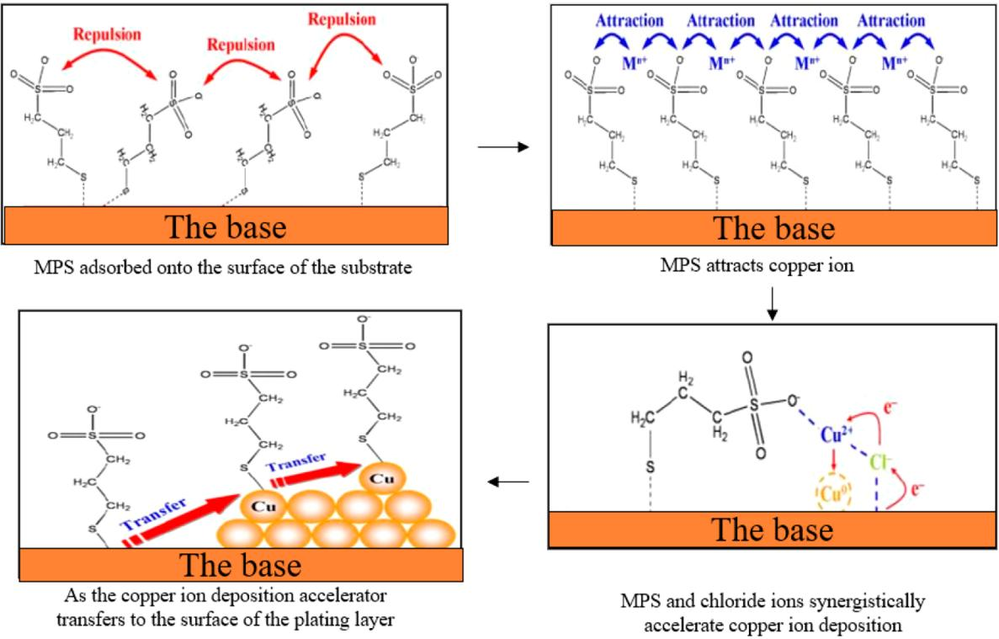  
Figure 10. Acceleration process of MPS in copper deposition.

4.5. Interactions among Electroplating Additives. There is currently no fully unified understanding regarding the specific mechanism of accelerators. Currently, the more widely accepted view is the MPS-accelerated copper deposition mechanism proposed by Dow30 and others (Figure 10). In this mechanism, MPS initially adsorbs on the electrode surface through the thiol group, and subsequently, its tail sulfonic acid group captures $\mathrm { C u } ^ { 2 + }$ in the solution and interacts with Cl− ions. The entire process involves an inner-sphere electron transfer mechanism. In the absence of Cl− ions in the plating solution, MPS or SPS will only exert inhibitory efects. The accelerating efect of SPS mainly results from the breaking of the disulfide bonds in its molecules into two MPS molecules under the influence of an electric field, and MPS is the substance that truly accelerates the process.

$$
\begin{array}{r l}&4 \mathrm{S} - (\mathrm{CH} _ {2}) _ {3} - \mathrm{SO} _ {3} \mathrm{Na} + 2 \mathrm{Cu} ^ {2 +}\\&\rightarrow 2 \mathrm{Cu} - \mathrm{S} - (\mathrm{CH} _ {2}) - \mathrm{SO} _ {3} \mathrm{Na}\\&+ [ \mathrm{S} - (\mathrm{CH} _ {2}) _ {3} - \mathrm{SO} _ {3} \mathrm{Cu} ] _ {2} + 4 \mathrm{H} ^ {+}\end{array}
$$

Initially, SPS adsorbs on the surface of chloride ions, then dissociates on the metal surface, leaving MPS monomers adsorbed on the copper substrate. During the copper deposition process, individual MPS molecules can be released from the electrode surface, enabling SPS in the electrolyte solution to adsorb on the copper substrate. It has been proven that MPS is more efective in replacing chloride ions on the copper substrate compared to SPS. The reaction between Cu (II) and free MPS produces MPS-Cu (I) and SPS. MPS-Cu (I) reacts on the copper substrate, leading to copper deposition on the surface, and subsequently releases SPS, entering the next cyclic reaction. As depicted in Figure 11, Chen et al.31 confirmed the existence of MPS-Cu+-Cl− through electrochemical impedance spectroscopy.

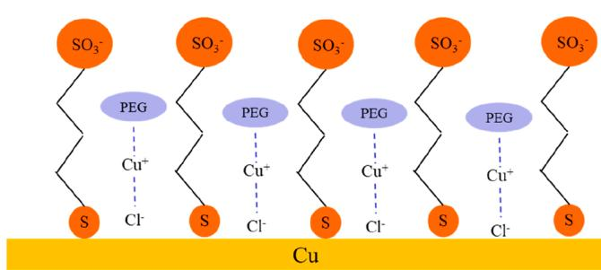  
Figure 11. Mechanism of action of PEG.

The most widely accepted theory regarding the mechanism of the inhibitory agent is that the formation of PEG-Cl−-Cu+ hinders the deposition of copper. This theory has also been substantiated by various techniques, including electrochemistry, surface-enhanced Raman spectroscopy, atomic force micros copy, and others.35,36 In the case of the inhibitor, chloride ions coordinate with PEG to form PEG-Cu (I)-Cl complexes. Its adsorption on the copper surface enhances cathodic polarization, thus inhibiting the deposition of copper. Moreover, leveling agents in the plating solution can form complexes by coordinating with the copper surface through their active sites (such as N, S, Pyridine rings, etc.). The adsorption of this complex on the copper surface enhances the inhibitory efect of PEG-Cu (I)-Cl on the copper surface.

Numerous studies indicate the presence of significant interactions between inhibitors and accelerators, and the manifestation of the accelerating efect depends to a certain extent on the presence of the inhibitor. For instance, in a plating solution containing $\mathrm { C l ^ { - } }$ but without PEG, the addition of SPS did not show a significant accelerating efect, and the resulting plated coating was not bright. Mofat et al.37 demonstrated that the competitive adsorption of SPS and PEG on the copper surface involves the competition for adsorption sites. They argue that the appearance of the accelerating efect is attributed to the disruption of the cathodic inhibition layer by the sulfonic acid group. Moreover, the rate of SPS replacing PEG adsorbed on the copper surface is dependent on the overpotential. The higher the overpotential, the faster SPS replaces PEG.

Dow et al.38 proposed that when JGB serves as a leveling agent, there is a synergistic efect between JGB, PEG, and chloride ions, enhancing their inhibitory efects. This enhanced efect is realized through the formation of PEG-JGB-Cl− complexes generated during the electroplating process. The synergistic efect is related to the convection intensity, causing the inhibition of PEG-JGB-Cl− complexes in high convection areas and the accumulation of SPS at the bottom of blind holes, thereby achieving overfilling of the blind holes. Bandas et al.39 studied the catalytic efect of amine leveling agents on SPS at the interface between copper and the electroplating solution, revealing that the influence of leveling agents on accelerators is related to the molecular weight of the leveling agent.

## 5. CHALLENGES AND ISSUES IN ACIDIC COPPERELECTROPLATING

The primary challenge in acidic copper electroplating lies in the incomplete understanding of the mechanisms of additives in the copper plating system, especially those of accelerators and leveling agents. Among them, the mechanism of leveling agents is of paramount importance. As leveling agents are vital for achieving uniform copper coatings, the challenge lies in correctly selecting and using appropriate additives when altering electroplating conditions, particularly in high current density electroplating.38 Currently, in industrial electroplating practices, the current density for through-hole electroplating is generally strictly controlled below 3 A/dm,2 and for plating blind holes, it is even lower, typically strictly controlled below 2 A/dm.2 There are two main impacts of increasing current density.

First, it seriously diminishes the uniformity of the coating, resulting in greater diferences in thickness between the copper surface and the copper coating inside the hole. Excessively thin hole copper can lead to severe damage to the electrical performance and reliability of PCBs, which is strictly prohibited in electroplating production. Second, increasing current density will impact existing additive systems, necessitating the develop ment of new additive systems. However, developing an entirely new electroplating solution system has become increasingly challenging, requiring higher costs and more funding. Furthermore, higher current density will accelerate the consumption of accelerators, increase the dificulty of additive control, and significantly impact coating quality.

## 6. CONCLUSIONS

As chip integration continues to soar, the standards for copper filling capabilities and quality in silicon vias with exceptional aspect ratios, including through-silicon vias (TSVs) and blind vias, have escalated significantly. Presently, domestic inquiries into electroplating additives remain insuficiently exhaustive, with a scarcity of inquiries into the intricate interaction mechanisms among these additives. Consequently, electro plating solutions utilized in domestic chip manufacturing still heavily rely on imports, necessitating the urgent development of high-performance domestic electroplating copper additives. Therefore, the quest for additives that possess low toxicity, environmental friendliness, stability, and electroplating eficacy is paramount for attaining independent chip localization.

Accelerators can be tailored toward organic additives devoid of sodium ions, with the objective of minimizing the impact of sodium ion infiltration on chip electrical performance. Future inquiries into leveling agents should concentrate on polyquater nary ammonium salts, small-molecule nitrogen-containing heterocyclic compounds, and inorganic molecules. Additionally, polymers enriched with multiple active functional groups, including ethers, hydroxyl groups, and imidazoles, emerge as a promising research direction for innovative leveling agents.

The subsequent electroplating solution development emphasizes the investigation of the electrochemical behavior’s influence on the grain growth and microstructure of electroplated copper during acidic deposition. This encompasses elucidating the copper crystal form transformation, meticulously controlling the microstructure, and comprehension of the copper coating’s mechanical property variations. Furthermore, revealing the regulatory mechanisms of additives on the mechanical properties of the copper coating material is paramount. Establishing a screening and design framework for organic additives with targeted functional groups is imperative, facilitating the creation of electroplating solutions tailored to meet the requirements of diverse semiconductor manufacturing processes.

## AUTHOR INFORMATION

## Corresponding Author

Renlong Liu − School ofChemistry and Chemical Engineering, Chongqing University, Chongqing 400044, China; orcid.org/0009-0004-9591-9331; Phone: 023- 65678935; Email: lrl@cqu.edu.cn

## Authors

Lanfeng Guo − School of Chemistry and Chemical Engineering, Chongqing University, Chongqing 400044, China; Hubei Sinophorus Electronic Materials Co., Ltd., Hubei 443007, China

Shaoping Li − Hubei Three Gorges Laboratory, Hubei 443007, China

Zhaobo He − Hubei Sinophorus Electronic Materials Co., Ltd., Hubei 443007, China

Yanmei Fu − Hubei Sinophorus Electronic Materials Co., Ltd., Hubei 443007, China

Facheng Qiu − College of Chemistry and Chemical Engineering, Chongqing University of Technology, Chongqing 400054, China; orcid.org/0000-0002-9998-9175

Guangzhou Yang − College of Chemistry and Chemical Engineering, Chongqing University of Technology, Chongqing 400054, China

Complete contact information is available at: https://pubs.acs.org/10.1021/acsomega.4c01707

## Notes

The authors declare no competing financial interest.

## Biographies

Professor Liu serves as a doctoral supervisor at the School ofChemistry and Chemical Engineering ofChongqing University, and also holds the position of Executive Deputy Director of Chongqing Chemical and Chemical Industry Society. He has long been engaged in teaching and scientific research in the field of green chemistry and chemical engineering, accumulating extensive research experience in the areas of green exploitation and utilization of mineral resources, intensification technology and intelligent equipment development for chemical processes, pollutant treatment, as well as comprehensive utilization of resources.

Dr. Guo is currently pursuing a PhD degree in the School of Chemistry and Chemical Engineering at Chongqing University, having graduated with a master’s degree from the same institution in 2017. He has long been engaged in the research and industrialization of wet electronic chemicals purification, as well as the electrolytic solution and process for copper interconnect in advanced chip packaging..

Dr. Li is the Executive Vice Director of Hubei Three Gorges Laboratory. He has been engaged in the development of key microelectronic chemical technology and project construction for a long time. He has successively developed preparation technologies for electronic grade phosphoric acid, electronic grade sulfuric acid, and electronic grade hydrofluoric acid, and has won the second prize of China National Science and Technology Progress Award.

Dr. He is the ChiefEngineer and Director ofthe R&D Center of Hubei Sinophorus Electronic Materials Co., Ltd. He has been engaged in the development and industrialization of electronic chemical preparation technology for a long time.

As a researcher at Hubei Xingfu Electronics, Engineer Fu Yanmei specializes in the research of acidic copper plating and nickel plating. In the field of electronic materials, especially metal surface treatment, the application of acidic copper plating and nickel plating is widespread.

Dr. Qiu graduated from Chongqing University with a Ph.D. degree in 2019 and is currently teaching at Chongqing University of Technology. His primary research focuses on the intensification of chemical processes, the optimization of reactor design, and CFD (Computational Fluid Dynamics) numerical simulations. He has published over 20 academic papers in these areas.

Yang Guangzhou is a graduate student currently enrolled at Chongqing University of Technology. His research focuses on acidic copper plating additives and CFD simulations of the electroplating process.

## ACKNOWLEDGMENTS

This work was supported by the Hubei Three Gorges Laboratory Open/Innovation Fund [grant numbers SK211009 and SK215001]; the National Key Research and Development Program of China [grant number 2019YFC1905800]; and Fundamental Research Funds for the Central Universities [grant number 2022CDJQY-005].

## ■ REFERENCES

(1) Wang, Y.; Zhang, X. Microelectronics technology in the 21st century. World Sci-Tech R & D 1999, No. 4, 4−11.

(2) Morand, Y. Copper Metallization for Advanced IC: Requirements and Technological Solutions. Microelectron. Eng. 2000, 50 (1), 391− 401.

(3) Gonella, R. Key Reliability Issues for Copper Integration in Damascene Architecture. Microelectron. Eng. 2001, 55 (1), 245−255.

(4) Focsa, A.; Blanc, D.; Poulain, G.; Barbos, C.; Gauthier, M.; Le Quang, N.; Lemiti, M. Copper Light-Induced Plating Contacts with Ni Seed-Layer for Mc-Si Solar Cells after Laser Ablation ofSiNx:H. Energy Procedia 2013, 38, 713−719.

(5) Liao, Y.; Zhang, S.; Dryfe, R. Electroless Copper Plating Using Dimethylamine Borane as Reductant. Particuology 2012, 10 (4), 487− 491.

(6) Li, M. G.; Wei, G. Y.; Li, M.; et al. Effect of HEDP on copper electroplating from non-cyanide alkaline baths [J]. Surface Engineering 2014, 30 (10), 728−734.

(7) Correia, A. N.; Façanha, M. X.; de Lima-Neto, P. Cu−Sn Coatings Obtained from Pyrophosphate-Based Electrolytes. Surf. Coat. Technol. 2007, 201 (16), 7216−7221.

(8) Yin, T.; Wu, R.; Leng, Z.; Du, G.; Guo, X.; Zhang, M.; Zhang, J. The Process of Electroplating with Cu on the Surface of Mg−Li Alloy. Surf. Coat. Technol. 2013, 225, 119−125.

(9) Chen, T.-C.; Tsai, Y.-L.; Hsu, C.-F.; Dow, W.-P.; Hashimoto, Y. Effects of Brighteners in a Copper Plating Bath on Throwing Power and Thermal Reliability of Plated Through Holes. Electrochim. Acta 2016, 212, 572−582.

(10) Lefebvre, M.; Allardyce, G.; Seita, M.; Tsuchida, H.; Kusaka, M.; Hayashi, S. Copper Electroplating Technology for Microvia Filling. Circuit World 2003, 29 (2), 9−14.

(11) Mattsson, E.; Bockris, J. O. Galvanostatic Studies of the Kinetics of Deposition and Dissolution in the Copper + Copper Sulphate System. Trans. Faraday Soc. 1959, 55 (0), 1586−1601.

(12) Liao, C. Research on levelers for filling electroplated copper microvias in printed circuit board industry. M.S. thesis; Chongqing University, 2021. DOI: 10.27670/d.cnki.gcqdu.2019.001847.

(13) Lin, J.; Wu, M. Technology and Development of Copper Plating for PCB. Printed Circuit Information 2009, No. 12, 27−32.

(14) Tsai, W.-C.; Wan, C.-C.; Wang, Y.-Y. Frequency Effect of Pulse Plating on the Uniformity of Copper Deposition in Plated Through Holes. J. Electrochem. Soc. 2003, 150 (5), C267.

(15) Liu, X. Synthesis and Application of Acidic Copper Plating Leveling Agent for Printed Circuit Boards. M.S. thesis; Central South University, 2010. https://kns.cnki.net/KCMS/detail/detail. aspx?dbcode=CMFD&dbname=CMFD2010&filename=2009240471. nh&v= (accessed 2024-02-19).

(16) Huang, S.-M.; Liu, C.-W.; Dow, W.-P. Effect of Convection-Dependent Adsorption of Additives on Microvia Filling in an Acidic Copper Plating Solution. J. Electrochem. Soc. 2012, 159 (3), D135.

(17) Moffat, T. P.; Wheeler, D.; Kim, S.-K.; Josell, D. Curvature Enhanced Adsorbate Coverage Model for Electrodeposition. J. Electrochem. Soc. 2006, 153 (2), C127.

(18) Ho, C. E.; Liao, C. W.; Pan, C. X.; Chen, H. J.; Kuo, J. C.; Chen, D. Electron Backscatter Diffraction Analysis on the Microstructures of Electrolytic Cu Deposition in the through Hole Filling Process. Thin Solid Films 2013, 544, 412−418.

(19) Ho, C. E.; Hsieh, W. Z.; Chen, C. C.; Lu, M. K. Electron Backscatter Diffraction Analysis on the Microstructures of Electrolytic Cu Deposition in the through Hole Filling Process: Butterfly Deposition Mode, Surf, Coat. Technol, 2014. 259. 262-267.

(20) Li, Z.; Tan, B.; Luo, J.; Qin, J.; Yang, G.; Cui, C.; Pan, L. Structural Influence of Nitrogen-Containing Groups on Triphenylmethane-Based Levelers in Super-Conformal Copper Electroplating. Electrochim. Acta 2022, 401, 139445.

(21) Dow, W.-P.; Huang, H.-S. Roles of Chloride Ion in Microvia Filling by Copper Electrodeposition: I. Studies Using SEM and Optical Microscope. J. Electrochem. Soc. 2005, 152 (2), C67.

(22) Feng, Z. V.; Li, X.; Gewirth, A. A. Inhibition Due to the Interaction of Polyethylene Glycol, Chloride, and Copper in Plating Baths: A Surface-Enhanced Raman Study. J. Phys. Chem. B 2003, 107 (35), 9415−9423.

(23) Choe, S.; Kim, M. J.; Kim, H. C.; Cho, S. K.; Ahn, S. H.; Kim, S.- K.; Kim, J. J. Degradation of Bis(3-Sulfopropyl) Disulfide and Its Influence on Copper Electrodeposition for Feature Filling. J. Electro chem. Soc. 2013, 160 (12), D3179.

(24) Garcia-Cardona, E.; Wong, E. H.; Barkey, D. P. NMR Spectral Studies of Interactions Between the Accelerants SPS and MPS and Copper Chlorides. J. Electrochem. Soc. 2011, 158 (3), D143.

(25) Schmitt, K. G.; Schmidt, R.; Gaida, J.; Gewirth, A. A. Chain Length Variation to Probe the Mechanism of Accelerator Additives in Copper Electrodeposition. Phys. Chem. Chem. Phys. 2019, 21 (30), 16838-16847.

(26) Lan, L.; Wang, C.; Wang, P.; Ming, X.; Zhu, Y.; Huang, Q.; He, W.; Zhou, G. Application Research of a Novel Accelerator MA for Acid Copper Electroplating. Electroplating and Finishing 2023, 45 (12), 64− 70.

(27) Wei, H.; Tan, T.; Liu, R.; Guo, L.; Tao, C.; Qin, X. Prediction and Effect Verification of Thiamine as a Leveling Agent in Chip Wafer Electroplating. ACS Omega 2023, 8 (48), 45495−45501.

(28) Chang, C.; Lu, X.; Lei, Z.; Wang, Z.; Zhao, C. 2- Mercaptopyridine as a New Leveler for Bottom-up Filling of Micro Vias in Copper Electroplating. Electrochim. Acta 2016, 208, 33−38.

(29) Liao, C.; Zhang, S.; Chen, S.; Qiang, Y.; Liu, G.; Tang, M.; Tan, B.; Fu, D.; Xu, Y. The Effect of Tricyclazole as a Novel Leveler for Filling Electroplated Copper Microvias. J. Electroanal. Chem. 2018, 827, 151−159.

(30) Li, J.; Zhou, G.; Hong, Y.; Wang, C.; He, W.; Wang, S.; Chen, Y.; Wen, Z.; Wang, Q. Copolymer of Pyrrole and 1,4-Butanediol Diglycidyl as an Efficient Additive Leveler for Through-Hole Copper Electroplating. ACS Omega 2020, 5 (10), 4868−4874.

(31) Zheng, L.; He, W.; Zhu, K.; Wang, C.; Wang, S.; Hong, Y.; Chen, Y.; Zhou, G.; Miao, H.; Zhou, J. Investigation of poly (1-vinyl imidazole co 1, 4-butanediol diglycidyl ether) as a leveler for copper electroplating of through-hole[J]. Electrochim. Acta 2018, 283, 560−567.

(32) Chen, H.-M.; Parulekar, S. J.; Zdunek, A. Interactions of Chloride and 3-Mercapto-1-Propanesulfonic Acid in Acidic Copper Sulfate Electrolyte. J. Electrochem. Soc. 2008, 155 (5), D349.

(33) Wang, W.; Li, Y.-B. Effect of Cl − on the Adsorption−Desorption Behavior of PEG. J. Electrochem. Soc. 2008, 155 (4), D263.

(34) Li, W. H.; Wang, Y.; Ye, J. H.; Li, S. F. Y. In Situ STM Study of Chloride Adsorption on Cu(110) Electrode in Hydrochloric Acid Aqueous Solution. J. Phys. Chem. B 2001, 105 (9), 1829−1833.

(35) Moffat, T. P.; Wheeler, D.; Kim, S.-K.; Josell, D. Curvature Enhanced Adsorbate Coverage Mechanism for Bottom-up Superfilling and Bump Control in Damascene Processing. Electrochim. Acta 2007, 53 (1), 145−154.

(36) Dow, W.-P.; Li, C.-C.; Lin, M.-W.; Su, G.-W.; Huang, C.-C. Copper Fill of Microvia Using a Thiol-Modified Cu Seed Layer and Various Levelers. J. Electrochem. Soc. 2009, 156 (8), D314.

(37) Bandas, C. D.; Rooney, R. T.; Kirbs, A.; Jäger, C.; Schmidt, R.; Gewirth, A. A. Interfacial Leveler-Accelerator Interactions in Cu Electrodeposition. J. Electrochem. Soc. 2021, 168 (4), 042501.

(38) Zhao, J.; Cui, G. Study on Adsorption and Complexation Behavior of Thiourea on Copper Surface. Int. J. Electrochem. Sci. 2011, 6 (9), 4048−4058.

(39) Bandas, C.; Rooney, R.; Kirbs, A.; et al. Interfacial Leveler-Accelerator Interactions in Cu Electrodeposition[J]. J. Electrochem. Soc. 2021, 168, 042501.