PAPER

Published on 12 February 2025

Licence and permissions

Check for updates

# Filling performance of an Acid Blue 1 leveler on blind microvias†

Cite this: New J. Chem., 2025, 49, 4538

Mingjie Li,a Xuesong Peng,a Jie Jiang,a Yaqiang Li, \*ab Fan Meng,a Youzheng Wu,a Maozhong An,a Ruopeng Li,\*a Penghui Ren\*ac and Peixia Yang \*a

Received 24th December 2024, Accepted 11th February 2025

DOI: 10.1039/d4nj05470a

The void-free blind microvia copper electroplating process is a key technology in HDI PCB manufacturing. This work systematically studied the influence of the Acid Blue 1 (AB1) leveler on blind microvia filling. AB1 exhibits excellent suppression during electroplating, with its efect strengthening as the AB1 concentration increases. Chronopotentiometry was used to study the interaction among AB1, SPS, and PEG. There is a synergistic suppressing interaction between the new leveler AB1 and suppressor PEG, while there is competition between AB1 and accelerator SPS. During electrodeposition, AB1 can adsorb on the copper substrate to reduce active sites and suppress copper electrodeposition, based on theoretical studies and in situ infrared spectroscopy. At the optimized electroplating process, void-free microvia filling is achieved with 20 mg L-1 AB1 and successive electroplating confirms the stability of AB1. Based on difusion diferences among additives and the competition between AB1 and SPS, a gradient competitive adsorption superfilling mechanism was proposed to illustrate the filling process of the AB1–SPS–PEG system. AB1 is beneficial to improving flatness and lowering surface roughness of the copper layer, which is conducive to reducing signal losses during high-frequency transmission. Additionally, AB1 can modulate the preferential formation of Cu(111) and Cu(200) and facilitate grain refinement.

rsc.li/njc

## 1. Introduction

High-density interconnect (HDI) printed circuit boards (PCBs) serve as a foundational platform for connecting all kinds of electronic components in electronic products, thus attracting significant research attention.1 With the trend toward smallersized electronic devices with higher performance, stricter requirements are imposed on PCB design and manufacturing technology.2,3 Especially in the fields of high-performance computing, high-speed communication, and precision instruments, the reliability and performance of PCBs are directly related to the performance and stability of the final products. Blind microvia filling is a key interconnect technology in the manufacturing process of PCBs, allowing for electrical connections between diferent layers in the circuit board.4,5 The application of this technology enhances PCB design flexibility, enabling more complex circuit layouts and greater space utilization.

Copper is widely used as an interconnect line in blind microvias for PCB manufacturing due to its good electronic (thermal and electrical conductivity) and mechanical (wear resistance and elongation, etc.) properties.6,7 The filling of blind microvias with copper is achieved through electroplating technology.8–10 In PCBs, copper not only provides a stable electrical connection but also enhances the structural strength of HDI PCBs, improving heat and wear resistance.11 Moreover, copper interconnect lines effectively reduce losses in signal transmission and enhance signal integrity, which is especially important for high-frequency and high-speed circuits.12 During copper electroplating, it is essential to adjust the metal deposition process in local microvias to avoid the formation of void defects caused by the edge effect, which can undermine the properties of the copper interconnect layer. The most common method is the addition of proper additives.13–15

The additives used in copper electroplating fall into three categories: accelerators, suppressors, and levelers.16 The most commonly used accelerator, suppressor, and leveler is bis-(sodium sulfopropyl)- disulfide (SPS), polyethylene glycol (PEG), and Janus Green B (JGB).17 During electroplating, density functional theory (DFT) calculations, in situ Raman spectroscopy, and scanning tunneling microscopy (STM) studies reveal that the disulfide bond of SPS will break up, with the sulfurcontaining side adsorbing on the copper base, while the other side (containing a sulfonic acid group) captures free $\operatorname { C u } ^ { 2 + }$ to accelerate reduction with adsorbed Cl- through the ‘‘bridging efect’’.18–20 As for PEG, in situ Raman and molecular dynamics (MD) simulations confirm the formation of $\mathbf { P E G - C u ^ { 2 + } - C l ^ { - } }$ adsorbate complexes, which increase the energy barrier and suppress copper electrodeposition.21–23 Mass spectrometry (MS) and DFT calculations demonstrate that the azo group of JGB competes with the reduction of $\mathrm { C u } ^ { 2 + }$ to obtain electrons, leading to dissociation24,25 into phenazine derivatives that can also adsorb on active sites to suppress copper growth.26,27 Among these additives, levelers are key components for achieving defect-free filling in blind vias.28 Nowadays, triphenylmethane derivatives are promising levelers and have been used in throughhole and blind-hole filling due to the unlocalized orbital distribution of the tertiary amine structure.29,30

In this work, a novel triphenylmethane derivative, Acid Blue 1 (AB1), was selected as a potential leveler, and the efects of diferent concentrations of AB1 on copper electroplating were investigated. The interactions among three diferent types of additives were studied using galvanostatic measurements. The influencing mechanism of AB1 on the copper cathode surface during electroplating was also studied theoretically and experimentally. The filling performance of AB1 in blind microvias was examined, and the electroplating process was optimized. Additionally, the surface morphology and roughness of the copper interconnect layer were analyzed, and finite element simulation was employed to study the high-frequency signal transmission losses influenced by AB1, while phase structure was investigated by XRD.

## 2. Experiment

## 2.1 Chemical materials

The chemicals used included $\mathrm { C u S O _ { 4 } { \cdot } 5 H _ { 2 } O , ~ H _ { 2 } S O _ { 4 } } ,$ and NaCl, which were purchased from Sinopharm Group. The virgin make-up solution (VMS) was composed of 250 $\textrm { g L } ^ { - 1 } \mathrm { { C u S O } _ { 4 } }$ $\mathrm { 5 H _ { 2 } O , ~ 4 0 ~ g ~ L ^ { - 1 } ~ H _ { 2 } S O _ { 4 } , }$ 60 mg $\mathrm { L } ^ { - 1 }$ Cl-. The additives used in this work include Acid Blue 1 (AB1), PEG, and SPS, which were sourced from Shanghai Aladdin Biochemical Technology. All chemicals were analytical-grade, and all solutions prepared used deionized water.

## 2.2 Electrochemical tests

A traditional three-electrode system, consisting of a Pt rotating disk electrode (working electrode), Pt foil (counter electrode), and saturated mercury sulfate electrode (referenced as SSE; reference electrode), was used to measure cyclic voltammetry (CV), electrochemical impedance spectra (EIS), and galvanostatic measurements. All electrochemical tests were controlled by the Gamry Framework Station. The voltage range for CV was $- 0 . 8 \mathrm { ~ V ~ }$ to 0.2 V vs. SSE, with a scan rate and rotation speed of $5 0 \mathrm { m V s } ^ { - 1 }$ and 1000 rpm.31 For the EIS tests, pre-deposition was performed with the WE deposited at $2 \mathrm { ~ A ~ d m } ^ { - 2 }$ for 1 min in

VMS. EIS was subsequently tested with the WE potential set at $- 0 . 5 \mathrm { ~ V ~ }$ vs. SSE. The frequency range was from ${ { 1 0 } ^ { 5 } }$ Hz to ${ 1 0 } ^ { - 2 } \mathrm { H z } ,$ , and the rotation speed was 1000 rpm.32 Galvanostatic measurements were carried out at $2 \operatorname { A } \dim ^ { - 2 }$ and 1000 rpm with additives introduced into the solution at 500 s, 1000 s, and 1500 s in diferent injection orders.33

## 2.3 Theoretical calculations

Gaussian was used to optimize the AB1 structure with B3LYP at $6 { - } 3 1 1 \mathbf { G } , ^ { 3 4 }$ while Multiwfn was employed to calculate the local electron afinity (LEA) to predict the adsorption area,35,36 and the LEA distribution was visualized using $\mathrm { { V M D } } \ 1 . 9 . 3 . ^ { 3 7 }$ The theoretical calculation of AB1 adsorption on the copper substrate was performed using the Vienna ab initio simulation package (VASP).38,39 A cubic cell measuring 23 Å in length and width, and 46 Å in height, was used for the calculation. The exchange– correlation function for structural relaxation was addressed using the GGA parameterized by PBE. The ion-electron interactions were determined through the PAW pseudopotential method, with the self-consistent field (SCF) convergence set to $1 0 ^ { - 5 } ~ \mathrm { e V } . ^ { 4 0 }$ The adsorption energy of the novel leveler AB1 on the copper substrate was calculated as follows:41

$$
\Delta E = E _ {\mathrm{AB1/Cu}} - E _ {\mathrm{Cu}} - E _ {\mathrm{AB1}}\tag{1}
$$

where $E _ { \mathrm { A B 1 / C u } }$ is the total energy after AB1 adsorbs on the copper substrate, $E _ { \mathrm { { C u } } }$ is the energy of the copper substrate, and $E _ { \mathrm { A B 1 } }$ is the energy of AB1. The molecular dynamics simulation for calculating the difusion properties of AB1 is detailed in the ESI.†

## 2.4 Electroplating

In electroplating experiments, phosphor copper plates $( 5 \times 1 0 \mathrm { c m } ^ { 2 } )$ were used as the anode, while PCB plates $( 5 \times 1 0 \mathrm { c m } ^ { 2 } )$ served as the cathode. Gas pumping, with a rate of 20 L h-1, was employed to stir the solution and accelerate mass transfer during electroplating. Each electroplating used 1.5 L solution, with the solution composition and optimized values shown in Table 1. Before electroplating, the PCB was cleaned with acetone and activated using 10 wt% $\mathrm { H } _ { 2 } \mathrm { S O } _ { 4 } .$ . The electroplating time for filling microvias was 3 h.

## 2.5 Copper characterization

In situ infrared spectroscopy was measured using a Nicolet IS50 IR with an MCT detector. The testing solution comprised 8 mmol $\mathrm { L } ^ { - 1 } \mathrm { C u S O } _ { 4 } { \cdot } 5 \mathrm { H } _ { 2 } \mathrm { O } ,$ 70 mmol ${ \bf L } ^ { - 1 } { \bf \Delta H } _ { 2 } { \bf S } { \bf O } _ { 4 } ,$ and 1.4 mmol $\mathrm { { \bf L } } ^ { - 1 } \mathrm { { \bf C l } ^ { - } }$ . The potential was controlled by the Gamry Framework station and ranged from -0.45 V to -0.65 V vs. SSE.

<table><tr><td colspan="2">Table 1 Electroplating solution composition and process</td></tr><tr><td>Solution composition and process</td><td>Optimized values</td></tr><tr><td> $CuSO_{4} \cdot 5H_{2}O$  (g  $L^{-1}$ )</td><td>220</td></tr><tr><td> $H_{2}SO_{4}$  (g  $L^{-1}$ )</td><td>50</td></tr><tr><td> $Cl^{-}$  (mg  $L^{-1}$ )</td><td>60</td></tr><tr><td>Acid Blue 1 (mg  $L^{-1}$ )</td><td>20</td></tr><tr><td>SPS (mg  $L^{-1}$ )</td><td>2</td></tr><tr><td>PEG (mg  $L^{-1}$ )</td><td>200</td></tr><tr><td>Cathode current density (A dm $^{-2}$ )</td><td>1.5</td></tr></table>

SEM (Zeiss Supra 55) was used to examine morphology, and an OLYMPUS DSX510 conformal microscope was used to measure roughness. The phase structure was studied by XRD (Brucker D8). The copper layer grain size was calculated based on Scherrer’s formula:

$$
D = \frac {K \lambda}{\beta \cos \theta}\tag{2}
$$

where $D$ is the grain size (nm), K is 0.89, b is the full width at half maxima in 2y degree, and y is the difraction angle.

## 2.6 Finite element simulation

COMSOL Multiphysics software was used to carry out the finite element simulation. The model was established based on the surface roughness measurement. The AC/DC module was employed to simulate the current density distribution at varying high frequencies (10 GHz and 100 GHz).

## 3. Results and discussion

## 3.1 Electrochemical analysis

3.1.1 CV analysis. Cyclic voltammetry was used to examine AB1 during electroplating,42 as shown in Fig. 1a and Fig. S1 (ESI†). The cathodic onset potential decreases as AB1 concentration increases (Fig. S1, ESI†). The onset potential without AB1 was about -430 mV, while it shifts negatively to -575 mV after adding 10 mg $\mathrm { L } ^ { - 1 }$ AB1, indicating that AB1 efectively increases cathodic polarization. In addition, the onset potential decreases from -583 mV $\mathbf { t o } - 6 5 0$ mV with additive concentrations rising from 20 mg $\mathrm { L } ^ { - 1 }$ to 150 mg $\mathrm { L } ^ { - 1 }$ , demonstrating an intensified suppressing efect on copper electrodeposition with higher AB1 concentrations. The anodic stripping area also declines continuously with increasing AB1 concentration, suggesting a reduction in the amount of electrodeposited Cu during the cathodic process. We calculated the anodic stripping coulomb (ASC) values according to eqn (S1) for quantitative evaluation of AB1 (details in ESI†).43 Fig. 1b shows that the ASC of VMS is $7 1 . 0 \mathrm { ~ C ~ } \mathrm { d m } ^ { - 2 }$ , which decreases by 28% to 51.4 $\mathrm { ~ C ~ d m } ^ { - 2 }$ with 10 mg $\mathrm { ~ L ~ } ^ { - 1 }$ AB1, indicating that trace AB1 (10 mg $\mathbf { L } ^ { - 1 } )$ can significantly suppress copper electrodeposition. At 20 mg $\mathrm { L } ^ { - 1 }$ and 30 mg $\mathrm { L } ^ { - 1 }$ AB1 concentrations, the ASC is $4 7 . 8 \mathrm { ~ C ~ } \mathrm { d m } ^ { - 2 }$ and 42.7 $\mathrm { ~ C ~ d m } ^ { - 2 } ,$ , both lower than $5 0 \mathrm { ~ C ~ } \mathrm { d m } ^ { - 2 } .$ . The ASC further decreases to 35.8 $\mathrm { ~ C ~ d m } ^ { - 2 }$ with AB1 concentration at 50 mg $\mathrm { L } ^ { - 1 }$ Notably, the ASC drops to $2 5 . 8 \mathrm { ~ C ~ } \mathrm { d m } ^ { - 2 }$ , accounting for 36% of VMS. Overall, cyclic voltammetry analysis indicates that AB1 suppresses copper electrodeposition.

a  
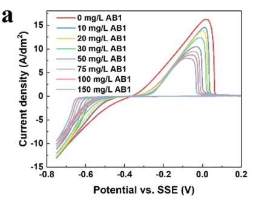

b  
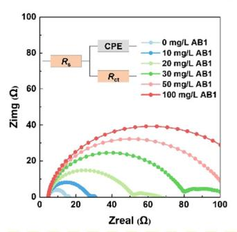

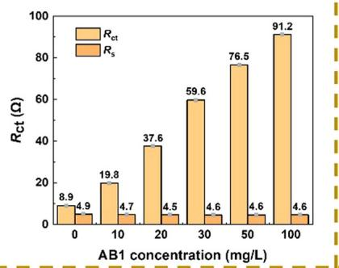

3.1.2 EIS analysis. In addition to CV tests, electrochemical impedance spectra (EIS) were conducted to study the efect of AB1.44 The impedance semicircle is related to charge transfer impedance $\left( R _ { \mathrm { c t } } \right) , R _ { \mathrm { c t } }$ increases with increasing impedance semicircle.

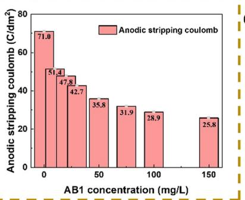

Fig. 1b (right) shows the influence of AB1 during EIS tests. The semicircle enlarges as AB1 concentration rises, indicating an increase in charge transfer impedance and a higher reaction transition energy requirement for the electroreduction of $\mathrm { C u } ^ { 2 + }$ to Cu. Solution impedance $\left( R _ { s } \right)$ and charge transfer impedance $\left( R _ { \mathrm { c t } } \right)$ were simulated according to the equivalent circuit shown in the inserted figure in Fig. 1b. The simulated results are depicted in Fig. 1b (left). Firstly, the generally unchanged $R _ { s }$ suggests that AB1 has little influence on solution conductivity. For $R _ { \mathrm { c t } } ,$ it is only 8.9 O for VMS, indicating that $\mathrm { C u } ^ { 2 + }$ is easily electro-reduced during electroplating without AB1. Introducing 10 mg $\mathrm { L } ^ { - 1 }$ increases $R _ { \mathrm { c t } }$ to 19.8 O, two times higher than VMS. $R _ { \mathrm { c t } }$ continues to rise from 37.6 O to 91.2 O with AB1 concentrations of 20 mg $\mathrm { L } ^ { - 1 }$ to 100 mg $\mathrm { L } ^ { - 1 }$ , and $R _ { \mathrm { c t } }$ at 150 mg $\mathrm { L } ^ { - 1 }$ AB1 is ten times larger than VMS. Overall, CV and EIS analyses confirm that AB1 plays a suppressive role during copper electrodeposition.

c  
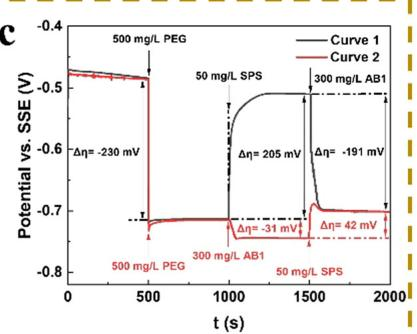

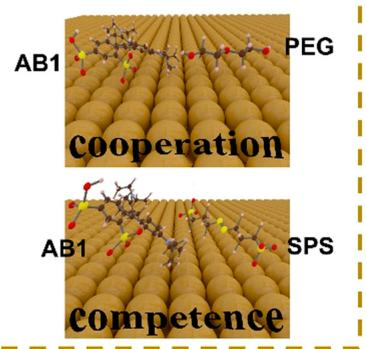  
Fig. 1 (a) Cyclic voltammetry under the influence of AB1 leveler (left) and histogram of anodic stripping coulomb (right). (b) EIS of AB1 measured at -0.5 V vs. SSE and 1000 rpm, with the simulated equivalent circuit shown in the inserted figure (left) and histogram of simulated solution impedance $( R _ { s } )$ and charge transfer impedance $( R _ { \mathrm { c t } } )$ (right). (c) Galvanostatic measurement with diferent additive injection orders at 2 A dm-2 and 1000 rpm (top) and schematic diagram of interactions among SPS, PEG, and AB1 (bottom).

3.1.3 Chronopotentiometry analysis. It is important to study the interaction among SPS (accelerator), PEG (suppressor), and AB1 (leveler), as it provides a deeper understanding of the filling mechanism in microvias.45 Traditionally, galvanostatic measurement is applied to study possible interactions by changing the injection order of the three types of additives. Fig. 1c (up) shows the change in cathodic potential after injecting additives into the testing solution. The cathodic potential declines (230 mV) after adding PEG, indicating its suppressing efect. Upon introducing AB1, the cathodic potential further decreases (31 mV), suggesting synergistic cooperation between AB1 and PEG. However, after the addition of SPS, the cathodic potential shifts positively (42 mV), indicating the accelerating efect of SPS in the presence of AB1 and PEG. By altering the additive injection order, SPS can cause a positive shift of 205 mV in cathodic potential after PEG injection, suggesting that SPS can replace PEG to accelerate copper electrodeposition, consistent with previous work.46 Following AB1 injection, the cathodic potential changes negatively (-191 mV). Additionally, the potential reaches the same level regardless of injection order, further verifying the competition between SPS and AB1. Fig. 1c (down) provides a schematic diagram illustrating the relationships among SPS, PEG, and AB1, showing cooperation between AB1 and PEG, but competition between AB1 and SPS.

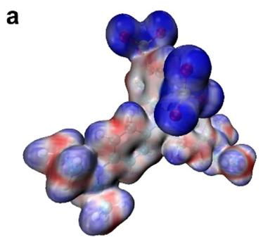  
b

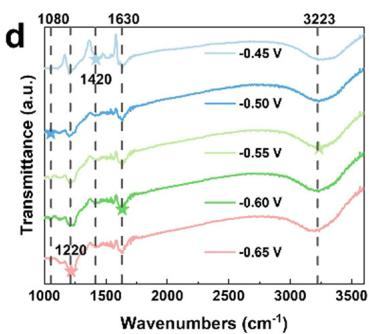

## 3.2 Efect mechanism study

3.2.1 Adsorption analysis. The influencing mechanism was studied using DFT calculations and in situ infrared spectroscopy .47–49 The AB1 formula and its optimized structure are shown in Fig. S2 (ESI†). Fig. 2a shows the local electron affinity (LEA) distribution, with the blue color indicating high electrophilicity and red representing nucleophilicity. The $- \mathbf { S } \mathbf { O } _ { 3 }$ area (high electrophilicity) in AB1 is conducive to forming interactions with the copper substrate due to vacant d orbitals. The adsorption equilibrium configuration of AB1 on the copper substrate is shown in Fig. 2b and Fig. S3 (ESI†), with color representations detailed in the ESI.† The quasi-plane structure of AB1 adsorbs nearly parallel to the copper substrate, with the $- \mathbf { S } \mathbf { O } _ { 3 }$ functional group connected to the benzene ring of AB1 preferentially adsorbing on the substrate. Fig. 2c shows the 2D charge density difference of the adsorption configuration after equilibrium. The blue and red colors represent charge depletion and accumulation, demonstrating charge transfer between copper and AB1. It is believed that AB1 adsorbs on the cathode surface to reduce active sites and increase cathodic polarization.

To verify the calculated results, in situ infrared spectroscopy was conducted to observe the AB1 adsorption process during electrodeposition,30 as shown in Fig. 2d. The peaks and their attributions are summarized in Table S1 (ESI†). The characteristic peaks $\left( - { \bf S } { \bf O } _ { 3 } \right.$ functional group) at 1080 cm-1 and $1 2 2 0 \mathrm { c m } ^ { - 1 }$ confirm the adsorption of the – $- \mathbf { S } \mathbf { O } _ { 3 }$ functional group of AB1 on the copper substrate. The stretching vibrations of $\mathrm { C - N }$ (1630 cm-1), C–C (1420 cm-1), and C–H (3223 $\mathrm { c m } ^ { - 1 } )$ of the aromatic ring indicate that AB1 adsorbs parallel to the copper substrate, consistent with the calculated adsorption equilibrium.

e  
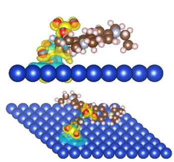  
C

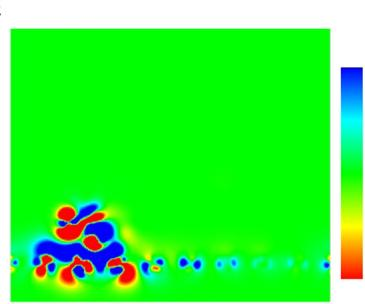

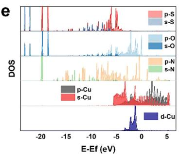

f  
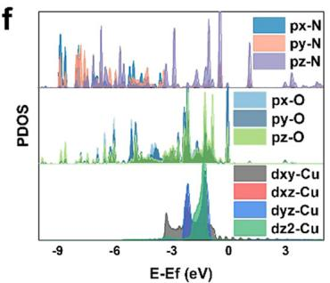  
Fig. 2 (a) Local electron afinity (LEA) mapped the distribution of AB1. (b) Adsorption equilibrium of AB1 on the copper substrate (bottom) and side view of the adsorption equilibrium configuration (top). (c) 2D Bader charge density diference after AB1 adsorbs on the copper substrate. (d) In situ infrared spectroscopy of AB1 during electroplating. (e) DOS of s and p orbitals of S, O, and N from AB1 and s, p, and d orbitals of Cu from the copper substrate. (f) PDOS of the p orbitals of N and O from AB1 and the d orbitals of Cu from the copper substrate.

3.2.2 DOS analysis. Density of states (DOS) analysis provides insight into the interaction at the orbital level.32 Fig. 2e shows the clear orbital overlap among the d orbitals of Cu, the s orbitals of N, and the p orbitals of O, indicating orbital interactions among the copper substrate, N atoms, and O atoms. In contrast, there is no orbital overlap between S and $\mathbf { C u } ,$ demonstrating that S atoms are not directly adsorbed on the copper substrate, consistent with the calculated adsorption configuration. To understand the specific orbital interactions in more detail, the PDOS (projected density of state) was calculated, as shown in Fig. 2f. Firstly, the pz orbitals of N atoms exhibit the largest overlap with the dyz and dz2 orbitals of Cu, while a strong hybridization occurs between py and pz orbitals of O atoms and dyz and dz2 orbitals of Cu. DOS analysis confirms significant d and p orbital hybridization among O, N, and Cu, further verifying the adsorption configuration and providing a deeper understanding of the adsorption mechanism. In summary, AB1 can adsorb on the copper cathode to reduce active sites and act as a barrier to suppress the reduction of free $\mathrm { C u } ^ { 2 + }$

## 3.3 Efect of AB1 on filling performance

3.3.1 Electroplating performance. The optimization of the electroplating process is shown in Fig. 3, with the used devices illustrated in Fig. 3c. Without AB1, the growth rate at the opening area is higher than that at the bottom and side walls, leading to void defects in microvias with both diameters (125 mm and 150 mm). At an AB1 concentration of 10 mg ${ { \bf L } ^ { - 1 } } ,$ the growth rate at the opening area decreases due to AB1 adsorption, which suppresses copper growth. However, this relatively low concentration is not conducive to establishing an efective concentration gradient, resulting in defects forming in the 125 mm microvias and concave growth in the 150 mm microvias. With 20 mg $\mathrm { ~ L ~ } ^ { - 1 } \ \mathbf { A B 1 }$ , an efective concentration gradient is formed, allowing copper to grow from bottom to top without defects in either microvias. Besides, the compact and flat copper morphology from the top view in Fig. S4 (ESI†) indicates that AB1 improves copper quality compared to layers obtained without it. In contrast, the commonly used leveler Janus Green B (Fig. S5, ESI†) produces a copper layer that contains gas holes, despite yielding a flat and defect-free surface, demonstrating that AB1 is superior in enhancing copper quality. The influence of morphology will be discussed in Section 3.4.1. When the AB1 concentration increases further to $3 0 \mathrm { m g L } ^ { - 1 }$ , the excessive concentration weakens the concentration gradient, causing the bottom-up growth mode to shift to a conformal growth mode in the 150 mm microvias. Overall, 20 mg L-1 AB1 is determined to be optimum.

The stability of AB1 was later evaluated, as shown in Fig. S6 and S7 (ESI†). Cyclic voltammetry indicates that there is no cathodic reduction reaction peak in the potential range of -0.75 V to +0.2 V vs. SSE, illustrating that no decomposition occurs for AB1 during electroplating. After introducing diferent coulombs (1 A h, 3 A h, 5 A h) into the solution with the optimized AB1 concentration ${ \left( { 2 0 \mathrm { m g L } ^ { - 1 } } \right) } .$ , electroplating experiments were carried out and the cross-sectional figure of the copper layer is shown in Fig. S7 (ESI†). A defect-free copper layer was obtained, further verifying that AB1 maintains good stability during electroplating.

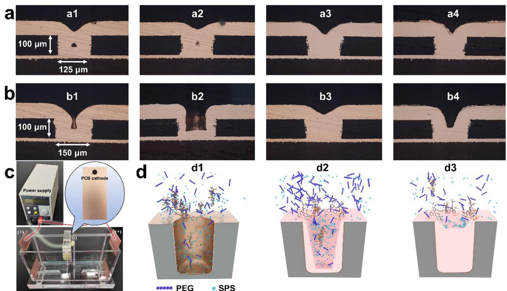  
Fig. 3Filling performance of ${ \mathsf { C u } }$ electroplating for 3 h with different AB1 concentrations in microvias with diameters of (a) 125 um. (b) 150 um. (a1) and (b1) (0 mg ${ \mathsf { L } } ^ { - 1 } ) ,$ (a2) and (b2) (10 mg L−1), (a3) and (b3) (20 mg L−1), and (a4) and (b4) $( 3 0 \mathrm { m g } \lfloor ^ { - 1 } ) .$ . (c) Electroplating devices. (d) Schematic diagram of the filling process for AB1–SPS–PEG system.

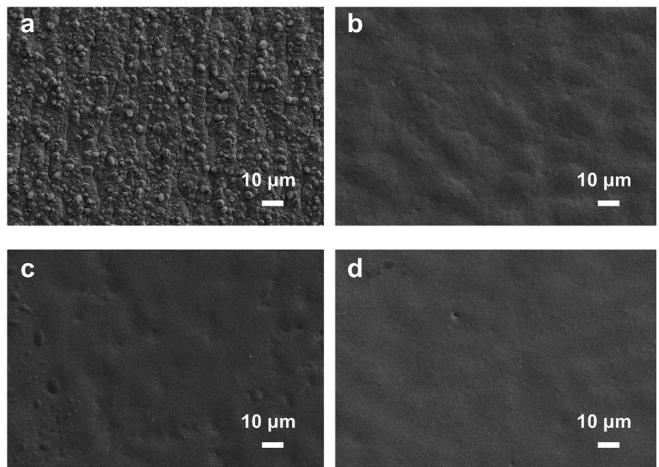  
Fig. 4 Morphology of the copper layer electrodeposited with diferent AB1 concentrations. (a) 0 mg L-1, (b) 10 mg L-1, (c) 20 mg L-1, and (d) 30 mg L-1.

3.3.2 Filling mechanism. The difusion property of AB1 was studied using molecular dynamics (MD) simulation, as shown in Fig. S8 (ESI†). Based on the Einstein equation (eqn (S2), ESI†), the difusion coeficient for AB1 $\left( D _ { \mathbf { A B 1 } } \right)$ is 2  $1 0 ^ { - 1 0 } \mathrm { m } ^ { 2 } \mathrm { s } ^ { - 1 }$ , which is close to the difusion coeficient for PEG $\left( D _ { \mathrm { P E G } } , 1 \times 1 0 ^ { - 1 0 } \mathrm { m } ^ { 2 } \mathrm { s } ^ { - 1 } \right) ^ { 5 0 }$ and one order smaller than that for SPS $\big ( D _ { \mathrm { S P S } } , 5 \times 1 0 ^ { - 9 } \mathrm { ~ m } ^ { 2 } \mathrm { ~ s } ^ { - 1 } \big ) . ^ { 5 1 }$ This illustrates that the leveler AB1 and suppressor PEG have slower difusion transport compared to the accelerator SPS. Coupled with the interactions among the three additives discussed in Section 3.1.3, namely the competition between AB1 and SPS, as well as cooperation between AB1 and PEG, gradient competitive adsorption superfilling was proposed to illustrate the AB1–SPS–PEG system, with a schematic diagram shown in Fig. 3d. At the initial stage (3d1), different additives are distributed uniformly within the microvias. As the filling process progresses (3d2), a concentration gradient for the additives forms due to their consumption and local diffusion transport limitations within the microvias. However, the concentration ratio of SPS to PEG and AB1 at the bottom increases compared to that at the opening area due to the differing diffusion properties among the three additives; specifically, $D _ { \mathrm { S P S } }$ is significantly larger than $D _ { \mathbf { A B 1 } }$ and $D _ { \mathbf { P E G } } .$ . As a result, the growth rate at the bottom is improved by the increased accelerating effect from the relatively amount of SPS, while growth at the opening area is effectively suppressed since AB1’s mass transport is not limited due to convection, leading to copper growth from the bottom to the top. At the final stage (3d3), the three additives redistribute uniformly at the opening area, resulting in the same growth rate across different areas. No momentum plating phenomena occur in the AB1–SPS–PEG system.52

## 3.4 Efect of AB1 on the copper layer

3.4.1 Efect of AB1 on morphology. Fig. 4 and 5a show the surface morphology of the copper layer observed by SEM and Olympus conformal laser microscope.53 Small bump particles are present on the uneven copper surface electrodeposited without AB1. After introducing 10 mg $\mathrm { L } ^ { - 1 }$ AB1, the surface flatness improves greatly, and the copper layer becomes compact, although large bump morphology remains. As the AB1 concentration continues to rise, the flatness of the copper layer further improves. Using the Olympus conformal laser microscope, the surface roughness $\left( R _ { \mathrm { z } } \right)$ was calculated, as shown in Fig. 5b. $R _ { \mathrm { z } }$ is 128 nm for the copper layer obtained without AB1 and decreases to 92 nm with 10 mg $\mathrm { L } ^ { - 1 }$ AB1. Furthermore, $R _ { \mathrm { z } }$ values obtained from 20 mg $\mathrm { L } ^ { - 1 }$ and 30 mg $\mathrm { L } ^ { - 1 }$ are 83 nm and 75 nm, respectively. The above analysis indicates that AB1 has a micro-scale leveling efect.

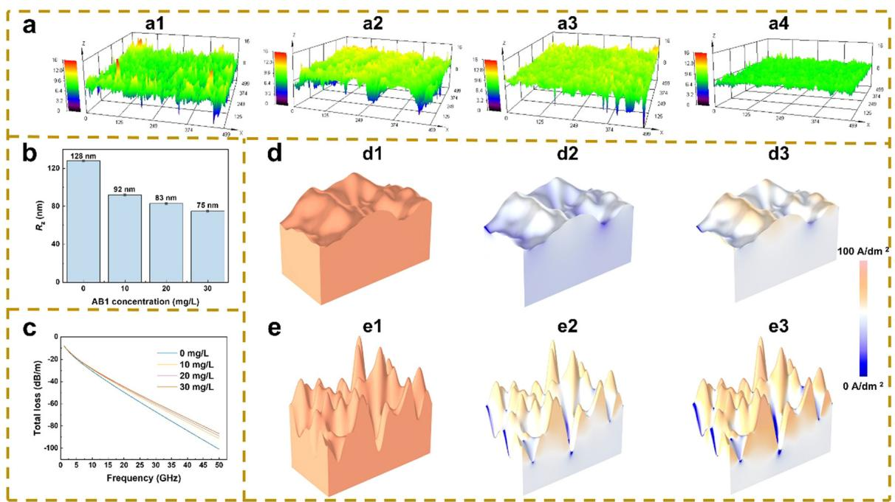  
Fig. 5 (a) Surface roughness observed from the Olympus conformal laser microscope, (b) Histogram of surface roughness (R-) influenced by AB1 concentration. (c) Relationship between signal transmission loss and AB1 concentration at diferent frequencies. Simulated current density distribution in the copper layer with 20 mg ${ \mathsf { L } } ^ { - 1 } { \mathsf { A B 1 } }$ (d) and without AB1 (e) when applied frequencies are 10 GHz (d2) and (c2) and 100 GHz (d3) and (c3). The simulation model shown in (d1) and (c1) was established based on R .

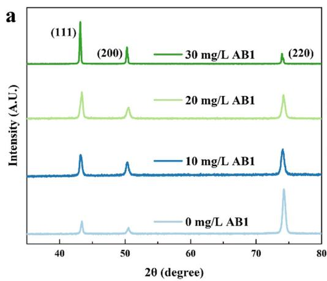

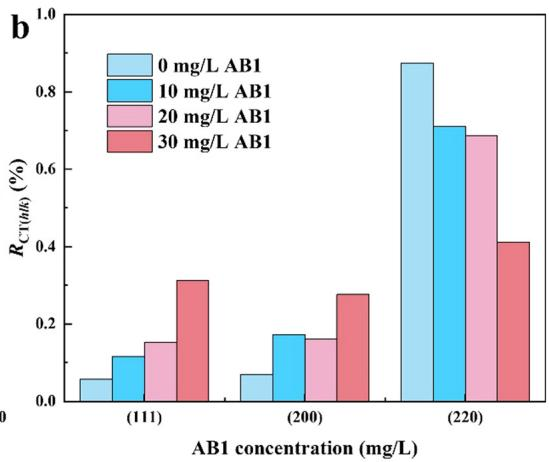  
Fig. 6 (a) XRD pattern of copper layer electrodeposited with diferent AB1 concentrations. (b) Histogram of calculated $R _ { \mathrm { C T ( 1 1 1 ) } } , R _ { \mathrm { C T ( 2 0 0 ) } } ,$ and $R _ { \mathsf { C T } ( 2 2 0 ) } .$

3.4.2 Efect of AB1 on signal loss. The influence of AB1 on signal loss during high-frequency transmission was studied using finite element simulation.54 Fig. 5c shows that signal loss is influenced by surface roughness and applied frequency. Total loss increases with rising frequency and $R _ { \mathrm { z } } .$ Additionally, the total loss with frequency for the copper layer obtained with JGB is also calculated (Fig. S5d, ESI†). In comparison, the signal loss obtained with AB1 is smaller than with JGB at the same frequency due to a lower $R _ { \mathrm { z } }$ for AB1. The skin efect for the optimized copper layer with 20 mg $\mathrm { L } ^ { - 1 }$ AB1 and without AB1 is shown in Fig. 5d and e. At a relatively low frequency (10 GHz), current density is distributed uniformly in the copper layer obtained from $2 0 \mathrm { m g L } ^ { - 1 }$ . Even at high frequency (100 GHz), the current density remains relatively well distributed. However, for the copper layer obtained without AB1, the current density mainly concentrates near the surface area at 10 GHz. Simulation results indicate that AB1 helps mitigate the influence of the skin efect during high-frequency signal transmission by improving surface flatness.

Table 2 Calculated grain size of the copper layer obtained with diferent AB1 concentrations from XRD patterns according to Scherrer’s equation

<table><tr><td rowspan="2">AB1 concentration (mg L $^{-1}$ )</td><td colspan="3">Grain size (nm)</td><td rowspan="2">Mean grain size (nm)</td></tr><tr><td>(111)</td><td>(200)</td><td>(220)</td></tr><tr><td>0</td><td>29.0</td><td>25.3</td><td>24.1</td><td>26.1</td></tr><tr><td>10</td><td>22.7</td><td>21.6</td><td>22.5</td><td>22.3</td></tr><tr><td>20</td><td>19.6</td><td>17.1</td><td>20.6</td><td>19.1</td></tr><tr><td>30</td><td>16.7</td><td>14.2</td><td>17.1</td><td>16.9</td></tr></table>

3.4.3 Efect of AB1 on phase structure. Fig. 6a shows the XRD of the copper layer with peaks at 43.31, 50.41, and $7 4 . 1 ^ { \circ }$ corresponding to $\operatorname { C u } ( 1 1 1 ) ,$ Cu(200), and Cu(220), respectively. The texture coeficient $R _ { \mathrm { C T } ( h k l ) }$ was calculated from the XRD to show the influence of AB1 on crystal orientation as follows:55

$$
R _ {\mathrm{CT} (h k l)} = \frac {I _ {(h k l)} / I _ {0 (h k l)}}{\sum \left(I _ {(h k l)} / I _ {0 (h k l)}\right)}\tag{3}
$$

where $I _ { 0 ( h k l ) } , ~ I _ { ( h k l ) }$ represent the normalized intensity of the standard copper sample and the copper layer obtained with diferent AB1 concentrations, as shown in Fig. 6b. $R _ { \mathrm { C T ( 1 1 1 ) } }$ and $R _ { \mathrm { C T } ( 2 0 0 ) }$ increase with rising AB1 concentrations, while R continuously decreases, demonstrating that AB1 is beneficial for forming of Cu(111) and Cu(200). Furthermore, Scherrer’s formula was used to calculate the influence of AB1 on the grain size of the copper layer, as shown in Table 2. The grain size of copper is 26.1 nm without AB1, while it decreases continuously to 16.9 nm with increased AB1 concentration, indicating that AB1 promotes grain refinement.

## 4. Conclusion

A novel leveler, Acid Blue 1, was used to achieve void-free copper filling in blind microvias. Electrochemical tests (CV and EIS) confirm the suppressive efect on the reduction of $\mathrm { C u } ^ { 2 + }$ . During copper electroplating, there is a synergistic suppression between AB1 and PEG, but competition between AB1 and SPS. DFT calculations and in situ infrared spectroscopy provide a deeper understanding of AB1 adsorption configuration on the copper substrate during electrodeposition, indicating that AB1 can reduce active sites and act as a barrier adsorption layer to increase cathodic polarization. After electroplating optimization, microvias with diameters of 125 mm and 150 mm can be filled with 20 mg $\mathrm { L } ^ { - 1 }$ AB1 at $1 . 5 \mathrm { A } \mathrm { d } \mathrm { m } ^ { - 2 } ;$ the good stability of AB1 indicates its industrial potential. A gradient competitive adsorption superfilling mechanism was proposed to explain the filling process for the AB1–SPS–PEG system. The diffusion differences among the three additives and the competition between AB1 and SPS are key to achieving bottom-up growth in microvias. AB1 improves the copper layer quality, enhances surface flatness, refines the grains, and reduces signal losses during high-frequency transmission. Additionally, AB1 suppresses the formation of Cu(220) while promoting the formation of Cu(111) and Cu(200).

## Data availability

All data are provided in full in the results section of this paper and the ESI.†

## Conflicts of interest

There are no conflicts to declare.

## Acknowledgements

This work was supported by the National Natural Science Foundation of China [No. 22402041] and the Shandong Provincial Natural Science Foundation [No. ZR2024QB383]. Numerical computations were performed at the Hefei Advanced Computing Center.

## References

1 J. Lei, W. Zhao-Yun and C. Zhuan-Yun, et al., 1-(2- Pyridylazo)-2-naphthol as a synergistic additive for improving throwing power of through hole copper electronic electroplating, J. Ind. Eng. Chem., 2023, 125, 269–276.

2 H. Masanori, T. Munemasa and A. Koji, et al., Copper Bottom-up Deposition by Breakdown of PEG-Cl Inhibition, Electrochem. Solid-State Lett., 2002, 5(10), C98–C101.

3 Z. Jiawei, C. Xin and Q. Chenhao, et al., Strong Convection-Dependent Adsorption of Phenothiazine Skeleton Levelers and Their Application in Copper Electroplating, J. Phys. Chem. C, 2023, 127, 1633–1642.

4 L. Chaohui, Z. Shengtao and C. Shijin, et al., The efect of tricyclazole as a novel leveler for filling electroplated copper microvias, J. Electroanal. Chem., 2018, 827, 151–159.

5 D. Weiping, H. Hershu and L. Zack, Interactions Between Brightener and Chloride Ions on Copper Electroplating for Laser-Drilled Via-Hole Filling, Electrochem. Solid-State Lett., 2003, 6(9), C134–C136.

6 P. C. Andricacos, C. Uzoh and J. O. Dukovic, et al., Damascene copper electroplating for chip interconnections. Symposium on electrochemical processing in ULSI fabrication I, 1999, 98 (6), 48–58.

7 P. C. Andricacos, C. Uzoh and J. O. Dukovic, et al., Damascene copper electroplating for chip interconnec tions, IBM J. Res. Dev., 1998, 42(5), 567–574.

8 Z. Miaomiao, M. Yachao and L. Jingwei, et al., 5-Amino-1.3.4-thiadiazole-2-thiol as a new leveler for blind holes copper electroplating: Theoretical calculation and electrochemical studies, Appl. Surf. Sci., 2022, 606, 154871.

9 R. Manu and S. Jayakrishnan, Efect of organic dye on copper metallization of high aspect ratio through hole for interconnect application, Mater. Chem. Phys., 2012, 135, 425–432.

10 M. Hayase and M. Nagao, Copper Deep Via Filling with Selective Accelerator Deactivation by Polyethyleneimine, J. Electrochem. Soc., 2013, 160(12), D3216–D3220.

11 X. Peng, L. Weiwei and S. Kexing, et al., Preparation of electrodeposited copper foils with ultrahigh tensile strength and elongation: A functionalized ionic liquid as the unique additive, Chem. Eng. J., 2024, 484, 149557.

12 X. Yin, P. Lijun and H. K. Saif, et al., Mechanical properties and microstructure of rolled and electrodeposited thin copper foil, Rare Met., 2016, 35(12), 909–914.

13 Y. Jia-Qiang, Q. Jiang-Peng and J. Lei, et al., Molecular structure impacts of tetrazole derivatives on their difusion and adsorption behaviors for microvia copper void-free filling, Surf. Interfaces, 2024, 44, 103679.

14 J. J. Hatch, M. J. Willey and A. A. Gewirth, Influence of Aromatic Functionality on Quaternary Ammonium Levelers for Cu Plating,J. Electrochem. Soc., 2011, 158(6), D323–D329.

15 V. Q. Dinh, K. Kondo and V. H. Hoang, Communication—Bottom-Up TSV Filling Using Sulfonated Diallyl Dimethyl Ammonium Bromide Copolymer as a Leveler, J. Electrochem. Soc., 2019, 166(12), D505–D507.

16 L. Jinge, X. Jie and Z. Xuehua, et al., Interface adhesion enhancement by condensed aromatic ring expansion of naphthalene imide derivatives for microvia metallization by copper electroplating, Thin Solid Films, 2021, 727, 138671.

17 L. Jun, W. Xiaomin and W. Xiaochuan, et al., Novel 2,5-bis(6- (trimethylamonium) hexyl)-3,6-diaryl-1,4-diketopyrrolo [3,4- c]pyrrole pigments as levelers for eficient electroplating applications, Dyes Pigm., 2021, 186, 109064.

18 G. S. Kevin, S. Ralf and H. V.-H. Frank, et al., 3-Mercapto-1- Propanesulfonate for Cu Electrodeposition Studied by in Situ Shell-Isolated Nanoparticle-Enhanced Raman Spectroscopy, Density Functional Theory Calculations, and Cyclic Voltammetry, J. Phys. Chem. C, 2015, 119, 23453–23462.

19 D. S. Zachary, Z. V. Feng and E. B. Mary, et al., Vibrational Spectroscopic and Mass Spectrometric Studies of the Interaction of Bis(3-sulfopropyl)-disulfide with Cu Surfaces, J. Electrochem. Soc., 2005, 153, C97.

20 T. M. T. Huynh, N. T. M. Hai and P. Broekmann, Quasi-Reversible Interaction of MPS and Chloride on Cu(100) Studied by In Situ STM, J. Electrochem. Soc., 2013, 160, D3063-D3069.

21 J. Ying, K. Kazuo and S. Yosuke, et al., Surface Adsorption of PEG and Cl- Additives for Copper Damascene Electrodeposition, Electrochem. Solid-State Lett., 2004, 8, C6.

22 Z. V. Feng, X. Li and A. A. Gewirth, Inhibition Due to the Interaction of Polyethylene Glycol, Chloride, and Copper in Plating Baths: A Surface-Enhanced Raman Study, J. Phys. Chem. B, 2003, 9415–9423.

23 L. Zhiqiang, W. Shouxu and W. Chong, et al., A comparison of typical additives for copper electroplating based on theoretical computation, Comput. Mater. Sci., 2018, 147, 95–102.

24 L. Yabing, W. Wei and L. Yonglei, Adsorption Behavior and Related Mechanism of Janus Green B during Copper Via-Filling Process, J. Electrochem. Soc., 2009, 156(4), D119.

25 W. Chong, Z. Jinqiu and Y. Peixia, et al., Electrochemical behaviors of Janus Green B in through-hole copper electroplating: An insight by experiment and density functional theory calculation using Safranine T as a comparison, Electrochim. Acta, 2013, 92, 356–364.

26 H. P. Zhu, Q. S. Zhu and X. Zhang, et al., Microvia Filling by Copper Electroplating Using a Modified Safranine T as a Leveler, J. Electrochem. Soc., 2017, 164(9), D645–D651.

27 N. T. M. Hai, T. M. T. Huynh and A. Fluegel, et al., Adsorption behavior of redox-active suppressor additives: Combined electrochemical and STM studies, Electrochim. Acta, 2011, 56, 7361–7370.

28 Y. Bo, C. Xin and Z. Yilin, et al., Unveiling the potential and mechanisms of 3,30-bicarbazole-based quaternary ammonium salts as levelers, Electrochim. Acta, 2023, 471, 143345.

29 L. Jiye, L. Zhen and T. Baizhao, et al., Communication-Triphenylmethane-Based Leveler for Microvia Filling in Copper Super-Conformal Electroplating, J. Electrochem. Soc., 2019, 166(13), D603–D605.

30 W. Zhao-Yun, J. Lei and L. Guang, et al., Electrochemical and in situ FTIR spectroscopic studies of gentian violet as a novel leveler in through-holes metallization for printed circuit board applications, Electrochim. Acta, 2022, 410, 140018.

31 L. Yaqiang, R. Penghui and L. Ruopeng, et al., A novel bright additive for copper electroplating: electrochemical and theoretical study, Ionics, 2023, 29, 363–375.

32 L. Yaqiang, L. Chengzhi and L. Ruopeng, et al., Experimental and Theoretical Study of the New Leveler Basic Blue 1 during Copper Superconformal Growth, ACS Appl. Mater. Interfaces, 2023, 15, 47628–47639.

33 L. Yaqiang, R. Penghui and Zhang Yuanhang, et al., The influence of leveler Brilliant Green on copper superconformal electroplating based on electrochemical and theoretical study, J. Ind. Eng. Chem., 2023, 118, 78–90.

34 L. Yaqiang, L. Lijuan and W. Qifeng, et al., Highly selective separation of acetic acid and hydrochloric acid by alkylamide based on double hydrogen bond coupling mechanism, Sep. Purif. Technol., 2021, 275, 119110.

35 T. Lu and F. Chen, Multiwfn: a multifunctional wavefunction analyzer, J. Comput. Chem., 2012, 33(5), 580–592.

36 E. Bernd, M. Bodo and H. C. H. Anselm, et al., Local molecular properties and their use in predicting reactivity, J. Mol. Modell., 2003, 9(5), 342–347.

37 W. Humphrey, A. Dalke and K. Schulten, VMD: visual molecular dynamics, J. Mol. Graphics Modell., 1996, 14(1), 33–38.

38 G. Kresse and J. Furthmiiller, Eficiency of Ab-Initio Total Energy Calculations for Metals and Semiconductors Using a Plane-Wave Basis Set, Comput. Mater. Sci., 1996, 6(1), 15–50.

39 G. Kresse and J. Furthmiiller, Eficient Iterative Schemes for Ab Initio Total-Energy Calculations Using a Plane-Wave Basis Set, Phys. Rev. B: Condens. Matter Mater. Phys., 1996, 54(16), 11169–11186.

40 L. Yaqiang, R. Penghui and Z. Yuanhang, et al., Investigation of novel leveler Rhodamine B on copper superconformal electrodeposition of microvias by theoretical and experimental studies, Appl. Surf. Sci., 2023, 615, 156266.

41 L. Yaqiang, R. Penghui and L. Xiangyu, et al., Elucidating the role of P on Mn- and N-doped graphene catalysts in promoting oxygen reduction: Density functional theory studies, SusMat, 2023, 3(3), 390–401.

42 L. Jinge, Z. Xuehua and J. Xu, et al., Fatty Acid Quaternary Ammonium Surfactants Based on Renewable Resources as a Leveler for Copper Electroplating, ChemElectroChem, 2019, 6, 3254–3263.

43 L. Yaqiang, M. Xiaochuan and L. Ruopeng, et al., Suppressing-accelerating efect of Nitrotetrazolium Blue chloride in boosting superconformal cobalt filling, J. Electroanal. Chem., 2023, 945, 117671.

44 L. Yaqiang, M. Xiaochuan and L. Chengzhi, et al., Investigation of novel suppressor Nitrotetrazolium Blue chloride on cobalt superconformal growth,J. Manuf. Process., 2023, 101, 15–24.

45 C. Chun, L. Xubin and L. Zhanwu, et al., 2-Mercaptopyridine as a new leveler for bottom-up filling of micro-vias in copper electroplating, Electrochim. Acta, 2016, 208, 33–38.

46 Z. Li, H. Wei and Z. Kai, et al., Investigation of poly (1-vinyl imidazole co 1, 4-butanediol diglycidyl ether) as a leveler for copper electroplating of through-hole, Electrochim. Acta, 2018, 283, 560–567.

47 W. Xiaomin, W. Kang and X. Jie, et al., Quinacridone skeleton as a promising eficient leveler for smooth and conformal copper electrodeposition, Dyes Pigm., 2020, 181, 108594.

48 T. Xulingjie, T. Zhihua and L. Zhiyuan, et al., 1-(4- Hydroxyphenyl)-2H-tetrazole-5-thione as a leveler for acid copper electroplating of microvia, RSC Adv., 2022, 12, 16153–16164.

49 L. Guokun, Z. Shouzhong and J. Daniel, et al., SEIRS Study of Chloride Mediated Polyether Adsorption on Cu, J. Phys Chem. C, 2018, 122(38), 21933–21951.

50 H. H. Yuwen and X. P. Zhang, Numerical simulation of the TSV-Cu filling by electroplating process with the accelerator and suppressor. 17th International Conference on Electronic Packaging Technology, 2016, 721–726.

51 A. S. Childers, M. T. Johnson and J. Ramirez-Rico, et al., Modeling Macro-Sized, High Aspect Ratio Through-Hole Filling by Multi-Component Additive-Assisted Copper Electrodeposition, J. Electrochem. Soc., 2013, 160(12), D3093–D3102.

52 T. P. Mofat, D. Wheeler and S. K. Kim, et al., Curvature enhanced adsorbate coverage mechanism for bottom-up superfilling and bump control in damascene processing, Electrochim. Acta, 2007, 53, 145–154.

53 L. Yaqiang, C. Xiaofeng and Z. Guangqian, et al., Optimization of electrodeposition nanocrystalline Ni–Fe alloy coatings for repla cement of Ni coatings,J. Alloys Compd., 2022, 903, 163761.

54 P. Xuesong, L. Lanchen and J. Jie, et al., Mechanistic insight into the Janus Green B on electrochemical roughening layer of copper foil, Colloids Surf., A, 2024, 698, 13423.

55 L. Mingjie, L. Xin and L. Yaqiang, et al., Investigation of novel brightener acid blue 1 on copper electroplating coating, Ionics, 2025, 31(1), 1061–1075.