pubs.acs.org/Langmuir

Article

# Thiazolyl Blue as a High-Eficiency Leveler for Conformal Copper Electrodeposition in High-Aspect-Ratio PCB Through-Holes

Shuzhou Xing, Xinrui Wang, Jie Jiang, Xuesong Peng, Sihai Bi, Youzheng Wu, Mingjie Li, Ruopeng Li,\* Yaqiang Li,\* Maozhong An, Jiang Qin, and Peixia Yang\*

Cite This: Langmuir 2026, 42, 15236−15247

Read Online

ACCESS

Metrics & More

ABSTRACT: Driven by the rapid development of 5G/6G communications, high-performance computing, and artificial intelligence, the metallization of high-aspect-ratio through-holes (THs) in printed circuit boards (PCBs) imposes stringent requirements on the thickness uniformity and interconnect reliability of electroplated copper layers. This study systematically investigates the application of a novel leveler, thiazolyl blue (MTT), for PCB THs’ electroplating, successfully realizing high-quality conformal deposition in high-aspect-ratio (10:1) THs. Electrochemical analyses demonstrate that MTT significantly enhances the cathodic polarization and efectively inhibits the reduction of Cu2+. Meanwhile, microscopic morphological characterizations confirm

Article Recommendations

\*sı Supporting Information

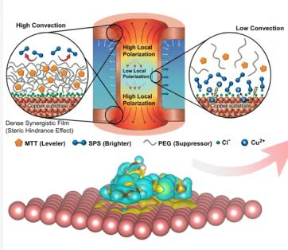

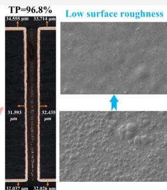

that MTT exhibits excellent leveling capability, reducing the surface roughness of the copper deposit to as low as 0.147 μm. Furthermore, density functional theory (DFT) calculations reveal that the high inhibitory eficiency of MTT originates from the dominant interfacial adsorption of MTT at the cathode. with the bulk cation-π interaction with $\mathrm { C u } ^ { 2 + }$ contributing as a minor secondary effect at the microscopic level. Crystallographic and interfacial wettability analyses further indicate that MTT effectively refines the grain size and promotes the preferential growth of the Cu(200) plane while improving the wettability of the plating bath. In practical high-aspect-ratio through-hole plating tests, the introduction of MTT substantially increases the throwing power (TP) from 25.2% to 96.8%. Based on these results, a competitive interfacial polarization remodeling mechanism governed by multiphysics coupling is proposed to elucidate the intrinsic role of MTT in promoting conformal through-hole deposition. This work provides a solid theoretical foundation and practical engineering guidance for the fabrication of highly reliable, high-frequency 3D interconnected PCB structures.

## 1. INTRODUCTION

Driven by the rapid advancement of 5G/6G communications, high-performance computing, and artificial intelligence (AI), printed circuit boards (PCBs)�the mother of electronic products�are undergoing profound technological revolutions.1−3 As the fundamental carrier connecting electronic components, the PCB not only provides mechanical support for chips and passive devices but also functions as the neural network sustaining signal transmission and power delivery throughout the electronic system.4 With the accelerated evolution of PCBs toward high integration, high interconnect density, and high-frequency/high-speed transmission, this trajectory poses two intertwined materials challenges. On the device side, the suppression of electromagnetic interference, interlayer crosstalk, and thermal accumulation in densely packed high-frequency boards has stimulated intensive research into advanced electromagnetic functional materials, with MXene-based two-dimensional absorbers and heterostructured composites emerging as a particularly promising family that delivers eficient GHz-to-THz electromagnetic wave absorption and integrated thermal management.5−8 On the interconnect side, the multilayer copper network that mechanically and electrically links the chips must, in parallel, be reformulated to simultaneously sustain signal integrity, ensure robust interconnect reliability, and guarantee long-term service lifespan under increasingly aggressive high-frequency operation�demands that ultimately translate into unprece dentedly stringent requirements on the copper metallization of microvias with high aspect ratios. Copper electrodeposition in high-aspect-ratio through-holes (THs) is the core technology for achieving interlayer electrical interconnection in multilayer PCBs. The quality of this metallization directly dictates the signal integrity, current-carrying capacity, and long-term service lifespan of the electronic devices.9,10

However, during the practical electroplating of high-aspect ratio THs, the initial current distribution is highly nonuniform due to geometric constraints. The local current density at the via opening is significantly higher than that at the center, accompanied by severe mass transfer limitations of Cu2+ within the hole. This multiphysics imbalance frequently triggers the “dog-bone” defect, characterized by excessive copper accumulation at the via opening and excessively thin deposits on the inner walls.11 Such nonuniform deposition severely compromises the electrical and mechanical performance of the interconnected structures, constituting a universal bottleneck in the high-density interconnect (HDI) industry.12 To overcome this challenge, it is imperative to introduce suppressors, accelerators, and levelers into the acidic copper sulfate bath.13 The precise synergistic and competitive adsorption among these three additives dynamically modulates the deposition kinetics at diferent spatial locations within the TH, ultimately achieving high-quality conformal interconnection.

Typically, polyether macromolecules (e.g., polyethylene glycol, PEG) serve as suppressors; bridged by chloride ions, they profoundly enhance cathodic polarization and retard copper growth.14 Sulfonate compounds bearing thiol or disulfide groups (e.g., bis(3-sulfopropyl) disulfide, SPS) act as accelerators: they capture Cu2+ at the cathode interface and lower the activation barrier for its reduction.15 Among the plating formulations, the leveler plays the most critica interfacial regulatory role. By preferentially adsorbing at strongly convected regions (e.g., the opening), the leveler establishes a localized high-impedance barrier that inhibits overplating,16−18 thereby compelling the spatial electric field lines to redistribute deeper into TH.19−21 To date, various commercial dyes have been reported as levelers (e.g., Janus Green B, tetrazolium blue chloride, PAN).22−24 Meanwhile, some researchers have devoted eforts to the synthesis of nove polymeric levelers (e.g., VIBDGE, PBDGE, Sudan-QNL). 25−27 Nevertheless, each of the aforementioned levelers exhibits specific limitations. Polymeric levelers such as VIBDGE and PBDGE, despite their promising performance, typically require multistep synthesis and tedious purification procedures, which considerably increase the production cost and hinder their practical scalability. Commercial dye-based levelers (e.g., Janus Green B) are readily accessible and have been widely adopted in industry with proven efectiveness; however, as the aspec ratio of through-holes continues to increase, further enhance ment of throwing power remains highly desirable to ensure the thickness uniformity and long-term reliability of the copper interconnects. In this regard, MTT ofers a compelling combination of advantages: it is a commercially available, of the-shelf reagent that can be directly procured at low cost entirely eliminating the need for custom synthesis or purification, and as will be demonstrated in Section 3.5, it delivers a throwing power (TP = 96.8%) that markedly outperforms the conventional leveler JGB (TP = 84.5%) under identical bath composition and process conditions. Therefore, a systematic investigation of MTT as a tailored leveler for high aspect-ratio PCB through-hole electroplating is of urgent practical significance.

It is worth noting that MTT has previously been explored in other copper electrodeposition contexts. Ogutu et al. first introduced MTT as a single additive for superconformal filling of through-glass vias (TGVs) with aspect ratios up to 10:1 in methanesulfonate-based electrolytes.28 More recently, Yang et al. compared MTT with iodonitrotetrazolium chloride (INT) in a sulfate-based acidic electroplating system for blind via copper filling and reported that MTT exhibits a conformal type filling tendency rather than the bottom-up superfilling behavior required for microvia applications.29 However, the performance of MTT in high-aspect-ratio PCB through-hole electroplating�an application scenario in which conformal, uniform thickness distribution rather than bottom-up super filling is the primary objective�has not yet been systematically investigated. The present work therefore complements these prior studies by examining MTT as a leveler within a sulfate based acidic electroplating system specifically tailored for through-hole plating, thereby establishing the suitability of MTT for this distinct application scenario. It should also be noted that our group recently reported tetrazolium blue chloride (TB) as a leveler for copper through-hole electro plating. Although TB and MTT both belong to the tetrazolium family, their molecular architectures difer considerably: TB bears two methoxy-phenyl substituents on the tetrazolium ring, whereas MTT carries a 4,5-dimethylthiazole moiety together with two unsubstituted phenyl groups. Such substituent diferences lead to distinguishable electrochemical responses and leveling outcomes. At their respective optimized conditions, TB exhibits a relatively large convection-dependent polarization response with Δη ≈ 31 mV, yielding a TP value of 136.7% along with preferential Cu(111) growth, whereas MTT, as demonstrated in the present study, shows a smaller Δη ≈ 19.3 mV and afords a TP value of 96.8% accompanied by a preferential Cu(200) growth (see Sections 3.4 and 3.5). A recent comparative investigation by Yang et al. likewise reported that MTT exhibits filling characteristics distinct from those of its nitro-substituted tetrazolium analog INT, further supporting the notion that subtle substituent variations within the tetrazolium family can give rise to markedly diferent leveling behaviors.29 These observations together underscore that MTT represents a distinct leveler within the tetrazolium family and warrants dedicated investigation for high-aspect-ratio PCB through-hole electroplating applications.

This work systematically investigates the application performance of thiazolyl blue tetrazolium bromide (MTT) as a highly eficient leveler in PCB TH electroplating. Utilizing scanning electron microscopy and laser confocal microscopy, the exceptional microscopic leveling efect of MTT on the surface morphology of the electrodeposited copper layer is intuitively revealed. Furthermore, X-ray difraction and contact angle measurements are employed to deeply analyze its regulatory efects on crystallographic phase evolution and solid−liquid interfacial wettability. More importantly, this study establishes a multiscale analytical framework integrating macroscopic electrochemical analyses with microscopic quantum chemical calculations to comprehensively elucidate the TH filling mechanism of MTT under multiphysics coupling. Ultimately, through precise optimization of the additive concentration ratio and related processing parameters, high-quality conformal electrodeposition in high-aspect-ratio PCB THs is successfully realized.

## 2. EXPERIMENTAL SECTION

## 2.1. Chemicals

All chemical reagents employed in this work, including copper sulfate pentahydrate $( \mathrm { \check { C } } \mathrm { u } \mathrm { S O } _ { 4 } { \cdot } 5 \mathrm { \check { H } } _ { 2 } \mathrm { \check { O } } )$ and sulfuric acid $\mathrm { ( H } _ { 2 } \bar { \mathrm { S O } } _ { 4 } ,$ 98 wt %), were purchased from Sinopharm Chemical Reagent Co., Ltd., China. The accelerator bis(sodium sulfopropyl) disulfide (SPS, CAS No. 27206-35-5), the suppressor polyethylene glycol (PEG, molecular weight = 20,000, CAS No. 25322-68-3), and the leveler Thiazolyl Blue (MTT, 3-(4,5-dimethylthiazol-2-yl)-2,5-diphenyltetrazolium, CAS No. 298-93-1) were all purchased from Shanghai Aladdin Biochemical Technology $\mathrm { C o . , L t \hat { d } . }$ , China. All chemicals used were of analytical grade purity (AR) and applied without any further purification process, and all test aqueous solutions were prepared using deionized water.

## 2.2. Electrochemical Tests

All electrochemical measurements were performed in a standard three-electrode electrolysis cell, with test control and data collection accomplished using a Gamry Reference 3000 potentiostat/galvanostat (Gamry Instruments, USA). A 5 mm-diameter platinum disk rotating electrode (RDE) was selected as the working electrode (WE). A platinum sheet electrode $( 1 \ \times \ 2 \ \mathrm { ~ c m } ^ { 2 } )$ was used as the counter electrode, and a saturated mercurous sulfate electrode (SSE, Hg/ $\mathrm { H g } _ { 2 } \mathrm { S O } _ { 4 } )$ served as the reference electrode (RE). Cyclic voltammetry (CV) measurements were conducted over a potential window of −0.8 to 0.2 V (vs SSE). Prior to electrochemical impedance spectroscopy (EIS) characterization, a copper layer was electrodeposited onto the RDE surface in the virgin makeup solution (VMS) at a constant current density of 1.5 A dm−2 for 60 s, thus converting the Pt-RDE to a Cu-RDE. EIS measurements were executed at 1000 rpm with an alternating current (AC) amplitude of 10 mV, a direct current (DC) bias potential of −0.5 V (vs SSE), and a frequency sweep range of 10 to 10−2 Hz. For chronopotentiometry (CP) tests, a constant current density of 2 A $\mathrm { d } \mathrm { m } ^ { - 2 }$ was applied to the electrode system. Under normal conditions, the rate of cathodic copper electrodeposition is positively correlated with the forced convection intensity of the plating bath because forced convection reduces the thickness of the $\dot { \mathrm { C u } } ^ { 2 + }$ difusion boundary layer. However, the plating bath contains not only ${ \mathrm { C u } } ^ { 2 + }$ but also various additives, which greatly complicate the mass transfer process at the cathode surface. According to the convection-dependent adsorption mechanism (CDA), a qualified plating bath system should exhibit the following behavior: a faster copper deposition rate under weakly forced convection and a relatively slower rate under strongly forced convection.30

## 2.3. Characterization

The microstructure of the electrodeposited copper layers was systematically characterized via multidimensional analytical approaches. A field-emission scanning electron microscope (Zeiss Supra55, Germany) was utilized to observe the surface morphology under an acceleration voltage of 5 kV. The surface roughness parameter (Sa) was quantitatively analyzed using an ultra-depth-of field 3D microscope (Olympus DSX510), and the average roughness (Sa) of each sample was calculated as the mean value of measurements obtained from three diferent regions. X-ray difraction (XRD, Bruker D8) was employed to investigate the preferential crystal plane orientation of the electrodeposited copper layers, and the measurements were performed at a voltage of 40 kV and a current of 40 mA, with continuous scanning at a rate of $0 . 0 2 ^ { \circ } / s$ over a 2θ range of 20−90°. An optical contact angle meter (Dataphysics-OCA20) was adopted to evaluate the interfacial properties, where 4 μL droplets were used for each test, and the average value was obtained from measurements conducted at five diferent positions.

## 2.4. DFT Calculations

The structural optimization of MTT was accomplished using Gaussian 09 with the B3LYP/6-311++G basis set.31,32 The interactions between ${ \mathrm { C u } } ^ { 2 + }$ and MTT were analyzed via Multiwfn based on the Atoms in Molecules (AIM) theory and the Interaction Region Indicator (IRI) method.33,34 Meanwhile, the intrinsic chemical properties of MTT were elucidated by means of Multiwfn, 35 combined with frontier molecular orbital theory and electrostatic potential analysis. All visualization results were rendered and output using the VMD 1.9.3 program.36 The adsorption behavior of MTT molecules on the Cu(111) surface was investigated through calculations performed with the Vienna Ab initio Simulation Package (VASP).37,38 For structural optimization, the generalized gradient approximation (GGA) was adopted as the exchange−correlation functional, which was parametrized using the Perdew−Burke− Ernzerhof (PBE) functional.39 Ion-electron interactions were described and calculated by employing the projector augmented wave (PAW) pseudopotential.40 Long-range van der Waals contributions to the MTT−Cu(111) interaction were captured through the Grimme DFT-D3 dispersion correction with zero damping (IVDW = 11). The adsorption energy of MTT on the copper substrate was calculated based on the following equation:

$$
\Delta E = E _ {\mathrm{Cu+MTT}} - E _ {\mathrm{MTT}} - E _ {\mathrm{Cu}}\tag{1}
$$

where $E _ { \mathrm { C u \mathrm { ~ + ~ } M T T } }$ denotes the total energy and the energies of the optimized MTT and copper substrate are denoted by $\bar { E _ { \mathrm { M T T } } }$ and $E _ { \mathrm { { C w } } }$ respectively.

## 2.5. Electroplating

The virgin makeup solution was composed of $7 5 \mathrm { g } \mathrm { L } ^ { - 1 } \mathrm { C u } \mathrm { S O } _ { 4 } { \cdot } 5 \mathrm { H } _ { 2 } \mathrm { O } ,$ 240 $\ g \mathrm { L } ^ { - 1 } \mathrm { H } _ { 2 } \mathrm { S O } _ { 4 } ,$ and 60 mg $\mathrm { L } ^ { - 1 }$ chloride ions. Table 1 presents the

Table 1. Bath Composition and Electroplating Process Parameters

<table><tr><td>Bath composition and process parameters</td><td>Optimum value</td></tr><tr><td> $CuSO_{4} \cdot 5H_{2}O$  (g/L)</td><td>75</td></tr><tr><td> $H_{2}SO_{4}$  (g/L)</td><td>240</td></tr><tr><td>PEG (mg/L)</td><td>250</td></tr><tr><td>SPS (mg/L)</td><td>1.5</td></tr><tr><td>MTT (mg/L)</td><td>50</td></tr><tr><td>Cathode current density ( $mA/cm^{2}$ )</td><td>20</td></tr></table>

detailed composition of the plating bath as well as the optimized process parameters selected through experimental screening. During the electroplating process, two phosphorus−copper plates were employed as the anodes, while the through-holes test coupon served as the cathode, and prior to electroplating, the test coupon was degreased with acetonerra under ultrasonic conditions, followed by activation treatment using a 10 wt % sulfuric acid solution and subsequent immersion in a Hull cell for electrodeposition. After the completion of electroplating, the through-holes were observed by an Olympus ultra-depth-of-field 3D microscope (Olympus DSX-510). A detailed flowchart of the experimental procedures is presented in Figure 1a.

## 3. RESULTS AND DISCUSSION

## 3.1. Surface Analysis of Electroplated Copper Layer

The regulatory efect of the MTT additive on the surface morphology of the electrodeposited copper layers was systematically investigated utilizing a scanning electron microscope and a laser confocal microscope. As depicted in Figure $^ { \mathrm { 1 b , } }$ the copper coating electrodeposited in VMS (without MTT) exhibits a distinctly rough and uneven morphology, characterized by the presence of large and coarse crystalline particles on the surface. In sharp contrast, upon the introduction of MTT into the plating bath (Figure 1c−g), the surface flatness of the coatings shows a dramatic enhancement. With an incremental increase in MTT concentration, the crystalline morphology transitions progressively toward a highly compact and smooth state. This observation unambiguously indicates that MTT possesses excellent leveling capability at the microscopic scale, efectively refining the grain size and upgrading the surface quality. This conclusion was further substantiated by the three-dimensional (3D) surface topography mapping. As illustrated in Figures S1 and S2, the surface roughness of the deposited layers decreases precipitously with elevating MTT concentrations, dropping from 0.545 to 0.147 μm. Such a smooth surface characteristic is highly advantageous for high-frequency signal transmission in printed circuit boards (PCBs). During high-frequency signal propagation, dictated by the skin efect,41 the skin depth of the alternating current becomes increasingly shallow at higher frequencies. When the skin depth diminishes to a scale comparable to the surface roughness of the copper traces, the high-frequency current is forced to travel along the tortuous, rugged surface contour, thereby substantially elongating the actual conductive pathway. Consequently, a copper deposit with inherently low surface roughness can substantially reduce the transmission loss of high-frequency signals. In summary, functioning as a highly eficient leveler, MTT can significantly enhance the surface flatness and compactness of the electro plated copper layers, fulfilling the stringent physical requirements for high-frequency interconnects.

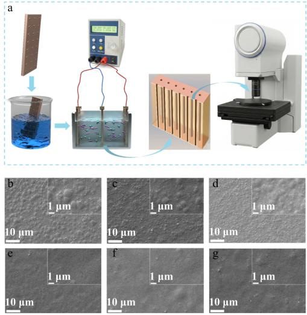  
Figure 1. (a) Schematic illustration of the direct current electroplating process for through-holes. (b−g) SEM images revealing the surface morphology evolution of the copper deposits, electroplated at a constant current density of 2 A/dm2 for 80 min, as a function of MTT concentration: (b) 0 mg/L, (c) 20 mg/L, (d) 30 mg/L, (e) 40 mg/L, (f) 50 mg/L, and (g) 60 mg/L. The main images were captured at 1000× magnification (scale bar: 10 μm), and the insets in the upper-right corners were captured at 10000× magnification (scale bar: 1 μm).

## 3.2. Electrochemical Analysis

Cyclic voltammetry (CV) is widely employed to preliminarily evaluate the inhibitive eficacy of additives during electrodeposition.42 As illustrated in Figure 2a, the cathodic onset potential for copper deposition in the virgin makeup solution (VMS) without MTT is approximately −0.43 V. In contrast, the introduction of merely 20 mg/L MTT significantly intensifies the cathodic polarization, causing the onset potential to shift negatively to −0.61 V. With a further increase in MTT concentration, the cathodic overpotential continues to escalate; when the MTT concentration reaches 60 $\mathrm { { m g / L } , }$ the onset potential further decreases to −0.67 V. This evolutionary trend is highly consistent with the linear sweep voltammetry (LSV) results in Figure 1c, robustly confirming that MTT exerts a severe suppressing efect on the copper electrodeposition process. Notably, once the MTT concen tration is increased to 50 mg/L, the increment in overpotential driven by concentration elevation approaches saturation, indicating that the surface adsorption and the corresponding inhibitive efect of MTT have been maximized. Furthermore, the charge density derived from the integrated area of the anodic stripping peak in the CV curves can be employed as a reliable indicator for the quantitative assessment of the inhibition performance of MTT. Figure 2b reveals that the anodic stripping coulomb of VMS is $1 2 1 . 8 6 ~ \mathrm { C } / \mathrm { d m } ^ { 2 }$ , which drastically decreases to $9 1 . 3 7 ~ \mathrm { C } / \mathrm { d } \mathrm { m } ^ { 2 }$ upon the addition of 20 mg/L MTT. When the concentration is elevated to 60 mg/L, the stripping coulomb plummets to $3 2 . 6 2 { \mathrm { C } } / { \mathrm { d m } } ^ { 2 } ,$ representing a 73.2% reduction compared to that of VMS. This remarkable decrease in anodic stripping coulomb further corroborates the profound suppression of copper deposition induced by MTT.43,44

To deeply investigate the interfacial suppression mechanism of MTT, electrochemical impedance spectroscopy (EIS) analysis was conducted. The radius of the impedance semicircle in the Nyquist plot intuitively reflects the resistance of charge transfer kinetics; a larger radius signifies a more dificult interfacial charge transfer process. The impedance data were fitted using an $R _ { \mathrm { u } } \ : \mathrm { \bar { ( C P E - } } R _ { \mathrm { c t } } )$ equivalent circuit model, and the extracted parameters are summarized in Table S1. $R _ { \mathrm { u } }$ represents the uncompensated solution resistance, reflecting the ohmic resistance of the bulk electrolyte. As shown in Figure 2d and ${ \sf e } , R _ { \mathrm { u } }$ remains essentially constant across all MTT concentrations, confirming that MTT exerts negligible influence on the ionic conductivity of the plating bath. $R _ { \mathrm { c t } }$ denotes the charge transfer resistance, representing the kinetic barrier for the $\mathsf { \check { C } } \mathsf { u } ^ { 2 + }$ reduction reaction at the electrode− electrolyte interface. With increasing MTT concentration, $R _ { \mathrm { c t } }$ rises dramatically from 24.46 Ω (0 mg/L) to 181.79 Ω (60 mg/L), which directly evidences that the adsorbed MTT layer severely impedes the interfacial electron transfer process. A constant phase element (CPE) is employed in lieu of an ideal double-layer capacitor to account for the frequency dispersion caused by surface heterogeneity, and its impedance is defined as $\mathrm { Z } _ { \mathrm { C P E } } = 1 / [ \mathrm { Y } _ { \mathrm { o } } ( \mathrm { j } \omega ) ^ { n } ]$ , where $\dot { \mathrm { Y } _ { \circ } }$ is the CPE coeficient and n is the CPE exponent (n = 1 for an ideal capacitor). Notably, the n value decreases from 0.842 (VMS) to approximately 0.77−0.80 upon MTT addition (as shown in Table S1), suggesting that the adsorbed MTT molecules introduce additional interfacial heterogeneity, which is consistent with the formation of a nonuniform organic adsorption layer that modifies the local dielectric environment at the electrode surface.45,46 In summary, MTT efectively suppresses the reductive deposition of copper ions.

Chronopotentiometry (CP) measurements were employed to study the convection-dependent adsorption behavior of MTT,2,16 utilizing a low rotation speed of 100 rpm and a high rotation speed of 1000 rpm to simulate the convection intensity at the center of the through-hole and the board surface, respectively (Figure 2g). With the continuous injection of MTT, the working electrode potential exhibits a continuous negative shift, indicating that the suppression of copper electroreduction by MTT strengthens with increasing concentration, which echoes the CV and EIS findings. Moreover, the potential drop at 1000 rpm is distinctly more rapid than that at 100 rpm, revealing that the adsorption of MTT on the

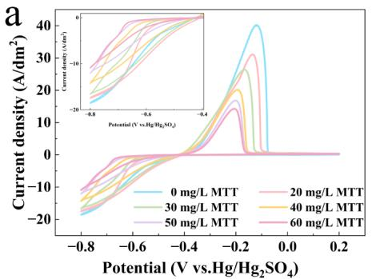

b  
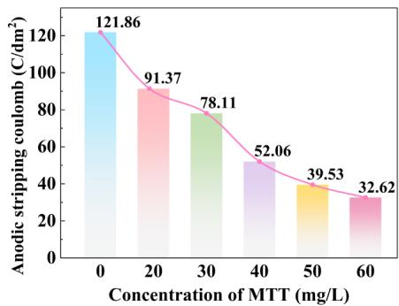

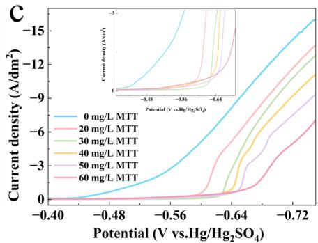

d1  
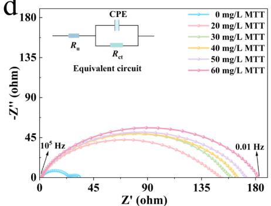

e  
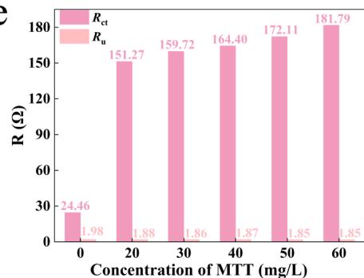

f  
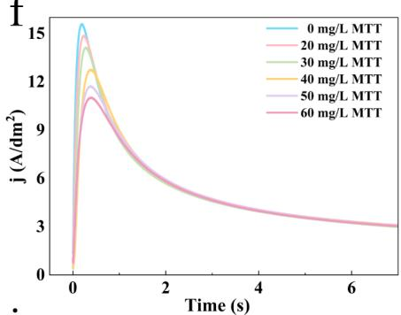

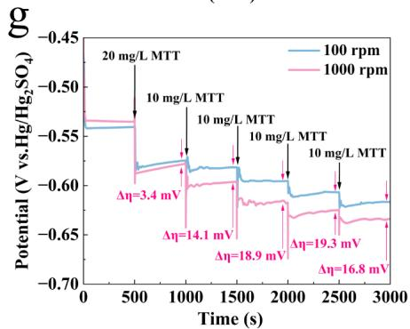

h  
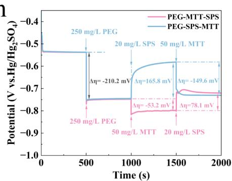

i  
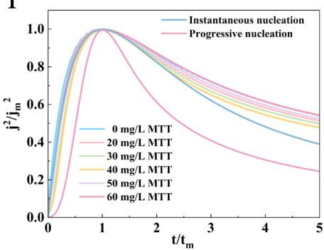  
Figure 2. Electrochemical characterization of the MTT additive in the copper electroplating bath. (a) Cyclic voltammetry curves. (b) Anodic stripping charge densities calculated from the integrated areas of the anodic peaks as a function of MTT concentration. (c) Linear sweep voltammetry curves. (d) Nyquist plot. (e) Bar chart of $R _ { \mathrm { c t } }$ and $R _ { \mathrm { u } } .$ (f) Chronoamperometric current−time transients. (g) Chronopotentiometric curves recorded under varying convection intensities. (h) CP curves illustrating the interactive efects under diferent injection sequences of PEG, SPS, and MTT. (i) Comparison of the normalized experimental CA transients with the theoretical dimensionless curves for 3D instantaneous and progressive nucleation based on the Scharifker−Hills (SH) model.

electrode surface is predominantly difusion-controlled. The potential diference $( \Delta \eta )$ between 100 and 1000 rpm under various MTT concentrations can be calculated to evaluate the microvia filling performance; typically, a larger $\Delta \eta$ is more conducive to achieving excellent superfilling. Figure 2g demonstrates that as the MTT concentration increases from 20 mg/L to 50 mg/L, Δη broadens significantly from 3.4 mV to 19.3 mV. However, with a further increase in MTT concentration, Δη follows a descending trend. The relatively high Δη values maintained within the concentration window of 40−50 mg/L suggest that this range is optimal for the conformal filling of through-holes. It is noteworthy that the $\Delta \eta$ values obtained from the CP measurements are well correlated with the actual through-hole filling results. A larger Δη signifies a greater polarization disparity between the high-convection region (hole opening) and the low-convection region (hole center), which serves as the electrochemical driving force for redistributing the deposition current toward the hole interior.16,30,47 The optimal $\Delta \eta$ window of 40−50 mg/L coincides precisely with the MTT concentration that yields the highest throwing power (TP = 96.8% at 50 mg/L, as will be shown in Section 3.5), thereby confirming the predictive validity of the CP-based evaluation for through-hole filling performance. Additionally, chronopotentiometry is frequently utilized to probe the synergistic or competitive interactions among multicomponent additives in the plating bath. By altering the injection sequence of the three core additives, the dynamic interactive mechanisms among MTT, bis(3-sulfopropyl)-disulfide (SPS), and polyethylene glycol (PEG) were systematically analyzed. As delineated by the blue line in Figure 2h, the sequential introduction of SPS and MTT into a system predosed with PEG triggers intense depolarization (a positive shift of 165.8 mV) and polarization (a negative shift of 149.6 mV) responses, respectively. Similarly, the pink line in Figure 2h indicates that the direct addition of MTT following PEG induces a further increase of cathodic polarization (−53.2 mV), verifying a pronounced synergistic inhibitory efect between MTT and PEG. Comparing the two potential evolution curves reveals that despite the diferent addition pathways, the final steady-state potentials of the systems remain virtually identical. This demonstrates that MTT and the accelerator SPS undergo competitive adsorption on the cathode surface, thereby jointly regulating the electrodeposition morphology of copper.

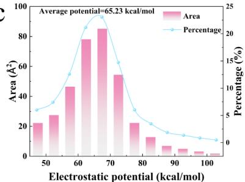

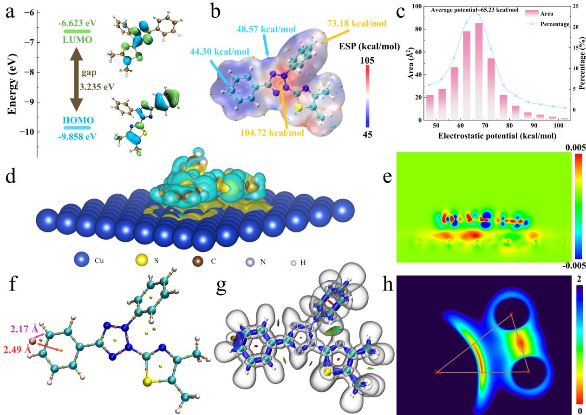  
Figure 3. (a) Frontier molecular orbitals (HOMO and LUMO) of the MTT molecule. (b) Electrostatic potential surface map and (c) the corresponding quantitative distribution histogram of the ESP. (d) Three-dimensional (3D) and (e) two-dimensional (2D) Bader charge density diference maps of the MTT molecule adsorbed on the copper substrate (red regions represent electron accumulation, and blue regions represent electron depletion). (f) AIM topological analysis map of the $\mathrm { M T T - C u } ^ { 2 + }$ cation−π interaction. (g) 3D isosurface map and (h) 2D color-mapped plane projection of IRI for the $\dot { \mathrm { M T T } } \mathrm { - } \mathrm { C u } ^ { 2 + }$ cation−π configuration (green regions: van der Waals interactions; blue regions: attractive noncovalent π-system perturbations associated with the cation−π contact).

Finally, chronoamperometry (CA) was employed to investigate the influence of MTT on the initial nucleation and growth kinetics of copper (Figure 1f). Under a potential step, the current density rapidly increases to a maximum value $( j _ { \mathrm { m } } )$ within a very short period and subsequently declines to a steady state due to difusion-limited mass transfer. The initial current transient corresponds to the formation of nuclei and 3D growth during electrodeposition. According to the standard Scharifker−Hills (SH) 3D nucleation theoretical model, the instantaneous and progressive nucleation processes under 3D difusion control obey the following dimensionless equations, respectively:

For instantaneous nucleation:

$$
(j / j _ {\mathrm{m}}) ^ {2} = \frac {1 . 9 5 4 2}{t / t _ {\mathrm{m}}} \{1 - \exp [ - 1. 2 5 6 4 (t / t _ {\mathrm{m}}) ] \} ^ {2}\tag{2}
$$

For progressive nucleation:

$$
(j / j _ {\mathrm{m}}) ^ {2} = \frac {1 . 2 2 5 4}{t / t _ {\mathrm{m}}} \{1 - \exp [ - 2. 3 3 6 7 (t / t _ {\mathrm{m}}) ^ {2} ] \} ^ {2}\tag{3}
$$

where $j$ is the maximum current density and $j _ { \mathrm { m } }$ is the time required to reach the peak current density. On the basis of the rigorous SH theoretical model, the experimentally acquired current−time transients were normalized (Figure 2i). The results indicate that, regardless of the presence or absence of MTT in the plating bath, the dimensionless experimental data points closely align with the theoretical curve for 3D instantaneous nucleation. This unambiguously indicates that, while MTT alters the kinetic rate of electrodeposition, it exerts a negligible impact on the inherent nucleation mechanism and growth mode of the copper.

## 3.3. Theoretical Insights into the Inhibition Mechanism

In this section, Density Functional Theory (DFT) calculations were conducted to unravel the interfacial adsorption and coordination efects of MTT during copper electrodeposition, thereby systematically elucidating its inhibition mechanism at the microscopic scale. The optimized geometric configuration of the MTT molecule is depicted in Figure S3. Frontier Molecular Orbital theory is extensively employed to analyze and predict the interfacial adsorption behavior of molecules. As illustrated in Figure 3a, the highest occupied molecular orbital (HOMO) and the lowest unoccupied molecular orbital (LUMO) are predominantly localized on the tetrazole and thiazole rings, indicating that these functional groups serve as active centers for preferential adsorption.10,48 Furthermore, the surface electrostatic potential distribution histogram (Figure 3c) reveals that the overall MTT molecule is positively charged,49,50 possessing a remarkably high average surface electrostatic potential of 65.23 kcal/mol. Driven by robust electrostatic attraction during the electrodeposition process, MTT is highly prone to adsorbing onto the cathodic surface, thereby efectively suppressing copper reduction. To further probe the interfacial adsorption dynamics of MTT on the copper substrate, charge density diference calculations were performed to quantitatively assess its adsorption behavior (Figure 3d and e). The pronounced interfacial charge redistribution between the copper substrate and the MTT molecule decisively confirms their close geometric proximity and intense electronic interaction. Further thermodynamic calculations yield a highly negative adsorption energy $\mathrm { o f } - 2 . 9 3$ eV. This value is consistent with�and slightly more conservative than�the magnitude reported for MTT on Cu(111) under an essentially equivalent level of theory (PBE + Grimme D3 dispersion, slab calculation: $E _ { \mathrm { a d s } } \approx - 8 . 1 4 \ \mathrm { e V } ;$ −785.93 kJ mol−1) by Yang et $\mathrm { a l . , } ^ { 2 9 }$ confirming that the strong MTT−Cu(111) interfacial adsorption is robustly captured by the present calculation. Collectively, these quantum chemica analyses substantiate that MTT can robustly adsorb onto the cathode surface during electroplating.

Table 2. AIM Analysis-Derived Electron Density $( \rho _ { \scriptscriptstyle \mathrm { B C P } } ) .$ , Laplacian of Electron Density $( \Delta ^ { 2 } \rho _ { \mathrm { { B C P } } } ) .$ , Energy Density $\left( H _ { \mathrm { B C P } } \right)$ , and Potential Energy Density $\left( V r _ { \mathbf { B C P } } \right)$ at the Bond Critical Point

<table><tr><td>Coordination configuration</td><td>Interaction</td><td> $\rho_{\text{BCP}} \times 10^{2}$  (au)</td><td> $\nabla^{2}\rho_{\text{BCP}} \times 10^{2}$  (au)</td><td> $H_{\text{BCP}} \times 10^{3}$  (au)</td><td> $Vr_{\text{BCP}} \times 10^{3}$  (au)</td></tr><tr><td>MTT- $Cu^{2+}$ </td><td>Ph⋯ $Cu^{2+}$ </td><td>5.68</td><td>23.47</td><td>-19.97</td><td>-62.67</td></tr></table>

To deeply investigate the coordination interaction between MTT and ${ \mathrm { C u } } ^ { 2 + } ,$ a multidimensional analysis integrating electrostatic potential (ESP) mapping, Local Electron Afinity (LEA), Atoms in Molecules (AIM) theory, and the Interaction Region Indicator (IRI) was employed. Because MTT exists in solution as a tetrazolium cation, its molecular surface is positive throughout (Figure 3b,c; average ESP ≈ 65.23 kcal/mol), and the relevant descriptor governing the site at which ${ \mathrm { C u } } ^ { 2 + }$ is preferentially captured is therefore not the (still positive) local ESP minimum but rather the local ionization energy and the polarizability of the underlying electron density. The Average Local Ionization Energy (ALIE, Figure S4) reaches its lowest value in the vicinity of a phenyl-ring carbon, identifying this position as the most readily polarizable, electron-donating site of the molecule. Coupled with the high π-electron density of the phenyl ring, this site is electronically primed to bind $\dot { \mathrm { C u } } ^ { 2 + }$ via a cation−π interaction, in which the attractive force originates from polarization of the π-cloud by the divalent cation rather than from a permanent electrostatic well.51,52 Figure 3f displays the topological (AIM) analysis of the $\mathbf { M T T - }$ $\mathrm { C u } ^ { 2 + }$ cation-π configuration. In the converged Gaussian geometry, ${ \mathrm { C u } } ^ { 2 + }$ resides 2.07 Å above the phenyl-ring plane, with a ${ \dot { \mathrm { C u } } } ^ { 2 + }$ ···ring-centroid distance of 2.49 Å. The cation is ofset 1.39 Å from the centroid axis so that the two shortest $\mathrm { C u } ^ { 2 + } { \cdots } \mathrm { C }$ contacts are with the meta- and para-carbons of the ring (2.18 Å and $2 . 2 3 \mathring { \mathrm { A } } ,$ respectively). This of-centroid, η2-like geometry is the canonical configuration of cation−π complexes formed by open-shell $\mathrm { d } ^ { 9 }$ transition-metal cations such as ${ \mathrm { C u } } ^ { 2 + } ,$ which preferentially bind in an asymmetric fashion to two adjacent ring carbons rather than over the ring centroid.51,52 The physicochemical nature of the interaction was quantitatively evaluated by extracting the topological parameters at the bond critical point (BCP, Table 2). The electron density ρ = 0.0568 au (<0.1 au), the positive Laplacian $\nabla ^ { 2 } \rho _ { \mathrm { B C P } } \ =$ 0.2347 au, and the slightly negative total energy density $H _ { \mathrm { B C P } } =$ −0.01997 au with $V r _ { \mathrm { B C P } } = - 0 . 0 6 2 6 7$ au together constitute the textbook closed-shell, noncovalent signature of a cation−π interaction; the modest negative $H _ { \mathrm { B C P } }$ further indicates a partial covalent stabilization, which is characteristic of cation−π contacts involving open-shell d-block metal cations.53 This DFT-derived picture is qualitatively supported by the UV−vis nonadditivity measurements presented in Figure S7, which evidence a localized perturbation of the ${ \mathrm { C u } } ^ { 2 + }$ d−d band�consistent with the partial displacement of an axially bound water from the $[ \mathrm { C u ( \hat { H } _ { 2 } O ) } _ { 6 } ] ^ { 2 + }$ first coordination sphere that necessarily accompanies the formation of a cation−π contact in solution. Moreover, as observed in Figure 3a, the energy gap of the MTT molecule is merely 3.235 eV. Such a narrow orbital bandgap implies that MTT readily undergoes electron transition and charge transfer with copper ions, which is in seamless agreement with the AIM topological analysis. The spatial interaction between MTT and $\bar { \mathrm { C u } } ^ { 2 + }$ was visually conceptualized via the IRI method (Figure 3g and h). In the isosurface map (Figure 3g), the distinctive, continuous blue isosurface emerging between MTT and $\mathrm { C u } ^ { 2 + }$ unequivocally proves a cation−π interaction, a phenomenon that is also intuitively visualized in the 2D color-mapped plane plot (Figure 3h).

From the above analyses, MTT can spontaneously adsorb onto the cathode interface in the plating bath, while simultaneously interacting with bulk $\mathrm { C u } ^ { 2 + }$ ions. To confirm the dominant role of interfacial adsorption, in situ FTIR spectra of the Cu working electrode were collected in VMS electrolyte containing 50 mg $\mathrm { L } ^ { - 1 }$ MTT at applied potentials ranging from −0.45 V to −0.65 V (vs SSE, 50 mV step). As shown in Figure S8, a series of vibrational features in the $1 0 0 0 { - } 1 7 0 0 \ \mathrm { ~ c m ^ { - 1 } }$ fingerprint region�attributable to the phenyl, tetrazolium, thiazole, and methyl moieties of MTT (phenyl and tetrazolium $\scriptstyle \mathrm { C = C / C = N }$ stretches near 1500− $1 6 2 0 ~ \mathrm { { c m } ^ { - 1 } }$ , thiazole/phenyl ring deformations near 1400− $1 5 0 0 ~ \mathrm { c m } ^ { - 1 } .$ , methyl C−H bending near $1 3 8 0 { - } 1 4 1 0 ~ \mathrm { c m } ^ { - 1 } , \mathrm { C } { - }$ N stretches near $1 2 7 0 { - } 1 3 3 0 ~ \mathrm { c m } ^ { - 1 }$ , and ring-breathing modes near $1 0 4 0 { - } 1 1 5 0 \ \mathrm { c m } ^ { - 1 } )$ �grow monotonically in intensity as the applied potential becomes more cathodic, providing direct in situ evidence for progressive MTT accumulation at the Cu cathode interface. Since the bulk cation−π interaction is much weaker than interfacial adsorption, it cannot appreciably hinder the difusion and subsequent adsorption of MTT at the cathode. Consequently, the overall inhibition eficiency is governed primarily by interfacial adsorption.

Based on the aforementioned theoretical calculations, topological analyses, and in situ FTIR spectroelectrochemical measurements, it can be concluded that the inhibition mechanism of MTT in the electrodeposition system arises from an asymmetric combination of two effects of markedly diferent magnitudes. At the cathode interface, MTT adsorbs strongly to form a dense blocking molecular layer that reduces the available active sites for $\mathrm { \Delta C u } ^ { 2 + }$ reduction (interfacial adsorption efect; the dominant kinetic contribution). In the bulk electrolyte, a small fraction of MTT engages $\dot { \mathrm { C u } } ^ { 2 + }$ ions through a comparatively weak cation−π interaction, modestly raising the activation barrier for ${ \mathrm { C u } } ^ { 2 + }$ reduction at the eventual interface (bulk cation−π contribution; a minor secondary efect).

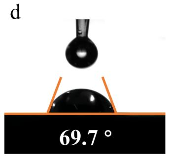

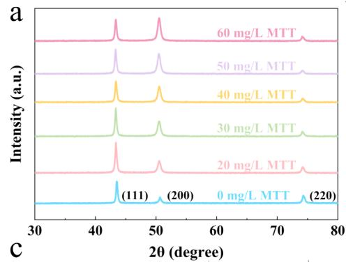

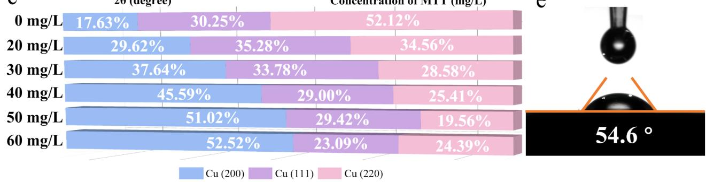  
Figure 4. (a) XRD patterns of the copper layers electrodeposited from baths containing various concentrations of the MTT additive. (b) Average grain size and (c) relative texture coeficients $( \mathrm { R T C } _ { \mathrm { ( h k l ) } } )$ of the corresponding copper deposits as a function of MTT concentration. Contact angle measurements on the PCB surface using diferent plating solutions: (d) VMS and $( \mathrm { e } ) \mathrm { \dot { V } M S } + 5 0 \mathrm { m g / L }$ MTT.

## 3.4. Phase Structure and Interface Analysis of Electroplated Copper Layer

The impact of MTT on the crystallographic structure and grain size evolution of the electroplated copper layers was investigated utilizing XRD. According to the XRD patterns (Figure 4a), characteristic difraction peaks corresponding to the (111), (200), and (220) planes of copper are distinctly observed at 2θ values of 43.3°, 50.4°, and $7 4 . 1 ^ { \circ } ,$ , respectively. As depicted in Figure 4a, with the incremental addition of MTT into the plating bath, the intensity of the (111) peak exhibits no obvious variation, whereas the (200) peak progressively intensifies and the (220) peak gradually attenuates. To quantitatively elucidate the regulatory efect of MTT on the preferred crystallographic orientation, the relative texture coeficients $( \mathrm { R T C } _ { \mathrm { ( h k l ) } } )$ for the respective lattice planes were calculated based on the following equation:

$$
\mathrm{RTC} _ {(\mathrm{hkl})} = \frac {I _ {(\mathrm{hkl})} / I _ {0 (\mathrm{hkl})}}{\sum (I _ {(\mathrm{hkl})} / I _ {0 (\mathrm{hkl})})} \times 100\tag{4}
$$

where $I _ { O ( \mathrm { h k l } ) }$ represents the standard difraction peak intensity of a randomly oriented copper powder sample and $I _ { \mathrm { ( h k l ) } }$ denotes the measured difraction peak intensity of the actual electrodeposited copper films. The quantitative results (Figure 4c) reveal that as the MTT concentration escalates from 0 mg/ L to 60 mg/L, $\mathrm { R T C } _ { ( 2 0 0 ) }$ sharply surges from 17.63% to 52.52%, $\mathrm { R T C } _ { ( 1 1 1 ) }$ exhibits a marginal decline, and $\mathrm { R T C } _ { ( 2 2 0 ) }$ plummets dramatically from 52.12% to 24.39%. This rigorous texture coeficient analysis unambiguously demonstrates that the incorporation of MTT does not induce a preferred orientation along the Cu(111) plane, but rather intensely promotes the preferential growth of the Cu(200) plane. Furthermore, the Scherrer equation was employed to quantitatively assess the influence of MTT concentration on the crystalline grain size (D) of the copper deposits:

$$
D = \frac {K \lambda}{\beta \cos \theta}\tag{5}
$$

where K is the Scherrer constant (assigned as 0.89), λ is the incident X-ray wavelength (0.1541 nm), β represents the full width at half-maximum (fwhm) of the difraction peak, and θ is the corresponding Bragg difraction angle. The calculated results (Figure 4b) dictate that within the concentration range of 0−50 mg/L, the grain size is notably refined from 23.30 to 18.46 nm as the MTT concentration elevates. Nevertheless, further exceeding this MTT concentration threshold leads to an anomalous grain coarsening. This phenomenon indicates that there exists an optimal concentration window for MTT, within which the most highly eficient grain refinement can be achieved.

Although the orientation evolution analyzed above and the conformal filling reported in Section $3 . 5$ are governed by diferent proximate mechanisms�the former by the facet selective character of MTT adsorption on the cathode and the latter by the convection-dependent adsorption (CDA)�they share a common origin in the surface adsorption of MTT and concurrently emerge at the same optimum concentration (50 mg/L). The two efects are functionally complementary in the present context: CDA establishes uniform Cu thickness from the orifice to the via center, while the Cu(200) preferential growth and the grain refinement to 18.46 nm provide a fine grained, densely packed microstructure throughout the conformal layer. The resulting deposit therefore satisfies simultaneously the two principal requirements of PCB through-hole metallization, namely conformal thickness uniformity (which guarantees interconnect reliability) and low surface roughness (which mitigates skin-efect-induced signal losses).

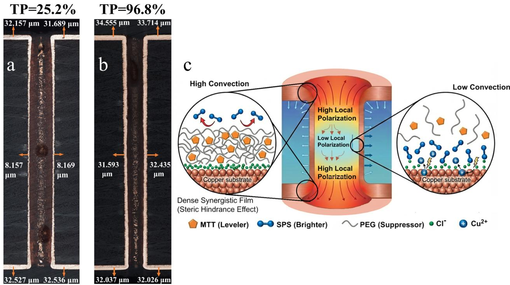  
Figure 5. Metallographic cross-sectional optical micrographs of PCB through-holes electroplated in (a) VMS + 1.5 mg/L SPS + 250 mg/L PEG and (b) VMS + 1.5 mg/L SPS + 250 mg/L PEG + 50 mg/L MTT. (c) Schematic illustration of the proposed mechanism for the conformal through-hole electrodeposition facilitated by MTT

Finally, contact angle measurements were conducted to evaluate the wettability modulation of MTT on the PCB substrates. During the electrodeposition process, a plating bath endowed with superior wettability can significantly lower the interfacial surface tension. This efectively weakens the adhesion of microscopic hydrogen bubbles (generated by side reactions) to the electrode surface, promoting their prompt detachment. Consequently, the formation of macroscopic defects such as pinholes and pitting on the coating surface is fundamentally suppressed. As illustrated in Figure 4d, the initial contact angle of the virgin makeup solution (VMS) on the PCB is 69.7°. Strikingly, upon the addition of 50 mg/L MTT, the contact angle decreases to 54.6° (Figure 4e). This distinct decrease in the contact angle verifies that the introduction of MTT substantially upgrades the overall wettability of the plating bath toward the substrate.

## 3.5. TH Electrodeposition Performance

To comprehensively evaluate the through-hole filling capability of MTT, the thickness uniformity of its electrodeposited copper layers within printed circuit board (PCB) throughholes was systematically characterized. In the PCB through hole electroplating process, Throwing Power (TP) serves as the pivotal quantitative index for evaluating the internal deposit thickness uniformity and evaluating the quality of the copper interconnects. The magnitude of the TP directly dictates the electrical reliability and long-term service lifespan of the 3D interconnected structures. Figures 5a,b, and S6 display high-resolution metallographic cross-sectional optical micrographs of the through-holes after electrodeposition under various MTT concentrations. At a constant current density of $2 \mathrm { A } / \mathrm { d } \mathrm { m } ^ { 2 } ,$ when VMS exclusively contains the accelerator SPS and the suppressor PEG (Figure 5a), the TP value of the through-hole is only 25.2%. At this juncture, a distinct geometric disparity exists between the deposit thickness at the opening and that in the central region, resulting in a severe “dog-bone” morphological defect that fundamentally fails to meet the electrical reliability requirements for high-density interconnects. Remarkably, with the introduction of MTT into the plating system, this geometric efect of uneven deposit distribution is efectively suppressed, and the overall coating morphology transits almost into a conformal deposition. As illustrated in Figure 5b, upon adding an optimal MTT concentration of 50 mg/L, the TP value increases to 96.8%. This visually dictates that MTT bridges the thickness gap between the surface opening and the deep interior, achieving high-quality conformal thickening of the copper layer within the through-hole.

To further benchmark the leveling performance of MTT against a well-established commercial leveler, a comparative through-hole electroplating experiment was conducted using 50 mg/L Janus Green B (JGB) under identical bath composition and process conditions. As illustrated in Figure S6d, the cross-sectional metallographic micrograph of the through-hole electroplated with JGB reveals a relatively uniform copper distribution along the hole wall, with no pronounced “dog-bone” defect observable at the orifice. Nevertheless, the overall copper deposit thickness within the through-hole remains noticeably thin compared to that achieved with MTT, yielding a TP value of approximately 84.5%. Although this TP value represents a substantial improvement over the additive-free system (TP = 25.2%), it remains significantly inferior to the 96.8% attained with 50 mg/L MTT. This performance disparity can be rationalized by the stronger cathodic polarization and more pronounced convection-dependent adsorption behavior of MTT, as demonstrated by the electrochemical analyses in Section 3.2. The higher inhibitory potency of MTT at the forcedconvection orifice region enables a more efective redistribution of the electric field lines toward the through-hole interior, thereby yielding superior thickness uniformity. These comparative results unequivocally corroborate the exceptional leveling eficacy of MTT and its marked advantage over the conventional JGB leveler in high-aspect-ratio through-hole electroplating applications.

Coupling the theoretical elucidation of the MTT inhibition mechanism in Section 3.3 with previous studies, competitive interfacial polarization remodeling driven by a multiphysics coupling mechanism was proposed to unveil the intrinsic influence of MTT. As portrayed in the schematic mechanism (Figure 5c), governed by the coupling of fluid dynamics (convective mass transfer) and electrochemical kinetics, MTT, PEG, and SPS undergo competitive adsorption at the solid− liquid interface within the through-hole. This induces a spatially diferentiated distribution of polarization resistance, reshaping the potential field across the inner surface of the through-hole. Specifically, propelled by the forced convection at the hole opening, MTT rapidly accumulates and adsorbs in this region via convection-dependent adsorption (CDA).54,55 Concurrently, MTT interacts synergistically with the PEG polymer chains and the bridging chloride ions to form a dense ternary synergistic suppression film on the copper substrate. This compact adsorption layer triggers a notable increase in the local polarization resistance at the opening. The resulting elevated electrochemical reaction barrier efectively suppresses the electroreduction kinetics of ${ \mathrm { C u } } ^ { 2 + }$ in this vicinity. Consequently, the increased polarization resistance at the orifice compels the spatial electric field lines $( \mathrm { i . e . , }$ the primary current distribution) to redistribute toward the deep interior of the through-hole, which is situated in a weak convection zone.56,57 Through this polarization remodeling efect, the inherent Ohmic potential drop caused by the geometric aspect ratio of the through-hole is compensated. Simultaneously, a steady-state difusion flux of $\mathrm { C u } ^ { 2 + }$ directed into the hole is sustained, ultimately driving the realization of a conformal through-hole deposition.

## 4. CONCLUSIONS

In summary, this study systematically investigated the application performance and multiphysics coupling mechanisms of MTT, acting as a leveler for copper electrodeposition in PCB through-holes. Electrochemical evaluations demon strate that MTT significantly enhances cathodic polarization via a convection-dependent interfacial adsorption. Meanwhile, microscopic morphological characterization confirms that MTT exhibits excellent leveling capability, significantly reducing the surface roughness of the copper deposit to 0.147 μm. Such a smooth surface topography is highly beneficial for mitigating the skin efect and lowering insertion loss during high-frequency signal transmission. Density functional theory analysis further elucidates that the microscopic origin of this robust inhibitory behavior lies primarily in the strong interfacial adsorption of MTT at the cathode, with the bulk cation−π interaction with ${ \mathrm { C u } } ^ { 2 + }$ contributing as a minor secondary efect. Phase structure and interface analysis illustrate that an optimal MTT concentration (50 mg/L) not only efectively refines the crystalline grain size and promotes the preferential growth of the Cu(200) plane but also decreases the solid−liquid interfacial contact angle to ${ 5 4 . 6 } ^ { \circ } ,$ thereby fundamentally suppressing the generation of macroscopic morphological defects. Ultimately, in practical throughhole electroplating applications, the competitive adsorption among MTT, PEG, and SPS induces a spatially diferentiated remodeling of polarization resistance. By establishing a high impedance barrier at the forced-convection orifice region, the inherent Ohmic potential drop within the through-holes is efectively compensated. Driven by this multiphysical coupling mechanism, the TP value of through-holes is substantially elevated from 25.2% to 96.8%, markedly outperforming the conventional leveler JGB (TP = 84.5%) under identical conditions, successfully achieving high-quality conformal deposition and providing a theoretical and practical basis for the fabrication of highly reliable, high-frequency 3D interconnected PCB structures.

## ■ ASSOCIATED CONTENT

## \*sı Supporting Information

The Supporting Information is available free of charge at https://pubs.acs.org/doi/10.1021/acs.langmuir.6c01870.

Summary of fitting parameters for EIS equivalent circuit; 3D surface topography mapping of electroplated copper layers at diferent concentrations of MTT; surface roughness histogram of electroplated copper layers at diferent concentrations of MTT; the optimized structure of the MTT molecule; local electron afinity map and average local ionization energy map; contact angle measurements on the PCB surface; metallographic cross-sectional optical micrographs of PCB through holes; UV−vis spectroscopy; in-situ infrared spectrosco py; detailed descriptions regarding the adsorption energy calculation (PDF)

## ■ AUTHOR INFORMATION

## Corresponding Authors

Ruopeng Li − School of Chemistry and Chemical Engineering, Harbin Institute of Technology, Harbin 150001, China; Email: liruopeng@hit.edu.cn

Yaqiang Li − College of Chemistry, Institute of Molecular Engineering Plus, Fuzhou University, Fuzhou 350116, China; Email: liyaqiang@fzu.edu.cn

Peixia Yang − School of Chemistry and Chemical Engineering, Harbin Institute of Technology, Harbin 150001, China; orcid.org/0000-0003-0383-3297; Email: yangpeixia@ hit.edu.cn

## Authors

Shuzhou Xing − School of Chemistry and Chemical Engineering, Harbin Institute of Technology, Harbin 150001, China; Zhengzhou Advanced Research Institute of Harbin Institute of Technology, Zhengzhou 450000, China

Xinrui Wang − School of Chemistry and Chemical Engineering, Harbin Institute of Technology, Harbin 150001, China

Jie Jiang − School of Chemistry and Chemical Engineering, Harbin Institute of Technology, Harbin 150001, China

Xuesong Peng − School of Chemistry and Chemical Engineering, Harbin Institute of Technology, Harbin 150001, China

Sihai Bi − School of Chemistry and Chemical Engineering, Harbin Institute of Technology, Harbin 150001, China

Youzheng Wu − School of Chemistry and Chemical Engineering, Harbin Institute of Technology, Harbin 150001, China

Mingjie Li − School of Chemistry and Chemical Engineering, Harbin Institute of Technology, Harbin 150001, China Maozhong An − School of Chemistry and Chemical Engineering, Harbin Institute of Technology, Harbin 150001, China; orcid.org/0000-0003-1215-0519

Jiang Qin − School of Energy Science and Engineering, Harbin Institute of Technology, Harbin 150001, China

Complete contact information is available at: https://pubs.acs.org/10.1021/acs.langmuir.6c01870

## Notes

The authors declare no competing financial interest.

## ■ ACKNOWLEDGMENTS

This work was supported by the National Natural Science Foundation of China [No. 22541202, 22402041, 22502032]. Numerical computations were performed at the Hefei Advanced Computing Center .

## ■ REFERENCES

(1) Peng, X.; Jiang, J.; Wang, X.; Lin, J.; Zhu, L.; Meng, L.; Wang, G.; Qin, J.; Li, Y.; Li, R.; An, M. Substrate Engineering for High Performance Ultrathin Copper Foils: Unveiling the Electronic Geometric Synergy of Low-Range-Order Ni-W Alloys. Adv. Funct. Mater 2026, No. e74586.

(2) Li, Y.; Li, C.; Li, R.; Peng, X.; Zhang, J.; Yang, P.; Wang, G.; Wang, B.; Broekmann, P.; An, M. Experimental and Theoretical Study of the New Leveler Basic Blue 1 during Copper Superconformal Growth. ACS Appl. Mater. Interfaces 2023, 15 (40), 47628−47639.

(3) Li, Y.; Ren, P.; Zhang, Y.; Li, R.; Zhang, J.; Yang, P.; Liu, A.; Wang, G.; An, M. Investigation of Novel Leveler Rhodamine B on Copper Superconformal Electrodeposition of Microvias by Theoreti cal and Experimental Studies. Appl. Surf. Sci 2023, 615, 156266.

(4) Chen, Y.; Xing, S.; Jiang, J.; Li, R.; Li, Y.; Li, X.; Li, M.; An, M.; Zhang, J.; Qin, J.; Yang, P. Deciphering the Role of Chromotrope 2R in Conformal Copper Electrodeposition and Microstructural Control for PCB Through-Hole Metallization. Electrochim. Acta 2026, 550, 148106.

(5) Du, X.; Yan, F.; Cheng, M.; Li, H.; Peng, C.; Liu, Y.; Liu, D.; Lan, D.; Wu, G.; Jia, Z. Dual-Functional Core−Shell Composites: Integrated Microwave Absorption and Thermal Management Proper ties. Int. J. Miner. Metall. Mater 2026, 33 (4), 1320−1328.

(6) Liu, D.; Liu, J.; Li, C.; Ji, Y.; Han, Y.; Xue, Z.; Lv, Q.; Chen, J.; Wang, Y.; Li, H. Tailoring Surface Terminals on MXene Enables High-Efficiency Electromagnetic Absorption. Carbon 2024, 228, 119392.

(7) Liu, D.; Lan, D.; Yin, Y.; Kong, J.; Meng, Y.; Liu, Y.; Qiu, Y.; Xia, G.; Liu, D. Interface Engineered Mo2C High-Performance Electromagnetic Absorption and Thermal Insulation. Acta Phys.-Chim. Sin 2026, 42, 100275.

(8) Wang, W.; Qin, H.; Li, H.; Lan, D.; Wang, Y.; Han, Y.; Liu, D.; Liu, R.; Wu, G. Heterointerface Engineering via Controlled Nitridation Enables GHz-to-THz Broadband Electromagnetic Wave Absorption in Mo1.33B2Tx Nanosheets. Sci. China Mater 2025, 68 (10), 3757−3766.

(9) Kanemoto, H.; Kawamura, T.; Suzuki, H.; Miyazaki, T.; Mozumi, H.; Kaneko, Y. Electroless Copper Plating Process by Applying Alternating One-Side Air Stirring Method for High-Aspect Ratio Through-Holes. J. Electrochem. Soc 2017, 164 (12), D771.

(10) Yuan, B.; Zhou, W.; Li, X.; Xie, Y.; Yin, X.; Chen, X.; Shen, D.; Wang, L. Investigation of Synthesized Carbazole Derivative Cz-BPDB as a High-Performance Leveler for Copper Electroplating. Surf. Coat. Technol 2023, 463, 129526.

(11) Böhme, A.; Döhler, T.; Hofmann, M.; Neumann, J.; Bochem, R.; Geissler, U.; Foitzik, A. Electrolytical Coating of Inhomogeneous

Structures Distributed on Metallic Surfaces. Mater. Sci. Forum 2023, 1106, 75−80.

(12) Zhang, Y.; An, M.; Yang, P.; Zhang, J. Recent Advances in Electroplating of Through-Hole Copper Interconnection. Electro catalysis 2021, 12 (6), 619−627.

(13) Ding, Q.; Li, N.; Wu, B.; Cheng, Q.; Zhao, Q.; Liu, T.; Wang, R.; Li, D. The Effect of Introducing − SO2 Fragments into the Structure of Polydimethyldiallylammonium (PD) on through-Hole Copper Plating Performance: A Theoretical and Experimental Study. Appl. Surf. Sci 2025, 688, 162396.

(14) Dow, W.-P.; Yen, M.-Y.; Lin, W.-B.; Ho, S.-W. Influence of Molecular Weight of Polyethylene Glycol on Microvia Filling by Copper Electroplating. J. Electrochem. Soc 2005, 152 (11), C769.

(15) Guo, L.; Li, S.; He, Z.; Fu, Y.; Qiu, F.; Liu, R.; Yang, G. Electroplated Copper Additives for Advanced Packaging: A Review. ACS Omega 2024, 9 (19), 20637−20647.

(16) Dow, W.-P.; Huang, H.-S.; Yen, M.-Y.; Huang, H.-C. Influence of Convection-Dependent Adsorption of Additives on Microvia Filling by Copper Electroplating. J. Electrochem. Soc 2005, 152 (6), C425.

(17) Xiao, L.; Li, Q.; Zeng, H.; Tian, L.; Huang, X.; Xie, J.; Zhang, H.; He, W.; Liang, K.; Huang, Q.; Chen, Y. Investigation of Azathioprine and Its Local-Structure Molecules as Levelers for through-Holes Copper Electroplating. Surf. Interfaces 2024, 53, 105073.

(18) Wang, Z.-Y.; Jin, L.; Yang, J.-Q.; Li, W.-Q.; Wu, D.-Y.; Zhan, D.; Yang, F.-Z.; Sun, S.-G. A Transfer-Adsorption Model for Forward Understanding the Synergistic Effects of Additives in through-Hole Uniform Copper Thickening. J. Electroanal. Chem 2023, 936, 117373.

(19) Chang, C.; Lu, X.; Lei, Z.; Wang, Z.; Zhao, C. 2- Mercaptopyridine as a New Leveler for Bottom-up Filling of Micro-Vias in Copper Electroplating. Electrochim. Acta 2016, 208, 33−38.

(20) Dow, W.-P.; Yen, M.-Y.; Liao, S.-Z.; Chiu, Y.-D.; Huang, H.-C. Filling Mechanism in Microvia Metallization by Copper Electro plating. Electrochim. Acta 2008, 53 (28), 8228−8237.

(21) Song, T.; Wang, J.-Y.; Qiu, J.-P.; Yang, J.-Q.; Wang, Z.-Y.; Zhao, Y.; Yang, X.-H.; Hu, R.; Cheng, J.; Yang, F.-Z.; Han, L.-H.; Zhan, D.- P. Synthesis of Quaternary Ammonium Gemini Levelers and Their Action Mechanisms in Microvias Void-Free Copper Filling. Colloids Interfaces 2025, 9 (5), 62.

(22) Wang, C.; Zhang, J.; Yang, P.; An, M. Electrochemical Behaviors of Janus Green B in Through-Hole Copper Electroplating: An Insight by Experiment and Density Functional Theory Calculation Using Safranine T as a Comparison. Electrochim. Acta 2013, 92, 356− 364.

(23) Li, X.; Li, Y.; Zhang, Y.; Li, R.; An, M.; Yang, P.; Zhang, J. Experimental and Theoretical Study of High-Flat and Stable Leveler Tetrazolium Blue Chloride in the Thickening Process of Copper through Holes. J. Ind. Eng. Chem 2025, 147, 360−369.

(24) Jin, L.; Wang, Z.-Y.; Cai, Z.-Y.; Yang, J.-Q.; Zheng, A.-N.; Yang, F.-Z.; Wu, D.-Y.; Zhan, D. 1-(2-Pyridylazo)-2-Naphthol as a Synergistic Additive for Improving Throwing Power of through Hole Copper Electronic Electroplating. J. Ind. Eng. Chem 2023, 125, 269−276.

(25) Zheng, L.; He, W.; Zhu, K.; Wang, C.; Wang, S.; Hong, Y.; Chen, Y.; Zhou, G.; Miao, H.; Zhou, J. Investigation of Poly (1-Vinyl Imidazole Co 1, 4-Butanediol Diglycidyl Ether) as a Leveler fo Copper Electroplating of through-Hole. Electrochim. Acta 2018, 283, 560-567.

(26) Li, J.; Zhou, G.; Hong, Y.; Wang, C.; He, W.; Wang, S.; Chen, Y.; Wen, Z.; Wang, Q. Copolymer of Pyrrole and 1,4-Butanediol Diglycidyl as an Efficient Additive Leveler for Through-Hole Copper Electroplating. ACS Omega 2020, 5 (10), 4868−4874.

(27) Zhou, W.; Yuan, B.; Li, X.; Zou, P.; Du, K.; Zhou, N.; Wang, L. Investigation on Synthesis and Mechanism of a Sudan I Copper Electrodeposition Leveler Based on Influencing Ion Diffusion Strategy. Dyes Pigm 2024, 227, 112156.

(28) Fey, E.; Li, J.; Dimitrov, N. Fast and Cost-Effective Superconformal Filling of High Aspect Ratio through Glass Vias Using MTT Additive. J. Electrochem. Soc 2017, 164 (6), D289−D296.

(29) Yang, J.-Q.; Qiu, J.-P.; Jin, L.; Wang, Z.-Y.; Song, T.; Zhao, Y.; Yang, X.-H.; Cheng, J.; Yang, F.-Z.; Zhan, D.-P. Molecular Structure Impacts of Tetrazole Derivatives on Their Diffusion and Adsorption Behaviors for Microvia Copper Void-Free Filling. Surf. Interfaces 2024, 44, 103679.

(30) Lu, X.; Yao, L.; Ren, S.; Wang, Z. A Study of Bottom-up Electroplated Copper Filling by the Potential Difference between Two Rotating Speeds of a Working Electrode. J. Electroanal. Chem 2014, 712, 25−32.

(31) Peng, X.; Zhou, X.; Jiang, J.; Li, Y.; Wang, G.; Li, R.; Wang, F.; Luo, X.; An, M. Theoretical Research and Application of Additive DPS in the Electrochemical Microroughening Layer of Copper Foil. Langmuir 2025, 41 (9), 6081−6091.

(32) Peng, X.; Li, L.; Jiang, J.; Li, Y.; Li, X.; Wang, G.; Liu, A.; Zhang, M.; Li, R.; An, M. Mechanistic Insight into the Janus Green B on Electrochemical Roughening Layer of Copper Foil. Colloids Surf., A 2024, 698, 134523.

(33) Orville-Thomas, W. J. Atoms in Molecules � a Quantum Theory: Richard F.W. Bader, Clarendon Press, Oxford, U.K. 1994, 438 pp., £25. J. Mol. Struct.: THEOCHEM 1996, 360, 175.

(34) Lu, T.; Chen, Q. Interaction Region Indicator: A Simple Real Space Function Clearly Revealing Both Chemical Bonds and Weak Interactions. Chem. Methods 2021, 1 (5), 231−239.

(35) Lu, T.; Chen, F. Multiwfn: A Multifunctional Wavefunction Analyzer. J. Comput. Chem 2012, 33 (5), 580−592.

(36) Humphrey, W.; Dalke, A.; Schulten, K. VMD: Visual Molecular Dynamics. J. Mol. Graphics 1996, 14 (1), 33−38.

(37) Kresse, G.; Furthmüller, J. Efficiency of Ab-Initio Total Energy Calculations for Metals and Semiconductors Using a Plane-Wave Basis Set. Comput. Mater. Sci 1996, 6 (1), 15−50.

(38) Kresse, G.; Furthmüller, J. Efficient Iterative Schemes for Ab Initio Total-Energy Calculations Using a Plane-Wave Basis Set. Phys. Rev. B 1996, 54 (16), 11169−11186.

(39) Ren, P.; An, M.; Yang, P.; Zhang, J. Revealing the Acceleration Effect of SPS and Cl - on Copper Surface: Instantaneous Nucleation and Multi-Step Energy Change. Appl. Surf. Sci 2022, 583, 152523.

(40) Li, M.; Peng, X.; Jiang, J.; Li, Y.; Meng, F.; Wu, Y.; An, M.; Li, R.; Ren, P.; Yang, P. Filling Performance of an Acid Blue 1 Leveler on Blind Microvias. New J. Chem 2025, 49 (11), 4538−4546.

(41) Okuma, N.; Kawabata, K.; Shiozaki, K.; Sato, M. Topological Origin of Non-Hermitian Skin Effects. Phys. Rev. Lett 2020, 124 (8), 086801.

(42) Chiu, Y.-D.; Dow, W.-P.; Huang, S.-M.; Yau, S.-L.; Lee, Y.-L. Sensitivity Enhancement for Quantitative Electrochemical Determination of a Trace Amount of Accelerator in Copper Plating Solutions. J. Electrochem. Soc 2011, 158 (5), D290.

(43) Li, Y.; Ma, X.; Li, R.; Zhang, J.; Yang, P.; Liu, A.; Wang, B.; Broekmann, P.; An, M. Suppressing-Accelerating Effect of Nitrotetrazolium Blue Chloride in Boosting Superconformal Cobalt Filling. J. Electroanal. Chem 2023, 945, 117671.

(44) Li, Y.; Ren, P.; Li, R.; Zhang, Y.; Zhang, J.; Yang, P.; An, M. A Novel Bright Additive for Copper Electroplating: Electrochemical and Theoretical Study. Ionics 2023, 29 (1), 363−375.

(45) Hung, C.-C.; Lee, W.-H.; Wang, Y.-L.; Chan, D.-Y.; Hwang, G.- J. Investigation of the Suppression Effect of Polyethylene Glycol on Copper Electroplating by Electrochemical Impedance Spectroscopy. J. Vac. Sci. Technol., A 2008, 26 (5), 1109−1114.

(46) Parida, S.; Das, S.; Mallik, A. An Experimental Study of Copper Electroplating by Electrochemical Impedance Spectroscopy (EIS) at Room Temperature. Mater. Today: Proc 2022, 66, 544−547.

(47) Peng, C.; Zhai, Y.; Chen, X.; Wang, C.; Hong, Y.; Chen, Y.; He, W.; Zhou, G.; Liu, B. Structure Performance Correlation of N-Heterocyclic Oligomer Leveler for Acid Copper Plating of Advanced Interconnects. Molecules 2023, 28 (6), 2783.

(48) Tao, Z.; Long, Z.; Tengxu, L.; Liu, G.; Tao, X. The Synergistic Effects of Additives on the Micro Vias Copper Filling. J. Electroanal. Chem 2022, 918, 116456.

(49) Lu, T.; Manzetti, S. Wavefunction and Reactivity Study of Benzo[a]Pyrene Diol Epoxide and Its Enantiomeric Forms. Struct. Chem 2014, 25 (5), 1521−1533.

(50) Manzetti, S.; Lu, T. The Geometry and Electronic Structure of Aristolochic Acid: Possible Implications for a Frozen Resonance. J. Phys. Org. Chem 2013, 26 (6), 473−483.

(51) Mahadevi, A. S.; Sastry, G. N. Cation−π Interaction: Its Role and Relevance in Chemistry, Biology, and Material Science. Chem. Rev 2013, 113 (3), 2100−2138.

(52) Vijay, D.; Sastry, G. N. Exploring the Size Dependence of Cyclic and Acyclic π-Systems on Cation−π Binding. Phys. Chem. Chem. Phys 2008, 10 (4), 582−590.

(53) Reddy, A. S.; Sastry, G. N. Cation [M = H+, Li+, Na+, K+, Ca2+, Mg2+, NH +, and NMe +] Interactions with the Aromatic Motifs of Naturally Occurring Amino Acids: A Theoretical Study. J. Phys. Chem. A 2005, 109 (39), 8893−8903.

(54) Dow, W.-P.; Li, C.-C.; Su, Y.-C.; Shen, S.-P.; Huang, C.-C.; Lee, C.; Hsu, B.; Hsu, S. Microvia Filling by Copper Electroplating Using Diazine Black as a Leveler. Electrochim. Acta 2009, 54 (24), 5894− 5901.

(55) Moffat, T. P.; Wheeler, D.; Josell, D. Electrodeposition of Copper in the SPS-PEG-Cl Additive System. J. Electrochem. Soc 2004, 151 (4), C262.

(56) Li, X.; Chen, X.; Zou, P.; Ye, R.; Wang, L. Synthesis and Application of Anthraquinone Quaternary Phosphonium Salt Electroplating Copper Leveler Based on Expanded Electrostatic Adsorption Area Strategy and Physicochemical Salt Bridge Mechanism. Appl. Surf. Sci 2024, 664, 160259.

(57) Li, X.; Yin, X.; Li, J.; Yuan, B.; Xiang, C.; Zou, P.; Wang, L. Synthesis of Coplanar Quaternary Ammonium Salts with Excellent Electrochemical Properties Based on an Anthraquinone Skeleton and Their Application in Copper Plating. Electrochim. Acta 2023, 437, 141541.