# Superconformal Cobalt Electrodeposition with a Hydrogen Evolution Reaction Suppressing Additive

To cite this article: Jungkyu Kang et al 2020 J. Electrochem. Soc. 167 162514

View the article online for updates and enhancements.

## You may also like

On four-point functions of ½-BPSoperators in general dimensions Francis A. Dolan, Laurent Gallot and Emery Sokatchev

Conformal inflation coupled to matter-Philippe Brax and Anne-Christine Davis

Spin chain for the deformed ABJM theory-Davide Forcella and Waldemar Schulgin

## ECC-Opto-10 Optical Battery Test Cell: Visualize the Processes Inside Your Battery!

Battery Test Cell for Optical Characterization Designed for light microscopy, Raman spectroscopy and XRD.

Optimized, Low Profile Cell Design (Device Height 21.5 mm) Low cell height for high compatibility, fits on standard samples stages.

High Cycling Stability and Easy Handling Dedicated sample holders for different electrode arrangements included!

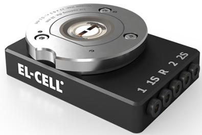

Cell Lids with Different Openings and Window Materials Available

  
Scan me!  
Contact us:  
Sample Test (Side-by-Side Setup)

+49 40 79012-734

sales@el-cell.com

www.el-cell.com

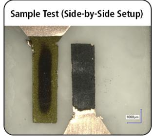

Sample Test (Face-to-Face Setup)

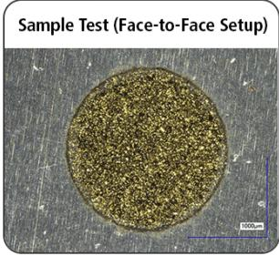

# Superconformal Cobalt Electrodeposition with a Hydrogen Evolution Reaction Suppressing Additive

Jungkyu Kang,1 Minjae Sung,1 Jinuk Byun,1 Oh Joong Kwon,2,z and Jae Jeong Kim1,z

1School of Chemical and Biological Engineering, Institute of Chemical Process, Seoul National University, Gwanak-gu, Seoul 08826, Republic of Korea

2Department of Energy and Chemical Engineering, Incheon National University, Yeonsu-gu, Incheon 22012, Republic of Korea

In this study, superconformal cobalt filling of submicron trenches by electrodeposition is investigated in the presence of 2-mercaptobenzimidazole (MBI), which suppresses both cobalt deposition and the hydrogen evolution reaction (HER). The mechanism through which this single additive enables superconformal cobalt filling is investigated. The formation and breakdown of the suppression layer are characterized by linear sweep voltammetry and chronoamperometry. The convection-driven local concentration of MBI exerts different suppressing effects on cobalt reduction and the HER, leading to a change in the deposition rate and the current efficiency of cobalt. These phenomena induce a deposition rate differential between the top and bottom of the submicron trench, enabling bottom-up cobalt filling with a V-shape profile. © 2020 The Electrochemical Society (“ECS”). Published on behalf of ECS by IOP Publishing Limited. [DOI: 10.1149/1945-7111/ abd3b9]

Manuscript submitted October 30, 2020; revised manuscript received December 8, 2020. Published December 29, 2020.

Supplementary material for this article is available online

As technology advances, electronic devices are continuously scaled down and the dimensions of copper interconnects are inevitably reduced. When the size of the interconnect reduces below a certain level, resistivity, which is considered as an intrinsic characteristic of the material, increases rapidly because of the resistivity size effect.1–5 The size effect, which is the origin of the increase in resistivity, is related to the electron mean free path (EMFP). In general, in bulk materials, resistivity is dominated by electron–phonon scattering; therefore, the larger the EMFP, the lower the resistivity. However, as the line width of the interconnect approaches the EMFP, the number of electrons that collide and the grain boundary scattering increases. Therefore, as the line width decreases, resistivity increases rapidly.5,6 This phenomenon is evidenced at the interconnect line width of <10 nm, which was recently reported; moreover, line resistivity increases to approximately 10 times that of bulk resistivity.7 When resistivity increases, semiconductor power consumption increases and speed delay occurs, limiting the performance of the semiconductor device, and adversely affecting the continuous device scaling.8 To overcome this limitation, it is advantageous to use a material that has a small EMFP or maximize the volume of the conductive metal using a material capable of reducing or removing the barrier layer.9,10 The candidate materials that satisfy these conditions are nickel, ruthenium, and cobalt. Among them, cobalt facilitates easy deposition and has a low cost, making it the most appropriate candidate.10 Extensive studies have been reported on application of cobalt in interconnects. Most of these studies focus on the resistance change and reliability after cobalt deposition through chemical vapor deposition (CVD).10–18 Conversely, only a few studies on the metallization of cobalt interconnects formed by electrodeposition have been conducted although electrodeposition has various merits. Electrodeposition has a considerably shorter process time than CVD, and the deposition characteristics can be easily controlled by changing the applied current or voltage and by introducing additives.

Additives are widely used to modulate the conditions of plating in electrodeposition. In particular, when performing feature filling, additives are essential components that cause a variation in the deposition speed depending on the deposition spots, thereby enabling the performance of superconformal filling. Copper bottom-up filling electrodeposition is performed using a threeadditive system consisting of a suppressor, an accelerator, and a leveler. Many studies have been conducted on the behavior of additives and their growth mechanisms; however, various additives are still being developed for copper electrodeposition.19–24 I n the case of nickel, one of the iron group metals, there have also been many studies on additives for superconformal filling. Polyethyleneimine (PEI) and benzimidazole derivatives, such as 2-mercaptobenzimidazole (MBI) and 2-mercapto-5-benzimidazolesulfonic acid (MBIS), were shown to yield void-free feature filling.25–27 Conversely, for cobalt, there are studies on the additives and mechanisms for cobalt bottom-up filling, although these are still insufficient. In cobalt bottom-up electrodeposition, some studies explain the mechanism based on the S-shaped negative differential resistance theory28,29 and the deposition speed difference due to complex formation,30 which has been suggested in copper bottom-up filling studies. Studies explaining the mechanism based on the interaction with the hydrogen evolution reaction (HER) involved in cobalt reduction have also been reported.31,32

As is well known, HER inevitably occurs during cobalt electrodeposition, and one must be familiar with these secondary processes to understand cobalt electrodeposition. These secondary processes increase the pH at the electrode–electrolyte interface, and cobalt hydroxide may precipitate under the increased pH condition.33,34 In this case, considerably large nodules and rough surfaces are formed and conductivity is reduced, resulting in a reduction in the quality of cobalt plating. To prevent this, boric acid with a buffering capability is mainly used in Watts-type plating baths.35,36 Similarly, if an additive that can suppress the HER in the potential region of cobalt deposition is used, the current efficiency can be increased, and the quality of the plating can be improved by inhibiting the increase in pH. In this study, MBI was selected as an additive capable of bottom-up filling by suppressing this additional reaction and increasing the cobalt deposition overpotential.

## Experimental

The base electrolyte for cobalt electrodeposition consisted of 0.1 M $\mathrm { C o S O } _ { 4 } { \cdot } 7 \mathrm { H } _ { 2 } \mathrm { O } .$ , 0.5 M $\mathrm { H } _ { 3 } \mathrm { B O } _ { 3 } ,$ and 1.0 M $\mathrm { N a } _ { 2 } \mathrm { S O } _ { 4 }$ at pH 3, adjusted using $\mathrm { H } _ { 2 } \mathrm { S O } _ { 4 } .$ Four different concentrations of MBI (50, 100, 150, and $2 0 0 \mu \mathrm { M } )$ were added to the electrolytes to investigate their effect on cobalt deposition and HER. The electrodeposition and electroanalytical measurements were performed with a potentiostat (PAR 273A, Princeton Applied Research) in a threeelectrode system, including a working electrode, with Pt mesh and Ag/AgCl electrode (KCl saturated) as the counter and reference electrodes, respectively. The temperature of the electrolytes was maintained at $\bar { 2 } 5 ~ ^ { \circ } \mathrm { C }$ using a thermostat.

The electrochemical behavior of the additive was investigated by linear sweep voltammetry (LSV) and chronoamperometry (CA) using a cobalt rotating disk electrode (RDE) with a geometric area of $0 . { \overset { \smile } { 0 } } 7 1 \ \mathrm { c m } ^ { 2 }$ as the working electrode. Cobalt rod $( \mathbf { A v e n t i o n } ^ { \otimes } .$ , 3 mm diameter and 99.9% metal basis) was inserted into Teflon holder (12 mm diameter) for usage as the electrode for the RDE system. The surface of the cobalt RDE was polished using a 2000-grit sand paper after which it was rinsed with deionized (DI) water and blown dry with $\Nu _ { 2 }$ prior to the electrochemical analyses. The voltammetric response was scanned from the open circuit potential (OCP) to −1.4 V (vs Ag/AgCl) at a scan rate of $1 0 \mathrm { m V } \ \hat { \mathrm { s } } ^ { - 1 }$ . Chronoamperometric experiments were performed by immersing the specimens at a preset potential to prevent the corrosion of the specimen seed layer.

The submicron trench filling was performed with a trenchpatterned Si wafer supplied by SK Hynix, Inc. with a width of 180 nm and a depth of 360 nm. The substrates were metalized by the physical vapor deposition (PVD) of a Ta barrier layer and a copper seed layer. Prior to electrodeposition, a coupon wafer, fragmented at $1 . 5 \mathrm { c m } \times 1 . 5$ cm, was loaded on the Teflon holder to expose an area of $1 \mathrm { c m } ^ { 2 } . \mathrm { A }$ cobalt layer was pre-plated on a copper-seeded substrate using the base solution (MBI-free) prior to each experiment. Before the electrodeposition of the cobalt seed layer, the wafer was immersed into an aqueous solution of 0.03 M citric acid and 0.034 M potassium hydroxide for 2 min to remove the native oxide of copper. Cobalt was electrochemically deposited onto the oxideetched coupon wafer at a potential of −1.0 V, with a deposition charge of 10 mC $\mathrm { c m } ^ { - 2 }$ . Cross-sectional images were obtained by field emission scanning electron microscopy (FE-SEM, S-4800, Hitachi) to investigate the trench filling performance.

The comparison of the cobalt film thickness as a function of the rotation speed was performed on planar Si substrates covered with a PVD Ti/TiN barrier layer and a PVD cobalt layer. The cobalt film deposition was examined by chronoamperometry on $\mathrm { ~ a ~ } 1 \mathrm { ~ c m } ^ { 2 }$ area. The cobalt film thickness was evaluated from the cleaved crosssections in the FE-SEM.

## Result and Discussion

Cobalt RDE was subjected to electrochemical analysis to investigate the effect of MBI on cobalt electrodeposition. The LSV results for the electrolyte with and without cobalt source in the presence of various concentrations of MBI are shown in Fig. 1. Since the standard reduction potential of protons is more positive than that of cobalt, the cobalt electrochemical experiment always involves the HER. For this reason, it is difficult to analyze the effect of additive on the HER and the cobalt deposition reaction separately. Therefore, we attempted to confirm the effect of MBI on the HER using a cobalt-free electrolyte as shown in Fig. 1a. Based on the results for MBI-free case, proton reduction was dominant at a relatively positive potential range o $\mathrm { \dot { \bar { \rho } } - 0 . 4 \ t o \ - 0 . 8 \ V }$ , and the current density increased because of the reduction of water at a potential more negative than $- 1 . 0 \mathrm { V }$ after passing the proton mass limiting region of $- 0 . 8 \mathrm { \ t o \ } - 1 . 0 \mathrm { \ V } . ^ { 3 7 }$ When MBI was added, in the region where the proton reduction was dominant, the current density was maintained at a level lower than that under the MBI-free condition, indicating the suppression of proton reduction. Afterward, the breakdown of suppression occurred from approximately $- 0 . 7 \mathrm { V } ,$ and the current density started to increase and became similar to that under the MBI-free condition at approximately −0.95 V. In the region where water reduction was dominant, the current was maintained lower than that under the MBI-free condition, indicating the suppression of water reduction. Interestingly, with varying the MBI concentration in the range of $5 0 { \mathrm { - } } 2 0 0 \mu \mathbf { M } .$ , the difference in current density was not significant. As shown in Fig. 1b, the LSV results of the solution containing ${ \mathrm { C o } } ^ { 2 + }$ also show the breakdown of the suppression layer in two stages. As reported in a previous study, cobalt deposition begins from −0.86 V under additive-free conditions.38 When MBI is added, as the concentration of MBI increases, the onset potential of cobalt exhibits a negative shift. In particular, at $2 0 0 \mu \mathbf { M } ,$ the suppression intensity increases rapidly, and the cobalt deposition onset negatively shifts to −1.16 V. According to the results shown in Figs. 1a and 1b, MBI suppressed the HER through overall surface coverage, not the selective suppression of cobalt deposition.

(a)  
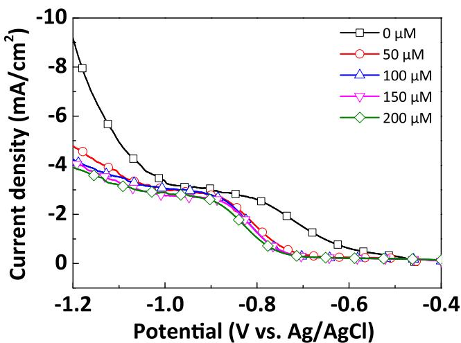

The influence of MBI on submicron trench cobalt filling was examined. We attempted to determine the optimal filling condition by varying the concentration of MBI and the application potential, and the results are shown in Fig. 2. For the MBI-free condition, the cobalt growth proceeded conformally at the same speed at the top and bottom of the trench in the potential range of $- \hat { 1 } . 0 \mathrm { ~ t o ~ } - 1 . 1 5 \hat { \mathrm { ~ V ~ } } .$ Under the conformal growth conditions, voids were eventually formed even though sufficient charge were applied, as shown in Fig. S1 (available online at stacks.iop.org/JES/167/162514/mmedia). $\operatorname { A t } 5 0 \mu \mathbf { M }$ and 100 μM MBI, where the suppression strength of MBI was relatively low, the difference in the deposition speeds at the top and bottom was not significant, resulting in a conformal filling. However, the inside of the trench was filled more than the MBI-free condition even though the same charge was applied. As shown in Fig. 1a, the addition of MBI suppresses the HER and increases the current efficiency of cobalt deposition, which results in more deposits inside the trench. When 150 μM was added, the suppression was strong at −1.0 V. From −1.05 V, the suppression strength began to reduce, and the bottom-up filling was acheived; however, the top was very rough and the uniformity was poor as nodes were created. $\mathrm { A t } - 1 . \dot { 1 } \ \mathrm { a n d } - 1 . 1 5 \mathrm { V }$ , the bottom-up filling was achieved, and the uniformity was good. $\begin{array} { r } { \mathbf { A t } \ 2 0 0 \mu \mathbf { M } , } \end{array}$ , cobalt filling did not occur adequately because of the strong suppression effect. This coincides with the LSV results shown in Fig. 1b, showing a very high suppression intensity when $2 0 0 \mu \mathrm { M }$ is added.

(b)  
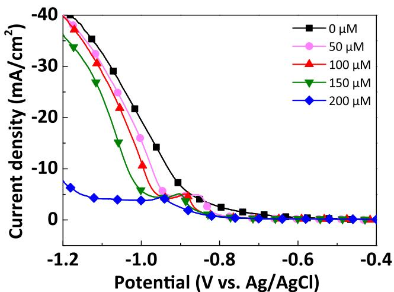  
Figure 1. (a) Linear sweep voltammograms without cobalt source. Cobalt-free electrolyte consisted of 0.5 M ${ \mathrm { H } } _ { 3 } { \mathrm { B O } } _ { 3 }$ and 1.0 M $\mathrm { N a } _ { 2 } \mathrm { S O } _ { 4 }$ with the addition of various MBI concentration at pH 3. (b) Linear sweep voltammograms for Co deposition from the electrolyte consisting of 0.1 M CoSO ·7H O, 0.5 M $\mathrm { H } _ { 3 } \mathrm { B O } _ { 3 }$ and 1.0 M Na SO . Experimental currents are converted to current densities using the 0.071 cm2 RDE area. The RDE was rotating at 500 rpm. Voltammetry was initiated at OCP with a 10 mV s−1 rate.

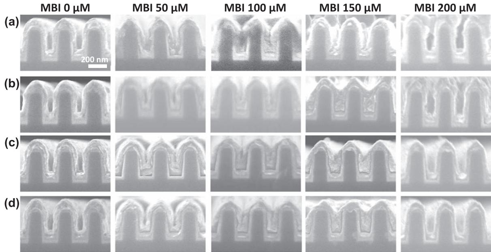  
Figure 2. Cross sectional SEM images of 180 nm trenches deposited in an electrolyte consisting of 0.1 M CoSO 〮7H O, 0.5 M H BO and 1.0 M Na ${ } _ { 2 } S O _ { 4 }$ with various MBI concentrations at pH 3. Deposition was performed at (a) −1.0 V, (b) −1.05 V (c) −1.1 V (d) −1.15 V vs Ag/AgCl for 300 mC $\mathrm { c m } ^ { - 2 }$ . The patterned substrates were rotating at 500 rpm.

To electrochemically investigate the factors contributing to the difference in the trench filling, the current density change according to the potential was investigated through chronoamperometry on cobalt RDE, as shown in Fig. 3. When MBI was added $\mathrm { a t - l } . 0 \mathrm { V } .$ the current density was 13 mA cm−2 lower than that under MBI-free condition, which implies that a strong suppression layer was formed. Contrarily, above −1.05 V, the current density relative to that of the MBI-free sample decreased to $4 { \mathrm { - } } 6 \operatorname { m A } \ \mathrm { c m } ^ { - 2 }$ as the suppression layer partially broke down. From the results shown in Fig. 2, we can infer that the bottom-up filling occurred under the condition of weak suppression. Notably, it takes time to form the suppression layer. Comparing the initial current density between the MBI-free and the 150 μM MBI conditions, a significant difference can be observed. For the MBI-free condition, when the potential was applied, a saturation point was immediately observed with a constant current density. However, when $1 5 0 \mu \mathrm { M }$ of MBI was added, the potential was applied, and the current density decreased for approximately 10 s, as indicated by the red line in Fig. 3b. After that, the current profile changed according to the potential. $\mathbf { A } \mathbf { t } \_ { - 1 . 0 } \mathbf { V } ,$ , the current density gradually decreased until approximately 50 s and saturated. Conversely, $\mathrm { a t } - 1 . 0 5 \mathrm { t o } - 1 . 1 5 \bar { \mathrm { V } } ,$ a partial breakdown of the suppression layer occurred, and the current density increased slightly, followed by saturation. In conclusion, the suppression layer can be formed in two steps depending on the potential, and under optimum conditions, cobalt deposition can be performed in an environment where only the first suppression layer is formed.

(a)  
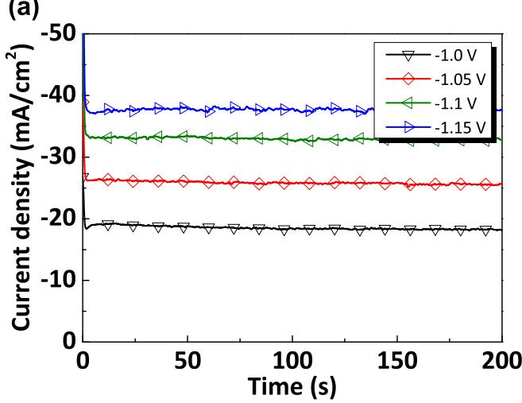

(b)  
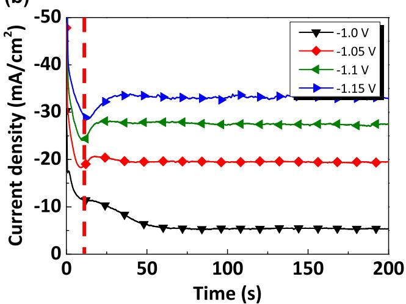  
Figure 3. Chronoamperometry of Co deposition at (a) MBI-free and (b) 150 μM MBI under various potentials. Experimental currents are converted to current densities using the 0.071 cm2 RDE area. The RDE was rotating at 500 rpm.

(a)  
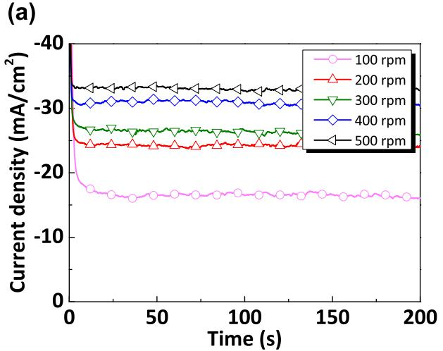

(b)  
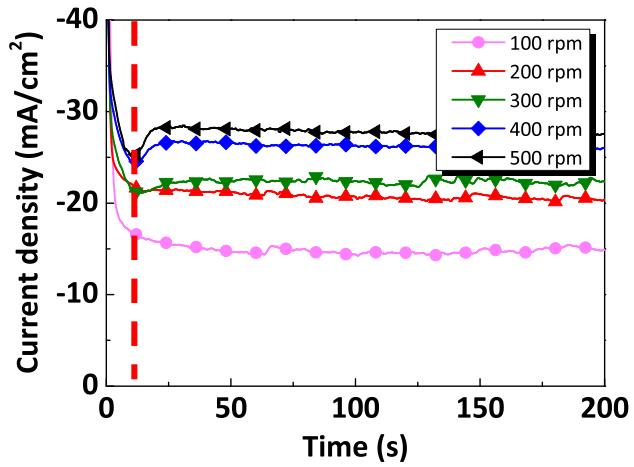

(c)  
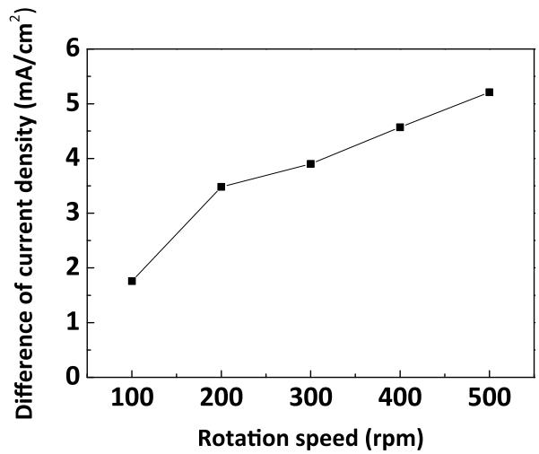  
Figure 4. Effect of rotation speed on the chronoamperometry for Co deposition at (a) MBI- free and (b) 150 μM MBI. (c) Difference between the saturated current density as a function of rotation speed. The base electrolyte consists of 0.1 M CoSO ·7H O, 0.5 M H BO and 1.0 M Na SO with pH 3. Chronoamperometry was performed $\mathrm { a t } - 1 . 1 \dot { \mathrm { V } }$ vs $\mathbf { A g / A g C l } .$ . Experimental currents are converted to current densities using the 0.071 cm2 RDE area.

Even though the aspect ratio (height/width) of the trench used in this study is 2, the difference in the convection intensities at the top and bottom of the submicron trench is noticeable.39 In the trench where convection is applied, the highest convection intensity is observed at the top, and it diminishes toward the bottom. There are many studies on the bottom-up filling of copper taking advantage of the fact that this difference in convection intensity affects the suppression strength of additive s.39–41 In Fig. 4, to determine the effect of convection on the change in the suppression effect of MBI, we performed current density comparison between the MBI-free condition and 150 μM MBI at −1.1 V vs $\mathrm { { A g / A g C l } }$ . It was defined that the higher the current density difference, the stronger the suppression. By comparing the suppression strength through the current density difference, the largest value was observed at 500 rpm. In Fig. 4c, the difference between the saturated current density values was plotted against the rotation speed. Under the potential condition in which bottom-up filling occurred, the higher the rotation speed, the stronger the suppression, which implied that the MBI was convection-dependent. One of the reasons for this convection dependence might be the influence of the mass transfer of MBI. As shown in Fig. 4b, when the rotation speed was high, the current density decreased initially and subsequently increased as the partial breakdown occurred. However, as the rotation speed decreases, the initial current profile became similar to the MBIfree result. That is, when the rotation speed is lowered, the supply of

MBI was not sufficient, and the concentration of the MBI near the electrode substrate was considerably low, therefore, the suppression effect on cobalt deposition reduced.

By simply comparing the current, it is difficult to confirm the combined effects of the cobalt deposition and the HER suppression strength change according to the convection intensity. Thus, the difference in the deposition thickness was confirmed by electroplating the cobalt film on the bare substrate. To reduce the measurement error, the center of each sample was selected and measured by FE-SEM for 6 points. Figure 5 shows the difference in film thickness according to the rotation speed under the MBI-free and $1 5 0 \mu \mathrm { M }$ MBI conditions. When cobalt film electrodeposition was conducted with the same charge, it was established that the higher the rotation speed, the higher the thickness under the MBIfree condition. This is because when the rotation speed is high, the deposition is performed at a high current density, owing to the effect of the sufficient mass transfer of ${ \mathrm { C o } } ^ { 2 + }$ and protons, and the current efficiency increases at a high current density, owing to the characteristics of cobalt electrodeposition.31 For the $1 5 0 ~ \hat { \mu }  { \mathrm { M } }$ MBI condition, despite exhibiting the highest current density at 500 rpm, the thickness was the lowest, and the thickness increased as the rotation speed decreased. When the rotation speed was lowered, the mass transfer of MBI was retarded, and the concentration of MBI at the electrode surface decreased. As can be observed from the LSV results in Fig. 1, the suppression effect of the HER was maintained even at relatively low MBI concentrations. However, the suppression strength of cobalt deposition depended on the MBI concentration. In other words, the suppression of HER was maintained at low concentrations of MBI to maintain a high current efficiency; however, the cobalt suppression strength rapidly reduced, resulting in a relatively high deposition rate. Conversely, at 500 rpm, the MBI supply was sufficient because of the strong convection, and the cobalt film thickness was decreased by the relatively strong suppression of cobalt deposition to offset the effect of increasing the current efficiency by suppressing hydrogen evolution. In a patterned surface, such as a trench, the consumption of MBI would be more concentrated at the top than at the bottom, and the difference in concentration of MBI would be higher than that in the planar surface, which was only affected by the rotation speed variance to afford the mass-transfer difference. When deposition was performed with 50 μM MBI and 50 rpm by simulating the bottom conditions, the Co film thickness was much higher than with 150 μM MBI and 500 rpm which simulating the top conditions as shown in Fig. S2.

(a)  
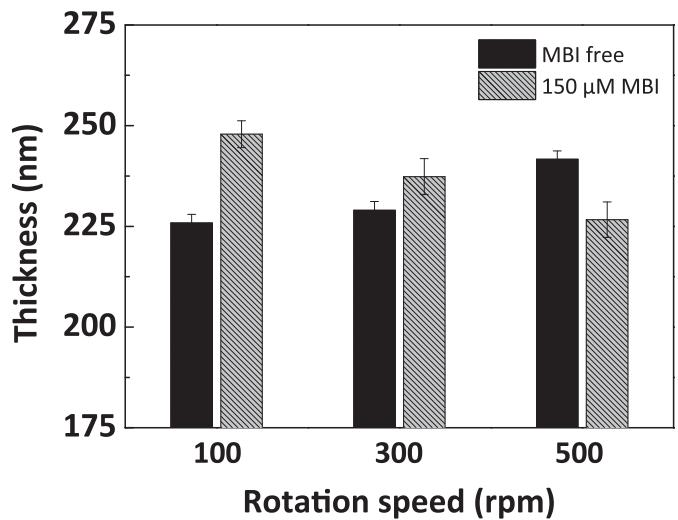  
Figure 5. Comparison of Co film thickness as a function of rotation speed at MBI-free and 150 μM MBI. The base electrolyte consists of 0.1 M CoSO ·7H O, 0.5 M H BO and 1.0 M Na SO with pH 3. The deposition was performed on the PVD Co wafer at −1.1 V vs Ag/AgCl for 1.0 C cm−2. The Co film thickness was measured by FE-SEM after cross section.

The filling profile according to the applied charge is shown in Fig. 6. When the filling is initiated by applying a potential, the concentrations of all the solution species including MBI are equal to the base solution composition at the top and bottom of the trench. Therefore, the cobalt growth proceeds conformally without any difference in the deposition speed at the top and bottom. This was demonstrated with the image obtained at $1 \mathrm { { 0 0 } } \mathrm { { \ m C } } \mathrm { { c m } } ^ { - 2 }$ where the initial stage of cobalt filling occurred. From 150 mC $\mathrm { c m } ^ { - 2 } ,$ a V-shape profile was formed as the deposition was enhanced at the bottom corner. The beginning of V-shape profile coincides with the start of steady-state current in chronoamperometry shown in Fig. S3. Deposition speed of the bottom reaches at steady-state current density between 5 and 7.5 seconds, earlier than that showed in planar geometry (Fig. 2). As the deposition progresses, the mass transport on the bottom of the trench is expected to be significantly less than that on the top. The MBI concentration gradients quickly develop within the trench because of the relatively slow diffusion of MBI. Therefore, at the top where the concentration of MBI is sufficient, the suppression of cobalt deposition by MBI is strong. At the bottom where the concentration of MBI is relatively low, the suppression of cobalt deposition is low, while the suppression of HER remains strong, resulting in a high current efficiency. In conclusion, the proximity to the bottom has a linear relationship with the ease of deposition. Therefore, the inner V-shape profile was maintained; however, the notch angle gradually increased as the filling proceeded, enabling the bottom-up filling profile to become almost flat at the end as shown at 400 mC $\mathrm { c m } ^ { - 2 } .$ . The concentration of MBI by location and its effect on cobalt deposition are depicted in Fig. 7.

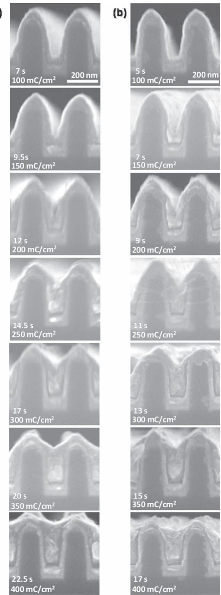  
Figure 6. The evolution of cobalt feature filling obtained at $\mathrm { ( a ) - l . l \ V }$ and (b) −1.15 V vs Ag/AgCl in the presence of 150 μM MBI at pH 3. The patterned substrates were rotating at 500 rpm.

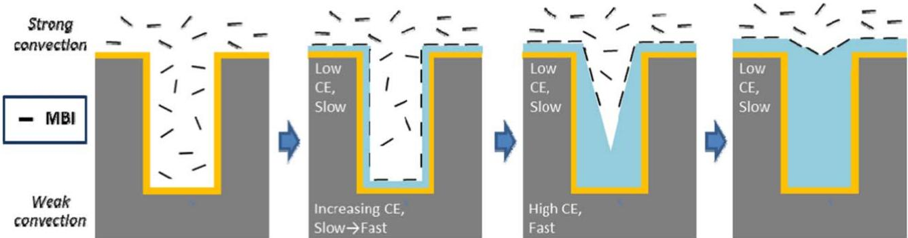  
Figure 7. Proposed MBI working mechanism for bottom-up cobalt fill under 500 rpm convection system. CE = current efficiency.

## Conclusions

The addition of MBI to a cobalt electrodeposition electrolyte suppressed both the cobalt deposition and the HER. The cobalt suppression effect varied significantly with the MBI concentration, while the HER suppression effect did not. Superconformal filling of submicron trenches was achieved by cobalt electrodeposition with 150 μM of MBI at −1.1 and −1.15 V vs Ag/AgCl. The formation and behavior of the MBI suppression layer were strongly influenced by the potential. The MBI suppression layer was formed in approximately 10 s after applying the potential, and it was divided into two cases: one where a partial breakdown occurred, and the other where a relatively strong suppression layer was formed depending on the potential. Cobalt bottom-up filling was possible in the potential region where the partial breakdown occurred. In addition, the intensity of the suppression of MBI for cobalt deposition varied according to convection intensity; this is attributable to the concentration difference because of the mass transfer of MBI. At the top where strong convection was maintained, the MBI suppression effect on cobalt deposition was dominant because of the sufficient supply of MBI. However, the convection intensity decreased as it entered the trench, resulting in an MBI concentration gradient. Furthermore, the suppression effect on cobalt deposition was considerably weak at the bottom, while the effect of increasing the current efficiency by suppressing the HER was maintained, enabling the bottom-up filling with a V-shape profile. Through this, we investigated the reason for the occurrence of superconformal cobalt filling, even with the addition of a single additive that exerts only a suppression effect.

## Acknowledgments

This work was supported by a National Research Foundation of Korea (NRF) grant, funded by the Korea government (MSIT) (No. 2019R1A2C1002400). This work was also supported by Incheon National University Research Grant in 2018.

## ORCID

Oh Joong Kwon https://orcid.org/0000-0002-7745-433X Jae Jeong Kim https://orcid.org/0000-0002-5270-4128

## References

1. J. S. Chawla, F. Gstrein, K. P. O’Brien, J. S. Clarke, and D. Gall, Phys. Rev. B, 84, 235423 (2011).

2. D. Choi and K. Barmak, Electron. Mater. Lett., 13, 449 (2017).

3. D. Josell, S. H. Brongersma, and Z, Tokei, Annu. Rev, Mater. Res., 39, 231 (2009)

4. T. Sun, B. Yao, A. P. Warren, K. Barmak, M. F. Toney, R. E. Peale, and K. R. Coffey, Phys. Rev. B, 79, 041402(R) (2009).

5. T. Sun, B. Yao, A. P. Warren, K. Barmak, M. F. Toney, R. E. Peale, and K. R. Coffey, Phys. Rev. B, 81, 155454 (2010).

6. W. Zhang, S. H. Brongersma, O. Richard, B. Brijs, R. Palmans, L. Froyen, and K. Maex, Microelectron, Eng., 76, 146 (2004).

7. R. L. Graham, G. B. Alers, T. Mountsier, N. Shamma, S. Dhuey, S. Cabrini, R. H. Geiss, D. T. Read, and S. Peddeti, Appl. Phys. Lett., 96, 042116 (2010).

8. D. Choi, Korean J Met Mater, 56, 605 (2018).

9. M. R. Baklanov, C. Adelmann, L. Zhao, and S. De Gendt, Ecs J Solid State Sc, 4, Y1 (2015).

10. K. Sankaran, S. Clima, M. Mees, and G. Pourtois, Ecs J Solid State Sc, 4, N3127 (2015).

11. R. N. Akolkar, F. Gstrein, and D. J. Zierath, (2012), United States of America Patent US20120153483A1

12. N. Bekiaris et al., 2017 IEEE International Interconnect Technology Conference (IITC), p. 1 (2017).

13. F. Griggio et al., 2018 IEEE International Reliability Physics Symposium (IRPS), 6E.3 (2018).

14. R. Grover et al., 2020 IEEE International Reliability Physics Symposium (IRPS), p. 1 (2020).

15. C. J. Jezewski, J. S. Clarke, T. K. Indukuri, F. Gstrein, and D. J. Zierath, (2016), United States of America Patent US9514983B2

16. F. W. Mont, X. Zhang, W. Wang, J. J. Kelly, T. E. Standaert, R. Quon, and E. T. Ryan, 2017 IEEE International Interconnect Technology Conference (IITC), p. 1 (2017).

17. A. Yeoh et al., 2018 IEEE International Interconnect Technology Conference (IITC), p. 144 (2018).

18. J. Zheng et al., 2015 IEEE International Interconnect Technology Conference and 2015 IEEE Materials for Advanced Metallization Conference (IITC/MAM), p. 265 (2015).

19. D. Josell, D. Wheeler, W. H. Huber, and T. P. Moffat, Phys. Rev. Lett., 87, 016102 (2001).

20. M. H. Lee, Y. Lee, M. Sung, S. K. Cho, Y. G. Kim, and J. J. Kim, J. Electrochem. Soc., 167, 102505 (2020).

21. T. P. Moffat, J. E. Bonevich, W. H. Huber, A. Stanishevsky, D. R. Kelly, G. R. Stafford, and D. Josell. J. Electrochem. Soc., 147, 4524 (2000).

22. T. P. Moffat, D. Wheeler, W. H. Huber, and D. Josell, Electrochem Solid St, 4. C26 (2001).

23. M. Sung, S. H. Kim, H. J. Lee, T. Lim, and J. J. Kim, Electrochim. Acta, 295, 224 (2019).

24. M. Sung, Y. Yoon, J. Hong, M. J. Kim, and J. J. Kim, J. Electrochem. Soc., 166, D546 (2019).

25. T. M. Braun, S. H. Kim, H. J. Lee, T. P. Moffat, and D. Josell, J. Electrochem. Soc., 165, D291 (2018).

26. C. H. Lee, J. E. Bonevich, J. E. Davies, and T. P. Moffat, J. Electrochem. Soc., 155. D499 (2008).

27. C. H. Lee and T. P. Moffat, Electrochim. Acta, 55, 8527 (2010)

28. D. Josell, M. Silva, and T. P. Moffat, J. Electrochem. Soc., 163, D809 (2016).

29. C. H. Lee, J. E. Bonevich, J. E. Davies, and T. P. Moffat, J. Electrochem. Soc., 156, D301 (2009).

30. Q. Huang, T. W. Lyons, and W. D. Sides, J. Electrochem. Soc., 163, D715 (2016).

31. M. A. Rigsby, L. J. Brogan, N. V. Doubina, Y. H. Liu, E. C. Opocensky, T. A. Spurlin, J. Zhou, and J. D. Reid, J. Electrochem. Soc., 166, D3167 (2018).

32. J. Wu, F. Wafula, S. Branagan, H. Suzuki, and J. van Eisden, J. Electrochem. Soc., 166, D3136 (2018).

33. D. R. Gabe, J. Appl. Electrochem., 27, 908 (1997).

34. N. Pradhan, T. Subbaiah, S. C. Das, and U. N. Dash, J. Appl. Electrochem., 27, 713 (1997).

35. M. A. Rigsby, T. A. Spurlin, and J. D. Reid, J. Electrochem. Soc., 167, 112507 (2020).

36. Y. Tsuru, M. Nomura, and F. R. Foulkes, J. Appl. Electrochem., 32, 629 (2002).

37. V. Grozovski, S. Vesztergom, G. G. Lang, and P. Broekmann, J. Electrochem. Soc., 164, E3171 (2017).

38. J. Kang, M. Sung, J. Byun, O. J. Kwon, and J. J. Kim, J. Electrochem. Soc., 167, 122510 (2020).

39. U. Landau, E. Malyshev, R. Akolkar, and S. Chivilikhin, “Simulations of bottom-up fill in via plating of semiconductor interconnects.” AIChE Annual Meeting, Nov, 17–18, 2003 (2003).

40. K. G. Jordan and C. W. Tobias, J. Electrochem. Soc., 138, 1933 (1991).

41. K. M. Takahashi and M. E. Gross, J. Electrochem. Soc., 146, 4499 (1999).