# 两种共轭结构抑制剂对盲孔内钴填充过程及作用机制研究

# THE EFFECT AND MECHANISM OF TWO CONJUGATED STRUCTURED INHIBITORS ON COBALT FILLING IN BLIND VIA

马晓川

哈尔滨工业大学2023 年 5 月国内图书分类号：TQ153.1

国际图书分类号：621.3

学校代码：10213

密级：公开

工学博士学位论文

# 两种共轭结构抑制剂对盲孔内钴填充过程及作用机制研究

博 士 研 究 生：马晓川

导 师：安茂忠教授

申 请 学 位：工学博士

学 科：化学工程与技术

所 在 单 位：化工与化学学院

答 辩 日 期：2023 年 5 月

授予学位单位：哈尔滨工业大学

Classified Index: TQ153.1

U.D.C: 621.3

Dissertation for the Doctoral Degree

# THE EFFECT AND MECHANISM OF TWO CONJUGATED STRUCTURED INHIBITORS ON COBALT FILLING IN BLIND VIA

Candidate： Ma Xiaochuan

Supervisor： Prof.An Maozhong

Academic Degree Applied for：

Doctor of Engineer

Speciality：

Chemical Engineering and

Technology

Affiliation：

School of Chemistry and Chemical

Engineering

Date of Defence：

May，2023

Degree-Conferring-Institution： Harbin Institute of Technology

## 摘 要

随着集成电路的集成度越来越高，晶体管的尺寸已经达到纳米级别。在 14nm 节点下，由于尺寸效应的影响，Cu 互连线的电阻率呈现指数级升高，需要新的材料替代部分金属 Cu 作为互连线。金属 Co 因其电子平均自由程较短，电阻率低，性能稳定和较低的电迁移能引起广泛关注。但是，由于新型芯片技术的发展时间短和工艺技术不成熟，对于适合金属 Co 填充过程的抑制剂结构以及抑制剂的分子结构仍需要进一步分析研究。因此，研究无缝填充 Co 技术具有非常重要的理论和实际价值。本论文首先通过理论计算和赫尔槽实验，对比了不同结构的添加剂对 Co 镀液的分散能力，确定了适合作为抑制剂的分子结构，并对抑制剂在镀液中的电化学行为以及填充效果进行了探讨，最终确定了适合微米级别盲孔填充的金属 Co 电镀工艺。

通过赫尔槽实验分析了 14 种不同结构的添加剂分子对 Co 沉积过程的影响，发现 C=N 环己二烯共轭结构和四氮唑共轭结构的分子可以提高 Co 镀液的分散能力。通过填充效果对比，发现具有共轭结构的孔雀石绿（MG）和氯化硝基四氮唑蓝（NBT）分别作为添加剂时，明显抑制 Co 在盲孔外表面的沉积速率，但是对盲孔底部沉积速率抑制效果不明显。通过分子动力学（MD）模拟分析，发现 MG 分子内的特殊 C=N 环己二烯共轭结构，可以有效地吸附在阴极表面，占据活性位点，阻碍 $\mathrm { C o } ^ { 2 + }$ 沉积。同时，NBT 分子内的四氮唑共轭结构也同样容易吸附在阴极表面，而且相较于 MG，NBT 具有更高的吸附能。

根据量子化学（QC）计算结果显示，MG 和 NBT 的前沿分子轨道中 EHOMO能级值较大，同时能级差值∆E 较低，最终导致 MG 和 NBT 具有较高的吸附能，分别达到 158.0 kcal/mol 和 214.9 kcal/mol。通过分子静电势计算发现，MG 和NBT 分子的表面静电势较高，而且分布广泛，容易在阴极表面产生吸附。此外，利用分子中的原子（AIM）理论分析得出，这两种添加剂可以与溶液中的 Co 离子形成配合物，进一步影响金属 Co 成核沉积过程。

通过镀液的电化学测试得知，较低浓度的 MG 和 NBT 就使 Co 还原电位发生明显的负移，而且随着抑制剂浓度的增加，镀液的极化过电位增加。通过计时电流曲线得出，增加镀液的传质速度，Co 的极化过电位增加，说明抑制剂 MG和 NBT 在阴极表面的吸附过程受传质过程控制。利用电化学石英晶体微天平（EQCM）测试发现，MG 和 NBT 作为抑制剂时，吸附在阴极表面阻碍 $\mathrm { C o } ^ { 2 + }$ 沉积，降低了沉积效率。通过与伏安曲线对比分析得出，MG 和 NBT 不仅抑制了Co 还原过程，还促进了氢还原过程。用同摩尔量的 K+代替 $\mathrm { C o } ^ { 2 + }$ 并进行循环伏安测试发现，MG 和 NBT 促进了析氢反应（HER），从而导致镀液的 pH 值升高。结合理论分析得知，抑制剂分子吸附在阴极表面，占据活性位点，阻碍 $\mathrm { C o } ^ { 2 + }$ 成核沉积；吸附在阴极表面的添加剂分子充当 HER 的活性位点，促进氢析出。通过 Co 还原电流和镀液还原的总电流对比得知，尽管镀液中有硼酸的存在，但是添加剂促进了 $_ { \mathrm { H } _ { 2 } \mathrm { O } }$ 的还原过程，导致局部 pH 值升高。

通过填充过程分析得知，MG 和 NBT 具有较强的抑制能力。添加低浓度的MG 和 NBT 于镀液中进行填充发现，盲孔底部的沉积速率高于外表面。对比不同电势下的填充效果分析得知，抑制剂在-1.20V 沉积电势下的填充机理和-1.25V 时不同，较低沉积电势下，镀液主要发生氢还原过程，由此引起的 pH 值升高在盲孔底部对流速率慢的区域更加明显，使底部具有更高的沉积速率。在-1.25V 沉积电势下，底部镀层的沉积速率差不多是外表面的 2 倍，使微米级别盲孔$( 1 0 0 ~ \mu \mathrm { m } \times 1 0 0 ~ \mu \mathrm { m } )$ 的填充率 FR 值分别达到 72.6%和 84.5%。而在-1.20 V 时，其 FR 值分别达到 90.3%和 91.9%。最终筛选出适合盲孔填充的最优配方分别是0.4 mol/L $\mathrm { C o S O _ { 4 } }$ ，0.5 mol/L $\mathrm { H } _ { 3 } \mathrm { B O } _ { 3 }$ ，10 mmol/L NaCl，20 mg/L MPS，10 mg/LMG 和 0.4 mol/L $\mathrm { C o S O _ { 4 } }$ ，0.5 mol/L $\mathrm { H } _ { 3 } \mathrm { B O } _ { 3 }$ ，10 mmol/L NaCl，20 mg/L NBT。对比不同沉积时间的填充图发现，低电势下，盲孔内形成的活化-钝化区域更明显，更有利于实现金属 $\mathrm { C o }$ 的无缝填充。最终根据添加剂这一作用机理，提出吸附-诱导-扩散填充机理，即抑制剂吸附在阴极表面抑制 Co 沉积；抑制剂诱导氢析出，导致局部 $\mathsf { p H }$ 值升高，底部容易形成氢氧化钴中间态，提高底部沉积速率；由于抑制剂受扩散控制，容易在盲孔形成抑制梯度，从而实现自底而上的无缝Co 填充。

关键词: 孔雀石绿；氯化硝基四氮唑蓝；抑制剂；Co 填充；氢析出；吸附-诱导-扩散机理

## Abstract

With the increasing integration of integrated circuits, the size of transistors has reached the nm level. Due to the influence of size effect, the resistivity of Cu interconnectors increases exponentially when the line width below 14 nm. So new materials are needed to replace metal Cu as interconnects. Metal Co has attracted widespread attention because of its short mean free path of electrons, low resistivity, stable performance and low electromigration. However, due to the short development time of the new chip technology and the immature process of new alternative materials, further analysis and study of the inhibitor and the molecular structure of the inhibitor suitable for the metal Co filling process are still needed. Therefore, studying the seamless filling Co technology has very important theoretical and practical value. According to theoretical calculation and Hull cell experiment, this paper compared the dispersion ability of plating bath after adding additives with different structures and their inhibition ability on Co plating bath, determined the molecular structure suitable for use as a Co plating inhibitor, and discussed the electrochemical behavior and filling effect of the inhibitor in the plating solution. Finally, a metal Co plating process suitable for micron level blind hole filling was verified.

The effect of 14 kinds of different additive molecules on Co deposition process was analyzed through Hull cell experiment. It was found that molecular with C=N cyclohexadiene conjugated structure and tetrazole conjugated structure can improve the dispersion ability of Co plating solution. By comparing the filling process, Malachite Green (MG) and Nitro Blue Tetrazolium Chloride (NBT) of the two conjugated structures were used as additives, the deposition rate of Co on the outer surface of the blind hole was significantly inhibited, but the deposition rate at the bottom of the blind hole was not significantly inhibited. According to MD simulation analysis, the special C=N cyclohexadiene conjugated structure in MG molecules could be adsorbed on the cathode surface effectively, occupying the active site and preventing the deposition of $\mathrm { C o } ^ { 2 + }$ . While the conjugated structure of tetrazole in NBT molecule is also easy to be adsorbed on the cathode surface, and NBT has higher adsorption energy than MG.

According to the quantum chemical (QC) calculation, the frontier molecular orbital of MG and NBT has a large EHOMO energy level value, while the $\Delta E$ is low, which ultimately leads to higher adsorption energy of MG and NBT. According to the calculation of molecular electrostatic potential, the surface electrostatic potential of MG and NBT molecules is high and widely distributed, so it is easy to produce adsorption on the cathode surface. In addition, AIM theory analysis shows that these two additives can form complexes with Co ions in solution, and further affect the metal Co nucleation deposition process.

The electrochemistry test of the plating solution showed that lower concentrations of MG and NBT (5 mg/L) caused a significant negative shift in the Co reduction potential, and with the increase in inhibitor concentration, the polarization overpotential of the plating solution increased. According to the chronoamperometric curve, increasing the mass transfer rate of the plating solution increases the polarization overpotential of Co, indicating that the adsorption process of inhibitors MG and NBT on the cathode surface is controlled by the mass transfer process. Electrochemical Quartz Crystal Microbalance (EQCM) testing showed that MG and NBT adsorbed on the cathode surface as inhibitors, which hindered the deposition of $\mathrm { C o } ^ { 2 + }$ and reduced the deposition efficiency. Compared with LSV curves, MG and NBT not only inhibited the Co reduction process, but also promoted the hydrogen reduction process. Cyclic voltammetry tests with $\mathrm { K } ^ { + }$ to replace $\mathrm { C o } ^ { 2 + }$ showed that MG and NBT promote the hydrogen evolution reaction (HER), resulting in an increase of pH value in the plating solution. Based on theoretical analysis, it is known that inhibitor molecules adsorb on the cathode surface, occupying active sites, and hindering the nucleation and deposition of $\mathrm { C o } ^ { 2 + }$ ; The additive molecules adsorbed on the cathode surface act as active sites for HER, promoting hydrogen precipitation. By comparing the Co reduction current with the total current of the plating solution reduction, the additive promotes the reduction process of $\mathrm { H } _ { 2 } \mathrm { O }$ and resulting in a local pH increase, although there is boric acid in the plating solution.

According to the filling process analysis, MG and NBT have strong inhibition ability. When 10mg/L MG and NBT are added, the coating deposition rate at the bottom is higher than that at the surface under different voltages. According to the filling effect analysis, the filling mechanism of inhibitor at -1.20 V deposition voltage is different from that at -1.25 V deposition voltage. The plating solution mainly occurs hydrogen reduction process, the increase of pH value causes the higher deposition rate at the bottom is more obvious, obtained. At -1.25 V deposition voltage, the plating rate of the bottom deposition is nearly twice that of the outer surface. When MG and NBT are used as additives, the filling FR value of the micron pore reaches 72.6% and 84.5%, respectively. At -1.20 V, the FR values reached 90.3% and 91.9%, respectively. The optimal formulations were 0.4 mol/L $\mathrm { C o S O } _ { 4 } , 0 . 5$ mol/L $\mathrm { H } _ { 3 } \mathrm { B O } _ { 3 } .$ , 10 mmol/L NaCl, 20 mg/L MPS, 10 mg/L MG and 0.4 mol/L $\mathrm { C o S O } _ { 4 } , 0 . 5$ mol/L $\mathrm { H } _ { 3 } \mathrm { B O } _ { 3 }$ 10 mmol/L NaCl, 20 mg/L NBT, respectively. Compared with the filling conditions of different deposition times, the activation-passivation zone formed in the blind hole is more obvious under low voltage, which is more conducive to the realization of metal Co superfilling. Finally, according to the action mechanism of additives, the adsorption-induction-diffusion filling mechanism was proposed, that is, the inhibitor was adsorbed on the cathode surface to inhibit Co deposition. Inhibitor induced hydrogen precipitation, resulting in the increase of pH, the formation of cobalt hydroxide at the bottom of the intermediate state, improve the bottom deposition rate; Because the inhibitor is controlled by diffusion, it is easy to form an inhibition gradient in the blind hole, thus achieving seamless bottom-up Co filling

Keywords：Malachite Green, Nitrotetrazazole blue, Inhibitor, Co filling, Hydrogen evolution process, adsorption-induction-diffusion mechanism

## 目 录

第1章 绪论....1
1.1 课题背景及研究的目的和意义....1
1.2 集成电路及其发展现状....2
1.2.1 互连技术的发展概况....3
1.2.2 Co 互连的提出....8
1.3 钴互连的填充过程....10
1.3.1 金属 Co 镀液的组成....11
1.3.2 金属 Co 填充过程机理....14
1.3.3 添加剂的 MD 模拟和 QC 计算....19
1.3.4 金属 Co 互连当前存在的问题....20
1.4 本文的主要研究内容....21
第2章 实验材料及表征方法....23
2.1 实验材料及相关仪器....23
2.1.1 实验试剂及药品....23
2.1.2 主要实验仪器....24
2.2 实验方法....24
2.2.1 电解液配制....24
2.2.2 电镀工艺流程....25
2.3 QC 计算和 MD 模拟....25
2.3.1 QC 计算....25
2.3.2 MD 模拟....25
2.4 测试表征方法....26
2.4.1 镀层形貌....26
2.4.2 镀层晶体结构分析....27
2.4.3 电化学测试....27
第3章 添加剂的筛选和理论分析....29
3.1 引言....29
3.2 添加剂对钴沉积过程的影响....30
3.2.1 添加剂对镀层形貌的影响....31
3.2.2 添加剂对钴填充过程的影响....33
3.2.3 添加剂对金属钴电化学行为的影响....38
3.3 添加剂分子在阴极表面的吸附过程及理论计算分析....40
3.3.1 添加剂分子的分子动力学模拟....40
3.3.2 添加剂分子的 QC 计算....44

3.3.3 MG 和 NBT 的分子静电势 ..... 48
3.4 本章小结 ..... 51
第 4 章 基于 MG 为抑制剂的金属钴填充过程研究 ..... 52
4.1 引言 ..... 52
4.2 基础镀液的电沉积过程 ..... 52
4.2.1 MPS 对镀液电化学行为的影响 ..... 52
4.2.2 MPS 对镀液电沉积过程的影响 ..... 54
4.3 MG 对镀液电化学行为的影响 ..... 56
4.3.1 MG 对镀液阴极极化的影响 ..... 56
4.3.2 MG 对钴沉积效率的影响 ..... 58
4.3.3 MG 对钴成核过程的影响 ..... 60
4.3.4 MG 对钴镀层的影响 ..... 62
4.3.5 MG 对钴填充过程的影响 ..... 63
4.4 pH 值对钴沉积过程的影响 ..... 65
4.4.1 MG 对 HER 的影响 ..... 65
4.4.2 pH 值对钴沉积过程的影响 ..... 69
4.4.3 MG 对镀层形貌的影响 ..... 70
4.5 金属钴超填充过程的研究 ..... 71
4.5.1 MG 浓度对超填充过程的影响 ..... 72
4.5.2 搅拌速度对超填充过程的影响 ..... 72
4.5.3 沉积电势对超填充的影响 ..... 73
4.5.4 pH 值对超填充过程的影响 ..... 74
4.5.5 超填充机理的研究 ..... 76
4.6 本章小结 ..... 77
第 5 章 NBT 为抑制剂的金属钴填充过程研究 ..... 79
5.1 引言 ..... 79
5.2 NBT 对金属钴电化学行为的影响 ..... 79
5.2.1 NBT 对镀液循环伏安曲线的影响 ..... 79
5.2.2 NBT 对镀液计时电流曲线的影响 ..... 82
5.2.3 NBT 对镀液阴极极化的影响 ..... 83
5.2.4 NBT 对镀液阻抗的影响 ..... 84
5.2.5 NBT 对金属钴成核过程的影响 ..... 85
5.3 NBT 对金属钴填充过程的影响 ..... 87
5.3.1 NBT 对镀层表面形貌的影响 ..... 87
5.3.2 NBT 对镀层结构的影响 ..... 89
5.3.3 NBT 对钴填充过程的影响 ..... 90
5.4 HER 对金属钴填充过程的影响 ..... 91
5.4.1 NBT 对 HER 过程的影响 ..... 92

5.4.2 HER 对金属钴还原过程的影响.....93
5.5 两种抑制剂对比.....97
5.6 本章小结.....101
结论.....103
创新点.....105
展望.....106
参考文献.....107

## 第 1 章 绪 论

## 1.1 课题背景及研究的目的和意义

课题来源于国家自然科学基金（项目编号：21972037）。

集成电路（Intergrated Circuits，简称 IC）就是将晶体管、电阻和电容等元器件集中到一起，方便实现各种电气功能的组合电路。而将这些元器件连接起来，就需要用到互连技术。随着集成电路的发展，互连技术也从最初的 Al 互连材料逐渐被 互连材料取代。但是随着极紫外（ ）光刻机的应用，制备出的晶体管结构越来越精细，目前栅电极的最小线宽达到 3 nm。此时，Cu作为互连线成为制约集成电路性能提升的关键，因为 Cu 的线电阻率相较于其体电阻率出现指数级升高，由此引发的 RC 延迟和晶界散射使器件性能衰减。因此，需要开发新的互连材料来替代 Cu 作为互连材料。

由于集成电路内三极管的制备用的是光刻技术，因此布线过程其实就是将金属材料沉积在盲孔或沟槽内实现无缝填充，而目前采用的工艺是电沉积工艺。自从大马士革铜互连工艺开发出来以后，电镀 Cu 技术一直是芯片布线的主要方式。之所以选择电沉积技术是因为只需要在镀液中添加少量的添加剂就能实现无缝填充，过程简单，操作便捷，商业价值高。也因此对于大马士革铜互连工艺的研究主要集中选择合适的添加剂实现金属 Cu 的高效无缝填充，其中添加剂的研究主要集中在加速剂、抑制剂和整平剂的筛选。

金属 Co 具有较低的平均电子自由程，因此作为纳米级别的互连线时，相较于体电阻率，其变化较小。作为互连材料，Co 仅需要一层阻抗层，而 Cu 则需要更厚的阻抗层和粘附层。此外，Co 的抗电迁移性能也比 Cu 更优异，因此作为替代材料，Co 在纳米级别互连中更具有优势，可以作为互连材料代替 Cu。对于 Co 的制备过程，仍以电沉积为主，这是因为只需要添加少量的抑制剂就可以实现 Co的无缝填充，因此对于添加剂的研究和选择也是目前的研究重点。

尽管目前有一些关于金属 Co 填充过程中的添加剂的研究，但是对于如何选择以及选择何种结构的添加剂，仍没有定论。而且文献中报道的抑制剂多为聚合物，这是基于长链结构容易在电极表面吸附，阻碍 Co 沉积，但同时又面临一个问题，Co 作为替代金属，主要用于纳米级别的互连的，而长链结构的大分子容易在孔口处堆叠致使沉积过程离子传输受阻，容易导致盲孔内出现缝隙。而小分子作为添加剂时，则需要较高的浓度以达到无缝填充的抑制效果，这种情况下容易导致 Co 镀层中出现 C，N 和 O 等原子掺杂，进而使 Co 镀层电阻率进一步升高，因此选择一种合适分子量的抑制剂也是提高 Co 镀层性能的关键。本文首先根据文献调研筛选了多种不同结构的添加剂作为抑制剂，研究其对 Co 填充过程影响，然后利用 MD 模拟和 QC 计算分析不同结构的添加剂，通过与实验测试对比分析适合 Co 填充的分子结构，从而确定合适的添加剂分子结构与模拟计算之间的关系，为以后在不同尺寸的盲孔或通孔进行填充时提供一种可用的添加剂筛选方案。此外，由于 $\mathrm { C o } ^ { 2 + }$ 还原过程中同时发生 HER，本文还研究了抑制剂对氢还原过程的影响，并通过电化学测试和填充实验分析了 HER 过程在填充过程中的作用，为以后 Co 在纳米级别盲孔中的填充过程提供了一种可用的机理模型。

## 1.2 集成电路及其发展现状

1958 年，Jack 利用蚀刻技术将晶体管组装连接制备出世界上第一块集成电路[1]，为以后的微电子技术和信息技术的发展奠定了基础。1966 年，美国无线电（RCA）公司利用光刻技术研制出了互补金属氧化物半导体晶体管（CMOS）集成电路[2]，制备的门阵列达到 50 门，后来的大规模集成电路的生产路线也都是沿着这种方式制备的。1971 年，Intel 公司成功研制出第一款微处理器 4004，它在单片内集成了 2300 个晶体管，晶体管之间的距离为 $1 0 ~ \mu \mathrm { m } ^ { \left[ 3 \right] }$ ，也被称为最具革新性的产品之一。1988 年，单晶体管动态随机存取存储器（DRAM）将3500 万个晶体管集成在 $1 \ \mathrm { c m } ^ { 2 }$ 的硅片上，标志着进入了超大规模集成电路（VLSI）阶段[4]。自此之后，随着光刻机的发展[5]，尤其是 EUV 光刻机的研制成功，使得集成电路中的晶体管尺寸达到几个纳米的级别[6-8]，而且整个集成电路也变得越来越小，但是其内部的晶体管数量却越来越多，如图 1-1 所示。

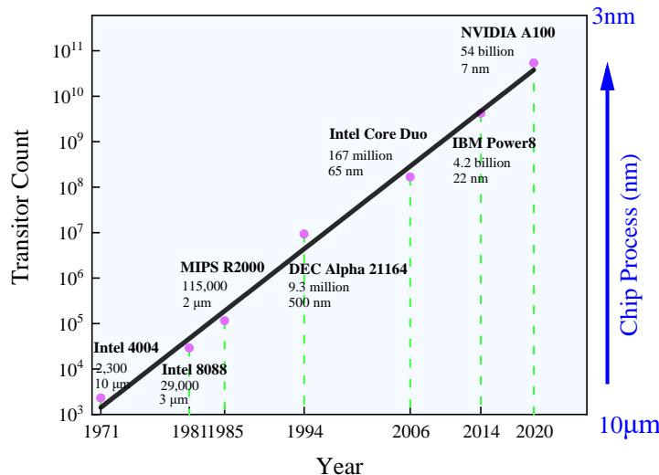  
图 1-1 集成电路的发展历程（数据取自各个厂商）  
Figure 1-1 The development of integrated circuit

从 1971 年 Intel 公司的 4004 芯片发展到 2020 年英伟达（NVIDIA）公司的 A100 芯片，其晶体管数目从 2300 个增加至 540 亿个，芯片制程也从最初的 $1 0 \mu \mathrm { m }$ 发展到了 7 nm。此外，根据 1965 提出的摩尔定律[9]“晶体管每两年增加一倍”，结合以往晶体管的发展趋势（图 1-1），实际生产中晶体管的数目几乎完全按照摩尔定律的预测而增加的。但是当制程达到 7nm 以下[10]，晶体管数目的增长速率近乎停滞，主要原因是芯片制程达到纳米级别，尺寸效应越来越明显，尤其是互连技术中的铜材料的电迁移和电阻率已经严重制约了集成电路的发展。

## 1.2.1 互连技术的发展概况

由于最初制备的集成电路体积较大，而且 Al 电阻率低，作为互连线可以与 Si 形成良好的欧姆接触，所以 Al 被选为互连材料。但是随着长时间的使用，电迁移现象[11]在金属 Al 导线中越来越明显，从而导致原子堆积，裂纹和气孔的形成[12-14]，而且在终端连接处有晶须的形成[15]，进而造成线路短路[16]，如图 1-1 所示。

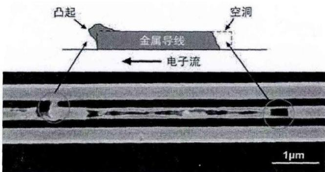  
图 1-2 Al 的电迁移现象[17]  
Figure 1-2 Electromigration of Aluminum

但是，Al 互连线与 $\mathrm { S i O } _ { 2 }$ 结合性好，表面易钝化从而性能稳定，因此研究人员尝试引入合金来改善 Al 的电迁移现象[18-20]。于是，IBM 公司通过在 Al 线中掺杂 $1 \ \mathrm { a t . \% } \{ \sim 2 \ \mathrm { a t . \% } \ \mathrm { C u }$ 以提高互连线的抗电迁移能力[21]。通过对比发现，Cu 的电阻率 $1 . 7 { \sim } 1 . 9 ~ { \mu } \Omega { \cdot } { \mathrm { c m } }$ 低于 Al 的 $2 . 8 { \sim } 2 . 9 ~ { \mu } \Omega { \cdot } \mathrm { c m }$ ，而且 Cu 的抗电迁移能力也要高于 Al 互连材料。随后，研究人员开始选择 Cu 来替代 Al 作为互连线，但是采用 Al 的布线方式制备出的 Cu 线不容易被蚀刻[22]。

20 世纪 90 年代，IBM 公司开发出了大马士革电镀铜工艺[23]，不同于 Al布线的先沉积 再蚀刻的方式，大马士革镀铜工艺是首先在基底利用光刻或蚀刻出沟槽图形，然后在沟槽内铺设阻挡层和铜种子层，最后利用电沉积的方式填充铜互连材料，如图 1-2 所示。大马士革镀铜工艺使布线的方式密度更高，可靠性好，工艺简单，而且价格也更低，自此才真正开启了铜互连工艺的时代。随后，双大马士革镀铜工艺被开发出来[24-26]，使得镀铜工艺被进一步优化。双大马士革镀铜工艺，就是将层间孔道和布线一次性地通过镀铜和化学机械平坦化（CMP）埋置而形成，其中镀铜工艺主要用在层间沟槽或通孔的填充。

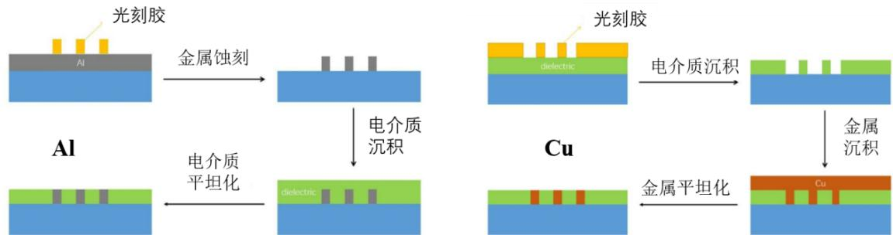  
图 1-3 Al 互连和 Cu 互连的布线过程[27]  
Figure 1-3 Schematic diagrams of Al and Cu interconnection process

大马士革电镀铜工艺主要是利用不同添加剂的相互作用，使铜离子在盲孔内外沉积时出现镀速差，其经典的组成配方为：加速剂为双（硫丙基）二硫化物（SPS），整平剂为健那绿（JGB）以及抑制剂聚乙二醇（PEG）。基础镀液组成为 $\mathrm { C u S O _ { 4 } }$ 和 $\mathrm { H } _ { 2 } \mathrm { S O } _ { 4 }$ 。在大规模集成电路中，镀液的配方往往采用低铜高酸的基础镀液和不同浓度的添加剂以达到无缝填充的效果[28]，作用机理如图 1-4。

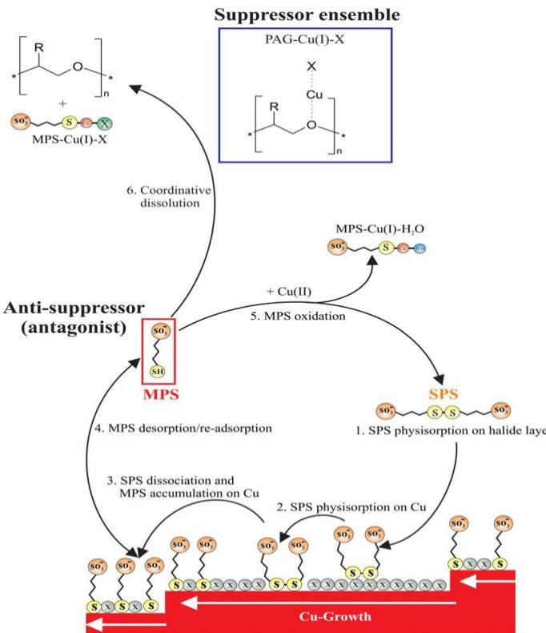  
图 1-4 添加剂 SPS 和 PAG 作用机理图[28]  
Figure 1-4 Schematic representation of the SPS reaction cycle superimposed

如图 1-4 所示，抑制剂 PEG 与溶液中还原的 $\mathrm { C u } ^ { 2 \cdot }$ 形成稳定 PEG-Cu(I)-Cl-配合物，从而抑制 Cu 成核沉积，但是随着沉积的进行，盲孔或沟槽外表面 PEG浓度变化不大，而底部 PEG 由于掺杂进镀层或被击穿导致浓度降低，此时 SPS吸附在底部阴极表面，逐渐分解为 MPS，然后与还原的一价 Cu 和 Cl-形成的MPS-Cu(I)-Cl-配合物吸附在阴极表面，其中 S 原子作为活性位点促进 Cu 成核沉积。而 JGB 整平剂被认为是吸附在开口处，从而使开口处的沉积过程延迟到最后的封孔[29]。在后续的发展中，大马士革镀铜工艺几乎一直按照这一机理进行，只是在研究过程中选择不同的可替换的添加剂来适应不同尺寸的盲孔或沟槽。

随着光刻技术从紫外全谱逐渐向深紫外及极紫外光刻技术的发展，制备出的 CMOS 晶体管尺寸达到几个纳米级别（目前最先进的芯片制程是 3nm）。研究人员发现线宽低于 40nm 时，Cu 的电子散射使其线电阻率开始升高[30, 31]，而且随着线宽继续缩小，电阻率开始呈现指数上升[32]。与此同时，铜互连线的RC 延迟（R 是电阻，C 是电容）也逐渐升高，由此引起门延迟也愈发严重[33]。而且 Cu 容易向 Si 基底中扩散，在 Cu 互连中需要提前沉积阻挡层[34]（NTi 和NTa 等），那么在纳米尺寸的线宽中阻挡层的厚度就无法被忽视。

Table 1-1 List of the twenty most conductive metals, sorted with increasing bulk roomtemperature resistivity $\rho _ { o , r t }$

表 1-1 金属的电子平均自由程列表[35]，其 $\rho _ { o , r t }$ 是常温下金属的体电阻率， $\nu _ { \mathrm { f } }$ 是平均费米速率， $\tau { \times } \rho _ { o }$ 和 $\lambda \times \rho _ { o }$ 是根据第一性原理计算的， $\tau _ { r t }$ 是弛豫时间， $\lambda _ { r t }$ 是电子平均自由程

<table><tr><td>Element</td><td></td><td>Crystal structures</td><td> $\rho_{o,rt}$  (μΩ cm)</td><td> $v_f$  (105m/s)</td><td> $\tau \times \rho_o$  (10-22Ωm s)</td><td> $\lambda \times \rho_o$  (10-16Ω m2)</td><td> $\tau_{\text{rt}}$  (fs)</td><td> $\lambda_{\text{rt}}$  (nm)</td></tr><tr><td>Silver</td><td>Ag</td><td>fcc</td><td>1.587</td><td>14.48</td><td>5.84</td><td>8.46</td><td>36.8</td><td>53.3</td></tr><tr><td>Copper</td><td>Cu</td><td>fcc</td><td>1.678</td><td>11.09</td><td>6.04</td><td>6.70</td><td>36.0</td><td>39.9</td></tr><tr><td>Gold</td><td>Au</td><td>fcc</td><td>2.214</td><td>13.82</td><td>6.04</td><td>8.35</td><td>27.3</td><td>37.7</td></tr><tr><td>Aluminum</td><td>Al</td><td>fcc</td><td>2.650</td><td>15.99</td><td>3.13</td><td>5.01</td><td>11.8</td><td>18.9</td></tr><tr><td>Calcium</td><td>Ca</td><td>fcc</td><td>3.36</td><td>4.8</td><td>24.7</td><td>11.9</td><td>73.6</td><td>35.4</td></tr><tr><td>Berylium</td><td>Be</td><td>hcp</td><td>3.56</td><td>12.62</td><td>13.2/21.0</td><td>17.1/24.3</td><td>37.0/59.1</td><td>48.0/68.2</td></tr><tr><td>Magnesium</td><td>Mg</td><td>hcp</td><td>4.39</td><td>11.63</td><td>8.60/7.30</td><td>9.81/8.80</td><td>19.6/16.6</td><td>22.3/20.0</td></tr><tr><td>Rhodium</td><td>Rh</td><td>fcc</td><td>4.7</td><td>6.67</td><td>4.85</td><td>3.23</td><td>10.3</td><td>6.88</td></tr><tr><td>Sodium</td><td>Na</td><td>bcc</td><td>4.77</td><td>10.21</td><td>14.4</td><td>14.7</td><td>30.2</td><td>30.9</td></tr><tr><td>Tridium</td><td>Ir</td><td>fcc</td><td>5.2</td><td>8.54</td><td>4.32</td><td>3.69</td><td>8.30</td><td>7.09</td></tr><tr><td>Tungsten</td><td>W</td><td>bcc</td><td>5.28</td><td>9.71</td><td>8.44</td><td>8.20</td><td>16.0</td><td>15.5</td></tr><tr><td>Molybdenum</td><td>Mo</td><td>bcc</td><td>5.34</td><td>9.18</td><td>6.53</td><td>5.99</td><td>12.2</td><td>11.2</td></tr><tr><td>Zinc</td><td>Zn</td><td>hcp</td><td>5.90</td><td>15.66</td><td>6.80/4.90</td><td>10.3/8.1</td><td>11.5/8.31</td><td>17.4/13.7</td></tr><tr><td>Cobalt</td><td>Co</td><td>hcp</td><td>6.2</td><td>2.55</td><td>13.1/10.9</td><td>7.31/4.82</td><td>21.2/17.6</td><td>11.8/7.77</td></tr><tr><td>Nickel</td><td>Ni</td><td>fcc</td><td>6.93</td><td>2.34</td><td>10.0</td><td>4.07</td><td>14.5</td><td>5.87</td></tr><tr><td>Potassium</td><td>K</td><td>bcc</td><td>7.20</td><td>7.94</td><td>28.6</td><td>22.7</td><td>39.7</td><td>31.5</td></tr><tr><td>Cadmium</td><td>Cd</td><td>hcp</td><td>7.5</td><td>15.55</td><td>8.35/6.89</td><td>12.6/11.3</td><td>11.1/9.18</td><td>16.8/15.1</td></tr><tr><td>Ruthenium</td><td>Ru</td><td>hcp</td><td>7.8</td><td>7.24</td><td>6.88/5.51</td><td>5.14/3.81</td><td>8.82/7.07</td><td>6.59/4.88</td></tr><tr><td>Indium</td><td>In</td><td>bct</td><td>8.8</td><td>16.32</td><td>4.64/4.45</td><td>7.62/7.18</td><td>5.27/5.05</td><td>8.65/8.16</td></tr><tr><td>Osmium</td><td>Os</td><td>hcp</td><td>8.9</td><td>8.19</td><td>7.60/5.51</td><td>6.41/4.33</td><td>8.54/6.19</td><td>7.20/4.87</td></tr></table>

因此，当出现这种尺寸效应时，研究人员就开始研究其他金属或合金材料作为下一代互连材料[36]，其中对于新材料的选择主要是依据电子平均自由程的大小，如表 1-1 所示。

从表中可以看出，电子平均自由程小于 Cu 的金属有很多，但是既然要作为替代材料，还需要考虑后续的 CMP 过程以及阻挡层问题。因此，经过筛选最终确定的可替代金属有 W，Mo，Ni，Co，Au，Rh，Ir 和 Ru。其中，W 和Mo 单金属难以单独电沉积，需要以合金的形式沉积，一般通过化学气相沉积（CVD）或物理气相沉积（PVD）的方式制备[37, 38]。Au 作为替代金属时，后续的 CMP 过程难以处理表面多出的 Au 沉积层，后续工艺复杂[39]。Rh，Ir 和Ru因为较低的电阻率已经被研究用作Cu互连的阻挡层，但是由于其通过CVD或原子层沉积（ALD）制备[40]，在高长径比的沟槽或通孔内填充时容易形成缝隙[41-43]，而且这类铂族金属在与 $\mathrm { S i O } _ { 2 }$ 的粘附力差，需要一层衬底[44]，同样后处理工艺复杂[40]。通过制备出不同厚度的薄膜金属层，对其电阻进行对比，如图 1-5 所示。通过图中发现，在 10nm 以下，Ru 的电阻率是低于现行 Cu 互连工艺的，其他的金属的电阻率变化不大。

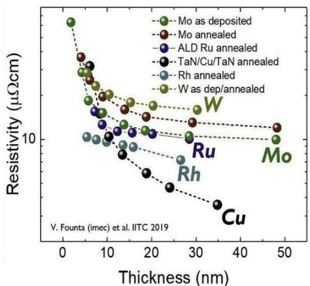  
图 1-5 不同金属层的电阻率变化[40]  
Figure 1-5 Resistivity for various film thicknesses of different metals

由于目前的双大马士革工艺已经成型，因此替代金属的制备过程仍以电沉积为主。于是，研究人员对于下一代互连材料的选择集中在 Co 上，尽管 Co 的体电阻率是 6.2 μΩ•cm，高于 Cu 的体电阻率，但是电子平均自由程较小，受尺寸效应变化小[35]。

除了选择单一金属作为替代材料，不同合金或金属间化合物作为替代材料同样引起研究人员的关注[44-51]，如图 1-6 所示，可以看出很多金属间化合物或合金的电阻率要低于 Cu[52]。其中，采用 Al 合金（AlNi，AlCu 和 AlSc 等）制备出低于 40nm 的线材料[53]，其最低电阻率（9.5μΩ•cm）甚至要低于 Ru 或 Mo单金属的电阻率。但是这种金属间化合物的制备采用的是物理气相沉积（PVD）的方法，难以调控合金的化学计量比，而且不能确定结晶度和晶界扩散对电阻率的影响。对于金属间化合物对电阻率和晶界扩散的影响需要进一步研究，因此，合适的合金或金属间化合物作为当下的替代材料仍需大量研究开发[54]。

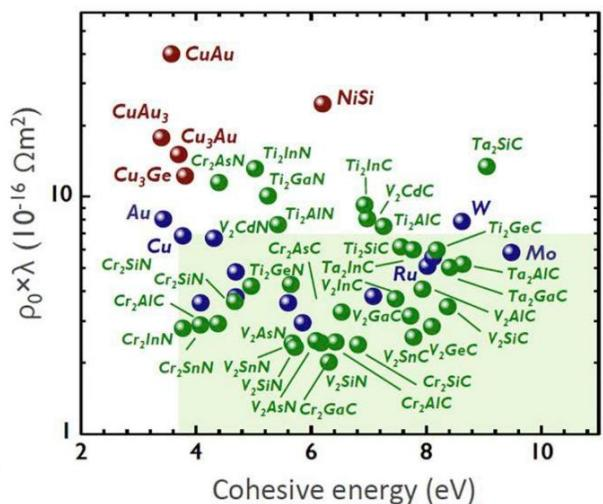  
图 1-6 不同金属间化合物的电阻率[52]，其中 $\rho _ { \boldsymbol { 0 } }$ 为体电阻率，λ 是电子平均自由程  
Figure 1-6 the resistivity of different binary intermetallics, $\rho _ { \boldsymbol { 0 } } \colon$ bulk resistivity, λ: mean free path of electrons

此外，由于石墨烯碳纳米管（GNR）受尺寸效应影响较小，而且它们在纳米尺度上的高载流能力和导电性，以及对电迁移的免疫力，因此研究人员尝试将它们作为互连材料来代替 Cu[55-57]。但是通过 CVD 制备的 GNR 显示其内部结构难以调控，主要是因为随着聚合度的提高，Armchair 结构从半导体性能变为金属性能，而 Zigzag 结构一直都是金属性能，就导致其电阻率的变化，如图 1-7 所示。GNR 的电导率强烈的依赖于其边缘形状和边缘粗糙度，使得其电阻率变得不可控。

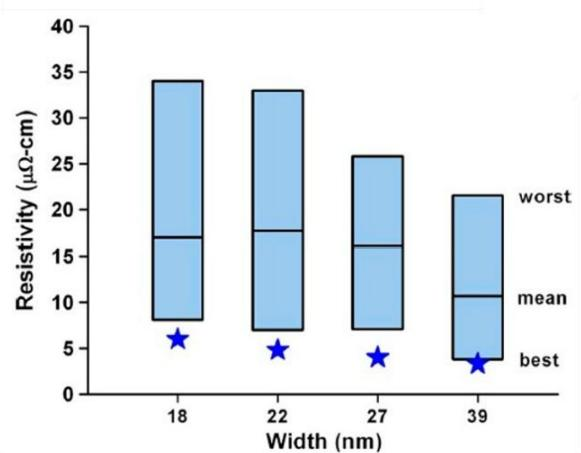  
图 1-7 不同尺寸下 GNR 的电阻率变化[57]  
Figure 1-7 Pherformance of individual GNRs of various line widths

## 1.2.2 Co 互连的提出

通过上述分析，Ru、金属间化合物和 Co 均有作为新型互连材料的潜力。但是，除了这些金属材料本身的物化性能，还要考虑与现行的后道工艺（BEOL）制程相匹配，以及材料成本。

为了降低 Cu 的电迁移率，2008 年就曾有研究人员选择在 Cu 上沉积 Co作为封盖层以减少 Cu 的电迁移[58]。2015 年，微电子研究中心（IMEC）研究了 45nm 宽的 Co 沟槽（via，M1）取代 Cu 作为中间的连接部分（图 1-8 所示）[59]，经过测试发现制备的沟槽线电阻降低了 30%。IMEC 认为这种方法可以有效的降低电阻和 RC 延迟，而且即使在 7nm 制程中也可以应用。

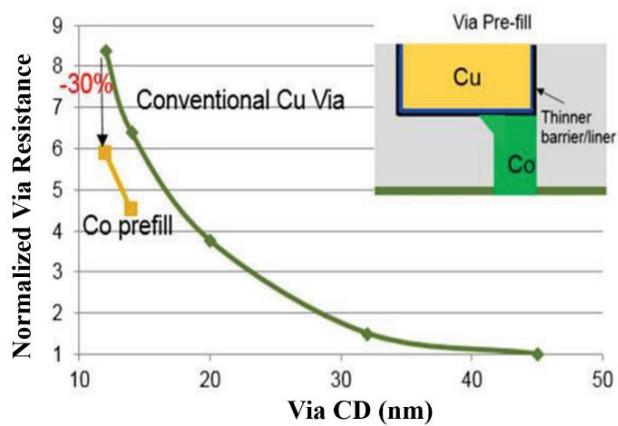  
图 1-8 BEOL 中沟槽内电阻率随尺寸的变化[59]  
Figure 1-8 Scalling of via resistance at 7nm BEOL

在 2016 年 IBM 公司就曾将 Co 作为布线的第一层（24nm 线宽）研究其作为替代金属对 BEOL 的影响[60]，如图 1-9 所示。通过对比发现，24nm 线宽时 Co 的电阻比 Cu 高 2.1 倍，而且在实际填充时，由于沟槽内阻挡层的厚度影响使 Co 的电阻比 Cu 高 1.7 倍。由此可以看出尺寸越小，Co 的电阻率变化要低于 Cu，因此在 14nm 制程中可以实现 Co 在第一层布线（M1）中取代 Cu。

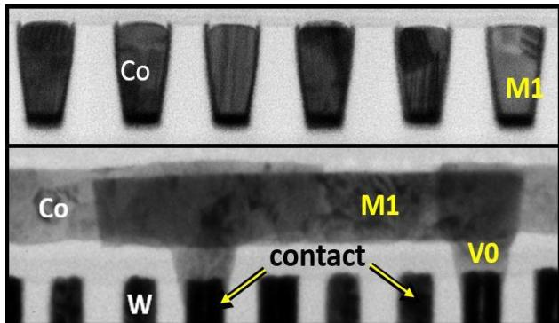  
图 1-9 Co 互连的 TEM 切面图[60]  
Figure 1-9 Cross sectional TEM micrographs of Co groundrule interconnects

2017 年，在 IEEE 国际电子设备大会（IEDM）上，Intel 公司提出了将 Co金属应用于 10nm 芯片最细连接线的设想[61]。同年，应用材料公司（AppliedMaterials, Inc.）就通过 CVD 的方法制备出了 Co 互连层代替 Cu，通过测试发现 Co 的电介质随时间破坏实验（TDDB）达 10 年之久，并且不需要厚的阻挡层。通过制备出的不同尺寸线宽的互连线发现，当线宽低于 14 nm 时，Co 的线电阻明显低于 Cu 的电阻，如图 1-10 所示。此外，在后续的实验中也发现，Co 作为替代材料，不仅电阻低于钨，而且仅仅制备 1nm 的阻挡层就可有效的减少 Co 的扩散，由此认为在 7nm 节点，Co 完全可以作为替代 Cu 的材料。

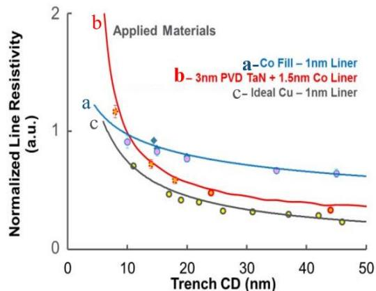  
图 1-10 沟槽内 Co 的线电阻率[61]，  
（a）Co 填充的线电阻，（b）实际制备的 Cu 线电阻和（c）理论得出的铜线电阻  
Figure 1-10 Line resistivity as a function of line CD for: Co with 1nm liner, Cu with 1nm liner (ideal Cu case), and Cu with 3nm barrier and 1.5nm liner (practical Cu case)

随后，台积电和三星也都公布在 7nm 制程的芯片中选择 Co 互连代替 Cu互连，制备的部分芯片结构如图 1-11(a)所示。自此之后，芯片制造商开始在7nm 节点的电路中选择 Co 作为最细连接线的部分。

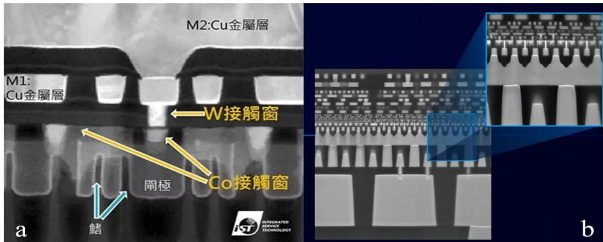  
图 1-11 部分芯片内部的构造图（数据来源于厂商）  
（a）布线后的构造图；（b）芯片布线材料选择  
Figure 1-11 Construction diagram of Fin Field-Effect Transistor inside some chip

尽管在 7 nm 节点时，Co 作为 Cu 的替代材料，电阻率降低了一半，电迁移减少了 20%，但是电迁移问题仍是需要解决的关键部分，尤其是在 3nm 节点及以下时。而且 Intel 在 2022 公布的最新 Intel 4 芯片（图 1-11b）中，表示由于 Co 互连在芯片的时钟速度方面性能不佳，不再采用纯钴作为互连线，但是其选择的替换材料 eCu 为镀钴铜，说明 Co 在未来芯片中仍是开发和研究的重点材料。

## 1.3 钴互连的填充过程

目前 Co 互连的应用主要是替代前几层布线中的 Cu，如图 1-12 所示。由于作为 M0 层，采用的方法主要是化学气相沉积技术（CVD）[61-64]，其中采用CVD 技术就可以实现对于需要填充的盲孔或沟槽形状规则，。但是对于后续的布线宽度越来越窄，需要更多的 Co 互连层，而且不同层之间大小不均一，CVD技术难以直接制备。

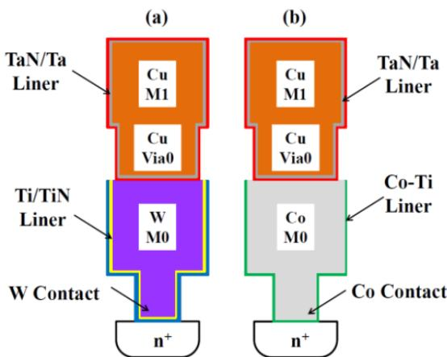  
图 1-12 布线工艺构造图[63]  
（a）传统的双大马士革工艺（a）；（b）可能的未来布线工艺  
Figure 1-12 Schematic of Dual-damascene conventional and proposed technology

其次，自从化学镀 Co 被报道出来[65]，利用化学镀的方式同样可以实现 Co的填充过程。但是目前所报道的化学镀 Co 主要集中在将 Co 作为粘附层沉积在阻挡层 TaN 上，以提高 Cu 互连线的附着力[66-69]。相对于电镀的方式，化学镀可以在非导体的基底上沉积，因为在沉积过程中会在基底上首先吸附还原性的离子/原子，然后促使 Co 离子还原沉积[70-72]。但是，化学镀制备的 Cu 填充线，其在沟槽或通孔内的镀层厚度往往低于外表面的厚度，这种方式更适合制备粘附层或阻抗层。因此，如果通过化学镀的方法进行 Co 无缝填充时，还需要考虑添加剂与化学镀的还原剂之间的相互作用，添加剂的作用机理也更加复杂。此外，研究表明采用 ALD 的方法制备的单层 Ru 原子，可以作为互连材料的阻挡层[73, 74]。因此，相较于化学镀的方式，利用电沉积的方法制备 Co 互连线更便捷（省去了还原/活化过程），操作流程更简单，更经济实用。所以本文通过在镀液中加入合适的抑制剂，利用电沉积的方式制备 Co 填充层。

## 1.3.1 金属 Co 镀液的组成

首先是对基础镀钴组成的分析：

## （1）镀液的主盐

在电沉积金属 Co 时，镀液的主盐选择主要是 $\mathrm { C o S O } _ { 4 } [ 7 5 { - } 7 7 ]$ $\mathrm { C o C l } _ { 2 }$ [78-80]和$\mathrm { C o N O } _ { 3 } [ 8 1 - 8 3 ]$ 这三种纯度高，价格低，实用性强的钴盐。

Hamulic 等人[84]通过 $\mathrm { C o S O _ { 4 } }$ $\mathrm { C o C l } _ { 2 }$ 和 $\mathrm { C o N O } _ { 3 }$ 三种不同主盐的镀液（镀液组成：主盐和 $\mathrm { H } _ { 2 } \mathrm { O } )$ ）电沉积 Co 镀层发现， $\mathrm { C o S O _ { 4 } }$ 和 $\mathrm { C o C l } _ { 2 }$ 作为主盐制备的镀层形貌相近， $\mathrm { C o N O } _ { 3 }$ 作为主盐制备的镀层形貌呈现无序针脊状。通过 X 射线吸收精细结构谱（EXAFS）分析发现，在 $\mathrm { C o S O _ { 4 } }$ 和 $\mathrm { C o C l } _ { 2 }$ 镀液中沉积的镀层为金属纯 Co 相，而 $\mathrm { C o N O } _ { 3 }$ 中制备的镀层主要为 $\mathrm { C o ( O H ) } _ { 2 }$ 。

Nakano 等人[85]利用 $\mathrm { C o S O _ { 4 } }$ 和 $\mathrm { C o C l } _ { 2 }$ 为主盐的镀液中电沉积的 Co 镀层对比发现，在 $\mathrm { C o S O _ { 4 } }$ 镀液中制备出的 Co 晶体的取向与沉积的过电势有关，较低过电势下 Co 晶体是(0 0 0 2)取向，高过电势下 Co 晶体是(1 1 2 0)取向。而CoCl2镀液中制备的 Co 晶体随过电势变化较小，主要是(1 1 2 0)取向。 $\mathrm { C o S O _ { 4 } }$ 镀液中制备的镀层形貌随着过电势的增加，晶粒尺寸逐渐减小，而 $\mathrm { C o C l } _ { 2 }$ 镀液中制备的镀层形貌随着沉积条件的变化发生改变，而且由于 Cl-在阴极表面的吸附导致阴极表面能降低，镀层出现片晶结构。

Huang 等人[86]通过对比镀液中 $\mathrm { C o S O _ { 4 } }$ 的浓度发现，当 $\mathrm { C o S O _ { 4 } }$ 的浓度低于$1 0 \ \mathrm { g / L }$ 时，其沉积电流效率显著下降；当 $\mathrm { C o S O _ { 4 } }$ 浓度达到 $4 0 ~ \mathrm { g / L }$ 时，其电流效率达到 90%，适合作为电沉积的浓度。但是当电流密度从 $1 0 0 \ \mathrm { A } / \mathrm { m } ^ { 2 }$ 升高至$8 0 0 \mathrm { A } / \mathrm { m } ^ { 2 }$ 时，其电流效率下降，而电流密度从 $5 0 \mathrm { A } / \mathrm { m } ^ { 2 }$ 增大至 $1 0 0 \mathrm { A } / \mathrm { m } ^ { 2 }$ 时，电流效率成上升趋势。与此同时，低电流密度下镀层致密均匀，晶粒较小，而高电流密度下，镀层出现不规则节点。

潘秉锁等人[87]通过调节不同 $\mathrm { C o S O _ { 4 } }$ 的浓度研究 CoNi 合金的电沉积过程发现， $\mathrm { C o S O _ { 4 } }$ 浓度的增加使镀液的分散能力下降，但是提高了镀液的深镀能力（提高 $7 6 . 6 \% )$ ）。 $\mathrm { C o S O _ { 4 } }$ 浓度的升高使镀层的显微硬度增加，内应力上升以及孔隙率增大，但 $\mathrm { C o S O _ { 4 } }$ 的加入细化了镀层的晶粒。

此外，由于在大马士革镀铜工艺中，主盐是硫酸铜，而且氯离子浓度对 $\mathrm { C u }$ 填充过程影响较大[88]，因此在本文研究中选择 $\mathrm { C o S O _ { 4 } }$ 作为镀液的主盐，用于Co 填充过程的研究。

## （2）pH 缓冲剂

由于 $\mathrm { C o } ^ { 2 + }$ 的还原电势低于氢还原的电势，因此在金属 Co 沉积的过程中会伴随着氢还原过程。这个过程导致镀液中 H+浓度降低，从而使 pH 值升高，使Co 镀层中夹杂 Co 氧化物或氢氧化物，从而影响镀层质量，因此在沉积的过程中需要添加合适的缓冲剂以调节镀液的 pH 值。

高灿柱等人[89]在电沉积 Ni 时研究了 $\mathrm { N H } _ { 4 } \mathrm { C l }$ $\mathrm { C H } _ { 3 } \mathrm { C O O H }$ 和 $\mathrm { H } _ { 3 } \mathrm { B O } _ { 3 }$ 三种酸性镀液中常用的缓冲剂时发现，当缓冲剂浓度较低（0.01-0.07 mol/L）时，Ni的沉积效率随着缓冲剂浓度的增加而迅速增加，且三种缓冲剂对镍沉积速率的影响几乎相同。当缓冲剂浓度继续增加， $\mathrm { N H } _ { 4 } \mathrm { C l }$ 几乎对 Ni 沉积速度不再有影响，沉积效率较低； $\mathrm { H } _ { 3 } \mathrm { B O } _ { 3 }$ 浓度达到 0.12mol/L 时，对沉积速率影响趋于稳定，沉积效率较高； $\mathrm { C H } _ { 3 } \mathrm { C O O H }$ 对沉积速率影响是先稳定后出现剧烈升高，最后趋于稳定，对沉积效率影响较大。

Ho 等人[90]通过在 $\mathrm { C o S O _ { 4 } }$ 镀液中添加不同浓度的 $\mathrm { H } _ { 3 } \mathrm { B O } _ { 3 }$ 来研究其对 Co 纳米颗粒的影响发现， $\mathrm { H } _ { 3 } \mathrm { B O } _ { 3 }$ 的加入使 Co 还原和氢还原电势负移，而且还原电流减低，这要归因于 $\mathrm { H } _ { 3 } \mathrm { B O } _ { 3 }$ 可以吸附在阴极表面占据活性位点。通过 XRD 分析得知， $\mathrm { H } _ { 3 } \mathrm { B O } _ { 3 }$ 倾向于吸附在 Co 晶体的 hcp(1011)晶面，从而使 Co 晶体向hcp(1010)过渡，而且晶粒尺寸下降。随着晶面取向的变化，磁滞回线的矫顽力逐渐降低。Sivasubramanian 等人[91]在电沉积 Co 三维枝晶时发现， $\mathrm { H } _ { 3 } \mathrm { B O } _ { 3 }$ 在阴极表面吸附对 Co 沉积起到抑制作用，而且由于 Co 晶体的(111)晶面的能量最低，受抑制作用较小，从而制备出了三维枝晶。说明 $\mathrm { H } _ { 3 } \mathrm { B O } _ { 3 }$ 还有导向剂的作用，有利于制备单晶结构。Karwas 等人[92]在对 Co-Zn 合金沉积时发现， $\mathrm { H } _ { 3 } \mathrm { B O } _ { 3 }$ 可以对 Co 成核和生长速率有较大影响，这是因 $\mathrm { H } _ { 3 } \mathrm { B O } _ { 3 }$ 存在时可以增加 $\mathbf { C o }$ 的成核密度，从而进一步使晶粒细化。

当用 Watts 型镀液沉积 Co 时，Rigsby 等人[93]对于 $\mathrm { H } _ { 3 } \mathrm { B O } _ { 3 }$ 在 $\mathbf { C o }$ 填充过程的作用机理进行详细分析。 $\mathrm { H } _ { 3 } \mathrm { B O } _ { 3 }$ 的加入使 镀层的粗糙度降低，增加了 $\mathbf { C o }$ 的极化过电位。而且不同 $\mathrm { p H }$ 条件下， $\mathrm { H } _ { 3 } \mathrm { B O } _ { 3 }$ 的电离常数也发生变化，结合 XPS图谱分析， $\mathrm { H } _ { 3 } \mathrm { B O } _ { 3 }$ 镀液中的解离过程如式(1-1)到(1-5)所示。当 $\mathrm { H } _ { 3 } \mathrm { B O } _ { 3 }$ 浓度为10 g/L 时，镀液中主要以[B(OH)4]-的形态存在，而当浓度增加至 40 g/L 时，随着 $\mathrm { p H }$ 的升高，镀液中硼酸的多聚态增加，因此镀液中起主要缓冲作用的是硼酸的多聚态。而且这种多聚态化合物抑制氢还原过程，同时与 $\mathrm { C o } ^ { 2 + }$ 形成络合物影响 Co 的成核沉积过程，两种共同作用有利于实现 Co 在沟槽内的填充。

$$
\mathrm{B} (\mathrm{OH}) _ {3 (\mathrm{aq})} + \mathrm{H} _ {2} \mathrm{O} \leftrightarrow [ \mathrm{B} (\mathrm{OH}) _ {4} ] ^ {-} + \mathrm{H} ^ {+}\tag{1-1}
$$

$$
2 \mathrm{B} (\mathrm{OH}) _ {3 (\mathrm{aq})} \leftrightarrow [ \mathrm{B} _ {2} \mathrm{O} (\mathrm{OH}) _ {5} ] ^ {-} + \mathrm{H} ^ {+}\tag{1-2}
$$

$$
3 \mathrm{B} (\mathrm{OH}) _ {3 (\mathrm{aq})} \leftrightarrow [ \mathrm{B} _ {3} \mathrm{O} _ {3} (\mathrm{OH}) _ {4} ] ^ {-} + \mathrm{H} ^ {+} + 2 \mathrm{H} _ {2} \mathrm{O}\tag{1-3}
$$

$$
4 \mathrm{B} (\mathrm{OH}) _ {3 (\mathrm{aq})} \leftrightarrow [ \mathrm{B} _ {4} \mathrm{O} _ {5} (\mathrm{OH}) _ {4} ] ^ {2 -} + 2 \mathrm{H} ^ {+} + 3 \mathrm{H} _ {2} \mathrm{O}\tag{1-4}
$$

$$
5 \mathrm{B} (\mathrm{OH}) _ {3 (\mathrm{aq})} \leftrightarrow [ \mathrm{B} _ {5} \mathrm{O} _ {6} (\mathrm{OH}) _ {6} ] ^ {3 -} + 3 \mathrm{H} ^ {+} + 3 \mathrm{H} _ {2} \mathrm{O}\tag{1-5}
$$

综上所述，本文在镀液的配制过程中加入 0.5 mol/L 的硼酸作为缓冲剂。

## （3）Cl-的作用

Pradhan 等人[94]通过在 $\mathrm { C o S O _ { 4 } }$ 基础镀液中添加不同浓度的 Cl-研究其对镀液电化学行为的影响，发现 Cl-对镀液的电化学行为几乎没有影响。Cl-浓度的变化主要对于镀层形貌有较大影响，Cl-浓度增加至 100mg/L，镀层晶粒变大；增加浓度至 500 mg/L 时，镀层晶粒变小；浓度增加至 2000 mg/L 时，镀层出现片状晶粒；继续增加至 5000 mg/L 时，镀层出现三角形晶粒，说明 Cl-主要影响镀层形貌。Kongstein 等人[95]通过在 $\mathrm { C o S O _ { 4 } }$ 基础镀液中研究 Cl-离子对 Co还原过程中的 Tafel 曲线，同样发现 Cl-对 Co 的还原电流和沉积效率几乎没有影响。

Jung 等人[96]通过对比不同 Cl-浓度对 Co 镀层腐蚀行为的影响发现，在碱性环境下 Cl-的加入可以有效的减少 Co 镀层的钝化过程，促进 Co 镀层还原，说明 Cl-的加入可以改善沉积时阳极 Co 的钝化过程。

综上所述，在 Co 镀液中 Cl-离子主要用于活化阳极，改善镀层形貌，因此在镀液中选择添加少量 Cl-。

## （4）pH 的影响

尽管在电沉积 的镀液中加入了硼酸作为缓冲剂，但是阴极近表面的氢析出过程仍会导致局部的 pH 值升高。Gabe[97]在文章中认为，H+或 $_ { \mathrm { H } _ { 2 } \mathrm { O } }$ 的还原是与金属沉积同时发生的，而且局部升高的 OH-与阴极表面的 Co 离子形成氢氧化钴吸附物或沉淀。并在文章中指出 H+离子放电过程是首先溶液中 $\mathrm { H } _ { 3 } \mathrm { O } ^ { + }$ 扩散到阴极表面形成 $\mathrm { H _ { a d s } }$ 或 M-H 吸附物，然后经过催化脱附或者电化学脱附形成 $\mathrm { H } _ { 2 ( \mathrm { a d s } ) }$ ，最后形成 $\mathrm { H } _ { 2 }$ 气泡。

Pradhan 等人[98]利用不同 pH 下镀液的电化学过程分析发现， $\mathrm { C o } ^ { 2 + }$ 在 $\mathrm { p H }$ 低于 4.0 时，倾向于形成 Co(OH)+中间态，而 pH 位于 4.0～4.5 时， $\mathrm { C o } ^ { 2 + }$ 与 OH-反应生成 Co(OH) 沉淀。随后 Matsushima 等人[99]利用 EQCM 计算 $\mathrm { C o S O _ { 4 } }$ 镀液在不同 pH 下的沉积过程发现，镀液的 pH 低于 4.0 时，镀层中没有氢氧化钴形成。而 pH 值高于 4.0 时，在较低沉积电势下，镀层中出现氢氧化钴，较高电势下氢氧化钴开始还原，Co 的还原过程包括两部分， $\mathrm { C o } ^ { 2 + }$ 直接还原和Co(OH)2还原。此外，通过 EQCM 计算出沉积效率可知，pH 值的升高增加了Co 的沉积效率。Tian 等人[100]利用 $\mathbf { N i - C o }$ 合金中金属比例随 pH（2.0～5.5）的变化发现， $\mathrm { p H }$ 值的升高，Co 的沉积效率增加，而合金中 Ni 的沉积效率下降，说明 pH 值的升高有利于形成 $\mathrm { C o ( O H ) ^ { - } }$ +中间体，从而吸附在阴极表面促进 Co

还原过程。

Graciano 等人[101]通过原位磁性研究了氢析出过程对 Co 镀层的影响，在$\mathrm { C o S O _ { 4 } }$ 和 $\mathrm { H } _ { 3 } \mathrm { B O } _ { 3 }$ 的镀液中，利用磁性的变化和电化学行为得知，参比电极为硫酸亚汞电极时，H+离子的还原电位在-1.10V， $\mathrm { C o } ^ { 2 + }$ 的还原电位在-1.20V，而从-1.19 V 时对应的磁性逐渐升高，而在-1.30 V 磁性的突然增加归因于 ${ \mathrm { C o } } ( \mathrm { O H } ) _ { 2 }$ 的形成。金属 Co 的磁性随着沉积电势的增加而增强。由此可知，尽管有 $\mathrm { H } _ { 3 } \mathrm { B O } _ { 3 }$ 作为缓冲剂，但是镀液仍需要调节至合适的 pH 值。

## （5）温度的影响

Santos 等人[102]通过电化学石英晶体微天平（EQCM）研究了温度对 $\mathrm { H } _ { 3 } \mathrm { B O } _ { 3 }$ 和 $\mathrm { C o S O _ { 4 } }$ 镀液中 Co 离子还原过程的影响，发现镀液温度为 $2 5 \mathrm { { ^ \circ C } }$ 时，Co 的还原过程为 $\mathrm { C o } ^ { 2 + }$ 直接还原成 $\mathbf { C o }$ ，而没有 Co 氢氧化物形成。而当镀液温度为 $4 8 \mathrm { { } ^ { \circ } C }$ 时，Co 离子和 $\mathrm { H } _ { 3 } \mathrm { B O } _ { 3 }$ 的比例越大，越容易出现 Co(OH)2沉淀，说明温度对氢还原过程的影响要明显高于对 Co 还原的影响。

Rehim 等人[103]研究了温度对含有 $\mathrm { H } _ { 3 } \mathrm { B O } _ { 3 }$ 的镀 Co 液的电化学行为，研究发现温度从 $1 0 \mathrm { { ^ \circ C } ; }$ 升高至 $5 5 \mathrm { { ^ \circ C } }$ 时，Co 的阴极极化减小，极化电流增加，同时阳极溶出峰面积增加，说明温度的升高使 Co 沉积效率增大。Kongstein 等人[104]通过不同温度下 $\mathrm { C o }$ 的还原动力学过程分析发现，Tafel 斜率随温度的升高增大，而且交换电流密度也随着增加。Nakano[105]和 Hamulic[84]等通过不同温度下沉积的镀层形貌发现，镀液的温度越高，沉积的 Co 镀层越粗糙。因此，本文中选择在常温（25℃）条件下研究 Co 电镀和填充过程。

## 1.3.2 金属 Co 填充过程机理

根据上述镀液分析，本文中以 $\mathrm { C o S O _ { 4 } }$ 为主盐， $\mathrm { H } _ { 3 } \mathrm { B O } _ { 3 }$ 为缓冲剂的 Watts 型镀液，室温条件下进行金属 Co 的填充过程分析。接下来是对于不同添加剂下金属 的填充机理进行分析：

## （1）S 型负微分电阻机理

Josell 在用聚乙烯亚胺(PEI)作为添加剂研究金属 Co 在 TSVs 中填充时发现[106]，镀液的循环伏安曲线（CV）随着 PEI 的加入有较大改变，如图 1-13a所示。其中，PEI 的加入使 CV 正向扫描时 Co 的还原电位负移，但是随着电流密度的增加，沉积电势出现明显下降。这是典型的 S 型负微分电阻现象，即电势的增加，电阻出现明显下降，从而导致电流密度急剧增长。文献中认为当达到还原电位时，吸附在阴极表面的 PEI 被破坏或掺杂进沉积层，从而导致局部溶液的电阻降低。根据这一现象，在进行 TSVs 填充时，盲孔底部的 PEI 浓度受传质影响而低于外部溶液的浓度，从而在底部形成 $\mathrm { C o } ^ { 2 + }$ 沉积的活化区域，而侧壁和外表面仍处在失活区域，从而导致底部 Co 镀层的沉积速率要高于外表面，如图 1-13c 所示。

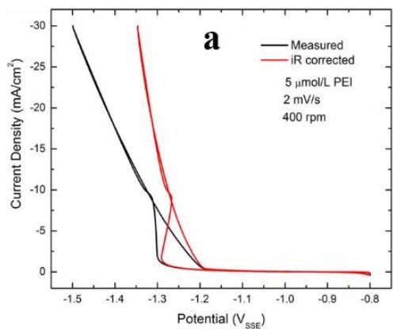

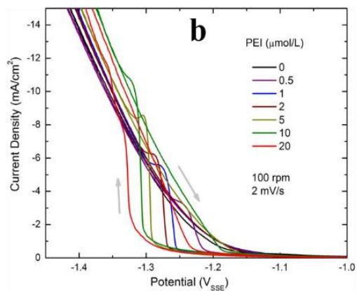

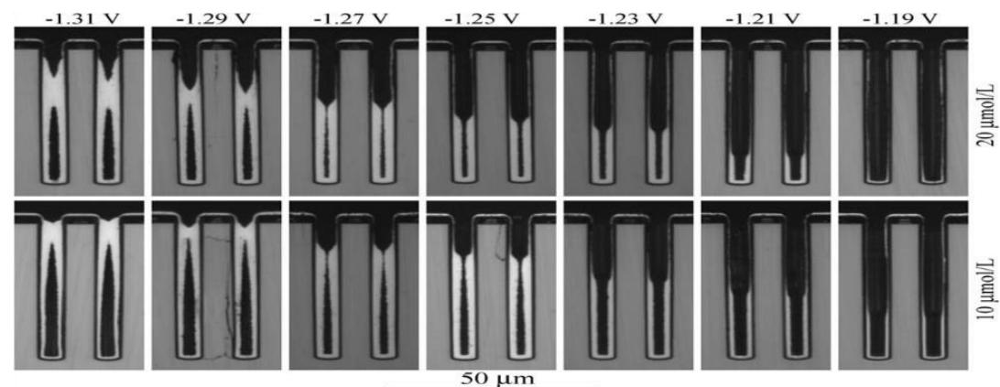  
图 1-13 添加 PEI 后的镀液 CV 曲线和填充过程[106]  
（a）添加 PEI 之后镀液的 CV 曲线；（b）不同浓度 PEI 下镀液的 CV 曲线；（c）不同电势下金属钴镀层在 TSVs 的切面图  
Figure 1-13 CV of the bath with PEI and cross-sectioned annular TSVs

## （2）电压依赖抑制效应

Huang等人[107-109]利用二肟类化合物作为抑制剂研究金属Co的沉积过程，通过 CV 曲线发现，还原电位达到沉积电势时，电流密度出现急剧增加，出现S 负微分电阻现象，如图 1-14 所示。二肟类化合物可以与 $\mathrm { C o } ^ { 2 + }$ 形成稳定的配合物，抑制了 Co 还原沉积，同时对氢析出过程有加速作用。通过电势瞬态曲线发现，抑制剂浓度的增加，瞬态电势逐渐降低。这种抑制方式能够在 Co 填充时，在盲孔内形成浓度梯度，从而可以实现金属 Co 的无缝填充。通过电流瞬态曲线发现，添加二肟类抑制剂使 Co 呈现出三维渐进成核过程。

此外，文献中还对比丁二酮肟（DMG），环己二酮二肟（CHD）和环己酮肟（CHO）三种抑制剂的抑制强度，通过 CV 曲线分析，CHD 的抑制作用最强， 的抑制作用最弱，说明二肟类结构中起到抑制作用的是 结构，苯环共轭结构可以增加抑制能力。分析其抑制机理是二肟与 Co 形成配合物，配合物吸附能力强，在沉积开始时吸附在阴极表面，阻碍 $\mathrm { C o } ^ { 2 \cdot }$ +还原过程。

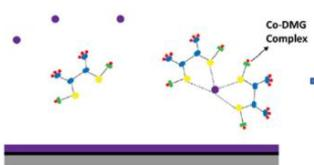

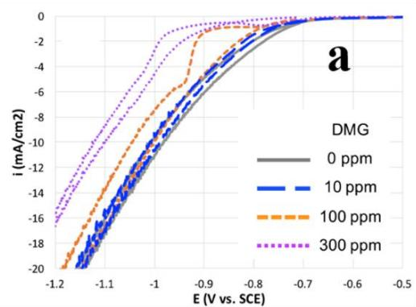

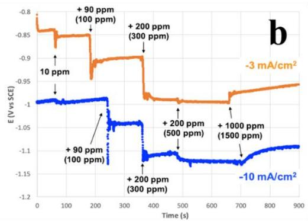  
c

$$
\mathrm{Co} ^ {2 +} + 2 \mathrm{e} \rightarrow \mathrm{Co}\tag{[1]}
$$

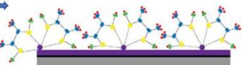

$$
\mathrm{Co} ^ {2 +} + 2 \mathrm{L} ^ {-} \rightarrow \mathrm{CoL} _ {2}\tag{[2]}
$$

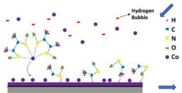

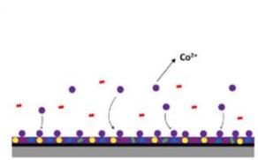  
图 1-14 添加不同 DMG 浓度后镀液的电化学行为变化和作用机理[107]  
（a）CV 曲线；（b）计时电位曲线；（c）抑制剂作用机理  
Figure 1-14 Cyclic voltammtry of Co electrodeposition at different DMG concentrations and potential transients upon injection and mechanism of inhibition of DMG

$$
\mathrm{CoL} _ {2} + 2 \mathrm{e} \rightarrow \mathrm{Co} + 2 \mathrm{L} ^ {-}\tag{[3]}
$$

$$
2 \mathrm{H} ^ {+} + 2 \mathrm{e} \rightarrow \mathrm{H} _ {2}\tag{[4]}
$$

$$
2 \mathrm{H} _ {2} \mathrm{O} + 2 \mathrm{e} \rightarrow \mathrm{H} _ {2} + 2 \mathrm{OH} ^ {-}\tag{[5]}
$$

## （3）抑制氢还原机理

Kang 等人[110]利用 2-巯基苯并咪唑（MBI）作为抑制剂研究其对 Co 填充过程的影响发现，MBI 对 Co 还原和 HER 过程均有抑制作用，但是随着浓度的增加，对 Co 的抑制作用明显增强，但是却对 HER 过程的抑制作用不明显。在以氯化银电极为参比电极的情况下，通过不同电势下的填充效果对比发现，当 MBI 的浓度达到 150μmol/L 时，在-1.10V 时沟槽内镀层沉积速率高于外表面的沉积速率。通过对比不同转速下镀层的填充厚度发现，较低转速时，MBI对沟槽外表面的抑制效果不明显，当转速达到 500rpm 时，沟槽内沉积速度高于外表面，说明在 500rpm 时可以实现金属 Co 的超共形沉积。分析 MBI 的作用机理是 MBI 吸附在阴极表面阻碍 Co 还原和 HER 过程，MBI 在沟槽底部被击穿或消耗而浓度降低，抑制失效，同时 MBI 对 HER 的抑制作用提高了 Co沉积效率；沟槽的外表面在高速搅拌下，吸附的 MBI 浓度变化不大，对 Co 的抑制作用占主要，从而形成 V 型轮廓。

## （4）氢诱导抑制失效

Wu 等人[64]研究了抑制剂（XF）对金属 Co 填充过程的影响，通过与没有添加剂的基础镀液的 CV 曲线对比，加入抑制剂后镀液的 CV 曲线出现明显的滞后现象，如图 1-15 所示。通过改变 CV 扫描的终止电势发现，终止电势越大，回扫的滞后现象越明显，说明 XF 的抑制效果是渐进的失效过程。对比不同 pH 下的 CV 曲线，较低过电势下，较高的 H+使抑制剂变为了加速剂，而较高过电势，抑制剂效果明显，说明 H+还原过程参与了抑制剂的失效反应。

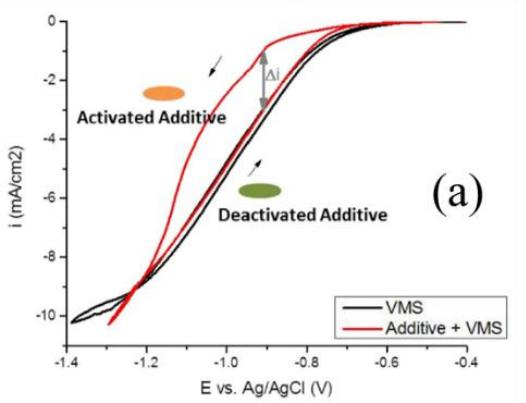

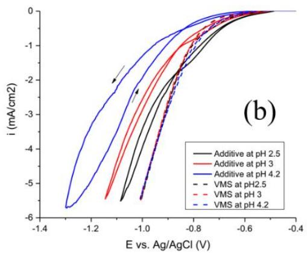

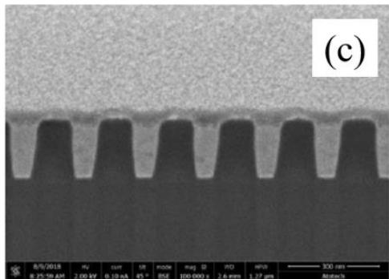

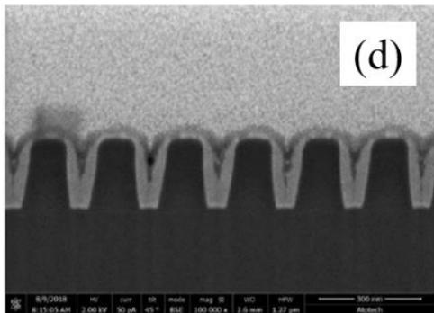  
图 1-15 添加 XF 后镀液的 CV 曲线和填充过程[64]  
（a）有无 XF 添加的镀液 CV 曲线；（b）不同 pH 条件下的镀液 CV；  
不同浓度 XF 的填充效果图（c）0.1 mmol/L XF；（d）0.05mmol/L XF  
Figure 1-15 Cyclic voltammetry and filling process of the bath with or without suppressor XF

因此，文献中认为这种抑制剂 可以与原子 反应，使抑制失效。通过填充实验，提出氢诱导失活机理，即沟槽内填充 时， 的抑制作用使沟槽外 Co 沉积过程受到抑制，沟槽内由于传质过程的影响和氢诱导的失活效应促使底部沉积效率较高，从而实现了金属 的超填充过程。

## （5）pH 驱动机理

Rigsby 等人[111]选择 Watts 型镀液中添加抑制剂研究了 pH 值的变化对 Co填充过程的影响。通过 EQCM 与 CV 曲线对比发现，Co 沉积过程中首先发生H+还原，然后是 $\mathrm { C o } ^ { 2 + }$ 还原，当添加合适的抑制剂时，使 $\mathrm { C o } ^ { 2 + }$ 与 $_ { \mathrm { H } _ { 2 } \mathrm { O } }$ 同时还原。

(a)

在此过程中可能会形成氢氧化钴产物，如图 1-16 所示。通过 EQCM 曲线外推计算的 Tafel 斜率证实，OH-参与了 Co 还原过程。计算不同搅拌速度和不同 pH值条件下的沉积效率得出，pH 值的增加有利于 Co 沉积，而且受传质过程的影响。因此，认为在 Co 还原过程中形成了 $\mathrm { C o ( O H ) ^ { + } }$ 中间态。他提出 pH 值驱动机理，Co 在填充过程由于沟槽外部受抑制剂作用，沉积效率低，镀速慢；而底部由于 HER 过程，导致 pH 值出现局部升高，出现的 OH-可以与 $\mathrm { C o } ^ { 2 + }$ 形成 Co(OH)+中间态，这种中间态吸附在底部，取代开始时吸附的抑制剂，使抑制失效，促进底部 Co 沉积，从而形成沟槽内外的沉积速率梯度，实现了 Co 的超填充。

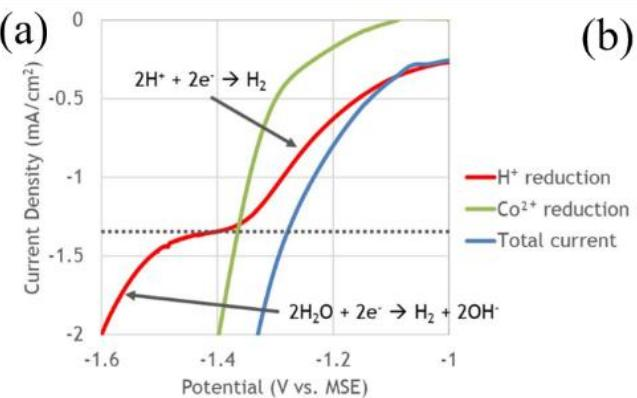

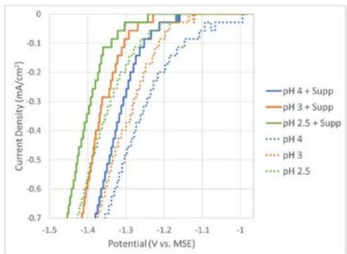

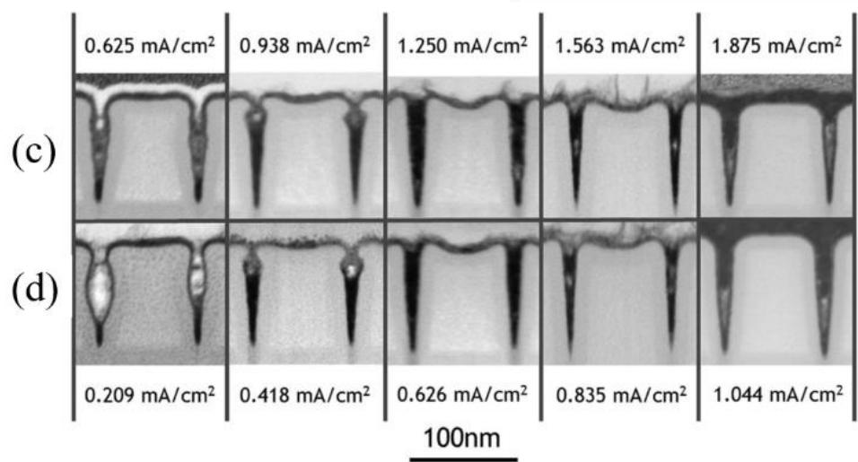  
图 1-16 添加抑制剂后的 EQCM 曲线和填充过程[111]  
（a）添加抑制剂后的 EQCM 曲线；（b）不同 $\mathsf { p H }$ 值条件下的 EQCM 曲线  
（c）pH=2.75 的镀液中填充过程；（d）pH=3.0 的镀液中填充过程  
Figure 1-16 Total and partial current densities for cobalt deposition and proton reduction at from EQCM and filling process at different pH

## （6）竞争吸附机理

国内的何为组[112, 113]研究了 3-巯基丙烷磺酸钠（MPS）和聚乙烯吡咯烷酮（PVP）这两种添加剂对 Co 填充过程的机理，通过 CV 曲线发现低浓度的 MPS对 Co 还原过程有加速作用，而 PVP 对 Co 还原有抑制作用。通过量子化学计算发现 MPS 和 PVP 的 $E _ { \mathrm { g } }$ 能级相近，MPS 中处于 HOMO 能级的磺酸基团可以作为吸附的活性位点，而且 PVP 内的酰胺基团静电势较高可以吸附在电极表面。提出竞争吸附的机理，较高浓度的 PVP 可以有效的抑制 Co 在沟槽内沉积，而随着底部 PVP 的消耗，MPS 逐渐取代吸附的 PVP，占据活性位点促使$\mathrm { C o } ^ { 2 \dag }$ 还原沉积；外表面较高浓度的 PVP 仍然吸附在表面，抑制 Co 成核沉积，从而形成内外的镀速差，实现了沟槽的无缝填充。

根据以上研究，抑制剂是实现金属 Co 填充的关键，抑制能力的大小主要取决于内部的官能团。但是，对于越来越小的晶体管（10 nm 以下），需要 Co填充的沟槽或盲孔的尺寸更加精细。当聚合物作为抑制剂时，容易吸附在盲孔开口处堵塞内部离子传输过程。这是由于聚合物型抑制剂自身的聚合度决定的，因此在 nm 级别的沟槽或盲孔填充时，不适合选择聚合物型抑制剂。而小分子的抑制剂抑制能力较弱，需要添加高浓度的小分子作为抑制剂，容易造成 Co镀层内 C，N 和 O 等杂质原子的含量较高，从而影响其电迁移和电阻率。因此，本文将重点研究抑制能力强的大分子抑制剂。

## 1.3.3 添加剂的 MD 模拟和 QC 计算

添加剂在镀液中主要会产生两方面影响：在阴极表面的吸脱附过程和与金属离子的相互作用，这种影响可以利用 MD 模拟和 QC 计算进行初步的预测和分析[114-119]。

## （1）MD 模拟

Wang 等人[120]利用 MD 模拟预测和分析了 N-丁基-N-甲基哌啶溴盐$( \mathrm { P P } _ { 1 4 } \mathrm { B r } )$ 在 Cu 的通孔电镀中的作用，经过计算得出其在 Cu(001)晶面的吸附能达到 197.8 kJ/mol，由此得出，较高吸附能的添加剂可以有效的抑制金属离子在阴极表面的沉积过程。而且通过通孔测试发现这种添加剂可以作为整平剂吸附在通孔开口处，抑制开口处 Cu 的沉积速率，也印证了 MD 模拟的结果。Zhou 等人[121]利用 MD 模拟分析 5-氨基-1,3,4-噻二唑-2-硫醇在 Cu(111)晶面的上的吸附过程，最终计算得到吸附能为 34.6 kcal/mol，而且经过模拟之后，这种分子结构排列几乎与 Cu 基底平行，说明其可以很好的吸附在阴极表面，起到抑制效果，并通过填充实验进行了验证。Wu 等人[122]分析了十六烷基三甲基溴化铵（CTAB）在 Cu 填充中的抑制作用，通过 MD 模拟和填充测试结果分析发现，CTAB 可以有效的吸附在 Cu 表面，起到抑制 Cu 沉积的作用。Zheng等人[123]分析了1-乙烯基咪唑和1,4-丁二醇二缩水甘油醚的共聚物（VIBDGE）作为整平剂对金属 Cu 沉积的影响，通过 MD 模拟发现这种共聚物在 Cu 表面具有较大的吸附能 163.4 kcal/mol，与健那绿（JGB）相比，VIBDGE 的吸附能高于 PEG（149.2 kcal/mol）。

上述分析可知，MD 模拟可以作为对添加剂吸附能力的分析和预测，因此本文中根据文献调研和实验测试分析了不同结构添加剂的抑制能力，并根据MD 模拟过程对添加剂分子结构进行分析。

## （2）QC 计算

Yin等人[124]首先利用 MD模拟分析了苯并三唑(BTA)和 1,2,4-三氮唑(TAZ)在 Co 阴极表面的吸附情况，然后根据 QC 计算分析了两种抑制剂的抑制能力强弱。根据前沿分子轨道理论，E 能级值越高，分子内的电子更容易转移至能量较低空分子的轨道，同时能级差值∆E 越低，代表着分子活性越高，抑制能力越强。根据计算结果得出 BTA $( E _ { \mathrm { H O M O } } { = } { - } 5 . 8 9 8 \ \mathrm { e V } , \Delta \mathrm { E = } 3 . 7 9 7 \ \mathrm { e V } )$ 的抑制能力明显强于 TAZ $( E _ { \mathrm { H O M O } } { = } { - } 6 . 4 4 6 \ \mathrm { e V } , \Delta \mathrm { E } = 5 . 4 2 1 \ \mathrm { e V } )$ ，并与阻抗谱实验测试得到的结果相一致。Zhang 等人[125]选择了氨基乙酸(Gly)和 3-巯基 1-丙烷磺酸钠(MPS)作为电镀钴的添加剂，利用 QC 计算对比两种添加剂分子结构发现，相较于 Gly，MPS 具有更低的 $E _ { \mathrm { H O M O } }$ 能级值，但是两者的∆E 相近。然后通过分子静电势计算发现，MPS 的表面经典势高于 Gly，所以 MPS 更容易吸附在阴极表面，MPS 和 Gly 存在竞争吸附的关系。

由上述可知，QC 计算可以被用来分析计算添加剂分子的前沿分子轨道信息，并模拟分析出可能产生吸附作用的官能团和起到抑制作用的结构，有利于从分子层面对添加剂进行详细分析，并且还可以根据计算结果推测和改进添加剂的结构。

## 1.3.4 金属 Co 互连当前存在的问题

根据文献调研总结分析，目前 Co 互连存在以下几方面问题:

（1）在芯片中的 Cu 互连技术开始成为制约其性能的关键因素时，除了选择互连替代金属，研究人员还通过改变传统的晶体管以提高芯片性能。但是由于技术封锁和高精尖芯片的保密限制，电镀 Co 互连工艺在实际中的性能表现仍需要进一步研究，包括填充 Co 的电迁移率和电阻率的变化以及 TDDB 失效分析。尽管 Intel 表示将新生产的芯片中 Co 连接层替换成镀钴铜材料，而台积电和三星等制造商表示仍采用 Co 连接层，说明目前 Co 作为互连材料在制造和应用中仍存在缺陷，仍需要继续研究。

（2）电镀 Co 互连工艺由于发展时间短，对于添加剂的选择以及添加剂分子结构组成并没有详细研究。而且对于添加剂，目前研究主要集中在抑制剂的选择，添加剂分子中的 C=N 被认为是起到抑制的关键，但是对于其作用过程以及机理分析仍然不明确。根据最新研究表明，Co 的合金（CoAl 等）在抗电迁移[54]性能中表现优异，因此在未来的芯片互连中 Co 合金或金属间化合物或许也可以作为 Cu 替代材料，对于抑制剂的筛选将更加复杂。

（3）由于尺寸效应的影响，添加剂尤其是小分子的添加剂在沉积过程中掺杂到 相中，出现 ， ， ， 和 等原子掺杂，杂原子对于 的电阻率和电迁移的影响目前仍需要进一步分析验证。而对于分子量较大的聚合物类抑制剂，根据量子化学计算发现其容易发生团聚形成较大直径的聚合物球[126]，而且随着分子量的增加其直径逐渐变大，由此引发的纳米级别盲孔孔口处聚集，导致填充时形成缝隙。因此，对于添加剂的分子量和盲孔尺寸之间的关系在实际填充中也需要进一步验证。

## 1.4 本文的主要研究内容

根据互连技术背景的分析研究，利用电沉积制备 Co 互连代替部分布线工艺的 Cu 互连是可行的，而且无论选择单金属还是合金作为替代材料，电镀工艺都是方便实用，便捷高效的方式，因此对于适合金属 Co 填充的抑制剂进行研究具有重要意义。此外，由上述总结分析，将理论计算用于对抑制剂内的分子结构的分析和验证是切实可行的，因此本论文的主要研究内容如下：

（ ）根据文献调研和总结选择多种不同分子结构的抑制剂，通过镀层表面形貌和镀液的赫尔槽实验，考察这些抑制剂对金属 Co镀液分散能力的影响。通过电化学测试和填充效果分析抑制剂的作用过程以及适合作为 填充的抑制剂结构。利用 MD 模拟考察抑制剂分子在阴极表面的吸附能，探究抑制剂的吸附关系和填充中抑制能力之间的联系，并通过 QC 计算探究抑制剂的内部分子结构并研究抑制剂的前沿分子轨道信息。根据理论和实验对比分析筛选出适合微米级别盲孔填充的抑制剂，并对抑制剂在镀液中作用方式进行分析。

（ ）通过考察孔雀石绿（ ）对镀液的极化电流，阴极沉积效率，阻抗的变化，分析 MG 对金属 Co 电沉积过程的影响。通过研究不同沉积条件下填充过程的变化，探究抑制剂的作用机理，同时根据抑制剂添加之后的成核过程的变化，分析抑制剂对金属 Co 成核过程的变化。通过探究抑制剂对 HER 过程的影响，考察由于氢还原引起的 pH 升高对填充过程的作用，并结合不同 pH值条件下的填充过程对填充机理进行分析，确定出最佳的工艺参数，并对填充机理进行总结分析。

（3）通过考察不同浓度氯化硝基四氮唑蓝（NBT）和不同搅拌速度对镀液电化学行为的影响，分析 NBT 的抑制作用机理，探究 NBT 在金属 Co 成核过程中的作用以及对镀层形貌和晶相结构的影响。考察 NBT 对氢还原过程的影响并探究 NBT作为单一添加剂时金属 Co的填充机理。通过对比 MG和NBT两种抑制剂对镀层的影响，对抑制剂分子结构和作用机制进一步分析研究。

## 第 2 章 实验材料及表征方法

## 2.1 实验材料及相关仪器

## 2.1.1 实验试剂及药品

本文中使用的主要试剂如表 2-1 所示。

表 2-1 主要试剂  
Table 2-1 Main reagents studied in the paper

<table><tr><td>试剂名称</td><td>分子式</td><td>级别</td><td>生产公司</td></tr><tr><td>柠檬酸</td><td> $C_6H_8O_7$ </td><td>分析纯</td><td>上海麦克林生化科技股份有限公司</td></tr><tr><td>香豆素</td><td> $C_9H_6O_2$ </td><td>分析纯</td><td>上海麦克林生化科技股份有限公司</td></tr><tr><td>香草醛</td><td> $C_8H_8O_3$ </td><td>分析纯</td><td>上海麦克林生化科技股份有限公司</td></tr><tr><td>4-(2-吡啶偶氮)间苯二酚</td><td> $C_{11}H_9N_3O_2$ </td><td>分析纯</td><td>上海麦克林生化科技股份有限公司</td></tr><tr><td>吉氏色素</td><td> $C_{14}H_{14}ClN_3S$ </td><td>分析纯</td><td>上海麦克林生化科技股份有限公司</td></tr><tr><td>中性红</td><td> $C_{15}H_{17}ClN_4$ </td><td>分析纯</td><td>上海麦克林生化科技股份有限公司</td></tr><tr><td>碱性品红</td><td> $C_{19}H_{17}N_3\cdot HCl$ </td><td>分析纯</td><td>上海麦克林生化科技股份有限公司</td></tr><tr><td>碱性蓝</td><td> $C_{23}H_{24}Cl_2N_2$ </td><td>分析纯</td><td>上海麦克林生化科技股份有限公司</td></tr><tr><td>藏红花T</td><td> $C_{20}H_{19}ClN_4$ </td><td>分析纯</td><td>上海阿拉丁生物科技股份有限公司</td></tr><tr><td>孔雀石绿</td><td> $C_{23}H_{25}ClN_2$ </td><td>分析纯</td><td>上海麦克林生化科技股份有限公司</td></tr><tr><td>甲基紫</td><td> $C_{24}H_{28}ClN_3$ </td><td>分析纯</td><td>上海麦克林生化科技股份有限公司</td></tr><tr><td>苯骈三氮唑</td><td> $C_6H_5N_3$ </td><td>分析纯</td><td>上海阿拉丁生物科技股份有限公司</td></tr><tr><td>四氮唑蓝</td><td> $C_{40}H_{32}C_{12}N_8O_2$ </td><td>分析纯</td><td>上海阿拉丁生物科技股份有限公司</td></tr><tr><td>氯化硝基四氮唑蓝</td><td> $C_{40}H_{30}Cl_2N_{10}O_6$ </td><td>分析纯</td><td>上海阿拉丁生物科技股份有限公司</td></tr><tr><td>硼酸</td><td> $H_3BO_3$ </td><td>分析纯</td><td>上海麦克林生化科技股份有限公司</td></tr><tr><td>硫酸钴</td><td> $CoSO_4\cdot 7H_2O$ </td><td>分析纯</td><td>上海麦克林生化科技股份有限公司</td></tr><tr><td>浓硫酸</td><td> $H_2SO_4$ </td><td>分析纯</td><td>天津渤海化工有限公司</td></tr><tr><td>氯化钠</td><td>NaCl</td><td>分析纯</td><td>上海阿拉丁生物科技股份有限公司</td></tr><tr><td>乙醇</td><td> $C_2H_5OH$ </td><td>分析纯</td><td>天津渤海化工有限公司</td></tr><tr><td>氢氧化钠</td><td>NaOH</td><td>分析纯</td><td>上海麦克林生化科技股份有限公司</td></tr><tr><td>硫酸钾</td><td> $K_2SO_4$ </td><td>分析纯</td><td>上海阿拉丁生物科技股份有限公司</td></tr></table>

## 2.1.2 主要实验仪器

本论文用到的主要仪器如表 2-2 所示。

表 2-2 主要实验仪器  
Table 2-2 Equipmentss studied in the paper

<table><tr><td>设备名称</td><td>型号</td><td>生产厂家</td></tr><tr><td>直流电源</td><td>PK-80</td><td>日本松定Matsusada有限公司</td></tr><tr><td>电子分析天平</td><td>BSA224S</td><td>德国赛多利斯仪器有限公司</td></tr><tr><td>电子天平</td><td>AL104</td><td>梅特勒-托利多仪器有限公司</td></tr><tr><td>超声清洗机</td><td>JP-040</td><td>深圳市洁盟清洗设备有限公司</td></tr><tr><td>数显控温磁力搅拌器</td><td>SZCL</td><td>巩义市予华仪器有限责任公司</td></tr><tr><td>电化学工作站</td><td>CHI760e</td><td>上海辰华仪器公司</td></tr><tr><td>接触角测试仪</td><td>JC2000D5</td><td>上海中晨数字技术设备有限公司</td></tr><tr><td>电化学综合测试系统</td><td>Interface 1010E</td><td>美国Gamry电化学仪器公司</td></tr><tr><td>pH计</td><td>PB-10</td><td>德国Sartorious公司</td></tr><tr><td>扫描电子显微镜</td><td>SU8010</td><td>日本日立公司</td></tr><tr><td>X射线光电子能谱仪</td><td>Kh-3000 VD</td><td>日本HIROX公司</td></tr><tr><td>X射线衍射仪</td><td>K-Alpha</td><td>荷兰赛默飞世尔科技公司</td></tr><tr><td>光学显微镜</td><td>DSX510</td><td>奥林巴斯有限公司</td></tr><tr><td>激光共聚焦拉曼光谱仪</td><td>RENISHAW in via</td><td>英国雷尼绍公司</td></tr></table>

## 2.2 实验方法

## 2.2.1 电解液配制

首先是基础镀液的配制，将 $\mathrm { H } _ { 3 } \mathrm { B O } _ { 3 }$ 和 $\mathrm { C o S O } _ { 4 } { \bullet } 7 \mathrm { H } _ { 2 } \mathrm { O }$ 分别溶于超纯水中，搅拌至充分溶解，然后将两者混合充分搅拌，用移液枪加入稀释的 Cl-离子溶液，然后用配制的稀 $\mathrm { H } _ { 2 } \mathrm { S O } _ { 4 }$ 溶液和稀 $\mathrm { { N a O H } }$ 溶液调节 pH 值。

添加剂的配制，由于添加的添加剂量较少，所以首先将添加剂配制成浓溶液。将添加剂加入到乙醇或纯水中配制成浓溶液，然后利用移液枪向基础镀液中加入适量的添加剂，最后再用稀 $\mathrm { H } _ { 2 } \mathrm { S O } _ { 4 }$ 溶液和稀 NaOH 溶液调节 pH 值。

## 2.2.2 电镀工艺流程

（1）基底的前处理过程，用于测试镀层性能的实验采用的 Cu 箔，首先用自制的碱性除油液进行表面除油，然后纯水冲洗，然后酸洗，纯水冲洗，乙醇中超声进一步清洗，最后氮气吹干留作备用。在进行电沉积实验之前，在稀硫酸中进行酸洗，纯水冲洗，氮气吹干之后直接进行电沉积实验。

用于填充实验的基底采用的不同规格的盲孔印制电路板（PCB），首先用碱性除油液超声清洗，升温进一步清洗，除完油之后纯水冲洗，酸洗之后，纯水中继续超声清洗，然后用乙醇超声清洗，纯水清洗吹干留作备用。在进行电沉积之前，首先酸洗，纯水冲洗，乙醇清洗，氮气吹干，然后将 PCB 板置于乙醇中超声润湿，最后放入镀液中，开路电位润湿 5 min。再开始测试之前在基础镀液中对 PCB 进行预镀 5 min 之后再开始进行填充实验。

（2）电沉积过程，采用三电极体系进行电沉积，工作电极为 Cu 箔或 PCB板，对电极为 4cm×4cm 纯钴(99.999%)板(阳极电解清洗表面)，参比电极为硫酸亚汞电极。用磁力搅拌对镀液进行搅拌。

## 2.3 QC 计算和 MD 模拟

## 2.3.1 QC 计算

量子化学（Quantun Chemical (QC) calculation）计算过程是基于密度泛函理论[127]（Density functional theory, DFT）对添加剂进行分子和轨道信息进行预测。首先利用 Chem3D 软件进行分子结构的绘制，然后导入 Gaussian 软件中，采用 optimization 工作方式计算添加剂的前沿分子轨道和能级信息。最后利用Gauss view 或 VMD 程序处理输出文件得到 HOMO 和 LUMO 轨道图。

## 2.3.2 MD 模拟

分子动力学（Molecular dynamic (MD) simulation）模拟是利用 MS 软件中的 Discover 模块对添加剂进行模拟，采用的 Ni 基底，力场选择 COMPASS。其中，利用水分子填充周期性盒子来模拟实际镀液体系。由于实际电沉积过程中选择的室温，因此在动力学模拟中选择的温度为 298 K。计算时间步长设置为 1 fs，总的模拟时间设置为 500 ps。

利用 MS 软件导入 Ni 晶体，切割成 Ni(111)晶面后，由于选用的“Watts”型镀液，制备的镀层以 Ni(111)晶面为主，而且 Ni(111)晶面是 Ni 的最密堆积面，稳定性高。根据周期性边界条件和和截断面积影响，晶面尺寸为 2.99nm×2.99nm×6.31 nm。利用 Discover 模块进行吸附模拟，其中添加剂盒子中含有 1 个有机分子和 $1 \ \mathrm { g } / \mathrm { c m } ^ { 3 }$ 的水分子（约 900 个），并在添加剂盒子上设置 1nm 厚度的真空层，模拟温度为 298 K。采用 COMPASS 力场进行计算，借助 NVT 模块进行计算，模拟步长为 1 fs，模拟时间为 500 ps。然后利用得到的终态吸附行为，计算添加剂分子在金属表面的吸附能，在最终态中选取基底进行计算得到 $E _ { \mathrm { s u r f a c e } }$ ，选取有机物分子计算的能量为 $E _ { \mathrm { o r g a n i c } }$ ，从而得到基底与有机物分子的结合能，具体计算过程用式（2-1）表示。

$$
E _ {b i n d i n g} = E _ {t o t a l} - E _ {o r g a n i c} - E _ {s u r f a c e}\tag{2-1}
$$

式中 $E _ { b i n d i n g } .$ ——添加剂分子与基体间的结合能（kcal/mol）;

$E _ { \mathrm { t o t a l } } .$ ——有机物和金属表面总的能量（kcal/mol）;

$E _ { \mathrm { o r g a n i c } }$ 有机物分子的能量（kcal/mol）;

$E _ { \mathrm { s u r f a c e } }$ 金属表面的能量（kcal/mol）

有机物分子与金属表面之间的结合能 $E _ { \mathrm { b i n d i n g } }$ 和吸附能 $E _ { \mathrm { a d s o r p t i o n } }$ 之间的关系如式（2-2）所示：

$$
E _ {a d s p o r t i o n} = - E _ {b i n d i n g}\tag{2-2}
$$

## 2.4 测试表征方法

## 2.4.1 镀层形貌

首先采用日本日立的 SU 8010 型扫描电子显微镜（SEM，Scanning ElectronMicroscope）观测 Co 镀层形貌。对于 SEM 分析，为了与填充过程保持一直，本文采用的在 Cu 箔上预镀一层 Co（约为 300 nm）作为基底。

首先是基底制备过程，采用的市场购买的高纯 Cu 箔，经过碱性除油，超纯水清洗，乙醇超声，纯水超声，酸洗，纯水冲洗，氮气纯干后预镀 Co 镀层。预镀 Co 镀层的溶液组成为 0.4 mol/L $\mathrm { C o S O } _ { 4 } { \bullet } 7 \mathrm { H } _ { 2 } \mathrm { O }$ ，0.5 mol/L $\mathrm { H } _ { 3 } \mathrm { B O } _ { 3 }$ ；沉积条件：三电极体系，铜箔为工作电极，纯钴板为对电极，硫酸亚汞电极为参比电极；沉积电势为-1.25V，沉积时间为 5min；镀液 pH=4，室温条件下。制备的基底纯水冲洗，氮气吹干以备后续电镀过程。

采用上海中晨 JC2000D5 型接触角测试仪测试水下空气的接触角。首先将镀层酸洗，纯水冲洗，氮气吹干置于装有 100 ml 超纯水的观测槽中，将镀层朝下，用微量进样器在样品表面注入空气，然后用仪器自带的相机采集对应的照片，再用仪器自带软件分析图像便得到接触角数据，每个样品接触角在不同位置测试五次，取平均值为最终结果。

采用奥林巴斯 DSX510 型光学显微镜测试盲孔切面图。将制备的 PCB 填充板切割，固化剂密封，用 100 目到 5000 目的不同目数的砂纸打磨，抛光后，清洗，超声，酸洗，腐蚀液清洗，最后观测。其中图像尺寸（像素）为 1194×1194（499 μm×499 μm），放大倍率为 555 倍。

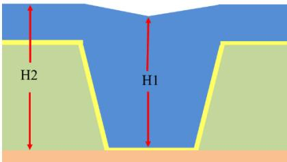  
图 2-1 盲孔结构图  
Figure 2-1 The schematic diagram of blind hole

填充率（FillingRate）FR 值[128]是用于描述填充过程中填充效果的，如图2-1 所示。计算过程如式（2-3）所示：

$$
\mathrm{FR} = \left. ^ {H 1} \right/ _ {H 2} \times 100\tag{2-3}
$$

## 2.4.2 镀层晶体结构分析

## （1）X 射线衍射分析

利用 K-Alpha 型 X 射线衍射仪（XRD）测试镀层相结构，其中入射射线采用 Kα 射线，旋转阳极采用 Cu 靶，射线波长为 0.1546 nm，电压为 40 kV，采点步长为 0.013°，测试角度范围为 20°到 90°。

## （2）镀层表面元素分析

利用 Kh-3000 VD 型 X 射线光电子能谱仪（XPS）测试镀层表面的元素组成和价态信息，阳极靶材为 AlKα，并利用 C 1s 的电子结合能（284.8 eV）对测试结果进行校准。

## 2.4.3 电化学测试

利用美国 Gamry 公司的 Interface 1010E 型电化学分析测试系统对镀液进行电化学分析主要包括循环伏安曲线（CV）、阴极极化曲线（LSV）、电化学阻抗测试（EIS）和计时电流法等。电化学工作站用 gamry 电化学测试仪器，测试体系为三电极体系，其中工作电极包括铂旋转圆盘电极（Pt，Φ=5 mm）和预镀钴（基础镀液-1.25 V 沉积 5 min，Co 厚度 300 nm 左右）的 Pt 电极，对电极为 Pt 片，参比电极为硫酸亚汞电极（MSE，饱和硫酸钾缓冲液）。测试溶液为电沉积过程中所用镀液。工作电极在测试之前分别用氧化铝（Φ=5mm和 Φ=1.5 mm）抛光粉处理，然后超纯水超声清洗。

利用美国 Gamry 公司的 Interface 1010E 型配套的电化学石英晶体微天平

（EQCM）测试金属钴沉积效率。工作电极为金晶圆（ $\scriptstyle \Phi = 7 \ \mathrm { m m } )$ ，对电极为Pt 丝，参比电极为硫酸亚汞电极。前期准备过程，金晶圆预镀一层 Co，制备方法同镀层电镜测试过程的方法。测试过程：电化学工作站与 EQCM 连用，从开路电位开始测试，扫描速率 10 mV/s。根据软件可以得到 Co 镀层质量随时间的变化曲线，然后利用式（2-4）计算出电流密度，与 LSV 曲线进行对比。

$$
m = K \cdot Q = K (i \cdot t)\tag{2-4}
$$

式中 K——Co 的电化当量，1.099 g/(A•h)。

利用自制的原位拉曼光谱电解池与英国雷尼绍公司的 RENISHAW in via型拉曼光谱仪组成原位测试系统，测试阴极表面在还原过程中，阴极表面由于添加剂吸附而造成的拉曼变化。拉曼光谱仪的测试波长为 532nm，测试范围：$5 0 0 { \sim } 3 5 0 0 ~ \mathrm { c m ^ { - 1 } }$ 。在自组装电解池中，Pt 丝为对电极，泡沫 Co 为工作电极，硫酸亚汞作为对电极。电解液组成为：0.04mol/L CoSO4 和 $0 . 5 \mathrm { m o l / L } \mathrm { H } _ { 3 } \mathrm { B } \mathrm { O } _ { 3 }$ $\mathrm { p H } { = } 4$ 。利用计时电流曲线，从开路电位每次升高 0.5 mV，直到出现明显的拉曼峰出现。

## 第 3 章 添加剂的筛选和理论分析

## 3.1 引言

通过文献总结发现，实现金属在盲孔或通孔中共形沉积的关键是添加剂的选择。选择单一添加剂或混合添加剂使盲孔或通孔内外形成明显的沉积速率差异才能更有利于金属的无缝填充。在大马士革电镀铜工艺中，合适浓度的抑制剂-加速剂-整平剂的相互作用，实现了金属铜在 TSV 中自底而上的填充。而选择“Watts”型镀钴液进行填充过程的研究时，镀液本身就有较高的极化过电位，具有一定的整平能力，因此在添加剂选择时往往是抑制剂或抑制剂-加速剂的选择。金属钴在芯片中应用时，由于具有较低的电子平均自由程，往往被用在14nm 以下的制程中作为互连材料。在此尺寸下，填充过程耗时很短，镀速较快，因此加速剂的作用就没有抑制剂的作用明显。此外，钴还原过程中伴随着氢还原过程，在研究钴沉积过程中还需要考虑氢还原的影响。

本章根据文献调研和总结选择了 14 种添加剂，其中柠檬酸[129]，香豆素[130,131]，香草醛[132-134]都在钴沉积中被认为具有整平作用，增加了钴阴极极化，但是在 Co 填充中很少被研究；吡啶-(2-偶氮-4)间苯二酚[135-138]，吉氏色素[139]作为添加剂时，可以吸附在钴离子表面或与钴形成稳定络合物，从而改变钴离子还原过程，但是对于钴填充过程影响需要进一步研究；结晶紫[140, 141]，碱性品红[142]与臧红 T[143]作为颜料可以很好的吸附在阴极表面，而且作为添加剂可以吸附在阴极表面对金属离子沉积起到抑制作用，已经在铜填充过程作为了整平剂[144,145]，因此选择与其相似结构的碱性蓝、孔雀石绿作为添加剂进一步研究对钴填充影响。此外，具有四氮唑结构的分子在铜沉积中被认为具有较大的抑制作用[146-148]，可以作为整平剂有效的提高铜填充效果[149, 150]，而且具有这种共轭结构的分子被认为可以发生开环反应，从而与金属离子形成稳定的络合物或螯合物[88]，从而对金属离子电化学行为产生较大影响，但是对于钴填充过程的影响并未被提及，因此在本章中选择了这十四种可能对金属钴沉积过程有作用的添加剂分子进行研究，

根据上述选择的添加剂，首先研究了这些添加剂对钴镀层形貌和电化学行为的影响，然后在镀液中加入相同摩尔量的添加剂分子研究其对钴填充过程的影响。最后通过分子动力学模拟（MD 模拟）研究这些添加分子在基体表面的吸附能力，从而从原子尺度上对添加剂的筛选提供依据[151]；利用前沿分子轨道信息研究添加剂在金属表面的吸附能力，以确定与金属钴填充之间的关系，以方便后续提高金属钴的填充能力。

## 3.2 添加剂对钴沉积过程的影响

根据文献总结选择的添加剂分子结构如图 3-1 所示。

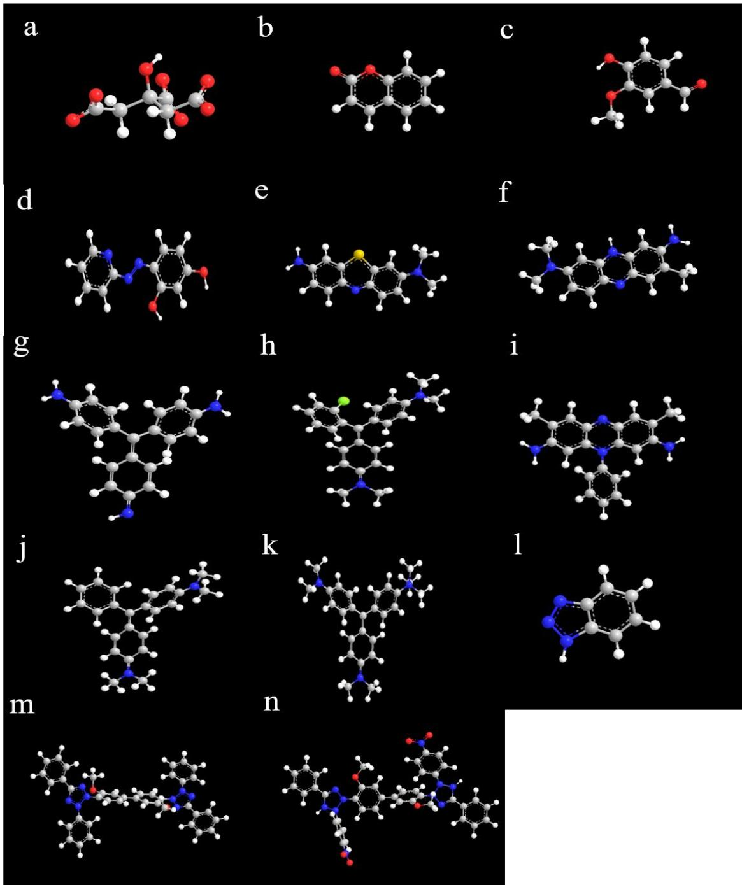  
图 3-1 14 种备选添加剂的分子结构图  
（a）柠檬酸；（b）香豆素；（c）香草醛；（d）4-(2-吡啶偶氮)间苯二酚；（e）吉氏色素；（f）中性红；（g）碱性品红；（h）碱性蓝；（i）藏花红 T；（j）孔雀石绿；（k）甲基紫；（l）苯骈三氮唑；（m）四氮唑蓝；（n）氯化硝基四氮唑蓝

Figure 3-1 Molecular structure of 14 alternative additive

从图 3-1 中可以看出，（a-c）三种分子均含有 C=O 官能团，这种结构被认为容易与 $\mathrm { C o } ^ { 2 + }$ 形成配合物，从而改变还原时的 $\mathrm { C o } ^ { 2 + }$ 水和态形式，进而影响Co 还原过程[151]；（d-f）是 N=N 和吩噻嗪结构的添加剂，这类构型的添加剂同样可以有效的吸附 $\mathrm { C o } ^ { 2 + }$ ，而且常被用作溶液中 Co 离子的检测，因此对于其$\mathrm { C o } ^ { 2 + }$ 还原过程也同样会产生影响；（ $\left( { { \bf { g } } - { \bf { k } } } \right)$ ）三苯甲烷类添加剂经常被用作染色剂和着色剂，容易吸附在阴极表面，而且其内部的 C=N 环己二烯结构具有较大的共轭结构，吸附在阴极表面容易造成明显的堵塞“blocking”效应，从而对Co 离子成核沉积过程产生影响；（l-n）中为四氮唑结构的添加剂分子，同样这种构型内的四氮唑及相邻的苯环构型容易在阴极表面形成吸附，使镀液中$\mathrm { C o } ^ { 2 + }$ 在阴极表面沉积受阻，而且内部的四氮唑结构容易发生开环反应，形成的$\mathrm { C } { = } \mathrm { N }$ 和 N=N 共轭结构可以与 $\mathrm { C o } ^ { 2 + }$ 形成稳定的配合物，进而影响 Co 成核还原过程。

## 3.2.1 添加剂对镀层形貌的影响

本节选择 $^ { 6 6 } \mathrm { W a t t s } ^ { 3 3 }$ 型镀液为基础镀液，其组成成分为 0.4 mol/L $\mathrm { C o S O } _ { 4 } { \bullet } { 7 } \mathrm { H } _ { 2 } \mathrm { O }$ 0.5 mol/L $\mathrm { H } _ { 3 } \mathrm { B O } _ { 3 }$ ，10mmol/L Cl-，溶液 pH=4，沉积时温度为室温。然后在镀液中添加 20μmol/L等摩尔量的上述 14 种添加剂，在-1.30V 条件下电沉积 10min观测其表面形貌的差异，结果如图 3-2 所示。

从图(a)中可以看出在没有添加任何添加剂时，镀层中出现大量的针脊状晶粒，而且镀层表面致密无针孔；(b-d)为添加含有碳基基团的柠檬酸，香豆素和香兰素后的镀层形貌，可以发现，镀层晶粒逐渐细化，而这种作用更多是归因于它们可以与镀液中的钴离子形成配合物，这种配合物可以抑制钴离子沉积过程，导致阴极极化增大，从而使晶粒细化；图(e-g)是添加具有 N=N 双键和吩噻嗪构型的添加剂后镀层的形貌，发现针脊状晶粒几乎消失，而且镀层晶粒变小。但是其中又有些许不同， 吡啶偶氮 间苯二酚为添加剂时，镀层中形成的镀层为不均匀块状晶粒；添加吉氏色素时晶粒为网状无定型形貌；镀液中添加中性红后，镀层变成大小较为均匀的块状晶粒。这同样应该归结为添加剂分子吸附在钴离子表面，影响钴离子还原过程，但是由于内部结构的不同导致形貌出现变化；图(h-l)是三苯甲烷类颜料为添加剂时的镀层形貌，可以看出由于内部结构不同，镀层形貌出现变化，总体上镀层的晶粒变小，其中（i 和k）镀层中出现针孔，k 图中针孔更小而且密集，这是因为氢析出造成的。藏花红 T 作为添加剂时，镀层变化较大，由最初的针脊状变为棒状，这或许与其在Co 成核时产生的晶面特定吸附有关[143]。通过图中也可以看出三苯甲烷类添加剂由于都是阳离子性分子，阴离子都是氯，具有较好可溶性，而且容易吸附在阴极表面，阻碍钴离子还原沉积，使钴镀层晶粒细化；图(m-o)中是氮杂环结构的分子加入后镀层的表面形貌，可以看出三氮唑和四氮唑结构的添加剂同样使晶粒细化，但是镀层形貌变化不大，仍然有少量针脊状晶粒出现。其中图（m）中凹凸不平的是基底形貌，可能是苯骈三氮唑作为添加剂时，抑制能力较强，在-1.30V 时，Co 沉积过程受抑制程度较大，镀层沉积较少。

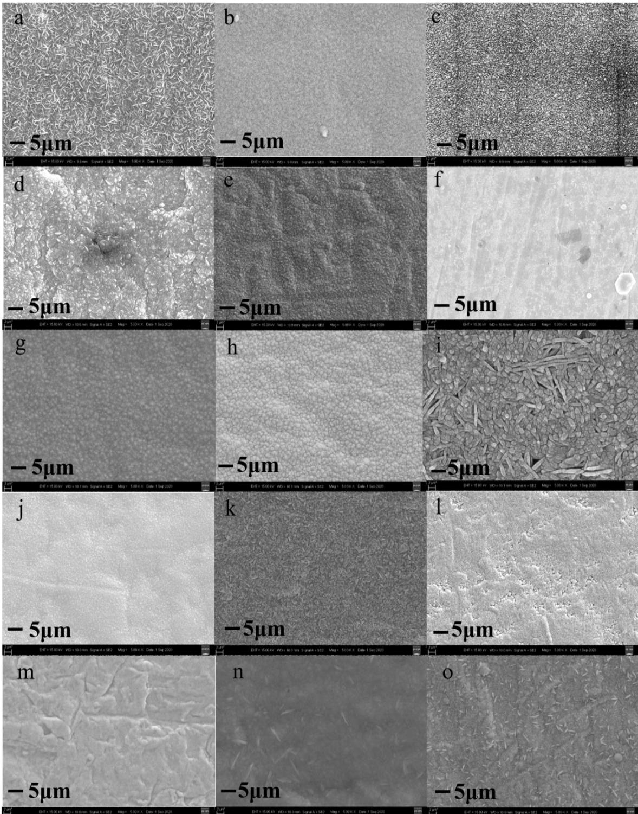  
图 3-2 含有不同添加剂的镀液电沉积 Co 镀层的 SEM 图  
（a）无任何添加剂；（b）柠檬酸；（c）香豆素；（d）香草醛；（e）4-(2-吡啶偶氮)间苯二酚，（f）吉氏色素；（g）中性红；（h）碱性品红；（i）碱性蓝；（j）藏花红T；（k）孔雀石绿；（l）甲基紫；（m）苯骈三氮唑；（n）四氮唑蓝；（o）氯化硝基四氮唑蓝  
Figure 3-2 SEM images of the base bath in the presence of different additives

## 3.2.2 添加剂对钴填充过程的影响

从图 3-2 可以看出，添加剂均能使镀层晶粒细化，说明这些添加剂对钴离子沉积过程有抑制或细化晶粒的作用。那么，是否适合作为抑制剂实现金属钴的填充过程仍需要进一步研究。

作为可以实现金属钴填充的抑制剂，其根本是抑制剂分子优先吸附在高电流密度区域，抑制此区域内 Co 沉积过程，从而使钴离子在低电流密度区域同样可以沉积，也就是要具有整平作用，因此接下来通过赫尔槽实验研究添加剂分子对 Co 的整平效果，如图 3-3 所示。图 3-3(a)是没有任何添加剂的“Watts”型基础镀液，溶液 pH=4，温度为室温，采用磁力搅拌 1000rpm。电源选择 0.5A 的输出电流，赫尔槽体积为 267ml，黄铜板为负极，纯钴板为正极，电沉积时间为 5 min。

从图 3-3（a）中可以看出，由基础镀液制备的镀层在较高电流密度区域（红线左侧），镀层均匀平整，在较低电流密度区域（红线右侧），无沉积层，说明基础镀液在较低电流密度范围沉积不均匀。在图(b-d)中，高电流密度区域镀层均匀，而在较低电流密度区域无镀层，通过对比发现，三种添加剂使镀液制备的镀层面积呈增长趋势，柠檬酸<香豆素<香草醛。其中，香草醛电流密度范围与无添加剂时镀层几乎一样，说明这三种羰基官能团的添加剂在浓度为 20μmol/L 条件下，对钴离子沉积没有整平作用。尽管通过 SEM 图发现添加剂可以使 镀层晶粒细化，但是通过赫尔槽试片发现，对镀层没有整平效果，说明此浓度下，添加剂的抑制能力不明显，没有提高镀液的分散能力；图(e-g)中，添加 吡啶偶氮 间苯二酚和中性红后的赫尔槽试片照片，与无添加剂时相比，镀层范围几乎没有变化，说明此浓度下这两种添加剂没有改变镀液的分散能力。而吉氏色素的镀层范围变大，但是在高电流密度区域的镀层出现烧焦，翘曲。说明此浓度下吉氏色素在低电流区域抑制 Co 沉积，但是在较高电流区域有加速沉积的作用，添加剂在高电流密度区域容易失效。

图 3-3(h-l)中，镀液中添加三苯甲烷类的分子时发现，由于相邻苯环上取代基的不同，Co 沉积层覆盖范围出现明显差异其中以孔雀石绿镀层分布最为广泛，在 0.5A 电流下实现了镀层的完全覆盖，说明孔雀石绿具有很好的整平效果。对比图(k 和 l)发现，孔雀石绿和甲基紫均增加了镀层面积，说明这两种添加剂均对金属 Co 沉积有整平作用。根据其结构组成发现，这两种分子有相似的结构，都是 C=N 和环己二烯共轭结构，说明这种结构适合作为抑制剂。而通过与图(h 和 i)对比发现，碱性品红中苯环上的取代基换成 ${ \mathrm { - N H } } _ { 2 }$ 基之后，分子几乎没有抑制效果；而碱性蓝分子中的苯环上由于有 Cl 取代基，添加剂的整平能力同样减弱。图（i）中碱性蓝作为添加剂时，镀层光亮性明显优于无添加时的镀层，说明碱性蓝可以作为光亮剂，但是抑制能力并没有增强。

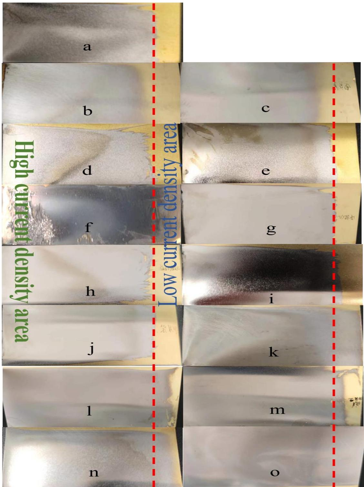  
图 3-3 含有不同抑制剂的镀液电沉积的赫尔槽试片照片  
（a）无任何添加剂；（b）柠檬酸；（c）香豆素；（d）香草醛；（e）4-(2-吡啶偶氮)间苯二酚，（f）吉氏色素；（g）中性红；（h）碱性品红；（i）碱性蓝；（j）藏花红T；（k）孔雀石绿；（l）甲基紫；（m）苯骈三氮唑；（n）四氮唑蓝；（o）氯化硝基四氮唑蓝  
Figure 3-3 Pictures of brass cathodes after cobalt plating using different additive in the Hull Cell

图 3-3(m-o)中，添加氮杂环类分子可以看出，添加剂从苯骈三氮唑到氯化硝基四氮唑蓝，试片的镀层范围逐渐增加，整平效果越来愈好，尤其是氯化硝基四氮唑蓝使镀层在较低电流密度下也能完全沉积，说明氯化硝基四氮唑蓝对金属钴沉积具有较高的整平能力。通过对比发现，四氮唑蓝和氯化硝基四氮唑蓝都可以使 Co 镀层范围增加，说明四氮唑结构使镀液的分散能力提高。由上述实验发现，孔雀石绿和氯化硝基四氮唑蓝对金属钴沉积有很好整平效果，这种整平作用是因为这两种分子容易吸附在电流密度高的区域，阻碍钴离子沉积，从而实现了在低电流区域的沉积。

为了进一步对比分析，接下来研究不同添加剂对金属钴填充过程的影响，如图 3-4 所示。在填充过程中，选择三电极体系，镀液组成为基础镀液和不同添加剂，溶液 pH=4，室温，在-1.30V 电势下沉积 1h。基底为 $1 0 0 \mu \mathrm { m } \times 1 0 0 \mu \mathrm { m }$ 的盲孔（PCB 板），钴片为对电极，硫酸亚汞电极为参比电极。为了方便对比，盲孔内外镀层厚度列在表 3-1。

从图 中可以看出，在无添加剂的基础镀液进行沉积时，盲孔底部出现沉积层，只是底部镀层厚度要明显低于外表面厚度。表 3-1a 中发现，无添加剂时盲孔底部镀层厚度为 11.3 μm，低于盲孔外表面镀层厚度（ ${ \mathrm { : 1 4 . 7 ~ } } \mu \mathrm { m } { \mathrm { ) } }$ 因此只需要添加少量抑制剂就可以实现共形填充。尽管通过 SEM 图显示这些添加剂均能使镀层晶粒细化，但是对比填充效果发现，有些添加剂对金属钴填充并没有效果。

图 3-4(b-d)中，从柠檬酸到香草醛，盲孔底部镀层逐渐增加，与赫尔槽试片中镀层的面积变化相对应，说明整平能力逐渐增强。从表 3-1(b-d)中发现，即使是香草醛作为添加剂，盲孔底部镀层厚度也才达到 13μm，而外表面镀层为 $1 3 . 9 ~ \mu \mathrm { m }$ ，说明尽管香草醛可以提高金属 Co 填充效果，但是在此浓度下仍不能满足无缝填充的需求。而且通过与无添加剂对比发现，外表面镀层厚度变化不明显，而盲孔底部厚度增加，说明香草醛在较低浓度下没有抑制作用，反而表现出加速底部沉积速率的效果。从表 3-1(e-f)中得知，4-(2-吡啶偶氮)间苯二酚对金属 Co 填充没有效果，但是却降低了底部 Co 的沉积速率，而吉氏色素添加之后，盲孔外表面镀层厚度下降至 11.7 μm，说明吉氏色素抑制了金属Co 在外表面的沉积速率，尽管吉氏色素使高电流密度区域的钴镀层翘曲脱落，但是对低电流密度区域有整平效果。由图 3-4g 和表 3-1g 中可知，中性红加入后填充的镀层厚度均降低，但是外表面的镀层厚度降低更为明显，说明中性红对外表面的抑制作用更明显，但是在此浓度下，仍不能实现盲孔共形填充。

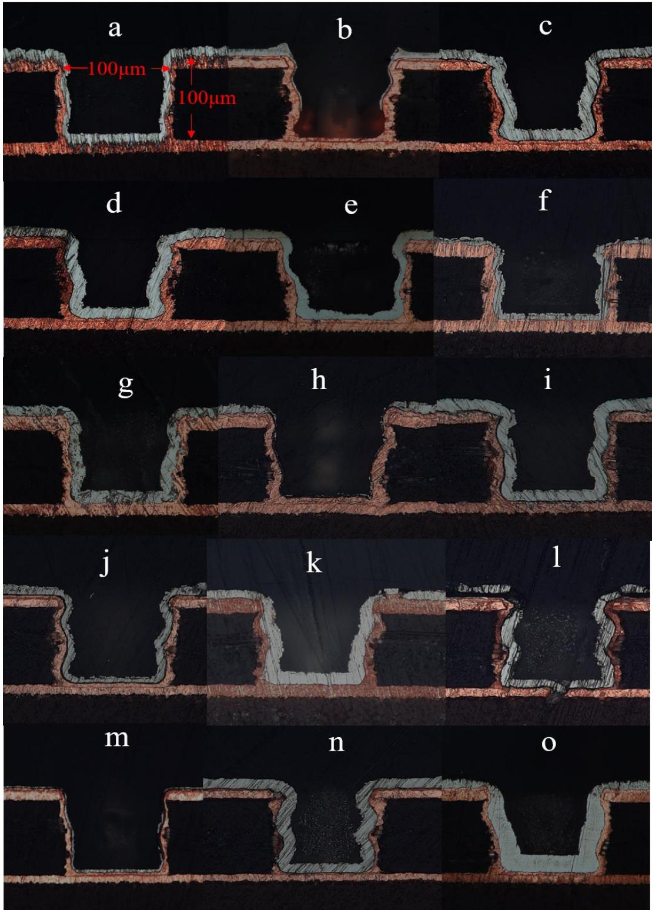  
图 3-4 加入不同添加剂后镀层的填充切面图  
（a）无任何添加剂；(b)柠檬酸；(c)香豆素；(d)香草醛；(e) 4-(2-吡啶偶氮)间苯二酚，(f)吉氏色素；(g)中性红；(h)碱性品红；(i)碱性蓝；(j)藏花红 T；(k)孔雀石绿；(l)甲基紫；(m)苯骈三氮唑；(n)四氮唑蓝；(o)氯化硝基四氮唑蓝  
Figure 3-4 Cross-sectional optical microscope pictures of blind via filling

表 3-1 含有不同添加剂的镀液在盲孔填充时电沉积的 Co 镀层厚度  
Table 3-1 The thichness of the filling coating with different additives

<table><tr><td>编号</td><td>添加剂</td><td>底部厚度/μm</td><td>孔口厚度/μm</td><td>外表面厚度/μm</td></tr><tr><td>a</td><td>无</td><td>11.3</td><td>13.4</td><td>14.7</td></tr><tr><td>b</td><td>柠檬酸</td><td>0.0</td><td>2.5</td><td>14.3</td></tr><tr><td>c</td><td>香豆素</td><td>12.1</td><td>12.6</td><td>15.2</td></tr><tr><td>d</td><td>香草醛</td><td>13.0</td><td>13.4</td><td>13.9</td></tr><tr><td>e</td><td>4-(2-吡啶偶氮)间苯二酚</td><td>6.5</td><td>13.0</td><td>13.4</td></tr><tr><td>f</td><td>吉氏色素</td><td>10.4</td><td>11.3</td><td>11.7</td></tr><tr><td>g</td><td>中性红</td><td>9.1</td><td>10.0</td><td>9.1</td></tr><tr><td>h</td><td>碱性品红</td><td>13.4</td><td>12.6</td><td>11.3</td></tr><tr><td>i</td><td>碱性蓝</td><td>11.3</td><td>12.1</td><td>13.0</td></tr><tr><td>j</td><td>臧花红T</td><td>6.5</td><td>11.3</td><td>12.1</td></tr><tr><td>k</td><td>孔雀石绿</td><td>12.6</td><td>8.7</td><td>7.4</td></tr><tr><td>l</td><td>甲基紫</td><td>10.1</td><td>10.0</td><td>9.1</td></tr><tr><td>m</td><td>苯骈三氮唑</td><td>2.2</td><td>2.2</td><td>2.2</td></tr><tr><td>n</td><td>四氮唑蓝</td><td>11.7</td><td>10.8</td><td>10.4</td></tr><tr><td>o</td><td>氯化硝基四氮唑蓝</td><td>13.9</td><td>10.4</td><td>6.9</td></tr></table>

从图 3-4(h-l)中可知，这五种添加剂均使盲孔外表面厚度降低，而且都含有三个苯环，其中碱性品红（图 h），孔雀石绿（图 k）和甲基紫（图 l）都使盲孔底部的镀层厚度明显高于外表面，其中藏花红 T 和中性红都有吩噻嗪结构，但是三苯环结构使藏花红 T 的抑制作用降低；此外碱性品红，孔雀石绿和甲基紫都还含有 C=N 环己二烯结构，由于相邻苯环取代基的不同，对镀液的填充效果有明显的差距，此外这三种抑制剂与碱性蓝（图 i）相比，具有相似分子结构，但是由于碱性蓝中 Cl 取代基的引入，导致其抑制效果变化较大。从表 3-1(h-l)中可知，孔雀石绿作为抑制剂，填充效果最好，其中盲孔底部为12.6 μm，而外表面为 7.4 μm，底部的沉积速率明显高于外表面。同时也对应着赫尔槽实验，说明孔雀石绿作为抑制剂具有较好的整平能力，可以实现金属钴的填充过程。

从表 3-1(m-o)中可知，氮唑环结构对金属钴填充时有明显的抑制作用，其中苯骈三氮唑为抑制剂时，整个盲孔表面沉积层厚度较低，这是因为其在阴极表面吸附时容易与基底形成明显的抑制层，这种抑制剂阻碍了整个沉积还原过程。而四氮唑蓝和氯化硝基四氮唑蓝作为添加剂时，盲孔底部的镀层厚度分别为 11.7 μm 和 13.9 μm，分别高于外表面的 10.4 μm 和 6.9 μm，说明这两种添加剂均有抑制作用。而氯化硝基四氮唑蓝作为抑制剂时，盲孔底部沉积速率几乎是外表面沉积速率的 2 倍，说明氯化硝基四氮唑蓝适合作为镀 Co 的抑制剂。

## 3.2.3 添加剂对金属钴电化学行为的影响

通过上述填充发现，不同结构添加剂对 Co 填充过程有不同的影响，因此接下来通过 LSV 曲线来研究添加剂对镀液电化学行为的影响，如图 3-5 所示。

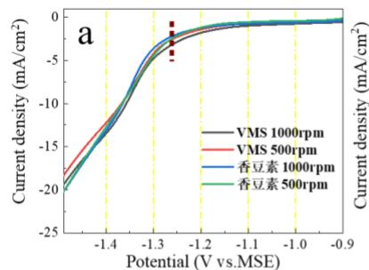

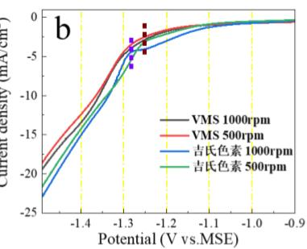

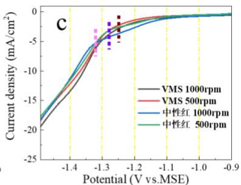

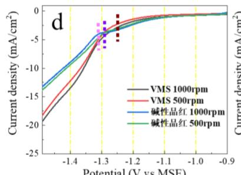

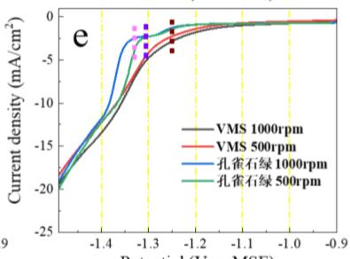

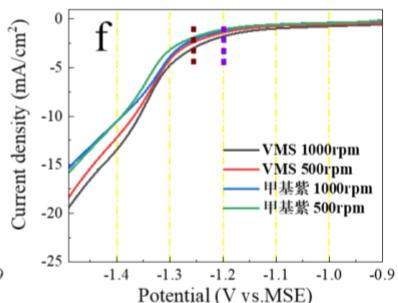

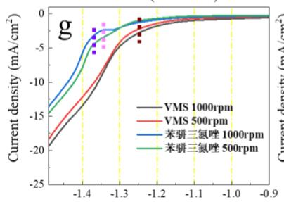

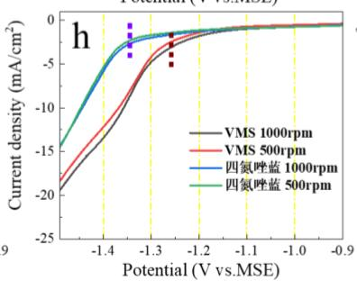

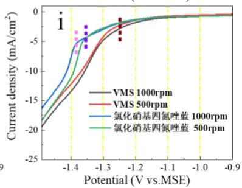  
图 3-5 在基础镀液中添加不同添加剂后镀液的 LSV 曲线  
（a）香豆素；（b）吉氏色素；（c）中性红；（d）碱性品红；（e）孔雀石绿；（f）甲基紫；（g）苯骈三氮唑；（h）四氮唑蓝；（i）氯化硝基四氮唑蓝

Figure 3-5 The LSV curves of different addtive in the VMS

其中，VMS代表基础镀液体系，添加剂浓度分别为20μmol/L。镀液pH=4，室温条件。测试采用的三电极体系，阴极为预镀钴的 Pt 圆盘电极，对电极是Pt 片，参比电极是硫酸亚汞电极，扫描速率为 10mV/s。在图（3-5）中，黑色和红色曲线为分别为 1000 rpm 和 500 rpm 转速下的基础镀液的 LSV 曲线。蓝色和绿色曲线分别对应着 1000 rpm 和 500 rpm 转速下的含有添加剂的 LSV 曲线。

虽然 SEM 图中可以看出，这些添加剂对金属钴镀层晶粒有细化作用，但是对金属钴的阴极还原过程影响不同。图（3-5）中显示，在没有添加剂时，不同转速下镀液的 LSV 曲线的还原电流几乎相同，钴离子的极化过电位在-1.26V 左右。由图 3-5(a)中可知，当香豆素作为添加剂时，降低了极化电流，但是对阴极还原电位几乎没有影响。说明香豆素降低了 $\mathrm { C o } ^ { 2 + }$ 还原的极化电流，但是没有影响 Co 沉积电位，对填充过程没有明显的抑制作用。图 3-6(b)中，吉氏色素作为添加剂时，在 500 rpm 时对钴离子还原电位几乎没有影响，但是在1000 rpm 时，使钴离子还原电位负移了 0.03 V 左右，说明吉氏色素对金属钴离子是有抑制作用的，然而在-1.25 V 时出现了电流密度的增加，可能是氢析出过程的影响。从赫尔槽试片中也发现，高电流密度区域镀层发生翘曲脱落，可能跟吉氏色素吸附在表面导致氢析出过程加剧有关。

从图 3-5(c-e)中得知，中性红，碱性品红和孔雀石绿作为添加剂时均使金属钴还原电位负移，说明三种添加剂抑制了钴沉积，均有抑制作用。而且从图中还发现，钴的极化电位随着转速的增加逐渐负移，说明添加剂分子受传质过程影响，转速越高抑制作用越强，通过与填充图对比发现，这三种抑制剂均使镀层在外表面的沉积速率降低。但是由于抑制能力有所差别，出现底部沉积速率有差异，而且通过 LSV 曲线对比发现在 500 rpm 时，中性红使还原电位负移-0.02V，碱性品红使还原电位负移-0.04V 左右，孔雀石绿使还原电位负移-0.05V，说明孔雀石绿的抑制能力最强。这种抑制作用使盲孔外表面在较高对流速度下抑制作用更强，而在盲孔底部的低对流速度，抑制作用减弱，从而造成内外的镀速差，也证实孔雀石绿可以作为抑制剂。从图 3-5(f)中发现，尽管甲基紫与孔雀石绿具有相似结构，但是由于分子内部取代基的不同，表现出的抑制效果有很大不同，甲基紫作为抑制剂时，使 Co 的还原电势变化不明显，这可能是因为添加的浓度较低不足以引起电势的变化。但是甲基紫添加之后，镀液的极化电流明显降低，说明甲基紫对金属 Co 还原有阻碍作用。

在图 3-5(g-i)中显示，四氮唑结构的添加剂都使钴还原电位负移，但是抑制效果有所不同。当苯骈三氮唑作为添加剂时，在 500rpm 搅拌速度下，钴离子的还原电位负移了-0.12 V，说明阻碍了钴离子沉积过程，但是在 1000 rpm时，阴极还原电位负移了-0.09V，要低于低转速时的抑制能力，说明高速搅拌使抑制减弱，这或许是归因于苯骈三氮唑的抑制作用是在阴极表面形成阻碍层，高速搅拌反而破坏了阻碍层。从填充图也可以看出，盲孔内填充时几乎无镀层沉积。四氮唑蓝作为添加剂时，使阴极还原电位负移了-0.10V，说明其抑制了钴离子还原过程，但是随着转速的增加，抑制效果变化不大。而氯化硝基四氮唑蓝作为添加剂时，阴极还原电位发生负移，而且随着转速的增加，还原电位从-1.35V 负移至-1.38V 左右，说明氯化硝基四氮唑蓝吸附在阴极表面阻碍了Co 沉积成核过程，而且受传质过程影响，因此可以作为镀钴的抑制剂。

通过上述研究可知，虽然添加剂可以使金属钴镀层的晶粒细化，但是对于填充过程的影响又有不同。通过赫尔槽实验和填充过程对比发现，孔雀石绿和氯化硝基四氮唑蓝均可以作为抑制剂，使金属 Co 在盲孔底部的沉积速率高于外表面。与其它添加剂对比发现，C=N 环己二烯结构和四氮唑结构的抑制剂对金属 Co 沉积还原过程有抑制作用。而且分子内取代基的不同，添加剂对于Co 填充过程的影响也不尽相同。通过 LSV 曲线显示，C=N 环己二烯结构和四氮唑结构的分子作为抑制剂时是阻碍了钴还原，使沉积电位负移。而且抑制剂的抑制效果受传质过程影响，这也是抑制剂能在盲孔内形成浓度梯度的关键。

## 3.3 添加剂分子在阴极表面的吸附过程及理论计算分析

在上一节中，14 种不同分子结构的添加剂被用来研究它们对金属钴填充过程的影响，发现不同添加剂对钴填充过程的影响差别很大，究其原因是因为不同的内部分子结构。通过对比发现，分子内不同的官能团以及与特征官能团相邻的不同取代基导致抑制剂在阴极表面的不同吸附行为。因此接下来通过理论计算过程来研究其分子结构对吸附的影响。借助 MD 模拟和 QC 计算分别对添加剂分子的吸附行为和前沿分子轨道信息进行研究。

## 3.3.1 添加剂分子的分子动力学模拟

首先利用分子动力学模拟（MD 模拟）来研究添加剂在阴极表面的吸附情况。通过 MD 模拟分析添加剂分子作为实现金属离子填充过程的添加剂[152]，可以吸附在阴极表面[153]，占据金属离子的还原活性位点[154]，起到抑制作用。MD 模拟的初始态和模拟计算 500ps 后的终态构型分别如 3-6 和 3-7 所示。

利用 MS 软件导入 Ni 晶体，切割成 Ni(101)晶面后，利用 Discover 模块进行吸附模拟，其中添加剂盒子中含有 1 个有机分子和 $1 \mathrm { g } / \mathrm { c m } ^ { 3 }$ 的水分子，在模拟的添加剂盒子上设置 1nm 厚度的真空层，模拟温度为 298K。采用 NVT 模块中 COMPASS 力场进行计算，其中模拟步长为 1fs，模拟时间为 500ps。

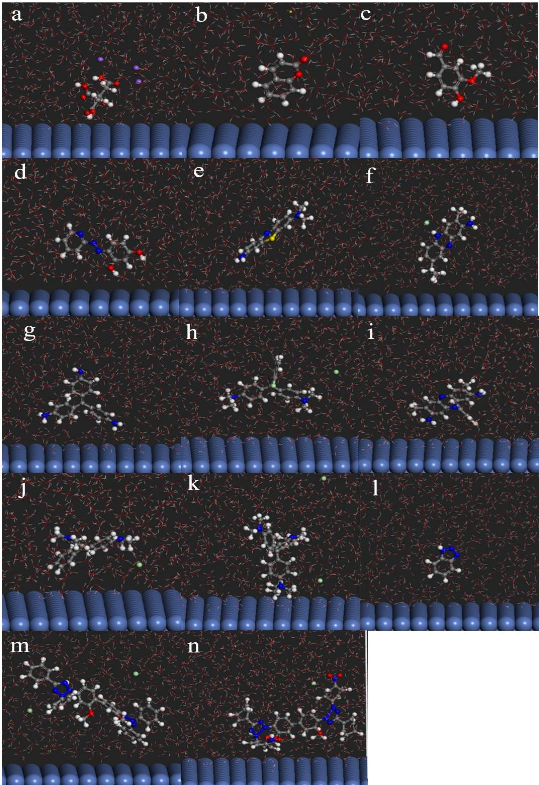  
图 3-6 添加剂分子在 MD 模拟时的初始态分布

（a）柠檬酸；（b）香豆素；（c）香草醛；（d）4-(2-吡啶偶氮)间苯二酚；（e）吉氏色素；（f）中性红；（g）碱性品红；（h）碱性蓝；（i）藏花红 T；（j）孔雀石绿；

（k）甲基紫；（l）苯骈三氮唑；（m）四氮唑蓝；（n）氯化硝基四氮唑蓝

Figure 3-6 Front view of the initial configuration of MD similated boxes

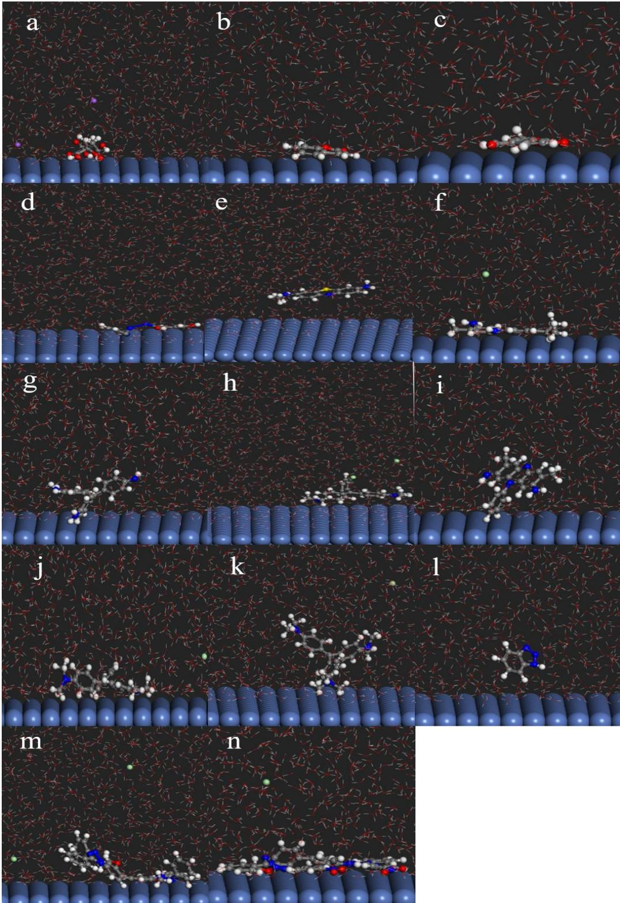  
图 3-7 添加剂分子在 MD 模拟时的终止态分布  
（a）柠檬酸；（b）香豆素；（c）香草醛；（d）4-(2-吡啶偶氮)间苯二酚；（e）吉氏色素；（f）中性红；（g）碱性品红；（h）碱性蓝；（i）藏花红 T；（j）孔雀石绿；（k）甲基紫；（l）苯骈三氮唑；（m）四氮唑蓝；（n）氯化硝基四氮唑蓝  
Figure 3-7 Front view of the final configuration of MD similated boxes

通过图 3-6 和 3-7(a-c)对比发现，含有 C=O 羰基结构的有机分子在吸附终止态时可以很好的吸附在阴极表面，吸附的位点主要分布在与 C=O 相连的共轭结构上。在图(d,e,f)中发现，C=N 双键和与之相连的吡啶官能团可以很好的吸附在阴极表面(d)，而与(f)相比，(e)中 C=N 双键分布在杂环内，杂环内 S 原子影响了 C=N 结构与阴极表面的吸附能力。从图(g-k)中可以看出，与阴极表面发生吸附的官能团主要分布在与 C=N 相连的共轭结构上，相连苯环上的取代基影响了吸附位点的活性，导致吸附出现差异。图(k-n)中对比发现，氮杂环结构同样可以吸附在阴极表面。为了更好的对比不同结构的吸附性能，通过在MS 软件中对比不同状态下的晶体表面的吸附效果，计算出不同添加剂在阴极表面的吸附能，如表 3-2 所示。

表 3-2 不同添加剂在阴极表面的吸附能  
Table 3-2 Adsorption energy of the different additive calculated from MD similated boxes

<table><tr><td>编号</td><td>名称</td><td>吸附能 (kcal/mol)</td><td>编号</td><td>名称</td><td>吸附能 (kcal/mol)</td></tr><tr><td>a</td><td>柠檬酸</td><td>-22.9</td><td>b</td><td>香豆素</td><td>-44.9</td></tr><tr><td>c</td><td>香草醛</td><td>-51.0</td><td>d</td><td>4-(2-吡啶偶氮)间苯二酚</td><td>-39.1</td></tr><tr><td>e</td><td>吉氏色素</td><td>-2.2</td><td>f</td><td>中性红</td><td>-80.2</td></tr><tr><td>g</td><td>碱性品红</td><td>-6.4</td><td>h</td><td>碱性蓝</td><td>-14.6</td></tr><tr><td>i</td><td>藏花红T</td><td>-24.5</td><td>j</td><td>孔雀石绿</td><td>-158.0</td></tr><tr><td>k</td><td>甲基紫</td><td>-34.4</td><td>l</td><td>苯骈三氮唑</td><td>-2.8</td></tr><tr><td>m</td><td>四氮唑蓝</td><td>-125.1</td><td>n</td><td>氯化硝基四氮唑蓝</td><td>-214.9</td></tr></table>

从表 3-2 中可以看出，(a-c)分子的吸附能分别为 22.9kcal/mol，44.9kcal/mol和 51.0 kcal/mol，吸附能增加的顺序：香草醛>香豆素>柠檬酸，在 C=O 双键结构中，醛基的吸附能力最强，苯环相连的羰基其次，无苯环结构的羧酸较弱。通过与图 对比，发现吸附能越高的分子对金属钴的整平效果越好，越有利于填充过程。表(d-f)分子的吸附能分别为 39.1 kcal/mol，2.21 kcal/mol 和 80.2kcal/mol，由此可知，尽管都是杂环结构，但是(e)中的吩噻嗪构型吸附能力较弱，内部 S 原子替换成 N 原子后的吩嗪结构则具有较大吸附能。通过与填充图比对发现，吸附能越大，低电流密度区域沉积越均匀，填充效果越好，但是低浓度下这三种添加剂抑制效果仍不能实现金属 Co 的超共形填充。

表中(g-k)分子可以看出，与苯环相连的 C=N 共轭结构可以吸附在阴极表面，但是这些三苯甲烷类分子在阴极表面吸附能力随着苯环上取代基的不同而有较大区别，其中由以孔雀石绿最为明显，吸附能达到 158.0 kcal/mol。结合填充效果图发现，孔雀石绿作为抑制剂可以有效的阻碍盲孔外表面的镀层，说明强吸附作用可以实现盲孔的填充。表 3-2(l-n)中发现，四氮唑类化合物可以很好的吸附在阴极表面，其中四氮唑蓝和氯化硝基四氮唑蓝在阴极表面的吸附能分别达到 125.1 kcal/mol 和 214.9 kcal/mol，说明四氮唑类化合物作为吸附位点，在阴极表面容易发生吸附，具有较大吸附能。填充图也可以看出这两种添加剂都可以使镀层在底部的沉积效率高于外表面，相较而言氯化硝基四氮唑蓝抑制效果更好。

## 3.3.2 添加剂分子的 QC 计算

通过上述 MD 模拟过程发现，含有羰基，C=N 共轭结构和氮杂环的有机分子可以在阴极表面发生吸附，这种吸附作用会使添加剂分子吸附在阴极表面，占据活性位点，影响钴离子还原沉积。为了进一步研究添加剂分子结构，通过QC 计算来分析添加剂分子的前沿分子轨道信息[151]。

根据分子的最高占据分子轨道（HOMO）和最低空分子轨道（LUMO）继续对这 14 种添加剂进行分析，如图 3-8 和 3-9 所示。其中，QC 计算采用的是Gaussian 软件，工作方式为 optimization，选择 DFT 理论计算方法，通过调整局域密度近似/广义梯度近似和波函数方程的线性比例，可获得不同的杂化泛函，如 B3LYP[155]、B3PW91[156]、MPW1PW91[157]和 PBEPBE[158]等。其中 B3LYP是应用最为广泛的杂化泛函，因此泛函为 B3LYP，基组设定为 6-31G(d, p)[159]。

通过图 3-8 中可以看出，所有分子计算出的 HOMO 电子云均分布在特征官能团部位，也就是说羰基，C=N 共轭结构和氮杂环这些官能团容易吸附在金属表面。之所以是这些官能团部位发生吸附，是因为共轭 π 键与基底 d 轨道发生相互作用，从而引起的表面结合能为负值，也就是出现吸附行为[160]。其中为了对比不同添加剂，分别在特征官能团相连苯环上引入不同取代基进行对比，图(a-c)中，电子云主要分布在羰基官能团及相邻结构中，而三种分子中羧基、吡喃酮和醛基之间的电子云分布差异不大；图(b-e)中，电子云分布在整个分子上，尽管相互之间官能团不同，但是电子云分布相差不大；图(g-k)所示，发现引入给电子基团甲烷或胺基时，电子云分布更广泛，电子更容易发生离域；如图(m,n)所示，发现引入硝基吸电子基团后，电子云向四氮唑及相邻苯环基团靠拢。继续对分子的 LUMO 能级分布进行研究，如图 3-9 所示。

通过图 3-9 添加剂分子的 LUMO 轨道电子云分布发现，由于添加剂内部官能团几乎都是与苯环相连，这些 LUMO 轨道电子云分布于 HOMO 轨道电子云分布几乎相同。由于相邻苯环上取代基的不同，导致 LUMO 轨道电子云分布略有不同，比如图(i-k)中，由于相邻苯环上的甲基，胺基结构都是给电子基

<table><tr><td>a</td><td>b</td><td>c</td><td></td></tr><tr><td colspan="2">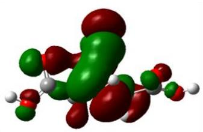</td><td>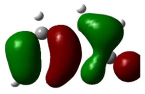</td><td>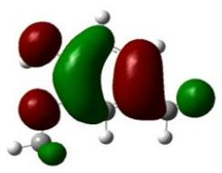</td></tr><tr><td>d</td><td>e</td><td>f</td><td></td></tr><tr><td colspan="2">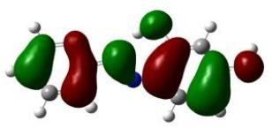</td><td>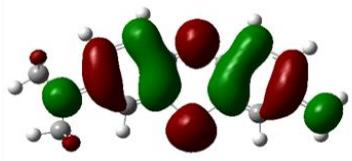</td><td>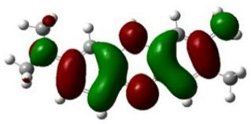</td></tr><tr><td>g</td><td>h</td><td>i</td><td></td></tr><tr><td colspan="2"></td><td></td><td></td></tr><tr><td>j</td><td>k</td><td>l</td><td></td></tr><tr><td colspan="2"></td><td></td><td></td></tr><tr><td>m</td><td>n</td><td></td><td></td></tr><tr><td colspan="2"></td><td></td><td></td></tr></table>

Figure 3-8 Localization of the highest occupied molecular orbital (HOMO)

b

g

C  
e  
a  

  
f

  
m

  
图 3-9 添加剂分子的 LUMO 分布  
(a)柠檬酸；(b)香豆素；(c)香草醛；(d) 4-(2-吡啶偶氮)间苯二酚；(e)吉氏色素；(f)中性 红；(g)碱性品红；(h)碱性蓝；(i)藏花红 T；(j)孔雀石绿；(k)甲基紫；(l)苯骈三氮唑； (m)四氮唑蓝；(n)氯化硝基四氮唑蓝

Figure 3-9 Localization of the lowest unoccupied molecular orbital (LUMO)

（a）柠檬酸；（b）香豆素；（c）香草醛；（d）4-(2-吡啶偶氮)间苯二酚；（e）吉氏色素；（f）中性红；（g）碱性品红；（h）碱性蓝；（i）藏花红 T；（j）孔雀石绿；

团，所以引起电子云向苯环发生扩散。图(m, n)中，由于氯化硝基四氮唑蓝中有硝基存在，电子云分布明显向硝基官能团发生离域。其中， $E _ { \mathrm { H O M O } }$ 能级值的大小代表着添加剂分子向金属表面的给电子能力，能级越高代表给电子能力越强，越容易导致在表面的吸附。与此同时， $E _ { \mathrm { L U M O } }$ 值表示添加剂分子接收电子的能力，能级差值 $. \Delta E$ 表示分子内电子的迁移能力， $\Delta E$ 越小，电子越容易迁移，越容易在金属表面稳定吸附。通过计算HOMO和LUMO的能级 $E _ { \mathrm { H O M O } }$ 和 ELUMO高低，进一步对比各个添加剂之间的∆E 带隙能级差值大小，如图 3-10 所示。

  
图 3-10 不同添加剂分子的前线轨道能量值及其差值  
（k）甲基紫；（l）苯骈三氮唑；（m）四氮唑蓝；（n）氯化硝基四氮唑蓝  
Fig. 3-10 Diagrammatic sketch of energy values of frontier molecular orbitals

从图 3-10 中可以看出，具有较高 $E _ { \mathrm { H O M O } }$ 能级的分子，其分子几乎是完全吸附在阴极表面。与图 3-8 对比发现，香豆素和香草醛的 $E _ { \mathrm { H O M O } }$ 值分别为-6.504eV 和-6.041eV，由于 E 值高，两种分子结构在吸附时，分子呈现出平面结构，与基底几乎完全平行。从表(d-f)中也可以发现，氮杂环结构中，中性红的 $E _ { \mathrm { H O M O } }$ 最高，而且具有较低的∆E 值，所以吸附能也最大。同理，表(g-k)列出的三苯甲烷类分子中，孔雀石绿的 $\Delta E$ 值达到 $- 2 . 5 1 2 \mathrm { e V }$ ，而且 $E _ { \mathrm { H O M O } }$ 达到 $- 5 . 8 0 7 \mathrm { e V }$ ，说明孔雀石绿可以很好的吸附在阴极表面。与和它结构相近的甲基紫和藏花红 T 对比发现，三种分子的 HOMO 能级电子云分布相近，都是分布在 $\mathrm { C } { = } \mathrm { N }$ 双键的共轭结构中，但是 $E _ { \mathrm { L U M O } }$ 能级值差别大，分别为 $- 4 . 8 3 7 \mathrm { e V }$ 和$- 4 . 9 7 4 \ \mathrm { e V }$ ，而且∆E 值较高，这是因为甲基紫分子内较多给电子的甲烷基和藏花红 T 内给电子的吩噻嗪结构。同时，氯化硝基四氮唑蓝也是因为∆E 值较低而具有较高的吸附能。因此，通过以上分析最有可能成为钴填充抑制剂的是孔雀石绿和氯化硝基四氮唑蓝。

## 3.3.3 MG 和 NBT 的分子静电势

通过上述对添加剂分子的理论分析总结出，孔雀石绿和氯化硝基四氮唑蓝具有较高的吸附能，而且可以作为抑制剂实现金属钴的填充过程。为了方便分辨，这里采用孔雀石绿和氯化硝基四氮唑蓝的缩写形式分别为 MG 和 NBT。接下来分别利用分子静电势研究 MG 和 NBT 分子的作用机理，如图 3-11 和 3-12 所示。

b  
  
图 3-11 MG 分子的静电势分布  
（a）分子静电势图；（b）静电势大小的分布图

Figure 3-11 Electrostatic potential mapped surface of MG with the surface local maxima  
a  

b  
  
图 3-12 NBT 分子的静电势分布  
（a）分子静电势图；（b）静电势大小的分布图  
Figure 3-12 Electrostatic potential mapped surface of Nitrotetrazolium Blue Chloride

从图 3-11(a)中可以看出，分子静电势最高达到 77.91 kcal/mol，说明此区域电子容易向金属原子或离子的空轨道发生电子迁移，形成稳定吸附状态。通过与图 3-8 终止时的吸附状态对比，证实 C=N 双键及相连的共轭结构部分吸附在金属表面，主要归因于 MG 内较大的共轭结构中容易形成离域 π 键，可以与金属原子中空的 d 轨道作用，从而产生吸附[160]。通过图 3-11(b)中对静电势的分布统计发现，分子静电势最高的区域占比达到 20%左右，这也是孔雀石绿与金属原子有较高吸附能的原因[161]。

从图 3-12(a)中可以看出,最高处达到 158.41 kcal/mol，说明这部分区域电子活性最高，越容易与金属原子空轨道相互作用，从而形成活性吸附位点。与图 3-8 计算出的终态吸附分布对比发现，与四氮唑相连的共轭结构部分几乎完全吸附在金属表面。由于分子端基相连的是强吸电子的硝基，所以使较高静电势电子分布较为集中，如图 3-12(b)所示，静电势在 70 kcal/mol 以上的电子云分布占比接近 45%，这也是 NBT 具有较高吸附能的原因。

对比发现，MG 的分子静电势要低于 NBT 的静电势，但是两者都具有较高的分子静电势，可以吸附在基底金属原子表面。与此同时，分子静电势还可以分析与镀液中的金属 Co 离子之间的相互作用，如图 3-13 和表 3-3 所示。

  
图 3-13 IRI 等值面图和键合能的拉普拉斯量  
（a）3D IRI 等值面；（b） $\mathrm { M G } { \cdot } \mathrm { C o } ^ { 2 + } .$ Cl-配合物的平面 IRI 等值面图  
Figure 3-13 IRI map of MG-Co2+-Cl- complexes and the inserted rainbow represents coloring method

表 3-3 AIM 分析得出的键合临界点电子密度 $( \rho _ { \mathrm { B C P } } )$ ，电子密度 $( \nabla ^ { 2 } \rho _ { \mathrm { B C P } } )$ 与能量密度$( H _ { \mathrm { B C P } } )$ 、势能密度 $( V _ { \mathrm { r B C P } } )$ 的拉普拉斯量  
Table 3-3 Electron density (ρ ), Laplacian of electron density $( \nabla ^ { 2 } \rho _ { \mathrm { B C P } } )$ and energy density $( H _ { \mathrm { B C P } } )$ , and potential energy density (VrBCP) at bond critical point from AIM Analysis

<table><tr><td>Complexes</td><td>Bond atoms</td><td> $\rho_{\text{BCP}} \times 10^{2}$ (a.u.)</td><td> $\nabla^{2}\rho_{\text{BCP}} \times 10^{2}$ (a.u.)</td><td> $H_{\text{BCP}} \times 10^{3}$ (a.u.)</td><td> $V_{\text{rBCP}} \times 10^{3}$ (a.u.)</td></tr><tr><td>MG- $Co^{2+}$ </td><td>Aromatic ring... $Co^{2+}$ </td><td>5.18</td><td>16.72</td><td>-9.23</td><td>-60.27</td></tr><tr><td> $Co^{2+}-Cl^{-}$ </td><td> $Co^{2+}...Cl^{-}$ </td><td>8.37</td><td>21.40</td><td>-23.98</td><td>-101.46</td></tr></table>

利用 IRI 等值面分析发现， $\mathrm { C o } ^ { 2 + }$ 可以与 MG 和 Cl-离子形成稳定的离子型配合物[163]。一般来说， $\mathrm { C o } ^ { 2 + }$ 的空轨道更容易与 的 轨道的 键相互作用。但是，模拟结果显示其形成连接的部位不在 HOMO 能级的电子云分布处，而是位于静电势较低的苯环结构中，归结其原因是 Cl-的强吸电子作用，反而容易与 MG 结构中苯环的 π 键相互作用。从表 3-3 中分子内原子 AIM 理论计算得出，这种构型的键临界点 BCP 的电子密度为正值，说明此时 $\mathrm { C o } ^ { 2 + }$ 和MG， $\mathrm { C o } ^ { 2 + }$ 和 Cl-存在闭壳层作用，相互之间存在离子键作用，由 IRI 等值面图可以看出容易形成 $\mathrm { M G - C } _ { 0 } \mathrm { \mathrm { ^ { 2 + } - C l } } ^ { - }$ 离子型配合物键，说明 MG 在加入后形成离子键，对 Co 离子还原过程产生影响。

  
图 3-14 IRI 等值面图和键合能的拉普拉斯量  
（a）3D IRI 等值面；（b）NBT-Co 配合物的平面 IRI 等值面图  
Figure 3-14 IRI map of NBT-Co complexes and the inserted rainbow represents coloring method  
表 3-3 AIM 分析得出的 NBT 配合物的键合临界点电子密度(ρBCP)，电子密度 $( \nabla ^ { 2 } \rho _ { \mathrm { B C P } } )$ 与能量密度 $( H _ { \mathrm { B C P } } )$ 、势能密度 $( V _ { \mathrm { r B C P } } )$ 的拉普拉斯量  
Table 3-4 Electron density (ρBCP), Laplacian of electron density $( \nabla ^ { 2 } \rho _ { \mathrm { B C P } } )$ and energy density $( H _ { \mathrm { B C P } } )$ , and potential energy density $( V \mathbf { r } _ { \mathrm { { B C P } } } )$ at bond critical point from AIM Analysis

<table><tr><td>Bond atoms</td><td> $\rho_{\text{BCP}} \times 10^{2}$  (a.u.)</td><td> $\nabla^{2} \rho_{\text{BCP}} \times 10^{2}$  (a.u.)</td><td> $H_{\text{BCP}} \times 10^{3}$  (a.u.)</td><td> $V_{\text{rBCP}} \times 10^{3}$  (a.u.)</td></tr><tr><td>N1···Co1 $^{2+}$ </td><td>8.27</td><td>62.25</td><td>-8.06</td><td>-171.75</td></tr><tr><td>N2···Co1 $^{2+}$ </td><td>7.83</td><td>56.78</td><td>-6.66</td><td>-155.26</td></tr><tr><td>N3···Co2 $^{2+}$ </td><td>7.83</td><td>56.78</td><td>-6.65</td><td>-155.24</td></tr><tr><td>N4···Co2 $^{2+}$ </td><td>8.27</td><td>62.26</td><td>-8.06</td><td>-171.75</td></tr></table>

同样利用 AIM 理论计算 Co 离子可能和 NBT 之间存在的相互作用，如图所示。 作为添加剂时，容易在阴极表面发生开环反应，尤其是在阴极扫描过程中，因此计算的时候采用开环后的 NBT 进行计算。通过 IRI 等值面图 发现， 与 $\mathrm { C o } ^ { 2 + }$ 之间存在化合键作用[164]，说明 不仅仅吸附在阴极表面占据活性位点，进而对金属钴的抑制作用，还能与溶液中的钴离子形成配合物，使钴的还原电位负移。从表 3-4 中可知，键合临界点密度的 BCP 值发现其为正值，说明 NBT 与 Co 离子之间的化合键是离子型的，正是这种作用和在阴极表面的吸附使钴离子还原电位发生负移，抑制了钴的沉积过程。

综上所述，MG 和 NBT 之所以能作为钴填充的抑制剂，是因为内部的 C=N双键共轭结构和四氮唑内较大的共轭 π 结构，可以吸附在金属基底上，从而占据活性位点，阻碍钴原子沉积。同时，MG 和 NBT 内部的共轭结构还可以与$\mathrm { C o } ^ { 2 + }$ 形成离子型配合物，从而阻碍 $\mathrm { C o } ^ { 2 + }$ +成核过程，使沉积过程受到抑制。

## 3.4 本章小结

本章首先将可能对金属 Co 填充过程产生抑制作用的 14 种有机分子作为单一添加剂，研究其对 Co 镀层形貌和极化过程的影响；其次经过对比分析不同结构对金属 Co 填充过程的影响，筛选确定两种添加剂 MG 和 NBT 可以作为填充的抑制剂；然后利用 MD 模拟和 QC 计算分析这些有机分子的分子结构，并与实验相结合，进一步讨论了 MG 和 NBT 能作为抑制剂的原因；最后探讨了 MG 和 NBT 与镀液中 $\mathrm { C o } ^ { 2 + }$ 离子的作用，研究得出如下结论：

（1）通过选择的 14 种不同结构的有机分子作为添加剂，发现在 Watts 型镀钴液中制备的 Co镀层晶粒大小均匀，镀层形貌平整。通过赫尔槽实验得知，在 $5 \ \mathrm { A } / \mathrm { m } ^ { 2 }$ 的电流下，这些分子中 MG 和 NBT 作为添加剂，Co 完全覆盖赫尔槽试片，整平能力最好。对填充过程分析发现，MG 和 NBT 作为添加剂时，盲孔底部的 Co 沉积速率几乎是外表面的 2 倍，说明这两种添加剂可以作为抑制剂实现金属 Co 填充。

（2）通过电化学极化曲线发现，MG 和 NBT 增加了 Co 的阴极极化过电位，抑制了 Co 沉积过程，而且添加剂受传质控制。借助 MD 模拟分析发现，MG 和 NBT 在金属表面的吸附能最高，分别达到 158.0 和 214.9 kcal/mol，由此可知 MG 和 NBT 吸附在阴极表面占据活性位点，从而抑制了 $\mathrm { C o } ^ { 2 + }$ 在阴极表面的还原过程。

（3）利用 QC 计算对比分析，三苯甲烷类分子内的 C=N 苯共轭结构可以作为活性位，吸附在阴极表面，相邻苯环的取代基对这种结构的吸附能影响较大。四氮唑类分子结构中的四氮唑环活性较高，容易吸附在阴极表面。QC 计算和 MD 模拟得到结果与填充过程的结果相一致。

（4）通过分子静电势分析，MG 和 NBT 都具有较高的分子静电势，其中NBT 由于分子表面静电势较高，而且分布均匀，导致其静电势高于 MG 的。而且与 $\mathrm { C o } ^ { 2 + }$ 进行 AIM 理论分析得知，MG 和 NBT 还可以与 $\mathrm { C o } ^ { 2 + }$ 形成配合物，影响 Co 的成核沉积过程。

## 第 4 章 基于 MG 为抑制剂的金属钴填充过程研究

## 4.1 引言

通过上一章节研究发现， 和 添加到镀液中可以作为抑制剂，吸附在阴极表面，占据活性位点，阻碍钴离子沉积过程。通过赫尔槽实验发现这两种抑制剂具有较强的整平能力，这与其内部的分子结构有关，通过 QC 计算和MD模拟发现其内部的C=N苯共轭结构和四氮唑结构是产生吸附的官能团。利用分子静电势分析发现，这两种共轭结构具有较高的静电势，使 MG 和 NBT具有较大吸附能，而且还可以与 $\mathrm { C o } ^ { 2 + }$ 形成配合物阻碍其成核沉积，因此将这两种添加剂作为抑制剂进一步研究，本章节首先讨论 MG 的抑制作用。

在上一章节中选择的添加剂在文献中被报道具有抑制作用，但是可能选择的浓度较低（20 μmol/L），部分添加剂在镀 Co 过程中并没有表现出较高抑制能力。但是作为抑制剂，较高的浓度容易造成镀层中杂原子掺杂，因此浓度越低，抑制效果越好，也是作为抑制剂筛选的关键。因此，接下来首先选择 MG作为抑制剂来详细研究不同浓度 MG 对镀液的电化学行为的影响，以及在不同浓度下对镀液填充过程的影响，并分析其作用机理。此外，上一章节中发现MG 作为抑制剂使镀层表面形成针孔，因此本章中也对 MG 在 HER 过程中的影响进行了研究。

## 4.2 基础镀液的电沉积过程

基础镀液组成为 $\mathrm { 0 . 4 m o l / L C o S O _ { 4 } \bullet 7 H _ { 2 } O , 0 . 5 m o l / L \mit H _ { 3 } B O _ { 3 } , 1 0 m m o l / L C l ^ { - } }$ 沉积条件为 $\mathsf { p H } { = } 4$ ，沉积温度 $2 5 \mathrm { { ^ \circ C } }$ 。由于在 MG 作为抑制剂时，SEM 照片(图3-2)显示镀层中出现针孔，因此本文选择 3-巯基丙烷磺酸钠(MPS)作为表面活性剂，接下来首先研究 MPS 对金属钴还原过程的影响。

## 4.2.1 MPS 对镀液电化学行为的影响

本文中 MPS 被用作表面活性剂，用于提高镀层致密光亮和与基底的结合力。MPS 作为加速剂在镀铜中得到广泛应用[165]，但是在镀钴溶液中应用较少。在镀钴液中加入 7 mg/L 的 MPS 时，发现 MPS 可以促进钴在低电流密度区域的沉积[108]。但是当 MPS 浓度达到 100 mg/L 之后，使钴离子还原电位负移，抑制了金属钴沉积[170]。由此可知，MPS 对金属钴沉积过程的影响是基于 MPS的浓度，低浓度下呈现加速作用，高浓度下表现为抑制作用。此外，MPS 内部的磺酸基可以作为表面活性官能团，有利于阴极表面析出的氢气泡脱离。因此，本文中选择 MPS 作为表面活性剂，其浓度为 20mg/L，研究 MPS 对钴镀液的影响如图 4-1 所示。

  
图 4-1 不同成分镀液的 LSV 曲线  
（a）添加 20 mg/L MPS；（b）不同转速下的 LSV 曲线  
Figure 4-1 The LSV curves of 20mg /L MPS in the VMS at different rates

从图 4-1(a)中可以看出，添加 20 mg/L 的 MPS 之后，镀液的 LSV 曲线中Co的还原电位几乎没有变化，说明此浓度下MPS对Co的还原电位没有影响。但是当电势扫描至-1.24 V 时，添加 MPS 后的曲线极化电流增加，说明 MPS吸附阴极表面，在较高电位下增加了 Co 的极化电流，但是由于 MPS 浓度较低，对 Co 还原电位没有影响。图 4-2(b)中可以发现，不同转速下，MPS 对 Co还原电位几乎没有影响，但是随着搅拌速度的增加，Co 的还原电流密度增加，说明此浓度下的，转速升高后，MPS 增加了极化电流。

  
图 4-2 MPS 对无 $\mathrm { C o } ^ { 2 + }$ 电解液电化学行为的影响  
（a）有无添加 20mg/L MPS 的 CV 曲线；（b）有无添加 MPS 的镀液的瞬态电流曲线  
Figure 4-2 Electrochemical behivious of the ${ \mathrm { K } } _ { 2 } { \mathrm { S O } } _ { 4 }$ in the presence or absence of MPS

由于 Co 还原过程伴随着 HER 过程，因此进一步研究了 MPS 对 HER 过程的影响，如图 4-2 所示。图 4-2 中用同摩尔浓度的 K+代替 $\mathrm { C o } ^ { 2 + }$ 保证电解液的电导率不变，镀液其它组成和测试条件不变。从图 4-2(a)可以发现，添加的20 mg/L MPS 之后，氢还原电流变化不大，但是在氢还原之前，电流密度出现变化，这与 MPS 在阴极表面的吸附有关。通过瞬态电流曲线(图 4-2b)发现，MPS 添加之后，稳态电流几乎没有变化，说明 MPS 对 HER 没有影响。不同电位下，起始电流的下降出现不同，这是因为 MPS 在双电层的吸附过程引起的。因此，MPS 作为表面活性剂对 Co 的还原电位没有影响。

## 4.2.2 MPS 对镀液电沉积过程的影响

由上述测试可知，MPS 对钴的极化电位几乎没有影响，对 HER 过程影响也可以忽略。由此可知，MPS 作为表面活性剂对镀液的电化学行为影响很小，接下来研究 MPS 对镀层形貌和填充过程的影响，如图 4-3 所示。

在此选用三电极体系的电沉积过程，其中，工作电极为预镀一层钴的铜箔(1 cm×1 cm)，对电极为纯钴片(4 cm×4 cm)，参比电极为硫酸亚汞电极。镀液搅拌速度为 100 rpm，沉积电势为-1.20 V，沉积时间为 600 s。

  
图 4-3 含有不同添加剂的镀液电沉积的镀层 SEM 照片（a）基础镀液；（b）添加 20 mg/L MPS；  
（c）添加 10 mg/L MG；（d）添加 10 mg/L MG 和 20 mg/L MPSFigure 4-3 SEM images of cobalt coatings with different additives

从图 4-3(a,b)中可以看出，在基础镀液中添加 20 mg/L MPS 之后，颗粒尺寸变化不大，颗粒形貌有所不同，可能与 MPS 吸附在电极上导致阴极钴电荷转移过程发生变化有关。根据镀层质量计算出的镀层厚度都在 1 μm 左右，说明 MPS 在此浓度下，对钴镀层厚度影响不大。由图 4-3(c)可知，当 MG 作为单一添加剂加入到镀液中时，镀层颗粒变小，但是镀层表面出现针孔，这是由于氢还原导致的。而在继续在镀液中加入 20 mg/L MPS 之后，镀层表面针孔消失，镀层更加致密，说明 MPS 作为表面活性剂，加速了镀层表面氢气泡的脱离，改善了镀层形貌。

利用赫尔槽实验，考察 MPS 对镀液整平过程的作用，如图 4-4 所示。其中，赫尔槽试片选择黄铜材质，阴极为钴片，镀液为基础镀液+添加剂，电流为 0.5 A。

  
图 4-4 含有不同添加剂的赫尔槽试片照片  
左侧为高电流密度区(近端)；右侧为低电流密度区(远端)。  
Figure 4-4 Pictures of brass cathodes after cobalt plating at 0.5 A for 5 min using different additive in the Hull Cell.

从图 4-4 中可以看出，在没有任何添加剂的基础镀液中电沉积制备的钴镀层分布不均匀，其中在高电流密度区镀层致密（左侧），呈现哑光，而在低电流密度区则无镀层沉积。添加 20 mg/L MPS 之后，高电流密度区镀层变得光亮，但是低电流密度区仍没有镀层沉积。说明此浓度下的 MPS 可以用作光亮剂，但是并没有整平作用。而 MG 加入后镀层在低电流密度区出现沉积层，由此可知，MPS 对于钴沉积层的整平作用几乎可以忽略，可以与 MG 组成混合添加剂改善镀层表面形貌。

为了进一步研究 MPS 对填充过程的影响，通过添加或没有添加 20 mg/LMPS 于镀液中，在盲孔中沉积 2 h 后的效果图对比分析 MPS 的作用，如图 4-5 所示。其中，镀液选择含有 10mg/L MG 的基础镀液，然后添加 20mg/L MPS。沉积条件为：电势为-1.25 V，搅拌速度为 500 rpm，pH=4，室温条件下沉积 2h。预镀钴后的 PCB 板作为阴极，钴片作为对电极。

  
图 4-5 有无 MPS 添加时金属钴填充的切面图  
（a）添加 20 mg/L MPS；（b）无 MPS 添加  
Figure 4-5 Cross-sectional optical microscope pictures of blind via filling

从图 4-5 中可以看出，在 $1 0 0 \mu \mathrm { m } { \times } 1 0 0 \mu \mathrm { m }$ 的盲孔中，无论是否添加 MPS，盲孔内外表面的镀层厚度几乎没有差别，但是镀层与基底的结合力有差异。与图 4-5(b)相比，图 4-5(a)中添加 MPS 之后，镀层与基底结合好，无脱落。由此可知，MPS 作为添加剂可以提高镀层与基底的结合力，而对镀层的填充效果没有明显影响。因此，为了改善镀层性能，本章选择在镀液中添加 20mg/L MPS。

## 4.3 MG 对镀液电化学行为的影响

通过理论计算和分子动力学模拟发现 MG 能够吸附在阴极表面，对金属钴沉积有抑制作用，而且 MG 分子可以与 $\mathrm { C o } ^ { 2 + }$ 形成配合物，进一步阻碍钴成核沉积。接下来，通过分析 MG 对镀液的电化学行为来进一步研究 MG 作为抑制剂对 $\mathrm { C o } ^ { 2 \cdot \mathsf { I } }$ +还原过程的影响。

## 4.3.1 MG 对镀液阴极极化的影响

在三电极体系中，Pt 圆盘电极作为工作电极，Pt 片作为对电极和硫酸亚汞作为参比电极，在 500rpm 搅拌速度下，研究不同浓度 MG 对镀液循环伏安曲线的影响，如图 4-6 所示。

从图 4-6(a)可以看出，即使添加较低浓度(2 mg/L)的 MG，镀液中仍出现了明显的滞后伏安特征，说明添加剂 MG 对钴沉积具有良好的抑制作用。此外，随着 MG 的浓度从 2 mg/L 增加到 20 mg/L，启动电位从-1.25 V 左右负移至-1.40 V，而过电位的增大与 MG 浓度有关，说明击穿电位的阈值与 MG 的吸附和传质过程有关。当 MG 浓度大于 10 mg/L 时，正向扫描时，阴极电位低于击穿电位后，电流密度急剧上升，出现 S 型负微分电阻现象。电流峰值的交叉可能代表了与 MG 钝化表面被击穿有关的超调现象。

  
图 4-6 不同浓度 MG 对镀液中 Co 离子的氧化还原过程的影响  
（a）CV 曲线；（b）根据阳极溶出峰面积计算得出的金属钴的沉积量  
Figure 4-6 Cyclic voltammetry of different concentration of MG

通过计算阳极溶出过程中溶解钴的电量，定量分析了 MG 浓度对钴的抑制作用。从图 4-6(b)中发现，阳极溶出峰面积随着 MG 浓度的增加而减小，说明 MG 浓度的增加降低了金属 Co 的沉积量，这与阴极扫描迟滞特征的分析是一致的。

  
图 4-7 不同扫描速度下镀液的 CV 曲线  
Figure 4-7 The CV curves of deposition solution with different scan rate at 500rpm

由图 4-7 可知，扫描速度的增加，钴的沉积电位逐渐负移，说明添加 MG后，吸附在表面的 MG 逐渐消耗，而且消耗速率会受到传质过程的影响。而在恒定转速下，随着扫描速度的增加，扩散层厚度逐渐减小，对沉积反应的抑制就越明显。此外，扫描速度的增加，电流超调值逐渐衰减，这说明钴阴极还原过程中 MG 被击穿才导致了 CV 曲线出现电流超调值。

## 4.3.2 MG 对钴沉积效率的影响

由于 $\mathrm { C o } ^ { 2 + }$ 还原成钴金属的标准电极电势(-0.28 V vs. NHE)低于 $\mathrm { H } ^ { + }$ 还原为$\mathrm { H } _ { 2 }$ 的标准电极电势(0 V vs. NHE)，所以钴在沉积时必然会伴随着析氢反应。因此，CV 中测试的总电流密度由氢还原的电流密度和钴还原的电流密度共同组成。因此，为了析氢反应对电沉积过程的影响，利用电化学石英微天平测试来研究 MG 对钴电沉积的影响，如图 4-8 所示。

  
图4-8 有无MG添加时镀液的EQCM曲线  
（a）计算出的沉积电量；（b）计算出的电流效率  
Figure 4-8 EQCM test of cobalt deposition and the total current density

为了方便与 CV 曲线对比，在开始测试之前首先在金电极上预镀一层金属Co，这样可以保持阴极表面没有变化，以减少异质传核过程的影响，更方便探究 Co 还原电位的变化。从图 4-8(a)中可以看出，MG 加入后，钴的沉积电量下降，同时沉积电位发生负移，说明 MG 抑制了钴电沉积过程。而且对比 $\mathrm { C o } ^ { 2 + }$ 还原电位发现，在扣除掉氢还原电流之后，Co 还原电位明显发生了负移，说明加入的 MG 加入抑制了 $\mathrm { C o } ^ { 2 + }$ 在阴极表面的成核沉积。从图 4-8(b)可以看出，在-1.60 V 到-1.20 V 的电势范围，Co 的沉积效率较低。有 MG 和无 MG 添加时，沉积效率均随过电位的增大而增大，说明过电位越大，金属沉积效率越高。综上所述，MG 不仅增加了钴的极化过电位，而且降低了 Co 沉积的电流效率。

一般来说，根据添加剂的对流依赖吸附(CDA)调节流体动力学可以改善金属的超共形填充过程，因此，接下来采用不同转速下的计时电流曲线研究转速对 $\mathrm { C o } ^ { 2 + }$ 还原过程的影响，如图 4-9 所示。

  
图 4-9 不同旋转速度下的计时电流曲线  
Figure 4-9 Current transients for cobalt deposition on thin Co seed at different rotating rate

从图 4-9 中可以看出，在-1.25V 的还原过电位下，当转速为 0 rpm 时，还原的电流密度为 $5 . 8 0 \mathrm { m A } / \mathrm { c m } ^ { 2 }$ ，随着转速增加，电流密度开始下降。当转速从0 rpm 增加到 100 rpm 时，电流密度从 $5 . 8 0 \mathrm { m A } / \mathrm { c m } ^ { 2 }$ 下降到约 $4 . 8 5 \mathrm { m A } / \mathrm { c m } ^ { 2 }$ ，对流增强了 MG 的抑制作用。同时，MG 的传质速度慢，吸附速度快，便于在孔道内形成 MG 浓度梯度。当无转速时，电流密度恢复到 $5 . 8 0 \mathrm { m A } / \mathrm { c m } ^ { 2 }$ 左右。而且随着转速再次增加，还原电流逐渐变小，说明 MG 在阴极表面的吸附过程是受扩散控制的。但是当转速进一步增大(大于 800 rpm)时，电流密度下降不明显，说明强对流条件下 MG 的吸附受 MG 浓度或吸附速率控制。

  
图 4-10 不同转速下的电化学阻抗谱  
(a)100rpm；(b)500 rpm  
Figure 4-10 Electrochemical impedance spectra in the bath with or without MG

根据 AIM 理论发现，MG 不仅吸附在阴极表面阻碍钴沉积，还可以与 $\mathrm { C o } ^ { 2 + }$ 形成配合物，而 Co(II)与 MG 形成的配合物对钴还原过程也会产生影响，接下来通过 EIS 谱图分析 $\mathrm { C o } ^ { 2 + }$ 还原过程中电荷转移的变化，如图 4-10 所示。图中测试过程选择在-1.25 V 的电势进行测试，分别对比了 100 rpm 和 500 rpm 转速下的镀液阻抗谱。

由图 4-10 可知，加入 MG 之后电容环变大，电解液阻值几乎不变。无论有无 MG 添加，都只有一个电容环，说明整个还原过程主要是 $\mathrm { C o } ^ { 2 + }$ 的还原。而由于 MG 的浓度过低，形成的配合物浓度较低，没有形成新的电容环，电荷传递过程以电解液中较高浓度的 $\mathrm { C o } ^ { 2 \mathrm { + } }$ 的电荷转移为主。通过不同转速下的阻抗谱对比发现，转速越高，容抗环越大。而且相较于基础镀液，添加 MG 后的镀液的容抗环增加更明显，说明较高转速 MG 的抑制作用更强。由此可知，较低浓度的 MG 对金属钴的抑制作用是以吸附在表面形成“位阻”为主，而且“位阻”作用受传质过程控制。

## 4.3.3 MG 对钴成核过程的影响

为了进一步研究 MG 对金属 Co 成核过程的影响，测试了镀液的计时电流I-t 曲线，如图 4-11 所示。

根据 Scharifker 和 Hills 的三维(3D)形核模型[166]，采用计时安培法对金属沉积的形核和生长进行研究。在这一部分中，测量了不同电位下的恒电位电流-时间瞬变曲线，以提供钴电沉积成核和生长的信息。基于 Scharifker 和 Hills(SH)三维成核模型（公式 4-1 和 4-2），将钴电沉积电流瞬态曲线归一化为 $( j / j _ { \mathrm { m } } ) ^ { 2 }$ 随 $( t / t _ { \mathrm { { m } } } )$ 的曲线，并与 SH 模型计算得出的成核曲线进行对比分析。

三维瞬时成核过程:

$$
\left(\frac {j}{j _ {m}}\right) ^ {2} = 1. 9 5 4 2 \left(\frac {t _ {m}}{t}\right) \left\{1 - \exp \left[ - 1. 2 5 6 4 \left(\frac {t}{t _ {m}}\right) \right] \right\} ^ {2}\tag{4-1}
$$

三维渐进成核过程：

$$
\left(\frac {j}{j _ {m}}\right) ^ {2} = 1. 2 2 5 4 \left(\frac {t _ {m}}{t}\right) \left\{1 - \exp \left[ - 2. 3 3 6 7 \left(\frac {t}{t _ {m}}\right) ^ {2} \right] \right\} ^ {2}\tag{4-2}
$$

式中 j——电流密度 $( \mathrm { m A } \cdot \mathrm { c m } ^ { - 2 } )$ ；

t——测试时间(s)；

$j _ { \mathrm { m } }$ ——电流密度最大值 $( \mathrm { m A } \cdot \mathrm { c m } ^ { - 2 } )$ )；

$t _ { \mathrm { m } }$ ${ \mathcal { I } } _ { \mathrm { m } }$ 对应的时间(s)

b  

  
图 4-11 不同电势下的瞬态电流曲线和 I \~ t 曲线的无量纲方程曲线（a，b）无 MG 添加；（b，d）添加 MG  
Figure 4-11 Current density-time transients for cobalt deposition on thin Co seed at different potentials and Dimensionless curves of progressive and instantaneous nucleation models

从图 4-11(a,b)可以看出，阴极电位为-1.10 V 时，电流密度几乎为 $0 \mathrm { m A } / \mathrm { c m } ^ { 2 }$ 测试过程中没有出现电流峰值，说明低电位下没有钴离子还原，出现的电流密度主要归因于 HER，这与 EQCM 分析一致（无论有无 MG 添加）。电流密度最初的下降是由于双层电的充电过程。当电势达到-1.20V 时，未添加 MG 时，并未出现钴成核过程，而添加 MG 之后，I-t 曲线上出现了较宽的峰，这可能与阴极表面的氢还原生成的氢气泡的扰动有关。当电势达到-1.25 V 之后，出现了钴成核和生长。当 $t { < } t _ { \mathrm { m } }$ 时，电流的升高归因于早期阶段新相的生长[169]。当 ${ t } ^ { = } t _ { \mathrm { m } }$ ，表面沉积的钴核出现接壤重叠，出现电流最大值 $j _ { \mathrm { m } } \Lsh$ 。当 $t { > } t _ { \mathrm { m } }$ 时，钴还原电流随时间衰减，并达到与外加电位无关的稳态值。

图 4-11(c, d)中与理论计算的 SH 模型对比发现，无论有无 MG 的添加，钴原子都是瞬时成核过程，而且都只有一个成核峰，说明 MG 的添加没有改变钴离子沉积成核方式。尽管AIM模拟显示MG可以与 $\mathrm { C o } ^ { 2 \mathrm { + } }$ 形成离子型配合物，但是通过成核过程发现这种配合物并没有形成明显的成核峰。这或许是由于MG 浓度过低，配合物在钴成核时与 $\mathrm { C o } ^ { 2 + } .$ 一起被还原，因此没有明显的成核峰。

## 4.3.4 MG 对钴镀层的影响

接下来研究添加剂 MG 对钴镀层形貌的影响，选择铜箔作为基底，钴片为对电极，搅拌速度为 500 rpm，如图 4-12 所示。

  
图 4-12 不同沉积电势下的镀层的 SEM 照片（a，b，c）-1.25 V；（d，e，f）-1.30 V  
Figure 4-12 SEM images of cobalt coatings

从图 4-12 中得知，(a,d)是无添加剂时 Co 镀层的形貌，(b,e)是只添加 MG时的 Co 镀层的形貌，(c,f)是添加 20 mg/LMPS 和 10 mg/L MG 后制备的 Co 镀层形貌。在-1.25V 时，MG 的加入使镀层颗粒细化，针脊状颗粒消失，镀层更加平整。但是 MG 作为单一添加剂时，容易导致镀层出现针孔，这是因为析氢反应导致的氢气泡，在下一节将进一步具体讨论。因此需要加入 MPS 作为表面活性剂，图 4-12(c)中显示 MPS 加入后针孔消失，而镀层颗粒大小无变化。在沉积电势为-1.30 时，得到同样结论，说明 MG 抑制钴成核沉积，使镀层颗粒细化。在 MG 作为单独的添加剂时，使镀层出现针孔，因此需要加入表面活性剂。

根据金属的平均电子自由程，hcp 结构的 Co 镀层更适合作为可替代的互连材料，因此接下来研究不同浓度 MG 对于镀层晶相的影响。采用三电极体系电沉积 Co 镀层，阴极为 Cu 箔，沉积电势为-1.25 V，沉积时间为 2h，镀液的搅拌速度为 100 rpm，如图 4-13 所示。

  
图 4-13 不同浓度 MG 对镀层相结构的影响  
Figure 4-13 XRD patterns of Co coating with different concentration of MG

从图 4-13 中可以看出，在没有添加 MG 的镀液中沉积的 Co 镀层为六方密堆（hcp）结构，晶粒沿着(100)和(110)晶面生长，加入 5mg/L MG 之后，镀层晶相出现明显变化，在 2θ 为 47.3o 处出现新的衍射峰，对应着 Co(101)晶面，此时钴相仍为 hcp 结构。随着镀液中 MG 浓度增加至 15 mg/L 时，Co(100)晶面几乎没有变化，而(002)晶面的衍射峰逐渐增大，此时镀层的相结构没有变化。但是当 MG 浓度增加至 20 mg/L 时，镀层晶相中出现 Co(111)晶面，说明镀液中加入高浓度的 MG 后，镀层晶相中出现（fcc）结构。

## 4.3.5 MG 对钴填充过程的影响

MG 作为镀钴的抑制剂时，可以吸附阴极表面，阻碍钴沉积，且受镀液对流传质影响，这些是实现超共形填充的关键。因此，选择在镀液中添加 10mg/L的 MG 研究其对金属钴填充过程的影响，如图 4-14 所示。

从图 4-14 发现，在不同电位(-1.25 V 和-1.30 V)沉积 2h 后，盲孔开口处钴镀层厚度分别为(8.6 μm 和 10.4 μm)，明显小于通孔底部的钴层厚度(15.6 μm和 19.2 μm)，底部 Co 镀层的沉积速率明显高于外表面和孔口的沉积速率，说明添加剂 在外表面的抑制作用更强。根据电化学测试发现，盲孔外表面消耗的 MG 在较高的传质速率下，可以及时从镀液中得到补充，从而维持抑制效果几乎不变。然而盲孔底部吸附的 MG 在还原过程中被击穿或掺杂进镀层，浓度开始下降，抑制效果逐渐变弱，同时受传质的影响不能得到及时补充，因此底部的抑制作用逐渐失效。这种抑制作用的变化形成了钝化-活化区，MG 抑制作用导致外表面钝化，沉积受限，钴还原被抑制；底部表面吸附的 MG 由于消耗后无法及时补充，减弱了对钴还原的抑制，使其处于活化区。

  
图 4-14 不同沉积条件下盲孔填充的光学显微镜图片  
（a）-1.25 V 沉积，沉积时间为 2h 和 10h；（b）-1.30 V 沉积，沉积时间为 2h 和 10h  
Figure 4-14 Cross-sectional optical microscope pictures of time evolution

分别在-1.25V 和-1.30V 的电势沉积 10 h 后，盲孔外表面的镀层厚度达到35.7 μm 和 43.4 μm，而盲孔内镀层厚度则分别达到 70.8 μm 和 114.8 μm，实现了自底而上的无缝填充。其中，在-1.30 V 沉积 10h 之后，发现镀层完全填充盲孔，FR 值为 72.6%。根据以上研究过程，利用有无 MG 添加的填充情况对比分析抑制剂的作用机理，如 4-15 所示。

  
图 4-15 有无 MG 添加时金属钴在盲孔中的填充效果  
（a）有无 MG 添加的填充效果，（b）有无 MG 添加的填充效果  
Figure 4-15 Cross-sectional optical microscope pictures of blind via filling

从图 4-15(a, b)中可以看出，在没有添加 MG 时，盲孔外镀层厚度要明显高于盲孔内镀层，使盲孔内镀层没有完全充满，导致孔内出现缝隙。加入 MG之后，外表面沉积受到抑制，镀层厚度下降，尤其是开口处，吸附 MG 之后，沉积效率较低。而盲孔底部镀层厚度逐渐增加，最终实现了金属钴在盲孔内的无缝填充。分析其机理是吸附-扩散机理，即，电沉积开始时，MG 吸附在整个盲孔内外表面，起到抑制沉积的效果。随着沉积的进行，盲孔内吸附的 MG 被消耗，又因为底部传质速率较慢，MG 浓度下降导致其对钴还原的抑制减弱，此时底部的沉积效率较高；而外表面消耗的 MG 在较快传质的作用下，可以及时从镀液中得到补充，仍可以抑制钴还原过程，此时外表面的沉积效率较低，最终实现了钴的无缝填充。

## 4.4 pH 值对钴沉积过程的影响

由于在金属钴填充的过程会伴随着 HER 过程，沉积时也会导致阴极表面pH 值升高，尤其是在盲孔对流速度低的底部。而由于填充过程需要较长时间完成，阴极表面附近的 pH 值会出现明显变化[106]，尤其是在较低过电势的条件下沉积时，因此接下来对填充过程中 pH 值的影响进一步研究。

## 4.4.1 MG 对 HER 的影响

MG 作为添加剂在镀铜和镀锡中被报道过[167,168]，而且文献中指出在金属还原的过程，MG 对氢析出过程也有影响。因此，接下来探究 MG 对钴还原过程中 HER 的影响，如图 4-16。

  
图 4-16 不同搅拌速度下镀液的 CV 曲线  
Figure 4-16 The CV curves of deposition solution at different rotating

从图 4-16 可以看出，在无转速的情况下，当电势达到-1.24V 时，电流密度开始急剧增加。当转速从 0 rpm 增加到 800 rpm 时，正向扫描时 Co 离子还原的阈值电位从-1.24 V 负移到-1.31 V，这与 MG 的吸附和表面覆盖度的变化有关。吸附的 MG 可以通过降低钴离子还原的活性表面积来起到阻滞作用。随着旋转速率的增加，还原过程的电流密度逐渐减小，这是由于 MG 从电解槽快速补充到阴极表面所致。此外，在-1.26V 附近观察到电流环，表明钴成核的过电位较大。在-1.15V 到-1.24V 左右，电流略有增加，主要是由于氢离子和 $_ { \mathrm { H } _ { 2 } \mathrm { O } }$ 的还原，而且在阴极表面未发现金属沉积(此处未显示)。在这种情况下，总电流密度与电位曲线呈现 S 型负微分电阻行为，这归因于表面吸附的 MG 被击穿。

需要注意的是，如图 4-16 内嵌图所示，随着转速从 0 rpm 增加到 800 rpm,H+还原电流密度也在-1.16V 到-1.24V 之间变化。在-1.16V 时，H+还原电流密度在 0 rpm 时达到 $0 . 3 \ \mathrm { m A } / \mathrm { c m } ^ { 2 }$ ，在 800 rpm 时达到 $0 . 7 \ \mathrm { m A } / \mathrm { c m } ^ { 2 }$ ，这是由于 $\mathrm { H } ^ { + }$ 还原随着转速的增加而加速。此外，到达-1.19V 之前的斜率与到达-1.19V 之后的斜率不同，说明部分电流来自于到达-1.19V 之前氢离子的还原(式 4-3)，以及电位在-1.19V 到-1.22V 范围内的水还原(式 4-4)所引起的电流。为了分析HER 过程，利用 EQCM 与总电流对比计算 HER 的电流，如图 4-17 所示。

  
图4-17 由EQCM计算出的电流与总电流对比曲线  
Figure 4-17 EQCM-derived cobalt current response at pH 4

由图 4-17 可以看出，在无对流条件下，向镀液中加入 MG 后，当扫描电位达到-1.10 V 时，总电流密度开始增加，低于未添加 MG 时的总电流密度。同样，在-1.14 V 左右 Co 还原的电流密度也有类似的趋势，这归因于抑制因子MG 的吸附。如插入图所示，HER 在-1.10 V 至-1.30 V 电位范围内的电流密度呈下降趋势，主要是由于 $\mathrm { H } _ { 2 } \mathrm { O }$ 或 H+的还原电流。在过电位较低时，质子还原的电流密度大于 Co 还原的电流密度，说明电化学反应主要为析氢过程，与热力学结果一致。也就是说，吸附的 MG 提高了 HER 的电流密度。因此，MG能抑制 $\mathrm { C o } ^ { 2 + }$ 离子的还原，但促进了 HER 过程。

$$
2 \mathrm{H} ^ {+} + 2 \mathrm{e} ^ {-} \rightarrow \mathrm{H} _ {2}\tag{4-3}
$$

$$
2 \mathrm{H} _ {2} \mathrm{O} + 2 \mathrm{e} ^ {-} \rightarrow \mathrm{H} _ {2} + 2 \mathrm{OH} ^ {-}\tag{4-4}
$$

根据 Pereira 的研究[99]，可以利用 EQCM 数据计算还原过程中钴的 M/z，来计算电荷转移数，分析参与反应的离子还原过程。因此，通过计算添加 MG和无添加 MG 的 M/z 数据，来分析钴还原的机制，如图 4-18 所示。

  
图 4-18 由 EQCM 数据计算出的有无添加 MG 的钴沉积层的频率和电量关系。  
Figure 4-18 The relationship between frequency and electric quantity curve with or without MG calculated from EQCM data.

根据 Sauerbrey 方程逐步进行计算，过程如下:

石英晶体的频率变化 $( \Delta f )$ 与电极的质量变化 $( \Delta m )$ ，可以写成:

$$
\Delta f = \frac {- 2 f _ {0} ^ {2} \Delta m}{A \sqrt {\mu_ {i} \rho_ {i}}} = - K \Delta m\tag{4-5}
$$

其中 A 为电极的活性面积， $\mu _ { \mathrm { i } }$ 为石英剪切模量， $\rho _ { \mathrm { i } }$ 为石英密度， $f _ { 0 }$ 为石英晶体谐振频率，K为实验质量系数，为 226 MHz/g。

当将式(4-5)与法拉第定律相结合时，可以根据公式绘制石英晶体频率变化 $( \Delta f )$ 与反应电荷(Q)的关系，来评估表面电化学反应的种类:

$$
\Delta f = - \left(\frac {K M}{F z}\right) Q\tag{4-6}
$$

其中：M 是摩尔质量，z 是电子数。重新排列式(4-6)， $M / z$ 可以通过拟合质量-电荷曲线的斜率(S)来确定:

$$
\frac {M}{z} = \frac {| S | F}{K}\tag{4-7}
$$

在不含 MG 的溶液中(图 4-18a 所示)，计算得到钴的 $M / z$ 为 29.8 g/mol，与理论值 $M / z$ 为 $2 9 . 5 \ : \mathrm { g / m o l } \ : ( \mathrm { M W _ { C o } / 2 e ^ { - } } )$ 基本一致，说明整个还原反应的物质为$\mathrm { C o } ^ { 2 + }$ 。添加 MG 之后(图 4-18b 所示)，计算出的 $M / z$ 为 27.6 g/mol，说明电荷转移过程仍是 $\mathrm { C o } ^ { 2 + }$ 还原为 $\mathbf { C o }$ ，并没有 Co(OH) 沉淀形成。由此可知，尽管添加剂 MG 促进 HER，但是对 Co 电荷转移过程影响不大，没有形成 ${ \mathrm { C o } } ( \mathrm { O H } ) _ { 2 }$ 0

然后利用伏安曲线进一步研究了MG在无Co离子存在的电解液中对HER的影响。为了匹配电解质的导电性，将 $\mathrm { C o S O _ { 4 } }$ 替换为 ${ \mathrm { K } } _ { 2 } { \mathrm { S O } } _ { 4 }$ 。选择预镀钴的铂电极为工作电极，如图 4-19 所示。

  
图 4-19 添加不同浓度的 MG 后镀液的 CV 曲线  
Figure 4-19 Cyclic voltammetry of hydrogen evolution in base electrolyte containing various concentration of MG

从图中可以看出，从-1.0 V 左右开始，电流密度随添加剂浓度的增加而增大。在镀液中加入 2mg/LMG 后，析氢过程明显加快。随着 MG 浓度的增加，对HER的加速作用逐渐增强。MG可以作为活性位点吸附在阴极表面促进HER，这与 EQCM 分析结果一致(图 4-17)。需要注意的是，EQCM 分析得到的电流密度与循环伏安分析略有不同，这是由于循环伏安测试中使用了旋转电极，而EQCM 测试中没有对流。

在镀液中加入 MG 后，氢还原过程明显加快，且还原电流随 MG 浓度的增加而增加。也就是说，MG 在电极表面的吸附覆盖率越高，质子还原电流密度就越大。此外，得到的析氢电流比 EQCM 收集到的析氢电流要低，这表明配合物 Co-MG 也可以作为 HER 的催化剂。综上所述，MG 吸附在阴极表面，通过占据表面活性位点抑制钴离子，同时在阴极还原过程中提高 HER。

MG 对 HER 的加速作用会促进电极表面氢氧根的出现，钴金属沉积过程中还可能出现 CoOH+或 ${ \mathrm { C o } } ( \mathrm { O H } ) _ { 2 }$ 的中间产物。而由 EQCM 数据证实，沉积过程中没有形成 Co(OH) 沉淀。那么形成的中间产物主要由 $\mathrm { C o O H } ^ { + } \mathrm { a d s } ($ (式 4-8)组成，中间体吸附在电极表面影响钴沉积过程。

$$
\mathrm{Co} ^ {2 +} + \mathrm{OH} ^ {-} \rightarrow \mathrm{Co} (\mathrm{OH}) _ {\text { ads }} ^ {+}\tag{4-8}
$$

## 4.4.2 pH 值对钴沉积过程的影响

综上所述，MG 的加入抑制了钴的沉积，但加速了 HER 过程。这说明 MG会强烈吸附在阴极表面并占据活性位点，对钴的沉积起抑制作用。而 MG 作为催化剂占据活性位有利于 $\mathrm { H } ^ { + } / \mathrm { H } _ { 2 } \mathrm { O }$ 的还原，造成 pH 值的升高，尤其是电极表面。接下来探究不同 pH 值，不同转速对沉积效率的影响，如图 4-20 所示。其中，镀液组成为 0.4 mol/L $\mathrm { C o S O _ { 4 } }$ ，0.5 mol/L $\mathrm { H } _ { 3 } \mathrm { B O } _ { 3 }$ ，10 mmol/L Cl-，20 mg/LMPS 和 10 mg/L MG，温度 298 K。采用三电极体系，工作电极为预镀钴的 Pt圆盘电极，对电极 Co 片，硫酸亚汞为参比电极。

  
图 4-20 在不同条件下 Co 还原的电流效率  
Figure 4-20 The current efficiency of the deposit as a function of pH, rotation rate, and applied current density

MG 对 HER 的促进作用仍然会导致局部 $\mathsf { p H }$ 值的增加，特别是在盲孔底部。因此，研究了不同 $\mathsf { p H }$ 值下 $\mathrm { C o } ^ { 2 + }$ 还原的电流效率(CE)的变化过程，如图 4-20 所示。沉积电流密度分别为 $2 \mathrm { \ m A } \cdot \mathrm { c m } ^ { - 2 }$ $5 \mathrm { \ m A } \cdot \mathrm { c m } ^ { - 2 }$ $8 \mathrm { \ m A } \cdot \mathrm { c m } ^ { - 2 }$ 。采用阳极溶出的方法计算了沉积层的 CE 值。可以看出，随着总电流密度的增大或旋转速度的减小， $\mathrm { C o } ^ { 2 + }$ 的还原电流所占的比例逐渐增大，导致 CE 升高。虽然镀液中 $\mathrm { C o } ^ { 2 + }$ 的浓度明显大于 $\mathrm { H } ^ { + }$ 的浓度，但在低电流密度下 $\mathrm { H } ^ { + }$ 的还原占主要地位。

由图 4-20 可知，电流密度为 $2 \ \mathrm { m A } / \mathrm { c m } ^ { 2 }$ 时，pH 为 3 时 $\mathrm { C o } ^ { 2 + }$ 还原的 CE 低至10%。在此条件下，改变 H+的还原速率或输运速率对 $\mathrm { C o } ^ { 2 + }$ +沉积 CE 有显著影响。除浓度效应外，质子还原动力学被证实在过电位较低时比钴还原快。因此，在较低的过电位沉积，pH 值对 Co 还原过程的影响是无法忽略的。

## 4.4.3 MG 对镀层形貌的影响

通过图4-12发现，在镀液中没有添加 MPS时，即使在高速搅拌的情况下，添加 MG 后的镀液制备的镀层中仍有针孔，这是因为氢析出过程产生的氢气泡引起的。接下来研究不同浓度 MG 对镀层形貌的影响，如图 4-21 所示。其中，为了更好的展示 MG 对镀层的影响，镀液中没有添加 MPS，而且在无搅拌条件下制备的钴镀层。

  
图 4-21 添加不同浓度 MG 的镀液中沉积出的钴镀层 SEM 照片  
（a）0mg/L;（b）5mg/L;（c）10mg/L;（d）15mg/L; （e）20mg/L;（f）25mg/L Figure 4-21 SEM pictures of Co deposition coating at 2mA/cm2 for 5min in the bath with different concentration of MG.

从图 4-21 中可以看出，在没有搅拌的情况下，Co 镀层的晶粒是密集堆叠的块状结构。随着 MG 的加入，颗粒逐渐细化，说明 MG 抑制了钴沉积。此外，钴颗粒减小的同时，颗粒表面的针孔逐渐增多，这是因为氢析出过程加剧了氢气泡的形成。说明 MG 浓度的增加，促进了 HER 过程，导致形成氢气泡的逐渐增多。然而，电镀层中的孔洞对 Co沉积的物理和化学性能有负面影响，应引入适当的表面活性剂。从图中也可以看出，MG 作为抑制剂对镀液有两种影响：MG 吸附在阴极表面，抑制 Co 成核还原过程，导致晶粒变小；吸附在阴极表面的MG促进了HER过程，分析认为MG吸附在表面后充当活性位点，促进氢析出过程，从而导致阴极表面的 pH 值升高。

为了进一步验证 MG 对镀层形貌的影响，选择不同转速和沉积电势下，观测对比镀层形貌的变化，如图 4-22 所示。

  
图 4-22 不同转速下镀液电沉积的镀层 SEM 照片  
无 MG 添加情况下，（a，b，c）转速为 0,200,500rpm; 添加 10mg/LMG 之后，（d，e，f）分别为转速 0,200,500rpm

Figure 4-22 SEM pictures of Co coating at different rotation rate in the bath

根据图 4-22 所示，在镀液中加入 MPS 可以减少形成的针孔，而且对 MG的抑制作用影响不大。为了研究氢析出过程的影响，沉积电势为 ，基础镀液中添加MPS作为表面活性剂，然后研究有无MG添加时镀层形貌的变化。通过图 4-22 中对比发现，在没有添加 MG 时，镀层颗粒呈块状，而且随着转速的增加，块状颗粒尺寸减小，但是形貌基本无变化。但是添加 MG 之后，在0rpm 转速下，仍能形成完整镀层，但是镀层颗粒形貌发生变化，且尺寸变小，说明在沉积的过程中，MG 的抑制作用使颗粒尺寸减小。在 100rpm 时，镀层出现不均匀形貌，当转速增加至 500rpm 时，基底表面几乎没有沉积层，说明在较高对流速度下，MG 的抑制作用更加明显，基底表面主要发生氢析出过程。

## 4.5 金属钴超填充过程的研究

综上所述，强对流区域，MG 抑制作用明显，钴还原受限，主要发生氢还原。弱对流区域，MG 消耗使抑制减弱，同时 MG 诱发的氢析出过程导致 pH值逐渐升高，钴还原速率发生变化。

## 4.5.1 MG 浓度对超填充过程的影响

首先探究抑制剂 MG 浓度对金属钴超填充过程的影响，如图 4-23 所示。

  
图 4-23 镀液中添加不同 MG 浓度沉积 2h 后的填充切面图  
（a）无添加剂；（b）5mg/L MG；（c）10mg/L MG；（d）20mg/L MG  
Figure 4-23 Cross-sectional pictures of blind via filling with different MG concentration

从图 4-23 中发现，未添加 MG 时，盲孔内外表面在沉积 2 h 后均出现钴镀层，说明未添加 时，具有较高极化过电位的镀钴液可以在盲孔内外沉积。当添加 5mg/L MG 时，，盲孔外表面镀层与未添加时相比逐渐消失，盲孔内镀层几乎没有变化，说明 MG 抑制了表面钴沉积，对底部钴沉积影响不大，形成明显的钝化-活化区。这是因为在底部吸附的 MG 被击穿或消耗，受溶液对流影响，底部 MG 传质受限，不能及时补充，所以浓度下降，抑制效果减弱。随着 MG 浓度的增加，外表面抑制效果增加，形成钝化区，镀层沿着盲孔内壁的高度下降，说明盲孔内出现了抑制梯度。这是因为扩散过程使盲孔内形成浓度梯度，从而使钴沉积效率出现差异，底部对流速度低，抑制剂浓度低，沉积效率高，出现活化区。在微米级别的盲孔中，10mg/L 的 MG 就可以实现金属钴的超填充过程。

## 4.5.2 搅拌速度对超填充过程的影响

不同搅拌速度影响 MG 扩散过程，容易形成浓度梯度，接下来研究不同转速下的填充过程，如图 4-24 所示。

  
图 4-24 不同转速条件下镀液沉积 2h 后的填充切面图  
（a）0rpm，（b）50rpm，（c）200rpm，（d）500rpm  
Figure 4-24 Current transients of Co deposition process with various rotation rate at -1.20V in the presence of 10mg/L MG.

从图 4-24 中得知，在(a)中无对流的镀液中，盲孔内外表面均有沉积层。在图(b)中，盲孔外表面镀层消失，而盲孔内镀层几乎没有影响。而且，随着转速的增加，盲孔内壁上镀层的高度逐渐下降，说明 MG 浓度受传质过程控制，如图(c，d)所示。较高的转速下，MG 的抑制作用更强，因为消耗的 MG 可以及时被补充。较低转速下，吸附的 MG 被消耗后，无法得到及时补充，抑制失效，钴开始沉积，出现活化区。抑制失效引起钴沉积电位的变化反映了其对 MG浓度的依赖性，而 MG 浓度与 MG 到表面的通量有关。此外，镀液对流速度的增加，使钝化-活化区的边界降低，与高浓度 MG 出现形成的边界有相同的效果，接下来，选择 500 rpm 的搅拌速度下进行超填充过程研究。

## 4.5.3 沉积电势对超填充的影响

通过 CV 曲线发现，抑制剂 MG 是电势依赖型的，因此选择不同沉积电势来研究其对填充过程的影响，如图 4-25 所示。

  
图 4-25 不同沉积电势下的镀层填充切面图  
（a-d）没有添加 MG；（A-C）添加 MG 之后  
Figure 4-25 Cross-sectional optical microscope pictures at different potential for 2 h

如图 4-25 所示，在没有添加 MG 时，盲孔内在电势达到-1.19V 后出现钴镀层，而且随着电势的升高，镀层厚度逐渐增加，盲孔内外均有镀层出现（图c 和 d）。但是在镀液中添加 MG 之后，沉积电势为-1.19 V 时，盲孔表面几乎无沉积层，说明 抑制了钴沉积过程。参考前面的伏安曲线，当施加电势为-1.19V 时，盲孔内外主要的电化学反应为氢离子还原。当沉积电位为-1.20V时，可以看到底部和侧壁开始出现沉积层，形成明显的钝化-活化区。抑制剂覆盖在表面上造成的阻塞效应使得金属在侧壁的沉积效率高于外表面的沉积效率，可以形成钝化-活化过渡区。从图 4-25(B, C)中可以看出，在盲孔底部沉积速度较快，而侧壁和外表面仍处于钝化状态。而且钝化-活化的边界随着电势的升高逐渐增加。边界的形成主要是由于 MG 击穿和扩散限制过程导致盲孔覆盖范围的差异。

## 4.5.4 pH 值对超填充过程的影响

填充过程除了抑制剂影响，HER 引起的 pH 值变化也同样重要，而且 MG作为抑制剂还加速了 HER，因此 pH 对填充过程影响同样需要被研究，尤其是在较低过电势的情况下。虽然镀液中加入了硼酸作为缓冲液，但从图 4-18 中可以看出，相同 pH 值在不同转速下的沉积效率差异明显，pH 值较低时更是如此。接下来，研究不同 pH 值下钴金属的填充过程，如图 4-26 所示。

  
图 4-26 不同镀液 pH 条件下沉积 2h 后的填充切面图  
（a）pH=3；（b）pH=3.5；（c） ${ \mathrm { p H } } = 4 ;$ （d）pH=4.5；（e）pH=5  
Figure 4-26 Cross-sectional optical microscope pictures of different pH of Co filling

当用稀硫酸将镀液 pH 调至 3 时，在盲孔中几乎没有镀层，如图 4-26(a)所示。这说明在此条件下发生的反应主要是 $\mathrm { H } ^ { + }$ 的还原，MG 的吸附抑制了钴沉积。当镀液 pH 值达到 3.5 时，在盲孔的中心底部开始出现 Co 沉积层，而不是底部角落，如图(b)所示。这种沉积模型似乎不同于基于钝化-活化区过渡模型的侧壁更高的沉积速率。也就是说，盲孔中仍然存在 MG 的抑制作用，中心底部的钴沉积可能是由某种促进剂引起的。在没有 MG 添加时，盲孔底部和外表面均出现钴沉积，而且底部厚度与外表面几乎相同。因此，局部的加速剂被认为可能是 pH 升高导致底部 $\mathrm { C o O H ^ { + } _ { a d s } }$ 的形成，而不是 MG 的分解。由于氢离子消耗和传质过程限制，局部 $\mathsf { p H }$ 值会升高，特别是 MG 吸附在底部时。

图 4-26(d, e)中，随着镀液 pH 值的增大，底部沉积物厚度逐渐增大。盲孔外表面依然无钴镀层，说明外表面覆盖的 MG 的抑制作用占据主要地位。与pH 为 4 的镀层相比，当 pH 值增加到 4.5 时，镀层在钝化和活化过渡区的分布不同。镀层在盲孔内上半部分的出现可能是由于钝化区表面 $\mathrm { C o O H ^ { + } { _ { a d s } } }$ 取代了MG，从而导致 MG 的覆盖范围缩小。当 pH 值为 5 时，质子浓度越低，沉积电流效率越高，尤其是 MG 从活化区底角消耗后，动力学过程影响更大。

综上所述，填充过程选择在镀液组成为 $\mathrm { 0 . 4 m o l / L C o S O _ { 4 } , 0 . 5 m o l / L H _ { 3 } B O _ { 3 } }$ 10 mmol/L Cl-，20 mg/L MPS 和 10 mg/L MG，pH 为 4，搅拌速度为 500 rpm的室温条件下进行。其中预镀钴的 PCB 板为工作电极，沉积电势为-1.20 V，如图 4-27 所示。

  
图 4-27 不同沉积时间下镀层填充的切面图  
（a）1h；（b）2h；（c）4h；（d）8h；（e）16h  
Figure 4-27 Cross-sectional optical microscope pictures of time evolution of Co filling

为了实现盲孔中的超填充，在-1.20 V 的电位下沉积不同时间观测填充效果，如图 4-27 所示。沉积 1 h 后，由于扩散限制过程控制的 MG 在局部被击穿，形成钝化区到活化区的转换过程，在底角处 Co 镀层开始沉积。随着沉积时间延长至 2 h，沉积的镀层逐渐覆盖整个底部。侧壁的局部击穿是一种短暂状态，随后转换为自底而上的填充。局部 pH 梯度的形成是一个时间积累的过程，因为质子的传质过程比抑制剂快。盲孔内 MG 的消耗与局部 pH 升高的协同作用可以解释底部从钝化区向活化区转变的过程。钝化-活化过渡区本质上应该是稳态的，这反映了镀液中抑制分布依赖于沉积电位。但随着时间的推移，这种过渡状态逐渐扩大(图 c)，这可能是由于升高的 pH 值使抑制作用失效，pH 升高的过程与长时间电镀有关。在稳定的钝化-活化过渡区形成后，自下而上的无缝填充顺利进行，如图 4-27d 和 e 所示。

## 4.5.5 超填充机理的研究

基于上述填充过程分析，接下来选择不同尺寸的盲孔进行研究，并对沉积机理进行总结。选择的盲孔尺寸分别为 $1 0 0 \mu \mathrm { m } \times 1 5 0 \mu \mathrm { m }$ 和 $1 0 0 \ \mu \mathrm { m } \times 5 0 \ \mu \mathrm { m }$ ，沉积时间分别为 2 h，8 h 和 16 h，如图 4-28 所示。

  
图 4-28 不同盲孔尺寸下得到的超填充切面图  
（a，b，c）盲孔尺寸为 100 μm×150 μm；（d，e，f）盲孔尺寸为 $1 0 0 ~ { \mu \mathrm { m } } { \times } 5 0 ~ { \mu \mathrm { m } }$ Figure 4-28 Cross-sectional optical microscope pictures of Co superfilling from the deposition bath

根据上述填充过程，选择 0.4 mol/L $\mathrm { C o S O _ { 4 } }$ $0 . 5 \mathrm { m o l } / \mathrm { L } \mathrm { H } _ { 3 } \mathrm { B O } _ { 3 }$ ，10 mmol/LCl-，20 mg/L MPS 和 10 mg/L MG 的镀液可以在不同尺寸的盲孔中实现超填充。从图 4-28(e)中得知，在 50 μm 直径的盲孔中，盲孔内厚度达到 102.3 μm时，外表面镀层厚度为 $1 3 . 3 ~ \mu \mathrm { m }$ ，填充率达到 90.3%。由于沉积时间较短，在$1 5 0 ~ { \mu \mathrm { m } }$ 直径的盲孔中并未实现超填充，但是当沉积 16h 时，盲孔内的镀层厚度为 $2 7 . 6 \mu \mathrm { m }$ ，而盲孔外表面几乎没有沉积层。此外，图 4-28(c)中可以看出明显的活化和钝化区，其中活化区几乎覆盖了整个盲孔内部。从短时间的填充图(a, d)中，这种活化区是首先在底部形成的，随着沉积时间的延长，活化区开始覆盖整个盲孔内部，而且不同尺寸的盲孔均出现这种情况。根据以上分析，认为其填充过程不仅仅包括 MG 的抑制作用，还包括 HER 过程引起的 pH 变化，两种相互作用才实现了金属钴的无缝填充过程，其填充机理如图 4-29 所示。

  
图 4-29 金属钴在盲孔内的填充机理分析  
(a)未填充时，(b)盲孔填充初期和(c)盲孔填充后期  
Figure 4-28 The filling mechanism of cobalt in blind via

分析其填充机理：在初始状态下，阴极表面覆盖了一层抑制剂 MG，抑制Co 还原，同时促进 HER，如图 4-29(a)所示；在沉积开始之后，由于 MG 的扩散限制，盲孔内形成抑制梯度，金属钴沉积速率开始出现差异，形成了钝化-活化过渡区。由于质子的传质过程受限，也建立了有效 pH 梯度，导致底部 pH值升高，其电流效率高与外表面的电流效率，如图 4-29(b)所示；随着沉积时间的延长，pH 值升高导致过渡区逐渐增大，直至覆盖整个盲孔。与 MG 形成的抑制梯度相比，pH 值升高形成的 Co(OH)+中间态对其影响较弱，从而形成V 型的填充模型，如图 4-29(c)所示。综上所述，本文提出了吸附-诱导-扩散机制，即 MG 吸附在阴极表面，在盲孔内形成抑制梯度，同时 MG 对 HER 的诱导效应导致 pH 值升高，由于受到扩散控制，盲孔底部 MG 抑制效果减弱，pH值在底部作用明显，从而导致 Co 开始自底而上填充整个盲孔。

## 4.6 本章小结

本章主要通过 MG 作为抑制剂，研究了 MG 对金属 Co 超填充过程的影响，得到以下结论：

（1）MG 作为抑制剂，吸附在阴极表面阻碍了 Co 还原过程，同时与镀液中 2+形成配合物，抑制成核过程。由 图可知， 作为单一添加剂时，使 Co 镀层的晶粒细化，但是也使镀层出现针孔，因此需要加入表面活性剂MPS。在-1.25V 沉积电势下，MG 可以使金属钴在盲孔中实现无缝填充。

（2）MG 促进 HER 过程，使阴极表面局部 pH 值升高。通过电化学测试发现，MG 的加入既降低了 Co 沉积效率，同时提高了氢还原的电流效率。在-1.20V 沉积电势下，氢还原的电流效率要高于 Co 沉积的电流效率，氢还原引起的 pH 值升高对填充过程影响较明显。通过填充效果分析发现，在此电势下沉积时，Co 在盲孔外表面几乎无沉积，而在盲孔底部优先沉积，形成 V 型填充模型，最终实现了盲孔的超填充。

（3）根据 MG 可以吸附在盲孔阴极表面阻碍 Co 沉积，同时诱导氢还原，使盲孔底部 pH 值升高，提高了底部 Co 的沉积效率，而且在镀液中受扩散控制，容易在盲孔内形成浓度梯度，进而导致盲孔内外沉积速率的差异，提出吸附-诱导-扩散机理。

（4）最终通过改变不同沉积条件，确定了适合微米级别盲孔填充的最优工艺条件：镀液组成为 0.4 mol/L $\mathrm { C o S O } _ { 4 } { \bullet } { 7 } \mathrm { H } _ { 2 } \mathrm { O }$ ，0.5 mol/L $\mathrm { H } _ { 3 } \mathrm { B O } _ { 3 }$ ，10mmol/LCl-，20mg/L MPS 和 10mg/L MG，沉积条件为 $\mathsf { p H } { = } 4$ ，搅拌速度为 500 rpm。利用此工艺参数，在-1.25V 时实现了盲孔的超共形填充，在 $1 0 0 \mu \mathrm { m } \times 1 0 0 \mu \mathrm { m }$ 的盲孔中，FR 值达到 72.6%；在-1.20V 时实现了 $1 0 0 \mu \mathrm { m } \times 5 0 \mu \mathrm { m }$ 盲孔的超填充，其FR 值达到 90.3%。

## 第5 章 NBT 为抑制剂的金属钴填充过程研究

## 5.1 引言

在上一章节中，通过 MG 对镀液的电化学测试过程和填充过程的分析得知，MG 作为抑制剂可以实现金属钴在微米级别的盲孔中的超填充，并且提出吸附诱导-扩散机理对其进行解释。但是 MG 作为抑制剂时，镀层中出现针孔，因此MG 不能作为单一添加剂，必须在镀液中加入表面活性剂。而对于互连线填充时，添加剂的种类越少越好，这样可以减少 Co 镀层中的原子掺杂。此外，尽管有硼酸作为缓冲剂，但是在盲孔底部低对流的情况下，由 HER 引起针孔的现象，会随着 MPS 的消耗而逐渐明显，这种情况是无法完全避免的。因此，选择一种具有润湿性能的，单一抑制剂就满足填充需求的添加剂是本章研究的重点。

通过 QC 计算和 MD 模拟发现，NBT 具有更高的吸附能，而且其内部起作用的官能团与 MG 不同，NBT 内部的四氮唑共轭结构起主要的作用，包括吸附位点和与溶液中 $\mathrm { C o } ^ { 2 + }$ 形成配合物。此外，NBT 分子结构中的 ${ \bf - N O } _ { 2 }$ 基是亲水基，可以与分子内的共轭基团形成类似于表面活性剂的结构，有利于氢气泡的脱离，而且通过对镀层表面形貌进行观测发现，NBT 作为抑制剂时，镀层中没有针孔出现，那么 NBT 作为抑制剂添加到镀液时，可以减少表面活性剂的引入。因此本章选择 NBT 作为抑制剂，进一步研究其对 Co 填充过程的影响。

## 5.2 NBT 对金属钴电化学行为的影响

## 5.2.1 NBT 对镀液循环伏安曲线的影响

图 5-1 是添加不同浓度 NBT 后，镀液的循环伏安曲线和阳极溶出电量。测试条件：转速 500rpm，Pt 旋转圆盘电极为工作电极，饱和甘汞(MSE)电极为参比电极，Pt 片为阴极，扫描速度为 10 mV/s。镀液组成为 0.4 mol/L $\mathrm { C o S O _ { 4 } }$ ，0.5mol/L $\mathrm { H } _ { 3 } \mathrm { B O } _ { 3 }$ ，10 mmol/LNaCl 以及不同浓度的 NBT，其中 pH=4，温度 298 K。

从图 5-1(a)中可以看出，在未添加 NBT 条件下，电势在-1.10V 至-1.50V 之间扫描时，正扫和回扫曲线对应的电流密度几乎相同。说明在 500 rpm 搅拌速度下，此区间内阴极表面附近的溶液状态没有变化。但是当添加 10mg/L NBT之后，在-1.10V 至-1.50V 区间内，正向扫描时电流密度开始增加的电位从-1.20V 负移至-1.25 V，而且随着 NBT 的浓度增加至 30 mg/L ，逐渐负移至-1.33 V左右。由此可知，NBT 对金属钴沉积有明显的抑制作用。根据 NBT 的 MD 模拟和 QC 计算结果分析可知，在镀液中添加 NBT 之后，NBT 可以吸附在阴极表面，阻碍金属钴离子传输过程，从而抑制金属钴沉积过程。并且 NBT 可以与钴离子形成络合物，在钴离子成核沉积时阻碍钴离子成核过程。

通过 CV 曲线的阳极溶出峰图 5-1(b)可知，阳极溶出只有一个峰，说明沉积层是单一金属钴镀层，而峰位置的变化可能是由于沉积层晶体相结构的变化。而且随着 NBT 浓度的增加，峰面积逐渐减小。根据溶出峰面积计算出的沉积层溶出电量，发现随着 NBT 的浓度从 0mg/L 增加至 30mg/L，溶出电量从 587.5$\mathrm { m Q } / \mathrm { c m } ^ { 2 }$ 降低至 $3 5 7 . 6 ~ \mathrm { m Q } / \mathrm { c m } ^ { 2 }$ ，说明添加 NBT 之后，抑制了金属钴沉积，钴镀层的质量降低，并且随着浓度的增加，沉积抑制作用增加，导致的沉积层沉积效率逐渐降低。

  
图 5-1 添加不同浓度 NBT 后镀液的 CV 曲线  
（a）CV 曲线；（b）阳极溶出电量  
Figure 5-1 The CV curves of different concentrations of MG in the base electrolyte

由于 NBT 对金属钴沉积有明显的抑制作用，接下来考察该抑制剂是否受传质影响。图 5-2 是选择 20mg/L 浓度的 NBT 作为抑制剂研究其在不同转速条件下对镀液 CV 曲线和溶出电量的影响，其中镀液组成和测试条件与图 5-1 相同。

由图 5-2(a)中可知，在添加 20mg/L 的 NBT 添加剂之后，不同搅拌速度下正向扫描的沉积电势受到抑制，在低转速 50 rpm 时，沉积电位在-1.29V 附近，而在高转速的 1000 rpm 条件下，沉积电位达到-1.40 V 左右，说明随着搅拌速度的增加，沉积电势负移，电流密度逐渐减小。由此证实随着转速的增加，抑制效果逐渐增强。这是因为 受传质控制，搅拌速度逐渐增加了 在阴极表面的覆盖度，使抑制效果增加，沉积过程受到阻碍。此外，在较高转速下，可以看出阳极溶出峰逐渐减小，通过图 5-2(b)计算出不同转速下的阳极溶出电量显示，随着转速的增加，阳极溶出电量逐渐减小。由此可知，随着转速的增加，阴极沉积层质量逐渐减小，说明沉积过程受到抑制。因此可得，NBT 的抑制作用受传质过程控制。那么，在这种情况下，不同转速镀液中就会可以形成明显的抑制梯度。也由此在 PCB 盲孔填充中，盲孔内因镀液的对流速度不同而会在内部形成传质速度的差异，这种差异之下，沉积速率也会不同。据此，金属钴在盲孔内部会出现自底而上的沉积效率差异，实现金属钴填充。

  
图 5-2 不同转速条件下镀液的 CV 曲线  
(a)CV 曲线；(b)阳极溶出量  
Figure 5-2 The CV curves of deposition solution at different rotating rate

根据以上 CV 测试过程可知，NBT 对 Co还原过程的抑制受传质过程影响。而在实际集成电路的填充过程中，阴极表面往往会首先预镀一层钴沉积层，因此，在阴极表面预镀一层金属 Co 继续研究 NBT 的抑制作用，如图 5-3 所示

图 5-3 是添加不同浓度 NBT 后，镀液的循环伏安曲线。测试条件为：转速500rpm，扫描速度为 10mV/s。工作电极是在 500 rpm 搅拌速度，沉积电势为-1.25V 条件下，Pt 圆盘电极在基础镀液中沉积 300s。其中测试用的镀液组成为0.4 mol/L CoSO ，0.5 mol/L H BO ，10 mmol/L NaCl 以及不同浓度 NBT，其中镀液 pH=4，温度 298 K。

  
图 5-3 添加不同浓度 NBT 的 CV 曲线  
Figure 5-3 The CV curves of different concentrations of MG

通过 CV 曲线可知在未添加 NBT 时，沉积电势在-1.20V 左右，随着浓度增加至 20mg/L ，沉积电势负移至-1.23V 左右。由此说明，NBT 对金属钴沉积起到抑制作用。但是与图 5-1 中沉积电势有差异，这是因为 Co 在不同基底的阴极表面沉积成核过程不同，NBT 对其抑制效果也有差异。由 CV 扫描曲线可知，在正向扫描过程中，NBT 吸附阴极表面与 $\mathrm { C o } ^ { 2 + }$ 形成络合物，阻碍沉积过程，所以导致扫描电流开始升高的电位发生负移，对应着沉积电势逐渐增大。在负向扫描过程，有无 NBT 的扫描曲线几乎相同，说明在回扫时 NBT 的抑制作用失效，NBT 在阴极表面的吸附被破坏。此外，当添加 40 mg/L 浓度的 NBT 时，发现正向扫描过程中抑制效果直到-1.50V 仍存在。在接下来填充过程中，选择浓度为 20 mg/L 的 NBT 作为抑制剂研究金属钴的填充过程。

## 5.2.2 NBT 对镀液计时电流曲线的影响

根据上述曲线描述，不同转速下 NBT 的抑制效果不同，由此选择在-1.25V时测试镀液中的计时电流曲线以研究转速的影响，如图 5-4 所示。

  
图 5-4 不同转速下镀液的计时电流曲线  
Figure 5-4 Current transients of Co deposition process with various rotation rate at -1.25V

由图中可知，在 恒电势下，镀液在无搅拌情况下，其电流密度为$3 . 8 5 \mathrm { m A } / \mathrm { c m } ^ { 2 }$ ，但是当圆盘电极旋转速度达到 800 rpm 时，电流密度急剧下降至$- 1 . 4 8 \mathrm { m A } / \mathrm { c m } ^ { 2 }$ ，而且随着转速的降低，电流密度逐渐下降。当转速降低至 0 rpm时，电流密度迅速上升。此外，图中显示在 100rpm 和 $2 0 0 \mathrm { r p m }$ 转速将降 0rpm，电流密度出现明显的波动，这或许与电极表面没有达到稳态，从而电流密度出现扰动。尤其是转速变化较小时，相对的扰动越明显。由此可知，NBT 在镀液中的抑制作用受传质过程的影响。

根据不同浓度下测试的 CV 曲线可知，NBT 的抑制作用随着浓度的增加而增强，而且受传质控制。而在 PCB 板的填充过程中可知，盲孔内外因溶液流动速度的不同，会在阴极表面形成不同的传质差异，由此会形成不同的抑制梯度，造成沉积速率的差异。此外，当达到沉积电势时，盲孔内由于 NBT 被击穿或者消耗而形成浓度梯度差，尤其是底部。这种情况下，会加速形成沉积效率的差异，从而可以使金属钴在盲孔内的沉积效率高于外表面，实现金属钴在 PCB 盲孔中的共形填充。

## 5.2.3 NBT 对镀液阴极极化的影响

金属钴在沉积过程中会伴随着析氢反应的进行，为了减少副反应的影响，通过测试 EQCM 曲线研究 NBT 对金属钴在阴极沉积的镀层质量，并根据Sauerbrey 方程计算出沉积量对应的电流密度与总电流密度对比，就可以得出NBT 对金属钴沉积效率的影响，如图 5-5 所示。

  
图 5-5 添加不同浓度 NBT 后镀液的 LSV 曲线  
（a）由 EQCM 数据计算出的沉积层质量曲线(实线部分)和总的电流密度(虚线部分)；  
（b）EQCM 对应电流密度计算出的沉积效率曲线  
Figure 5-5. EQCM-derived cobalt current response at pH 4 with different concentration of MG in the base electrolyte

图5-5是添加不同浓度NBT后，由EQCM数据计算得出镀液的LSV曲线。测试条件为：转速 0 rpm，预镀钴的金晶圆为工作电极，扫描速度为 10 mV/s。其中镀液 pH=4，温度 298 K。通过图 5-5(a)中可知，阴极沉积的钴镀层质量随着 NBT 的加入逐渐降低，并且随着 NBT 浓度的升高，金属钴镀层的质量逐渐下将。当加入 10 mg/L 的 NBT 时，发现阴极表面直到-1.20 V 时，表面镀层的质量才开始增加，而随着 NBT 浓度增加至 40mg/L 时，镀层开始在阴极表面发生沉积的电位负移至-1.30 V 左右。说明 NBT 吸附在阴极表面抑制了金属钴在阴极表面的沉积过程。但是，总电流开始升高的电位位于-1.10 V，那么在-1.10V～-1.20V 之间，电流密度的增加对应的是氢还原过程的加剧。

以添加 20 mg/L 的 NBT 为例，当 CV 曲线正向扫描至-1.20 V 时，对应的氢还原电流密度达到 $3 \mathrm { m A } { \cdot } \mathrm { c m } ^ { - 2 }$ ，而此时无钴沉积发生。为了进一步研究沉积效率，将阴极镀层质量转化为电流密度与总电流密度进行对比，可以得出 NBT 对沉积效率的影响，如图 5-5(b)所示。镀液中加入 NBT 后，沉积效率下降，而且随着 NBT 浓度的增加沉积效率逐渐下降。与(a)图对比发现，添加 20 mg/L 浓度的 NBT，在-1.23V 时阴极表面几乎无沉积层，但是(b)图中测试出电流效率大约为 10%，这是因为在沉积过程中副反应（氢还原）影响了沉积层形成之前的电流，由此引起了偏差。在沉积层出现之后的沉积效率才能反映出 NBT 对金属钴沉积的抑制作用。从图中可以看出，NBT作为抑制剂阻碍了金属钴沉积过程，使沉积效率下降。

## 5.2.4 NBT 对镀液阻抗的影响

通过 NBT 静电势分析发现，在镀液中添加 NBT 之后，可以与钴离子形成离子型配合物。尽管 NBT 的浓度很低，但是对于金属钴离子的抑制作用仍然很明显，也可以认为是由于配合物吸附在阴极表面，阻碍了溶液中浓度较高的自由钴离子的还原。为了进一步研究 NBT 对金属钴沉积动力学过程的影响，利用阻抗谱图(EIS)对其还原过程进行研究，如图 5-6 所示。

  
图 5-6 含有不同浓度 NBT 条件下镀液的电化学阻抗谱  
（a）100rpm;（b）500rpm  
Figure 5-6 Electrochemical impedance spectra of Co deposition with different NBT concentration

图 5-6 是在添加不同浓度的 NBT 之后，在电势为-1.25V 条件下，测试出的的阻抗谱图。从图中可以看出，在无 NBT 添加的电解液中，EIS 的 Nyquist 图近似于半圆形，代表典型的电化学双电容回路。由文献中报道可知，整个钴离子还原过程分为两部分：首先是吸附在阴极表面的 $\mathrm { C o } ^ { + } \mathrm { a d s }$ 还原成钴原 $\vec { \mathrm { \Delta } }$ 。从 EIS谱图中可以看出，高频段的电容环反应了钴离子最后的还原过程。然后是近阴极表面 $\mathrm { C o ( O H ) _ { a d s } }$ 或者配合物 $\mathrm { C o } ( \mathrm { N B T ) _ { a d s } }$ 向表面吸附 $\mathrm { C o ^ { + } a d s }$ 的转变。同一转速下，NBT 浓度的增加，双电层电容逐渐变大，说明 NBT 吸附在阴极表面，占据活性位点，形成位阻，导致界面电容增加。其中，在 100 rpm 条件下，加入 NBT之后，双电层电容环逐渐变大，说明具有更高的电荷转移电阻或更慢的反应。此外在较低的频率范围内，出现另一个感应回路（相较于 NBT 抑制产生的感应回路，这个感应回路的 $\mathrm { Z _ { r e a l } }$ 阻值变小），这表明相较于 NBT 抑制作用，沉积过程中涉及额外的电荷转移步骤。而与 500rpm 情况下的 EIS 相比，在 500 rpm 时的低频区域，同样产生一个额外的感应回路(当浓度达到 15mg/L 时，回路出现明显变化)。这个感应回路应该归因于 $\mathrm { C o } ( \mathrm { N B T ) _ { a d s } }$ 的出现导致的电荷转移受阻。在100rpm时，阻值减小的回路应该归因于 $\mathrm { C o ( O H ) _ { a d s } }$ 的出现，导致的 $\mathrm { C o } ( \mathrm { N B T ) _ { a d s } }$ 转移电荷过程发生变化。

由此可知，NBT 加入到电解液中，占据阴极表面活性位点，产生位阻，导致电荷转移电阻增加。同时，尽管加入很少量的 NBT，但是仍能与 $\mathrm { C o } ^ { 2 + }$ 形成离子型配合物 Co-(NBT)，而且更容易吸附在阴极表面，增加溶液中 $\mathrm { C o } ^ { 2 + }$ 向阴极表面 Co 原子成核的反应历程。此外，在无搅拌情况下，导致氢析出过程的加剧，促使阴极表面 pH 值升高，利于在阴极表面形成 $\mathrm { C o ( O H ) ^ { + } { } a d s }$ 中间态。

## 5.2.5 NBT 对金属钴成核过程的影响

利用计时电流曲线对在镀液中有无添加 NBT 时的成核过程进行分析，研究添加剂对金属钴成核过程的影响，如图 5-7 所示。

图 5-7 是添加 20 mg/L NBT 后，得到不同电势下的计时电流曲线。测试条件为：转速 500 rpm，Pt 圆盘电极为工作电极，扫描速度为 10 mV/s。

  
图 5-7 未加入和添加 NBT 的镀液中所得 I \~ t 曲线  
（a）无 NBT；（b）添加 NBT  
Figure 5-7 I \~ t curves with various applied potential on Pt electrode from the bath with or without NBT

从图 5-7(a)中可以看出，在未添加 NBT 时，当施加电势达到-1.20V 时，电流密度出现变化，从 0 s 到 10 s 左右，电流密度下降，是双电层充电过程和阴极表面的吸附过程引起的。随后在 17 s 左右，电流密度开始上升，这是由于溶液中Co离子开始在阴极表面成核造成的。随后在电流密度达到最大值 $j _ { \mathrm { m } }$ 之后，电流密度基本上保持不变，这是因为晶核生长和质子还原过程共同作用的结果。此外随着电势从-1.20 V 增加至-1.50 V， $j _ { \mathrm { m } }$ 对应的 $t _ { \mathrm { m } }$ 逐渐减小至 1 s 左右，说明成核速度逐渐增加。而且图中显示，不同电势下只有一个成核过程，对应的是溶液中 $\mathrm { C o } ^ { 2 + }$ 的还原成核过程。

而在添加 NBT 之后，如图 5-7(b)所示，电势为-1.20 V 时，在 $t _ { \mathrm { i } } { = } 2 . 3 \mathrm { s }$ 时出现明显的成核峰，可能是由于 NBT-Co 络合物促进析氢，造成的阴极表面局部$\mathsf { p H }$ 值升高而形成的成核过程，随后在 $t _ { \mathrm { i } } { = } 1 5 \mathrm { s }$ 时电流密度开始升高，可以看出诱导成核时间比无 NBT 添加时短，说明 NBT 抑制了 $\mathrm { C o }$ 成核沉积，但是加速 $\mathrm { C o } ^ { 2 + }$ 的成核速度。随着施加电势的增加，可以看出图中出现两个成核过程，第一个峰对应的是 NBT-Co 络合物的还原，第二个峰对应的溶液中 $\mathrm { C o } ^ { 2 + }$ 的还原，而且与无添加 NBT 时的 $j _ { \mathrm { m } }$ 对应的 $t _ { \mathrm { i } }$ 相差不大。由此可知，NBT-Co 络合物首先吸附在阴极表面影响 $\mathrm { C o } ^ { 2 + }$ 成核过程，然后才是溶液中 $\mathrm { C o } ^ { 2 + }$ 的还原成核过程。说明即使加入 20 mg/L 的较低浓度的 NBT，也能对 Co 成核过程产生明显的影响，起到抑制作用。

利用 Scharifer and Hills (SH)模型研究添加剂对金属钴沉积过程成核机制的影响，对瞬态成核电流进行归一化处理，如图 5-8 所示。金属在异质基底上沉积成核时，受扩散过程影响而形成三维成核模式，其包括三维瞬时成核和渐进成核过程。根据文献中的公式推导出两种极限条件下的瞬时电流密度 $j _ { \mathrm { m } }$ 与对应的时间 $t _ { \mathrm { m } }$ 之间的关系式，计算其成核过程，如公式(4-1)和(4-2)所示。

  
图 5-8 I\~ t 曲线的无量纲方程曲线以及 SH 模型所得的无量纲方程曲线（a）没有添加 NBT 的镀液；（b）添加 20 mg/L NBT 的镀液  
Figure 5-8 Dimensionless curves of progressive and instantaneous nucleation models

将归一化的 I\~t 曲线与极限条件下的瞬时成核和渐进成核过程进行比较发现，在添加 NBT 之后时，金属钴的成核方式有变化，尤其是在 $t _ { \mathrm { m } } { < } 1$ 时。对于成核过程的研究，还要考虑副反应的影响。其中，对于瞬态 I\~t 曲线开始出现的电流下降 $( t _ { \mathrm { m } } { < } 1 )$ 可以归因于添加剂在阴极表面的吸附，是双电层电容变化过程。由于氢析出电势是低于钴还原电势的，假设副反应中产生的氢在形成后立即溶解到电解质中或从电极上分离。随着施加电势的升高，添加剂在阴极表面发生吸附之后，接下来是氢还原过程。而且氢还原电流随着过电势的增加而升高，导致总还原电流逐渐增加，因此在对金属钴成核过程研究时，由于氢还原引起的电流变化会导致结果出现偏差。

## 5.3 NBT 对金属钴填充过程的影响

通过以上 NBT 对镀液电化学行为的研究发现，NBT 吸附在阴极表面，增加了金属钴还原过电势，抑制了金属钴离子在阴极表面的沉积过程。而且随着NBT 浓度的增加，抑制效果越明显。此外，NBT 作为抑制剂，其传质过程受溶液对流的影响，说明在盲孔内可以形成 NBT 浓度梯度，有利于金属钴在盲孔内自底而上的沉积，实现无缝填充过程。

## 5.3.1 NBT 对镀层表面形貌的影响

由于盲孔填充过程中内外溶液具有不同的对流速度，因此接下来研究不同转速下 NBT 对镀层表面形貌的影响，如图 5-9 所示。

由于金属钴极化过电位较大，因此，在 Watt 型镀液体系中，即使没有添加任何添加剂，在-1.25V 条件下也能沉积出的平整致密的金属钴镀层。这是因为较大过电位，成核速率较高，晶粒较细，镀层较为光亮致密，如图 $^ { 5 - 9 ( \mathrm { a } , \mathrm { b } ) }$ 所示。而在添加抑制剂 NBT 之后，发现镀层晶粒变细，而且晶粒大小均匀。从电化学行为可以看出，溶液中 $\mathrm { C o } ^ { 2 + }$ 沉积电势负移，极化过电位增加。NBT 抑制了金属钴成核沉积过程，因此在-1.25 V 时，在 NBT 的抑制作用下，金属钴镀层中晶粒变小，更加致密平整(图 5-9c 和 d)。

为了进一步研究镀层的表面形貌，本节在铜箔上沉积镀层后，测试其水下与空气接触角，如图 5-10 所示。基础镀液组成为：0.4 mol/L $\mathrm { C o S O _ { 4 } }$ ，0.5 mol/L$\mathrm { H } _ { 3 } \mathrm { B O } _ { 3 }$ 和 10 mmol/L $\mathrm { N a C l }$ 。MPS 搅拌速度为 500 rpm，沉积电势为-1.25 V，pH值为 4，室温条件下电沉积 1800 s。其中，Co 片作为对电极，硫酸亚汞电极为参比电极，铜箔为工作电极。

  
图 5-9 不同浓度 NBT 条件下镀液中沉积的镀层 SEM 照片  
（a）无 NBT 的镀液，转速为 0rpm；（b）无 NBT 的镀液，转速为 500rpm；（c）添加 20mg/L NBT 的镀液，转速为 0rpm；（d）添加 20 mg/L NBT 的镀液，转速为 500rpm

Figure 5-9 SEM pictures of Co deposition coating at -1.25 V for 60 s in the bath without and with 20 mg/L NBT  
  
图 不同沉积条件下的镀层形貌和水下接触角  
（a，c）没有添加 NBT；（b，d）添加 20 mg/L NBT  
Figure 5-10 SEM pictures of Co deposition coating

通过图 5-10 中可以看出，加入 NBT 之后，针脊状晶粒减少，镀层也更加平整。当钴离子在阴极表面还原成核时，NBT 在表面凸起处优先吸附，阻碍凸起处沉积，从而可以实现晶粒细化，平整。通过水下与空气泡的接触角可知，即使没有添加NBT，与空气的接触角达到139°，说明钴镀层与空气接触角较大，在钴沉积时利于表面生成的氢气泡脱离，提高了镀层质量。而在 NBT 加入之后，镀层与空气的接触角达到 146°，说明平后的镀层更利于氢气泡脱离。因此在金属钴在盲孔中填充时，氢还原导致的氢气析出，可以快速从孔壁上脱离，有效的降低盲孔内空洞的产生，更有利于实现无孔洞填充。

## 5.3.2 NBT 对镀层结构的影响

由镀层表面形貌发现，添加的 NBT 使钴镀层晶粒细化，接下来通过 XRD研究金属镀层的相结构，如图 5-11 所示。其中，选择铜箔作为基底，在镀液中加入不同浓度 NBT，沉积时间为 2 h。

  
图 5-11 不同浓度 NBT 对镀层相结构的影响  
Fig. 5-11 XRD patterns of Co coating in the bath with different concentration of NBT

从图 5-11 中可知，在未添加 NBT 时，镀层在 2θ 为 41.7 o 和 76.1 o 处出现衍射峰，对应着 Co(100)和(110)晶面，此时钴相为 hcp 结构。随着镀液中 NBT浓度的增加，Co(100)晶面几乎没有变化，而(110)晶面的衍射峰逐渐减小，直至消失。与此同时，在 2θ 为 47.5o 处出现新的衍射峰，对应着 Co(101)晶面，而且随 NBT 浓度的增加逐渐增强。说明，NBT 在(110)晶面发生特异性吸附，抑制晶粒沿着(110)晶面的生长

此外，通过 XRD 发现镀层并没有存在 Co(fcc)结构。根据平均电子自由程理论计算得出，hcp 结构相较于 fcc 结构的钴晶粒，其平均电子自由程更短，更适合在微纳级别芯片填充中取代铜作为互连材料。

## 5.3.3 NBT 对钴填充过程的影响

由上一章节研究可知，实现金属自底而上的无缝填充的关键是抑制剂可以在通孔或者盲孔内形成浓度梯度差，从而形成抑制梯度。这种抑制梯度受镀液对流影响，究其根本原因是因为抑制剂在阴极表面的吸附和解吸过程受扩散过程控制。通过上述研究发现，NBT 作为抑制剂可以阻碍金属钴离子沉积成核，而且 NBT 在阴极表面的吸脱附过程受扩散控制。那么，接下来探究 NBT 作为抑制剂对金属钴在盲孔内填充过程的影响，如图 5-12 所示。

  
图 5-12 不同尺寸盲孔内填充的光学显微镜切面图  
（a）100μm×150μm；（b）100μm×100μm;（c）100μm×50μm  
Figure 5-12 Cross-sectional optical microscope pictures of blind via filling at different size  
在图 5-12 填充过程中，工作电极为预镀钴的 PCB 板(1 cm×2 cm)，纯钴片

(4cm×4cm)作为阴极，硫酸亚汞电极作为对电极；沉积电势为-1.25V，溶液 pH值为 4，搅拌速度为 500 rpm，室温条件下通过沉积不同时间，研究 NBT 对填充过程中镀层的影响。由于沉积过程中伴随着氢还原过程，会出现 pH 值升高的现象，因此每隔 2 h 对镀液进行调节，保持镀液 pH 值分布在 4±0.3。对于抑制剂 NBT 的补充情况：NBT 在金属钴沉积时会掺杂进钴镀层，从而导致浓度逐渐降低，在填充过程中并未补充 NBT 浓度，因此在长时间填充过程中，会有些许出现偏差。

从图 5-12 中发现，在沉积 2h 时(如图 a1-c1)，金属钴镀层在盲孔外表面的厚度分别为 11.0 μm, 11.6 μm 和 9.2 μm，此时盲孔底部镀层的厚度分别为 25.4μm，23.2μm 和 24.1μm，可以发现盲孔内镀层厚度明显高于外表面，说明 NBT的抑制效果在盲孔内外不同，这是因为外表面 NBT 的消耗能得到及时补充而维持表面处于钝化的状态。随着沉积时间的延长，发现盲孔内镀层的厚度逐渐增加，其生长速率要高于外表面的生长速率，说明此时盲孔内外表面已经形成明显的抑制梯度，进而造成沉积速率差异。从图 c2 发现，当盲孔内壁镀层相互接壤时，优先在底部接壤，出现 V 型沉积模式，底部形成无缝填充。当孔内镀层厚度达到 100μm 时，就完成了金属钴的超共性填充过程，此时镀层厚度分别是109.3 μm，116.2 μm 和 108.9 μm。利用填充率公式计算出其 FR 值分别是 79.6%，84.5%和 80.2%，发现 NBT 作为抑制剂使金属钴具有较高的填充效率。

此外，加入 NBT 之后，盲孔底部沉积层厚度明显高于外表面，最终实现了金属钴的无缝填充。盲孔内壁的沉积层与底部厚度相差不大，尤其是与底部相接触的侧壁上，说明NBT作为抑制剂会在盲孔内形成明显的钝化-活化过渡区。过渡区优先出现在盲孔内角落处，在 Moffat 的研究中同样发现这种现象[106]。这是因为 NBT 在盲孔内吸脱附过程受传质过程影响，底部吸附的 NBT 被击穿或消耗之后无法得到及时补充，从而导致抑制作用失效。此时盲孔底部角落处由开始的钝化区变为活化区，沉积开始进行，沉积效率升高，镀层厚度逐渐增加。而在盲孔顶部和开口处，由于消耗的 NBT 可以及时从外部镀液中补充，从而几乎维持表面 NBT 浓度不变，抑制效果抑制存在，沉积效率较低。由此在盲孔内出现 NBT 的浓度差，从而形成明显的抑制梯度，造成盲孔沉积速率差异，最终实现金属钴自底而上的填充过程。

## 5.4 HER 对金属钴填充过程的影响

金属钴沉积过程伴随着氢还原，尤其是在扩散速率较慢的区域，因此在电沉积过程中会在阴极表面形成较高的 pH 波动，其中在近表面区域 H+浓度急剧下降，甚至由酸性变为碱性环境。因此， $\mathsf { p H }$ 值在填充过程中得影响仍需要进一步探究。

## 5.4.1 NBT 对 HER 过程的影响

通过上述 CV 和 LSV 发现，NBT 可以吸附在阴极表面阻碍 $\mathrm { C o } ^ { 2 + }$ 沉积成核。由于氢还原电势要低于钴还原电势，因此镀液在钴还原沉积时，会伴随着氢还原反应，即使有硼酸缓冲剂存在的情况下，也会导致局部的 pH 值升高。由于NBT 可以与 $\mathrm { C o } ^ { 2 + }$ 形成配合物，因此阴极表面吸附的 NBT 可能在沉积时转化为Co(NBT)配合物，因此研究 NBT 对 HER 过程的影响时，需要排除 $\mathrm { C o } ^ { 2 + }$ 的影响，在测试的电解液中选择同摩尔量的 K+离子代替 $\mathrm { C o } ^ { 2 + }$ 离子。

为了研究 NBT 对 HER 过程的影响，LSV 和瞬态电流曲线被用于研究电解液的还原过程，如图 5-13 所示。其中，基础镀液中 $\mathrm { C o } ^ { 2 + }$ 被同摩尔量的 $\mathrm { K } ^ { + }$ 离子取代，工作电极仍然采用预镀一层钴的 Pt 电极，对电极为 Pt 片，参比电极为硫酸亚汞电极。

  
图 5-13 不同浓度的 NBT 对镀液中氢析出过程的影响  
（a）添加不同浓度 NBT 后镀液的 LSV 曲线；（b）有无 NBT 添加的 i-t 曲线  
Figure 5-13 LSV curves of hydrogen evolution and Current-time transients for HER in base electrolyte containing various concentration of MG

从图 5-13(a)中发现，NBT 加入之后，氢还原电流逐渐增加，说明 NBT 促进了氢还原过程，而且随着浓度的增加而 HER 逐渐增强。究其根本原因，NBT作为抑制剂吸附在阴极表面，可以与阴极表面溶解的 $\mathrm { C o } ^ { 2 + }$ 离子形成 Co(NBT)配合物，这种配合物吸附在阴极表面，充当活性位点，增加了氢还原电流。同时，也有文献指出这种作用可能是由于 NBT 吸附在电活性阴极表面，从而增加阴极活化面积，导致氢析出电流升高。而氢析出过程同样是扩散控制，那么在盲孔底部的氢析出过程导致局部 H+离子浓度降低，pH 值会升高，容易在局部形成$\mathrm { C o ( O H ) _ { \ a d s } ^ { + } }$ 中间态，进一步加速抑制失效，底部镀层生长速率进一步加快，更有利于实现自底而上的超共形沉积。

由于本文中采用的恒电势沉积的方式，从图 5-13(b)中发现，其中虚线为没有添加剂 NBT 的计时电流曲线，实线为添加 NBT 之后镀液的计时电流曲线。通过对比发现，在加入 NBT 之后，不同电势下氢还原电流均出现增加，说明NBT 增加了 HER 过程。

## 5.4.2 HER 对金属钴还原过程的影响

在较低过电势条件下，H+离子还原效率要明显高于钴还原电势，尤其是在较低对流速度的镀液中，如图(5-4)所示。因此，接下来在无对流的电解液状态下研究 pH 值对金属钴还原过程的影响，如图 5-14 所示。其中，EQCM 得到的数据是由金电极上钴沉积量计算出的，因此电流密度的升高只是反应了钴沉积的过程。其中，在基础镀液中添加 20 mg/L NBT 作为电解液，预镀一层 Co 的金晶圆作为阴极，Pt 丝作为对电极，硫酸亚汞电极作为参比电极。

  
图 5-14 不同 pH 值条件下计算得出的 EQCM 曲线  
Figure 5-14 EQCM-derived cobalt current response at different pH

从图中可以看出，在不考虑溶液氢还原过程的影响时，pH 值的升高，金属钴沉积电流逐渐增加，说明 pH 值的升高提高了金属钴的沉积效率。由图(5-14)中可以看出，pH 值升高，H+离子浓度降低，H+还原效率下降。而且，氢还原过程受扩散过程影响，即，传质速度越快，氢还原电流越高。也因此，在无搅拌的情况下，阴极表面在高 pH 电解液中，pH 值升高越明显。此外，随着 pH 值从 3 升高到 5，金属钴的沉积过电位发生负移，说明 pH 值的变化引起钴沉积动力学过程的变化。Rigsby 也证实[107]，即使在有抑制剂存在的情况下，当溶液中添加抑制剂之后，pH 值的增加仍使金属钴还原的过电位阈值发生正移。由此可知，抑制剂减缓了钴还原反应热力学过程，pH 值的升高促进了反应热力学过程。由此可知，在盲孔底部由于对流受限，H+的传质也同样受到抑制，盲孔底部的pH 值变化要比外表面区域更明显，因此盲孔底部的沉积速率也更快，更利于无缝填充过程。

此外，结合上一章节中 4-25 图所示，pH 的增加使盲孔内镀层厚度增加，而钝化和活化区几乎不变，说明 pH 值升高增加了 Co 沉积的热力学过程，尤其是盲孔底部对流速度较慢的区域，那么 pH 值的变化不仅仅是形成 Co(OH)+中间态使抑制失效，同时还增加了 Co 还原速率，两者共同作用使底部沉积速率明显高于外表面的沉积速率。

  
图 5-15 不同 pH 值条件下 EQCM 数据计算出的 Tafel 曲线  
Figure 5-15 Tafel plots generated from EQCM data for cobalt deposition showing the effect of pH and additive. 5 mV/s, no stirring, Co coated Au electrode.

为了进一步验证 pH 值对金属钴沉积效率的影响，由 EQCM 数据计算出Tafel 关系，如图 5-15 所示。由图 5-15 中可以看出，pH 升高之后，钴还原的起始电位向右移动，逐渐增加，说明 pH 值对钴还原热力学有影响。图中显示钴还原的起始电位在有添加剂的情况下，变化约为- 59 mV/pH(无添加剂时，变化值相差不大[107])， 这与氢氧根参与的反应机制一致。在这此测试条件下，钴沉积反应可能通过吸附的氢氧化钴中间体进行连续的 1 电子转移步骤，如方程 4-7所示。改变 pH 值会导致沉积速率的改变，这是由氢氧根离子浓度差异引起的。

从上面的数据，可以得出结论，pH 起着至关重要的作用，不仅影响了钴沉积的电流效率，而且还影响沉积过程的热力学。由此可知，pH 值的变化对金属沉积有较大影响，而且 H+浓度的变化受扩散控制，因此在进行盲孔填充研究时，在底部 pH 值变化要大于外表面，有利于超填充过程。而且在长时间填充时，pH 值变化对于盲孔外表面的影响较小，但是对传质速度较慢的盲孔底部有较大影响。与此同时，NBT 的抑制作用梯度也利于钴在盲孔底部的沉积过程，两者相互作用更利于金属钴的超填充。

由图 5-12 可知，在-1.25 V 条件下，NBT 的抑制作用可以实现金属钴的超共形填充，但是盲孔外镀层厚度仍然较为明显。除此之外，在较高过电势下，钴的沉积效率更高，氢析出造成的 pH 值升高可以被忽略。但是，当施加电势为-1.19 V 时，氢析出效率较高，造成的 pH 值升高对金属钴填充过程具有较大影响。接下来研究在-1.19 V 条件下，HER 过程对钴镀层形貌的影响，如图 5-16 所示。其中沉积时间为 60 s，镀液 pH 值为 4。

  
图 5-16 不同沉积条件下的镀层表面形貌  
(a)无 NBT 添加，0rpm 的转速下；(b) 无 NBT 添加，500rpm 的转速下；

(c)添加 20 mg/L NBT，0rpm 的转速下；(d) 添加 20 mg/L NBT，0rpm 的转速

Figure 5-16 SEM images of cobalt coatings obtained from virgin makeup solution

从图 5-16 可以发现，在无 NBT 添加时，镀层颗粒较小而且致密平整。随着搅拌速度的增加，颗粒逐渐细化。从图(c)中可以看出，相较于图(a)，NBT 加入之后，镀层颗粒较大(沉积层质量升高，此处并未列出)，说明添加的 NBT 促进了钴沉积过程。图(d)中发现，在 500 rpm 搅拌条件下，基底无钴沉积层，说明 NBT 是有抑制作用的，这与图(a)中的结论相悖，说明在无搅拌下，NBT 的抑制失效，甚至出现促进沉积的现象。究其根本原因，添加的 NBT 促进了氢析出过程，从而导致 pH 值的升高，不仅使抑制失效，还改变了钴沉积热力学过程，这种现象也在不同 pH 值的 EQCM 数据中得到印证。

接下来，研究在-1.19V 时的填充情况，如 5-17 所示。其中，镀液组成与图5-12 相同。

  
图 5-17 不同尺寸盲孔内填充的光学显微镜切面图  
(a)100μm×150μm；(b)100μm×100μm; (c)100μm×50μm  
Figure 5-17 Cross-sectional optical microscope pictures of blind via filling at different size

镀液中添加 20 mg/L 的 NBT，在沉积 1h 后发现，盲孔外表面沉积受到抑制，几乎无镀层沉积，说明 NBT 吸附在表面，抑制钴沉积成核，如图 5-17(a1-c1)所示。通过图中还发现镀层是沿着盲孔角落生长，说明 NBT 的抑制失效首先发生在盲孔底部，形成钝化-活化区域。钝化区内 NBT 能得到及时补充，维持对钴沉积的抑制作用，如孔口和外表面所示；活化区由于 NBT 的消耗，以及受扩散控制而浓度降低，抑制减弱，出现沉积层在盲孔底部。但是图 a2-c2 中发现，活化区在底部形成后，经过 6h 沉积之后，底部镀层厚度与内壁厚度几乎相同，分别是 33.3μm，29.1μm 和 26.5μm。说明活化区和钝化区发生了变化，这种变化是因为 NBT 诱导了 HER 过程，引起了 pH 升高所导致的。

经过不同沉积时间，最终在-1.19V 条件下实现了盲孔的超填充，如图 a3-c3所示。其中，不同尺寸盲孔填充厚度分别为 96.8μm，97.4μm 和 $9 6 . 6 \mu \mathrm { m }$ ，对应的 FR 值分别为 93.6%，93.8%和 91.9%。对于其沉积机理，认为符合提出的吸附-诱导-扩散机制。

## 5.5 两种抑制剂对比

通过上述研究过程，发现 MG 和 NBT 都可以作为抑制剂，吸附在阴极表面，抑制金属 Co 沉积过程，从而实现了金属 Co 的超填充过程，分别得到较高的 FR 值，但是由于其内部分子结构不同，因此也导致镀液组成和镀层不同，具体如下所示：

（1）为了对比 MG 和 NBT 对镀层表面形貌的影响，接下来通过分别在基础镀液中添加 MG 和 NBT，沉积 2 h 后的镀层形貌进行研究，如图 5-18 所示。通过 5-18 的 SEM 图发现，MG 作为抑制剂促进氢还原，导致镀层出现针孔，因此需要表面活性剂 MPS；NBT 分子内部的 ${ \bf - N O } _ { 2 }$ 基结构有利于氢气泡脱离，制备的镀层无针孔，如图(b)所示。此外，同时添加剂 NBT 和 MG 于基础镀液中，发现镀层表面形貌与单独添加 NBT 时的镀层形貌相似，这是也说明 NBT较 MG 更容易吸附在阴极表面，阻碍 Co 沉积过程。因此，相较于 MG，NBT 作为抑制剂时可以不需要表面活性剂，更适合作为 Co 填充的抑制剂。

  
图 5-18 不同添加剂的镀层制备的镀层表面形貌  
(a)添加 10 mg/L MG；(b)添加 20 mg/L NBT；(c)添加 10 mg/L MG 和 20 mg/L NBT  
Figure 5-18 SEM images of the base bath with different additives

(2)由于 MG 和 NBT 的分子结构不同，而且添加到镀液中之后发现，均促进氢析出过程，因此接下来研究镀层中的金属 Co 相组成，如图 5-19 所示。图5-19 中的镀层是在-1.20 V， 0 rpm 条件下沉积 20 min 制备的。由图(a)(c)中可知，镀层的总谱中显示 C1s 和 O1s 都是一个峰，分别位于 284.8eV 和 532.3eV处。图(b)中，MG 为添加剂时制备的镀层 Co2p 谱图中在 781.2 eV(Co 2p3/2)和$7 9 7 . 4 \ \mathrm { e V } ( \mathrm { C o } \ 2 \mathrm { p } _ { 1 / 2 } )$ ，对应着金属 Co，其中在 777.3 eV 处对应着 $\mathrm { C o } ^ { 0 }$ ；图(d)中，NBT 为添加剂时制备的镀层 Co2p 谱图中在 $7 8 0 . 9 \ \mathrm { e V } ( \mathrm { C o } \ 2 \mathrm { p } _ { 3 / 2 } )$ 和 797.1 eV(Co$\boldsymbol { 2 } \mathsf { p } _ { 1 / 2 } )$ ，对应着金属 Co，其中在 777.3 eV 处的峰对应着 $\mathrm { C o } ^ { 0 } \circ$ 而且由于等离子体损失和终态效应[171]，在 $\mathrm { C o } 2 \mathsf { p } _ { 1 / 2 }$ 和 $\mathrm { C o } 2 \mathsf { p } _ { 3 / 2 }$ 峰旁出现明显的伴峰。有上述研究可知，MG 和 NBT 作为抑制剂进行电镀时，制备的镀层均为纯钴相。而且通过上一章节显示，镀层的 XRD 谱图在添加 10 mg/L MG 时制备的镀层晶相与添加NBT 制备的镀层同为 hcp 结构。

  
图 5-19 不同添加剂条件下制备的镀层 XPS 图  
（a，b）添加 MG 后镀层的 XPS 图;（c，d）添加 NBT 后镀层的 XPS 图  
Figure 5-19 XPS spectra of Co deposits from the bath with MG or NBT

（3）由于在芯片填充过程中不仅需要制备盲孔，还需要完成沟槽和通孔的填充，因此接下来本章节还对比了两种添加剂在较深横纵比(横纵比为 1:10，通孔直径为 300 μm，通孔长度为 $3 0 0 0 \mu \mathrm { m } )$ 的通孔中的填充情况，如图 5-20 所示。

从图 中可以看出， 和 作为抑制剂添加到镀液中，使其在高横纵比的通孔中也能实现金属 Co 的完全覆盖。通过对比发现，NBT 作为抑制剂时通孔中间的厚度为 8.2μm，高于 MG 作为抑制剂时的厚度(7.1 μm)。而根据第四章所述，增加抑制剂浓度可以提高镀液的整平效果，但是 MG 在浓度增加到 60 mg/L 时，镀液中出现蓝紫色沉淀，而且这种沉淀吸附在阴极表面，可能是因为 MG 作为颜料容易吸附在阴极表面，当浓度过高时与 $\mathrm { C o } ^ { 2 \mathrm { + } }$ 形成不溶的团聚物。相较于 MG，NBT 即使添加到 1g/L 也没有出现这种情况。此外，由 MG条件下制备的镀层晶相显示，当 MG 浓度高于 15 mg/L 时，镀层中出现 fcc 结构。相较于 fcc 结构的 Co，hcp 结构的钴相更适合作为互连材料，因此相较于MG，NBT 的浓度范围更加广泛。

  
图 5-20 不同添加剂的镀液在通孔中填充切面图

  
(a)添加 10mg/L MG；(b)添加 20mg/LNBT  
Figure 5-20 Cross-sectional microscope pictures of through hole filling at different size

（4）通过 MD 模拟和电化学分析发现，MG 和 NBT 可以吸附在阴极表面，而且利用结合能计算出 MG 的吸附能要小于 NBT 的吸附能。接下来通过原位拉曼光谱分别对 MG 和 NBT 在镀液中阴极表面的吸附过程进行研究，如图 5-21 所示。其中为了方便测试，镀液选择为 0.01 mol/L $\mathrm { C o S O } _ { 4 } { \bullet } 7 \mathrm { H } _ { 2 } \mathrm { O }$ 和 0.5 mol/L$\mathrm { H } _ { 3 } \mathrm { B O } _ { 3 }$ ，然后分别加入 MG 和 NBT 进行分析，pH 值为 4。

  
图 5-21 添加剂在镀液中的原位拉曼光谱测试  
（a）有无 MG 添加时的拉曼谱图；（b）有无 NBT 添加时的拉曼谱图  
Figure 5-21 SERS spectra of different concentrations of additives

图 5-21 中可以看出，在没有添加剂存在的镀液中，在还原电势达到-1.10V时，拉曼光谱没有明显变化，说明此时阴极表面反应还没有开始。在添加 MG后的镀液（图 a）中，在开路电位（OCP）时，没有出现明显的谱图峰位置变化，说明 MG 最初在镀液中添加后，并没有在阴极表面产生明显的吸附行为，随着沉积电势的增加，当电势达到-1.10V 时，通过拉曼光谱可以发现出现明显的特征振动峰，其中在 $1 5 9 2 ~ \mathrm { c m } ^ { - 1 }$ 和 $1 5 0 3 ~ \mathrm { c m } ^ { - 1 }$ 对应苯环上 C-C 振动， $1 3 6 5 ~ \mathrm { c m ^ { - 1 } }$ 和$1 3 1 5 ~ \mathrm { c m } ^ { - 1 }$ 对应与苯环相连 N 结构 $\left( \mathrm { N - p h - C } \right)$ 特征振动， $1 2 2 3 ~ \mathrm { c m } ^ { - 1 }$ 和 $1 1 8 1 ~ \mathrm { c m } ^ { - 1 }$ 对应着苯环上的 C-H 振动峰， $1 1 1 9 ~ \mathrm { c m } ^ { - 1 }$ 和 989 对应着苯环的伸缩振动[172]。由此可知，MG 在阴极表面出现了明显的吸附行为。同理，根据图（b）中，可以发现在 $1 5 9 7 ~ \mathrm { c m } ^ { - 1 }$ 处对应硝基官能团， $1 3 5 4 ~ \mathrm { c m ^ { - 1 } }$ 对应四氮唑环特征振动，1314$\mathrm { c m ^ { - 1 } }$ 和 $1 2 7 1 ~ \mathrm { { c m } ^ { - 1 } }$ 对应着四氮唑环内的 N-N 的振动峰。由此说明，在未达到沉积电势时，阴极表面首先吸附的是 NBT 添加剂。根据上述原位拉曼谱图也证实，金属钴在阴极表面沉积之前，阴极表面吸附了抑制剂，而吸附的抑制剂阻碍 $\mathrm { C o } ^ { 2 + }$ 还原。此外，吸附的抑制剂由于受到扩散控制，最终在盲孔内出现浓度梯度，进而使 $\mathrm { C o } ^ { 2 + }$ 在盲孔内的沉积速率形成差异

根据以上所述，这两种添加剂的内部分子的 $\mathrm { C = N - p h }$ 和四氮唑构型使添加剂吸附在阴极表面，而 NBT 作为抑制剂时，由于端基处有硝基这种亲水基官能团而使镀层沉积时产生的氢气快速脱离，从而制备的镀层表面平整致密，没有针孔形成。因此，我们开发出了另一种抑制剂（AN-S1），由于具有跟 NBT 具有相似的结构，而能再镀液填充时很好的吸附在阴极表面，接下来通过填充过程研究 AN-S1 对 Co 的抑制作用，如图 5-23 所示。其中，AN-S1 的浓度为 20 mg/L，镀液组成为 0.4 mol/L $\mathrm { C o S O _ { 4 } }$ 和 $0 . 5 \mathrm { m o l / L H _ { 3 } B O _ { 3 } }$ ，搅拌速度为 500 rpm，溶液 pH

值为 4，温度为室温。

  
图 5-23 添加 AN-S1 后在不同沉积条件下的盲孔填充切面图（a）-1.30V 电势下沉积 2h；(b)-1.30V 电势下沉积 6h；  
(c)5mA/cm-2 电流下沉积 2h；(d) $5 \mathrm { m A } / \mathrm { c m } ^ { - 2 }$ 电流下沉积 6h  
Figure 5-23 Cross-sectional optical microscope pictures of blind via filling at different size

综上所述，四氮唑结构的分子具有很好的抑制作用，可以实现 Co 的填充过程。因此，本章节选择了另一种具有相似结构的抑制剂 AN-S1 进行填充研究，通过沉积不同时间发现，这种结构的分子可以有效的抑制 Co 沉积过程。在 5$\mathrm { m A } / \mathrm { c m } ^ { - 2 }$ 的电流下可以实现超填充过程，而且在 $1 0 0 ~ { \mu \mathrm { m } } { \times } 1 0 0 ~ { \mu \mathrm { m } }$ 的盲孔中沉积6 h 就可以实现无缝填充，FR 值达到 86.1%，说明这种四氮唑结构可以作为超填充的抑制剂。

## 5.6 本章小结

本章选择 NBT 作为添加剂研究了其对 Co 镀液的填充进行了研究，并分析了 pH 值变化对填充过程的影响，得到以下结论：

（1）由循环伏安测试得知，NBT 吸附在阴极表面，即使加入 5mg/L 的 NBT对金属 Co 还原过程也具有明显的抑制作用。而且通过成核过程分析，NBT 还可以与 $\mathrm { C o } ^ { 2 + }$ 形成配合物，在成核过程中出现两个还原过程， $\mathrm { C o } ^ { 2 + }$ 直接成核和 Co-

NBT 成核过程，NBT 的加入使 $\mathrm { C o } ^ { 2 + }$ 成核过程受到抑制。

（2）通过对比不同 pH 的塔菲尔曲线发现，OH-参与了 $\mathrm { C o } ^ { 2 + }$ 的还原过程，通过 XPS 分析得知，镀层中使纯钴相，没有氢氧化钴形成，说明 OH-与 Co2+形成了 Co(OH)+中间态，这种中间态优先出现在盲孔底部，取代 NBT 的吸附位置，使 NBT 抑制失效，促进 Co 自底而上的超填充。

（3）通过与 MG 对比发现，NBT 对 HER 的促进更明显，使盲孔可以在更低的沉积电势下得到超填充。同时也验证了吸附-诱导-扩散机理，认为按照这种机理可以实现金属 Co 的超填充，最终在基础镀液中添加 20mg/LNBT，制备了无缝填充的 Co 镀层。

（4）通过盲孔中的填充效果对比，最终确定了 0.4 mol/L $\mathrm { C o S O _ { 4 } }$ ，0.5 mol/L$\mathrm { H } _ { 3 } \mathrm { B O } _ { 3 }$ ，10 mmol/L Cl-和 20 mg/L NBT 的最优配方，并且在-1.20V 沉积电势下，$\mathsf { p H }$ 值为 4 的镀液中制备的镀层 FR 值达到 91.9%。通过 NBT 与 MG 做对比发现，NBT 相较于 MG 有较大的可调节浓度范围，而且抑制能力更强，最终制备的金属 Co 镀层为 hcp 结构，可以作为钴互连的填充材料。

## 结 论

本文根据文献筛选出不同结构的添加剂，经过 QC 计算和 MD 模拟分析，确定了 MG 和 NBT 可以作为金属 Co 填充的抑制剂，并通过改变实验参数，确定最适合微米级别盲孔填充的镀液组成。最后利用电化学测试探究了 MG 和NBT 的作用机理，并对机理进行了验证，得到以下结论：

（ ）本文选择了 种不同结构的添加剂，研究了不同分子结构的添加剂对金属 Co 沉积过程中的抑制作用。通过沉积镀层表面形貌分析发现，所选 14添加剂均能使镀层表面晶粒细化，通过赫尔槽实验对比发现，在筛选的添加剂中，具有 C=N 环己二烯共轭结构和四氮唑结构的分子增加了镀液的分散能力，具有整平效果，其中由以 MG 和 NBT 的整平效果最佳。将同摩尔量的添加剂作为抑制剂时，发现具有 C=N 环己二烯结构的分子，因其相邻苯环上取代基的不同而表现出不同的抑制能力，MG 分子的抑制效果最好；具有四氮唑结构的添加剂均表现出对 Co 的抑制作用，NBT 作为抑制剂时，盲孔底部沉积效率明显高于外表面。

（2）借助 MD 模拟对比分析不同结构的添加剂分子发现，C=N 环己二烯结构的分子容易吸附在阴极表面，相邻苯环上的取代基对吸附能影响较大，其中 MG 的吸附能达到 158.0 kcal/mol；具有四氮唑分子结构的添加剂也具有较高的吸附能，其中 NBT 的吸附能达到 214.9 kcal/mol，说明这两种添加剂分子可以很好的吸附在阴极表面，阻碍 Co 沉积过程。通过 QC 计算分析认为，MG 和NBT 具有较低的 $E _ { \mathrm { H O M O } }$ 值、较小的 $| \Delta E _ { }$ 值，从而使 NBT 和 MG 分子在阴极表面具有较高的吸附能。根据分子静电势分析得知，MG 和 NBT 表面的分子静电势分别为分别达到 77.91 kcal/mol 和 158.41 kcal/mol，而且分布较为广泛，这也导致 MG 和 NBT 可以很好的吸附在阴极表面，同时，利用 AIM 理论分析发现，MG 和 NBT 可以与 $\mathrm { C o } ^ { 2 + }$ 形成离子型配合物，不同的是，MG 是与 $\mathrm { C o } ^ { 2 + }$ 和 Cl-同时结合，形成 $\mathrm { M G - C o } ^ { 2 + } \mathrm { - C l }$ -型离子配合物。而 NBT 则是内部四氮唑结构发生开环后，与 $\mathrm { C o } ^ { 2 + }$ 形成配合物 NBT-Co。

（3）通过镀液的电化学行为分析发现，MG 作为抑制剂，增加了钴的极化过电位，抑制了钴成核沉积过程，降低了钴沉积效率。通过电化学阻抗谱发现，MG增加了 $C 0 2 \mathrm { \Delta } \mathrm { + }$ 还原过程的电荷转移电阻，而且对流传质越大，抑制作用越强。通过 SEM 图和 XRD 谱图发现，MG 使钴镀层的晶粒细化，但是镀液中只添加

MG 时，镀层出现针孔，需要加入 MPS 消除针孔；添加低浓度 MG 时，镀层晶相结构为 hcp 结构。在-1.25 V 较高沉积电势条件下，镀液填充方式为共形填充过程。通过 EQCM 曲线与总的还原曲线对比发现，MG 加入后促进了 HER 过程，造成局部 pH 升高，但是并没有形成氢氧化钴沉淀。在-1.20 V 较低沉积电势下，镀层首先出现在盲孔底部，而外表面几乎没有镀层，在 $1 0 0 \mu \mathrm { m } \times 5 0 \mu \mathrm { m }$ 的盲孔中填充率达到 90.3%。

（4）MG 作为抑制剂时，通过对比不同沉积条件下的填充图发现，在较低沉积电势-1.20V下，氢还原过程引起的局部pH升高对镀层沉积效率影响较大。与电化学测试对比总结发现，MG 首先吸附在阴极表面阻碍 $\mathrm { C o } ^ { 2 + }$ 离子成核沉积，$\mathrm { C o } ^ { 2 + }$ 在阴极表面沉积受到抑制，沉积速率降低；阴极表面吸附的 MG 可以作为氢析出的活性位点，促进 HER 过程，导致局部 pH 值升高，容易形成 $\mathrm { C o ( O H ) ^ { + } }$ 中间态，从而吸附在阴极表面，使 MG 抑制失效；MG 的吸附过程和 pH 的局部变化都受到扩散过程控制，因此在盲孔外表面吸附的 MG 浓度要高于盲孔内，而盲孔内由于传质受限，局部 pH 变化要高于外表面，形成的氢氧化钴中间态吸附在盲孔底部，使 MG 在底部的抑制作用失效，提出了吸附-诱导-扩散机制解释这种现象。

（5）通过电化学测试发现，NBT 作为抑制剂同样阻碍 $\mathrm { C o } ^ { 2 + }$ 成核沉积过程，降低了钴沉积效率，而且 NBT 受传质过程影响，这种情况下，盲孔外表面的抑制作用要高于盲孔内部，所以在-1.25V 沉积电势下可以实现金属钴共形填充过程。与 MG 作用相似，NBT 抑制钴沉积，促进 HER 过程，使镀层晶粒细化，但是作为单一添加剂并没有导致镀层出现针孔。在-1.20V较低沉积电势条件下，无搅拌时阴极表面局部 pH 升高使 NBT 抑制作用失效，使盲孔底部首先出现沉积层，外表面沉积受到抑制。最终在 $1 0 0 \mu \mathrm { m } ^ { \times 5 0 } \mu \mathrm { m }$ 盲孔中填充率为 91.9%，而填充机理符合“吸附-诱导-扩散”机制。通过对比发现，低浓度的 MG（低于15mg/L）和 NBT 均能制备 hcp 结构的纯钴相，而且这两添加剂均是在钴沉积之前发生的吸附，最终在基础镀液中添加 10 mg/L MG 和 20 mg/L MPS 以及基础镀液中添加 20 mg/L NBT，实现了盲孔的无缝填充。

## 创新点

（1）MD 模拟、理论计算及原位拉曼光谱分析发现，具有共轭结构的 MG和 NBT 均能够吸附在阴极表面， $\mathrm { C o } ^ { 2 + }$ 还原过电势提高，从而抑制了其还原。

（2）针对 Co 填充过程，提出 $\overline { { \mathrm { ~ J ~ } } } ^ { 6 6 } \mathrm { M G }$ 吸附阻碍 $\mathrm { C o } ^ { 2 + }$ 还原，同时诱导 $\mathrm { H } _ { 2 }$ 析出致盲孔底部 $\mathsf { p H }$ 值升高，因 MG 传质受扩散控制而加大盲孔内 Co 沉积效率差异”的“吸附-诱导-扩散”机制。

（3）研究表明，MG 须与 MPS 共同作用才能在 100μm×50μm 的盲孔中得到超填充的 Co 层，而单独采用 NBT 作为抑制剂即可实现，两种情况下的填充率均超过 90%。

## 展 望

由于本文中首次用 MG 和 NBT 作为镀钴的抑制剂，仍有以下几个方面值得进一步研究：

（1）Co 互连技术主要用在 7nm 以下的节点，填充的盲孔或者沟槽也是纳米级别。由于受条件所限，本文中采用的盲孔为微米级别。实现纳米或微米级别盲孔的填充过程，其关键因素都是抑制剂抑制外表面的金属沉积过程，而盲孔内受传质作用影响，抑制剂浓度降低，抑制效果减弱，从而形成抑制梯度。因此，可以实现微米级别盲孔填充的 MG 和 NBT，其在纳米级别盲孔填充时同样起抑制作用，而且受传质影响，盲孔内会出现抑制浓度梯度，同样出现沉积速率差异，可以实现无缝填充。但是具体的抑制剂浓度跟微米级别盲孔填充会存在差异，因此 和 对于更小尺寸盲孔填充需要进一步确定作用浓度和最优配方。

（2）本文中选择四氮唑类分子进行了填充过程的研究，发现这种含有四氮唑结构的添加剂抑制效果较好，而且通过后续分析对比，筛选出了另一种相似结构的添加剂分子，对于目前采用的微米级别盲孔有更好的填充速率和填充能力，但是对于纳米级别盲孔和通孔仍需要进一步研究。此外，在对流较高的条件下，由 MG 和 NBT 形成钝化和活化区的界限，出现不规则分布，比如盲孔内左右不对称。这种情况对于厚径比较大的盲孔，其填充过程中的钝化和活化区的界限应该更容易区分，因此在以后的实验验证或实际生产中，针对厚径比较大的盲孔的填充效果，可以进一步对比分析其活化和钝化区界限。

（3）在金属钴的填充实验中，由于盲孔尺寸较大，在单因素变化对比时，并没有对盲孔完全填充，只是通过分析短时间内盲孔内的填充效果来对比分析的，在下一步的工作中，还需要对目前的通过改变并未对镀液中所有的条件进行盲孔的完全填充对比。而且长时间电沉积，阴极表面尤其是盲孔底部的 pH 变化没有进行测量。本文中发现 pH 值的变化对于 Co 在盲孔内的填充过程，其影响是很明显的，因此对于接下来的工作重点可以集中在盲孔内不同位置的 pH 值变化进行测量。

## 参考文献

[1] KILBY J S C. Turning potential into realities: The invention of the integrated circuit (Nobel lecture)[J], ChemPhysChem, 2001, 2(8-9): 482-489.

[2] IWAI H, OHMI S I J M R. Silicon integrated circuit technology from past to future[J], Microelectronics Reliability, 2002, 42(4-5): 465-491.

[3] CORDING S, 禾沐. 英特尔 4004 微处理器的诞生[J]. 单片机与嵌入式系统应用, 2022, 22(5): 1-3.

[4] GRAEB H, ZIZALA S, ECKMUELLER J, et al. The sizing rules method for analog integrated circuit desig [C], IEEE/ACM Digest of Technical Papers IEEE, 2001: 343-349.

[5] RESNICK D, DAUKSHER W, MANCINI D, et al. Imprint lithography for integrated circuit fabrication[J], Journal of Vacuum Science & Technology B: Microelectronics and Nanometer Structures Processing, Measurement, and Phenomena, 2003, 21(6): 2624-2631.

[6] LI L, LIU X, PAL S, et al. Extreme ultraviolet resist materials for sub -7 nm patterning[J], Chemical Society Reviews, 2017, 46(16): 4855-4866.

[7] LOKE A L, YANG D, WEE T T, et al. Analog/mixed-signal design challenges in 7-nm CMOS and beyond[C]. 2018 IEEE Custom Integrated Circuits Conference. IEEE, 2018: 1-8.

[8] STROJWAS A J, DOONG K, CIPLICKAS D. Yield and reliability challenges at 7nm and below[C]. 2019 Electron Devices Technology and Manufacturing Conference. IEEE, 2019: 179-181.

[9] SCHALLER R R. Moore's law: past, present and future [J], IEEE, 1997, 34(6): 52-59.

[10] MACK C A. Fifty years of Moore's law[J]. IEEE Transactions on semiconductor manufacturing, 2011, 24(2): 202-207.

[11] TU K N. Recent advances on electromigration in very-large-scale-integration of interconnects[J]. Journal of applied physics, 2003, 94(9): 5451-5473.

[12] VALEK B C, BRAVMAN J C, TAMURA N, et al. Electromigration-induced plastic deformation in passivated metal lines[J]. Applied Physics Letters, 2002,

81(22): 4168-4170.

[13] YEH E C C, CHOI W J, TU K N, et al. Current-crowding-induced electromigration failure in flip chip solder joints [J]. Applied Physics Letters, 2002, 80(4): 580-582.

[14] CHOI W J, YEH E C C, TU K N, et al. Electromigration of flip chip solder bump on Cu/Ni(V)/Al thin film under bump metallizaton[C]. 52nd Electronic Components and Technology Conference 2002. IEEE, 2002: 1201-1205

[15] IMURA E, OHNISHI T, YOSHIKAWA K, et al. In-situ scanning electronmicroscopy observation of hillock and whisker growth on Al-Ta alloy-films for interconnections of thin-films transistor lquid-crystal displays[J]. Journal of Vacuum Science & Technology A, 1994, 12(5): 2922-2924.

[16] BOHM J, VOLKERT C A, MONIG R, et al. Electromigration-induced damage in bamboo Al interconnects [J] Journal of Electronic Materials, 2002, 31(1): 45-49.

[17] SHINGUBARA S, NAKASAKI Y, KANEKO H. Electromigration in a single crystalline submicron width aluminum interconnection[J]. Applied physics letters, 1991, 58(1): 42-44.

[18] CHANG C Y, VOOK R W. Formation and growth of electromigration induced islands in aluminum and in aluminum alloy films[J]. Thin Solid Films, 1993, 223(1): 23-30.

[19] SPOLENAK R, KRAFT O, ARZT E. Alloying effects in electromigration: What controls the electromigration drift[C]. AIP Conference Proceedings. American Institute of Physics, 1999, 491(1): 126-137.

[20] DEKKER J P, LODDER A, VANEK J. Theory for the electromigration wind force in dilute alloys[J]. Physical Review B, 1997, 56(19): 12167-12177.

[21] AMES I, DHEURLE F, HORSTMANN R J I J O R, et al. Reduction of electromigration in aluminum films by copper doping[J]. IBM Journal of Research and Development, 1970, 14(4): 461-463.

[22] YARBROUGH W A, MESSIER R J S. Current issues and problems in the chemical vapor deposition of diamond[J]. Science, 1990, 247(4943): 688-696.

[23] ANDRICACOS P C, UZOH C, DUKOVIC J O, et al. Damascene copper electroplating for chip interconnections[J]. IBM Journal of Research and Development, 1998, 42(5): 567-574.

[24] VAIRAGAR A, MHAISALKAR S, MEYER M, et al. Direct evidence of electromigration failure mechanism in dual-damascene Cu interconnect tree structures[J]. Applied physics letters, 2005, 87(8): 081909.

[25] WEISS K, RIEDEL S, SCHULZ S, et al. Development of different copper seed layers with respect to the copper electroplating process[J]. Microelectronic engineering, 2000, 50(1-4): 433-440.

[26] CONTOLINI R J, TARTE L, GRAFF R T, et al. Copper electroplating process for sub-half-micron ULSI structures[R]. Lawrence Livermore National Lab.(LLNL), Livermore, CA (United States), 1995.

[27] 陈智涛, 李瑞伟. 集成电路片内铜互连技术的发展[J]. 微电子学, 2001,31(4): 239-241

[28] HUYNH T M, WEISS F, HAI N T, et al. On the role of halides and thiols in additive-assisted copper electroplating[J]. Electrochimica acta, 2013, 89: 537- 548.

[29] HASEGAWA M, NEGISHI Y, NAKANISHI T, et al. Effects of additives on copper electrodeposition in submicrometer trenches[J]. Journal of The Electrochemical Society, 2005, 152(4): 221-227.

[30] STEINHOGL W, SCHINDLER G, STEINLESBERGER G, et al. Sizedependent resistivity of metallic wires in the mesoscopic range[J]. Physical Review B, 2002, 66(7): 075414-075418.

[31] SONDHEIMER E J P R. The influence of a transverse magnetic field on the conductivity of thin metallic films[J]. Physical Review, 1950, 80(3): 401.

[32] HU C K, KELLY J, HUANG H, et al. Future on-chip interconnect metallization and electromigration[C]. 2018 IEEE International Reliability Physics Symposium. IEEE, 2018: 1-6.

[33] CLARKE J S, GEORGE C, JEZEWSKI C, et al. Process technology scaling in an increasingly interconnect dominated world[C]. 2014 Symposium on VLSI Technology: Digest of Technical Papers. IEEE, 2014: 1-2.

[34] IRELAND P J T S F. High aspect ratio contacts: A review of the current tungsten plug process[J]. Thin Solid Films, 1997, 304(1-2): 1-12.

[35] GALL D. Electron mean free path in elemental metals[J]. Journal of applied physics, 2016, 119(8): 085101-085107.

[36] JOSELL D, BRONGERSMA S H, TOKEI Z. Size-dependent resistivity in

nanoscale interconnects[J]. Annual Review of Materials Research, 2009, 39: 231-254.

[37] YANG G, LIU X X. Electrochemical fabrication of interconnected tungsten bronze nanosheets for high performance supercapacitor[J]. Journal of Power Sources, 2018, 383: 17-23.

[38] PARK K S, KIM S. Seedless copper electrodeposition onto tungsten diffusion barrier[J]. Journal of The Electrochemical Society, 2010, 157(12): 609-614.

[39] LIEW M, ROY S, SCOTT K J. Development of a non-toxic electrolyte for soft gold electrodeposition: an overview of work at University of Newcastle upon Tyne[J]. Green Chemistry, 2003, 5(4): 376-381.

[40] SHAO I, COTTE J, HARAN B, et al. An alternative low resistance MOL technology with electroplated rhodium as contact plugs for 32nm CMOS and beyond[C]. 2007 IEEE International Interconnect Technology Conferencee. IEEE, 2007: 102-104.

[41] CHOU Y S, YEN S C, JENG K T, et al. Fabrication of ruthenium thin film and characterization of its chemical mechanical polishing process[J]. Materials Chemistry and Physics, 2015, 162: 477-486.

[42] PACQUETTE A, OSULLIVAN E J, KRISHNAN M. Electrodeposition of Platinum Group Metals for Interconnects Beyond 5nm Technology Node[C]. Electrochemical Society Meeting Abstracts 239. The Electrochemical Society, Inc., 2021 (24): 934-934.

[43] SON S H, LEE H K, PARK S C, et al. Kinetics of rhodium electrodeposition for semiconductor interconnect applications[J]. Surface and Interface Analysis, 2010, 42(6-7): 1244-1246.

[44] DUTTA S, MOORS K, VANDEMAELE M, et al. Finite size effects in highly scaled ruthenium interconnects[J]. IEEE Electron Device Letters, 2018, 39(2): 268-271.

[45] TOKEI Z, VEGA V, MURDOCH G, et al. Inflection points in interconnect research and trends for 2nm and beyond in order to solve the RC bottleneck[C]. 2020 IEEE International Electron Devices Meeting. IEEE, 2020: 1-32.

[46] CHEN L, KUMAR S, YAHAGI M, et al. Interdiffusion reliability and resistivity scaling of intermetallic compounds as advanced interconnect materials[J]. Journal of Applied Physics, 2021, 129(3): 035301.

[47] SANKARAN K, MOORS K, TOKEI Z, et al. Ab initio screening of metallic MAX ceramics for advanced interconnect applications[J]. Physical Review Materials, 2021, 5(5): 056002-056011.

[48] SHAIGAN N, QU W, IVEY D G, et al. A review of recent progress in coatings, surface modifications and alloy developments for solid oxide fuel cell ferritic stainless steel interconnects[J]. Journal of Power Sources, 2010, 195(6): 1529- 1542.

[49] PENN J, MILLER E. Electrical resistivity and Seebeck coefficients of CoSb and NiSb[J]. Journal of Applied Physics, 1973, 44(1): 177-179.

[50] ABOELFOTOH M, TU K N, NAVA F, et al. Electrical transport properties of Cu3Ge thin films[J]. Journal of applied physics, 1994, 75(3): 1616-1619.

[51] SMITH J, OGREN J R. Electrical properties and thermal expansion of the Laves Phases, CaMg2 and MgCu2[J]. Journal of Applied Physics, 1958, 29(11): 1523-1525.

[52] ADELMANN C, SANKARAN K, DUTTA S, et al. Alternative metals: From ab initio screening to calibrated narrow line models[C]. 2018 IEEE International Interconnect Technology Conference. IEEE, 2018: 154-156.

[53] SOULIE J P, TOKEI Z, SWERTS J, et al. Aluminide intermetallics for advanced interconnect metallization: thin film studies[C]. 2021 IEEE International Interconnect Technology Conference. IEEE, 2021: 1-3.

[54] SONG K Y, LEE J S, LEE Y, et al. Study on CoAl intermetallic compound films for advanced interconnect applications: Experimental and DFT investigations[J]. Vacuum, 2022, 206: 111528.

[55] WAKABAYASHI K, DUTTA S. Nanoscale and edge effect on electronic properties of graphene[J]. Solid state communications, 2012, 152(15): 1420- 1430.

[56] CHEN X, AKINWANDE D, LEE K J, et al. Fully integrated graphene and carbon nanotube interconnects for gigahertz high-speed CMOS electronics[J]. IEEE Transactions on Electron Devices, 2010, 57(11): 3137-3143.

[57] Murali R, Brenner K, Yang Y, et al. Resistivity of graphene nanoribbon interconnects[J]. IEEE Electron Device Letters, 2009, 30(6): 611-613.

[58] NAKAZAWA E, ARITA K, TSUCHIYA Y, et al. Development of selective Co CVD capping process for reliability improvement of advanced Cu

interconnect[C]. Proc. MRS Advanced Metallization Conf., 2008: 19-23.

[59] ZHENG J F, CHEN P, BAUM T H, et al. Selective Co growth on Cu for voidfree via fill[C]. 2015 IEEE International Interconnect Technology Conference and 2015 IEEE Materials for Advanced Metallization Conference (IITC/MAM). IEEE, 2015: 265-268.

[60] KELLY J, CHEN J C, HUANG H, et al. Experimental study of nanoscale Co damascene BEOL interconnect structures[C]. 2016 IEEE International Interconnect Technology Conference/Advanced Metallization Conference. IEEE, 2016: 40-42.

[61] BEKIARIS N, WU Z, REN H, et al. Cobalt fill for advanced interconnects[C]. 2017 IEEE international interconnect technology conference (IITC). IEEE, 2017: 1-3.

[62] SIMON A, BOLOM T, NIU C, et al. Electromigration comparison of selective CVD cobalt capping with PVD Ta (N) and CVD cobalt liners on 22nmgroundrule dual-damascene Cu interconnects[C]. 2013 IEEE International Reliability Physics Symposium. IEEE, 2013: 1-3.

[63] HOSSEINI M, KOIKE J, SUTOU Y, et al. Amorphous Co-Ti alloy as a single layer barrier for Co local interconnect structure[C]. 2016 IEEE International Interconnect Technology Conference IEEE, 2016: 162-164.

[64] WU J, WAFULA F, BRANAGAN S, et al. Mechanism of cobalt bottom-up filling for advanced node interconnect metallization[J]. Journal of The Electrochemical Society, 2018, 166(1): D3136.

[65] PEARLSTEIN F, WEIGHTMAN R J J O T E S. Electroless cobalt deposition from acid baths[J]. Journal of The Electrochemical Society, 1974, 121(8): 1023.

[66] NAKANO H, ITABASHI T, AKAHOSHI H J. Electroless deposited cobalttungsten-boron capping barrier metal on damascene copper interconnection[J]. Journal of The Electrochemical Society, 2005, 152(3): 163-167.

[67] TING C H, PAUNOVIC M, PAI P, et al. Selective electroless metal deposition for via hole filling in VLSI multilevel interconnection structures[J]. Journal of the Electrochemical Society, 1989, 136(2): 462-467.

[68] SHACHAM-DIAMAND Y, OSAKA T, OKINAKA Y, et al. 30 years of electroless plating for semiconductor and polymer micro-systems[J].

Microelectronic Engineering, 2015, 132: 35-45.

[69] DULAL S, KIM T H, RHEE H, et al. Development of an alkali-metal-free bath for electroless deposition of Co-WP capping layers for copper interconnections[J]. Journal of alloys and compounds, 2009, 467(1-2): 370- 375.

[70] CHEN G S, PAN Y C, CHEN W C, et al. Dual near-zero-thickness sealing for the strengthening of cobalt thin films and nanolines for future interconnect applications[J]. Applied Surface Science, 2023, 609: 155387.

[71] ZYULKOV I, ARMINI S, OPSOMER K, et al. Selective electroless deposition of cobalt using amino-terminated SAMs[J]. Journal of Materials Chemistry C, 2019, 7(15): 4392-4402.

[72] MORITA K, SAIDA R, MATSUDAIRA T, et al. Electroless deposition of Pure cobalt film for realizing low resistivity lSI interconnection[C]. Electrochemical Society Meeting Abstracts prime2020. The Electrochemical Society, Inc., 2020 (17): 1503-1503.

[73] WEHRING B, GERLICH L, UHLIG B. XPS Diffusion Analysis of Ta (N)/Ru Diffusion Barriers for Cobalt Interconnects[C]. 2021 IEEE International Interconnect Technology Conference. IEEE, 2021: 1-3.

[74] PEDREIRA O V, CROES K, LESNIEWSKA A, et al. Reliability study on cobalt and ruthenium as alternative metals for advanced interconnects[C]. 2017 IEEE International Reliability Physics Symposium. IEEE, 2017: 6B-2.1- 6B-2.8.

[75] RIVERA M, RIOSREYES C H, MENDOZA H L H. Morphological and magnetic properties of cobalt nanoclusters electrodeposited onto HOPG[J]. Applied Surface Science, 2008, 255(5): 1754-1758.

[76] BHUIYAN M S, TAYLOR B J, PARANTHAMAN M, et al. Microstructure and magnetic properties of electrodeposited cobalt films[J]. Journal of Materials Science, 2008, 43(5): 1644-1649.

[77] TUTUNARU B, PATRU A, PREDA M. Cobalt electrodeposition onto stainless steel[J]. Revista De Chimie, 2006, 57(6): 598-600.

[78] CORREIA A N, DE OLIVEIRA R C B, DE LIMA N P. Preparation and characterization of electrodeposited iron plus cobalt thin films from a chloride bath[J]. Journal of the Brazilian Chemical Society, 2006, 17(1): 90-97.

[79] GOMEZ E, VALLES E. Thick cobalt coatings obtained by electrodeposition[J]. Journal of Applied Electrochemistry, 2002, 32(6): 693- 700.

[80] CUI C, JIANG S, TSEUNG A J J O T E S. Electrodeposition of cobalt from aqueous chloride s solutions[J]. Journal of the Electrochemical Society, 1990, 137(11): 3418.

[81] BARRERA E, PARDAVé M P, BATINA N, et al. Formation mechanisms and characterization of black and white cobalt electrodeposition onto stainless steel[J]. Journal of the electrochemical society, 2000, 147(5): 1787.

[82] LI Z, WEN G, LIANG J, et al. High-efficiency nitrate electroreduction to ammonia on electrodeposited cobalt–phosphorus alloy film[J]. Chemical Communications, 2021, 57(76): 9720-9723.

[83] JAGADALE A D, KUMBHAR V S, BULAKHE R N, et al. Influence of electrodeposition modes on the supercapacitive performance of Co3O4 electrodes[J]. Energy, 2014, 64: 234-241.

[84] HAMULIC D, MILOSEV I, LUTZENKIRCHEN H D. The effect of the deposition conditions on the structure, composition and morphology of electrodeposited cobalt materials[J]. Thin Solid Films, 2018, 667: 11-20.

[85] NAKANO H, NAKAHARA K, KAWANO S, et al. Effect of electrolysis factors on crystal orientation and morphology of electrodeposited cobalt[J]. Journal of applied electrochemistry, 2002, 32(1): 43-48.

[86] HUANG J, KARGL S C, ALFANTAZI A M. Electrowinning of cobalt from a sulfate-chloride solution[J]. Canadian metallurgical quarterly, 2004, 43(2): 163-172.

[87] 潘秉锁, 杨洋, 杨凯华. 镍钴合金电沉积中硫酸钴影响的探讨[J]. 材料保护, 2006, 39(4): 10-12.

[88] LIN G Y, YAN J J, YEN M Y, et al. Characterization of through-hole filling by copper electroplating using a tetrazolium salt inhibitor[J]. Journal of The Electrochemical Society, 2013, 160(12): 3028-3034.

[89] 高灿柱, 鹿玉理, 刘汝涛, 等. 缓冲剂对镀镍过程作用机理的研究[J]. 电化学, 1998, 4(2): 107-111.

[90] HO H Y, CHEN W B, FU T Y, et al. On the electrodepositing of cobalt nanoparticles on ITO in the presence of boric acid[J]. IEEE transactions on

magnetics, 2013, 50(1): 1-4.

[91] SIVASUBRAMANIAN R, SANGARANARAYANAN M V, Boric acid assisted electrosynthesis of hierarchical three-dimensional cobalt dendrites and microspheres[J]. Materials Chemistry and Physics, 2012, 136(2-3): 448- 454

[92] KARWAS C, HEPEL T. Morphology and composition of electrodeposited Cobalt-Zinc alloys and the influence of boric Acid[J]. Journal of The Electrochemical Society, 1989, 136(6): 1672-1678.

[93] RIGSBY M A, SPURLIN T A, REID J D. The multi-functional role of boric acid in cobalt electrodeposition and superfill[J]. Journal of The Electrochemical Society, 2020, 167(11): 112507.

[94] PRADHAN N, SINGH P, TRIPATHY B, et al. Electrowinning of cobalt from acidic sulphate solutions-effect of chloride ion[J]. Minerals engineering, 2001, 14(7): 775-783.

[95] KONGSTEIN O, HAARBERG G, THONSTAD J. Current efficiency and kinetics of cobalt electrodeposition in acid chloride solutions. Part II: the influence of chloride and sulphate concentrations[J]. Journal of applied electrochemistry, 2007, 37: 675-680.

[96] JUNG H, ALFANTAZI A. Corrosion properties of electrodeposited cobalt in sulfate solutions containing chloride ions [J]. Electrochimica Acta, 2010, 55(3): 865-869.

[97] GABE D R. The role of hydrogen in metal electrodeposition processes[J]. Journal of applied electrochemistry, 1997, 27(8): 908-915.

[98] PRADHAN N, SUBBAIAH T, DAS S C, et al. Effect of zinc on the electrocrystallization of cobalt[J]. Journal of applied electrochemistry, 1997, 27: 713-719.

[99] MATSUSHIMA J, TRIVINHO S F, PEREIRA E C. Investigation of cobalt deposition using the electrochemical quartz crystal microbalance[J]. Electrochimica Acta, 2006, 51(10): 1960-1966.

[100] TIAN L, XU J, XIAO S. The influence of pH and bath composition on the properties of Ni-Co coatings synthesized by electrodeposition[J]. Vacuum, 2011, 86(1): 27-33.

[101] GRACIANO V, BERTOCCI U, STAFFORD G R. In-situ stress measurements

during cobalt electrodeposition[J]. Journal of The Electrochemical Society, 2019, 166(1): D3246.

[102] SANTOS J, MATOS R, TRIVINHO S F, et al. Effect of temperature on Co electrodeposition in the presence of boric acid[J]. Electrochimica Acta, 2007, 53(2): 644-649.

[103] ABDELREHIM S S, IBRAHIM M A M, DANKERIA M M. Electrodeposition of cobalt from gluconate electrolyte[J]. Journal of applied electrochemistry, 2002, 32: 1019-1027.

[104] KONGSTEIN O, HAARBERG G, THONSTAD J. Current efficiency and kinetics of cobalt electrodeposition in acid chloride solutions. Part I: The influence of current density, pH and temperature[J]. Journal of applied electrochemistry, 2007, 37: 669-674.

[105] NAKANO H, NAKAHARA K, KAWANO S, et al. Effect of electrolysis factors on crystal orientation and morphology of electrodeposited cobalt [J] Journal of Applied Electrochemistry, 2002, 32(1): 43-48.

[106] JOSELL D, SILVA M, MOFFAT T P. Superconformal bottom-up cobalt deposition in high aspect ratio through silicon vias[J]. Journal of The Electrochemical Society, 2016, 163(14): D809.

[107] HUANG Q, LYONS T W, SIDES W D. Electrodeposition of cobalt for interconnect application: effect of dimethylglyoxime[J]. Journal of The Electrochemical Society, 2016, 163(13): D715.

[108] LYONS T, HUANG Q. Effects of cyclohexane-monoxime and dioxime on the electrodeposition of cobalt[J]. Electrochimica Acta, 2017, 245: 309-317.

[109] HU Y, LYONS T, HUANG Q. Influence of furil dioxime on cobalt electrochemical nucleation and growth[J]. Journal of The Electrochemical Society, 2020, 167(2): 022509.

[110] KANG J, SUNG M, BYUN J, et al. Superconformal cobalt electrodeposition with a hydrogen evolution reaction suppressing additive[J]. Journal of The Electrochemical Society, 2020, 167(16): 162514.

[111] RIGSBY M A, BROGAN L J, DOUBINA N V, et al. The critical role of pH gradient formation in driving superconformal cobalt deposition[J]. Journal of The Electrochemical Society, 2018, 166(1): D3167.

[112] ZHANG D, CHEN Y, SU Y, et al. Additive-assisted cobalt electrodeposition as surface magnetic coating to enhance the inductance of spiral copper

inductors[J]. Surfaces and Interfaces, 2022, 28: 101603.

[113] NI X, WANG C, SU Y, et al. Effect of 3-mercapto-1-propane sulfonate sulfonic acid and polyvinylpyrrolidone on the growth of cobalt pillar by electrodeposition[J]. Nanotechnology Reviews, 2022, 11(1): 1209-1218.

[114] MICHAEL F, RUSSO, J, RONG L, et al. Molecular dynamic simulation of aluminumewater reactions using the ReaxFF reactive force field[J]. International Journal of Hydrogen Energy, 2011, 36(10): 5828-5835.

[115] BENGJAMIN A H, Alan P C, Mark S P S. Exploring peptide-membrane interactions with coarse-grained MD simulations[J]. Biophysical Journal, 2011, 110(8): 1940-1948.

[116] ANDREAS K, GERHARD E N, ALECEY A S, et al. Adsorption of organosilanes at a Zn-Terminated ZnO (0001) surface:  molecular dynamics study[J]. Langmuir, 2006, 22(19): 8036-8042.

[117] XIA S W, QIU M, YU L M, et al. Molecular dynamics and density functional theory study on relationship between structure of imidazoline derivatives and inhibition performance[J]. Corrosion Science, 2008, 50(7): 2021-2029.

[118] FENG Z B, REN L L, ZHANG J Q, et al. Theoretical calculations and electrochemical behaviors of additives in DMH-based alkaline bath for nanocrystalline Zn-Ni electrodeposition[J]. Journal of the Electrochemical Society, 2016, 163(9): 544-553.

[119] ZHU H D, REN X F, YAN S X, et al. Investigation of the interfacial behavior of organics on sulfide semiconductor surfaces by quantum chemical calculations and molecular dynamics simulations[J]. New Journal of Chemistry, 2021, 45(41): 19321-19328.

[120] WANG C, AN M Z, YANG P X, et al. Prediction of a new leveler (N-butylmethyl piperidinium bromide) for through-hole electroplating using molecular dynamics simulations [J]. Electrochemistry Communications, 2022, 26(1): 171-181.

[121] ZHOU M M, MENG Y C, LING J W, et al. 5-Amino-1,3,4-thiadiazole-2-thiol as a new leveler for blind holes copper electroplating: Theoretical calculation and electrochemical studies[J]. Apply Surface Science, 2022, 606(30): 154871-154883.

[122] WU H Y, LI Z Y, WANG Y, et al. Inhibition Effect of CTAB on

Electrodeposition of Cu in Micro Via: Experimental and MD Simulation Investigations[J]. Journal of The Electrochemical Society, 2019, 166(15): 816- 825.

[123] ZHENG L, HE W, ZHU K, et al. Investigation of poly (1-vinyl imidazole co 1, 4-butanediol diglycidyl ether) as a leveler for copper electroplating of through-hole[J]. Electrochimica Acta, 2018, 283: 560-567.

[124] YIN D, YANG L, NIU X, et al. Theoretical and electrochemical analysis on inhibition effect of benzotriazole and 1, 2, 4-triazole on cobalt surface[J]. Colloids and Surfaces A: Physicochemical and Engineering Aspects, 2020, 591: 124516.

[125] ZHANG D M, CHEN Y M, SU Y Z, et al. Additive-assisted cobalt electrodeposition as surface magnetic coating to enhance the inductance of spiral copper inductors[J]. Surfaces and Interfaces, 2022, 28 101603.

[126] KELLY J J, WEST A C. Copper deposition in the presence of polyethylene glycol: I. Quartz crystal microbalance study[J]. Journal of The Electrochemical Society, 1998, 145(10): 3472.

[127] STEPHENS P J, DEVLIN F J, CHABALOWSKI C F, et al. Ab initio calculation of vibrational absorption and circular dichroism spectra using density functional force fields[J]. The Journal of physical chemistry, 1994, 98(45): 11623-11627.

[128] KIM B, SHARBONO C, RITZDORF T, et al. Factors affecting copper filling process within high aspect ratio deep vias for 3D chip stacking[C]. 56th Electronic Components and Technology Conference 2006. IEEE, 2006: 6.

[129] LIU Y, LI Z J, WANG Y C, et al. Electrochemical reduction process of Co(II) in citrate solution[J]. Transactions of Nonferrous Metals Society of China, 2014, 24(3): 876-883.

[130] MOUANGA M, RICQ L, BERCOT P. Electrodeposition and characterization of zinc-cobalt alloy from chloride bath; influence of coumarin as additive[J]. Surface & Coatings Technology, 2008, 202(9): 1645-1651.

[131] BOZZINI B, DURZO L. An in-situ SERS Study of the Interfacial behaviour of coumarin during the electrodeposition of cobalt[J]. International Journal of Electrochemical Science, 2009, 4(7): 1028-1051.

[132] ORTIZ A J L, MEAS Y, TREJO G, et al. Effect of aromatic aldehydes on the

electrodeposition of ZnCo alloy from cyanide-free alkaline-gluconate electrolytes[J]. Journal of Applied Electrochemistry, 2011, 41(6): 669-679.

[133] BASAVANNA S, NAIK Y A. Electrochemical and reflectance studies of bright Zn-Co alloy coatings[J]. Indian Journal of Chemical Technology, 2012, 19(2): 91-95.

[134] BASAVANNA S, NAIK Y A. Electrochemical studies of Zn-Ni alloy coatings from acid chloride bath[J]. Journal of Applied Electrochemistry, 2009, 39(10): 1975-1982.

[135] ASGHARINEZHAD A A, EBRAHIMZADEH H, REZVANI M, et al. A novel 4-(2-pyridylazo) resorcinol functionalised magnetic nanosorbent for selective extraction of Cu(II) and Pb(II) ions from food and water samples[J]. Food Additives and Contaminants Part a-Chemistry Analysis Control Exposure & Risk Assessment, 2014, 31(7): 1196-1204.

[136] KAPOOR J, RAO A L J. Spectrophotometric determination of ziram and zineb using 4-(2-pyridylazo) resorcinol[J]. Pesticide science, 1994, 42(2): 109-112.

[137] LIU B F, LIU L B, CHENG J K. Analysis of metal complexes in the presence of mixed ion pairing additives in capillary electrophoresis[J]. Journal of Chromatography A, 1999, 848(1-2): 473-484.

[138] MORI I, FUJITA Y, TOYODA M, et al. Fluorimetric determination of hydrogen peroxide by use of the fluorescence reaction between N-(4 ′ - hydroxyphenyl)-N-(4-methylquinolinyl) amine and cobalt (II) in the presence of trimethylstearylammonium chloride[J]. Talanta, 1991, 38(6): 683-686.

[139] VERMA P, BALDRIAN P, NERUD F. Decolorization of structurally different synthetic dyes using cobalt(II)/ascorbic acid/hydrogen peroxide system[J]. Chemosphere, 2003, 50(8): 975-979.

[140] NICHOLS R J, BECKMANN W, MEYER H, et al. An in situ scanning tunnelling microscopy study of bulk copper deposition and the influence of an organic additive[J]. Journal of Electroanalytical Chemistry, 1992, 330(1-2): 381-394.

[141] NICHOLS R J, BACH C E, MEYER H. The effect of three organic additives on the structure and growth of electrodeposited copper: An in-situ scanning probe microscopy study[J]. Berichte der Bunsengesellschaft fur physikalische Chemie, 1993, 97(8): 1012-1019.

[142] AZEREDO H M C. Betalains: properties, sources, applications, and stabilitya review[J]. International Journal of Food Science and Technology, 2009, 44(12): 2365-2376.

[143] HAI N T M, HUYNH T M T, FLUEGEL A, et al. Adsorption behavior of redox-active suppressor additives: Combined electrochemical and STM studies [J] Electrochimica Acta, 2011, 56(21): 7361-7370.

[144] ZHU H P, ZHU Q S, ZHANG X, et al. Microvia filling by copper electroplating using a modified Safranine T as a leveler[J]. Journal of The Electrochemical Society, 2017, 164(9): 645-651.

[145] DOW W P, LI C C, LIN M W, et al. Copper fill of microvia using a thiolmodified Cu seed layer and various levelers[J]. 2009, 156(8): D314.

[146] SEKAR R. Synergistic effect of additives on electrodeposition of copper from cyanide-free electrolytes and its structural and morphological characteristics [J] Transactions of Nonferrous Metals Society of China, 2017, 27(7): 1665- 1676.

[147] LEPPIN C, LANGHOFF A, HOFFT O, et al. A Modulation QCM applied to copper electrodeposition and stripping[J]. Electroanalysis, 2021, 33(12): 2529-2538.

[148] KIM H C, KIM M J, LIM T, et al. Effects of nitrogen atoms of benzotriazole and its derivatives on the properties of electrodeposited Cu films[J] . Thin Solid Films, 2014, 550: 421-427.

[149] WANG C, ZHANG J, YANG P, et al. Through-hole copper electroplating using nitrotetrazolium blue chloride as a leveler[J]. Journal of The Electrochemical Society, 2013, 160(3): 85-88.

[150] 王冲. PCB 通孔电镀铜添加剂的分子模拟及其作用机制的研究[D]. 哈尔滨：哈尔滨工业大学, 2013，31-40.

[151] 冯忠宝. DMH 体系电镀 Zn-Ni 合金配位剂和添加剂理论筛选及工艺研究[D]. 哈尔滨：哈尔滨工业大学, 2017，30-46.

[152] MOFFAT T P, WHEELER D, KIM S K, et al. Curvature enhanced adsorbate coverage mechanism for bottom-up superfilling and bump control in damascene processing[J]. Electrochimica Acta, 2007, 53(1): 145-154.

[153] LEE C H, MOFFAT T P. A modified Damascene electrodeposition process for bottom-up filling of recessed surface features[J]. Electrochimica Acta, 2010,

55(28): 8527-8531.

[154] BRAUN T M, JOSELL D, JOHN J, et al. Simulation of copper electrodeposition in through-hole vias[J]. Journal of The Electrochemical Society, 2019, 167(1): 013510-013520.

[155] KELLY J J, WEST A C. Copper deposition in the presence of polyethylene glycol: I. Quartz crystal microbalance study[J]. Journal of The Electrochemical Society, 1998, 145(10): 3472-3476.

[156] CURTISS L A, REDFERN P C, RAGHAVACHARI K, POPLE J A. Assessment of Gaussian-2 and density functional theories for the computation of ionization potentials and electron affinities[J]. Journal of Chemical Physics, 1998, 109(1): 42-55.

[157] LYNCH B J, Truhlar D G. How well can hybrid density functional methods predict transition state geometries and barrier heights?[J] Journal of physical chemstry A, 2001, 105(13): 2936-2941.

[158] KOZUCH S, MARTIN J M L. Spin-Component-Scaled double hybrids: an extensive search for the best fifth-rung functionals blending DFT and Perturbation theory[J]. Journal of computational chemistry, 2013, 34(27): 2327-2344.

[159] TIRADO R J, JORGENSEN W L. Performance of B3LYP density functional methods for a large set of organic molecules[J]. Journal of chemical theory and computation, 2008, 4(2): 297-306.

[160] 胡昉. 有机分子在金属单晶表面的吸附结构和电子性质研究[D]. 杭州：浙江大学, 2015，40-45.

[161] BULAT F A, TORO L A, BRINCK T, et al. Quantitative analysis of molecular surfaces: areas, volumes, electrostatic potentials and average local ionization energies[J]. Journal of molecular modeling, 2010, 16: 1679-1691.

[162] MURRAY J S, POLITZER P. The electrostatic potential: an overview[J]. Wiley Interdisciplinary Reviews: Computational Molecular Science, 2011, 1(2): 153-163.

[163] 袁海凤, 陈鲁生. 表征化学键本质的 AIM 理论和结合能标准[J]. 山东化工, 2013, 42(05): 36-37.

[164] 钱燕燕. 基于 5,5'-联四唑-1,1-二羟基类含能离子盐晶体性能的量化计算和理论研究[D].太原：中北大学, 2019,42-49.

[165] DOW W P, HUANG H S, LIN Z, et al. Interactions between brightener and chloride ions on copper electroplating for laser-drilled via-hole filling[J]. Electrochemical and solid-state letters, 2003, 6(9): C134.

[166] SCHARIFKER B, HILLS G. Theoretical and experimental studies of multiple nucleation[J]. Electrochimica Acta, 1983, 28(7): 879-889.

[167] THEOHARI S, TSANGARAKI K I. Direct current electrodeposition of tin for the colouration of aluminium oxide films, in the presence of Malachite Green[J]. Transactions of the IMF, 1998, 76(1): 45-50

[168] HAN Y J, ZHANG X, LEACH G W. Shape control of electrodeposited copper films and nanostructures through additive effects[J]. Langmuir, 2014, 30(12): 3589-3598.

[169] KONG D, ZHENG Z, MENG F, et al. Electrochemical nucleation and growth of cobalt from methanesulfonic acid electrolyte[J]. Journal of The Electrochemical Society, 2018, 165(16): 783-789.

[170] HU Y, DEB S, LI D, et al. Effects of organic additives on the impurity and grain structure of electrodeposited cobalt[J]. Electrochimica Acta, 2021, 368: 137594.

[171] XUE T, LEE J M. Capacitive behavior of mesoporous Co(OH)2 nanowires[J]. Journal of Power Sources, 2014, 245: 194-202.

[172] XIAO G N, MAN S Q. The effect of L-cysteine on surface-enhanced Raman scattering of malachite green in silver colloids[J]. Spectroscopy Letters, 2013, 46(8): 577-582.