# Data-driven discovery of novel additives for superconformal cobalt electrodeposition in 3D interconnects

Yuhang Jiang a, Guoxiang Cui a, Sibo Zhao a, Xiangyu Ren a, Shenghong Ju b,c,\*, Yunwen Wu a,d,\*\*

a School of Material Science and Engineering, Shanghai Jiao Tong University, Shanghai, 200240, China b Key Laboratory for Thermal Science and Power Engineering of Ministry of Education, Department of Engineering Mechanics, Tsinghua University, 100084, Beijing, China

c China-UK Low Carbon College, Shanghai Jiao Tong University, Shanghai, 201306, China

d State Key Laboratory of Micro-Nano Engineering Science, Shanghai Jiao Tong University, 800 Dongchuan Road, Shanghai, 200240, China

## A R T I C L E I N F O

Keywords: Machine learning Cobalt interconnects Additives Bayesian optimization TSVs

## A B S T R A C T

In advanced electronic manufacturing, additives play a pivotal role in achieving high-quality metal interconnect by enabling precise pattern filling during electrodeposition. Currently, due to complex mechanisms, vast molecular spaces and lack of predictive models, the development of additives still relies on inefficient trial-and-error methods. In this work, a machine learning (ML)-based data-driven framework is developed to accelerate the discovery of cobalt electrodeposition additives. Focusing on molecular adsorption dynamics at the cobalt elec trolyte interface during electrodeposition, this work employs quantum chemical properties to guide the construction of machine learning models for identifying molecules with ideal adsorption potential. Bayesian optimization is employed to optimize model accuracy by tuning hyperparameters, and SHAP analysis provides interpretable chemical insights. Three novel additives are identified, which are 2-aminopyrazine (APZ), 1-methylimidazole-4,5-dicarbonitrile (MIDCN), and 2-amino-4-ethylpyridine (AEP). Electrochemical and electroplating validation confirms that all additives exhibit strong inhibition effects, enabling grain refinement that reduces cobalt film surface roughness below 10 nm $R _ { \mathrm { a } } ,$ with the optimal performer achieving 4.58 nm $R _ { \mathbf { a } } .$ . Furthermore, superconformal filling of through‑silicon vias (TSVs) with aspect ratios >5 is achieved. This work establishes a machine learning-based data-driven strategy as an effective tool for accelerating the discovery of highperformance electrodeposition additives. The identified additives provide new insights into industrial metalli zation solutions for scaled-down nodes.

## 1. Introduction

As advanced chip manufacturing technologies trend toward miniaturization in the post-Moore's Law era, cobalt (Co) has been proposed as a promising alternative to replace copper (Cu) in advanced semiconductor applications [1–4] due to its superior electrical performance [5,6] and interconnect reliability at the nanoscale [7]. Electrodeposition is the predominant technique for Co interconnects [8,9]. Organic additives are decisive for modulating deposition kinetics and achieving high quality Co interconnects, such as surface planarization [10] and defectfree superfilling in submicron patterns.

In recent years, many studies have focused on the development of additives for cobalt superconformal electrodeposition and the underlying superfilling mechanisms [11–16]. It has been found that molecules influence the electrode process through their adsorption and interactions with the metal surface [17]. These interactions can be eluci dated by Frontier Molecular Orbital (FMO) theory [18], where a higher highest occupied molecular orbital (HOMO) energy indicates a stronger electron donation capability, while a lower lowest unoccupied molec ular orbital (LUMO) energy suggests a greater tendency to accept electrons. Additionally, within the framework of the Hard-Soft Acid-Base (HSAB) principle [19], metallic cobalt $( \mathsf { C o } ^ { 0 } )$ is classified as a ‘soft acid and therefore exhibits a preferential affinity for ‘soft bases’ — molecules characterized by a narrow HOMO-LUMO gap (ΔE), as chemical hardness $\boldsymbol \eta \approx \varDelta \mathrm { E } / 2$ . Consequently, in the electrodeposition field, ΔE has been considered as a practical criterion for identifying promising additives [20], as molecules with smaller ΔE values generally exhibit stronger adsorption affinity toward the metal surface and thus exert more significant regulatory effects on the electrodeposition process [21–24]. An et al. [25] demonstrated a strong correlation between ΔE and both calculated adsorption energies and electrochemically measured inhibition ability, successfully applying this metric to identify Methylene Blue as a promising candidate for Cu electroplating.

Organic additives for cobalt electrodeposition typically feature nitrogen (N), oxygen (O), or sulfur (S) heteroatoms. Studies have shown that S-containing molecules functionalized with disulfide (-S-S-), thiol (-SH), or sulfonate (-SO₃H) groups generally exhibit an accelerating effect in cobalt electroplating (e.g. MPS [21] and thiourea [26]). O-containing additives mainly affect metal-ion solvation and complexation [12], rather than functioning through strong interfacial adsorption where ΔE serves as a key predictor. Notably, inhibitory additives play a particularly critical role in cobalt interconnects, as cobalt superfilling can be accomplished with one-component suppressors [27,28]. Nitrogen-containing molecules, which can interact with the electrode surface through π-bonds and the lone pair electrons of nitrogen, and often exhibit suppressive behavior during the deposition process [29], are preferable to S- and O-containing additives for screening strategies targeting interfacial adsorption–dominated suppression. Furthermore, they present enhanced environmental and economic advantages [30].

Finding effective additives is a challenge in the field of electrode position. Due to the absence of established screening criteria and the vastness of the chemical space of organic compounds, the process of discovering additives through traditional experimental trial-and-error methods resembles searching for a needle in a haystack and is both time-consuming and resource-intensive [31]. Quantum chemical prop erties enable the prediction of adsorption propensity, thereby accelerating additive screening [13]. However, DFT calculations for numerous molecules often require substantial computational resources and time. Therefore, a much more effective and cost-friendly screening method is essential for achieving high-efficiency screening of additives for superconformal cobalt electrodeposition. With the accumulation of databases in materials science, machine learning and data-driven strategies have made significant progress in materials discovery [32], property prediction and experiment optimization [33] by uncovering the statistical patterns embedded within extensive datasets and constructing quantitative structure-property relationship (QSPR) models [34–36]. The combination of first-principles calculations with machine learning is anticipated to enhance the prediction of material properties, thereby expediting the design and discovery of new materials [37] and has been successfully applied to the screening of electrolyte additives of Zn-ion batteries recently [38].

In this work, we propose a data-driven method to identify novel, high-efficiency, and environmentally friendly nitrogen-containing molecules as inhibitors for cobalt interconnections (Fig. 1). The computational details are described in the Methods section. We employed a DFT computational database to construct machine learning models. The molecular descriptors were calculated based on SMILES [39] (Simplified Molecular-Input Line-Entry System) strings. They were further filtered through a three-step dimensionality reduction workflow. Six machine learning models were systematically compared. XGBoost achieved the best R2 and MAE after Bayesian hyperparameter optimization. SHAP (SHapley Additive exPlanations) [40] analysis was applied to quantitatively evaluate each descriptor's contribution to ΔE predictions. Crucially, these feature analysis insights were translated into chemical implications. ML models were employed for high-throughput screening of a commercial molecular library, from which three promising addi tives were identified. Electrochemical measurements demonstrated the surface polarization capability of the additives. Moreover, their application enabled electrodeposited cobalt films with precisely controlled nanoscale roughness. Furthermore, defect-free superfilling of TSVs was successfully achieved. This informatics framework presents an innovative approach to additive discovery while providing practical solutions for advanced cobalt metallization.

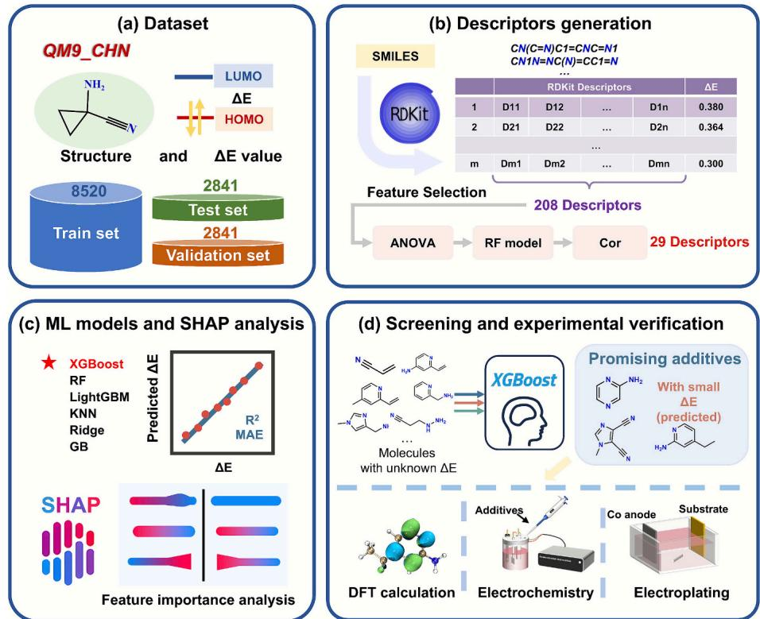  
Fig. 1. Workflow for the discovery of high-performance cobalt electrodeposition additives. (a) Initial dataset: division into training (60%), validation (20%), and test (20%) sets. (b) Selection of key molecular descriptors by comprehensive consideration of variance, RF model importance scores, and correlation. (c) Construction of ML models and feature importance analysis via SHAP. (d) Identification of promising additives by the XGBoost model and multidimensional experimental validation.

## 2. Method

## 2.1. Datasets and molecular descriptors

To enable comprehensive molecular screening, we extracted and established a CHN subset (over 14,000 molecules containing only C, H, and N) derived from QM9 [41]—a public quantum chemistry database widely acknowledged to deliver high-fidelity quantum chemical properties for the comprehensive chemical space of small organic molecules in which all properties were computed via density functional theory (DFT) using the B3LYP functional and the 6-31G(2df, p) basis set. This dataset has been validated in computational chemistry research, covering diverse molecular topologies and functional groups of small organics, which provides sufficient structural diversity to avoid overfitting in subsequent machine learning modeling. We specifically selected the CHN subset to align with the study's focus on nitrogen containing additives, excluding molecules with other heteroatoms that could confound model training and prediction due to fundamentally different electrochemical mechanisms.

Molecular descriptors were calculated by RDKit [42], which is a widely used open-source cheminformatics toolkit that provides molecular descriptors and fingerprints for machine learning applications. A total of 208 structural and chemical descriptors were calculated. High dimensional features elevate the risk of model overfitting and compromise generalization performance [43], thereby necessitating feature dimensionality reduction to eliminate redundant features while mini mizing the loss of core information. The process of feature engineering is summarized in Fig. 2a. Firstly, the number of features was filtered to 130 based on variance tests (ANOVA) with a threshold of 0.01 [44]. Next, importance scores for the remaining 130 descriptors were obtained using random forest algorithm, serving to further mitigate data vari ability [45]. Twenty-four descriptors were selected according to ranking of importance and 6 structure-based descriptors (prefixed with “fr”) were added to examine whether there is a relationship between func tional groups and target performance. The Pearson correlation co efficients of the 30 descriptors were further analyzed to remove one feature from pairs with a correlation higher than 0.92 [46]. Finally, 29 descriptors were obtained (Table S1), which reflect molecular charac teristics from multiple dimensions, including topological structure, physicochemical properties, electronic features, and substructural fragments. Fig. 2b illustrates the Pearson correlation matrix of the 29 descriptors after feature engineering.

## 2.2. Machine learning models establishment and evaluation

Herein, six machine learning regression algorithms were compared, including eXtreme Gradient Boosting (XGBoost) [47], Random Forests (RF) [48], Light Gradient Boosting Machine (LightGBM) [49], K-Nearest Neighbor Regression (KNN) [50], Ridge Regression (Ridge) [51], and Gradient Boosting Decision Tree (GB) [52]. Since the applicability of a model to specific tasks depends on data characteristics and objectives, comparing multiple algorithms is essential to select the best-fitting model.

The machine learning implementation was carried out using Scikitlearn [53], a widely used open-source Python module. The entire dataset was randomly partitioned into three parts, with a split of 60% for the training set, 20% for the test set, and 20% for the validation set. The substantial sample size ensures that this splitting strategy inherently preserves the consistency of target property distributions across subsets (Fig. S1). Specifically, the training set was employed for model fitting, while the test set was strictly held out and reserved exclusively for the final evaluation. The process of hyperparameter search via Bayesian optimization algorithm using the Optuna package [54] was conducted on the validation set [55], with the final parameters determined after at least 500 optimization iterations. Mean absolute error (MAE) and coefficient of determination (R2) were used to evaluate the performance of different models [56].

## 2.3. Quantum chemical calculation

To verify the accuracy of the machine learning predictions, density functional theory (DFT) calculations were performed using the Gaussian 16W package. These calculations adopted the same B3LYP functional and 6-31G(2df, p) basis set as those used for the training dataset to ensure data consistency. Furthermore, to better emulate the electrochemical environment and capture weak intermolecular interactions, Grimme's D3 dispersion correction with Becke-Johnson damping (GD3BJ) and the Polarizable Continuum Model (PCM) with water as the solvent were employed—the former to compensate for the van der Waals forces neglected by B3LYP, and the latter to mimic the solvation effects in cobalt electrodeposition systems.

## 2.4. Experimental

## 2.4.1. Chemicals and reagents

The cobalt makeup solution comprises 0.05 mol/L CoSO₄⋅7H₂O and

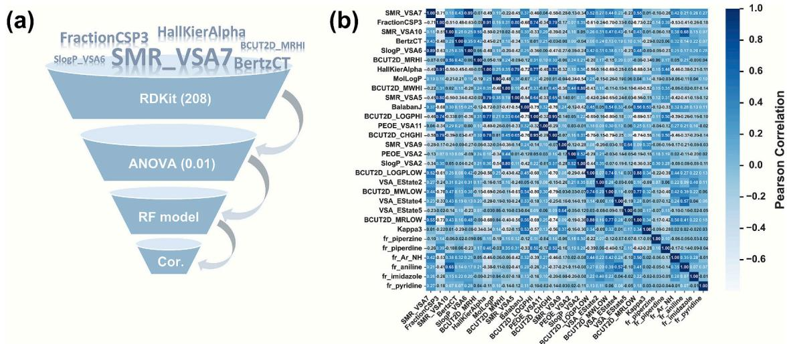  
Fig. 2. (a) The process of feature engineering. (b) Correlation matrix depicting Pearson coefficients among the 29 screened features

30 g/L H₃BO₃, with its pH adjusted to 3.5 using $\mathrm { H } _ { 2 } \mathrm { S O } _ { 4 } .$ . Three additives—2-aminopyrazine (APZ), 1-methylimidazole-4,5-dicarbonitrile (MIDCN), and 2-amino-4-ethylpyridine (AEP)—were employed. The additives were incorporated into the cobalt electrolyte to reach predetermined mass concentrations.

## 2.4.2. Electrochemical

Cyclic voltammetry (CV) and chronopotentiometry (CP) were conducted to investigate the effect of additives on Co deposition. The ex periments were performed on an electrochemical workstation (CHI660E, Chenhua) using a three-electrode system consisting of a 5 mm-diameter platinum rotating disk electrode (Pt-RDE), a platinum plate (CE), and a saturated Hg/Hg₂SO₄ reference electrode (RE). CP was carried out at a constant current density of 0.4 $\mathrm { \sf A } / \mathrm { d } \mathrm { m } ^ { 2 }$ with a rotation rate of 500 rpm. CV was performed over a potential range of −1.5 to 0.2 V at a scan rate of 50 mV/s.

## 2.4.3. Electrodeposition

A silicon wafer with a 500 nm-thick Cu seed layer $( 1 . 5 \times 1 . 5 \ : \mathrm { c m } ^ { 2 } )$ was used as the substrate for Co electrodeposition. A cobalt plate (99.99% purity) served as the anode. Cobalt films were deposited at a current density o $\mathrm { f } 0 . 4 \mathrm { A } / \mathrm { d } \mathrm { m } ^ { 2 }$ and a rotation speed of 500 rpm for 10 min.

(a)  
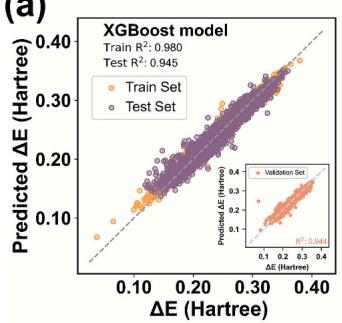

(b)  
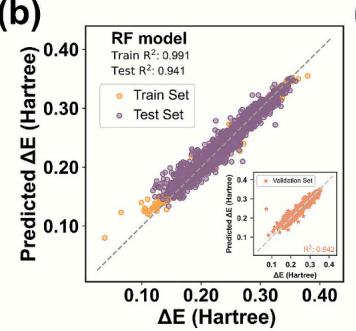  
(e)

(d)  
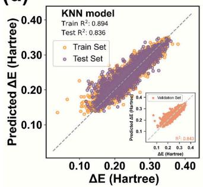  
(g)

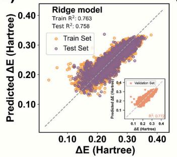  
(h)

Through‑silicon vias (TSVs) with a diameter of around 4 μm, a height of around 20 μm, and an aspect ratio $\mathbf { ( A R ) } > 5$ were used in this study. The morphology of cobalt films was analyzed using scanning electron microscopy (SEM, RISE). Surface roughness was evaluated by atomic force microscopy (AFM, Oxford Instruments MFP-3D).

## 3. Results and discussion

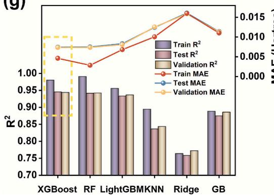  
(c)

## 3.1. Performance evaluation of the ML models

The relationship between the optimized descriptors and ΔE was modeled using six ML algorithms, including XGBoost, RF, LightGBM, KNN, Ridge regression, and GB, as illustrated in Fig. 3. Among these, traditional methods (KNN and Ridge regression) exhibited limited predictive accuracy, with test $\mathrm { R } ^ { 2 }$ values of 0.836 and 0.758, respectively (Fig. 3d, e). In contrast, the ensemble-based methods (XGBoost, RF, LightGBM, and GB) demonstrated better predictive performance, indicating that ΔE likely exhibits complex nonlinear relationships which simple linear or distance-based models struggle to capture [57] (Fig. 3a–c, f). The Random Forest (RF) model demonstrated exceptionally high goodness-of-fit on the training set $( \mathsf { R } ^ { 2 } = 0 . 9 9 1 )$ , yet its per formance on the test set was comparatively lower $( \mathbb { R } ^ { 2 } = 0 . 9 4 1 )$ , as shown in Fig. 3b. This discrepancy suggests the presence of a certain degree of overfitting, which occurs because the deep decision trees constituting the model overlearn specific details and noise from the training set, compromising the generalizability gained from prediction averaging [58]. Among all models, XGBoost achieved superior performance, with an MAE of 0.00741 Hartree and an $\mathrm { R } ^ { 2 }$ value of 0.945 on the test set (Fig. 3h), which highlights the advantage of its gradient boosting strategy with regularization in preventing overfitting while preserving predictive power [47]. The robustness of this model was further vali dated by 5-fold cross-validation (Table S2), ensuring that the predictive accuracy was not a result of favorable data partitioning. The subsequent SHAP analysis and application focused solely on the XGBoost model. The hyperparameters optimized through Bayesian optimization are provided in the Supporting Information (Table S3).

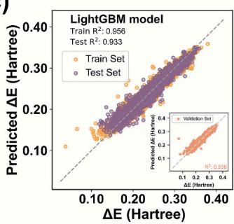

(f)  
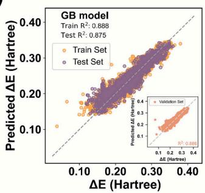

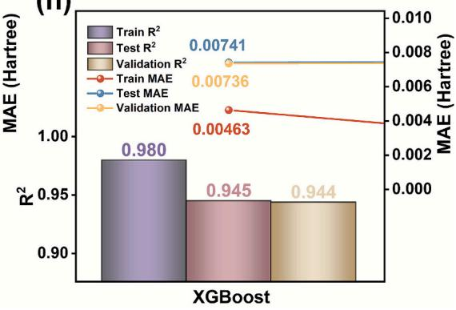  
Fig. 3. Machine learning performance for ΔE: (a)–(f) comparison of six machine learning regression methods for constructing QSPR models. (a) eXtreme Gradient Boosting (XGBoost); (b) Random Forests (RF); (c) Light Gradient Boosting Machine (LightGBM); (d) K-Nearest Neighbor Regression (KNN); (e) Ridge Regression (Ridge); (f) Gradient Boosting Decision Trees (GB). (g) Comparison of all models based on R2 and MAE metrics. (h) Detailed results of the optimal XGBoost model

## 3.2. Feature importance analysis by SHAP

Shapley Additive Explanations (SHAP) was employed to identify the most influential input descriptors [59]. It provides enhanced interpretability compared to conventional methods by elucidating both the magnitude and direction of feature impact on ΔE. Fig. 4a reveals the importance ranking of the descriptors based on the mean absolute SHAP values. It can be concluded that SMR\_VSA7 is the primary descriptor influencing ΔE, whereas the six structure-based descriptors (e.g., fr\_piperdine, fr\_imidazole) exhibit negligible significance. This may be attributed to the fact that although functional groups alter the electronic structure, polarity, and steric environment of molecules, these effects are already captured by global descriptors that represent the molecule's overall charge and configurational properties.

Fig. 4b depicts the distribution relationship between feature values and their corresponding SHAP values. Each data point represents a molecule, where red indicates greater feature values and blue indicates lower values. The x-axis represents the SHAP values of each feature, where positive and negative values indicate positive and negative contributions to the model's predictions, respectively. The predominance of red dots on the left side indicates that SMR\_VSA7, BCUT2D\_MRHI, and BertzCT exert a negative effect on ΔE—specifically, the larger their values, the smaller the predicted ΔE. In contrast, HallKierAlpha and FractionCSP3 show a positive association with ΔE. Therefore, a molecule characterized by a low ΔE is likely to possess high values of SMR\_VSA7, BCUT2D\_MRHI, and BertzCT, coupled with low values of HallKierAlpha and FractionCSP3.

Here, we highlight two descriptors — SMR\_VSA7 and HallKierAlpha. The chemical interpretations and the corresponding mathematical

(a)  
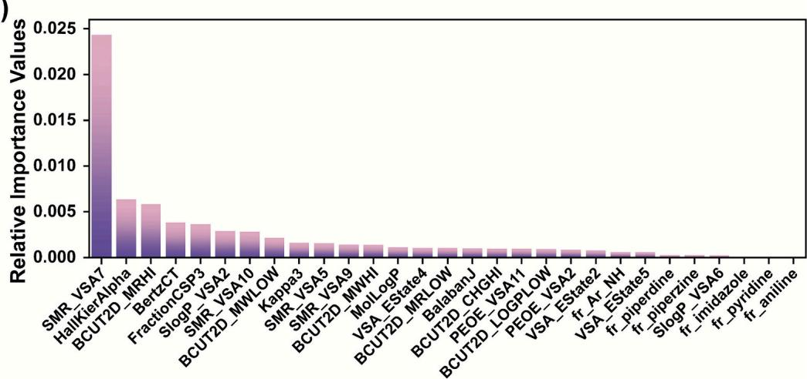

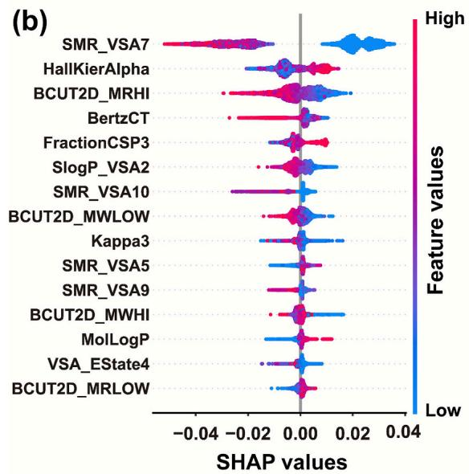

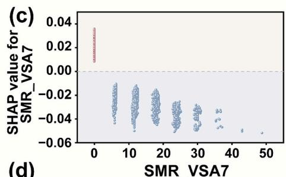

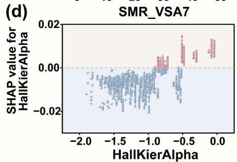  
Fig. 4. Feature importance analysis for ΔE on the XGBoost model using SHAP. (a) Importance ranking of the optimized descriptors based on the average of absolute SHAP values. (b) Bee-swarm summary plot showing the distribution of SHAP values for the top fifteen descriptors (arranged in descending order of importance). Distribution diagrams illustrating the relationship between feature values and corresponding SHAP values for (c) SMR\_VSA7 and (d) HallKierAlpha.

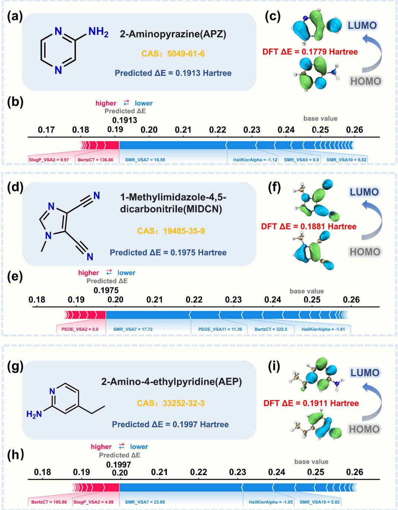  
Fig. 5. Configurations and predicted ΔE of molecules screened by the XGBoost model. (a), (d), (g) Structures and predicted ΔE of APZ, MIDCN, and AEP, respectively; (b), (e), (h) SHAP force plots for APZ, MIDCN, and AEP, respectively (red indicates features that increase ΔE, while blue indicates those that decrease it; The intersection of red and blue zones corresponds to the model's predicted ΔE); (c), (f), (i) DFT-calculated ΔE of APZ, MIDCN, and AEP, respectively. Orbital visualization was conducted with Multiwfn [62,63].

definitions of these descriptors are provided in Fig. S2. SMR\_VSA7 rep resents the sum of the van der Waals surface areas of atoms contributing to the molar refractivity value within the range of 3.05 to 3.63 [60,61]. This reflects a relatively high polarizability interval, reflecting the surface exposure of atoms with moderately high polarizability within the molecule. From Fig. 4c, the SHAP values are positive exclusively when SMR\_VSA7 approaches zero, implying the absence of atoms with molar refractivity within this specified range. Furthermore, molecules with large SMR\_VSA7 values tend to exhibit lower ΔE values. HallKierAlpha is a topochemical descriptor based on molecular topology. Fig. 4d in dicates that molecules with smaller HallKierAlpha (αHK) values gener ally possess lower ΔE. This is because lower αHK reflects compact molecular architectures, where constrained structural configurations facilitate orbital energy minimization through enhanced electron delocalization. These findings may provide useful guidance for the preliminary screening of additives.

## 3.3. Screening small molecule and experimental verification

Based on the ML model, we can perform high-throughput ΔE predictions across a large molecular space for preliminary assessment. To rapidly advance these predictions to experimental validation, we employed a commercially available (CA) dataset with unknown ΔE as the prediction set. Every molecule in the dataset is quality-controlled, eliminating delays and costs associated with synthetic feasibility. Spe cifically, we mapped the chemical space of the training set onto the Sigma–Aldrich catalog and retrieved 4355 nitrogen-containing organic compounds. After prioritizing candidates based on the predicted ΔE values, the top 1% were flagged as promising additives. Considering accessibility, toxicity, and cost, we selected three molecules — 2-amino pyrazine (APZ), 1-methylimidazole-4,5-dicarbonitrile (MIDCN), and 2- amino-4-ethylpyridine (AEP) — for subsequent experimental verification (Table S4). These candidates exhibited favorable frontier orbital energy gaps (ΔE), underscoring their adsorption activity on the metal surface. Fig. 5a, d, and g illustrate their chemical structures and predicted ΔE values. DFT validation showed good agreement with XGBoost predictions, with a maximum relative error of 7.5% (Fig. 5c, f, i). SHAP force plots quantitatively decompose the predicted ΔE for each molecule into additive feature contributions (Fig. 5b, e, h). SMR\_VSA7 exhibits the largest-magnitude negative SHAP value for all additives, indicating its dominant role in reducing ΔE. This observation corroborates the global feature-importance ranking, underscoring SMR\_VSA7 as a critical determinant of the target property.

## 3.3.1. Electrochemical validation

The effects of additives on cobalt electrodeposition were validated by electrochemical characterization. Fig. 6a-c show the potential transients during Chronopotentiometry (CP). A transient polarization appears immediately upon the addition of APZ and MIDCN, and a polarization for AEP is observed at concentrations above 50 ppm. Subsequently, all three additives cause increasingly cathodic polarization, ultimately resulting in voltage drops of 236, 244 and 119 mV for APZ, MIDCN and AEP, respectively, demonstrating a strong interaction between the ad ditives and the cobalt surface. Cyclic voltammetry (CV) was used to further investigate the impact on Co electrodeposition at different concentrations of additives (Fig. 6d-f). The magnified views of the cobalt deposition potential range show a negative shift in deposition potential upon additives addition, as a more negative potential is required to drive the deposition reaction. The anodic stripping area decreases with increasing concentration for all three additives, indicating that they can effectively inhibit the deposition of cobalt [64]. The introduction of AEP additionally gives rise to an extra anodic peak, which probably

(a)

corresponds to the co-deposition of the additive with cobalt [65]. Notably, although all three additives effectively adsorb onto the surface and inhibit cobalt deposition (due to their low ΔE values), MIDCN demonstrates superior polarization performance. This can be attributed to the fact that the thermodynamic adsorption tendency -represented by ΔE — serves as a fundamental prerequisite for inhibition effect. Nevertheless, once adsorption has occurred, differences in suppression efficacy are further modulated by kinetic factors, such as adsorption configuration and steric hindrance. This finding highlights that incorporating descriptors characterizing adsorption configuration and kinetic behavior in future will enable the quantitative prediction of inhibitory efficacy.

The adsorption of polarizing additives facilitates the formation of flat cobalt plating by modulating the electrodeposition process (Fig. 7a). Without additives, the “Tip effect” causes preferential electrodeposition of ${ \mathsf { C o } } ^ { 2 + }$ at protruding sites, leading to uneven cobalt growth. In contrast, additives adsorb onto the electrode surface, inducing deposit suppression at these high-curvature regions. This adsorption-mediated regulation homogenizes the electrodeposition kinetics across the entire substrate, thereby eliminating uneven growth and promoting the formation of a flat cobalt plating. Guided by electrochemical tests and preexperiment, the additive concentrations were determined to be 20 ppm (APZ), 10 ppm (MIDCN), and 50 ppm (AEP) for optimum plating performance. The cobalt film deposited in the VMS electrolyte exhibits a dull, gray appearance, rendering the reflected pattern almost invisible (Fig. 7b). In contrast, the films obtained with the three chosen additives demonstrate a mirror-like surface, enabling a clear and vivid reflection of the pattern (Fig. 7e, h, k). SEM images acquired at identical magnification reveal that the cobalt deposit obtained from the additive-free VMS is characterized by large, ridge-shaped grains with a random and disordered morphology (Fig. 7c). A markedly different morphology is observed upon the addition of the three additives, featuring a compact and smooth surface comprised of refined grains (Fig. 7f, i, l). This microstructural refinement is related to the strong polarization behavior of the additives. Accordingly, the surface roughness is significantly reduced. In comparison to the arithmetic mean roughness $\left( R _ { \mathrm { a } } \right)$ of 69.4

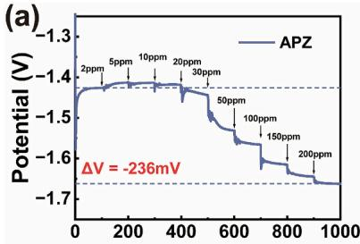

## 3.3.2. Electrodeposition

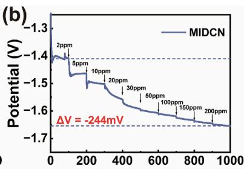

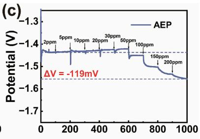

(d)  
(e)  
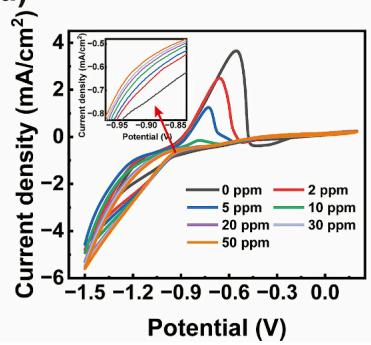

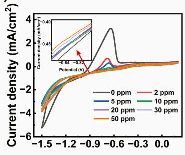

(f)  
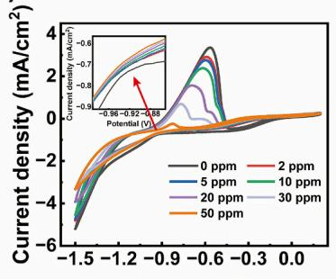  
Fig. 6. (a)–(c) Chronopotentiometry (CP) curves for APZ, MIDCN, and AEP, respectively; the corresponding additive was injected into the electrolyte every 100 s. (d) (f) Cyclic voltammetry (CV) curves for different concentrations of APZ, MIDCN, and AEP, respectively, accompanied by a magnified view of the cobalt deposition potential range

(c)  
(f)  
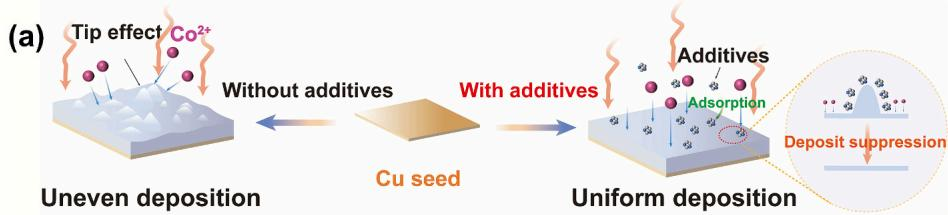

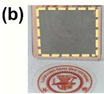

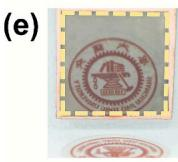

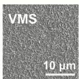

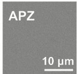

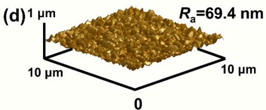

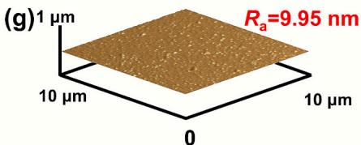

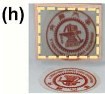

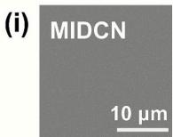

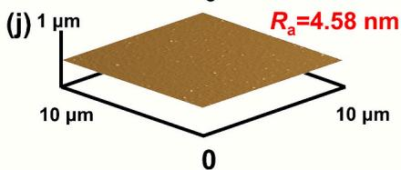

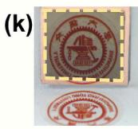  
(1)

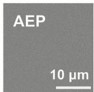

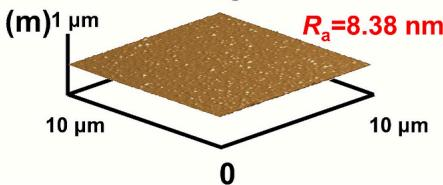  
Fig. 7. Surface characterization of cobalt films. (a) Schematic of the mechanism. Optical photographs, SEM images, and AFM topography of cobalt films obtained from: (b–d) VMS, (e–g) APZ, (h–j) MIDCN, and (k–m) AEP.

nm observed for the VMS sample (Fig. 7d), the $R _ { a }$ values for films deposited with the addition of APZ (Fig. 7g), MIDCN (Fig. 7j), and AEP (Fig. 7m) are decreased to 9.95 nm, 4.58 nm, and 8.38 nm, respectively. These results confirm that the selected additives enhance the uniformity and flatness of the cobalt film during electrodeposition.

Through‑silicon via (TSV) technology is widely used in advanced packaging to achieve high-density interconnections (Fig. 8a). During the TSV filling process, the tip effect induced by the geometric structure results in enhanced electric field intensity and accelerated mass trans port at the top of the TSV [65], leading to the formation of voids or seam defects in VMS, as illustrated in Fig. S3. In contrast, cobalt superfilling i successfully achieved using 20 ppm APZ, 10 ppm MIDCN, and 50 ppm AEP, respectively (Fig. 8c–e). EDS mapping confirms the uniform deposition of cobalt throughout the entire via structure (Fig. 8f–h). Specifically, the purple region clearly illustrates the distribution of Co, while the yellow region serves as a structural reference, corresponding to the elemental mapping of the silicon substrate. This consistent and homogeneous distribution of Co demonstrates the effectiveness of these candidates as additives in achieving uniform and void-free Co deposition in high-aspect-ratio microstructures. The underlying bottom-up filling mechanism can be described as follows (Fig. 8b). In the initial stage of electrodeposition, additives uniformly adsorb onto the cobalt surface. As the deposition proceeds, the additive molecules within the TSV trenches are gradually depleted. Owing to mass transport constraints, the replenishment of additives inside the deep vias occurs at a slower rate than on the upper surface, resulting in a reduced inhibitor concentration within the trenches compared to the via opening. This concentration gradient leads to weaker suppression at the bottom of the via relative to its top. Consequently, the deposition rate is elevated at the bottom in comparison to the top, facilitating bottom-up filling and thereby enabling the formation of void-free interconnect structures.

## 4. Conclusion

In summary, this study established a data-driven framework that integrates machine learning with experimental validation to efficiently identify novel, high-efficiency, and low-toxicity nitrogen-containing additives for superconformal cobalt electrodeposition. A comprehensive description of the molecules' physical properties was obtained using RDKit descriptors, and the key feature set was subsequently identified by integrating three feature selection strategies. Among the six evaluated ML models, XGBoost achieved the best predictive performance for ΔE prediction $( \mathrm { R } ^ { 2 } = 0 . 9 4 5 )$ . SHAP analysis revealed that descriptors associated with van der Waals surface area (SMR\_VSA7) and molecular topology (HallKierAlpha) significantly influence ΔE. These findings provide interpretable insights that can guide the design of additive molecules. The trained model was applied to a commercial molecular database, successfully identifying APZ, MIDCN, and AEP as three promising candidate molecules. Experimental validation demonstrated that the three additives effectively induce cathodic polarization and exhibit significant inhibitory effects even at low concentrations. In terms of coating quality, the introduction of these additives reduced the surface roughness (R ) of the cobalt film from 69.4 nm to below 10 nm, with MIDCN achieving a remarkably low roughness of 4.58 nm. Moreover, all three additives successfully facilitated defect-free superfilling of highaspect-ratio through‑silicon vias (TSVs), thereby confirming their excellent capability for three-dimensional structural filling. This study proposes an effective approach for the development of environmentally friendly and cost-efficient advanced interconnect additives.

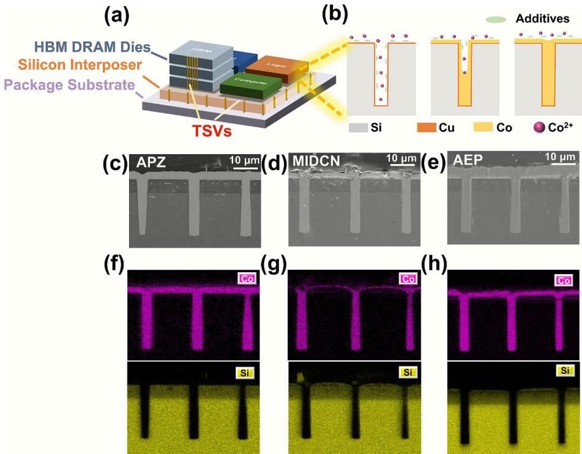  
Fig. 8. (a) Application of Through-Silicon Via (TSV) technology in 2.5D/3D interconnections. (b) Schematic illustration of the bottom-up superfilling mechanism for cobalt electrodeposition. (c–e) Cross-sectional SEM images of TSV filling with 20 ppm APZ, 10 ppm MIDCN, and 50 ppm AEP, respectively. (f–h) Corresponding EDS mapping results for the TSV fillings with APZ, MIDCN, and AEP, respectively.

## CRediT authorship contribution statement

Yuhang Jiang: Writing – original draft, Visualization, Methodology, Data curation. Guoxiang Cui: Methodology, Formal analysis. Sibo Zhao: Writing – review & editing, Data curation. Xiangyu Ren: Writing – review & editing, Data curation. Shenghong Ju: Writing – review & editing, Supervision, Funding acquisition, Conceptualization. Yunwen Wu: Writing – review & editing, Supervision, Funding acquisition, Conceptualization.

## Declaration of competing interest

The authors declare that they have no known competing financial interests or personal relationships that could have appeared to influence the work reported in this paper.

## Acknowledgements

This work was supported by the National Natural Science Foundation of China (NO. 22472095), the Shanghai Municipal Education Commission Research Project (2024AIZD012) and Shanghai International Science and Technology Collaboration Project (No. 24160712600). The computations in this work were run on the Siyuan-1 cluster supported by the Center for High Performance Computing at Shanghai Jiao Tong University.

## Appendix A. Supplementary data

Supplementary data to this article can be found online at https://doi. org/10.1016/j.cej.2026.172903.

## Data availability

The source code and original data can be accessed at https://github. com/ai4chips/ML4CoAdditives.

## References

[1] C. Auth, A. Aliyarukunju, M. Asoro, D. Bergstrom, V. Bhagwat, J. Birdsall, N. Bisnik, M. Buehler, V. Chikarmane, G. Ding, Q. Fu, H. Gomez, W. Han, D. Hanken, M. Haran, M. Hattendorf, R. Heussner, H. Hiramatsu, B. Ho, S. Jaloviar, I. Jin, S. Joshi, S. Kirby, S. Kosaraju, H. Kothari, G. Leatherman, K. Lee, J. Leib, A. Madhavan, K. Marla, H. Meyer, T. Mule, C. Parker, S. Parthasarathy, C. Pelto, L. Pipes, I. Post, M. Prince, A. Rahman, S. Rajamani, A. Saha, J.D. Santos, M. Sharma, V. Sharma, J. Shin, P. Sinha, P. Smith, M. Sprinkle, A.S. Amour, C. Staus, R. Suri, D. Towner, A. Tripathi, A. Tura, C. Ward, A. Yeoh, A 10nm high performance and low-power CMOS technology featuring 3rd generation FinFET transistors, Self-Aligned Quad Patterning, contact over active gate and cobalt local interconnects, in: Proceedings of the 2017 IEEE International Electron Devices Meeting (IEDM), 2017, pp. 29.1.1–29.1.4, https://doi.org/10.1109 JEDM 2017 8268472

[2] N. Bekiaris, Z. Wu, H. Ren, M. Naik, J.H. Park, M. Lee, T.H. Ha, W. Hou, J.R. Bakke, M. Gage, Y. Wang, J. Tang, Cobalt fill for advanced interconnects, in: Proceedings of the 2017 IEEE International Interconnect Technology Conference (IITC), 2017, pp. 1 3, https://doi.org/10.1109/IITC-AMC.2017.7968981.

[3] F.W. Mont, X. Zhang, W. Wang, J.J. Kelly, T.E. Standaert, R. Quon, E.T. Ryan, Cobalt interconnect on same copper barrier process integration at the 7nm node, in: Proceedings of the 2017 IEEE International Interconnect Technology Conference (IITC), 2017, pp. 1–3, https://doi.org/10.1109/IITC-AMC.2017.7968971.

[4] M.H.v.d. Veen, K. Vandersmissen, D. Dictus, S. Demuynck, R. Liu, X. Bin, P. Nalla, A. Lesniewska, L. Hall, K. Croes, L. Zhao, J. Bommels, ¨ A. Kolics, Z. Tokei, ¨ Cobalt bottom-up contact and via prefill enabling advanced logic and DRAM technologies, in: Proceedings of the 2015 IEEE International Interconnect Technology Conference and 2015 IEEE Materials for Advanced Metallization Conference (IITC MAM), 2015, pp. 25–28, https://doi.org/10.1109/IITC-MAM.2015.7325605.

[5] D. Gall, Electron mean free path in elemental metals, J. Appl. Phys. 119 (2016) 085101, https://doi.org/10.1063/1.4942216.

[6] D. Gall, The search for the most conductive metal for narrow interconnect lines, J. Appl. Phys. 127 (2020) 050901, https://doi.org/10.1063/1.5133671.

[7] C. Adelmann, K. Sankaran, S. Dutta, A. Gupta, S. Kundu, G. Jamieson, K. Moors, N. Pinna, I. Ciofi, S.V. Eishocht, J. Bommels, ¨ G. Boccardi, C.J. Wilson, G. Pourtois, Z. Tokei, ˝ Alternative metals: from ab initio screening to calibrated narrow line models, in: Proceedings of the 2018 IEEE International Interconnect Technology

Conference (IITC), 2018, pp. 154–156, https://doi.org/10.1109 IITC.2018.8456484.

[8] Q. Song, Y. Zhao, C. Wang, H. Xie, H. Yin, Z. Ning, Bubble-assisted densification of cobalt deposit during electrowinning in CoCl2 solution, Hydrometallurgy 189 (2019) 105111, https://doi.org/10.1016/j.hydromet.2019.105111.

[9] F. Su, C. Liu, Q. Zuo, P. Huang, M. Miao, A comparative study of electrodeposition techniques on the microstructure and property of nanocrystalline cobalt deposit, Mater. Chem. Phys. 139 (2013) 663–673, https://doi.org/10.1016/j. matchemphys.2013.02.014.

[10] X. Ni, Y. Chen, X. Jin, C. Wang, Y. Huang, Y. Hong, X. Su, G. Zhou, S. Wang, W. He, Q. Chen, Investigation of polyvinylpyrrolidone as an inhibitor for trench superfilling of cobalt electrodeposition, J. Taiwan Inst. Chem. Eng. 112 (2020) 232–239, https://doi.org/10.1016/j.jtice.2020.06.010.

[11] C.H. Lee, J.E. Bonevich, J.E. Davies, T.P. Moffat, Superconformal electrodeposition of co and co–Fe alloys using 2-Mercapto-5-benzimidazolesulfonic acid, J. Electrochem. Soc. 156 (2009) D301, https://doi.org/10.1149/1.3142427.

[12] T.W. Lyons, Q. Huang, Effects of cyclohexane- Monoxime and Dioxime on the electrodeposition of cobalt, Electrochim. Acta 245 (2017) 309–317, https://doi org/10.1016/j.electacta.2017.05.130.

[13] X. Ma, Y. Li, P. Yang, J. Zhang, M. An, Influence of suppressing additive malachite green on superconformal cobalt electrodeposition, J. Electroanal. Chem. 92 (2022) 116696, https://doi.org/10.1016/j.jelechem.2022.116696.

[14] F. Wafula, J. Wu, S. Branagan, H. Suzuki, A. Gracias, J.v. Eisden, Electrolytic cobalt fill of sub-5 nm node interconnect features, in: Proceedings of the 2018 IEEE International Interconnect Technology Conference (IITC), 2018, pp. 123–125, https://doi.org/10.1109/IITC.2018.8430384.

[15] M. Zhang, P. Chang, P. Chen, T. Hang, M. Li, Y. Wu, Super-flat and uni-oriented cobalt film electrodeposited by modulating the crystal nucleation and growth behavior, Appl. Surf. Sci. 645 (2024) 158795, https://doi.org/10.1016/j. apsusc.2023.158795.

[16] P. Xu, X. Shen, X. Zhang, W. Tang, W. Huang, Q. Xu, Study on the electrochemical deposition behavior and blind hole filling behavior of cobalt under the regulation of hexamethylenetetramine as a leveling agent, Electrochim. Acta 532 (2025) 146509, https://doi.org/10.1016/j.electacta.2025.146509.

[17] A. Liu, W. Guan, X. Zhao, X. Ren, X. Liang, L. Gao, Y. Li, T. Ma, Investigation on the interfacial behavior of polyorganic inhibitors on a metal surface by DFT study and MD simulation, Appl. Surf. Sci. 541 (2021) 148570, https://doi.org/10.1016/j. apsusc.2020.148570.

[18] K. Fukui, Role of frontier orbitals in chemical reactions, Science 218 (1982) 747–754, https://doi.org/10.1126/science.218.4574.747.

[19] R.G. Pearson, Hard and soft acids and bases, J. Am. Chem. Soc. 85 (1963) 3533 3539, https://doi.org/10.1021/ja00905a001.

[20] L. Guo, S. Li, Z. He, Y. Fu, F. Qiu, R. Liu, G. Yang, Electroplated copper additives for advanced packaging: a review, ACS Omega 9 (2024) 20637 20647, https://doi. org/10.1021/acsomega.4c01707.

[21] X. Ni, C. Wang, Y. Su, Y. Luo, Y. Ye, X. Su, W. He, S. Wang, Y. Hong, Y. Chen, G. Zhou, B. Liu, Effect of 3-mercapto-1-propane sulfonate sulfonic acid and polyvinylpyrrolidone on the growth of cobalt pillar by electrodeposition, Nanotechnol. Rev. 11 (2022) 1209–1218, https://doi.org/10.1515/ntrev-2022- 0071.

[22] Z.-Y. Wang, L. Jin, G. Li, J.-Q. Yang, W.-Q. Li, D. Zhan, Y.-X. Jiang, F.-Z. Yang, S.- G. Sun, Electrochemical and in situ FTIR spectroscopic studies of gentian violet as a novel leveler in through-holes metallization for printed circuit board applications, Electrochim. Acta 410 (2022) 140018, https://doi.org/10.1016/j. electacta.2022.140018.

[23] D. Zhang, Y. Chen, Y. Su, Y. Hong, C. Wang, G. Zhou, S. Wang, W. He, Y. Sun, W. Zhang, X. He, C. Xu, Y. Li, Z. Xu, Y. Du, Additive-assisted cobalt electrodeposition as surface magnetic coating to enhance the inductance of spiral copper inductors, Surf. Interfaces 28 (2022) 101603, https://doi.org/10.1016/j. surfin.2021.101603.

[24] Z. Lei, L. Chen, W. Wang, Z. Wang, C. Zhao, Tetrazole derived levelers for filling electroplated cu Microvias: electrochemical behaviors and quantum calculations, Electrochim. Acta 178 (2015) 546–554, https://doi.org/10.1016/j. electacta.2015.08.037.

[25] Y. Li, P. Ren, R. Li, Y. Zhang, J. Zhang, P. Yang, M. An, A novel bright additive for copper electroplating: electrochemical and theoretical study, Ionics 29 (2023) 363 375, https://doi.org/10.1007/s11581-022-04799-7.

[26] M. Mouanga, L. Ricq, P. Berçot, Effects of thiourea and urea on zinc–cobalt electrodeposition under continuous current, J. Appl. Electrochem. 38 (2008) 231 238, https://doi.org/10.1007/s10800-007-9430-1.

[27] Q. Huang, T.W. Lyons, W.D. Sides, Electrodeposition of cobalt for interconnect application: effect of Dimethylglyoxime, J. Electrochem. Soc. 163 (2016) D715, https://doi.org/10.1149/2.1111613jes.

[28] M.A. Rigsby, L.J. Brogan, N.V. Doubina, Y. Liu, E.C. Opocensky, T.A. Spurlin, J. Zhou, J.D. Reid, Superconformal cobalt fill through the use of sacrificial oxidants, ECS Trans. 80 (2017) 767, https://doi.org/10.1149/08010.0767ecst.

[29] J. Kang, M. Sung, J. Byun, O.J. Kwon, J.J. Kim, Proton sensitive additive for cobalt electrodeposition, J. Electrochem. Soc. 167 (2020) 122510, https://doi.org 10.1149/1945-7111/abb284.

[30] L. Xu, X. Tan, Z.-H. He, L. Hao, W. Wang, Z.-T. Liu, A.W. Robertson, Z. Sun, Emerging green catalytic synthesis of biomolecules from CO and/or nitrogenous small molecules, Matter 7 (2024) 59–81, https://doi.org/10.1016/j. matt.2023.10.025.

[31] Q. Li, J. Hu, J. Zhang, P. Yang, Y. Hu, M. An, Screening of electroplating additive for improving throwing power of copper pyrophosphate bath via molecular

dynamics simulation, Chem. Phys. Lett. 757 (2020) 137848, https://doi.org/ 10.1016/j.cplett.2020.137848.

[32] Z. Han, S. Xia, Z. Chen, Y. Guo, Z. Li, Q. Huang, X.-J. Liu, W.-W. Xu, Facilitated the discovery of new γ/γ’ co-based superalloys by combining first-principles and machine learning, npj Comput, Mater 10 (2024) 259, https://doi.org/10.1038/ s41524-024-01455-8.

[33] Z.-W. Zhao, Y. Geng, A. Troisi, H. Ma, Performance prediction and experimental optimization assisted by machine learning for organic photovoltaics, Adv. Intell. Syst. 4 (2022) 2100261, https://doi.org/10.1002/aisy.202100261.

[34] Y. Sun, M. Chen, Y. Zhao, Z. Zhu, H. Xing, P. Zhang, X. Zhang, Y. Ding, Machine learning assisted QSPR model for prediction of ionic liquid s refractive index and viscosity: the effect of representations of ionic liquid and ensemble mode development, J. Mol. Liq. 333 (2021) 115970, https://doi.org/10.1016/j. molliq.2021.115970.

[35] X. Zhang, B. Ding, Y. Wang, Y. Liu, G. Zhang, L. Zeng, L. Yang, C.-J. Li, G. Yang, M. K. Nazeeruddin, B. Chen, Machine learning for screening small molecules as passivation materials for enhanced perovskite solar cells, Adv. Funct. Mater. 34 (2024) 2314529, https://doi.org/10.1002/adfm.202314529.

[36] Y. Wang, Q. Tang, X. Xu, P. Weng, T. Ying, Y. Yang, X. Zeng, H. Zhu, Accelerated discovery of magnesium intermetallic compounds with sluggish corrosion cathodic reactions through active learning and DFT calculations, Acta Mater. 255 (2023) 119063, https://doi.org/10.1016/j.actamat.2023.119063.

[37] A. Aldossary, J.A. Campos-Gonzalez-Angulo, S. Pablo-García, S.X. Leong, E. M. Rajaonson, L. Thiede, G. Tom, A. Wang, D. Avagliano, A. Aspuru-Guzik, In silico chemical experiments in the age of AI: from quantum chemistry to machine learning and Back, Adv. Mater. 36 (2024) 2402369, https://doi.org/10.1002 adma.202402369.

[38] H. Li, J. Hao, S.-Z. Qiao, AI-driven electrolyte additive selection to boost aqueous Zn-ion batteries stability, Adv. Mater. 36 (2024) 2411991, https://doi.org/ 10.1002/adma.202411991

[39] D. Weininger, SMILES, a chemical language and information system. 1. Introduction to methodology and encoding rules, J. Chem. Inf. Comput. Sci. 28 (1988) 31–36, https://doi.org/10.1021/ci00057a005.

[40] S.M. Lundberg, S.-I. Lee, A unified approach to interpreting model predictions, in: Proceedings of the 31st International Conference on Neural Information Processing Systems (NIPS), 2017, pp. 4768–4777, https://doi.org/10.48550 arXiv.1705.07874.

[41] R. Ramakrishnan, P.O. Dral, M. Rupp, O.A. von Lilienfeld, Quantum chemistry structures and properties of 134 kilo molecules, Sci. Data 1 (2014) 140022, https://doi.org/10.1038/sdata.2014.22.

[42] RDKit: open-source cheminformatics. https://www.rdkit.org/, 2022. (Accessed 5 September 2022).

[43] E.W. Bai, Big data: the curse of dimensionality in modeling, in: Proceedings of the 33rd Chinese control conference (CCC), 2014, pp. 6–13, https://doi.org/10.1109 ChiCC 2014 6896586

[44] X. Huang, S. Ju, Tutorial: AI-assisted exploration and active design of polymers with high intrinsic thermal conductivity, J. Appl. Phys. 135 (2024) 171101, https://doi.org/10.1063/5.0201522.

[45] S. Zhang, X. He, X. Xia, P. Xiao, Q. Wu, F. Zheng, Q. Lu, Machine-learning-enabled framework in engineering plastics discovery: a case study of designing polyimides with desired glass-transition temperature, ACS Appl. Mater. Interfaces 15 (2023) 37893–37902, https://doi.org/10.1021/acsami.3c05376.

[46] C. Zhi, S. Wang, S. Sun, C. Li, Z. Li, Z. Wan, H. Wang, Z. Li, Z. Liu, Machine learning-assisted screening of Interface passivation materials for perovskite solar cells, ACS Energy Lett. 8 (2023) 1424–1433, https://doi.org/10.1021/ acsenergylett.2c02818.

[47] T. Chen, C. Guestrin, M. Assoc Comp, XGBoost: a scalable tree boosting system, in: Proceedings of the 2nd ACM SIGKDD International Conference on Knowledge Discovery and Data Mining (KDD), 2016, pp. 785–794, https://doi.org/10.1145/ 2939672.2939785.

[48] L. Breiman, Random forests, Mach. Learn. 45 (2001) 5–32, https://doi.org 10.1023/A:1010933404324.

[49] G. Ke, Q. Meng, T. Finley, T. Wang, W. Chen, W. Ma, Q. Ye, T.-Y. Liu, LightGBM: a highly efficient gradient boosting decision tree, in: Proceedings of the 31st International Conference on Neural Information Processing Systems (NIPS), 2017, pp. 3149–3157.

[50] T.M. Cover, P.E. Hart, Nearest neighbor pattern classification, IEEE Trans. Inf. Theory 13 (1967) 21 27, https://doi.org/10.1109/TIT.1967.1053964.

[51] A.E. Hoerl, R.W. Kennard, Ridge regression: biased estimation for nonorthogona problems, Technometrics 42 (2000) 80–86, https://doi.org/10.2307/1271436.

[52] J.H. Friedman, Greedy function approximation: a gradient boosting machine, Ann. Stat. 29 (2001) 1189–1232, https://doi.org/10.1214/aos/1013203451.

[53] F. Pedregosa, G. Varoquaux, A. Gramfort, V. Michel, B. Thirion, O. Grisel, M. Blondel, P. Prettenhofer, R. Weiss, V. Dubourg, J. Vanderplas, A. Passos, D. Cournapeau, M. Brucher, M. Perrot, E. ´ Duchesnay, Scikit-learn: machine learning in Python, J. Mach. Learn. Res. 12 (2011) 2825–2830.

[54] T. Akiba, S. Sano, T. Yanase, T. Ohta, M. Koyama, Optuna: a next-generation hyperparameter optimization framework, in: Proceedings of the 25th ACM SIGKDD International Conference on Knowledge Discovery Data Mining (KDD), 2019, pp. 2623 2631, https://doi.org/10.1145/3292500.3330701. J.P.o.t.t.A.S.I.C.o.K. D., D. Mining.

[55] J. Luketina, M. Berglund, K. Greff, T. Raiko, Scalable gradient-based tuning of continuous regularization hyperparameters, in: Proceedings of the 33rd International Conference on International Conference on Machine Learning (ICML), 2016, pp. 2952–2960, https://doi.org/10.48550/arXiv.1511.06727.

[56] G. Cui, Z. Guo, X. Ren, Y. Jiang, X. Jin, Y. Wu, S. Ju, Active learning for the discovery of binary intermetallic compounds as advanced interconnects, The Journal of Physical Chemistry Letters 16 (2025) 3579–3588, https://doi.org/ 10.1021/acs.jpclett.5c00386.

[57] J. Zhang, Z. Yang, X. Zhang, H. Yang, X. Nie, Q. Wu, H. Zhang, M. Yue, Machine learning-enabled prediction of synthesis–property relationships in cobalt nanowires as rare-earth-free permanent magnets, ACS Appl. Mater. Interfaces 17 (2025) 46067–46077, https://doi.org/10.1021/acsami.5c12123.

[58] L. Lang, L. Tiancai, A. Shan, T. Xiangyan, An improved random forest algorithm and its application to wind pressure prediction, Int. J. Intell. Syst. 36 (2021) 4016–4032, https://doi.org/10.1002/int.22448.

[59] W. Sun, Y. Zheng, K. Yang, Q. Zhang, A.A. Shah, Z. Wu, Y. Sun, L. Feng, D. Chen, Z. Xiao, S. Lu, Y. Li, K. Sun, Machine learning–assisted molecular design and efficiency prediction for high-performance organic photovoltaic materials, Sci. Adv. 5 (2019) eaay4275, https://doi.org/10.1126/sciadv.aay4275.

[60] L. He, K. Xiao, C. Zhou, G. Li, H. Yang, Z. Li, J. Cheng, Insights into pesticide toxicity against aquatic organism: QSTR models on daphnia magna, Ecotoxicol

Environ. Saf. 173 (2019) 285–292, https://doi.org/10.1016/j. ecoenv.2019.02.014.

[61] Y. Chen, C. Liu, G. Guo, Q. Zhao, H. Jiang, Q. Wu, D. Fang, W. Gao, Y. Chen, Q. Peng, K. Wu, B. Shen, D. Wu, F. Cao, H. Sun, Physical–chemical coupling machine learning approach to exploring reactive solvents for absorption capture of carbonyl sulfide, Chem. Eng. Sci. 280 (2023) 118984, https://doi.org/10.1016/j. ces.2023.118984.

[62] T. Lu, F. Chen, Multiwfn: a multifunctional wavefunction analyzer, J. Comput. Chem. 33 (2012) 580–592, https://doi.org/10.1002/jcc.22885.

[63] T. Lu, A comprehensive electron wavefunction analysis toolbox for chemists, Multiwfn, J. Chem. Phys. 161 (2024) 082503, https://doi.org/10.1063/ 5.0216272.

[64] Y. Wu, S. Ju, F. Li, M. Zhang, X. Ren, M. Li, Tailoring crystalline orientation of electrodeposited cobalt by alkynol additives, Electrochim. Acta 497 (2024) 144593, https://doi.org/10.1016/j.electacta.2024.144593.

[65] Y. Wu, M. Zhang, Y. Jiang, Y. Tong, P. Chang, T. Hang, M. Li, Investigation of phenyl methyl sulfoxide as an additive for cobalt super-filling in 3D interconnect, Surf. Interfaces 56 (2025) 105652, https://doi.org/10.1016/j.surfin.2024.105652.