# Superconformal Cobalt Fill through the Use of Sacrificial Oxidants

To cite this article: Matthew Aaron Rigsby et al 2017 ECS Trans. 80 767

View the article online for updates and enhancements.

## You may also like

Effects of Pyrrole Polymerizing Oxidant on the Properties of Pyrolysed Carbon-Supported Cobalt-Polypyrrole as Electrocatalysts for Oxygen Reduction Reaction Hao-Dong Sha, Xianxia Yuan, Xin-Xin Hu et al.

Theoretical estimation of sonochemicalyield in bubble cluster in acoustic field Zhuang-Zhi Shen and

Superconformal Cobalt Fill through the-Use of Sacrificial Oxidants Matthew Rigsby, Lee Brogan, Natalia Doubina et al.

# Superconformal Cobalt Fill Through the Use of Sacrificial Oxidants

M. A. Rigsby, L. J. Brogan, N. V. Doubina, Y. Liu, E. C. Opocensky, T. A. Spurlin, J. Zhou, and J. D. Reid

Lam Research Corporation, 11155 SW Leveton Dr., Tualatin, Oregon 97062, USA

Conventional damascene electroplating utilizes a combination of organic additives, namely, a suppressor, an accelerator, and a leveler, to achieve superconformal fill of interconnects. An alternative mechanism for superconformal cobalt fill is proposed here. This mechanism, the Differential Current Efficiency Fill (DCEF) mechanism, utilizes sacrificial oxidants to achieve voidfree superconformal fill. In the DCEF mechanism, the presence of a sacrificial oxidant, such as H+, O2, or an organic additive, promotes a difference in metal deposition rate between the field and the feature bottom. Addition of a single suppressor-type additive assists in driving the plating rate differential. By appropriately selecting the sacrificial oxidants, organic additives, the waveform, and the mass transport conditions, void-free superconformal cobalt fill can be achieved in a variety of features.

## Introduction

As interconnect dimensions continue to decrease, the extendibility of conventional copper damascene processing becomes increasingly problematic, in terms of yield and reliability. Small feature openings require thin seed to avoid having them close before the features can be filled (pinch-off) due to large overhang formation during seed deposition. The thin seed is susceptible to agglomeration, which leads to discontinuities and poor nucleation during the electrodeposition process. Reliability is also impacted by the decreasing line dimensions (1-2). Due to the higher current density in smaller lines, void formation occurs more readily, leading to decreasing electromigration lifetime as critical dimensions scale down. A third issue with decreasing dimensions is increasing RC delay and IR drop due to the exponential increase in resistivity with decreasing line crosssection (1-2). As such, the space occupied by the barrier layer within the feature becomes much more valuable.

To address these copper damascene extendibility issues, alternative metals, such as cobalt, are being actively explored for fill in smaller line dimensions (1-2). In terms of bulk resistivity, copper is significantly superior to cobalt. However, cobalt may not require a barrier layer, which frees up space within the feature for more metal. Because of the difference in barrier thickness, there may be a cross-over at narrow line widths such that a cobalt line will be less resistive than an equivalent copper line (3). Another benefit of removing the barrier is that the features are more open, decreasing the risk of discontinuous seed or pinch-off. Increasing the relative amount of metal within a line should also be advantageous for electromigration, as more metal would have to move to create a void. Additionally, the higher melting point of cobalt with respect to that of copper should lead to improved electromigration performance (1-2).

Superconformal cobalt fill does not follow the conventional damascene process, with suppressors, accelerators, and levelers. Rather, it can be achieved using a single organic additive. Previous studies have investigated the effect of various additives on cobalt fill in sub-micrometer trenches and through-silicon vias (4-6). Fill is typically attributed to a potential-dependent suppression effect that results in an S-shaped negative differential resistance. However, this mechanism may not hold for very small dimensions, on the order of tens of nanometers, as the ability to bifurcate into active and passive regimes is dependent on electrode dimensions (7-8).

New insights are presented for superconformal cobalt fill in nanometer-scale features through a proposed mechanism that the authors have termed the Differential Current Efficiency Fill (DCEF) mechanism. In the DCEF mechanism, the presence of one or more sacrificial oxidants promotes a difference in metal deposition rate between the field and the feature bottom by directly altering the deposition rate through current efficiency. Suppressor-type additives may promote the plating rate differential either by altering the kinetics of deposition or by behaving as a sacrificial oxidant, or both. It will be demonstrated that this strategy can be applied to achieve superconformal cobalt fill in nanometer-scale features.

## Experimental

A standard three-electrode cell was used for electrochemical studies. Mercury sulfate (sat. $\mathrm { K } _ { 2 } \mathrm { S O } _ { 4 } )$ reference electrode (MSE) from Koslow Scientific was used as the reference, and all potentials are reported with respect to MSE. The anode was 1.27 mm thick cobalt sheet with 9.9995% purity from ESPI Metals. For some electrochemical studies, a platinum rotating disk electrode (RDE) was used as the cathode. For electrochemical quartz crystal microbalance (EQCM) studies, a Maxtek Research QCM was used with a 5MHz gold sensing electrode.

The cobalt plating solution consisted of $\mathrm { C o S O } _ { 4 } { \cdot } 7 \mathrm { H } _ { 2 } \mathrm { O }$ (30-60 mM), $\mathrm { H } _ { 3 } \mathrm { B O } _ { 3 }$ (0.2- 0.6 M), and $\mathrm { H } _ { 2 } \mathrm { S O } _ { 4 }$ for pH adjustment. In some experiments, a propriety additive, Suppressor A, was added to the cobalt makeup solution.

For both the Pt RDE and the Au EQCM electrode, a layer of Co was pre-plated onto the cathode in additive-free solution at high current density. The pre-plated layer was subtracted from all stripping experiments. The EQCM response (deposition rate, $\bar { \mathsf { A } } / { \mathsf { s } } )$ was mathematically converted to a current density for the cobalt deposition and stripping separate from any side reactions. All EQCM data is presented as this QCM-derived cobalt partial current density.

Fill tests were done on coupons cut from cobalt-seeded wafers. The typical stack was $\mathrm { C o } / \mathrm { T i N } / \mathrm { S i O } _ { 2 } .$ For most experiments, the feature aspect ratio was at least 5:1.

## Results and Discussion

Figure 1 demonstrates void-free bottom-up fill of high-aspect-ratio features with cobalt. Such superconformal fill has been achieved in a variety of feature dimensions. The

mechanism by which bottom-up fill proceeds is quite different from that of the conventional copper damascene process. As such, the cobalt plating bath consists of only one additive, a suppressor-type organic species.

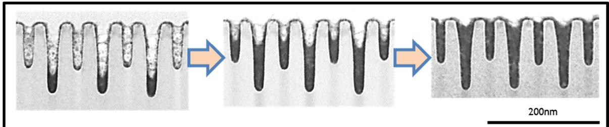  
Figure 1. Bottom-up progression of cobalt fill of cobalt-seeded structures. Bath contained Suppressor A.

To explore the mechanism that leads to superconformal cobalt fill, a series of electrochemical tests were done in combination with electrochemical quartz crystal microbalance (EQCM) experiments. Figure 2 compares the electrochemical and corresponding EQCM responses during a slow-sweep cyclic voltammogram at pH 2.5 and pH 4.0. The electrochemical data gives information about the suppression strength of the additives, but is complicated by the competing hydrogen evolution reaction and possible effects of pH on additive behavior, and so this type of data has only limited value. Because the EQCM is sensitive to mass change during the electrochemical process, it gives direct information on the amount of cobalt deposited under a given set of conditions, which is crucial when the system has competing reactions. In comparing these two plots, it is observed that the total current at a given potential is generally greater at the lower pH, but the cobalt partial current is greater at the higher pH. It can be concluded that hydrogen evolution is in strong competition with cobalt deposition and that it is, therefore, consuming a significantly greater portion of the current at lower pH.

A - Echem pH Effect - Suppressor A  
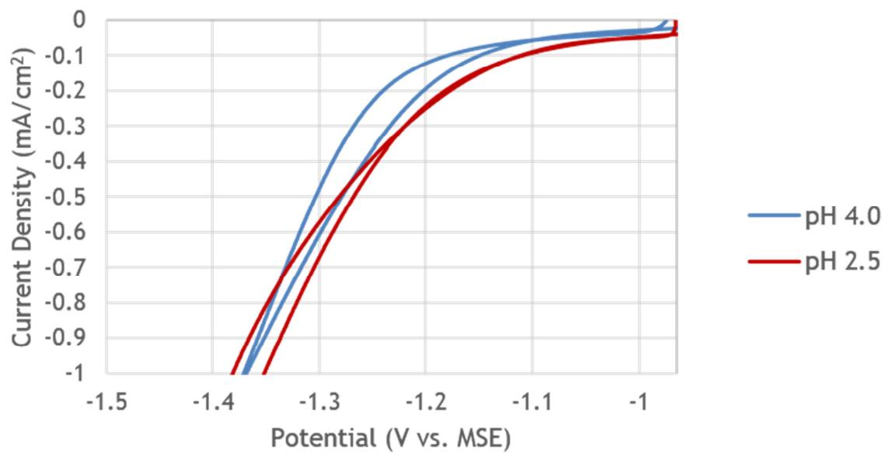

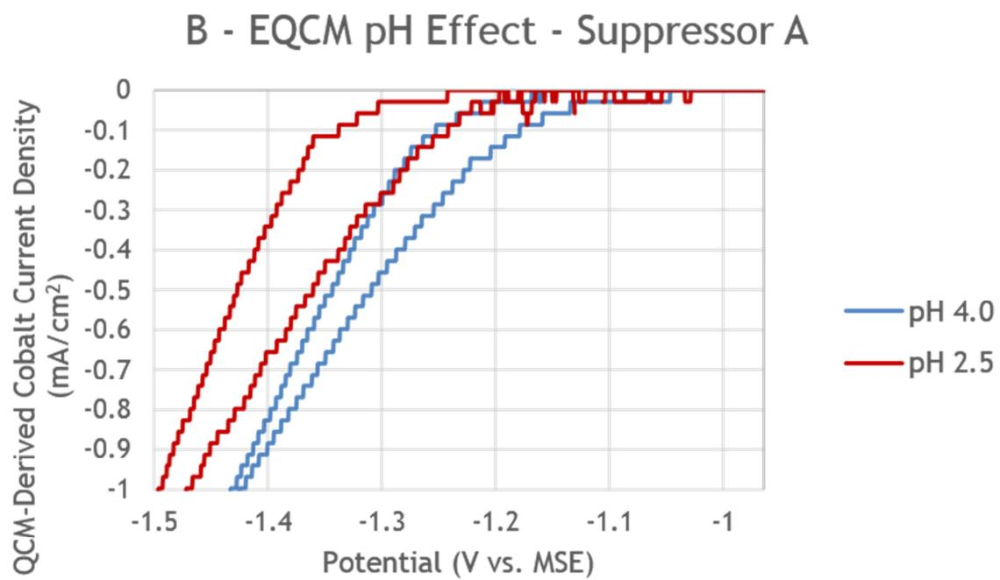  
Figure 2. A) Electrochemical response during cyclic voltammogram in presence of Suppressor A at pH 2.5 and pH 4.0. B) EQCM response during the cyclic voltammogram shown in A. 10 mV/s, no stirring.

From the data in Figure 2, current efficiency is an important factor in electrodeposition of cobalt. To further investigate this effect, EQCM experiments were done over a range of pH and current density. In Figure 3, the current efficiency derived from the EQCM has been plotted as a function of (A) the current density and (B) the potential. From Figure 3A, the current efficiency decreases with decreasing current density, and this effect is significantly enhanced by decreasing pH. Because both the onset of hydrogen evolution occurs at lower overpotential than that of cobalt deposition and the hydrogen evolution reaction kinetics are faster, current efficiency is low at the lower current densities (9). At high current density, the cobalt reduction dominates and the current efficiency is high.

From the plot of current efficiency as a function of the potential (Figure 3B), the presence of a suppressor-type additive is shown to play an important role in increasing the potential window over which hydrogen evolution occurs without significant cobalt reduction. Thus, the current efficiency for cobalt deposition can be modulated by a suppressing additive. From numerous fill tests on various structures, it is found that bottom-up fill occurs under conditions that lead to lower current efficiency (i.e., lower current and lower pH). The addition of a suppressing organic promotes this behavior.

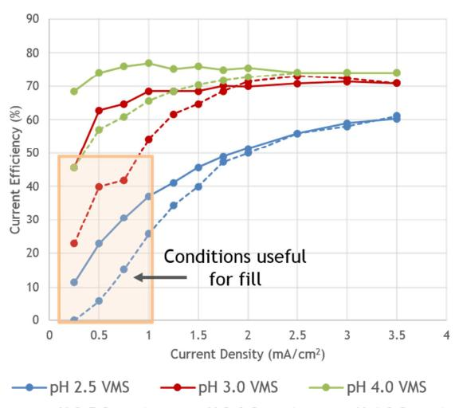

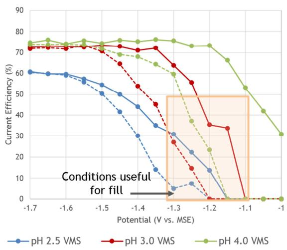  
---- pH 2.5 Supp A ---- pH 3.0 Supp A ---- pH 4.0 Supp A

Figure 3. EQCM-derived current efficiency as a function of pH, current density, and potential. 10 mV/s, no stirring.

Deposition rate is another factor that must be considered. Because this information is not as obvious from the voltammetric plots of Figure 2, Tafel plots were generated. Figure 4 presents Tafel plots based on the EQCM-derived cobalt partial current density at pH 2.5 and pH 4.0, both with and without Suppressor A in solution. The first feature that stands out is that the charge transfer coefficient is changed by the presence of the additive. This is as expected, because a suppressor-type additive should affect the reaction kinetics. This effect of the additive on the reaction kinetics is critical because of its impact on current efficiency. On the other hand, the charge transfer coefficient is not affected by changing pH. This means that the effect of pH on the cobalt deposition rate is not kinetic, but it rather must be thermodynamic, which is not expected for the direct deposition of a metal. However, the change in thermodynamics of deposition is clearly demonstrated in the plots. The onset potential for cobalt reduction, both with and without additive, shifts by \~-59 mV/pH, which is consistent with a reaction mechanism where hydroxide is involved. Under these test conditions, the cobalt deposition reaction must proceed as consecutive 1-electron transfer steps through a cobalt hydroxide intermediate (10). Altering the pH then leads to modification of the deposition rate due to the changing hydroxide ion concentration.

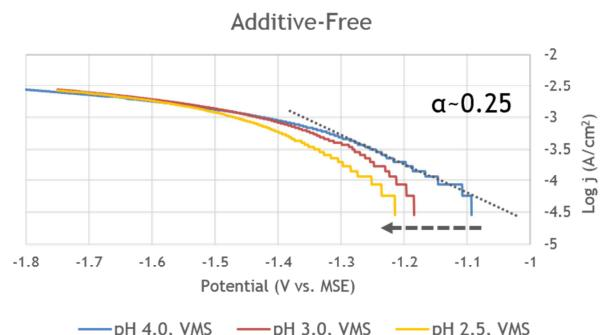

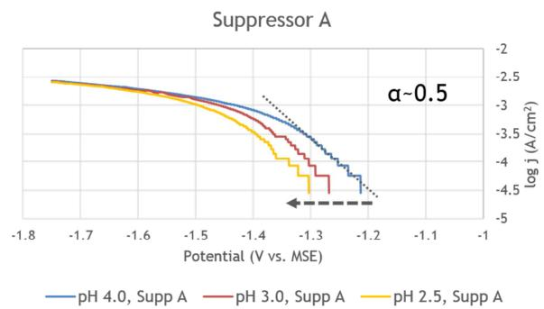  
Figure 4. Tafel plots generated from EQCM data for cobalt deposition showing the effect of pH and additive. 10 mV/s, no stirring.

From the data above, it is concluded that pH plays an important role in determining not only the current efficiency for cobalt deposition, but also the thermodynamics of the deposition process. However, this does not fully explain the phenomenon of bottom-up fill in interconnects. To produce bottom-up fill, there must be a significant differential in the deposition rate between the field and the feature bottom.

In Figure 5, Tafel plots are again presented, this time with varying potential scan rate at two different pH. At slow scan rate and with no solution stirring during the potentiodynamic deposition, the system approaches an approximate steady state, meaning that the near-surface region is essentially at equilibrium. By increasing the scan rate, the system can be pushed further away from the steady-state condition, and changes in deposition rate may become observable through comparison of the potential shift between the forward and reverse scans. At slow scan rate, pH 2.5 and pH 4.0 exhibit a similar shift in potential that is due to the pH shift that comes from the mass-transport limited depletion of $\mathrm { H } ^ { + }$ near the electrode surface. Under the non-equilibrium conditions of high scan rate, however, a significant increase in the potential shift is observed at low pH, while the shift is unaffected at higher pH. Because the current efficiency is significantly lower at the lower pH, the proton concentration change is larger and the local pH shift during the potential scan is greater. By not allowing the system to reach equilibrium during the scan, it becomes apparent that significant pH differences, and therefore, deposition rate difference, may be possible within a single system.

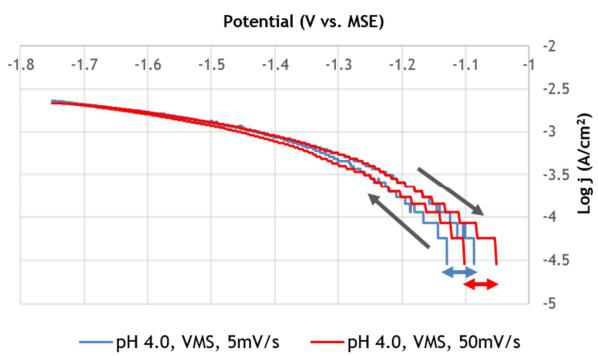

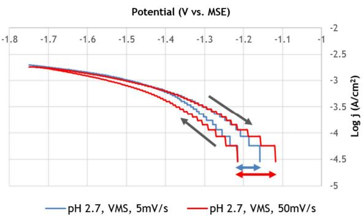  
Figure 5. Tafel plots generated from EQCM data for cobalt deposition, showing the effect of scan rate on the shift in potential between forward and revere scans. No stirring.

It is possible that local pH shifts could alter the $\mathsf { p K } _ { \mathrm { a } }$ of the organic additive, and therefore change the adsorption and suppression effects. The data in Figure 5 demonstrates that deposition rate changes can be achieved by pH shifts alone in the absence of an organic additive. However, certain organic additives may help to drive a larger deposition rate difference, depending on $\mathrm { p K _ { a } }$ values.

Based on the data, Figure 6 depicts the proposed mechanism for superconformal cobalt fill. When the wafer is immersed in the bath, the relative concentrations of all solution species are equal on the field and in the feature, and are representative of the bulk solution composition. When current flow begins, deposition will be slow and conformal, since the deposition rate is the same everywhere. The plating surface will likely have adsorbed ${ \mathrm { H } } ^ { \mathfrak { d } } .$ , adsorbed additive, and adsorbed CoOH+/CoOH evenly distributed between the field and the feature. Because mass transport into the bottom of the feature is significantly less than that on the field, concentration gradients for the

active sacrificial species $\left( \mathrm { H } ^ { + } \right)$ , organic additive) quickly develop within the feature due to the low current efficiency. The concentration gradients lead to a difference in current efficiency, thermodynamic deposition rate, and deposition kinetics between the base of the feature and the field. Bottom-up fill is then driven by the gradient-induced differentials and proceeds up the feature until the transport-induced concentration gradients are dissipated. At this point, fill shuts down, everything is equally suppressed, and deposition continues slowly and conformally. Because of the critical reliance on current efficiency to produce bottom-up fill, this mechanism has been termed the Differential Current Efficiency Fill mechanism (DCEF).

Organic suppressor-type additives have been found to be crucial to achieving efficient bottom-up fill through the DCEF mechanism. The additives can play multiple roles in the fill process. By altering the kinetics of the deposition reaction, the additive can significantly lower the current efficiency, which maintains a very slow deposition rate on the field and assists in generating the pH gradient within the feature. Consumption of the organic additive within the feature would also generate an additive concentration gradient under the lower mass transport conditions, which decreases the overall suppression within the feature relative to on the field. Finally, depending on the pKa of the particular additive, its adsorption properties could be altered, further driving the field/base deposition rate differential.

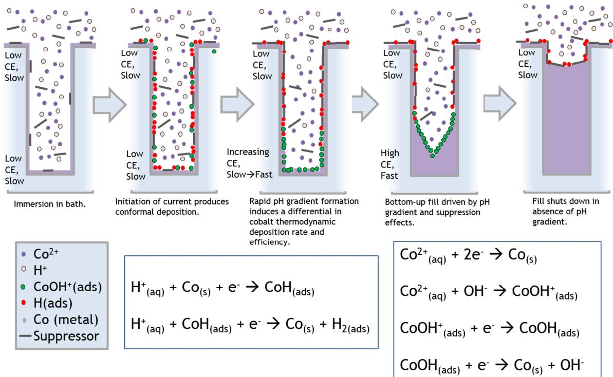  
Figure 6. Proposed differential current efficiency fill mechanism for superconformal cobalt fill. Bottom-up fill relies on increased deposition rate at the base of a feature induced by low current efficiency. Relevant reactions are also included.

Figure 7 uses the electrochemical and EQCM data to demonstrate an example of how the DCEF mechanism can work. In this hypothetical case, the starting pH is 2.7, Suppressor A is present in solution, and the applied current is 0.5 mA/cm . When current is initially applied, the potential depends on the bulk pH and suppressor concentration. At this initial potential, the cobalt partial current density is only \~0.1 $\mathrm { m A } / \mathrm { c m } ^ { 2 } .$ corresponding to about 20% current efficiency. As a pH gradient develops within the feature, the potential must shift to maintain a constant current density as the current efficiency and deposition rate change. Assuming in this hypothetical case that the H+ concentration at the base decreases by a factor of a little more than ten to pH\~4 and that the effective suppressor concentration approaches zero due to consumption and low mass transport, the potential would shift in the positive direction by \~70 mV. At this new potential, the cobalt partial current density at the feature base has increased to \~0.4 m $\mathrm { A } / \mathrm { c m } ^ { 2 }$ , corresponding to \~80% current efficiency. On the field, however, the pH and suppressor concentration will still be equal to the bulk values, so the cobalt partial current there is almost zero. So, in this hypothetical case, the cobalt deposition current at the base is \~13-14 fold higher than that on the field. This represents a significant differential in the deposition rate between the field and feature base, and would lead to rapid growth from the base of the feature with almost no plating on the field. Further, as the feature is filled from the bottom, the gradient changes due to the changing depth, and the deposition shifts back to higher overpotential until a mass-transport-determined steady-state condition is reached, at which point cobalt deposition will again be slow and conformal. Depending on the process, these shifts in potential may be large enough to observe experimentally, potentially providing a means to predict the endpoint of the fill process in simple cases.

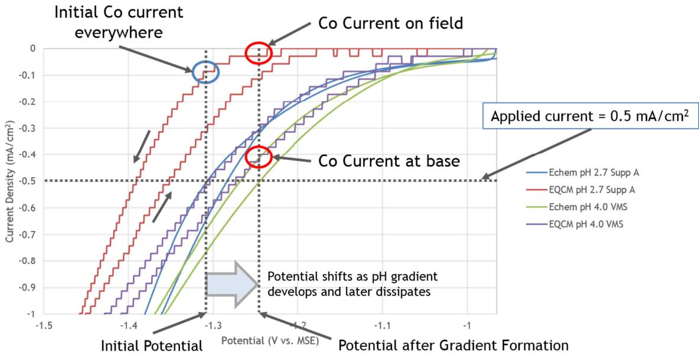  
Figure 7. Hypothetical case to illustrate action of DCEF mechanism. Electrochemical and EQCM data correspond to either pH 2.7 with Suppressor A or pH 4.0 in absence of Suppressor A. 10 mV/s, no stirring.

The reliance on current efficiency-induced pH and additive gradients leads to some important implications for the DCEF mechanism. As an example, for high-aspect ratio features, the evolution of fill will be dependent on the current density that is selected. At very low current density, H+ and additive will be depleted near the base of the feature only. This will lead to bottom-up deposition, but the fill will shut down too deep within the feature due to the depth of the H+/additive depletion zone. At higher current density, the H+/additive depletion zone will be at a shallower location within the feature, which

could lead to undesirably fast deposition on the sidewalls and, therefore, pinch-off and seam formation. If the current density is high enough, the current efficiency will be too high to support formation of the appropriate concentration gradients, and deposition will be conformal rather than bottom-up. Thus, for deep features, stepping the current up during the fill process can assist in moving the depletion zone to more appropriate depths so that bottom-up fill can continue to completion.

A similar effect would be expected when simultaneously filling features of varying dimensions. For the feature for which the process conditions were optimized, fill will be bottom-up and void-free. However, because the H+/additive depletion zone depends strongly on the current, the rotation rate, and feature depth, different feature dimensions will fill differently for the given process conditions. Significantly deeper features will likely pinch off and form a seam because the depletion zone is too high in the feature, while significantly shallower features may not fill at all because the depletion zone is too deep. Careful selection of proper waveform, mass transport, and concentrations is therefore critical to achieving superconformal growth across a die.

## Conclusions

Superconformal cobalt fill is achieved in high-aspect ratio nanometer-scale features by effective use of sacrificial oxidants through the DCEF mechanism. The sacrificial oxidant may be, for example, $\mathrm { H } ^ { + } , \mathrm { O } _ { 2 } ,$ , or an organic additive and functions to lower the cobalt deposition current efficiency. By operating at low current efficiency, concentration gradients for the active sacrificial species are developed within the feature. Here, the role of $\mathrm { H } ^ { + }$ as a sacrificial oxidant has been demonstrated. In addition to shifting the reaction at the base of the feature toward cobalt deposition through higher relative current efficiency, it has been shown that shifts to higher pH via $\mathrm { H } ^ { + }$ consumption and lower mass transport lead to faster cobalt deposition rates through the thermodynamics of a $\mathrm { C o O H } ^ { + }$ reaction intermediate. Relatively small pH shifts, which can be achieved through mass transport effects, can lead to significant differences in deposition rates. Due to their impact on the deposition kinetics, suppressor-type additives play an important role in lowering the current efficiency at a given potential, driving the pH gradient formation and limiting plating on the field. Additive gradients, either through concentration gradient formation or through the effect of pH shifts on adsorption and suppression properties, can also create a differential in kinetics within the feature. Bottom-up cobalt fill proceeds when waveform, mass transport, and organic and inorganic solution constituent concentrations synergistically create the appropriate deposition rate differential through the DCEF mechanism. The DCEF mechanism and insights presented here may be applicable to superconformal fill of other metals, as well.

## References

1. C. Adelmann, L. G. Wen, A. P. Peter, Y. K. Siew, K. Croes, J. Swerts, M. Popovici, K. Sankaran, G. Pourtois, S. Van Elshocht, J. Bommels, and Z. Tokei, Proc. of IEEE IITC/AMC, 173 (2014).

2. O. V. Pedreira, K. Croes, A. Lesniewska, C. Wu, M. H. Van der Veen, J. De Messemaeker, K. Vandersmissen, N. Jourdan, L. G. Wen, C. Adelmann, B. Briggs, V. Vega Gonzalez, J. Bommels, Z. Tokei, Proc. Of IEEE IRPS, 6B-2.1 (2017).

3. G. Gall, J. Appl. Phys., 119, 085101 (2016).

4. D. Josell, M. Silva, and T. P. Moffat, J. Electrochem. Soc., 163 (14), D809 (2016).

5. C. H. Lee, J. E. Bonevich, J. E. Davies, and T. P. Moffat, J. Electrochem. Soc., 156 (8), D301 (2009).

6. Q. Huang, T. W. Lyons, and W. D. Sides, J. Electrochem. Soc., 163 (13), D715 (2016).

7. S. Bozdech, K. Krischer, D. A. Crespo-Yapur, E. Savinova, and A. Bonnefont, Faraday Discuss., 193, 187 (2016).

8. T. M. Braun and T. P. Moffat, 232nd Meeting of the Electrochemical Society, National Harbor, MD, Abstract MA2017-02 930 (2017).

9. O. E. Kongstein, G. M. Haarberg, and J. Thonstad, J. Appl. Electrochem., 37, 669 (2007).

10. M. I. Jeffrey, W. L. Choo, and P. L. Breuer, Minerals Engin., 13, 1231 (2000).