Research Papers

# Influence of trace tungsten contents on thin-film properties and electromigration behaviors of electroless-deposited cobalt interconnect lines

Jau-Shiung Fang a, Ting-Hsun Su b , Yi-Lung Cheng c, Chun-Wei Huang b , Giin-Shan Chen b,\*

a Department of Materials Science and Engineering, National Formosa University, Yunlin 632, Taiwan

b Department of Materials Science and Engineering, Feng Chia University, Taichung 407, Taiwan

c Department of Electrical Engineering, National Chi-Nan University, Nantou 545, Taiwan

## A R T I C L E I N F O

Keywords: Nanostructures Thin films Interfaces Mechanical properties Electrical properties

## A B S T R A C T

Electroless-plated cobalt alloys with tungsten typically exceeding 5 at.% are the common barrier materials for copper metallization. As cobalt is a new interconnect material for advanced microchips, it is worth studying the advanced cobalt-interconnect metallization process that involves extremely diluted cobalt-tungsten (CoW) alloys with an eliminated impurity resistivity and enhanced electromigration reliability. To this aim, we fabricated three different CoW nanolines with 0.03, 0.06 and 0.11 at.% of W using an electroless process, and examined their electromigration behaviors under accelerated stressing conditions, using Co lines as a control. All three W contents, especially 0.06 at.%, mitigate Co electromigration. The mechanism for the electromigration mitigation is due to an improvement of the film s nanomechanical and surface wetting properties, as well as grain-structure refinements. A full account of the relationship between the film properties, grain structures and electromigration testing results is given, reasonably explaining the cause of the reliability optimization.

## 1. Introduction

The contact critical dimension of the CMOS transistors currently using copper (Cu) as a core interconnect material is expected to reach 18 nm [1], associated with a diminishment of interconnect width towards less than a few tens of nm. The rather long electron mean free path of 40 nm for Cu would induce multiple electron scatterings in such narrow lines, giving rise to a high residual electrical resistivity [2]. Therefore, Cu is not a good interconnect conductor for future technology nodes. Compared to $\mathrm { C u } ,$ cobalt (Co) has a much shorter electron mean free path of about 9 nm, leading to the product of the resistivity and mean free path of Co being less than that of Cu: $6 . 0 5 \times 1 0 ^ { - 1 6 } \mathrm { v s . } 6 . \dot { 7 } 0 \times 1 0 ^ { - 1 6 } \Omega \mathrm { m } ^ { 2 }$ [2]. Considering the resistivity-size effect, Co is considered to be a more appropriate interconnect material than Cu, especially as the line width (or cross section) is reduced down to below a crossover value of about 15 nm [3–5] (or 450 nm2) [6,7]. Moreover, electromigration is essentially a forced metal diffusion behavior and the key factor that influences the electromigration reliability of a conductive line is the magnitude of its effective valence (Z\*) and diffusivity (D): the lower the product of the $Z ^ { * }$ and D, the higher the electromigration reliability. The absolute value of the $Z ^ { * }$ for Co is about 5 to 10 times lower than that of Cu [8,9]. With a higher melting point of 1495 ◦C than 1085 ◦C of Cu, Co has a much lower (about one order of magnitude) self-diffusivity than Cu [10]. Indeed, the product of the Z\* and D for Co is two orders of magnitude smaller than that of Cu [11,12]. Therefore, Co has become the new, alternative interconnection material for advanced microchips [1].

Electroless process has long been used to prepare thin barrier/cap layers of Co alloys for Cu-interconnect metallization [13]. The basic components in an electroless cobalt-alloy plating solution are typically cobalt sulfate $\mathrm { ( C o S O _ { 4 } ) }$ as a source of Co ions and dimethylamine borane $\mathrm { ( C _ { 2 } H _ { 9 } B N ) }$ , sodium hydroborate (NaBH ) or sodium hypophosphite $\mathrm { ( N a H _ { 2 } P O _ { 2 } ) }$ as a chemical reductant. The oxidation of the chemical reductant results in the incorporation of boron or phosphors into the deposited $\mathrm { C o } ,$ creating a solute-strengthening effect that stabilizes the phase structure, stuffs grain boundaries and/or generates an amorphous matrix, which are all beneficial to barrier/cap properties. Moreover, as a refractory metal, tungsten (W) is highly resistant to heat and abrasion. Its addition to the binary Co alloys thus further elevates thermal-mechanical and barrier properties. Therefore, innovate formulations based on sulfate baths with an added W-containing salt, such as tungstate $[ 1 4 , 1 5 ]$ or phosphotungstic acid [16], have been developed to fabricate barrier/cap layers of ternary Co alloys with high W contents usually exceeding 5 at.%.

To serve as a core-conducting interconnect material, thin metal films need to have an electrical resistivity close to their bulk values. However, high concentrations of alloy components, particularly heavy elements such as $\mathsf { W } ,$ in thin films of binary or ternary cobalt-based alloys would induce a high impurity electrical resistivity. After thermal annealing, the tungsten-added cobalt binary/ternary films still give a high resistivity value exceeding several tens or even hundreds of μΩ-cm [17,18]. We have recently developed an all-wet self-assembled-monolayer (SAM) seeding and electroless process for cobalt metallization. By using a $\mathrm { C o S O } _ { 4 } { \mathrm { - N } } _ { 2 } \mathrm { H } _ { 4 }$ (hydrazine; a metal-free reductant) bath, thin films and nanolines of alloy-free Co with (after annealing) a low resistivity o $\mathrm { f } \le 1 5$ μΩ-cm are fabricated [19]. In this study, we report an extension of our previous work by adding tungstate to the $\mathrm { C o S O } _ { 4 } – \mathrm { N } _ { 2 } \mathrm { H } _ { 4 }$ bath for the interconnect metallization of various Co alloys with trace W contents (termed CoW) of 0.03, 0.06 and 0.11 at.%, giving a low impurity-component resistivity potentially suitable for future interconnect-material applications. By using unalloyed Co as a reference, the enhancement of the electromigration reliability of interconnect lines of the various CoW alloys, in particular with 0.06 at.% added W, will be confirmed. The correlation between nanomechanical/wetting properties of the surface films and the difference in electromigration failure profiles and grain structures of the interconnect lines will be analyzed, elucidating why the optimal W content (0.06 at.%) gives the greatest effectiveness of mitigating electromigration failure.

## 2. Experimental procedures

The experiments were designed to develop a new electroless process for the plating and thin-film properties characterization of extremely diluted Co alloys with various W contents of 0.03, 0.06 and 0.11 at.%. Then, interconnect lines of the three tungsten-added Co alloys embedded in patterned $\mathrm { { S i O } } _ { 2 }$ dielectric layers were fabricated for the evaluation of their electromigration behaviors, using interconnect lines of unalloyed Co as a control.

## 2.1. Substrate fabrication

Electron beam lithography in conjunction with plasma etching was used to pattern a 130 nm-thick SiO2 layer on an 8-inch (100) Si wafer with groups of straight trenches, terminated by two squared recessions. The patterned SiO /Si wafer was cleaved into $2 \times 2 \ : \mathrm { c m } ^ { 2 }$ pieces for the fabrication of interconnect lines of the three different Co alloys and Co (the control sample for electromigration testing). In addition, a 30 nmthick $\mathrm { S i O } _ { 2 }$ layer was thermally grown on a planar Si wafer. The planar $\mathrm { S i O } _ { 2 } / \mathrm { S i }$ wafer was also cleaved into $2 \times 2 \mathrm { c m } ^ { 2 }$ pieces for the fabrication of thin Co and W-added Co films.

## 2.2. Surface-modification process and electroless metallization

Prior to the fabrication of electromigration testing structures and thin planar films of Co alloys and Co, the patterned and planar $\mathrm { { S i O } _ { 2 } / S i }$ substrates were both processed by the same procedure: surface hydroxylation and the growth of a (3-aminopropyl)triethoxysilane SAM (APTMS-SAM), followed by SAM functionalization and seeding (catalytic particle growth). Silanization of the dielectric substrates with an orderly APTMS-SAM for the seeding was performed under a tightly controlled processing environment and in a suitable toluene-APTMS incubation solution, as detailed in our previous publications [20,21]. The readers may also refer to our previous publication for surface characterizations of the SAM-coated and seeded samples [22]. Analytical reagent grade chemicals and 18 mega-ohm deionized water were used for the preparation of the chemical solutions.

The planar $\mathrm { S i O } _ { 2 } / \mathrm { S i }$ substrates after seeding were deposited with a thin Co film as a control sample, using a recently developed $\mathrm { C o S O } _ { 4 } ( 0 . 2$ $\mathrm { M } ) { - } \mathrm { N } _ { 2 } \mathrm { H } _ { 4 }$ bath formulation [19]. ${ \mathrm { N a } } _ { 2 } { \mathrm { W O } } _ { 4 }$ with a low molar concentration o $\mathbf { 2 . 5 0 \times 1 0 ^ { - 4 } M } , 1 . 0 6 \times 1 0 ^ { - 3 }$ M or $5 . 3 0 \times 1 0 ^ { - 3 } .$ M was added to the sulfate solution for the plating of W-containing Co films. Chemical composition analyses using Thermo Scientific inductively coupled plasma mass spectrometry (iCAP TQ) revealed that the cobalt-based films deposited by the above three baths contained 0.03, 0.06 and 0.11 at.% of W, denoted hereafter as $\mathsf { C o W } _ { \mathrm { l } } , \mathsf { C o W } _ { \mathrm { m } }$ and $\mathrm { C o W _ { h } , }$ respectively.

The patterned $\mathrm { S i O } _ { 2 } / \mathrm { S i }$ substrates after seeding were divided into four sets for the electroless filling of $\mathrm { C o , C o W _ { l } , C o W _ { m } }$ and $\mathsf { C o W _ { h } }$ to a thickness of about 150 nm. After removing the planar-field deposits using mechanical polishing, numerous interconnect lines of $\mathrm { C o , C o W _ { l } , C o W _ { m } }$ and $\mathrm { C o W _ { h } }$ were formed. The top-view scanning electron image (Fig. 1), together with the inserted cross-sectional transmission electron image, indicates that the electromigration test structure consists of a straightline segment of 100 nm deep, 60 nm wide (the bottom side) and 25 μm long, which is terminated by two $3 0 \times 3 0 ~ \mu \mathrm { m } ^ { 2 }$ electrode pads.

## 2.3. Electromigration testing and failure analyses

Prior to electromigration testing, the samples of $\mathrm { C o , C o W _ { l } , C o W _ { m } }$ and CoW lines were annealed $( 4 0 0 \ ^ { \circ } \mathbf { C } / 3 0$ min) using an Ulvac’s Mila-5000 rapid thermal vacuum annealer. All annealing treatments were performed in flowing $\boldsymbol { \mathrm { A r } } { - } \boldsymbol { \mathrm { H } } _ { 2 }$ (5 %) that prevented the samples from oxidation. A heating rate of $1 5 ~ ^ { \circ } \mathrm { C } ~ s ^ { - 1 }$ was used and fast cooling was performed by simply switching off the heating. They were then placed on a thermal chuck situated in a probe-station-enclosed dark box, immediately under constant current stressing by using a Keithley 4200- SCS semiconductor parameter analyzer. The onset of electromigration for metallic interconnects under regular operation conditions occurs on a time scale of several years. Here, the interconnect lines were tested under accelerated electromigration conditions using very high current densities of the order of $1 0 ^ { 7 } \mathrm { A } \mathrm { c m } ^ { - 2 } .$ . Such current densities were about 2–3 orders of magnitude greater than the practical ones. Thus, the electromigration failure of the tested interconnect lines was speeded up. Specifically, many $\mathrm { C o , \ C o W _ { l } , \ C o W _ { m } }$ and $\mathrm { C o W _ { h } }$ lines were stressed at room temperature under a preset current density of 30, 50 or 70 MA $\mathrm { c m } ^ { - 2 }$ , simultaneously recording the resistance versus stressing time plots until line reupture. Then, the mean times to failure (MTFs) of these lines were derived, used to calculate the current density scaling factor (or termed n factor) for each line type, based on modified Black’s equation [23]:

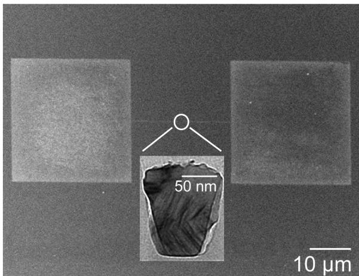  
Fig. 1. Top-view SEM micrograph and cross-sectional TEM micrograph (inset) showing the electromigration test structure of Co and W-added Co interconnect lines.

$$
\mathrm{MTF} = A J ^ {- n} \exp (E _ {\mathrm{a}} / k T),\tag{1}
$$

where A is the cross-sectional dependent constant, J is the current density, E is the activation energy, k is the Boltzmann constant, and T is the absolute temperature.

Physical failure profiles and grain structures of the Co and CoW lines after electromigration stressing were analyzed by Thermo Scientific Talos™ F200X. This instrument was a (scanning) transmission electron microscope, (S)TEM, having multiple operating modes including conventional TEM imaging, scanning TEM (STEM) imaging, diffraction, spectroscopy and combinations of these. Particularly, it had an extremely high spatial resolution of 0.13 nm for high-resolution imaging and energy-dispersive X-ray (EDX) mapping. Thin-foil specimens for the STEM/TEM analysis were prepared by a Thermo Scientific Helios G5 DualBeam, equipped with a scanning electron microscope (SEM) for the in-situ cutting of the lines along their longitudinal directions using a focused ion beam.

## 2.4. Thin-film property characterization

Film thicknesses of $\mathrm { C o , C o W _ { l } , C o W _ { m } }$ and $\mathrm { C o W _ { h } }$ were measured by a high-precision surface-step profilometer (ET 3000, Kosaka Lab. Ltd.), and their deposition rates were procured from the plots of film thickness versus plating time. The planar films for property examinations had the same thickness of about 70 nm. SEM imaging was used to observe the thermal stability of these films after annealing.

Nanomechanical scratch testing of thin films of $\mathrm { C o } , \mathrm { C o W _ { l } , C o W _ { m } }$ and $\mathrm { C o W _ { h } }$ was conducted in a Bruker’s Hysitron TI 980 Tribolndenter. The Tribolndenter was equipped with two sensors for precise force and depth measurements using a state-of-the-art piezoelectric actuator. This advanced design allowed us to control each and every measurement by progressively increasing the normal load of a diamond stylus in a controlled fashion, while synchronously collecting the feedback data of normal displacement, lateral force and lateral displacement. Subsequently, the related plots were automatically generated by using a Hysitron TriboScan software. On-site scanning probe microscopical imaging of the whole scratch profile for the feedback of the scratch data was used to derive the nanomechanical properties of the tested films, such as critical load, delamination force, adhesion strength and friction coefficient.

Surface energies of SAM-coated $\mathrm { S i O _ { 2 } ( S A M / S i O _ { 2 } ) }$ substrates and thin layers of $\mathrm { C o } , \mathrm { C o W _ { l } , C o W _ { m } }$ and $\mathrm { C o W _ { h } }$ on the $\mathbf { S A M } / \mathbf { S i O _ { 2 } }$ substrates were measured by the Owens-Wendt method [24]. The measured surface energies were used to estimate the effect of the added-W content on the wettability and adhesion strength of the coated films.

## 3. Results and discussion

In this section we first describe the basic properties of the thin deposited films of $\mathrm { C o , C o W _ { l } , C o W _ { m } a n d C o W _ { h } }$ including their deposition rates, chemical compositions, surface-deposit evolutions and thermal stability, and then evaluate interconnect’s electromigration behaviors and electromigration-mitigation mechanisms. Finally, a summary and conclusions are presented.

## 3.1. Basic film properties

Thin films of $\mathrm { C o , C o W _ { l } , C o W _ { m } }$ and $\mathrm { C o W _ { h } }$ were deposited on the same seeded $\mathrm { S i O } _ { 2 } / \mathrm { S i }$ substrates for various times. Then, their thicknesses were measured by high-resolution surface profilometry (some also reconfirmed by top-view SEM imaging). It was found that the deposition of these films with thicknesses in the range of 30 nm–100 nm was reproducible and the deposited layers were bright colored and uniform under visual inspection. Least-squares fitting the thickness versus deposition time plots in Fig. 2 results in four straight-line segments, giving a constant deposition rate for each kind of the four deposits. It is clear from

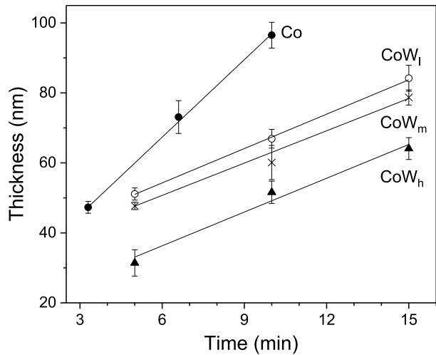  
Fig. 2. Plots showing the linear variations of thickness with plating time for thin films of Co, CoW , $\mathtt { C o W _ { m } }$ and $\mathrm { C o W _ { h } , }$ from which their deposition rates were obtained by least squares fitting to be 7.80 5.58, 5.22 and 4.20 nm $\mathrm { m i n ^ { - 1 } }$ respectively.

Fig. 2 that the Co films, deposited by the cobalt sulfate-citrate-hydrazine bath, have the highest deposition rate of $7 . 8 0 \ \mathrm { n m \ m i n ^ { - 1 } }$ . Here, the Co films were deposited by a hydrazine-based bath with 0.2 M cobalt sulfate. When tungstate with increasing concentrations from 0.25, 1.06 to 5.30 mM is respectively added to the above electrolyte as a W source, the deposition rates of the thin $\mathrm { C o W _ { l } , \ C o W _ { m } }$ and $\mathrm { C o W _ { h } }$ films are monotonically decreased to be 5.58, 5.22 and 4.20 nm min− 1, respectively.

When adsorbed onto the deposit surface, W (VI) ions tend to become an inhibiting component that blocks the self-catalytic sites of Co [25]. Thus, the W (VI) ions depress Co deposition and their reduction reaction into metallic W being incorporated to the main Co deposit is interde pendent upon the main reduction reaction of the cobaltous ions. Specifically, previous studies have shown that adding high contents of tungstate $( \mathrm { W O _ { 3 } ^ { 4 + } } )$ to the cobalt sulfate $( \mathsf { C o } ^ { 2 + } )$ aqueous solutions with $\mathrm { W O } _ { 3 } ^ { 4 + } \mathrm { - t o - C O } ^ { 2 + }$ molarity ratios exceeding 0.3 or even greater than 2, using a given chemical reductant such as hypophosphite or dimethylamine borane, results in a decrease in the deposition rates of Co [25–28]. Here, the pure Co film was deposited by a sulfate-citrate-hydrazine bath. It should be noted that the concentration of the sulfate in this bath was 0.2 M. The $\mathrm { C o W _ { l } , C o W _ { m } }$ and $\mathrm { C o W _ { h } }$ films were deposited by otherwise this same bath except including quite low tungstate concentrations of about $2 . 5 0 \times 1 0 ^ { - 4 } , 1 . 0 6 \times 1 0 ^ { - 3 }$ and $5 . 3 0 \times 1 0 ^ { - 3 } \mathrm { M }$ , respectively. The $\mathrm { W O _ { 3 } ^ { 4 + } - t o { - } C O ^ { 2 + } }$ molarity ratios of the three CoW electroless-plating baths were very low, only $1 . 2 0 \times 1 0 ^ { - 3 } , 5 . 3 0 \times 1 0 ^ { - 3 }$ and $2 . 6 5 \times 1 0 ^ { - 2 }$ However, they do cause the Co deposits to yield gradually decreased deposition rates. These results suggest that the tungstate in the tungstate-diluted Co-plating baths also depresses Co deposition as it does in the tungstate-concentrated baths.

Thin films of binary cobalt alloys, such as Co(P) or Co(B), are typically deposited by aqueous electrolytes that contain cobalt sulfate, hypophosphite (or borazane) and a citrate chelating agent. Tungstate, as used in this study, is usually added to the above electroless baths for the incorporation of metallic W into the binary alloys for barrier/cap applications. Traditionally, highly concentrated tungstate, in terms of tungstate-to-cobalt sulfate (or $\mathsf { \bar { W } O _ { 3 } ^ { 4 + } - t o - C O ^ { 2 + } } )$ molarity ratios of 0.3 or greater, is used, which results in the incorporation of substantial amounts of metallic W in the range of 2 10 at.% to the Co matrix. In spite of the fact that pure W cannot be deposited by either chemical or electrochemical methods, electrochemical studies suggest that Co serves as a catalyst for the electroless deposition of W; namely, after the deposition of Co on catalytic particles or layers, the deposited Co subsequently serves as another catalyst to activate the codeposition of Co and W. The W can be reduced from tungstile ions $( \mathrm { W O } _ { 2 } ^ { 2 + } )$ , and is then simultaneously incorporated into the Co matrix during the reduction of the cobaltous ions via a so-called induced codeposition mechanism [16, 28,29]. Here, the baths with extremely low tungstate–to–cobalt sulfate molarity ratios of $1 . 2 0 \times 1 0 ^ { - 3 } , 5 . 3 0 \times 1 0 ^ { - 3 }$ and $\overline { { 2 . 6 5 \times 1 0 ^ { - 2 } } }$ were used to deposit CoW alloys, and the deposited films indeed contained only 0.03, 0.06 and 0.11 atomic percentage of $\mathsf { W } ,$ , respectively. This result suggests that, for the cobalt-tungsten alloy films deposited by the tungstate-diluted hydrazine baths, the trace W contents are incorporated to the Co film matrixes also via the induced codeposition mechanism, as for the conventional tungstate-concentrated baths. Indeed, the study of the deposition and film properties of tungsten-containing binary/ternary alloys of Co using $\mathrm { C o S O } _ { 4 } { \mathrm { - N } } _ { 2 } \mathrm { H } _ { 4 }$ bath formulations with diluted tungsten-ion sources is rather limited. The mechanism for plating diluted cobalt-tungsten alloys using the tungstate-diluted baths is worthy of investigation via electrochemical analysis. This topic is behind the scope of this current study, and a detailed electrochemical investigation will be made in a separate project which will be presented elsewhere.

The seeding process used in this study is capable of loading 2-nm sized catalytic particles onto the substrates of SAM-coated $\mathrm { { S i O } _ { 2 } / S i }$ [22], which are the catalytic sites for the electroless growth of W-alloyed Co or unalloyed Co. During the course of electroless deposition, the W-added Co or Co deposits surrounding the 2 nm-sized catalytic particles are expanded with plating time to become island-like deposits, eventually coalescing themselves into a thin continuous film. As demonstrated by the top-view and cross-sectional (inset) SEM micrographs in Fig. 3a and 3b, respectively, the thin Co and $\mathrm { C o W _ { m } }$ films yield similar uniform surface morphologies and microstructures. The two Co and $\mathrm { C o W _ { m } }$ films were further annealed to a certain extent $( 5 0 0 ~ ^ { \circ } \mathrm { C } / 3 0$ min in flowing Ar/H2 gas), and the associated top-view SEM micrographs are shown in Fig. 3c and 3d, respectively. It can be seen from Fig. 3c that the annealing causes a serious disruption and agglomeration of the Co film, leading to the exposure of the underlying dielectric substrate. However, an identical annealing induces densification and substantial grain growth of the $\mathrm { C o W _ { m } }$ film, which still retains an intact film structure (Fig. 3d). These findings suggest that the Co film is strengthened by the extremely diluted alloying of 0.06 at.% W.

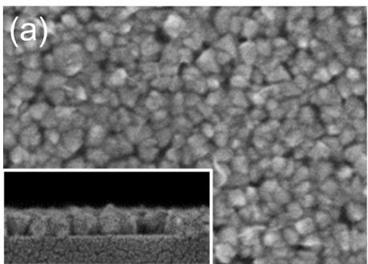

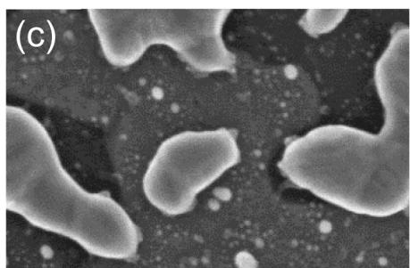

## 3.2. Electromigration performance

A set of pristine $\mathrm { C o , C o W _ { l } , C o W _ { m } }$ and $\mathrm { C o W _ { h } }$ interconnect lines was stressed at ambient temperature for various durations under 30 MA $\mathrm { c m } ^ { - 2 } ,$ simultaneously their resistance versus time plots were recorded, as shown in $\mathrm { F i g . }$ . 4a. The related plots for two other sets of pristine lines under two other different current densities (50 and $7 0 \mathrm { M A } \mathrm { c m } ^ { - 2 } )$ were recorded, displayed in Fig. 4b and c, respectively. We can point out the existence of two regions for all resistance-changing curves: first, the resistances remain very close to the initial resistance values and then leap at a given stressing time, corresponding to the onset of line failures. The time when a rupture of the lines occurs corresponds to a sharp drop in the electrical resistance, defined as the electromigration failure time. Five meaningful resistance versus stressing-time plots for each line type under the same stressing condition were measured. The obtained elec tromigration failure times were averaged to obtain the MTF. Fig. 5 shows that the logarithmic plots of the MTFs versus current densities for the four different types of metallic interconnects constitute four straightline segments, corresponding to the current density scaling factors (n factors) of 0.50, 0.43, 0.33, 0.42 for the $\mathrm { C o , C o W _ { l } , C o W _ { m } }$ and $\mathrm { C o W _ { h } }$ lines, respectively.

While not applicable to the entire interconnect routes with changes in current flow directions or layered structures, Black’s equation, Eq. (1), fits quite well for linear interconnects, and is thus an accurate way of estimating the service life duration and failure mode (through the magnitude of current-density scaling factor) of simple interconnect lines under accelerated testing conditions [30,31]. Previous studies on electromigration behaviors of the conductive lines of Al-Cu and Cu by Lloyd among others [23,32] came to a conclusion that the magnitude of the scaling factor provides an insight into the electromigration failure mode of metallic lines. When sealed by an adhesive/barrier, the conductive line normally exhibits a void-growth failure mode with a scaling factor of 1 or less, depending on the robust of the sealant layer and the mechanical strength of the core metallic material itself. Here, the interconnect lines of $\mathrm { C o , C o W _ { l } , C o W _ { m } }$ and $\mathrm { C o W _ { h } }$ are sealed by an SAM barrier and all reasonably give a scaling factor o $: \leq 0 . 5$ over the accelerated electromigration stressing currents from 30 to $7 0 \ \mathrm { M A } \ \mathrm { c m } ^ { - 2 }$ . These results suggest the failure of all these lines by a void-growth mode.

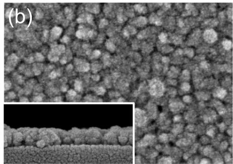

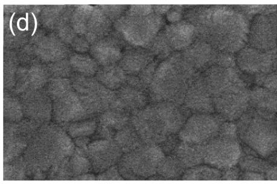  
Fig. 3. Top-view and cross-sectional (inset) SEM micrographs typical of as-grown (a) Co and $( \mathrm { b } ) \mathrm { C o W _ { m } }$ films, and the associated SEM micrographs for the (c) Co and (d) $\mathrm { C o W _ { m } }$ films after $5 0 0 ~ { } ^ { \circ } \mathrm { C } / 3 0$ min inert-gas annealing.

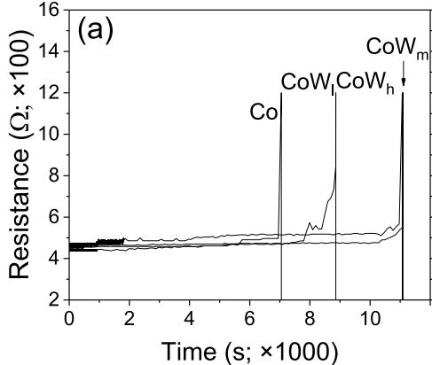

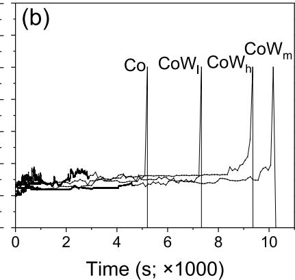

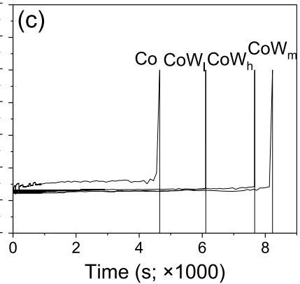  
Fig. 4. Resistance against stressing time curves for the pristine lines of $\mathrm { C o } , \mathrm { C o W _ { l } , C o W _ { m } }$ and $\mathrm { C o W _ { h } }$ bias-stressed at ${ } ^ { 2 5 } \ ^ { \circ } \mathrm { C }$ under (a) 30, (b) 50 and (c) $7 0 \mathrm { M A c m } ^ { - 2 } .$

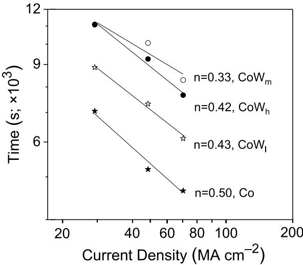  
Fig. 5. Logarithmic plots of electromigration failure time against current density for Co and various W-added Co interconnect lines. The straight-line segments were obtained by least squares fitting, from which the scaling factors were extracted and shown in the figure.

The Co line has the shortest lifetime and highest scaling factor of 0.50, indicating that it has the fastest void growth rate and is most liable to electromigration failure. All other three W-alloyed Co lines have a lower scaling factor and longer lifetime than the Co line, suggesting the retarding of void growth by the added W. Especially, the $\mathrm { C o W _ { m } \left( W = \right. }$ 0.06 at.%) line has the lowest scaling factor of 0.33. This result suggests that the medium W content of 0.06 at.% gives the best alloying effect for the $\mathrm { C o W _ { m } }$ line to yield the lowest void growth rate upon electromigration stressing.

## 3.3. Thin-film properties

The samples for nanoscratch testing were thin films of $\mathrm { C o } , \mathrm { C o W _ { l } }$ $\mathrm { C o W _ { m } }$ and $\mathrm { C o W _ { h } }$ on the same SAM-tethered $\mathrm { { S i O } _ { 2 } }$ on Si. These films had the same thickness of 70 nm. Their nanomechanical properties were measured by nanoscratch testing using a diamond stylus to draw across the film surfaces at a constant speed $( 0 . 6 ~ \mu \mathrm { m } ~ s ^ { - 1 } )$ with progressively increased normal forces towards a maximum predetermined force. Considering the difference in film hardness and adhesion strength, the normal force was increased at a constant rate of $1 0 \mu \mathrm { N } s ^ { - 1 }$ and 15 $\mu \mathrm { N } s ^ { - 1 }$ for the ${ \mathrm { C o / C o W _ { l } } }$ films and the $\mathrm { C o W _ { m } / C o W _ { h } }$ films, respectively. The typical sets of the plots of lateral force versus ramped normal force obtained from a single scratch of these surface films are given in Fig. 6a and b for thin films of ${ \mathrm { C o / C o W _ { l } } }$ and $\mathrm { C o W _ { m } / C o W _ { h } , }$ respectively. The progressive increase in the applied normal force results in a gradual increase in the force that acts in the direction parallel to the coating surfaces, known as the lateral force. When the scratch just penetrates any of these four films, a sharp change in the friction coefficient occurs. This moment is associated with fluctuations in the lateral force, used to define the critical applied load for film delamination. Due to the subtle nature of fluctuations in the lateral forces responsible for film delamination, the black straight lines in Fig. 6a and b serve as the fitting curves which facilitate the identification of the critical applied loads for the four surface films. Here, three meaningful scratches were made for each surface film, from which the average critical load with a standard deviation for film delamination was obtained, As shown in the bar graph of Fig. 6c, the critical loads of the $\mathrm { C o , C o W _ { l } , C o W _ { m } }$ and $\mathrm { C o W _ { h } }$ films are 1466 ± 134 μN, 1811 ± 99 μN, 2266 ± 96 μN and 2115 ± 165 $\mu \mathrm { N } ,$ respectively.

The critical load corresponds to the applied normal force at which the surface film just delaminates from its supporting substrate. Here, the adhesion strength $\left( \sigma _ { \mathrm { { c } } } \right)$ of the film can be calculated from the previously reported mechanical-data related equation:

$$
\sigma_ {c} = \left(2 P _ {c} / \pi d _ {c} ^ {2}\right) \left[ (4 + \nu_ {f}) 3 \pi \mu / 8 - (1 - 2 \nu_ {f}) \right]\tag{2}
$$

[33,34], where $\mathrm { P _ { c } }$ is the film-delamination force (i.e., critical load), ${ \tt d } _ { \tt c }$ is the width of the associated scratch track obtainable from the panoramic image of the whole scratch, $\nu _ { \mathrm { f } }$ is the Poisson ratio of the coated film assuming to be the same as bulk $\mathrm { C o } , 0 . 3 1 $ , and $\mu$ is the friction coefficient, defined as the ratio between the lateral force and the normal force [35]. By dividing the lateral forces by the normal forces in the force plots of Fig. 6a and $\mathbf { b } ,$ the dynamic friction coefficients of the $\mathrm { C o } , \mathrm { C o W _ { l } , C o W _ { m } }$ and $\mathrm { C o W _ { h } }$ films at the critical loads are derived to be almost the same $( 0 . 2 9 - 0 . 3 0 )$ . By fitting the above measured data to Eq. $( 2 ) ,$ , the adhesion strengths of the Co, $\mathrm { C o W _ { l } , C o W _ { m } }$ and $\mathrm { C o W _ { h } }$ films are calculated to be 35.8 MPa, 43.4 MPa, 56.1 MPa and 52.7 MPa, respectively. The three tungsten additions all evidently improve the cobalt’s adhesion strength. Among the three W-added surface films, the thin $\mathrm { C o W _ { m } }$ film has the highest adhesion strength (56.1 MPa), in sharp contrast to the much lower value of the unalloyed Co film (35.8 MPa).

The ability of a coating against penetration is indicative of its hardness. For the case of surface films, the hardness obtained from nanoscratch testing is often assessed by a comparative method [36]. Thus, the relative hardness of the Co and three different W-added Co films can be deduced from monitoring the variation of their normal displacements with the progressively increased normal forces, as shown in Fig. 6d. All four metallic films roughly show a straight line as the normal displacement exceeds 20 nm. Thus, the relative values of their hardness are procured from the slopes of the straight-line segments to be about 14.8, 15.6, 16.8 and 17.5 μN nm− 1 for the $\mathrm { C o } , \mathrm { C o W _ { l } , C o W _ { m } }$ and $\mathrm { C o W _ { h } } ,$ respectively. It appears that the hardness of Co is increased with the increase of the W concentration namely that the Co film is the softest material with the lowest hardness of $1 4 . 8 ~ \mu \mathrm { N } ~ \mathrm { n m } ^ { - 1 } ;$ the $\mathrm { C o W _ { m } }$ film has a markedly greater hardness of $1 6 . 8 ~ \mu \mathrm { N } ~ \mathrm { n m } ^ { - 1 }$

Table 2  
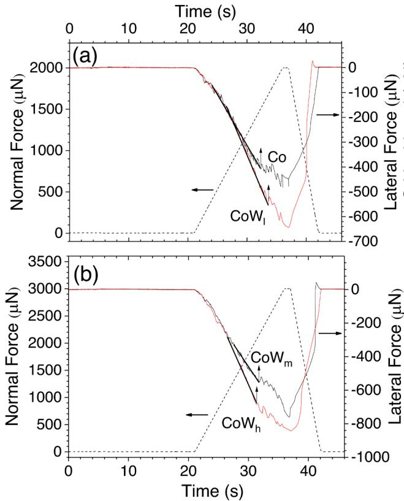

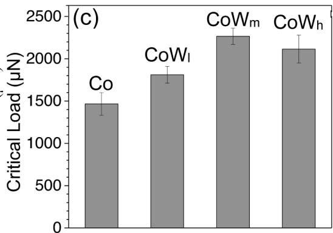

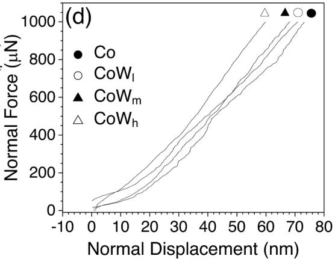  
Fig. 6. Plots showing the variations of lateral force with ramped normal force for thin films of (a) Co/CoW and (b) $\mathrm { C o W _ { m } / C o W _ { h } , }$ together with (c) the associated bar graph of their critical loads causing film delamination and (d) normal force vs. normal displacement plots. The black straight lines in (a) and (b) function as fitting curves, enabling the identification of the critical applied loads.

Surface energy includes dispersive and polar components due to van der Waals and polar interactions, respectively [37,38], which can be measured by the Owens-Wendt method [24]. Here, diiodomethane (nonpolar liquid) and water (polar liquid) with the established polar and dispersive surface-energy values, as reported before [39,40], were used separately for measuring the contact angles of their liquid droplets on the SAM-coated $\mathrm { S i O } _ { 2 }$ (substrate), thin Co and all W-added Co films. The measured surface energies and associated contact angles are summarized in Table 1, showing that the $\mathbf { S A M } / \mathbf { S i O } _ { 2 }$ substrate has the highest specific surface energy of 74 mJ m− 2. Among the four metallic films, the Co film has the highest specific surface energy of 70 mJ $\mathbf { m } ^ { - 2 } ,$ , while the $\mathrm { C o W _ { m } }$ film with the moderate W content (0.06 at.%) has the lowest specific surface energy of 60 mJ $\mathrm { m } ^ { - 2 }$ . However, increasing the W content from 0.06 at.% to 0.11 at.% results in a rise in the specific surface energy from 60 to 69 mJ m $^ { - 2 } ;$ decreasing the W content from 0.06 at.% to 0.03 at.% also causes an increase in the specific surface energy from 60 to 66 mJ m− 2.

The surface energies and associated contact angles for the sample films involved in this study. Note the standard derivations (about ± 2 %) were omitted in the table.

<table><tr><td rowspan="2">Sample Films</td><td colspan="2">Contact Angle (°)</td><td colspan="3">Surface Energy Data (mJ m-2)</td></tr><tr><td>H2O</td><td>CH2I2</td><td>Polar</td><td>Dispersive</td><td>Total</td></tr><tr><td>SAM/SiO2</td><td>8</td><td>5</td><td>40</td><td>34</td><td>74</td></tr><tr><td>Co</td><td>13</td><td>42</td><td>47</td><td>23</td><td>70</td></tr><tr><td>CoW1</td><td>26</td><td>37</td><td>39</td><td>27</td><td>66</td></tr><tr><td>CoWm</td><td>34</td><td>58</td><td>44</td><td>16</td><td>60</td></tr><tr><td>CoWh</td><td>18</td><td>43</td><td>46</td><td>23</td><td>69</td></tr></table>

## 3.4. The correlation between thin-film properties and electromigration behaviors

The values of the adhesion strength, hardness, specific surface energy and electromigration mean time to failure (MTF) of Co, CoWl, $\mathrm { C o W _ { m } }$ and $\mathrm { C o W _ { h } } ,$ as obtained from the preceding sections, are compiled in Table 2 for comparison. According to this table, the extension of the lifetime and reduction in the scaling factor of Co by W alloying correlate closely with the improvement of surface and nanomechanical properties of the thin films. Notably, surface energy is an important thermodynamic factor that decides the wettability of a condensed matter to a heterogeneous supporting substrate. The deposited film with a lower surface energy would have a higher wetting tendency and thus should be with a greater substrate adherence than the counterpart with a higher surface energy. Indeed, the adhesion strength of the Co films after adding 0.03 at.% and 0.06 at.% of W is increased from 35.8 to 43.4 and 56.1 MPa, respectively, concurring well with the respective decrease in the surface energy from 70 to 66 and 60 mJ $\mathrm { m } ^ { - 2 }$ for CoW and $\mathrm { C o W } _ { \mathrm { m } } .$ As the added W is further increased to 0.11 at.%, the adhesion strength of the related $\mathrm { C o W _ { h } }$ film is reduced to 52.7 MPa, associated with an increase in the surface energy to 69 mJ $\mathbf { m } ^ { - 2 }$ . The measured data of $\mathrm { C o W _ { l } }$ and $\mathrm { C o W _ { h } }$ (high tungsten content) obviously deviates from the inverse variation trend for $\mathbf { C o } ,$ , CoWl and $\mathrm { C o W } _ { \mathrm { m } } .$ This deviation can be attributed to the strong affinity of W for oxygen [41], which likely results in a higher sticking coefficient of W atoms on the SiO₂ substrate compared to Co atoms [42]. This interfacial reaction likely facilitates the formation of tungsten oxide between the $\mathrm { C o W _ { h } }$ and $S \mathrm { i O _ { 2 } , }$ thereby enhancing adhesion strength. Such behavior has also been reported in Co-Zr, Co-Al [43] and Co-W-B [44] barriers for Cu metallization. The high concentration of W in $\mathrm { C o W _ { h } }$ promotes the diffusion of W atoms and the subsequent formation of tungsten oxide. This process, coupled with the high surface energy of 69 mJ $\mathbf { m } ^ { - 2 }$ , results in a moderate adhesion energy of 52.7 MPa. Note that. The data of Table 2 apparently suggest that the magnitude of the adhesion strength, along with the film’s hardness, is a key electromigration-mitigation factor, which in turn places the electromigration-reliability ranking of the four different Co deposits in decreasing order from $\mathrm { C o W _ { m } , C o W _ { h } , C o W _ { l } }$ to Co.

The measured data of electromigration failure, surface energy and film mechanical properties of Co, CoW , $\mathrm { C o W _ { m } }$ and $\mathrm { { C o W } _ { h } . }$

<table><tr><td rowspan="2">Measured Data</td><td colspan="4">Sample Films</td></tr><tr><td>Co</td><td> $CoW_1$ </td><td> $CoW_m$ </td><td> $CoW_h$ </td></tr><tr><td>Scaling Factor</td><td>0.50</td><td>0.43</td><td>0.33</td><td>0.42</td></tr><tr><td>MTF (s)*</td><td>5000</td><td>7330</td><td>11,010</td><td>9255</td></tr><tr><td>Adhesion (MPa)</td><td>35.8</td><td>43.4</td><td>56.1</td><td>52.7</td></tr><tr><td>Hardness ( $μN nm^{-1}$ )</td><td>14.8</td><td>15.6</td><td>16.8</td><td>17.5</td></tr><tr><td>Surf. Energy ( $mJ m^{-2}$ )</td><td>70</td><td>66</td><td>60</td><td>69</td></tr></table>

\*Stressing condition: RT; $\mathbf { J } = 5 \times 1 0 ^ { 7 } \mathrm { A c m } ^ { - 2 } .$

Current flow through a conductor under the action of an electric field simultaneously places two forces on its atoms. One, the so-called direct force, is the electrostatic force exerted by the electric field on the ion cores, and another is the wind force due to the momentum transfer between current-charge carriers (vastly electrons with an elementary charge e) and the metal atoms [45]. As both forces are proportional to the electric field E and a valence, the net electromigration force F is conveniently related to the following equation:

$$
F = (Z _ {d i r e c t} + Z _ {w i n d}) e E = Z * e E,\tag{3}
$$

where $\mathbf { Z } _ { \mathrm { d i r e c t } }$ is the nominal valence of the metal atoms (ignoring the dynamic screening effect), $\mathbf { Z } _ { \mathrm { w i n d } }$ is the electron-wind valence, and $Z ^ { * }$ stands for the effective valence. Electromigration involves diffusion of metallic ions driven by the electromigration force F. Upon electromigration stressing, the ion diffusion is typically via a vacancy-transfer mechanism with a flux J (in units of atoms cm $^ { - \dot { 2 } } { \cdot } s ^ { - 1 } )$ determined by the atomic diffusivity $\mathbf { D } ,$ the vacancy concentration $\mathrm { C } ,$ the operating temperature T, and the electromigration force F as:

$$
J = D C / k T (Z *) e E\tag{4}
$$

[46,47]. For the electrical stressing performed below half the absolute melting point of a stressed metal, electromigration mass transport is predominantly through grain boundaries (and interface) via a vacancy diffusion mechanism.

The forced motion of metal atoms along their jump path towards their neighboring vacancies leads to electromigration, eventually causing the vacancies around the grain boundaries to deviate from the equilibrium concentration. Assuming a negative effective valence, vacancies are depleted on the anode side and accumulated on the cathode side of the grain boundaries [48,49]. $^ { \mathrm { ~ S o , ~ } }$ there is a vacancy concentration gradient decreasing from cathode to anode. This gives rise to the cathode side to have tensile forces and the anode side compressive forces. The internal stress gradient in turn triggers atomic migration opposing the electromigration atomic flux [31]. To account for this back stress effect, a diffusion term has been included [8,50], and the total electromigration flux is described as:

$$
J (e m) = - D \partial C / \partial x + D C / k T (Z ^ {*}) e E.\tag{5}
$$

Our experiments were made at ambient temperature being well below half of the cobalt’s absolute melting point. Thus, the mass transport of cobalt occurs primarily through the grain boundaries via a vacancy diffusion mechanism. If the equilibrium of the total atomic flux, as depicted in Eq. (5), is disturbed at triple points where grain bound aries branch off, by the metal/substrate interfaces with existing strong electron crowding effect, or by some inhomogeneous factors, such as localized change in grain sizes [31,51], a divergence in the atomic or vacancy flux will be present that creates extra vacancies for the nucle ation of voids and subsequent growth of the voids in the surrounding

damaged area.

Here, the content of the W in Co is minor (0.03, 0.06 or 0.11 at.%), and thus the effective valence $Z ^ { * }$ , diffusivity D and electrical resistivity ρ of the alloyed Co are assumed to be the same as those of the unalloyed Co. Stressing the Co and W-added Co lines with an identical current density under the same temperature should induce the same electromigration flux at equilibrium according to Eq. (5). Thus, the reason for the W-added Co lines to yield a higher resistance to a variety of flux divergences showing a reduced void growth rate and extended electromigration lifetime, as implicitly confirmed by their smaller n factors, is related to the higher film mechanical properties. As stated, compressive and tensile stresses tend to build up, respectively, in the anode and cathode sides of a damaged region around the grain boundaries or material interfaces. The relaxation of the stress gradient by a back-diffusion process accelerates the formation and growth of the voids there [52]. The high adhesion strength and hardness of the W-added $\mathbf { C o } ,$ especially $\mathrm { C o W } _ { \mathrm { m } } ,$ contribute to the inhibition of stress relaxation during electromigration stressing, thus mitigating electromigration and prolonging interconnect’s lifetime. A thin polycrystalline conductive film with a higher adhesion strength and hardness would have a stronger substrate’s binding force and a tighter (or tougher) grain structure, which would put it more resistant to electromigration voiding or thermal stressing [53, 54]. Indeed, the SEM micrographs in Fig. 3 show that the thermal stability of the Co film is worse than that of the $\mathrm { C o W _ { m } }$ film; the Co interconnect line also has an inferior electromigration reliability, as compared to all W-added Co interconnect lines.

## 3.5. Failure-profile and grain-structure analyses

Grain structure is a crucial factor in defining the strength or weakness of thin solid films. Most noticeably, among the four thin-film materials, $\mathrm { C o W _ { m } \ ( W \ = \ 0 . 0 6 }$ at.%) and Co have the best and worst electromigration reliability, respectively. Here, TEM/STEM was used to analyze two narrow lines of $\mathrm { C o W _ { m } }$ and Co (the reference sample) after electromigration stressing for a given time at $5 . 0 \times 1 0 ^ { 7 } \mathrm { ~ A ~ c m } ^ { - 2 }$ and ambient temperature. The MTFs of Co and $\mathrm { C o W _ { m } }$ lines were about 5000 s and 11,000 s, respectively. Here, the stressing times of the two Co and $\mathrm { C o W _ { m } }$ lines were preset at half of the failure times as 2500 and 5500 s, respectively. Bright-field TEM images were first recorded over broad regions of the two lines along their longitudinal sections, as shown in Fig. 7a and b. It can be seen from Fig. 7a that electrical stressing of the Co line for 2500 s has induced the formation of many dome-shaped voids about 250 nm long and 50−80 nm deep which are located predominantly along the interfaces of the metal line with the surrounding substrate. This situation suggests that electromigration flux divergences of the Co atoms indeed occur at the grain boundaries and interfaces. As shown in the inset of Fig. 7a, prolonged electromigration stressing for 4200 s causes the voids to grow, spreading themselves transversely into open slits with 300−500 nm in length. Subsequently, the line is ruptured at 5000 s. Fig. 7b shows, however, that stressing the $\mathrm { C o W _ { m } }$ line for a much longer time of 5500 s only causes the formation of much smaller voids without the formation of any open slits. The imaging analysis suggests again that $\mathrm { C o W _ { m } }$ has a better electromigration resistance than Co. It should be noted that the voids in the Co interconnect line are located predominantly along its interfaces with the underlying substrate. It can be inferred from the void location and wear-out profile evolution that, upon electromigration stressing, the depletion of the Co atoms by grain-boundary diffusion starts from the meta $/ \mathrm { { S i O } _ { 2 } }$ interfaces where there probably existing the strongest electron crowding effect and atomic flux divergence [36]. Moreover, the dome-shaped voids display a larger length than depth, suggesting preferential electromigration paths for the Co and W-added Co lines.

Fig. 7a and b suggest that adding 0.06 at.% of W to interconnect lines of Co results in a greatly reduced void growth rate, associated with a reduction of the 0.50 scaling factor of pure Co to 0.33. Closely comparing the bright-field TEM micrographs in Fig. 7a, b seems to reveal the existence of a significant grain-structure difference between the Co and $\mathrm { C o W _ { m } }$ lines. This difference was further analyzed by STEM HAADF (high-angle annular dark-field) imaging and high-resolution TEM, as shown in Fig. 7c, d (Co) and $\mathrm { F i g . ~ 7 e , ~ f ~ ( C o W _ { m } ) . }$ . The STEM HAADF image in Fig. 7c shows that the Co line is made of large, columnar crystalline grains. It appears that some grains span the height of the entire interconnect line. The incoming mass flux reaching such ‘blocking’ grains tends to induce a flux divergence that is readily to move upwards along their ‘straight’ grain boundaries to the top free surface, later leading to the formation of large voids in the vicinity of these grains. As seen from the micrograph inserted in Fig. 7a, stressing for 4200 s causes Co atoms to migrate along the interfaces, free surface and grain boundaries, which then accumulate on the top free surface. Eventually, electrical discontinuity in the conductor line leads to open circuit failure.

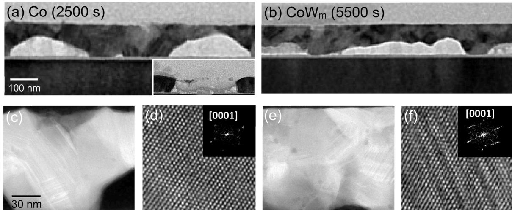  
Fig. 7. Bright-field TEM images, taken from longitudinal sections of (a) Co and (b) $\mathrm { C o W _ { m } }$ interconnect lines, showing their failure profiles after bias stressing for 2500 and 5500 ${ \mathbf { s } } ,$ respectively. Inset of (a) showing the Co-line failure profile and the cobalt accumulation on the top-free surface after 4200 s stressing. The associated HAADF and lattice-fringe images respectively in (c), (d) for Co and (e), (f) for $\mathrm { C o W } _ { \mathrm { m } } ,$ along with their [0001]-oriented Fourier transform patterns (insets), revealing their grain-structure difference.

The STEM-HAADF image of the unalloyed Co line (Fig. 7c) exhibits a ‘clean, smooth’ contour, suggesting a relatively low defect density; the line also gives a ‘perfect’ lattice fringe image (Fig. 7d) and [0001] zoneaxis Fourier transform pattern of HCP-Co (inset, Fig. 7d). By contrast, the $\mathrm { C o W _ { m } }$ line comprises a stacking of equiaxed grains (Fig. 7b), seemingly offering a more complicated grain structure that could inhibit grain-boundary electromigration. Moreover, the $\mathrm { C o W _ { m } }$ line exhibits an HAADF image with an intricate, rough contour (Fig. 7e), suggesting a relatively high defect density. Its high-resolution TEM image (Fig. 7f), taken along the [0001] zone axis, clearly shows the existence of stacking faults on (0001) basal planes, associated with a streaky diffraction pattern of HCP-Co (inset of Fig. 7f). Comparing the unalloyed $\mathbf { C o } ,$ the equiaxed $\mathrm { C o W _ { m } }$ has a more complex grain structure and a higher density of immobile planar defects, which would offer a maze of diffusion routes to retard the void-growth rate.

It should be noted that an STEM-HAADF image is produced by col lecting the high-angle scattered electrons due to Rutherford scattering of atomic nuclei using an annulus detector around the principal axis of a primary incident electron beam. The collected signals are thus highly sensitive to the variation in the atomic number of the atoms in the imaged specimen, as opposed to the conventional TEM dark-field imaging method which utilizes extremely small-angle Bragg diffracted electrons. The high dependence of imaging contrast on atomic number makes STEM-HAADF a facile way to resolve a higher atomic-number alloy from its matrix material, as for the case of the W in Co matrix. However, using STEM-HAADF imaging, high-resolution TEM and STEM-EDX line scanning/mapping turned out to be inconclusive regarding the location of the added W, indicating that 0.06 at.% of W could be beyond the detection limit of the Talos™ F200X microscope.

In sum, the mitigation of Co electromigration by the alloying of extremely diluted W is directly related to an improvement of the film’s mechanical properties and a reduction in the film’s surface energy. Grain-structure refinement also plays a role in the reliability reinforcement.

## 4. Conclusions

An all-wet SAM-seeding and electroless-plating process has been developed to form thin films of Co and extremely diluted CoW alloys with controlled thin-film properties, including deposition rates, alloy compositions, deposit surface morphologies and microstructure stability against thermal stressing. We then extend this all-wet process to fill these metal films into SiO2 trenches, eventually fabricating nanolines of three different CoW alloys for electromigration-behavior evaluations, using nanolines of Co as a reference. The electromigration mitigation for all three nanolines of Co alloys with 0.03 at.%, 0.06 at.% and 0.11 at.% of added W, termed $\mathrm { C o W _ { l } , C o W _ { m } }$ and $\mathrm { C o W _ { h } } ,$ respectively, under accelerated current stressing conditions of the order of $1 0 ^ { 7 } \mathrm { A } \mathrm { c m } ^ { - 2 }$ has been confirmed. Most noticeably, the $\mathrm { C o W _ { m } }$ line containing a moderate amount of W, while only 0.06 at.%, yields a significantly reduced current density scaling factor of 0.33, which is much smaller than that of the Co line (0.50). So, it also yields a much slower void growth rate, associated with an electromigration lifetime at least twice as long as that of the Co line. While a variety of advanced TEM analyses fail to locate the trace amount of W which is less than one atom in about 1000 cobaltmatrix atoms, the 0.06 at% added W markedly elevates the adhesion strength and hardness of Co from 35.8 to 56.1 MPa and 14.8 to 17.5 μN $\mathrm { n m } ^ { - 1 } ,$ respectively. Moreover, it also reduces Co surface energy from 70 to 60 mJ $\mathbf { m } ^ { - 2 }$ , favoring the wetting of the electroless deposits onto the underlying substrate. A fourth benefit given by the optimum W content, as found from advanced STEM/TEM analysis, is that the big electromigration-accelerating blocking grains, as exist in the Co line, are absent from the $\mathrm { C o W _ { m } }$ line. The full account of the thin-film properties being investigated correlates well with the reliability performance of the four different metallic thin films/interconnects under thermal/electricfield stressing. It also reasonably explains why the ranking of their electromigration reliability being increased from $\mathbf { C o } ,$ CoW (0.03 at.%), $\mathrm { C o W _ { h } }$ (0.11 at.%) to $\mathrm { C o W _ { m } }$ (0.06 at.%).

## CRediT authorship contribution statement

Jau-Shiung Fang: Resources, Methodology. Ting-Hsun Su: Investigation, Data curation. Yi-Lung Cheng: Resources, Methodology. Chun-Wei Huang: Software, Data curation. Giin-Shan Chen: Writing – original draft, Supervision, Funding acquisition, Conceptualization.

## Declaration of competing interest

The authors declare that they have no known competing financial interests or personal relationships that could have appeared to influence the work reported in this paper.

## Acknowledgments

The authors would like to thank the Ministry of Science and Technology, Taiwan (MOST 111-2221-E-035-056-MY2) for the financial support of this work. Drs. Chien-Nan Hsiao and Wei-Chun Chen of the Taiwan Instrument Research Institute are acknowledged for TEM support.

## Data availability

Data will be made available on request.

## References

[1] Institute of Electrical and Electronics Engineers (IEEE). International Roadmap for Devices and System: Section 4.5. Interconnect Technology Requirements, 2023 edition, More Moore, 2023.

[2] D. Gall, Electron mean free path in elemental metals, J. Appl. Phys. 119 (2016) 08510, https://doi.org/10.1063/1.4942216.

[3] N. Yoshida, S. Hassan, W. Tang, Y. Yang, W. Zhang, S.C. Chen, L. Dong, H. Zhou, M. Jin, M. Okazaki, J. Park, N. Bekiaris, R. Hung, J. Zhou, Y. Lei, P. Ma, X. Tang, T. Miyashita, N. Kim, E. Yieh, Highly conductive metal gate fill integration solution for extremely scaled RMG stack for 5 nm & beyond, in: Proceedings of the IEEE International Electron Devices Meeting, 2017, https://doi.org/10.1109 IEDM.2017.8268439. IEDM17-544, 22.2.1 4.

[4] I. Ciofi, O.V. Pedreira, B. Parvais, K. Croes, RC benefits of advanced metallization options, IEEE Trans. Electron Devices 66 (2019) 2339–2345, https://doi.org/ 10.1109/TED.2019.2902031.

[5] D. Tierno, I. Ciofi, O.V. Pedreira, B. Parvais, K. Croes, Exploring the benefits of cryogenic temperatures for Co and Ru metallizations, in: Proceedings of the 2023 IEEE International Interconnect Technology Conference and IEEE Materials fo Advanced Metallization Conference, 2023, pp. 1–3, https://doi.org/10.1109/IITC/ MAM57687.2023.10154717.

[6] R. Hen, Z.Y. Wu, N. Bekiaris, J. Tseng, G. How, X.G. Xie, W. Lei, R. Tao, R. Shaviv, J.J. Lee, R. Vinnakota, K. Kashefizadeh, M. Gage, M. Naik, Resistance scaling of Cu interconnect and alternate metal (Co, Ru) benchmark toward sub 10 nm dimension, in: Proceedings of the 2018 IEEE International Interconnect Technology Conference, 2018, pp. 166 168, https://doi.org/10.1109/IITC.2018.8430411.

[7] M.H. van der Veen, N. Heylen, O.V. Pedreira, I. Ciofi, S. Decoster, V.V. Gonzalez, N. Jourdan, H. Struyf, K. Croes, C.J. Wilson, Zs. Tokei, Damascene benchmark of Ru, Co and Cu in scaled dimensions, in: Proceedings of the 2018 IEEE International Interconnect Technology Conference, 2018, pp. 172–174, https://doi.org/ 10.1109/IITC.2018.8430407.

[8] P.S. Ho, T. Kwok, Electromigration in metals, Rep. Prog. Phys. 52 (1989) 301–349, https://doi.org/10.1088/0034-4885/52/3/002.

[9] J.P. Dekker, A. Lodder, Calculated electromigration wind force in face-centeredcubic and body-centered-cubic metals, J. Appl. Phys. 84 (1998) 1958–1962, https://doi.org/10.1063/1.368327.

[10] O. Clauben, S. Gerlach, C. Russel, Self-diffusivity of polyvalent ions in silicate liquids, J. Non Cryst. Solids 253 (1999) 76–83, https://doi.org/10.1016/S0022- 3093(99)00345-2.

[11] A.S. Oates, Strategies to ensure electromigration reliability of Cu/low-k interconnects at 10 nm, ECS J. Solid State Sci. Technol. 4 (2015) N3168 N3175, https://doi.org/10.1149/2.0171501JSS.

[12] O. Varela Pedreira, M. Lofrano, H. Zahedmanesh, Ph.J. Roussel, M. van der Veen, V. Simons, E. Chery, I. Ciofi, K. Croes, Assessment of critical Co electromigration parameters, in: Proceedings of the 2022 IEEE International Reliability Physics Symposium (IRPS), Dallas, TX, USA, 2022, https://doi.org/10.1109 IRPS48227.2022.9764427, 8C.2-1-8C.2-7.

[13] Y. Shacham-Diamand, T. Osaka, Y. Okinaka, A. Sugiyama, V. Dubin, 30 years of electroless plating for semiconductor and polymer micro-systems, Microelectron. Eng. 132 (2015) 35 45, https://doi.org/10.1016/j.mee.2014.09.003

[14] Z. Sukackiene, L. Tamasauskaite-Tamasiunaite, V. Jasulaitiene, A. Balciunaite, A. Naujokaitis, E. Norkus, Electroless deposition of CoBW coatings using

morpholine borane as a reducing agent, Thin Solid Films 636 (2017) 425–430, https://doi.org/10.1016/j.tsf.2017.06.034

[15] K. Nishizawa, A. Matsumoto, Y. Nakagawa, H. Sakuma, S. Goto, N. Fukumuro, S. Yae, Comparison of electroless Ni-P and Co-W-P diffusion properties against GaAs substrate, J. Electron. Mater. 52 (2023) 4080–4090, https://doi.org 10.1007/s11664-023-10380-3.

[16] Y. Shacham-Diamand, Y. Sverdlov, N. Petrov, Electroless deposition of thin-film cobalt-tungsten-phosphorus layers using tungsten phosphoric acid (H3[P (W O ) ]) for ULSI and MEMS applications, J. Electrochem. Soc. 148 (2001) C162–C167, https://doi.org/10.1149/1.1346605.

[17] J. Gambino, J. Wynne, J. Gill, S. Mongeon, D. Meatyard, B. Lee, H. Bamnolker, L. Hall, N. Li, M. Hernandez, P. Little, M. Hamed, I. Ivanov, C.L. Gan, Self-aligned metal capping layers for copper interconnects using electroless plating Microelectron. Eng. 83 (2006) 2059–2067, https://doi.org/10.1016/j. mee.2006.09.008.

[18] M. Malki, A. Rozenblat-Raz, A. Duhin, A. Inberg, D. Horvitz, Y. Shacham-Diamand, Thin electroless Co(W,P) film growth on titanium-nitride layer modified by self assembled monolayer, Surf. Coat. Technol. 252 (2014) 1–7, https://doi.org 10.1016/j.surfcoat.2014.04.041

[19] J.S. Fang, G.S. Chen, C.C. Chang, C.N. Hsiao, W.C. Chen, Y.L. Cheng, Understanding electromigration failure behaviors of narrow cobalt lines and the mechanism of reliability enhancement for extremely dilute alloying of manganese oxide, J. Alloy. Compd. 970 (2024) 172591, https://doi.org/10.1016/j. jallcom.2023.172591.

[20] J.S. Fang, T.M. Yang, Y.C. Pan, G.Y. Lai, Y.L. Cheng, G.S. Chen, Chemical-structure evolution model for the self-assembling of amine-terminated monolayers on nanoporous carbon-doped organosilicate in tightly controlled environments, Langmuir 36 (2020) 15153–15161, https://doi.org/10.1021/acs langmuir.0c02801.

[21] G.S. Chen, W.H. Chang, C.C. Chang, Y.H. Chien, J.S. Fang, Y.L. Cheng, Structural models and barrier properties of amine-terminated trialkoxysilane monolayers incubated in nonpolar vs. polar protic solvents, Mater. Chem. Phys. 274 (2021) 125113, https://doi.org/10.1016/j.matchemphys.2021.125113.

[22] G.S. Chen, T.M. Yang, S.T. Chen, Y.L. Cheng, J.S. Fang, A new alternative self assembled-monolayer activation process for electroless deposition of copper interconnects without a conventional barrier, Electrochem. Commun. 87 (2018) 9 12, https://doi.org/10.1016/j.elecom.2017.12.015

[23] J.R. Lloyd, Black’s law revisited—Nucleation and growth in electromigration failure, Microelectron. Reliab. 47 (2007) 1468–1472, https://doi.org/10.1016/j. microrel.2007.07.094.

[24] D.K. Owens, R.C. Wendt, Estimation of the surface free energy of polymers, J. Appl. Polym. Sci. 13 (1969) 1741 1747, https://doi.org/10.1002/app.1969.070130815.

[25] N. Petrov, Y. Sverdlov, Y. Shacham-Diamand, Electrochemical study of the electroless deposition of Co(P) and Co(W, P) alloys, J. Electrochem. Soc. 149 (2002) C187 C194, https://doi.org/10.1149/1.1452118.

[26] Y. Sverdlov, V. Bogush, H. Einati, Y. Shacham-Diamand, Electrochemical study of the electroless deposition of Co(W, B) alloys, J. Electrochem. Soc. 152 (2005) C631–C638, https://doi.org/10.1149/1.1997167

[27] Y. Sverdlov, V. Bogush, Y. Shacham-Diamand, Microstructure and material properties of electroless CoWP films obtained from sulfamate solutions, Microelectron. Eng. 83 (2006) 2243–2247, https://doi.org/10.1016/j. mee.2006.10.012.

[28] R. Tarozaite, Z. Sukackiene, A. Sudavicius, R. Juskenas, A. Selskis, A. Jagminiene, E. Norkus, Application of glycine containing solutions for electroless deposition of Co-P and Co-W-P films and their behavior as barrier layers, Mater. Chem. Phys. 117 (2009) 117–124, https://doi.org/10.1016/j.matchemphys.2009.05.016.

[29] A.A. Aal, H. Barakat, Z.A. Hamid, Synthesis and characterization of electroless deposited Co-W-P thin films as diffusion barrier layer, Surf. Coat. Technol. 202 (2008) 4591–4597, https://doi.org/10.1016/j.surfcoat.2008.03.023.

[30] J. Lienig, M. Thiele, Fundamentals of Electromigration—Aware Integrated Circuit Design, Springer, 2018.

[31] Y.X. Lin, A. Gusak, S.Y. Jing, K.N. Tu, Fast prediction of electromigration lifetime with modified mean-time-to-failure equation, Mater. Lett. 325 (2022) 132880, https://doi.org/10.1016/j.matlet.2022.132880

[32] J.R. Lloyd, Electromigration in integrated circuit conductors, J. Phys. D Appl. Phys. 32 (1999) R109–R118, https://doi.org/10.1088/0022-3727/32/17/201.

[33] S.J. Bull, D.S. Rickerby, New developments in the modelling of the hardness and scratch adhesion of thin films, Surf. Coat. Technol. 42 (1990) 149 164, https://doi. org/10.1016/0257-8972(90)90121-R.

[34] S.Y. Chang, S.Y. Lin, Y.C. Huang, C.L. Wu, Mechanical properties, deformation behaviors and interface adhesion of (AlCrTaTiZr)N multi-component coatings, Surf. Coat. Technol. 204 (2010) 3307–3314, https://doi.org/10.1016/j. surfcoat.2010.03.041.

[35] X.F. Wang, P. Xu, R. Han, J. Ren, L.Y. Li, N. Han, F. Xing, J.H. Zhu, A review on the mechanical properties for thin film and block structure characterised by using nanoscratch test, Nanotechnol. Rev. 8 (2019) 628–644, https://doi.org/10.1515 ntrev-2019-0055.

[36] J.A. Williams, Analytical models of scratch hardness, Tribol. Int. 29 (1996) 675 694, https://doi.org/10.1016/0301-679X(96)00014-X.

[37] E.J. Chibowksi, Surface free energy and wettability of silyl layers on silicon determined from contact angle hysteresis, Adv. Colloid Interface Sci. 113 (2005) 121 131, https://doi.org/10.1016/j.cis.2005.01.005.

[38] D. Janssen, R. De Palma, S. Verlaak, P. Heremans, W. Dehaen, Static solvent contact angle measurements, surface free energy and wettability determination of various self-assembled monolayers on silicon dioxide, Thin Solid Films 515 (2006) 1433–1438, https://doi.org/10.1016/j.tsf.2006.04.006.

[39] K. Malecha, I. Gancarz, W. Tylus, Argon plasma-assisted PDMS-LTCC bonding technique for microsystem applications, J. Micromech. Microeng. 20 (2010) 115006, https://doi.org/10.1088/0960-1317/20/11/115006.

[40] G. Cappelletti, S. Ardizzone, D. Meroni, G. Soliveri, M. Ceotto, C. Biaggi, M. Benaglia, L. Raimondi, Wettability of bare and fluorinated silanes: a combined approach based on surface free energy evaluations and dipole moment calculations, J. Colloid Interface Sci. 389 (2013) 284–291, https://doi.org/ 10.1016/j.jcis.2012.09.008.

[41] A.O. Lindahl, P. Andersson, C. Diehl, O. Forstner, P. Klason, D. Hanstorp, The electron affinity of tungsten, Eur. Phys. J. D 60 (2010) 219–222, https://doi.org/ 10.1140/epjd/e2010-00199-y.

[42] X. Chen, C. Ning, Accurate electron affinity of Co and fine-structure splittings of Co− via slow-electron velocity-map imaging, Phys. Rev. A 93 (2016) 052508, https://doi.org/10.1103/PhysRevA.93.052508.

[43] Y. Yamada, M. Yahagi, J. Koike, Thermodynamic evaluation of the liner and barrier properties of a single-phase interlayer for advanced Cu interconnections, in: Proceedings of the IEEE International Interconnect Technology Conference (IITC), Kyoto, Japan, 2021, pp. 1–3, https://doi.org/10.1109/IITC51362.2021.9537369.

[44] H. Einati, V. Bogush, Y. Sverdlov, Y. Rosenberg, Y. Shacham-Diamand, The effect of tungsten and boron on the Cu barrier and oxidation properties of thin electroless cobalt–tungsten–boron films, Microelectron. Eng. 82 (2005) 623–628, https://doi. org/10.1016/j.mee.2005.07.082.

[45] H.B. Huntington, A.R. Grone, Current-induced marker motion in gold wires, J. Phys. Chem. Solids 20 (1961) 76–87, https://doi.org/10.1016/0022-3697(61) 90138-X.

[46] C.S. Hau-Riege, An introduction to Cu electromigration, Microelectron. Reliab. 44 (2004) 195–205, https://doi.org/10.1016/j.microrel.2003.10.020.

[47] R.L. de Orio, H. Ceric, S. Selberherr, Physically based models of electromigration: from Black’s equation to modern TCAD models, Microelectron. Reliab. 50 (2010) 775–789, https://doi.org/10.1016/j.microrel.2010.01.007.

[48] J. Niehof, H.C. De Graaff, A.J. Mouthaan, J.F. Verwey, An empirical model for early resistance changes due to electromigration, Solid State Electron. 38 (1995) 1817 1827, https://doi.org/10.1016/0038-1101(94)00285-N

[49] K.N. Tu, Recent advances on electromigration in very-large-scale-integration of interconnects, J. Appl. Phys. 94 (2003) 5451 5473, https://doi.org/10.1063 1.1611263.

[50] R. Hoffmann-Vogel, Electromigration and the structure of metallic nanocontacts, Appl. Phys. Rev. 4 (2017) 031302, https://doi.org/10.1063/1.4994691.

[51] H. Wang, C. Bruynseraede, K. Maex, Impact of current crowding on electromigration-induced mass transport, Appl. Phys. Lett. 84 (2004) 517–519, https://doi.org/10.1063/1.1644048.

[52] S.K. Lin, Y.C. Liu, S.J. Chiu, Y.T. Liu, H.Y. Lee, The electromigration effect revisited: non-uniform local tensile stress-driven diffusion, Sci. Rep. 7 (2017) 3082, https://doi.org/10.1038/s41598-017-03324-5.

[53] J.R. Lloyd, M.W. Lane, E.G. Liniger, C.K. Hu, T.M. Shaw, R. Rosenberg, Electromigration and adhesion, IEEE Trans. Device Mater. Reliab. 5 (2005) 113–118, https://doi.org/10.1109/TDMR.2005.846308.

[54] S.P. Prasad, Y. Singh, P.K. Vaitheeswaran, G. Subbarayan, The connection between electromigration resistance and thin-film adhesion and their degradation with temperature, IEEE Trans. Compon. Packag. Manuf. Technol. 13 (2023) 426–443, https://doi.org/10.1109/TCPMT.2023.3259299.