# Suppressing-accelerating effect of Nitrotetrazolium Blue chloride in boosting superconformal cobalt filling

Yaqiang Li a,b,1, Xiaochuan Ma a,1, Ruopeng Li a, Jinqiu Zhang a, Peixia Yang a, Anmin Liu c, Bo Wang a,\*, Peter Broekmann b,\*, Maozhong An a,\*

a MIIT Key Laboratory of Critical Materials Technology for New Energy Conversion and Storage, School of Chemistry and Chemical Engineering, Harbin Institute of Technology, Harbin 150001, China

b Department of Chemistry, Biochemistry and Pharmaceutical Science, University of Bern, Freiestrasse 3, 3012 Bern, Switzerland

c State Key Laboratory of Fine Chemicals, School of Chemical Engineering, Dalian University of Technology, Dalian 116000, China

## A R T I C L E I N F O

Keywords: Superconformal growth Numerical simulation Raman spectra

## A B S T R A C T

Achieving cobalt superconformal (bottom-up) growth is significantly important. Electrochemical methods, including cyclic voltammetry, electrochemical impedance spectra and EQCM-derived Coulomb-voltage curves, were used to confirm the suppressing influence of new suppressor Nitrotetrazolium Blue chloride (NBT). In situ Raman spectroscopy was used confirm that NBT can effectively adsorb on cobalt surface. Besides, EQCM-derived Coulomb-voltage illustrates that it is more beneficial for cobalt electrodeposition at high pH. The NBT effect on hydrogen evolution reaction (HER) was studied by LSV and chronoamperometry. Finite element simulation is used to investigate the accelerating effect of NBT on HER and convection. Suppressing-accelerating effect is proposed to illustrate effect of NBT. NBT can not only suppress the cobalt deposition but also can accelerate local convection by intensifying HER, which can in turn strengthen NBT adsorption. SEM analysis demonstrates that convection and NBT can refine grain. High-quality cobalt is achieved with low SDT values ranging from 24 μm to 45 μm and high FP values (75.4 % for 150 μm, 88.9 % for 100 μm and 87.2 % for 50 μm)

## 1. Introduction

With the development of electronic fabrication technology, the interconnect line width has been downscaled to nano size [1,2]. After entering post-Moore era, convectional copper damascene technology is facing enormous challenges in terms of reliability and electronic property of integrated circuit (IC) [3,4]. It is easy to form defects during production due to edge effect at the opening of vias with narrow line width, thus lowering the yield and reliability [5,6]. When the line width is lower than mean free electron path (MFEP) of interconnect materials, the resistivity sees an exponential growth due to severe electron scattering at the boundary [7,8], which increases the IC delay and has a bad influence on electronic property [9,10]. As a result, developing newgeneration interconnect metal is industrially important [11]. Cobalt, due to its low MFEP and compatibility with copper damascene technology, has been used as the interconnect metal at advanced node [12,13].

Due to uneven distribution of electric field caused by edge effect and limited mass transfer during electroplating, it is necessary to add effective additives to achieve void-free bottom-up (superconformal) filling [14,15]. Nowadays, researchers have developed some effective suppressors. He et al applied suppressor polyvinylpyrrolidone (PVP) to achieve superconformal growth based electrochemical methods [16], while Josell et al studied the effect of branched polyethylenimine (PEI) on cobalt deposition and applied S-shaped negative differential resistance (S-NDR) model to predict bottom-up filling [17]. In contrast, Huang et al applied quartz microbalance to study the suppressing effect of dimethylglyoxime and study the influence of HER [18]. Ma et al studied the suppressing mechanism of malachite green on cobalt electrodeposition by coupling AIM method, molecular electrostatic potential and electrochemical method as well as proposed adsorption-transport mechanism to illustrate the influence of malachite green on bottom-up growth [19].

Researchers pay much attention on the influence of different addi tives on cobalt electrodeposition, however, there is a lack of experimental research to provide an insight into the effective special group.

Table 1  
The bath composition and electroplating process parameters.

<table><tr><td>Bath composition and process parameters</td><td>Optimum values</td></tr><tr><td> $CoSO_{4} \cdot 7H_{2}O$  (mol/L)</td><td>0.4</td></tr><tr><td> $H_{3}BO_{3}$  (mol/L)</td><td>0.5</td></tr><tr><td> $Cl^{-}$  (mg/L)</td><td>6</td></tr><tr><td>NBT (mg/L)</td><td>10</td></tr><tr><td>pH</td><td>4</td></tr><tr><td>Cathode potential v.s. SSE (V)</td><td>-1.25</td></tr></table>

Nowadays, in situ Raman spectra [20,21] and STM [22,23] are widely used to study the adsorption of additives. Besides, HER occurs inevitably during cobalt electrodeposition and has a significant influence on local mass transfer. Nevertheless, there is lack of research on the effect of HER during electrodeposition and the influence of additive on HER [24,25]. Nowadays, finite element method (FEM) is widely used to simulate the practical process to provide more detailed information for researchers [26], like diffusion [27], electric field distribution [28,29], gas releasing process [30], TSV filling simulation [31,32] and so on. Li et al combined experimental and simulated results to propose Gas Microfluidic Pumping (GMP) model to illustrate the effect of gas releasing during HER on the mass transfer [33]. As a result, applying FEM is a good way to help researcher to understand the influence of HER on mass transfer.

In this work, we use cyclic voltammetry (CV), electrochemical impedance spectra (EIS) and EQCM-derived Coulomb-voltage to investigate Nitrotetrazolium Blue chloride (NBT) suppressing effect of during electrodeposition. The adsorption phenomena of NBT on were confirmed by in situ Raman spectra was used to verify the possible adsorption of NBT on cathode during electrodeposition. The influence of pH on current density was studied by measuring EQCM-derived Coulomb-voltage curves, while the acceleration of NBT on HER was analyzed and the influence of gas flow produced by HER with different NBT concentration on flow rate (convection) of electrolytes was acquired by Finite element simulation. Scanning electron micrograph (SEM) was used to observe the convection and NBT on cobalt layer morphology. Finally, superconformal filling in microvias is achieved.

## 2. Experiments

## 2.1. Materials and chemicals

In this work, analytical grade (AR) additive Nitrotetrazolium Blue chloride (NBT) with CAS no. of 298–83-9 is bought from Shanghai Aladdin Co., Ltd., China, while other AR chemicals, including $\mathrm { C o S O _ { 4 } { \cdot } 7 H _ { 2 } O , H _ { 3 } B O _ { 3 } }$ and NaCl, is purchased from Sinopharm Chemical Reagent Co. Ltd., China. The deionized water is used to prepare all kinds of electroplating solutions.

## 2.2. Electrochemical measurement

Electrochemical measurement was controlled by Gamry Framework and was measured in a traditional three-electrode system. The rotating disk electrode (radius of 0.25 cm), saturated mercury sulfate electrode (SSE) and a platinum with the area of 2 cm × 1 cm were used as working, reference and counter electrode, respectively. Inert $\mathrm { N } _ { 2 }$ was pumped into bath solution to remove oxygen dissolved to exclude the possible oxidization influence before electrochemical tests. The scan rate for cyclic voltammetry (CV) is 5 mV/s and the rotating speed was 1000 rpm, while electrochemical impedance spectra (EIS) was carried out at 1.25 V v.s. SSE, 500 rpm. The scan rate for linear sweeping voltammetry (LSV) was 5 mV/s. Besides, electrochemical quartz crystal microbalance (EQCM) was used to study NBT effect on cobalt deposition with 5 MHz gold quartz crystal. Before carrying EQCM tests, the gold quartz crystal was pre plated with cobalt layer at $\scriptstyle \lfloor \mathbf { A } / \mathbf { d m } ^ { 2 }$ for 60 s. Current transients was carried out by chronoamperometry at different cathodic potentials.

## 2.3. Finite element simulation

Finite element (FE) simulation was carried out by COMSOL Multiphysics. Two-dimensional symmetric model was established to simulate the rotating disk electrode (RDE). The radius of simulated RDE is set as 0.25 cm according to experiments. Electrochemistry module and CFD module were coupled together to simulate the influence of HER with different NBT concentration on the mass transfer of NBT. Tertiary current distribution and bubble flow and laminar flow were used, respec tively. The parameters (exchange current density, charge transfer efficient) were calculated from LSV curves obtained with different NBT concentration and the detailed parameters were shown in Table S1.

## 2.4. Characterization

The NBT adsorption behavior on cobalt surface was studied by in situ Raman spectra at RENISHAW with excitation wavelength of 432 $4 3 2$ nm. Gamry Framework station was used to control the cathodic potentials. The surface morphology under the influence of NBT and convection was measured on scanning electron microscope (Helios Nanolab 600i).

## 2.5. Electroplating

Virgin-makeup solution (VMS) consists of 0.4 mol/L $\mathrm { C o S O } _ { 4 } { \cdot } 7 \mathrm { H } _ { 2 } 0 ,$ 0.5 mol/L $\mathrm { H } _ { 3 } \mathrm { B O } _ { 3 }$ and 6 mg/L NaCl. The electroplating experiments were done in a three-electrode bath in microvias with different diameters (150 μm, 100 μm and 50 μm, respectively). The depth of microvias was 100 μm. The working electrode is substrate with microvias, while reference electrode and counter electrode were high-purity cobalt plate and saturated mercury sulfate electrode (SSE) was used as reference electrode and counter electrode. 10 wt% $\mathrm { H _ { 2 } S O _ { 4 } }$ was used to activate the substrate, after which electroplating was carried out with electroplating solution disturbed by gas pump (8 L/h). An OLYMPUS confocal laser microscope (DSX510) was used to observe the cross-sectional images of microvias and take videos for recording hydrogen gas releasing process. Table 1 shows the electrolytes receipt and process parameters.

## 3. Results and discussion

## 3.1. The effect of NBT on cobalt electrodeposition

The influence of NBT on cobalt reduction process was studied by CV and EIS. In the CV tests, the cathodic polarization change and anodic stripping coulomb were used to evaluate the suppressing performance of NBT on cobalt electrodeposition [34]. It can be seen from 1 (a) that the onset potential sees a decline from −1.2 V to lower than −1.4 V with the NBT concentration rising from 0 mg/L to higher than 20 mg/L, indi cating that it becomes harder for $\mathsf { C o } ^ { 2 + }$ to be reduced. Besides, the anodic stripping area decreases continuously. The calculated anodic stripping coulomb is shown in Fig. 1 (b). The coulomb of VMS is about $2 . 8 0 \mathrm { C } / \mathrm { c m } ^ { 2 } .$ After introducing NBT, the coulomb decreases gradually to $0 . 5 0 \mathrm { C } / \mathrm { c m } ^ { 2 }$ which demonstrates that NBT can effectively suppress the cobalt electrodeposition. What’s more, the surface coverage of NBT is estimated by applying Eq. (1):

$$
\theta = 1 - \frac {Q}{Q _ {0}}\tag{1}
$$

where θ represent surface coverage (%), Q is stripping coulomb under the influence of additive and $Q _ { 0 }$ is stripping coulomb without additive. When the surface coverage is within 40% to 60%, it is better to achieve bottom-up growth under the influence of mass transfer. As a result, 15 mg/L NBT is regarded to have the potential to achieve superfilling in microvias.

Besides, the suppressing ability of NBT is also investigated by electrochemical impedance spectra (EIS). Usually, the impedance ring

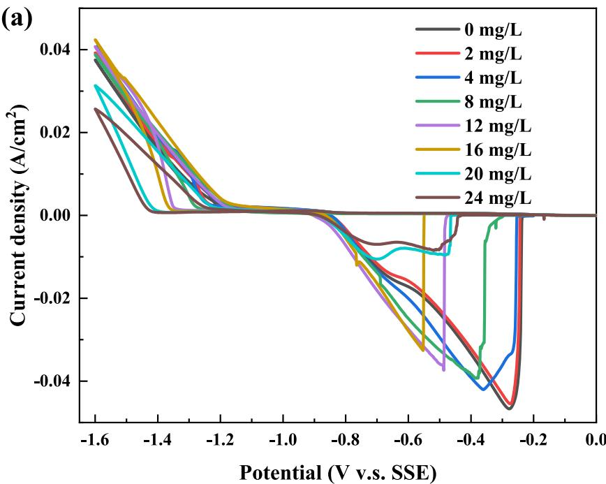

(b)  
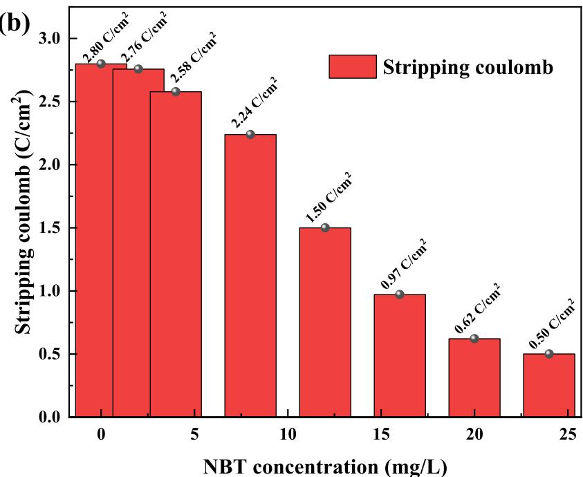  
Fig. 1. (a) Cyclic voltammetry measured at 500 rpm at a scan rate of 5 mV/s with NBT concentration ranging from 0 mg/L to 24 mg/L. (b) The calculated anodic stripping coulomb from Fig. 1 (a). The electrochemical testing plating bath consists of 4 mol/L $\mathrm { C o S O } _ { 4 } ,$ 0.5 mol/L $\mathrm { H } _ { 3 } \mathrm { B O } _ { 3 } ,$ 6 mg/L Cl-, pH of 4.0.

radius sees an increase with the rising of reaction energy barrier [35]. As a result, it can be concluded from Fig. 2 (a) that there is a rising trend in terms of impedance ring radius with the rising of NBT concentration, which demonstrates that the difficulty for cobalt electrodeposition is strengthened, in accordance with the CV analysis. Besides, the charge transfer impedance (Rct) and solution impedance (Rs) were acquired by establishing equivalent circuit, as shown in Fig. S1. Fig. 2 (b) show the simulated data. The Rs stayed basically unchanged, illustrating that bath impedance is hardly affected by NBT. As for Rct, it saw an increase from 107.5 Ω (VMS) to more than 374.1 Ω when NBT concentration rises from 0 mg/L to 20 mg/L. The Rct obtained in solution with 20 mg/L is three times larger than that of VMS. In summary, CV and EIS confirm that NBT can suppress the cobalt electrodeposition effectively.

Since HER occurs inevitably during cobalt electrodeposition, the electrochemical quartz microbalance (EQCM) was accepted to study the influence of NBT and exclude the HER since the current density is calculated by measuring mass change during cobalt electrodeposition. The measured Coulomb-voltage curves controlled by linear sweeping voltammetry is shown in Fig. 3 (a) and original mass change under sweeping voltage condition can be seen in Fig. S2. It can be seen clearly that the deposited coulomb quantity sees a gradually decline with NBT concentration rising from 0 mg/L to 20 mg/L, which is consistent with CV analysis above.

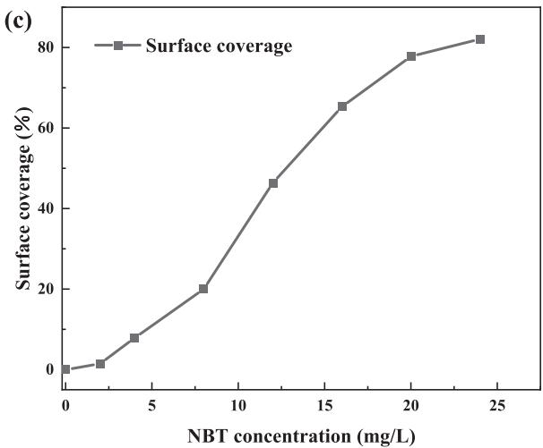  
Fig. 1. (continued).

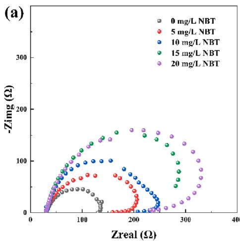

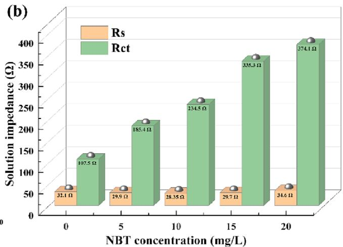  
Fig. 2. Electrochemical impedance spectra (EIS) under the influence of different NBT concentration obtained at −1.25 V v.s. SSE, 500 rpm. The electrochemical testing plating bath consists of 4 mol/L $\mathrm { C o S O _ { 4 } } ,$ 0.5 mol/L $\mathrm { H } _ { 3 } \mathrm { B O } _ { 3 } ,$ 6 mg/L Cl-, pH of 4.0.

Fig. 3 (b) shows in situ Raman spectra of NBT during cobalt electrodeposition to discuss the possible NBT adsorption behavior on cobalt surface. The characteristic peaks appeared during cobalt electrodeposition is summarized in Table 2. Stretching vibration of tetrazole ring $\mathrm { N - N }$ leads to peaks of 991 and $1 3 2 0 ~ \mathrm { { c m } ^ { - 1 } }$ [36,37], while 1128 and 1182 $\mathrm { c m } ^ { - 1 }$ are due to the bending vibration of aromatic C–H [38,39]. Besides, the bending vibration of tetrazole ring N–N appears at 1220 $\mathrm { c m } ^ { - 1 }$ and bending vibration of tetrazole is located at 1363 cm $^ { - 1 } [ 4 0 , 4 1 ]$ Stretching vibration of aromatic C–C appears at $1 4 2 9 \mathrm { c m } ^ { - 1 }$ [38]. As for $1 5 5 1 ~ \mathrm { { c m } ^ { - 1 } }$ and $1 5 9 4 ~ \mathrm { { c m } ^ { - 1 } }$ , they belong to stretching vibration of aromatic $\mathrm { c - c }$ and ${ \mathrm { C } } { \mathrm { - N } } ,$ respectively [41,42]. It should be noted that the typical peak intensity sees a gradually increase with the cathodic potential shifting negatively, illustrating that the adsorption might be strengthened with the increase of cathodic polarization. In summary, electrochemical analysis, including CV analysis, EIS analysis and EQCM derived coulomb-voltage curves analysis, as well as in situ Raman spectra confirms that NBT can be used as an effective suppressor adsorbing on cathode surface (suppressing effect).

## 3.2. The effect of pH on cobalt electrodeposition

The EQCM-derived Coulomb-voltage curves was applied to study the influence of pH value on cobalt electrodeposition. The mass change with sweeping voltage is shown in Fig. S3. Fig. 4 shows the calculated coulomb-voltage curves from Fig. S3. The deposited coulomb for cobalt sees an increase with the rising of pH value, meaning that high pH is beneficial for the formation of cobalt deposits. The reaction process under the influence of pH can be expressed as follows [43]:

$$
2 \mathrm{H} ^ {+} + 2 \mathrm{e} ^ {-} = \mathrm{H} _ {2}\tag{2}
$$

$$
2 \mathrm{H} _ {2} \mathrm{O} + 2 \mathrm{e} ^ {-} = \mathrm{H} _ {2} + 2 \mathrm{OH} ^ {-}\tag{3}
$$

$$
\mathrm{Co} _ {\mathrm{aq}} ^ {2 +} + \mathrm{OH} ^ {-} = \mathrm{CoOH} _ {\mathrm{ad}} ^ {+}\tag{4}
$$

In which aq represents aqueous phase and ad represents adsorbates. During the cobalt electrodeposition, the local pH near the cathode surface sees an increase due to hydrogen evolution reaction. The free ${ \mathsf { C o } } ^ { 2 + }$ near the surface can complex with OH– to form $\mathrm { C o O H ^ { + } }$ adsorbates to boost the reaction rate. When plate is electrodeposited, the pH value in the feature is higher than other parts due to geometry limitation and mass transport limitation. As a result, the current density in the feature is higher since high pH is conducive for the formation of adsorbed cobalt hydroxide intermediate to increase the deposition rate. Besides, the high pH is also good for the improvement for current efficiency according to our previous work [2]. In summary, the difference in terms of pH in the feature and field will benefit the bottom-up growth.

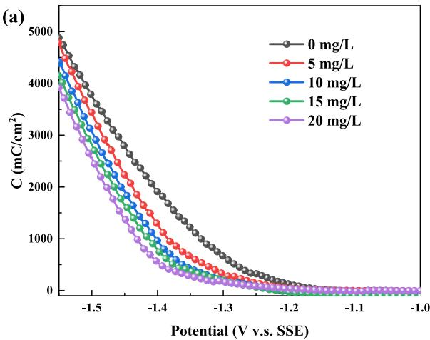

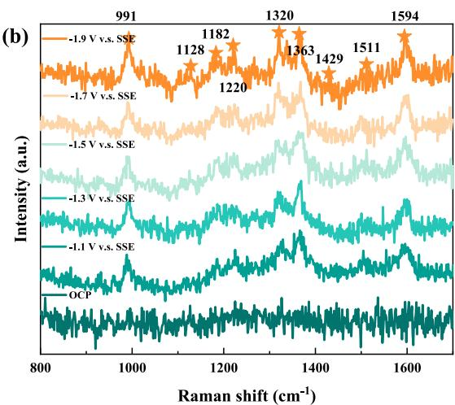  
Fig. 3. (a) EQCM-derived Coulomb-voltage curves with different NBT concentration at scan rate of 5 mV/s without stirring condition. The electro chemical testing plating bath consists of 4 mol/L $\mathrm { C o S O _ { 4 } , }$ 0.5 mol/L $\mathrm { H _ { 3 } B O _ { 3 } } ,$ 6 mg/L Cl-, pH of 4.0. (b) in in situ Raman spectra of NBT measured in 40 mM $\mathrm { C o S O } _ { 4 } + 5 0$ mM $\mathrm { H } _ { 3 } \mathrm { B O } _ { 3 } + 1 . 4$ mM Cl- at various cathodic potentials ranging from OCP to −1.9 V v.s. SSE.

Raman spectra characteristic band assignments for Nitrotetrazolium Blue chloride.

<table><tr><td>Band position/cm $^{-1}$ </td><td>Band assignment</td><td>Ref</td></tr><tr><td>991</td><td> $\nu$  (tetrazole ring N—N)</td><td>[36]</td></tr><tr><td>1128</td><td> $\delta$  (aromatic C—H)</td><td>[38]</td></tr><tr><td>1182</td><td> $\delta$  (aromatic C—H)</td><td>[39]</td></tr><tr><td>1220</td><td> $\delta$  (tetrazole ring N—N)</td><td>[40]</td></tr><tr><td>1320</td><td> $\nu$  (tetrazole ring N—N)</td><td>[37]</td></tr><tr><td>1363</td><td> $\delta$  (-tetrazole)</td><td>[41]</td></tr><tr><td>1429</td><td> $\nu$  (aromatic C—C)</td><td>[38]</td></tr><tr><td>1511</td><td> $\nu$  (C—N)</td><td>[42]</td></tr><tr><td>1594</td><td> $\nu$  (NO $_{2}$ )</td><td>[41]</td></tr></table>

δ: bending modes; ν: stretching modes

## 3.3. The acceleration of NBT on HER

HER plays a significant influence on local mass transfer due to gas releasing process on cathode surface. The obvious gas releasing process can be seen in video provided in supplementary, which is taken by applying −1.25 V v.s. SSE on plates. HER not only have an obvious influence on current efficiency but also influence the local mass transport. As a result, the influence of NBT on HER is also studied respectively. Fig. 5 (a) shows that the LSV curves under the influence of different NBT concentration without adding $\mathrm { C o S O _ { 4 } } .$ . The HER current density rises with NBT concentration, indicating that NBT can effectively boost HER. What’s more, current transients under different applied potential are also measured to verify the boosting influence of NBT on HER. Fig. 5 (b) shows that the HER current density with NBT is obviously larger than that without NBT no matter with the applied potential. After steady current density is achieved, the stable current density is summarized in Fig. 5 (c) for comparison and the direct boosting effect of NBT on HER can be intuitively observed with original figures shown in Table S1.

In order to deeply discuss the influence of NBT on convection, finite element simulation is accepted to simulate electrolytes flow rate under the influence of different NBT concentration based on COMSOL Multiphysics. Here, a RDE model is established to simulate the process. The parameters for HER are extracted from Fig. 5 (a) and relevant parameters are summarized in Table S2. As shown in Fig. 6 (a), the working area is consistent with our experiments. When the simulated potential is

−1.5 V and NBT concentration is 30 mg/L, it can be seen from Fig. 6 (a) and 6 (b) that HER occurs severely and the flow rate is high up to 10 mm $/ s ,$ which can effectively improve the convection near the cathode surface. Fig. 6 (c) shows the pH distribution and the flow direction of hydrogen ions. In Fig. 6 (d), the simulated LSV curves is accordance well with experimental LSV curves, which verify that the parameters used are correct. The comparison of flow rate near the surface under the influence of NBT is shown in Fig. 6 (e). The simulated results indicates that the convection is intensified with NBT, which can effectively strengthen the mass transfer near the cathode surface, resulting that the supply of suppressor is more easily achieved with high NBT concentration. The kind of positive feedback is conducive for NBT to suppress the cobalt deposition.

As a result, NBT is an accelerator for HER (accelerating effect) and during cobalt electrodeposition, the NBT mass transport is unlimited on plane surface to intensify the HER. The gas bubble will in turn increase the mass transport of NBT on cathode surface to cover the surface compactly. The cobalt electrodeposition is effectively suppressed based on the suppressing effect of NBT on cobalt deposition compared with that on the bottom of microvias to benefit the superconformal growth.

## 3.4. Surface morphology

SEM was used to observe the effect of NBT and convection on cobalt layer [44] and the histogram of grain size distribution obtained is asserted in Fig. 7. Fig. 7 (a) shows that the cobalt layer consists of rectangular strip grain without NBT. The cobalt surface is loose and the grain size is relatively large with mean grain size about 321 nm. Although the grain size is declined to some extent (mean grain size of 302 nm), the cobalt layer is not so compact due to the rectangular strip grain after applying 500 rpm, as shown in Fig. 7 (b), illustrating that convection is of weak grain refinement. After introducing NBT, the grain morphology turns from rectangular to sphere and the cobalt layer is compact without convection. The grain size sees a huge decline to about 109 nm, which indicates that NBT can effectively refine grain. After convection condition is applied, the grain size sees a further decline. As a result, the convection and NBT can effectively improve the cobalt morphology.

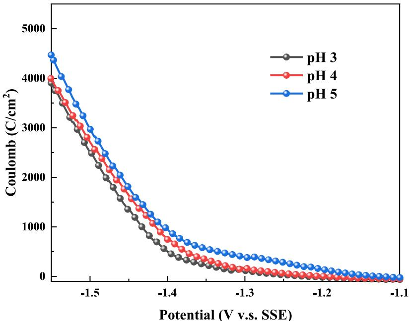  
Fig. 4. EQCM-derived Coulomb-voltage curves with different pH at scan rate of 5 mV/s without stirring condition. The electrochemical testing plating bath consists of 4 mol/L $, \mathrm { C o S O } _ { 4 } ,$ 0.5 mol/L $\mathrm { , H _ { 3 } B O _ { 3 } , }$ 6 mg/L Cl-.

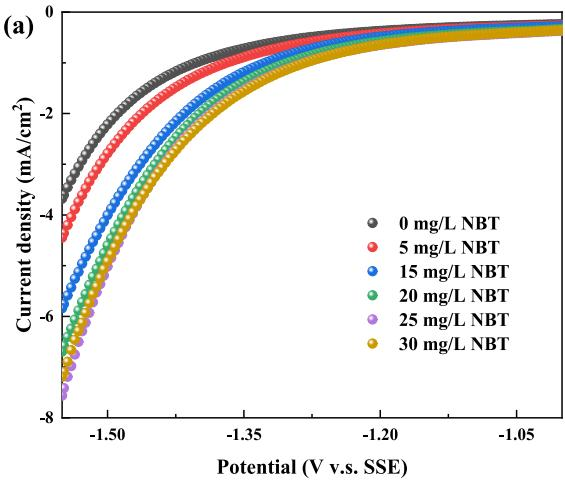  
(c)

(b)  
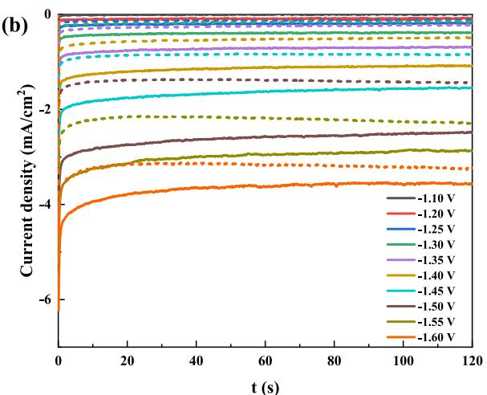

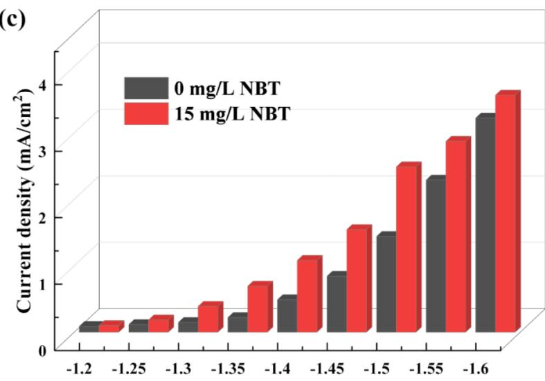  
Potential (V v.s. SSE)  
Fig. 5. (a) Linear sweeping voltammetry (LSV) measured with different NBT concentration at 5 mV/s and 500 rpm in electrolytes with $\mathrm { C o S O _ { 4 } }$ replaced by $\mathrm { K _ { 2 } S O _ { 4 } . ( b ) }$ Chronoamperometry obtained with 500 rpm in electrolytes with $\mathrm { C o S O _ { 4 } }$ replaced by $\mathrm { K _ { 2 } S O _ { 4 } }$ measured at different cathodic potential. The solid line indicates that 15 mg/L NBT is introduced while dotted line is obtained without NBT. (c) Comparison of stable current density with and without the introduction of NBT.

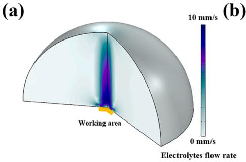  
(b)

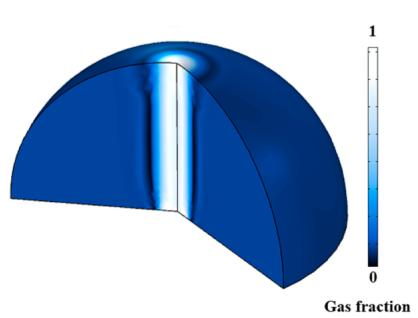  
(c)

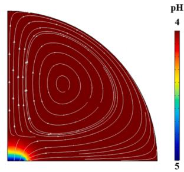

(d)  
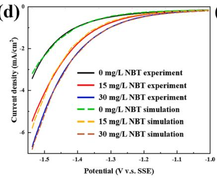

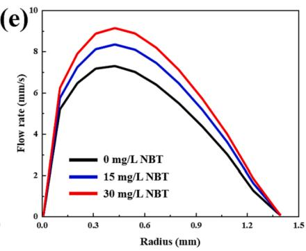

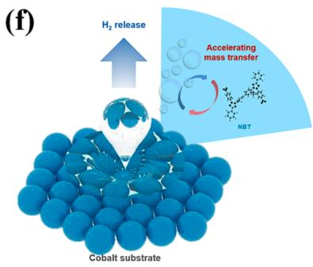  
Fig. 6. 3D (a) electrolytes flow rate distribution and (b) gas fraction distribution when the simulated potential is −1.5 V with 30 mg/L NBT. (c) 2D pH distribution when applied potential is − 1.5 V with 30 mg/L. The streamline indicates the flow direction of hydrogen ions. (d) Comparison of simulated LSV curves with experimental LSV curves. The dotted line is simulated results while the solid line is experimental results. (e) Flow rate comparison near the working area with different NBT concentration. (f) Schematic diagram of intensified mass transfer due to gas releasing.

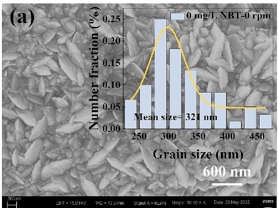

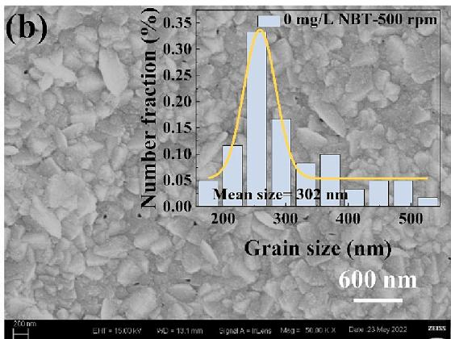

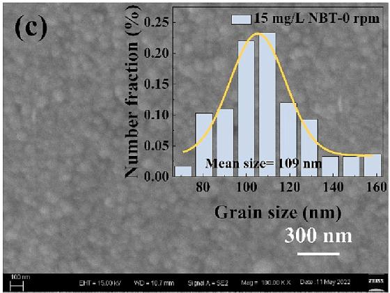

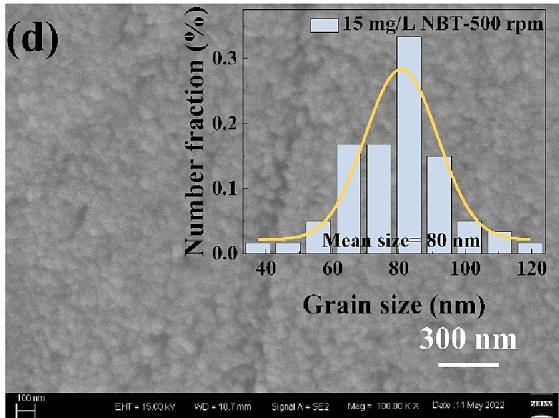  
Fig. 7. SEM images of cobalt layer electrodeposited at −1.25 V for 60 s in electroplating bath containing 4 mol/L CoSO , 0.5 mol/L H BO , 6 mg/L Cl-, pH of 4.0 with (a) 0 mg/L NBT, 0 rpm, (b) 0 mg/L NBT, 500 rpm, (c) 15 mg/L NBT, 0 rpm and (d) 15 mg/L NBT, 500 rpm.

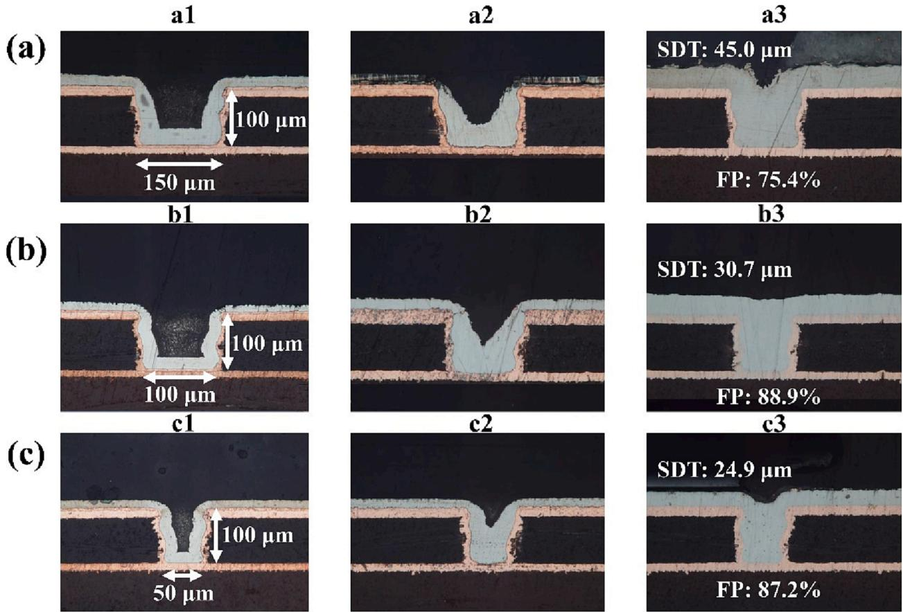  
Fig. 8. The shape evolution of cobalt interconnect within micovias of different diameters of (a) 150 μm, (b) 100 μm and (c) 50 μm. The applied cathodic potential is −1.25 V. The electroplating solution consists of 0.4 M g/L CoSO4⋅7H2O, 0.5 M g/L H3BO3, 15 mg/L NBT, 10 mg/L Cl-, pH = 4.

## 3.5. Electroplating

Electroplating is carried out to verify this new suppressor, namely NBT. Fig. 8 shows the shape evolution of microvias with different di ameters during cobalt electroplating. The surface deposit thickness (SDT) and filling percentage (FP) are used to judge the filling perfor mance [45,46].

The shape evolution of cobalt layer in microvias of 150 μm is shown in Fig. 8 (a). a2 in Fig. 2 (a) shows that the deposition of cobalt at the opening and plane is suppressed obviously after being electrodeposited for 4 h. The SDT and FP is 45.0 μm and 75.4 % when cobalt layer is electrodeposited for 10 h. The relatively high FP value and low SDT indicate that cobalt layer is of high quality.

Likewise, it can be seen from b2 and c2 that the cobalt grows faster at the bottom than on the sidewalls and opening of the microvias, which is attributed to the intensified mass transfer of NBT at the opening and sidewalls, while the consuming rate of NBT at the bottom is higher than the supplementary rate at the bottom. Hence, cobalt grows from bottom to up. After being electrodeposited for 8 h for 100 μm (b3) and 6 h for 50 μm (c3), cobalt layer reaches to the opening and the FP values are high (88.9 % and 87.2 %, respectively) with SDT for 100 μm and 50 μm being 30.7 μm and 24.9 μm.

Suppressing-accelerating effect was proposed to clearly illustrate the filling mechanism of NBT. On one hand, it is NBT who plays a major effect in superfilling process because growth rate difference at the plane and in the bottom can be caused due to effective NBT concentration gradient is formed as a result of geometry limitation and mass transfer limitation (suppressing effect). On the other hand, the accelerating ef fect of NBT on HER will play a supporting role during electroplating. Because the mass transfer at the plane is influenced little compared with that in the microvias due to geometry limitation. The NBT concentration at the plane is relatively higher, which strengthen the HER and gas releasing process in turn further intensify the NBT diffusion and adsorption to suppress the cobalt deposition at the plane. In contrast, the mass transfer is limited in microvias, leading to the NBT concentration is relatively low, which weaken the hydrogen bubble releasing and in turn lower the supplying of NBT from bulk to feature. The cobalt begins to grow from the bottom to the top. The accelerating effect has a positive influence on cobalt interconnect layer quality. In summary, the relatively low SDT and high FP values obtained in microvias with different diameters indicate that high-quality cobalt interconnect layer can be achieved under the influence of NBT.

## 4. Conclusion

In this work, electrochemical analysis methods, including cyclic voltammetry, electrochemical impedance spectra and EQCM were used to study the suppressing effect of NBT on cobalt electrodeposition. Besides, in situ Raman spectra was used to analyze the suppressing mechanism and NBT can absorb on cobalt surface to suppress the cobalt electrodeposition. EQCM-derived coulomb-voltage curves indicates that high pH is beneficial for the cobalt electrodeposition. Finite element method was accepted to simulate the influence of NBT concentration on convection. Besides, NBT can benefit the HER, which can effectively intensify the local mass transfer during electrodeposition. The intensified local mass transfer can further supply suppressor NBT to cathode surface so as keep the deposition in plane suppressed. Suppressingaccelerating effect is proposed to illustrate the effect of NBT. On one hand, NBT can adsorb on cathode surface to suppress cobalt deposition. On the other hand, NBT can boost the HER and the intensified gas releasing process in turn accelerate the mass transfer of NBT to strengthen the suppressing effect of NBT on cobalt electrodeposition.

The effect of convection and NBT on cobalt layer is investigated by SEM as well as convection and NBT is conducive to refine the grain size. Superconformal growth was obtained within different microvias with relatively good quality. The SDT values for for 150 μm, 100 μm and 50 μm are low (45.0 μm, 30.7 μm and 24.9 μm, respectively), while the FP values are 75.4 % for 150 μm, 88.9 % for 100 μm and 87.2 % for 50 μm.

## CRediT authorship contribution statement

Yaqiang Li: Writing – original draft, Investigation, Conceptualization, Methodology, Formal analysis, Data curation. Xiaochuan Ma: Writing – review & editing, Data curation, Validation. Ruopeng Li: Investigation. Jinqiu Zhang: Supervision. Peixia Yang: Resources. Anmin Liu: Writing – review & editing. Bo Wang: Resources, Valida tion. Peter Broekmann: Investigation, Supervision, Formal analysis. Maozhong An: Funding acquisition, Project administration.

## Declaration of Competing Interest

The authors declare that they have no known competing financial interests or personal relationships that could have appeared to influence the work reported in this paper.

## Acknowledgements

This work was supported by the National Natural Science Foundation of China [No. 21972037] and State Key Laboratory of Urban Water Resource and Environment, Harbin Institute of Technology, China [No. 2021TS07]. Numerical computations were performed on Hefei advanced computing center.

## Appendix A. Supplementary data

Supplementary data to this article can be found online at https://doi. org/10.1016/j.jelechem.2023.117671.

## References

[1] L. Yaqiang, M. Xiaochuan, Z. Jinqiu, et al. Research Progress of Metal Interconnection Technology and Related Theory in Chip Fabrication [J]. Surface technology, 2021, 50 (7): 24-43, 164.

[2] X.C. Ma, Y.Q. Li, P.X. Yang, et al., Influences of suppressing additive malachite green on superconformal cobalt filling and nucleation [J], Journal of Electrochemistry 28 (6) (2022) 2104521.

[3] D. Choi, Potential of ruthenium and cobalt as next-generation semiconductor interconnects [J], Korean Journal of Metals and Materials 56 (8) (2018) 605 610.

[4] N.A. Lanzillo, P. Bhosale, C. Lavoie, D.J. Dechene, R.R. Robison, K. Choi, Spindependent electron scattering in cobalt interconnects [J], J. Phys. D Appl. Phys. 52 (49) (2019) 495302.

[5] M. He, X. Zhang, T. Nogami, X. Lin, J. Kelly, H. Kim, T. Spooner, D. Edelstein L. Zhao, Mechanism of Co liner as enhancement layer for Cu interconnect gap-fill [J], J. Electrochem. Soc. 160 (12) (2013) D3040–D3044.

[6] J. S. Clarke, C. George, C. Jezewski, et al. Process technology scaling in an increasingly interconnect dominated world [C]. IEEE symposium on VlSI technology. Honolulu: IEEE, 2014.

[7] H. Huang, P. S. McLaughin, Kelly J J, et al. Time dependent dielectric breakdown of cobalt and ruthenium interconnects at 36nm pitch [C]. 2019 IEEE International Reliability Physics Symposium (IRPS). IEEE, 2019: 1-5.

[8] S. Beyne, O.V. Pedreira, H. Oprins, I. De Wolf, Z. Tokei, K. Croes, Electromigration activation energies in alternative metal interconnects [J], IEEE Trans. Electron Devices 66 (12) (2019) 5278 5283.

[9] A. Rogozhin, A. Miakonkikh, A. Tatarintsev, et al. Cobalt subtractive etch for advanced interconnects [C]. International Conference on Micro-and Nano-Electronics 2021. SPIE, 2022, 12157: 330-336.

[10] K. Sankaran, S. Clima, M. Mees, et al. Exploring Alternative Metals to Cu and W for Interconnects: an ab initio Insight [C]. IEEE International Interconnect Technology Conference. IEEE, 2014: 193-196.

[11] P. Chenyuan, N. Azad, A Proposal for a Novel Hybrid Interconnect Technology for

[12] S. Dutta, S. Beyne, A. Gupta, S. Kundu, S. Van Elshocht, H. Bender, G. Jamieson, W. Vandervorst, J. Bommels, C.J. Wilson, Z. Tokei, C. Adelmann, Sub-100 nm Cobalt Interconnects [J], IEEE Electron Device Lett. 39 (5) (2018) 731 734.

[13] J. Wu, F. Wafula, S. Branagan, H. Suzuki, J. van Eisden, Mechanism of Cobalt Bottom-Up Filling for Advanced Node Interconnect Metallization [J], J. Electrochem. Soc. 166 (1) (2019) D3136–D3141

[14] T.W. Lyons, Q. Huang, Effects of Cyclohexane- Monoxime and Dioxime on the Electrodeposition of Cobalt [J], Electrochim. Acta 245 (2017) 309 317.

[15] T. A. Spurlin, M. A. Rigsby, L. Brogan, et al. Cobalt Electrofill for Future Generations of Contacts and Interconnects [C]. 2019 China Semiconductor Technology International Conference (CSTIC). IEEE, 2019: 1-3.

[16] X. Ni, Y. Chen, X. Jin, C. Wang, Y. Huang, Y. Hong, X. Su, G. Zhou, S. Wang, W. He, Q. Chen, Investigation of polyvinylpyrrolidone as an inhibitor for trench superfilling of cobalt electrodeposition [J], J. Taiwan Inst. Chem. Eng. 112 (2020) 232–239.

[17] D. Josell, M. Silva, T.P. Moffat, Superconformal Bottom-Up Cobalt Deposition in High Aspect Ratio Through Silicon Vias [J], J. Electrochem. Soc. 163 (14) (2016) D809–D817.

[18] Q. Huang, T.W. Lyons, W.D. Sides, Electrodeposition of Cobalt for Interconnect Application: Effect of Dimethylglyoxime [J], J. Electrochem. Soc. 163 (13) (2016) D715–D721.

[19] X. Ma, Y. Li, P. Yang, J. Zhang, M. An, Influence of suppressing additive malachite green on superconformal cobalt electrodeposition [J], J. Electroanal. Chem. 921 (2022), 116696.

[20] Y. Li, P. Ren, Y. Zhang, S. Wang, J. Zhang, P. Yang, A. Liu, G. Wang, Z. Chen, M. An, The influence of leveler Brilliant Green on copper superconformal electroplating based on electrochemical and theoretical study [J], J. Ind. Eng. Chem. 118 (2023) 78–90

[21] Y. Li, P. Ren, Y. Zhang, R. Li, J. Zhang, P. Yang, A. Liu, G. Wang, M. An, Investigation of novel leveler Rhodamine B on copper superconformal electrodeposition of microvias by theoretical and experimental studies [J], Appl. Surf. Sci. 615 (2023) 156266.

[22] M. Wilms, P. Broekmann, C. Stuhlmann, K. Wandelt, In-situ STM investigation of adsorbate structures on Cu (111) in sulfuric acid electrolyte [J], Surf. Sci. 416 (1-2) (1998) 121–140.

[23] P. Broekmann, M. Wilms, M. Kruft, C. Stuhlmann, K. Wandelt, In-situ STM investigation of specific anion adsorption on Cu (111) [J], J. Electroanal. Chem. 467 (1-2) (1999) 307 324

[24] M.A. Rigsby, L.J. Brogan, N.V. Doubina, Y. Liu, E.C. Opocensky, T.A. Spurlin, J. Zhou, J.D. Reid, The Critical Role of pH Gradient Formation in Driving Superconformal Cobalt Deposition [J], J. Electrochem. Soc. 166 (1) (2019) D3167–D3174.

[25] M.A. Rigsby, T.A. Spurlin, J.D. Reid, The Multi-Functional Role of Boric Acid in Cobalt Electrodeposition and Superfill [J], J. Electrochem. Soc. 167 (11) (2020), 112507.

[26] G. Allaire, Numerical analysis and optimization: an introduction to mathematica modelling and numerical simulation[M], OUP Oxford, 2007.

[27] X. Lu, H. Xu, P. Yang, L. Xiao, Y. Li, J. Ma, R. Li, L. Liu, A. Liu, V. Kondratiev, O. Levin, J. Zhang, M. An, Zinc-assisted MgO template synthesis of porous carbon supported Fe-Nx sites for efficient oxygen reduction reaction catalysis in Zn-air batteries [J], Appl Catal B 313 (2022), 121454.

[28] R. Li, Y. Li, P. Yang, P. Ren, D. Wang, X. Lu, R. Xu, Y. Li, J. Xue, J. Zhang, M. An, J. Ma, B.o. Wang, H. Liu, S. Dou, Synergistic interface engineering and structura optimization of non-noble metal telluride-nitride electrocatalysts for sustainably overall seawater electrolysis [J], Appl Catal B 318 (2022), 121834.

[29] R.P. Li, Y.Q. Li, P.X. Yang, et al., Key Roles of Interfacial OH- ion Distribution on Proton Coupled Electron Transfer Kinetics Toward Urea Oxidation Reaction [J], Small 19 (30) (2023), 2302151

[30] R. Li, Y. Li, P. Yang, P. Ren, A. Liu, S. Wen, J. Zhang, M. An, Construction of Self-Supporting NiCoFe Nanotube Arrays Enabling High-Efficiency Alkaline Oxygen Evolution [J], ACS Appl. Mater. Interfaces 14 (49) (2022) 54758.

[31] T.M. Braun, J. John, N. Jayaraju, D. Josell, T.P. Moffat, Simulating the Influence of Supporting Electrolyte Concentration on Copper Electrodeposition in Microvias [J], J. Electrochem. Soc. 169 (1) (2022), 012502.

[32] T.M. Braun, D. Josell, T.P. Moffat, et al., Simulating Cu electrodeposition in high aspect ratio features: Effect of control mode and uncompensated resistance in S NDR systems [J], Electrochim. Acta 375 (2021), 137925.

[33] R. Li, Y. Yuan, H. Gui, Y. Liu, H. Li, Y. Li, S. Wen, A. Liu, J. Zhang, P. Yang, M. An, Synergistic doping and structural engineering over dendritic NiMoCu electrocatalyst enabling highly efficient hydrogen production [J], Nanoscale 14 (38) (2022) 14297 14304.

[34] T.P. Moffat, D. Wheeler, D. Josell, Electrodeposition of copper in the SPS-PEG-C additive system: I. kinetic measurements: Influence of SPS [J], J. Electrochem. Soc. 151 (4) (2004) C262.

[35] Y. Li, P. Ren, R. Li, et al., A novel bright additive for copper electroplating electrochemical and theoretical study [J], Ionics (2022) 1–13.

[36] U. Geiger, A. Elyashiv, R. Fraenkel, S. Zilberg, Y. Haas, The Raman spectrum o dimethylaminophenyl pentazole (DMAPP) [J], Chem. Phys. Lett. 556 (2013) 127 131.

[37] A. Gomez-Zavaglia, ´ A. Ismael, L.I.L. Cabral, A. Kaczor, J.A. Paixao, ˜ R. Fausto, M.L. S. Cristiano, Structural investigation of nitrogen-linked saccharinate–tetrazole [J], J. Mol. Struct. 1003 (1-3) (2011) 103 110.

[38] S. Chen, X. Li, Y. Guo, J. Qi, A Ag-molecularly imprinted polymer composite for efficient surface-enhanced raman scattering activities under a low-energy laser [J], Analvst 140 (9) (2015) 3239–3243

[39] D. Yong, Y. Fang, Effects of the Halide Ion Adsorption Competition on the Near Infrared Surface Enhanced Raman Spectroscopy of Rhodamine B-Au Colloid System [J], Journal of Optoelectronic Laser 14 (8) (2003) 881–885.

[40] R.F.V. Villamil, P. Corio, S.M.L. Agostinho, J.C. Rubim, Effect of sodium dodecylsulfate on copper corrosion in sulfuric acid media in the absence and presence of benzotriazole [J], J. Electroanal. Chem. 472 (2) (1999) 112–119.

[41] N.K. Katturi, S. Dev G, N. Kommu, G.K. Podagatlapalli, V.R. Soma, Ultrafast Coherent Anti-Stokes Raman spectroscopic studies of nitro/nitrogen rich aryl tetrazole derivatives [J], Chemical Physical Letters 756 (2020) 137843.

[42] S.C.S. Bugalho, E.M.S. Maçoas, ˆ M. Lurdes S. Cristiano, R. Fausto, Low temperature matrix-isolation and solid state vibrational spectra of tetrazole [J], PCCP 3 (17) (2001) 3541 3547.

[43] R.A.J. Critelli, P.T.A. Sumodjo, M. Bertotti, R.M. Torresi, Influence of glycine on Co electrodeposition: IR spectroscopy and near-surface pH investigations [J], Electrochim. Acta 260 (2018) 762 771.

[44] Y. Li, X. Cai, G. Zhang, C. Xu, W. Guo, M. An, Optimization of electrodeposition nanocrytalline Ni-Fe alloy coatings for the replacement of Ni coatings [J], J. Alloy. Compd. 903 (2022), 163761.

[45] H.P. Zhu, Q.S. Zhu, X. Zhang, C.Z. Liu, J.J. Wang, Microvia filling by copper electroplating using a modified safranine T as a leveler[J], J. Electrochem. Soc. 164 (9) (2017) D645–D651.

[46] W.-P. Dow, C.-C. Li, M.-W. Lin, G.-W. Su, C.-C. Huang, Copper fill of microvia using a thiol-modified Cu seed layer and various levelers[J], J. Electrochem. Soc. 156 (8) (2009) D314.