pubs.acs.org/acsaelm

Article

# Inhibitor Alkyne-PEG4-amine Contributes to Cobalt Superfilling

Yiting Tong, Dawei Lai, Ya Li, Tao Hang, Ming Li, and Yunwen Wu\*

Cite This: ACS Appl. Electron. Mater. 2024, 6, 5712−5719

Read Online

ACCESS

Metrics & More

Article Recommendations

ABSTRACT: In the field of electronic plating, the addition of additives is the key to achieve cobalt superfilling, while finding and researching suitable additives is a major challenge. In this work, alkyne-PEG4-amine (AP4A) was used as an inhibitor to achieve nanometer scale superfilling of cobalt electrodeposition. The inhibition of AP4A was analyzed by electrochemical methods, including cyclic voltammetry and chronopotentiometry tests. AP4A efectively inhibits the cobalt electrodeposition, adsorbing onto the surface of the electrode and showing an outstanding ability for polarization. Quantum chemical calculations show that the amino group within AP4A may be the main active site for reaction, which possesses capacity for calculations show that the amino group within AP4A may be the main active site for donating electrons. Furthermore, surface morphology and crystalline structure characteriza tions indicate that, under the efect of AP4A, the cobalt film maintains excellent electrical properties while obtaining better flatness and preferential orientation of the AP4A, the cobalt film maintains excellent electrical properties while obtaining better flatn , AP4A was used and the bottom-up (101) crystal plane. In superfilling of nanometer scale structures with high aspect ratios electrodeposition of cobalt was successfully achieved, which demonstrates that AP4A is an efective inhibitor for cobalt superfilling electrodeposition of cobalt was successfully achieved, which demonstrates that AP4A is an and ofers an excellent solution strategy in electrodeposition area. and offers an excellent solution strategy in electrodeposition area

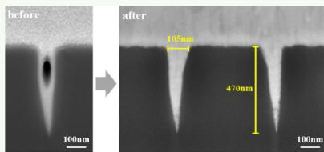

KEYWORDS: Cobalt interconnection, Electrodeposition, Additive, Superfilling, IC interconnect

## 1. INTRODUCTION

As the manufacture of integrated circuits advances toward smaller sizes and higher integration densities, the requirements for interconnect materials are becoming more stringent, while the limitations of traditional copper interconnection have become increasingly apparent.1−6 The resistivity of copper interconnects increases exponentially when the width falls below the copper mean free path, primarily due to frequent electron scattering at interfaces and grain boundaries, which becomes the main factor determining the resistivity.7,8 In contrast, cobalt interconnects possess better properties, such as very short electronic mean free path, relatively low price, and good compatibility in silicon-based electronic chips.9−11 Besides, cobalt has a higher melting point, which is more beneficial to reduce the electromigration caused by atomic difusion.12 These properties are particularly beneficial for applications in advanced integrated circuit assemblies in the post-Moore’s law era. Therefore, cobalt is expected to be a new generation of interconnection material instead of traditional copper. 13−15

The manufacture process of cobalt interconnects is similar to that of copper interconnects and is compatible with existing electrodeposition processes for copper damascene interconnects. The electrodeposition process for cobalt interconnection is an advanced interconnect technology for integrated circuits that utilizes a wet electrochemical deposition method to bottom-up fill the interconnect structures of semiconductor chips with cobalt metal. Electrodeposition has the advantages of simple operation, easy control of process parameters, and low cost and is considered to be the main technology for cobalt filling at present.16−18 In recent years, the process of copper electrodeposition has been thoroughly studied, leading to a comprehensive understanding of the bottom-up electro deposition (superfilling) mechanism, which is also applied to cobalt electrodeposition to achieve defect-free interconnect structures.19,20

The search for suitable additives is the core to fulfill the bottom-up electrodeposition mechanism. Generally, the electrodeposition rate of cobalt changes in diferent positions of the hole due to changing thermodynamics across the additive concentration gradient.21,22 When the deposition rate at the bottom of the hole is higher than that at the upper part of the hole, it can obtain the void-free superfilling deposition of cobalt in the microvias, holes, or trenches from bottom to to p.23−25 These additives have efects on controlling the deposition process and have influence on the surface morphology, crystal structure, and electrical properties of the cobalt films.26−29 The research on cobalt electroplating additives has focused on finding compounds that can achieve superfilling while improving plating properties. However, there are few reports and research studies in this field, particularly for the superfilling processes at present.

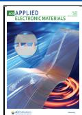

In this work, we propose a cobalt electrodeposition additive which can be used for superfilling. The inhibition efect of alkyne-PEG4-amine (AP4A) was investigated by electrochemical methods, including cyclic voltammetry and chronopotentiometry. Quantum chemical calculations were applied to confirm the inhibition efect of the AP4A molecule on electrodeposition. The results of the cobalt electrodeposition experiment showed that AP4A has significant influence on electrical properties, surface morphology, and crystal structure. In superfilling of nanometer scale structures with high aspect ratios, the additive AP4A was used to achieve bottom-up cobalt electrodeposition successfully. This study provides a targeted solution for superfilled cobalt plating, which has a good role in promoting the development of electroplating in the future.

## 2. EXPERIMENT

2.1. Chemicals and Reagents. The cobalt electroplating solution was composed of cobalt sulfate heptahydrate $\left( \mathrm { C o S O } _ { 4 } \right) .$ $\mathrm { 7 H } _ { 2 } \mathrm { O } )$ and boric acid $\left( \mathrm { H } _ { 3 } \mathrm { B O } _ { 3 } \right)$ , with the pH of the electroplating solution adjusted to 3.0 by using sulfuric acid $\left( \mathrm { H } _ { 2 } \mathrm { S O } _ { 4 } ^ { - } \right)$ . The concentrated solution of AP4A was made by dissolving an appropriate amount of reagent in purified water. Weight concentration of additives was used in the study, measured in parts per million (ppm).

2.2. Electrochemical Tests. The electrochemical characteristics of the additive AP4A were assessed through cyclic voltammetry (CV) and chronopotentiometry tests. The experimental setup was established by utilizing a threeelectrode system linked to an electrochemical workstation (CHI660E, Chenhua). The configuration includes a platinum rotating disk electrode with a diameter of 5 mm (Pt-RDE, WE), a platinum plate electrodes (CE), and a saturated Hg/ $\mathrm { H g } _ { 2 } \mathrm { S O } _ { 4 }$ reference electrode (RE). The chronopotentiometry tests were conducted at a steady current of 0.4 ASD (0.4 A/ dm2). CV was performed with potential sweeps ranging from −1.5 to 0.2 V, with the scanning rate set at 50 mV/s. The electrode rotates at a speed of 500 rpm in most studies unless otherwise stated in the paper.

2.3. Quantum Chemical Calculation. Quantum chemical calculations were executed with the Gaussian 16W software suite. The geometry optimizations of the AP4A molecule were conducted by density functional theory (DFT), using the B3LYP method with the $6 { \cdot } 3 1 1 \mathrm { G } { + } { + } ( \mathrm { d } , \mathrm { p } )$ basis set. The highest occupied molecular orbital (HOMO) and the lowest unoccupied molecular orbital (LUMO) were calculated. Besides, GaussView6.1 software was utilized to analyze the electrostatic potential (ESP) to determine the optimal reaction site and predict its adsorption properties.

2.4. Electrodeposition. A cobalt plate of 99.99% purity served as the anode. Silicon wafers, measuring 1.5 cm by 1.5 cm, were prepared as cathodes, which were cleaved from a 12 in. diameter silicon wafer with a copper seed layer of 500 nm thickness deposited onto the adhesion layer. Unless otherwise noted, the cobalt films were electrodeposited at a current density of 0.4 ASD with a rotation speed of 500 rpm for a duration of 10 min. Electrodeposition experiments were performed at a constant environmental temperature of 25 ${ } ^ { \circ } { \mathrm { C } } .$ The morphology of cobalt films was characterized by scanning electron microscopy (SEM, TESCAN MIRA3). The surface roughness of the cobalt films was examined by atomic force microscopy (AFM, Oxford Instruments MFP-3D). The crystal structure of the cobalt film was obtained by an X-ray difractometer (XRD, Rigaku Mini Flex 600), operated at 40 kV and 15 mA, in the range from $3 0 ^ { \circ }$ to ${ 8 0 ^ { \circ } }$ with a step of $0 . 0 2 ^ { \circ } .$ The depth profiles of various elements in the electrodeposited cobalt films were obtained using time-of flight secondary ion mass spectroscopy (TOF-SIMS, TESCAN GAIA3). The cobalt film sheet resistance was measured via a four-point probe setup. The silicon wafers with copper seed layer used for superfilling were nanometer-scale structures, with a diameter of approximately 100 nm and a high aspect ratio (AR) around 5.

## 3. RESULTS AND DISCUSSION

3.1. Electrochemical Tests. The inhibitive behaviors of AP4A on cobalt electrodeposition were investigated by electrochemical tests (Table 1). Figure 1a shows the CV

Table 1. Electrochemical Parameters

<table><tr><td>Test</td><td>Parameter</td><td>Concentration of AP4A (ppm)</td><td>Rotation Speed (rpm)</td></tr><tr><td>cyclic voltammetry (CV)</td><td>-1.5–0.2 V</td><td>0–300</td><td>500</td></tr><tr><td>chronopotentiometry</td><td>0.4 ASD</td><td>0–300</td><td>100/500/1000</td></tr></table>

results obtained at diferent concentrations of AP4A. The anodic stripping area in the CV curve decreases as the concentration of AP4A increases, which indicates the inhibition efects of AP4A in cobalt deposition. Moreover, the cobalt deposition potential decreases with increasing concentration of AP4A, which means AP4A displays a promotion efect on the polarization of cobalt electro deposition.

The inhibition efect at diferent concentrations and the saturation efect concentration of AP4A were investigated by using the linear fitting for the crossing point method (Figure 1b).30 The integral value of the anodic stripping peak of CV curve is defined as $Q _ { 0 }$ without AP4A and as Q with AP4A. Significantly, the ratio $Q / Q _ { 0 }$ is influenced by the concentration of AP4A. This relationship can be categorized into three distinct phases, each characterized by a unique slope. The values of $Q / Q _ { 0 }$ show a significant decrease at low concentrations of AP4A but reach a stable stage at high concentrations of AP4A. Notably, a transitional slope is observed on the curve within the AP4A concentration range from 30 to 100 ppm. Upon further increasing the AP4A concentration above 100 ppm, the inhibition efect of AP4A on cobalt electrodeposition signifies the maximum.

The inhibition efect of AP4A was also demonstrated in the chronopotentiometry tests. Figure 1c shows the potential transients, with a transient polarization enhancement appearing immediately upon the addition of AP4A, followed by a gradual decrease in potential until a stable polarization behavior is achieved. The cathodic potential of cobalt deposition decreases from −1.428 V (additive-free) to −1.733 V (300 ppm AP4A). As the concentration of AP4A increased, the potential gradually decreased and the inhibition efect approached saturation, which is also consistent with the CV results. The additive AP4A can be considered as an inhibitor with a strong inhibition efect based on these electrochemical tests. The chronopotentiometry tests (Figure 1d) were also carried out to predict the superfilling capacity with high and low rotation speeds, respectively, simulating the top and bottom of the structures.31,32 Within range from 5 to 200 ppm, the potential

(c)

(d)

(a)  
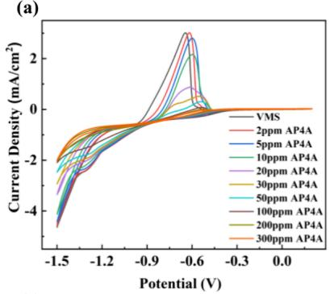

(b)  
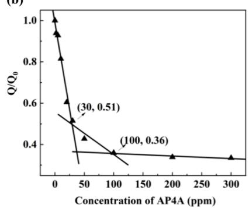

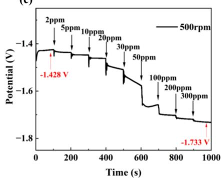

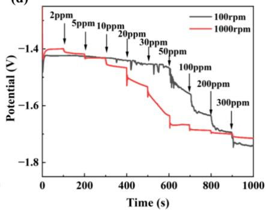  
Figure 1. (a) CV curves of various concentrations. (b) $Q / Q _ { 0 }$ as a function of AP4A concentration, (c) Potential change obtained in the chronopotentiometry tests with increasing concentration of AP4A, (d) Impact of diferent rotation speeds (100/1000 rpm) in chronopotentiometry tests with increasing concentration of AP4A.

of 100 rpm is higher than 1000 rpm for the same concentration, which means a weaker inhibition efect, and as a result, the deposition rate on the bottom should be higher than that on the surface, promoting bottom-up electrodeposition. From the above electrochemical characterization, AP4A is considered to show excellent potential for superfilling.

3.2. Quantum Chemical Calculations. Quantum chem ical calculations are used to predict the molecular properties and behaviors. Frontier molecular orbitals, including HOMO and LUMO, are important tools for investigating the interaction at the atomic level, utilized to predict interactions between molecules and metal surfaces, as well as elucidate adsorption and reaction mechanisms (Figure 2). A molecule’s HOMO reflects its capacity for donating electrons to metal ions, and its LUMO reflects its capacity for accepting electrons from the metal substrate. The lower the value of the energy gap $\left( \Delta E = E _ { \mathrm { L U M O } } - E _ { \mathrm { H O M O } } \right)$ is, the more stable the adsorption 33−35

As for molecule AP4A, the $E _ { \mathrm { L O M O } }$ value is −0.348 eV (Figure 2a) and the $E _ { \mathrm { H O M O } }$ value is −6.806 eV (Figure 2b), with ΔE equal to 6.458 eV, which suggests that AP4A can efectively adsorb onto the surface of the electrode and interact with cobalt cations, influencing the process of cobalt electrodeposition. The amino group is the main contributor to the HOMO orbital. Organics with higher $E _ { \mathrm { H O M O } }$ values exhibit an enhanced ability to donate electrons, which facilitates their bonding with the d-orbital of metal. Thus, as for AP4A, it can enhance adsorption onto the electrode surface and inhibit cobalt deposition.

The electrostatic potential (ESP) map ofers a visual depiction of the electron density contributed by diferent atoms across its molecular surface, which is essential for predicting its electrophilic reaction sites and the interac tion.3,34,35 In the visualization (Figure 2c), areas of high electron density are indicated by blue, reflecting lower ESP values, while areas of low electron density are indicated by red, reflecting higher ESP values. In the ESP map of AP4A, the amino group exhibits high electron density, which indicates that this group may function as the main active site to interact with cobalt during the electrodeposition reaction.

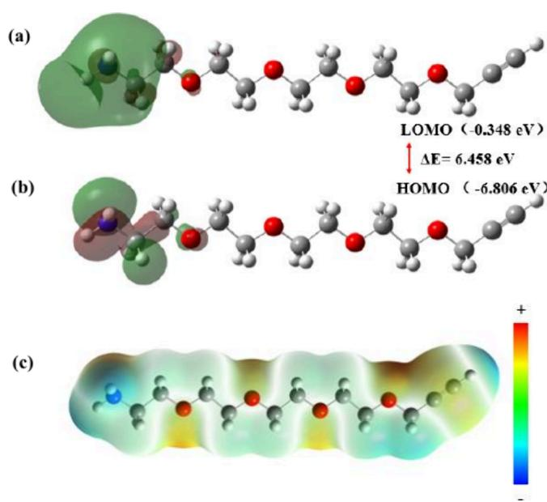  
Figure 2. Quantum chemistry calculation results of AP4A shown as ( ) − ( ) − ( ) AP4A. Color of atoms: H (white), C (gray), N (blue), and O (red).

3.3. Electrodeposition. Based on the above electrochemical tests and quantum chemical calculations, cobalt films were obtained by electrodeposition experiments, and various characterizations were conducted to investigate the efect of AP4A in cobalt electrodeposition. The SEM images (Figure 3) display the influence of AP4A on the surface morphology. Compared with the cobalt electrodeposited from the solution without AP4A (Figure 3a). the cobalt film changed significantly under the efect of AP4A (Figure 3b−d), with the cobalt film becoming flatter and denser and the grains becoming larger.

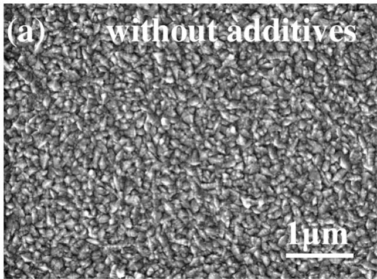

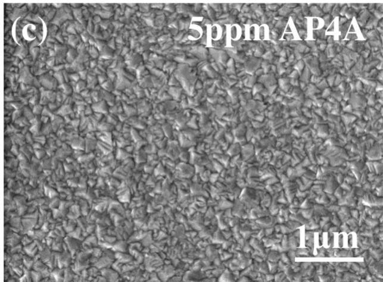

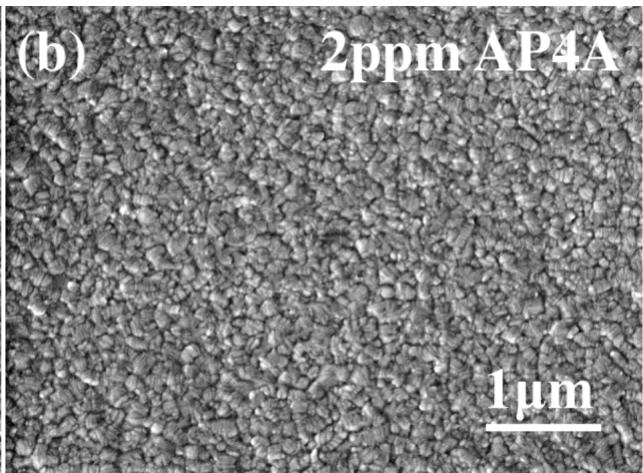

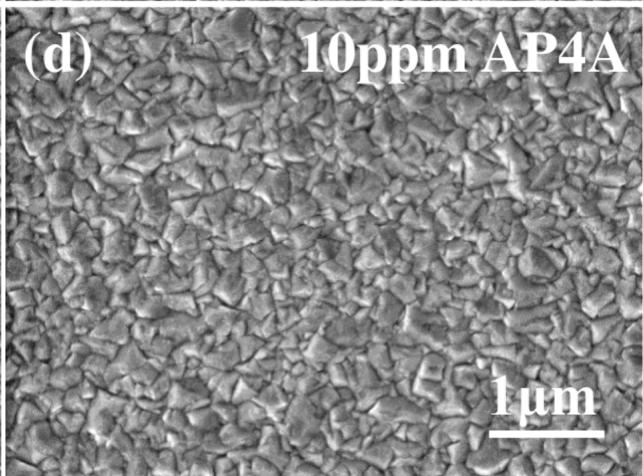

(e) without additives  
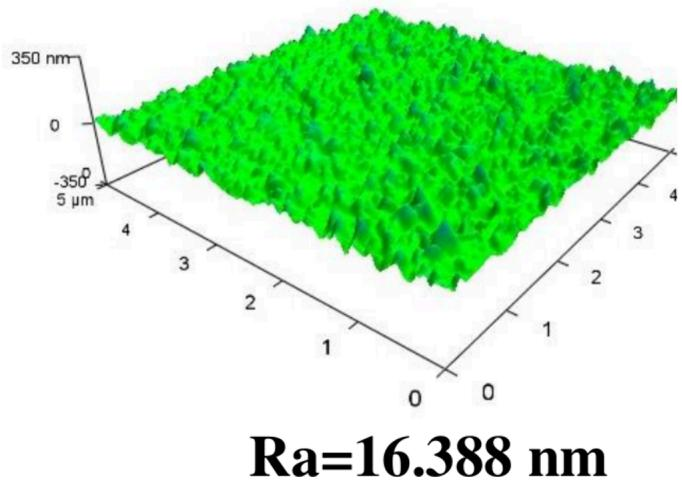

(f)  
5ppm AP4A  
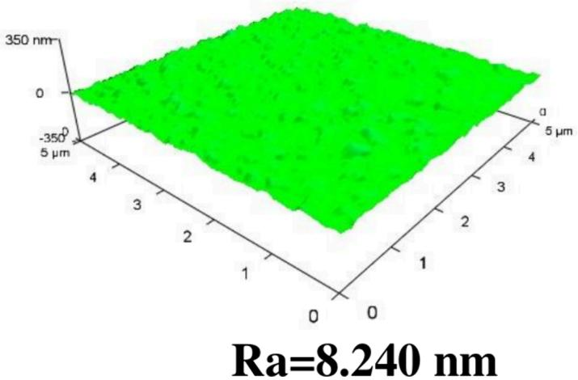  
Figure 3. SEM images of cobalt film surfaces (a) without AP4A, (b) with 2 ppm AP4A, (c) with 5 ppm AP4A, and (d) with 10 ppm AP4A. AFM images of cobalt film surfaces (a) without AP4A and (f) with 5 ppm AP4A.

The surface roughness is quantified by AFM (Figure 3e,f), showing that the arithmetic mean roughness $\left( R _ { \mathrm { a } } \right)$ of the cobalt film without any additive is 16.388 nm and with 5 ppm AP4A is 8.240 nm. The cobalt film with AP4A has a lower $R _ { \mathfrak { a } }$ than the film without AP4A, confirming that AP4A enhances the uniformity and flatness of the cobalt film during electro deposition.

From XRD analysis, AP4A was also found to have a significant influence on the crystal structure of the cobalt films. The additive-free cobalt deposits exhibit a hexagonal close packed (HCP) structure, while the addition of AP4A diminishes the difraction peak intensity of the cobalt (100), (002), and (110) planes as shown in Figure 4a, suggesting that AP4A specifically inhibits the growth of these particular surfaces while the (101) plane becomes the main growth direction.

(a)  
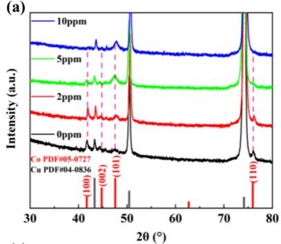  
(c)

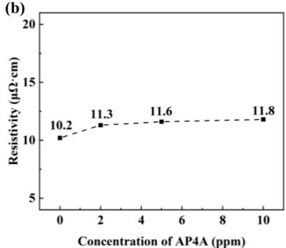

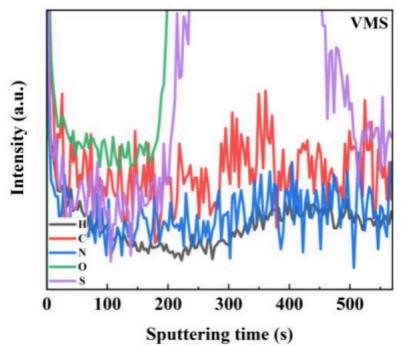

(d)  
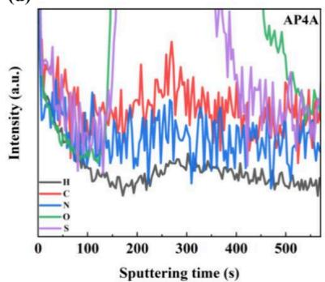  
Figure 4. (a) XRD patterns of cobalt films deposited with diferent concentrations of AP4A. (b) Resistivity of the cobalt films with diferent concentrations of AP4A. TOF-SIMS patterns of cobalt films (c) without additive and (d) with 5 ppm AP4A.

To assess the electrical performance of the cobalt films, resistivity measurements (Figure 4b) were conducted on the samples. The additive-free cobalt film demonstrates the lowest resistivity, approximately 10.2 μΩ·cm. After the addition of AP4A, the resistivity remains low and stabilizes at around 11− 12 μΩ·cm. The resistivity slightly increases as the concentration of AP4A increases, which may be attributed to the nonmetallic impurities added by additive doping in the electrodeposition process. The impurity distribution in cobalt films with and without 5 ppm AP4A was investigated by TOF-SIMS (Figure 4c,d). It is obvious that the content of some organic impurity elements (especially N) are increased, while the N element only originates from the additive AP4A, confirming the introduction of nonmetallic impurities by the additive.

3.4. Cobalt Superfilling. In the electrodeposition process, the constraints of the hole geometry lead to higher electric field and mass-transport conditions at the top of the hole.36,37 The current and ion concentration at the top of the hole is often higher than at the bottom; as a result, cobalt tends to deposit more rapidly at the top than at the bottom, resulting in the formation of structures containing voids. Besides, as the current density increases, the possibility of void formation also rises, which is attributed to a more pronounced concentration of current at the top of the hole and an increased restriction on mass-transport at the bottom. Therefore, in terms of current parameter settings, the electrodeposition was carried out using segmental currents and starting from a small current (Table 2) in order to optimize the filling process, improve the filling eficiency, and reduce the defects (such as pores and voids) in the process.

Table 2. Electrodeposition Procedures

<table><tr><td>Steps</td><td>Current Density (ASD)</td><td>Time (s)</td><td>Purpose</td></tr><tr><td>preprocessing</td><td>0</td><td>5</td><td>preimmersion</td></tr><tr><td>step 1</td><td>0.4</td><td>60</td><td>fill the hole</td></tr><tr><td>step 2</td><td>0.7</td><td>80</td><td>fill the hole</td></tr><tr><td>step 3</td><td>1.0</td><td>90</td><td>thicken the surface layer</td></tr></table>

Based on the above study, cobalt superfilling electrodeposition was performed with AP4A. The cross-sectional view (Figure 5) confirms AP4A’s capability as an inhibitor in cobalt superfilling. In this work, the concentration of AP4A is 5 ppm, which achieved bottom-up cobalt electrodeposition. The bottom-up filling mechanism is depicted in Figure 6. During the process of cobalt electrodeposition, AP4A molecules are adsorbed on the surface of the electrode, modulating the partial electric field strength and current density distribution. In addition, under the influence of mass transport, the molecules have a higher concentration at the top of the hole, leading to a more significant inhibitory efect and slowing down the rate of reduction of the cobalt ions. As a result, the electric field and concentration gradient developed in the presence of the AP4A molecules lead to a higher rate of deposition of cobalt ions at the bottom of the hole than at the top, resulting in the expected bottom-up superfilling.

## 4. CONCLUSIONS

In summary, this research successfully achieved cobalt superfilling in high aspect ratio nanometer scale structures under the action of AP4A. From the analysis of electrochemical tests and quantum chemical calculations, the cobalt electro deposition inhibitor AP4A shows a splendid ability for polarization, mainly resulting from the capacity for donating electrons of the amino group. Furthermore, AP4A can afect the surface morphology and crystalline structure of the cobalt film. Under the efect of AP4A, the cobalt film maintains excellent electrical properties while obtaining better flatness with $R _ { \mathrm { a } }$ reduced from 16.388 nm (without additive) to 8.240 nm (with AP4A) and preferential orientation of the (101) crystal plane.

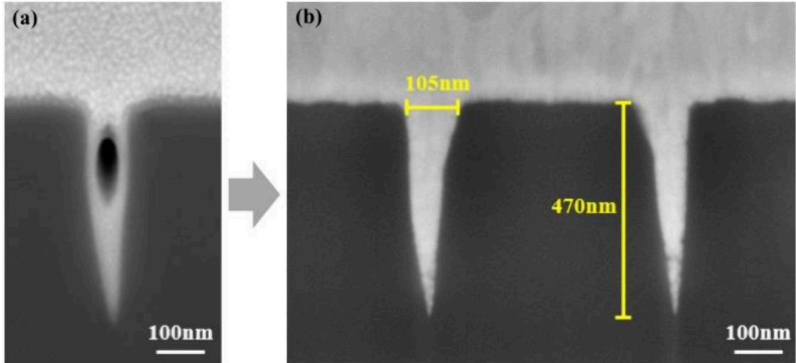

Figure 5. Cross-sectional FIB-SEM views of cobalt superfilling (a) before and (b) after electrodeposition with 5ppm AP4A.  
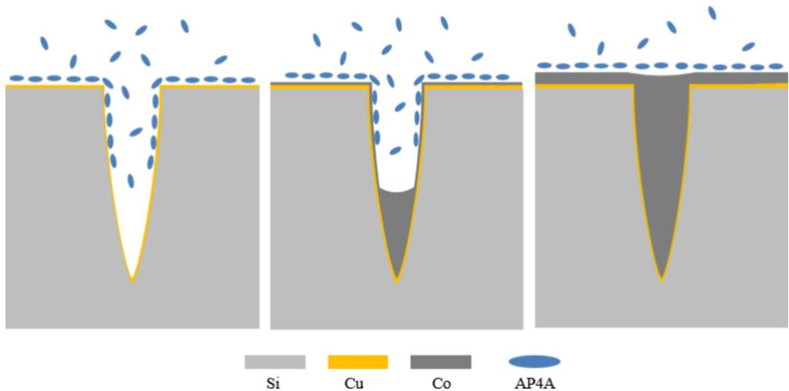  
Figure 6. Schemefor bottom up superfilling of cobalt electrodeposition.

In this work, the feasibility for achieving superfilling with additives is assessed by electrochemical experiments and quantum chemical calculations in the first place, which is verified by practical filling of electrodeposition. This research successfully identifies an additive molecule that can be used for cobalt superfilling and investigates its inhibition mechanism as well as its film properties, providing helpful insights into the relationship between molecule and microstructure, which is meaningful for realizing high-quality nanoscale cobalt inter connections and for the search of other potential additives.

## ■ AUTHOR INFORMATION

## Corresponding Author

Yunwen Wu − State Key Laboratory of Metal Matrix Composites, School of Material Science and Engineering,

Shanghai Jiao Tong University, Shanghai 200240, China; orcid.org/0000-0001-5404-607X; Email: tlwuyunwen@ sjtu.edu.cn

## Authors

Yiting Tong − State Key Laboratory of Metal Matrix Composites, School of Material Science and Engineering, Shanghai Jiao Tong University, Shanghai 200240, China; orcid.org/0009-0007-7074-6966

Dawei Lai − State Key Laboratory of Metal Matrix Composites, School of Material Science and Engineering, Shanghai Jiao Tong University, Shanghai 200240, China; orcid.org/0009-0009-7783-463X

Ya Li − State Key Laboratory of Metal Matrix Composites, School of Material Science and Engineering, Shanghai Jiao Tong University, Shanghai 200240, China

Tao Hang − State Key Laboratory of Metal Matrix Composites, School of Material Science and Engineering, Shanghai Jiao Tong University, Shanghai 200240, China; orcid.org/0000-0001-6902-0788

Ming Li − State Key Laboratory of Metal Matrix Composites, School of Material Science and Engineering, Shanghai Jiao Tong University, Shanghai 200240, China

Complete contact information is available at:

https://pubs.acs.org/10.1021/acsaelm.4c00774

## Notes

The authors declare no competing financial interest.

## ■ ACKNOWLEDGMENTS

This work was financially supported by the National Natural Science Foundation of China (No. 51991374).

## ■ REFERENCES

(1) de Oliveira Hansen, R.; Mátéfi-Tempfli, M.; Safonovs, R.; Adam, J.; Chemnitz, S.; Reimer, T.; Wagner, B.; Benecke, W.; Mátéfi-Tempfli, S. Magnetic films for electromagnetic actuation in MEMS switches. Microsyst. Technol. 2018, 24 (4), 1987−1994.

(2) Luo, X.; Chen, C.-Y.; Chang, T.-F. M.; Sone, M.; Zhang, Q.; Zhang, J. The Structure and Micro-Mechanical Properties of Electrodeposited Cobalt Films by Micro-Compression Test. J. Electrochem. Soc. 2021, 168 (10), 102502.

(3) Zhang, D.; Chen, Y.; Su, Y.; Hong, Y.; Wang, C.; Zhou, G.; Wang, S.; He, W.; Sun, Y.; Zhang, W.; et al. Additive-assisted cobalt electrodeposition as surface magnetic coating to enhance the inductance of spiral copper inductors. Surf. Interfaces 2022, 28, 101603.

(4) Broekmann, P.; Fluegel, A.; Emnet, C.; Arnold, M.; Roeger-Goepfert, C.; Wagner, A.; Hai, N. T. M.; Mayer, D. Classification of suppressor additives based on synergistic and antagonistic ensemble effects. Electrochim. Acta 2011, 56 (13), 4724−4734.

(5) He, M.; Zhang, X.; Nogami, T.; Lin, X.; Kelly, J.; Kim, H.; Spooner, T.; Edelstein, D.; Zhao, L. Mechanism of Co Liner as Enhancement Layer for Cu Interconnect Gap-Fill. J. Electrochem. Soc. 2013, 160 (12), D3040−D3044.

(6) Zheng, Y.; Gao, L.; Dong, R.; He, S. Role of CCUS in carbon neutral power system. Carb Neutrality 2022, 1, 19.

(7) Huang, Q.; Lyons, T. W.; Sides, W. D. Electrodeposition of Cobalt for Interconnect Application: Effect of Dimethylglyoxime. J. Electrochem. Soc. 2016, 163 (13), D715−D721.

(8) Hu, Y.; Huang, Q. Effects of Dimethylglyoxime and Cyclohexane Dioxime on the Electrochemical Nucleation and Growth of Cobalt. J. Electrochem. Soc. 2019, 166 (1), D3175−D3181.

(9) Hu, Y.; Huang, Q. Oscillatory Behavior in Cobalt Electrodeposition with 3-Mercapto-1-Propanesulfonate. J. Phys. Chem. C 2020, 124 (39), 21608−21616.

(10) Kang, J.; Sung, M.; Byun, J.; Kwon, O. J.; Kim, J. J. Superconformal Cobalt Electrodeposition with a Hydrogen Evolution Reaction Suppressing Additive. J. Electrochem. Soc. 2020, 167 (16), 162514.

(11) Ciofi, I.; Roussel, P. J.; Saad, Y.; Moroz, V.; Hu, C.; Baert, R.; Croes, K.; Contino, A.; Vandersmissen, K.; Gao, W.; et al. Modeling of Via Resistance for Advanced Technology Nodes. IEEE Trans. Electro. Dev. 2017, 64 (5), 2306−2313.

(12) Hu, Y.; Deb, S.; Li, D.; Huang, Q. Effects of organic additives on the impurity and grain structure of electrodeposited cobalt. Electrochim. Acta 2021, 368, 137594.

(13) Ma, X.; Li, Y.; Yang, P.; Zhang, J.; An, M. Influence of suppressing additive malachite green on superconformal cobalt electrodeposition. J. Electroanal. Chem. 2022, 921, 116696.

(14) Qiu, L.-N.; Ni, Z.-H.; Wang, Y.-J.; Hu, C.-F.; Qu, X.-P. Electroless Deposition of Pure Co on TaN Substrate for Interconnect Metallization. J. Electrochem. Soc. 2022, 169 (7), 072507.

(15) Wislicenus, M.; Liske, R.; Gerlich, L.; Vasilev, B.; Preusse, A. Cobalt advanced barrier metallization: A resistivity composition analysis. Microelectron. Eng. 2015, 137, 11−15.

(16) Song, Q.; Zhao, Y.; Wang, C.; Xie, H.; Yin, H.; Ning, Z. Bubble-assisted densification of cobalt deposit during electrowinning in CoCl2 solution. Hydrometall. 2019, 189, 105111.

(17) Su, F.; Liu, C.; Zuo, Q.; Huang, P.; Miao, M. A comparative study of electrodeposition techniques on the microstructure and

property of nanocrystalline cobalt deposit. Mater. Chem. Phys. 2013, 139 (2−3), 663−673.

(18) Wu, J.; Wafula, F.; Branagan, S.; Suzuki, H.; van Eisden, J. Mechanism of Cobalt Bottom-Up Filling for Advanced Node Interconnect Metallization. J. Electrochem. Soc. 2019, 166 (1), D3136−D3141.

(19) Xiao, N.; Li, D.; Cui, G.; Li, N.; Li, Q.; Wu, G. Adsorption behavior of triblock copolymer suppressors during the copper electrodeposition. Electrochim. Acta 2014, 116, 284−291.

(20) Lyons, T. W.; Huang, Q. Effects of Cyclohexane- Monoxime and Dioxime on the Electrodeposition of Cobalt. Electrochim. Acta 2017, 245, 309−317.

(21) Kiruba, M.; Lakshminarasimhan, N.; Jeyabharathi, C. Butynediol’s Role beyond Brightening Additive during Electrodeposition of Cobalt. J. Electrochem. Soc. 2022, 169 (3), 032507.

(22) Lee, C. H.; Bonevich, J. E.; Davies, J. E.; Moffat, T. P. Superconformal Electrodeposition of Co and Co-Fe Alloys Using 2- Mercapto-5-benzimidazolesulfonic Acid. J. Electrochem. Soc. 2009, 156 (8), D301−D309.

(23) Josell, D.; Silva, M.; Moffat, T. P. Superconformal Bottom-Up Cobalt Deposition in High Aspect Ratio Through Silicon Vias. J. Electrochem. Soc. 2016, 163 (14), D809−D817.

(24) Rigsby, M. A.; Brogan, L. J.; Doubina, N. V.; Liu, Y.; Opocensky, E. C.; Spurlin, T. A.; Zhou, J.; Reid, J. D. Superconformal Cobalt Fill through the Use of Sacrificial Oxidants. ECS Trans. 2017, 80 (10), 767−776.

(25) Rigsby, M. A.; Brogan, L. J.; Doubina, N. V.; Liu, Y.; Opocensky, E. C.; Spurlin, T. A.; Zhou, J.; Reid, J. D. The Critical Role of pH Gradient Formation in Driving Superconformal Cobalt Deposition. J. Electrochem. Soc. 2019, 166 (1), D3167−D3174.

(26) Fukui, R.; Katayama, Y.; Miura, T. The effect of organic additives in electrodeposition of Co from an amide-type ionic liquid. Electrochim. Acta 2011, 56 (3), 1190−1196.

(27) Pan, B.; Zhang, Q.; Liu, Z.; Yang, Y. Influence of butynediol and tetrabutylammonium bromide on the morphology and structure of electrodeposited cobalt in the presence of saccharin. Mater. Chem. Phys. 2019, 228, 37−44.

(28) Manhabosco, T. M.; Müller, I. L. Influence of saccharin on morphology and properties of cobalt thin films electrodeposited ove n-Si(100). Surf. Coat. Technol. 2008, 202 (15), 3585−3590.

(29) Banbur-Pawlowska, S.; Mech, K.; Kowalik, R.; Zabinski, P. Analysis of electrodeposition parameters influence on cobalt deposi roughness. Appl. Surf. Sci. 2016, 388, 805−808.

(30) Zhang, M.; Chang, P.; Chen, P.; Hang, T.; Li, M.; Wu, Y. Super-flat and uni-oriented cobalt film electrodeposited by modulat ing the crystal nucleation and growth behavior. Appl. Surf. Sci. 2024, 645. 158795.

(31) Li, Y.; Ren, P.; Zhang, Y.; Li, R.; Zhang, J.; Yang, P.; Liu, A.; Wang, G.; An, M. Investigation of novel leveler Rhodamine B on copper superconformal electrodeposition of microvias by theoretical and experimental studies. Appl. Surf. Sci. 2023, 615, 156266.

(32) Ni, X.; Chen, Y.; Jin, X.; Wang, C.; Huang, Y.; Hong, Y.; Su, X.; Zhou, G.; Wang, S.; He, W.; et al. Investigation of polyvinylpyrrolidone as an inhibitor for trench super-filling of cobalt electrodeposition. J. Taiwan Inst. Chem. Eng. 2020, 112, 232−239.

(33) Feng, X.; Yu, N.; Hang, T.; Zhang, Y.; Li, M. Experimental and Theoretical Study on Self-Annealing Behavior of Copper Film Electroplated with 2-Mercaptopyridine and 2-Aminobenzothiazole as Additives. J. Electrochem. Soc. 2016, 163 (2), D57−D62

(34) Ni, X.; Wang, C.; Su, Y.; Luo, Y.; Ye, Y.; Su, X.; He, W.; Wang, S.; Hong, Y.; Chen, Y.; et al. Effect of 3-mercapto-1-propane sulfonate sulfonic acid and polyvinylpyrrolidone on the growth of cobalt pilla by electrodeposition. Nanotechnol. Rev. 2022, 11 (1), 1209−1218.

(35) Uzun, S.; Esen, Z.; Koç, E.; Usta, N. C.; Ceylan, M. Experimental and density functional theory (MEP, FMO, NLO, Fukui functions) and antibacterial activity studies on 2-amino-4- (4- nitrophenyl) −5,6-dihydrobenzo [h] quinoline-3-carbonitrile. J. Mol. Struct. 2019, 1178, 450−457.

(36) Beica, R.; Sharbono, C.; Ritzdorf, T. Through silicon via copper electrodeposition for 3D integration. 58th Electro. Comp. & Tech. Conf. 2008, 577.

(37) Kim, B.; Sharbono, C.; Ritzdorf, T.; Schmauch, D. Factors affecting copper filling process within high aspect ratio deep vias for 3D chip stacking. 56th Electro. Comp. & Tech. Conf. 2006, 1.

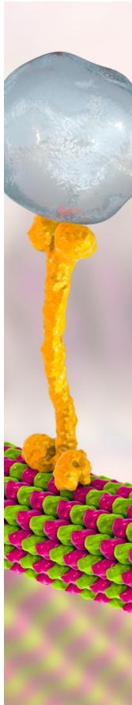

CAS BIOFINDER DISCOVERY PLATFORMTM

# BRIDGE BIOLOGY AND CHEMISTRY FOR FASTER ANSWERS

Analyze target relationships, compound effects, and disease pathways

Explore the platform