# Nicotinic acid as a novel inhibitor for alkaline cobalt CMP: Experiment and molecular simulation

Boao Ma a,b, Shihao Zhang a,b, Baimei Tan a,b,\*, Wei Li a,b, Yazhen Wang a,b, Xiaoqin Sun a,b

a School of Electronics and Information Engineering, Hebei University of Technology, Tianjin 300130, China Tianjin Key Laboratory of Electronic Materials and Devices, Tianjin 300130, China

## G R A P H I C A L A B S T R A C T

The major mechanism of corrosion inhibition effect by nicotinic acid (NA) is to form a passivation film which adsorbs on cobalt (Co) surface so as to strengthen the surface impedance and isolate the corrosion medium. In an alkaline environment (pH 10), NA exists in the form of Nic2− ions, which are negatively charged. Driven by electrostatic forces and Van der Waals forces between NA molecule (N atom and the carboxyl) and cobalt atom, Nic2− ions are appealed to the Co(OH)2, leading to the appearance of Co(II)-NA molecule groups. NA molecules produce a single or multilayer self-assembled Co(II)-NA film on the cobalt surface and further preven the corrosion on Co film.

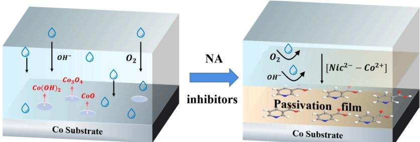

## A R T I C L E I N F O

Keywords: Cobalt interconnection Nicotinic acid Corrosion inhibitor Electrochemistry Molecule simulation

## A B S T R A C T

Cobalt (Co) is the interconnect metal of integrated circuits with the feature size of 10 nm and below, and Co corrosion is the main problem in cobalt interconnect chemical mechanical polishing (CMP). The introduction of inhibitors is one of the most ideal approaches to reduce corrosion. In this work, useful insights into the corrosion inhibition performance of nicotinic acid (NA), a green inhibitor, on cobalt film in alkaline medium were investigated via electrochemical characterization, surface analysis, quantum chemical calculation, and molecular dynamics (MD) simulation, as well as the adsorption mechanism at atomic level was explored. NA belongs to anodic erosion inhibitor and its inhibition efficiency reached a maximum of 86.65 % at the concentration of 80 mM pH 10, which was identified by the contact angle and potentiodynamic polarization (PDP) test. The elec trochemical impedance spectra (EIS) suggested that the surface resistance was enhanced to prevent corrosion. Free energy obtained from the Langmuir model indicates that NA molecules are physically and spontaneously adsorbed on cobalt surface. XPS results further confirmed this point, which reveals that NA exists in the form of Nic2− in alkaline solution and forms a $\mathrm { C o ( O H ) _ { 2 } ( N i c ^ { 2 - } ) }$ molecule group (Co(II)-NA) on Co surface. Additionally, quantum chemical calculations based on density function theory (DFT) have approved that C–N bond and carboxyl group are the active sites of NA molecule and form the most significant electrostatic adsorption force with cobalt atoms. Moreover, it can be inferred from MD simulations that NA molecules are spontaneously and physically adsorbed on the cobalt surface at a certain angle. In a word, NA manifests its effectiveness in corrosion inhibition of cobalt and will become a potential cobalt CMP inhibitor. The research methods and results of this paper are beneficial to the study of the adsorption characteristics and inhibition mechanism of inhibitors on the metal surface, and provide a theoretical basis for optimizing the composition of Co CMP slurry.

## 1. Introduction

As the feature size of integrated circuits (ICs) shrinks below 10 nm, cobalt is the most promising material to replace tungsten (W) and copper (Cu) as the front and intermediate lines owing to its great resistance to electromigration and good performance in step coverage [1]. In addition, the barrier layer of cobalt interconnect ICs is thinner than that of copper [2,3]. After cobalt film deposition, the wafer surface is uneven, so chemical mechanical polishing (CMP) is used in IC manufacturing process to realize local and global planarization through the coordina tion of chemical action and mechanical action [4].

However, Co is prone to being corroded by CMP slurry, which con tains many aggressive chemicals, e.g., oxidizers and complexing agents, in which $\mathrm { H } _ { 2 } \mathrm { O } _ { 2 }$ is widely used to increase removal rate of cobalt as a green oxidizer [5,6]. Yang et al. [7] studied the corrosion of Co in alkaline medium containing $\mathrm { H } _ { 2 } \mathrm { O } _ { 2 }$ and found that lots of pits were appeared in the presence of 0.1 wt% $\mathrm { H } _ { 2 } \mathrm { O } _ { 2 } ,$ , and at some locations, the coating layer was fragmented and peeling occurred. In order to reduce the corrosion of Co surface, many methods and new chemicals have been introduced into the study of cobalt. Badawy et al. [8] investigated the corrosion of Co in alkaline solution and suggested that the potential of Co can be increased by increasing the pH value of the solution to slow down the corrosion rate. Accordingly, all experiments in this study were carried out under alkaline conditions.

In recent years, the addition of corrosion inhibitors has been proved to be an effective measure to inhibit corrosion of metal materials [9 11]. Many studies show that organic inhibitor molecules containing elements such as C, N, and O are often more effective in corrosion prevention, among which benzotriazole (BTA) is a common inhibitor and has been broadly commercialized [12 14]. The corrosion inhibition effect of BTA was firstly reported by Cotton et al. [15], and since then researchers have carried out a lot of researches on BTA $[ 9 , 1 6 , 1 7 ]$ . However, some current studies reported that BTA has a poor inhibition effect on Co corrosion in corrosive medium. Yang et al. [7] characterized the surface morphology of Co in the solution containing BTA and $\mathrm { H } _ { 2 } \mathrm { O } _ { 2 }$ by SEM, and concluded that BTA could not effectively reduce the pitting caused by $\mathrm { H } _ { 2 } \mathrm { O } _ { 2 }$ on Co surface. Similarly, Lei et al. [18] suggested that BTA is no longer applicable to Co CMP by means of surface morphology test. In addition, the toxicity of BTA also limits its application in CMP [19,20]. Therefore, scholars have been committed to developing green and effective corrosion inhibitors for Co CMP, such as organic acid and vi tamins [21–23].

Notably, nicotinic acid, which belongs to the B3 group of vitamins, is widely used as an intermediate in the synthesis of various pharmaceuticals and shows favorable potential in corrosion inhibition effect. Mohamed et al. [23] investigated the polishing behavior and defects of cobalt samples with an aqueous mixture of $\mathrm { H } _ { 2 } \mathrm { O } _ { 2 } ,$ oxalic acid (OA), and nicotinic acid at pH 10. The results show that the alkaline solution including 80 mM NA can broadly reduce the corrosion current of cobalt samples and galvanic erosion between cobalt and copper, proving that NA can operate as an inhibitor for Co film in $\mathrm { H } _ { 2 } \mathrm { O } _ { 2 }$ solution. He et al. [24] concluded that NA offers a composite layer on the cobalt surface, and prevents further Co corrosion, while a combination of 10 mM NA and 5 mM TAZ minimized Co-Cu corrosion as measured by zero resistance galvanometer. Although it is confirmed that NA possesses an inhibition effect on cobalt, further studies on NA, such as the interaction process between NA and $\mathrm { C o } ,$ the adsorption mechanism of NA on Co surface and so on, have not been reported. Studying the adsorption of corrosion inhibitor on the metal surface is of great significance to explore the corrosion inhibition mechanism. This work mainly studies the inhibitory effect of NA on cobalt corrosion in alkaline medium, as well as the formation and mechanism of [NA-Co] complex.

Studies on the performance of inhibitor molecules only by conventional chemical experiments and characteristic methods are inadequate. The rapid development of theoretical chemistry provides a more scientific explanation for its research. Molecular simulation is a crucial approach to study the molecular chemical activity of corrosion inhibitors from a microscopic perspective [25,27–29]. The adsorption mechanism between inhibitors and metal substrates can be intuitively characterized by molecular simulation technology. Ma et al. [26] probed the effect of potassium oleate (PO) as a viable corrosion inhibitor for Cu films in $\mathrm { E D T A  – H _ { 2 } O _ { 2 } }$ based solution through combining chemical experiment analysis with molecular simulation. Density functional theory and molecular dynamics approaches were applied to study the inhibition mechanism at the atom level of PO on Cu(111) substrate. Yin et al. [16] evaluated the corrosion inhibition of BTA and TAZ at the molecular level via comparing quantum chemical descriptors. Therefore, it is necessary to further study the quantum chemical properties of NA and micro adsorption mechanism of NA on Co surface.

Considering that NA is an inexpensive, green, and easily available organic inhibitor, it was introduced into the alkaline (pH 10) solution. The molecular structure of NA is shown in Fig. 1. Contact angle and PDP measurements were carried out to determine the optimal concentration of NA. The passive film of NA was investigated by EIS, and the reaction between Co and NA was explored by XPS. Density functional theory was employed to study the properties of NA molecule. Several chemical descriptors were calculated to reveal active sites of NA molecule and the electron transfer characteristics between NA and Co atoms, as well as MD simulation was conducted to study the adsorption configuration, adsorption stability and adsorption sites of NA on Co surface. This work provides a more in-depth insight into the development of alkaline cobalt CMP slurry.

## 2. Experimenta

## 2.1. Materials

Cobalt coupons (2 cm \* 2 cm) cut from a 12-inch. cobalt blanket wafer were used to accomplish the contact angle test and electrochemical experiments. Before each experiment, the coupons were immersed in 0.025 M citric acid $\mathrm { ( C _ { 6 } H _ { 8 } O _ { 7 } , }$ , CA, 99 %) solution for 5 min to remove the oxide layer on the film surface, then rinsed with deionized water (DIW) and dried with nitrogen $\left( \mathrm { N } _ { 2 } \right)$ . After CA treatment, the cobalt specimens were immersed in NA $( \mathrm { C } _ { 6 } \mathrm { H } _ { 5 } \mathrm { N O } _ { 2 } ,$ 99.5 %) solutions with different concentrations (40, 50, 60, 70, 80 mM) for 5 min. The pH of each inhibitor solution was adjusted to 10.00 with KOH and $\mathrm { H _ { 3 } P O _ { 4 } } .$ Eventually, these cobalt coupons were rinsed with DIW and dried with $\Nu _ { 2 }$ to obtain different samples.

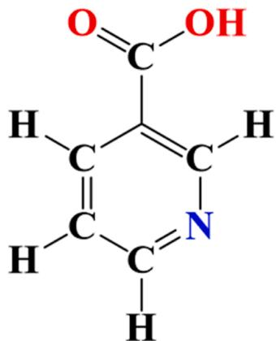  
Fig. 1. Molecular structure formula of NA.

## 2.2. Surface characteristic techniques

The contact angle of the cobalt sample surfaces without or with NA immersion was tested via contact angle analyzer (JC2000D, Shanghai Zhongchen Co, Ltd).

The surface chemical compounds of cobalt samples were explored by X-ray photoelectron spectroscopy (XPS, ESCALA250Xi, Thermo, USA), which was stimulated by an Al-Kα anode and operated at a base pressure of $5 \times { 1 0 } ^ { - 1 0 }$ mbar and a constant power of 150 W. High-resolution Co 2p spectra were measured at a passing energy of 20 eV and a step size of 0.1 eV. The data were fitted and corrected in CasaXPS software.

## 2.3. Electrochemical experiments

All PDP measurements were performed on a CHI660E workstation with a three-electrode system (Chenhua, Shanghai). The treated cobalt coupon was wrapped with waterproof tape with an exposed area of $0 . 3 8 \mathrm { c m } ^ { 2 } ,$ which was used as the working electrode, and saturated mercury electrode (SCE) and platinum (Pt) electrode (the size was 2 cm \* 2 cm) as the reference electrode and the counter electrode, respectively. Different concentrations of NA liquids (pH 10) were taken as electrolyte solutions. The open circuit potential (OCP) was tested incessantly for 600 s to acquire more stable results. The Tafel plots of the Co electrode were gained by PDP curve test at the scanning rate of 5 mV/s within the voltage range of $\mathrm { O C P } \pm 0 . 3 \ : \mathrm { V }$

The EIS measurements were conducted on cobalt electrode via potentiostat (ZSRS-UI5022), OCP as initial value and 10 mV peak-topeak sine waves with the frequency in the range of 0.1 Hz to 10 kHz as AC perturbation signals. The EIS data were fitted and rectified by the complex nonlinear least squares (CNLS) method in Zsimpwin software.

## 2.4. Theoretical calculation details

The quantum parameters of NA were calculated using the $\mathrm { D m o l } ^ { 3 }$ module in material studio software. First, the structure of NA was optimized with GGA-PBE exchange-correlation function and DNP basis set. The convergence threshold of energy, Max. Force, and Max. displacement respectively was $1 \times 1 0 ^ { - 5 } \mathrm { { H a } } , 2 \times 1 0 ^ { - 3 } \mathrm { { H a } } / \mathring { \mathrm { { A } } } ,$ , and $5 ~ \times$ $1 0 ^ { - 3 } \mathrm { \AA } .$ Then, several quantum parameters including HOMO, LUMO, etc. were calculated.

The Forcite module was employed to operate MD simulations. The ideal Co(111) surface was selected as the adsorption object owing to its high atomic density and low Miller index. The inhibitor molecule and Co (111) crystal system with the size of $6 \times 6 \times 8$ and containing a 40 Å vacuum layer were optimized before the start of each dynamics simulation. In order to obtain stable adsorption configuration of the inhibitor on the Co(111) surface, MD simulation was carried out at the ‘Universal force field and $\mathbf { \hat { Q } E q } ^ { * }$ charge. The total energy was calculated by the summation method of the atom-based electrostatic and van der Waals. All MD simulations were based on NVT thermodynamics with an absolute temperature of 298 K, a time step of 1 $\mathbf { f s } ,$ and a total simulation time of 1000 ps.

## 3. Results and discussion

## 3.1. Contact angle test analysis

The adsorption of organic molecules on the metal surface will change its hydrophilicity/hydrophobicity and alters the contact angle of metal surface, while fresh metal surfaces usually present hydrophilicity, hence the contact angle reflects the adsorption effect of the inhibitor [30]. Fig. 2 illustrates contact angle of cobalt samples treated with different concentrations of NA and compared with that treated with CA. After CA treatment, the natural oxide layer on the cobalt surface was removed, and the contact angle of the cobalt surface reduced from $5 5 ^ { \circ }$ to 47◦, obtaining the fresh cobalt surface [31]. The contact angle increased to $6 7 ^ { \circ }$ following 40 mM NA treatment and increased steadily with the increase of NA concentration until the maximum contact angle reached $8 3 ^ { \circ }$ when the concentration was 80 mM. When the concentrations of NA were 90 and 100 mM, the contact angles were 82◦ and 83◦, respectively, which remained basically unchanged compared with that of 80 mM. These results show that when the concentration of NA is greater than 80 mM, the adsorption of NA molecules on the cobalt surface reaches saturation.

## 3.2. Electrochemical test analysis

According to the contact angle results, PDP tests were carried out to evaluate the effect of corrosion inhibition of NA with the concentration less than 100 mM on cobalt electrode. Fig. 3 shows the PDP curves of cobalt electrode treated with different NA concentrations.

With the introduction of NA, both the anode and cathode branches of Tafel curves have the tendency to extend to the region of low corrosion current density. Compared with the cathode branches, the corrosion current density of the anode branches differs from one another markedly, i.e. the reduction reaction rate of dissolved oxygen at the cathode basically remains unchanged, while the metal ionization process occurring at the anode is inhibited. Accordingly, nicotinic acid belongs to the anodic corrosion inhibitor. The linear region of anodic branch, named as passivation region, proves that NA molecules gradually adhere to the cobalt surface to form a protective film and reduce the corrosion degree. It is noteworthy that the slope at the end of the 40 mM NA anode branch (circled in red) sinks, which is caused by the incompactness of the passivation film as the local corrosion medium may interact with the metal through the protective layer to aggravate the metal ionization. The illustration in Fig. 3 shows the PDP test curves of cobalt electrode in NA solutions with concentrations of 80, 90 and 100 mM, respectively. It can be seen that these three curves almost coincide, which indicates the surface corrosion of Co electrode is similar.

The corrosion potential $( E _ { \mathrm { c o r r } } )$ and the current density $( I _ { \mathrm { c o r r } } )$ fitted by Tafel curves are shown in Table 1, which is the intersection of extrapolation of the linear region of anodic and cathodic branches. Additionally, the corrosion inhibition efficiency $( \eta _ { \mathrm { T } } )$ calculated by Eq. (1) are also shown in Table 1.

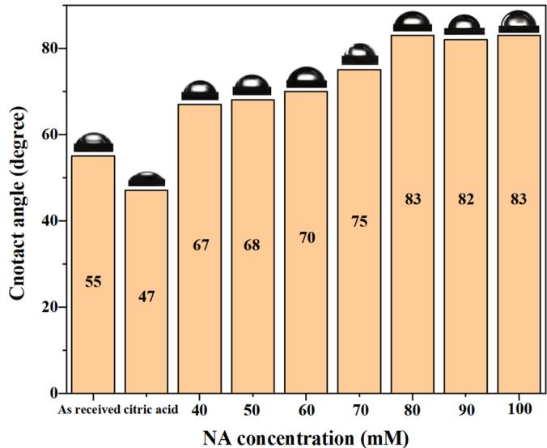  
Fig. 2. Contact angle of cobalt surface after immersion with CA and with different concentrations of NA.

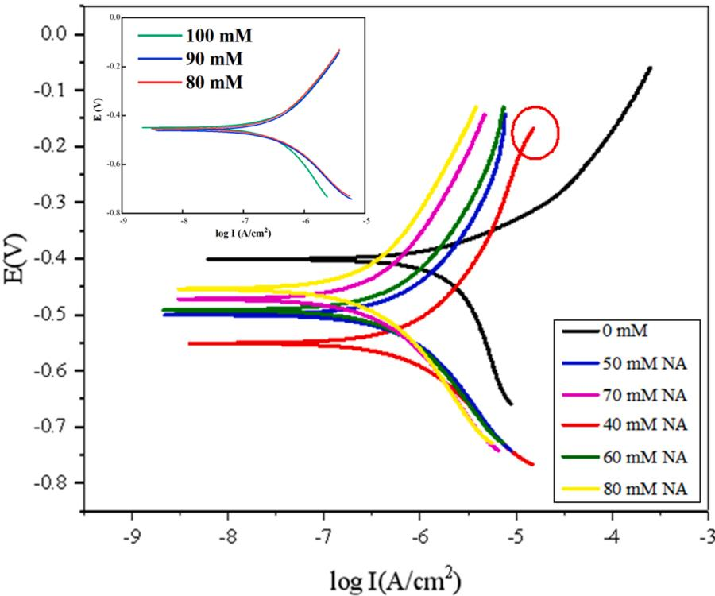  
Fig. 3. PDP curves of Co samples soaked in different concentrations of NA (illustration: PDP curves with the concentration of 80, 90 and 100 mM).

The $E _ { \mathrm { c o r r } } , \ : I _ { \mathrm { c o r r } } ,$ and $\eta _ { \mathrm { T } }$ of cobalt samples treated with different concentrations of NA.

<table><tr><td>Concentration (mM)</td><td> $E_{\text{corr}}$  (V)</td><td> $I_{\text{corr}}$  ( $\mu A/cm^2$ )</td><td> $\eta_T$ (%)</td></tr><tr><td>0</td><td>-0.401</td><td>2.154</td><td>-</td></tr><tr><td>40</td><td>-0.551</td><td> $8.438 \times 10^{-1}$ </td><td>60.83</td></tr><tr><td>50</td><td>-0.500</td><td> $6.429 \times 10^{-1}$ </td><td>70.15</td></tr><tr><td>60</td><td>-0.492</td><td> $5.175 \times 10^{-1}$ </td><td>75.97</td></tr><tr><td>70</td><td>-0.472</td><td> $3.425 \times 10^{-1}$ </td><td>84.10</td></tr><tr><td>80</td><td>-0.454</td><td> $2.876 \times 10^{-1}$ </td><td>86.65</td></tr><tr><td>90</td><td>-0.461</td><td> $2.950 \times 10^{-1}$ </td><td>86.30</td></tr><tr><td>100</td><td>-0.449</td><td> $2.912 \times 10^{-1}$ </td><td>86.48</td></tr></table>

$$
\eta_ {T} = \left[ 1 - \frac {I _ {\text {corr, within inhibitors}}}{I _ {\text {corr, without inhibitors}}} \right] \times 100 \%\tag{1}
$$

As shown in Table 1, with the presence of 40 mM $\mathrm { N A } , I _ { c o r r }$ decreases from 2.154 $\mu \mathrm { A } / \mathrm { c m } ^ { 2 }$ to $8 . 4 3 8 \times 1 0 ^ { - 1 } \mu \mathrm { A / c m } ^ { 2 }$ , which affirms that NA does limit the dissolution of cobalt electrode.

It is confirmed that inhibitor functions at certain concentrations [32]. With the increase of NA concentration, $I _ { c o r r }$ decreases, while in hibition efficiency increases. When the concentration of NA exceeds 80 mM, the variations of $E _ { \mathrm { c o r r } }$ and $I _ { \mathrm { c o r r } }$ of cobalt electrode are very small, among which values of $E _ { \mathrm { c o r r } }$ are − 0.499 \~ − 0.461 V, and $I _ { \mathrm { c o r r } }$ is between $2 . 8 7 6 \times 1 0 ^ { - 1 }$ and $2 . 9 5 0 \times 1 0 ^ { - 1 } \mu \mathrm { A / c m ^ { 2 } }$ . And the corrosion in hibition efficiency stabilizes between 86 % and 87 %. This indicates that there is no significant difference in the corrosion state of cobalt electrode, i.e., the adsorption of NA on cobalt surface reaches saturation at 80 mM. When the concentration of NA is 80 mM, the minimum value of $I _ { c o r r } \mathrm { i s } 2 . 8 7 6 \times 1 0 ^ { - 1 } \mu \mathrm { A / c m } ^ { 2 } .$ and the $\eta _ { T }$ reaches the maximum of 86.65 %, suggesting that NA performs the optimal corrosion inhibitory effect at 80 mM.

The electrochemical experiment results are consistent with the contact angel test. It is reasonable to suppose that the tightest passive film is formed by 80 mM NA, so as to provide the strongest corrosion inhibition [24,33]. In order to understand the basic adsorption mode of NA on the cobalt/solution interface, several adsorption isotherm models were exploited. The results of PDP fitted show that the adsorption between NA and Co surfaces conforms to the Langmuir isotherm model suitably. The Langmuir isotherm equations are described by Eqs. (2) and (3)[31]:

$$
\frac {C}{\theta} = C + \frac {1}{K}\tag{2}
$$

$$
\theta = 1 - \frac {I _ {\text { corr,   within inhibitors }}}{I _ {\text { corr,   without   inhibitors }}}\tag{3}
$$

where C means the inhibitor concentration, K refers to the adsorption equilibrium constant in units of the reciprocal of concentration, and θ represents the coverage. Then, Eq. (4) describes the Gibbs standard free energy of adsorption $\left( \Delta \boldsymbol { \mathrm { G } } ^ { \circ } \mathsf { a d s } \right)$ [31]:

$$
K = \frac {1}{C _ {\text { solvent }}} \exp \left(- \frac {\Delta G _ {a d s} ^ {\circ}}{R T}\right)\tag{4}
$$

where the absolute temperature is $T = 2 9 8 \mathrm { K } ,$ , the molarity of water is $C _ { s o l \nu e n t } { = 5 5 . 5 \mathrm { m o l / L } } ,$ and the conventional gas constant is R= 8.314 kJ/ mol·K.

As illustrated in Fig. 4, the matching results are reliable with a fit of 0.9900. The value of $\Delta \mathrm { G } _ { \mathrm { ~ a d s ~ } } ^ { \circ } \mathrm { i } s - 1 7 . 9 2$ kJ/mol. The negative value of $\Delta G ^ { \circ } { \sf a d s }$ implies that NA molecules can be adsorbed spontaneously on the cobalt surface [33]. Generally, the chemisorption caused by electron transfer or coordination bond is dominant, when $\Delta G ^ { \circ } { \sf a d s }$ is less than − 40 kJ/mol, while van der Waals force and electrostatic attraction predominate if $\Delta G ^ { \circ } { \sf a d s }$ is greater than − 20 kJ/mol, indicating the adsorption is a physical interaction [34]. As a result, the adsorption process of NA on the cobalt surface could be considered as physical adsorption, in which NA is physically adsorbed on the cobalt surface to form a passive film to protect the cobalt film from further corrosion.

Table 2

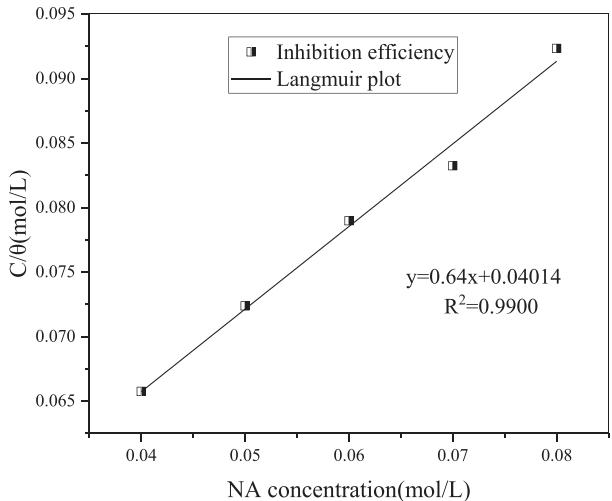  
Fig. 4. Langmuir isotherm image of Co surface adsorbed with NA.

## 3.3. Electrochemical impedance spectroscopy analysis

EIS measurement was used to analyze the passivation effect of physically adsorbed protective film on cobalt surface in alkaline medium. Fig. 5(a) shows the Nyquist impedance spectra of the Co electrodes in different concentrations of NA, which can better understand the structure of passivation layer. Since the Nyquist curve is a 1/4 arc, the charge transfer controls the erosion on cobalt/alkaline medium interface, and the equivalent circuit is a simple model formed by electron exchange on passivation film. In the event that the general shape of the impedance spectra does not change with the introduction of inhibitors, the reaction principle of the corrosive medium could be considered as unaffected [35]. Meanwhile the radius of the spectrum increases with the increase of NA concentration, suggesting that the adsorption film turns to be more completed [36]. The radius of imped ance spectrum reaches the maximum when the concentration of NA is 80 mM, which is consistent with PDP results. Nonetheless, the center of the 1/4 arc is apparently below the x-axis, known as the frequency dispersion effect, which is on account of the non-ideal capacitive behavior of the cobalt/medium interface generated by the non-uniformity of cobalt electrode surface.

It is necessary to immerse the cobalt sample for adequate time to ensure the penetration of electrolyte into the film approach saturation. Then the Q value of the phasing element in the circuit will basically remain stable when the measured resistance can more precisely reflect the impedance change of the film [8].

The equivalent circuit for the Co electrode in the NA solution is shown in Fig. 5(b), as well as the EIS fitted parameters are listed in

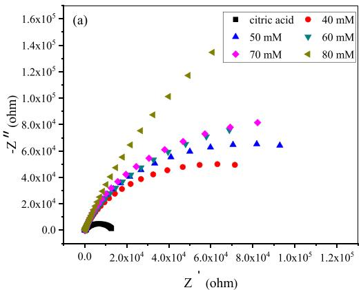

Fitted electrochemical impedance parameters with different concentrations of NA.

<table><tr><td rowspan="2">Resistance</td><td rowspan="2">Citric acid</td><td colspan="5">NA concentration (mM)</td></tr><tr><td>40</td><td>50</td><td>60</td><td>70</td><td>80</td></tr><tr><td>Rs(ohm)</td><td>355.6</td><td>245</td><td>244.1</td><td>208.6</td><td>199.6</td><td>198.3</td></tr><tr><td>Rct(ohm)</td><td> $1.292 \times 10^{4}$ </td><td> $1.262 \times 10^{5}$ </td><td> $1.588 \times 10^{5}$ </td><td> $2.064 \times 10^{5}$ </td><td> $2.187 \times 10^{5}$ </td><td> $7.867 \times 10^{5}$ </td></tr><tr><td> $\eta$ </td><td>-</td><td>89.76 %</td><td>91.86 %</td><td>93.74 %</td><td>94.09 %</td><td>98.36 %</td></tr></table>

Table 2. The equivalent circuit model includes a solution resistance $( R _ { s } ) ,$ a double layer capacitance (CPEdl), and a charge transfer resistance $( R _ { c t } ) .$ The corrosion inhibition efficiency (η) can be estimated with Eq. (5):

$$
\eta = 1 - \frac {R _ {c t} - R _ {c t 0}}{R _ {c t}} \times 100 \%\tag{5}
$$

where $R _ { c t }$ and $R _ { c t 0 }$ are charge transfer resistance in the presence and absence of NA inhibitor, respectively. As shown in Table 2, $R _ { c t }$ increases with the increase of NA concentration and reaches the maximum at 80 mM, while $R _ { s }$ is the opposite. The decline of $R _ { s }$ is due to the increase of solute in the medium. The results show that the resistance of the passive film covered the Co surface increases after adding NA molecules, as well as η. That is to say, the inhibition mechanism is the formation of an adsorption layer on the cobalt surface caused by NA, which enhances the surface resistance. And the enlargement of NA concentration enables the Co surface to attract more inhibitor molecules to possess a thicker and denser inhibition film.

## 3.4. XPS analysis

XPS was introduced to confirm the chemical composition of cobalt samples to further analyze the reaction state of cobalt surface. The XPS spectra and corresponding Co 2p spectra of cobalt samples after being treated with CA and immersed in 80 mM NA are shown in Fig. 6. Fig. 6 (a) shows that the two curves have three distinct peaks (C, O, and Co). In contrast, the peak intensities of C, O, and Co soaked in NA are signifi cantly higher than that of soaked in citric acid. This phenomenon is consistent with the element of NA molecules, and it can be inferred that inhibitor NA and its relative products can successfully assemble on the cobalt surface, issuing in the change of peak intensity of homologous elements. In addition, the appearance of N peak on the Co sample’s surface is induced by the pyrazole ring in the NA molecule [32].

Fig. 6(b) shows the fitted curves of Co 2p peak of cobalt treated with CA. The bonding energy peaks at 780 eV, 777.8 eV, and 796.4 eV correspond to compounds of $\mathrm { C o } _ { 3 } \mathrm { O } _ { 4 } ,$ Co, and CoO, respectively [37]. Thus the fresh Co surface contains cobalt atoms and cobalt oxides caused by natural oxidation of the sample while waiting for detection [38].

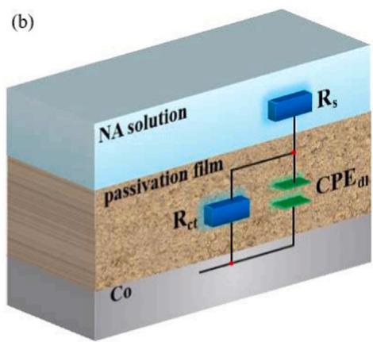  
Fig. 5. (a) The Nyquist impedance plots of the cobalt samples in different concentrations of NA; (b) The corresponding equivalent circuit model.

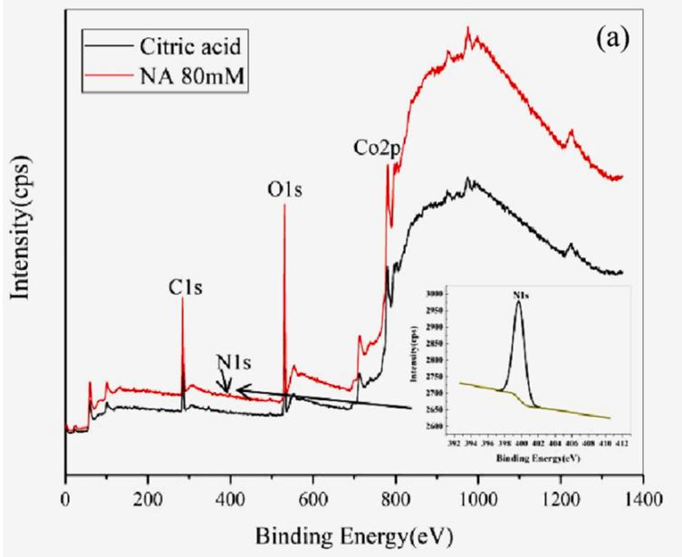

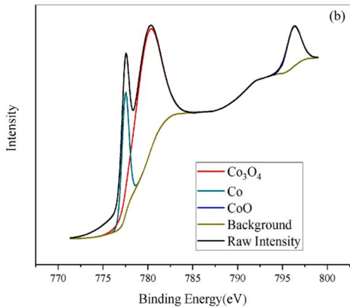

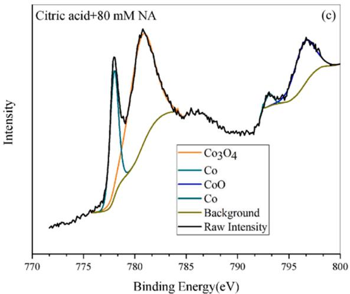  
Fig. 6. XPS spectra of Co samples after immersion in different solutions: (a) XPS spectra of cobalt surface without and with NA, (b) citric acid, (c) citric acid+ 80 mM NA.

The rectified Co 2p spectrum of cobalt sample soaked with 80 mM NA is shown in Fig. 6(c). The surface compositions of the cobalt film consist of $\mathrm { C o _ { 3 } O _ { 4 } } ~ ( 7 8 0 . 6 \ : \mathrm { e V } )$ , Co (777.9 eV and 793.1 eV), and CoO $\left( 7 9 6 . 5 \ : \mathrm { e V } \right) \left[ 3 9 \right]$ ]. The surface of cobalt adsorbed with NA consists of pure cobalt and its oxides with no new binding energy material. Consequently, it can be reasonably deduced that NA is physically adsorbed on the Co surface [40].

Through the analysis of electrochemistry and XPS, the reaction process of cobalt sample with NA attached can be concluded as below [32]:

$$
O _ {2} + H _ {2} O + 4 e ^ {-} \leftrightarrow 4 O H ^ {-}\tag{6}
$$

$$
C o + 2 O H ^ {-} \leftrightarrow C o (O H) _ {2} + 2 e ^ {-}\tag{7}
$$

$$
3 C o (O H) _ {2} + 2 O H ^ {-} \leftrightarrow C o _ {3} O _ {4} + 4 H _ {2} O + 2 e ^ {-}\tag{8}
$$

$$
C o (O H) _ {2} \leftrightarrow C o O + H _ {2} O\tag{9}
$$

$$
C o (O H) _ {2} + N i c ^ {2 -} (a q) \rightarrow C o (O H) _ {2} \left(N i c ^ {2 -}\right) _ {a d s}\tag{10}
$$

In an alkaline environment (pH 10), NA exists in the form of $\mathrm { N i c } ^ { 2 \mathrm { - } }$ ions, which are negatively charged [32]. Driven by electrostatic forces and Van der Waals forces, $\mathrm { N i c } ^ { 2 - }$ ions are appealed to the Co(OH) produced in formula (7), leading to the appearance of Co(II)-NA mole cule groups as described in formula (10). As illustrated in Fig. 7, NA molecules produce a single or multilayer self-assembled Co(II)-NA film on the cobalt surface and further prevent the corrosion on Co film [41].

## 3.5. DFT calculation analysis

Frontier molecular orbital (FMO) theory has been widely applied in the field of chemical structure to evaluate the efficiency of inhibitors, as well as explore the mechanism of interaction between inhibitors and metal surfaces [42–44]. Hence, a series of quantum chemical parameters, such as the highest occupied molecular orbital (HOMO) and the lowest unoccupied molecular orbital (LUMO) energy levels, and the energy gap (ΔE) were calculated by DFT method. Firstly, the structure of NA molecular was optimized, and then properties of the frontier orbital of NA molecule were evaluated.

HOMO has the electron donor nature with loose binding to its elec trons, while LUMO possesses the ability to accept electrons, which is usually called electron acceptor, with a strong affinity for electrons.

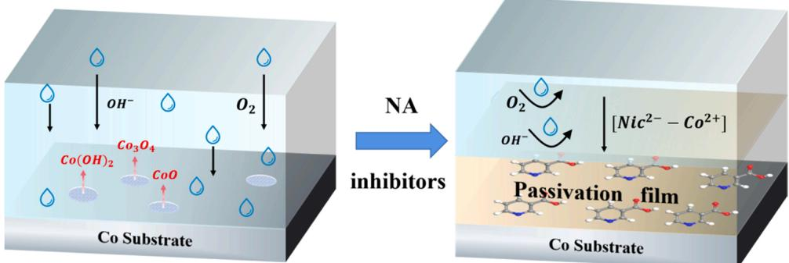  
Fig. 7. Corrosion inhibition schematic diagram of NA on cobalt surface.

Generally, the higher HOMO energy or a lower LUMO energy manifests a mightier capability of molecular electron pairs to transfer or vacant orbitals to accept electron pairs. For corrosion inhibitors, this also means a more violent trend of binding and adsorption with metal surface atoms, that is, more efficient corrosion inhibition competence [45]. On top of that, the molecule activity is strengthened with the decrease of ΔE $( \Delta E { = } \Delta E _ { L U M O } - \Delta E _ { H O M O } )$ , i.e. the reduction of ΔE promotes the impact of corrosion inhibition.

Fig. 8(a) and (b) demonstrate the optimized NA molecule and the electron cloud distribution of HOMO and LUMO. In the HOMO diagram, the electron cloud is mainly distributed on the $\mathrm { N } { = } \mathrm { C }$ bond, while the N––C bond and the carboxyl group (-COOH) occupy the primary electron cloud of LUMO, indicating that chemical reactivity exists in the $\mathrm { N } { = } \mathrm { C }$ bond and the -COOH. The truth that the value of ΔE for BTA $\left( \Delta E _ { B T A } { = } 3 . 7 9 7 \ \mathrm { e V } \right)$ [8] is larger than that of NA $( \Delta E _ { N A } { = } 2 . 1 1 4 \ \mathrm { e V } )$ signifies that the corrosion inhibition performance of NA surpasses that of BTA. Electrostatic potential (ESP) results can further confirm this conclusion, as shown in Fig. 8(c). The region of electrophilic with the highest negative potential is marked in red, while the blue region indicates nucleophilic. As shown in Fig. 8(d), the highest red region is located on N6 and O8, as well as the blue region covers the H14 atom, which fully suggests that the functional sites of NA on the cobalt surface are N––C bond and the carboxyl group.

In addition, Fukui function is employed to reflect local reactivity and predict reaction sites. The Fukui function describes the change degree of electron density at various positions when the number of electrons of the system changes, which is strictly defined as [46]:

$$
f (r) = \left(\frac {\partial \rho (r)}{\partial N}\right) _ {v (r)} = \left(\frac {\partial \mu}{\partial v (r)}\right) _ {v (r)}\tag{11}
$$

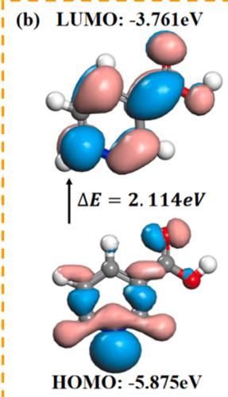

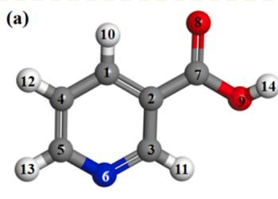

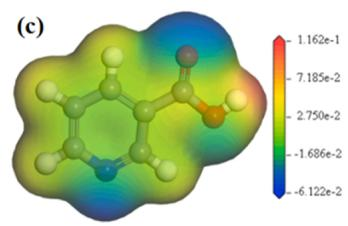

where N and μ are the number of electrons and chemical potential of the system, respectively, ρ(r)refers to electron density and v(r) means the fixed external potential (the attraction potential of atomic nuclei for electrons). Under finite-difference approximation, the condensed Fukui functions are as follows [47]:

$$
f _ {k} ^ {+} = q _ {k} (N + 1) - q _ {k} (N) \text {(nucleophilic attack)}\tag{12}
$$

$$
f _ {k} ^ {-} = q _ {k} (N) - q _ {k} (N - 1) \text {(electrophilic attack)}\tag{13}
$$

where $q _ { k } ( N ) , q _ { k } ( N + 1 )$ , and $q _ { k } ( N - 1 )$ denote the Mulliken charge of each atom in NA molecule at different states of charge with N electrons, $N + \mathit { 1 }$ electrons (an anion), and N-1 electrons (a cation), respectively.

As shown in Fig. 8(d), the highest $f _ { k } ^ { - }$ value in the Fukui function is for the N6 atom, which intimates that the coordination bonds could be established through electron transfer of N6 atom from NA molecule to the empty orbit of cobalt atoms on the surface. The O8 atom, owning the highest value of $f _ { k } ^ { + } ,$ , is where the nucleophilic attack is most likely to occur on NA molecule. Namely, the $\scriptstyle { \mathrm { C } } = 0$ is susceptible to accepting electrons from cobalt atoms to form bonds, which is also in accordance with the results of LUMO orbital distribution.

Moreover, some quantum chemical parameters of NA were deter mined. On account of Koopmans theorem, the ionization potential (I) and electron affinity (A) were calculated [48]. Then, other properties were estimated according to the first vertical ionization energy and electron density of the chemical substance, including the absolute electronegativity $( \chi ) ,$ , overall hardness $( \eta ) ,$ and overall electrophilic index (ω) [36]. Meanwhile, the electron transfer fraction (ΔN) between NA molecule and Co surface was derived. The calculation equations and results are shown in Table 3.

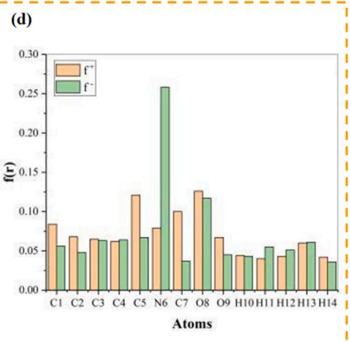  
Fig. 8. (a) Optimized structure of NA molecule, (b) HOMO, LUMO distributions and energy gap(ΔE), (c) Electrostatic Potential (ESP), (d) Condensed Fukui function.

Table 3  
Quantum chemical parameters of NA: equations and results.

<table><tr><td> $E_{HUMO}/V$ </td><td> $E_{LUMO}/V$ </td><td>I/eV</td><td>A/eV</td><td> $\chi_{NA}/eV$ </td><td> $\eta_{NA}/eV$ </td><td>ω/eV</td><td>ΔN/eV</td></tr><tr><td></td><td></td><td>-  $E_{HOMO}$ </td><td>-  $E_{LUMO}$ </td><td> $\frac{I+A}{2}$ </td><td> $\frac{I-A}{2}$ </td><td> $\omega = \frac{\chi^{2}}{2\eta}$ </td><td> $\Delta N = \frac{\Phi_{Co} - \chi_{NA}}{2(\eta_{Co} + \eta_{NA})}$ </td></tr><tr><td>-5.875</td><td>-3.761</td><td>5.875</td><td>3.761</td><td>4.818</td><td>1.057</td><td>10.981</td><td>0.00095</td></tr></table>

where the value of work function is $\Phi _ { C o } = 4 . 8 2 \mathrm { e V } , \chi _ { N A }$ and $\eta _ { N A }$ symbolize the absolute electronegativity and hardness of $\mathrm { N A } ,$ respectively. ηCo was considered as zero on the assumption that the cobalt surface is a bulk $\left( I = A \right) \left[ 3 6 \right]$ . Chemicals with ω greater than 1.5 eV can be classified as powerful electrophiles [49]. As $\omega = 1 0 . 9 8 1$ eV for NA, the NA molecule is a relatively stable electrophilic molecule with a strong inclination to accumulate electrons from electron-rich cobalt surface [50]. Electrons are transferred from inhibitor molecule to metal when $\Delta N > 0$ and vice versa if the value of ΔN is negative [51]. Obviously, the NA molecule holds the potential to transfer its own electrons to the Co surface. Although the value of ΔN $( \Delta N = 0 . 0 0 0 9 5 )$ is positive, it is very small and close to zero. Hence, the electron transfer effect between NA molecular and cobalt surface can be neglected. In conclusion, the physical adsorption process between NA molecules and Co surface is the molecular coalescence driven by electrostatic forces and Van der Waals forces.

## 3.6. MD simulation analysis

MD simulation can visualize the interaction status between the in hibitor molecule and metal surface [6]. Fig. 9(a) shows the most steady configuration of NA on the surface of Co(111), that the NA molecule is adsorbed at a certain angle on the Co surface. Adsorption energy, defined as the energy released by the corrosion inhibitor molecule adsorbed on the metal surface, is described as [46]:

$$
E _ {a d s} = E _ {\text { complex }} - \left(E _ {C o} + E _ {N A}\right)\tag{14}
$$

where $E _ { c o m p l e x }$ is the overall energy of the whole investigated system, containing Co(111) substrate with a NA molecule, $E _ { C o }$ symbolizes the energy of the cobalt substrate without inhibitor, and $E _ { N A }$ refers to the energy of the NA molecule. It is generally assumed that the adsorption process of corrosion inhibitor molecules on the metal surface turns to be more settled and solid with the accumulation of negative adsorption energy. The $E _ { a d s }$ value is − 24.382 kJ/mol, indicating that the NA molecules can be spontaneously and equably adsorbed on the Co surface.

The radial distribution function (RDF) is a common parameter to estimate the connection length, which can reflect the chemical bonds after the interaction between the inhibitor and metal surface [52]. Actually, RDF is the ratio of the local density around a particle to the bulk density of the system in a given coordinate. The local density near the target particle (small r value) is different from the bulk density of the system, but the local density should be the same as the bulk density when it is far away from the target particle, i.e. when the value of r is large, the value of RDF should be close to 1 [53]. RDF can be described as [36]:

$$
g _ {A B} (r) = \frac {1}{\rho 4 \pi r ^ {2}} \frac {\sum_ {i = 1} ^ {T} \sum_ {j = 1} ^ {N} \Delta N (r \rightarrow r + \delta r)}{N \times T}\tag{15}
$$

where N is the amount of particles, T means the calculation time, δr represents the set distance difference and ΔN refers to the amount of particles between r and r + δr. As shown in Fig. 9(b), the position of the peak is about 4.55 Å, implying that the NA molecule is comparatively 4.55 Å away from the surface cobalt atom of Co(111). In general, Coulomb force and van der Waals force play major roles in the interaction of the system when the position of RDF figure’s peak is higher than 3.5 Å, which corresponds to physical adsorption, whereas chemical interaction is related to the peak position less than 3.5 Å [53]. This consequence indicates the predominance of physisorption in the investigated system, which confirms the experimental results.

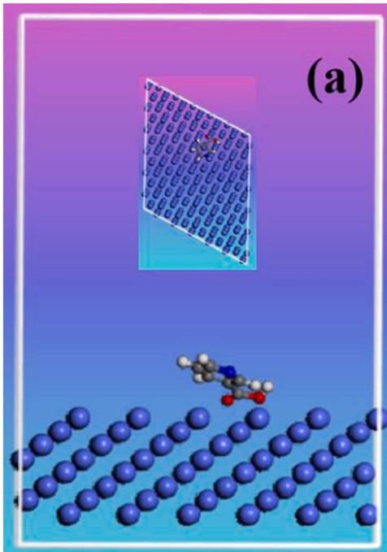

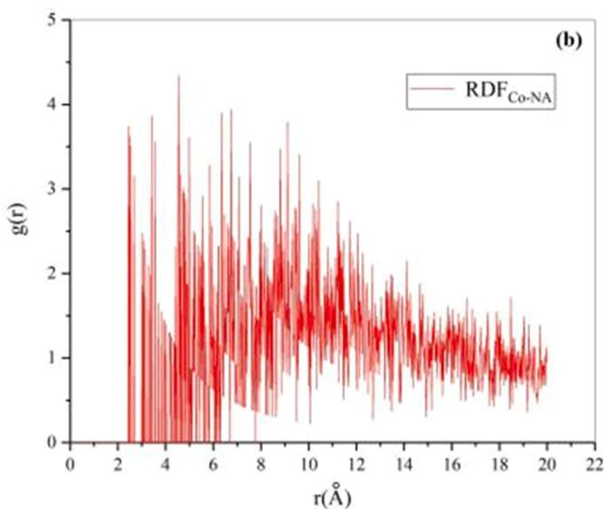  
Fig. 9. (a) Equilibrium configuration of NA on $\scriptstyle \mathrm { C o }$ (111) (Inset: top view); (b) $\mathrm { R D F _ { C o - N A } }$ image.

## 4. Conclusion

In this work, we focused on nicotinic acid as a potential corrosion inhibitor for cobalt CMP in alkaline medium, and the adsorption behavior of NA was systematically revealed by several characteristic techniques and molecular simulations. The results of contact angel and electrochemical test show that corrosion efficiency reached the maximum value of 86.65 % at the concentration of 80 mM. The adsorption of NA on cobalt surface follows the Langmuir adsorption isotherm, which is a spontaneous physical process. EIS further suggests that with the increase of NA concentration, the passivation film covered on cobalt surface became more complete, resulting in the increase of surface resistance. According to the results of XPS, NA molecules exist in the form of $\mathrm { N i c } ^ { 2 - }$ ions in alkaline environment, and physically assemble on $\mathrm { C o ( O H ) _ { 2 } }$ to form Co(II)-NA molecular groups to isolate the permeation of corrosive medium. DFT calculation and MD simulation indicate that NA molecule is adsorbed on the Co(111) surface at a certain angle through Coulomb force and van der Waals force, which are derived from the interaction of $\mathrm { N } { = } \mathrm { C }$ bond and carboxyl in NA molecule and surface cobalt atoms. The results of this work on passive film of NA on Co surface and its microscopic properties provide a theoretical basis for optimizing the composition of Co CMP slurry, and also provide support for subsequent researches of exploring synergistic effect of NA and other slurry components. In conclusion, NA is suggested to be an effective potential inhibitor for Co CMP in IC manufacturing process. Its physical adsorption on cobalt surface will help to improve the inhibitor removal effect in post CMP cleaning.

## Data Availability

The raw/processed data required to reproduce these findings cannot be shared at this time as the data also forms part of an ongoing study.

## CRediT authorship contribution statement

Boao Ma: Conceptualization, Methodology, Software, Investigation, Writing – original draft. Shihao Zhang: Visualization, Investigation, Writing – review & editing. Baimei Tan: Resources, Supervision, Writing – review & editing. Wei Li: Visualization, Investigation, Writing – review & editing. Yazhen Wang: Investigation, Supervision. Xiaoqin Sun: Software, Validation.

## Declaration of Competing Interest

The authors declare that they have no known competing financial interests or personal relationships that could have appeared to influence the work reported in this paper.

## Data Availability

No data was used for the research described in the article.

## Acknowledgments

This work was supported by the Major National Science and Technology Special Projects (No. 2016ZX02301003-004-007) and the Natural Science Foundation of Hebei Province, China (No.F2018202174 and No.2022202072). The authors thank the teachers and classmates for helpful discussions.

## References

[1] Daniel Josell, Sywert Brongersma, Zsolt Tokei, ˝ Size-dependent resistivity in nanoscale interconnects, Annu. Rev Mater, Res, 39 (2009) 231-254 httns://doi org/10.1146/annurev-matsci-082908-145415.

[2] Jialin Wen, Tianbao Ma, Weiwei Zhang, et al., Atomistic mechanisms of Si chemical mechanical polishing in aqueous H O : reaxFF reactive molecular

dynamics simulations, Comput. Mater. Sci. 131 (2017) 230–238, https://doi.org 10.1016/j.commatsci.2017.02.005.

[3] Jialin Wen, Tianbao Ma, Weiwei Zhang, et al., Atomic insight into tribochemical wear mechanism of silicon at the Si/SiO interface in aqueous environment: molecular dynamics simulations using ReaxFF reactive force field, Appl. Surf. Sci. 390 (2016) 216–223, https://doi.org/10.1016/j.apsusc.2016.08.082.

[4] Liang Jiang, Yongqing Lan, Yongyong He, et al., 1, 2, 4-triazole as a corrosion inhibitor in copper chemical mechanical polishing, Thin Solid Films 556 (2014) 395–404, https://doi.org/10.1016/j.tsf.2013.12.047.

[5] Wenquan Lu, Jian Zhang, Frank Kaufman, et al., A combined triboelectrochemical QCM for studies of the CMP of cupper, J. Electrochem. Soc. 152 (2005) B17–B22, https://doi.org/10.1149/1.1836124.

[6] Kawaguchi Kentaro, Ito Hiroshi, Kuwahara Takuya, et al., Atomistic mechanisms of chemical mechanical polishing of Cu surface in aqueous H O : Tight-binding quantum chemical molecular dynamics simulations, ACS Appl. Mater. Interfaces 8 (18) (2016) 11830–11841, https://doi.org/10.1021/acsami.5b11910.

[7] Shenghua Yang, Baoguo Zhang, Qiming Zhang, et al., A study of cobalt galvanic and pitting corrosion with combination of BTA and PMP, ECS J. Solid State Sci. Technol. 8 (2019) P416–P422, https://doi.org/10.1149/2.0141908jss.

[8] Badawy Wael, F.M. Al-Kharafi, J.R. Al-Ajmi, Electrochemical behaviour of cobalt in aqueous solutions of different pH, J. Appl. Electrochem. 30 (2000) 693–704, https://doi.org/10.1023/A:1003893122201.

[9] Liang Jiang, Yongqing Lan, Yongyong He, et al., 1, 2, 4-triazole as a corrosion inhibitor in copper chemical mechanical polishing, Thin Solid Films 556 (2014) 395–404, https://doi.org/10.1016/j.tsf.2013.12.047.

[10] Jiao Hong, Xinhuan Niu, Yuling Liu, et al., Effect of a novel chelating agent on defect removal during post-CMP cleaning, Appl. Surf. Sci. 378 (2016) 239–244, https://doi.org/10.1016//j.apsusc.2016.03.230.

[11] Lei Guo, Ime Bassey Obot, Xingwen Zheng, et al., Theoretical insight into an empirical rule about organic corrosion inhibitors containing nitrogen, oxygen, and sulfur atoms, Appl. Surf. Sci. 406 (2017) 301–306, https://doi.org/10.1016/j. apsusc.2017.02.134.

[12] Tengda Ma, Shihao Zhang, Yi Xu, et al., Unraveling the surface behavior of amino acids on Cu wiring in chemical mechanical polishing of barrier layers: a combination of experiments and ReaxFF MD, J. Mol. Liq. (2021) 341, https://doi. org/10.1016/j.molliq.2021.117307.

[13] Chenqi Yan, Yuling Liu, Jin Zhang, et al., Synergistic effect of glycine and BTA on step height reduction efficiency after copper CMP in weakly alkaline slurry, Ecs J. Solid State Sci. Technol. 6 (1) (2017), https://doi.org/10.1149/2.0291612jss, 0-0.

[14] I. Dugdale, J.B. Cotton, An electrochemical investigation on the prevention of staining of copper by benzotriazole, Corros. Sci. 3 (1963) (1963) 69–74, https:// doi.org/10.1016/S0010-938X(63)80001-3.

[15] J.B. Cotton, I.R. Scholes, Benzotriazole and related compounds as corrosion inhibitors for copper, Br. Corros. J. 2 (1) (1967) 1 5, https://doi.org/10.1179 000705967798327235

[16] Da Yin, Liu Yang, Baimei Tan, et al., Theoretical and electrochemical analysis on inhibition effect of benzotriazole and 1, 2, 4-triazole on cobalt surface, Colloids Surf. A-Physicochem. Eng. Asp. (2020) 591, https://doi.org/10.1016/j. colsurfa 2020.124516

[17] Peljhan Sebastijan, Koller Joˇze, Kokalj Anton. The effect of surface geometry of copper on adsorption of benzotriazole and Cl. Part I, J. Phys. Chem. C 118 (2014) 933–943, https://doi.org/10.1021/jp409717e.

[18] Shuangshuang Lei, Shengli Wang, Hongliang Li, et al., Effect of benzotriazole and 5-Methyl/1-H carboxyl benzotriazole on chemical mechanical polishing of cobalt in H O based slurry, ECS J. Solid State Sci. Technol. (2021) 10, https://doi.org/ 10.1149/2162-8777/ac0e0e.

[19] A. Fateh, M. Aliofkhazraei, A.R. Rezvanian, Review of corrosive environments for copper and its corrosion inhibitors, Arab. J. Chem. 13 (1) (2020) 481–544, https:/ doi.org/10.1016/j.arabjc.2017.05.021.

[20] Heon-Yul Ryu, Byoung-Jun Cho, Nagendra Prasad Yerriboina, et al., Selection and optimization of corrosion inhibitors for improved Cu CMP and post-Cu CMP cleaning, Ecs J. Solid State Sci. Technol. 8 (5) (2019), https://doi.org/10.1149 2.0101905jss, 0-0.

[21] Xiaoqin Sun, Tengda Ma, Da Yin, et al., Adsorption mechanism of potassium oleate on cobalt surface based on cobalt interconnection CMP: A combined experimental and DFT investigation, Ecs J. Solid State Sci. Technol. 10 (2) (2021), https://doi. org/10.1149/2162-8777/abe1d8.

[22] Guang Yang, Peng He, Xinping Qu, Inhibition effect of glycine on molybdenum corrosion during CMP in alkaline H O based abrasive free slurry, Appl. Surf. Sci. 427 (2018) 148 155, https://doi.org/10.1016/j.apsusc.2017.08.140.

[23] Mohamed S. Hasanin, A.Al. Kiey Sherief, Environmentally benign corrosion inhibitors based on cellulose niacin nano-composite for corrosion of copper in sodium chloride solutions, Int. J. Biol. Macromol. 161 (2020) 345 354, https:// doi.org/10.1016/j.ijbiomac.2020.06.040.

[24] Peng He, Guang Yang, Xinping Qu. Study on effect of different complexing agents and inhibitors on Co corrosion in H2O2 based alkaline solution by EQCM[C]. Icpt 2017; International Conference on Planarization/cmp Technology, 11: 1–5. https://doi.org/10.1016/j.mee.2020.111308.

[25] Xiaoguang Guo, Xiaoli Wang, Zhuji Jin, et al., Atomistic mechanisms of Cu CMP in aqueous H O : molecular dynamics simulations using ReaxFF reactive force field, Comput. Mater. Sci. 155 (2018) 476–482, https://doi.org/10.1016/j commatsci.2018.09.022

[26] Tengda Ma, Baimei Tan, Lei Guo, et al., Multidimensional insights into the corrosion inhibition of potassium oleate on Cu in alkaline medium: a combined experimental and theoretical investigation, Mater. Sci. Eng. B-Adv. Funct. Solid State Mater. (2021) 272, https://doi.org/10.1016/j.mseb.2021.115330

[27] Matjaz Finsgar, The influence of the amino group in 3-amino-1, 2, 4-triazole corrosion inhibitor on the interface properties for brass studied by ToF-SIMS, Rapid Commun. Mass Spectrom. 35 (7) (2021), https://doi.org/10.1002/rcm.9056.

[28] Hao Li, Yujie Qiang, Wenjie Zhao, et al., A green Brassica oleracea L extract as a novel corrosion inhibitor for Q235 steel in two typical acid media, Colloids Surf. A-Physicochem. Eng. Asp. (2021) 616, https://doi.org/10.1016/j. colsurfa.2020.126077.

[29] Wei Luo, Qingyun Lin, Xue Ran, et al., A new pyridazine derivative synthesized as an efficient corrosion inhibitor for copper in sulfuric acid medium: experimenta and theoretical calculation studies, J. Mol. Liq. (2021) 341, https://doi.org 10.1016/j.molliq.2021.117370.

[30] Da Yin, Liu Yang, Tengda Ma, et al., Synergistic effect of composite complex agent on BTA removal in post CMP cleaning of copper interconnection, Mater. Chem. Phys. 252 (2020), 123230, https://doi.org/10.1016/j.matchemphys.2020.123230.

[31] R. Popuri, H. Amanapu, C.K. Ranaweera, Potassium oleate as a dissolution and corrosion inhibitor during chemical mechanical planarization of chemical vapor deposited Co films for interconnect applications, Ecs J. Solid State Sci. Technol. 6 (12) (2017), https://doi.org/10.1149/2.0251712jss, 0-0.

[32] K.V. Sagi, L.G. Teugels, M.H. van der Veen, et al., Chemical mechanical polishing of chemical vapor deposited Co films with minimal corrosion in the Cu/Co/Mn/ SiCOH patterned structures, Ecs J. Solid State Sci. Technol. 6 (5) (2017), https:// doi.org/10.1149/2.0171705JSS, 0-0.

[33] Jiakai Zhou, Xinhuan Niu, Yaqi Cui, et al., Study on the film forming mechanism, corrosion inhibition effect and synergistic action of two different inhibitors on copper surface chemical mechanical polishing for GLSI, Appl. Surf. Sci. 505 (2020), 144507, https://doi.org/10.1016/j.apsusc.2019.144507.

[34] Mingjie Zhong, Shyam Venkataraman, Yongqing Lan, et al., Role of 1, 2, 4-triazole as a passivating agent for cobalt during post-chemical mechanical planarization cleaning, J. Electrochem. Soc. 161 (3) (2014), https://doi.org/10.1149/ 2.093403jes, 0-0.

[35] Rajeev Kumar, Savita Chahal, Sumit Kumar, et al., Corrosion inhibition performance of chromone-3-acrylic acid derivatives for low alloy steel with theoretical modeling and experimental aspects, J. Mol. Liq. 243 (2017) 439–450, https://doi.org/10.1016/j.molliq.2017.08.048.

[36] Lei Guo, Jianhong Tan, Savas¸. Kaya, et al., Multidimensional insights into the corrosion inhibition of 3, 3-dithiodipropionic acid on Q235 steel in H SO medium: a combined experimental and in silico investigation, J. Colloid Interface Sci. 570 (2020) 116–124, https://doi.org/10.1016/j.jcis.2020.03.001.

[37] Jiakai Zhou, Xinhuan Niu, Zhi Wang, et al., Study on effective methods and mechanism of inhibiting cobalt removal rate in chemical mechanical polishing of GLSI low-tech node copper lilm, Ecs J. Solid State Sci. Technol. 8 (11) (2019), https://doi.org/10.1149/2.0271910jss, 0-0.

[38] Fengxia Liu, Shengli Wang, Chenwei Wang, et al., Effect of diethylenetriamine pentaacetate pentapotassium on chemical mechanical polishing of cobalt in H O based slurry, Ecs J. Solid State Sci. Technol. 8 (5) (2019), https://doi.org/10.1149 2.0291905jss, 0-0.

[39] Xinbo Zhang, Guofeng Pan, Lianjun Hu, et al., Effects of nitrilotriacetic acid and corrosion inhibitor on cobalt barrier chemical–mechanical polishing: experimental and density functional theory analysis, Colloids Surf. A: Physicochem. Eng. Asp. 605 (2020), 125392, https://doi.org/10.1016/j.colsurfa.2020.125392.

[40] Mark C. Biesinger, Brad P. Payne, Andrew P. Grosvenor, et al., Resolving surface chemical states in XPS analysis of first row transition metals, oxides and hydroxides: Cr, Mn, Fe, Co and Ni, Appl. Surf. Sci. 257 (7) (2011) 2717–2730, https://doi.org/10.1016/j.apsusc.2010.10.051.

[41] Bing Wu, Srini Raghavan, Removal of BTA adsorbed on Cu: a feasibility study using the quartz crystal microbalance with dissipation (QCMD) Technique, Ecs J. Solid State Sci. Technol. 8 (5) (2019), https://doi.org/10.1149/2.0191905JJSS, 0-0.

[42] Siewteng Sim, Yoshito Andou, A.A. Bashid Hamra, et al., Development of organo dispersible graphene oxide via pseudo-surface modification for thermally conductive green polymer composites, Acs Omega 3 (12) (2018) 18124–18131, https://doi.org/10.1021/acsomega.8b02478.

[43] Pengcheng Li, Xiaoan Li, Shujuan Dai, Adsorption of gold cyanide on quartz, Colloids Surf. A-Physicochem. Eng. Asp. (2020) 590, https://doi.org/10.1016/j colsurfa.2020.124514.

[44] Chao Yu, Shutian Wu, Zhijuan Huang, et al., Water/ethanol complexation induced solubility variation of hexaquocobalt(II) bis (p-toluenesulfonate) and hexaquonickel(II) bis (p-toluenesulfonate, J. Mol. Liq. 224 (2016) 139–145 https://doi.org/10.1016/j.molliq.2016.09.094.

[45] Xiaoxing Zhang, Yingang Gui, Hanyan Xiao, et al., Analysis of adsorption properties of typical partial discharge gases on Ni-SWCNTs using density functional theory, Appl. Surf. Sci. 379 (2016) 47–54, https://doi.org/10.1016/j. apsusc.2016.04.048.

[46] Zaki S. Lei Guo, Savas Safi, Kaya, et al., Anticorrosive effects of some thiophene derivatives against the corrosion of iron: a computational study, Front. Chem. (2018) 6, https://doi.org/10.3389/fchem.2018.00155.

[47] Lei Guo, Savas Kaya, Ime Bassey Obot, et al., Toward understanding the anticorrosive mechanism of some thiourea derivatives for carbon steel corrosion: a combined DFT and molecular dynamics investigation, J. Colloid Interface Sci. 506 (2017) 478–485, https://doi.org/10.1016/j.jcis.2017.07.082.

[48] Robert C. Morrison, The extended Koopmans’ theorem and its exactness, J. Phys. Chem. 96 (5) (1992) 3718–3722, https://doi.org/10.1063/1.461875.

[49] R. Luis, Domingo Patricia P´erez, Global and local reactivity indices for electrophilic/nucleophilic free radicals, Org. Biomol. Chem. 11 (26) (2013) 4350 4358, https://doi.org/10.1039/c3ob40337h.

[50] Song Liu, Xiaotian Qi, Ruopeng Bai, et al., Theoretical study of Ni-catalyzed C–N radical–radical cross-coupling, J. Org. Chem. 84 (6) (2019) 3321–3327, https:// doi.org/10.1021/acs.joc.8b03245.

[51] A. Stoyanova, G. Petkova, S.D. Peyerimhoff, Correlation between the molecular structure and the corrosion inhibiting effect of some pyrophthalone compounds, Chem. Phys. 279 (1) (2002) 1–6, https://doi.org/10.1016/S0301-0104(02)00408- 1.

[52] Lei Guo Yujie Qiang, Hao Li, et al., Fabrication of environmentally friendly Losartan potassium film for corrosion inhibition of mild steel in HCl medium, Chem. Eng. J. 406 (2021), 126863, https://doi.org/10.1016/j.cej.2020.126863

[53] Hassane Lgaz, Sourav Kr Saha, Abdelkarim Chaouiki, et al., Exploring the potential role of pyrazoline derivatives in corrosion inhibition of mild steel in hydrochloric acid solution: Insights from experimental and computational studies, Constr. Build. Mater. 233 (2020), 117320, https://doi.org/10.1016/j.conbuildmat.2019.117320.