ARTICLE

# Effect of Saccharin on Crystallization Behavior of Electroless Cobalt Plating

Yu-Xin Luo#, Jing-Jing Wang#, Lu Wang, Zi-Yi Yan, Yi Ma, Xin Bo\*, Jing-Shuang Dang\*, Zeng-Lin Wang\*

Key Laboratory of Applied Surface and Colloid Chemistry, Ministry of Education; Institute of New Concept Sensors and Molecular Materials; School of Chemistry and Chemical Engineering; Shaanxi Normal University; Xi’an, Shaanxi, China, 710119

## Abstract

In the process of electroless cobalt plating, the saccharin additive can significantly change the surface morphology, texture orientation, and conductivity of the cobalt coating layer. When the amount of saccharin was 3 mg·L–1, the cobalt coating transformed from disordered large grains to a honeycomb structure, with a preferred orientation of (002) facet on hexagonal close-packed (HCP) cobalt crystals. The resistivity of the cobalt film decreased to 14.4 μΩ·cm, and further decreased to 10.7 μΩ·cm after the annealing treatment. When the concentration of saccharin was increased, the grain size was gradually refined and a “stone forest” structure was observed, with the preferred orientation remaining unchanged. The addition of saccharin also slightly improves the purity of cobalt coating to a certain extent. Through the study of the crystallization behavior of cobalt electroless plating, saccharin molecules can adsorb to specific c-sites on the cobalt dense crystal plane, inhibiting the growth of abc stacking arrangement and inducing the crystal growth in ab stacking mode, thereby achieving optimal growth of HCP (002) texture.

Keywords: Electroless cobalt plating; Additives; Saccharin; Crystallization behavior

## 1. Introduction

With the continuous development of chips towards high integration, the chip interconnect size is constantly decreasing and copper interconnect technology faces huge challenges. When the interconnect size is reduced to below 7 nm, copper wire conducts exponential growth in resistivity due to its grain boundary scattering [1, 2], leading to chip overheating and increased power consumption, which in turn affects the computing speed and overall device performance [3]. On the other hand, copper interconnects require a barrier layer of approximately 2 nm tantalum nitride (TaN) to prevent copper metal from diffusing into the silicon dielectric layer, thus further increasing the interconnect resistance [4]. Metal cobalt has the advantages of short electron mean free path, resistance to electromigration and good compatibility with semiconductor manufacturing, which has been considered as a new type of interconnect material to replace copper [5–7]. Currently, the pioneer manufacturers such as Intel and TSMC are also proposing to adopt cobalt as a new interconnect metal for advanced chip manufacturing [8]. At present, the cobalt interconnects in silicon chip are realized through electroplating cobalt super-filling. Although there have been reports on the research of electroplated cobalt super-filling in chip microholes [9–11], compared with electrodeposited copper, electrodeposited cobalt is prone to forming holes and cracks due to such issues as hydrogen evolution, homogenization and poor coating quality [12]. Electroless plating is one of the most practical routs to realize cobalt plating in industrial-scale since it presents a good coverage ability, facile processing and low cost. Particularly, additives play a crucial role in electroless plating [13–16]. The appropriate additives not only can improve the quality of the chemical coating, but also enhance its properties such as density, corrosion resistance, wear resistance, and conductivity.

Saccharin (SAC) is a common organic, non-toxic small molecule that can be used as an additive in the electroplating process to improve the quality of coatings, reduce internal stress, refine grains, enhance the glossiness and reflectivity of coatings [17–19]. Altamirano-Garcia et al. [20] studied the effects of sulfates, chlorides, and saccharin on the electrodeposition of cobalt nickel alloys, and found that the addition of saccharin significantly improved the deposition current efficiency and suppressed hydrogen production, thereby improving the density of the alloy coating. Hoghoghifard et al. successfully improved the microwave absorption performance of nickel coated fabrics by adding saccharin to the plating solution [21]. They found that adding saccharin can reduce surface resistivity, refine grain size, enhance hysteresis loss, and ultimately improve the microwave shielding effect of the fabric. Kolonits et al. found that adding saccharin can significantly refine grain size, increase lattice defect density, and thus improve the hardness of nickel films [22]. Currently, researchers explored the additive mechanism through molecular dynamics simulations and calculations of quantum chemistry, which can effectively resolve molecular-metal interactions [23, 24]. Nevertheless, the researches on quantum chemical calculation of the electroless cobalt plating under the influence of additives are insufficient. Therefore, it is of great significance to establish a method based on quantum chemical calculation to study the effect of additives on cobalt plating.

Upon electroless cobalt plating, we observed that the addition of saccharin would change the morphology of cobalt plating. Then we systematically studied the effects of saccharin additive on the microstructure, crystallization behavior, and conductivity of cobalt plating. It was found that adding an appropriate amount of saccharin can effectively adsorb specific crystal planes of cobalt crystals, thereby directionally regulating their growth behavior and obtaining cobalt coatings with (002) texture preferred orientation, which promotes the conductivity of cobalt coatings. At the same time, density functional theory (DFT) simulations provided insights into the crystallization behavior of cobalt coatings, revealing that saccharin molecules can adsorb to specific sites on the cobalt dense crystal plane, blocking abc packing and inducing crystal growth in ab stacking mode to form hexagonal close-packed structure (002) texture.

## 2. Experimental Sections

## 2.1. Electroless cobalt plating

The substrate was a 25 mm × 40 mm acrylonitrile butadiene styrene copolymer (ABS), and its pretreatment process has been given in Table 1. The treatment solutions (OPC serial reagents) used for pre-soaking, activation, and sensitization were provided by Hangzhou Aoye Technology Co., Ltd. The electroless cobalt plating solution contained 0.08 mol·L–1 hexahydrate cobalt chloride (99%, Sinopharm Chemical Reagent, CAS: 7791-13-1), 0.1 mol·L–1 trisodium citrate (99%, Sinopharm Chemical Reagent, CAS: 68-04-2), 4 ml·L–1 triethanolamine (99%, Sinopharm Chemical Reagent, CAS: 102-71-6), and 0.64 mol·L–1 hydrazine hydrate (85%, Sinopharm Chemical Reagent, CAS: 10217-52- 4). The addition of saccharin (SAC, 98%, Aladdin, CAS: 81-07-2) additive dosage rangeed from 0 to 1000 mg·L–1. The plating period lasted from 0.5 to 2 h, and the plating temperature was 65 °C. The pH was adjusted to 12.70 using a pH meter (PB-21, Sartorius) with 6 mol·L–1 NaOH (96%, Sinopharm Chemical Reagent, CAS: 1310-73-2). The obtained cobalt coating samples were also annealed in the tube furnace (OTF-1200X, KJMTI) at 300 °C for 60 min under argon atmosphere.

## 2.2. Characterizations

The rates of electroless cobalt deposition were determined by measuring the mass difference on the substrate after electroless plating. The linear sweep voltammetry (LSV) was used to investigate the effects of saccharin concentration on the oxidation behavior of $\mathrm { N } _ { 2 } \mathrm { H } _ { 4 }$ and reduction behavior of $\mathrm { C o } ^ { 2 + }$ ion. The electrochemical measurement was carried out at the scan rate of $2 \mathrm { m V } { \cdot } \mathrm { s } ^ { - 1 }$ in a standard three-electrode system, consisting of a cobalt electrode (5.0 mm in diameter), nickel foam and a saturated calomel electrode (SCE, $\mathrm { H g } | \mathrm { H g } _ { 2 } \mathrm { C l } _ { 2 } )$ as the working, the counter and the reference electrodes, respectively. The anodic polarization curves were measured in the electroless cobalt bath without cobalt ion $( \mathbf { C o } ^ { 0 }$ on the working electrode), and the cathodic polarization curves were measured in the same composition bath without $\mathrm { N } _ { 2 } \mathrm { H } _ { 4 } .$ The surface morphology of the electroless cobalt plating layer was characterized using a field emission scanning electron microscope (SEM, SU8220). The crystallization behavior of cobalt film was characterized using a fully automated X-ray diffractometer (XRD, Bruker D8 Advance). The X-ray source was selected as $\mathrm { C u } / \mathrm { K } _ { \alpha ^ { \prime } }$ with an incident angle range of $4 0 ^ { \circ } \sim 5 0 ^ { \circ }$ and a scanning rate of $0 . 5 \mathrm { ^ { \circ } { \cdot } \mathrm { m i n ^ { - 1 } } }$ . The conductivity of cobalt film was tested using a multifunctional digital four-probe analyzer (ST2258C).

Table 1. The pre-treatment for ABS substrate.

<table><tr><td>Step</td><td>Content</td><td>Condition</td></tr><tr><td>Degreasing</td><td> $NaOH\ 80\ g\cdot L^{-1},\ NaCO_{3}\ 15\ g\cdot L^{-1},\ Na_{3}PO_{4}\ 30\ g\cdot L^{-1}$ </td><td>80 °C, 15 min</td></tr><tr><td>Swelling</td><td> $NMP\ 100\ ml\cdot L^{-1},\ NaOH,\ 90\ g\cdot L^{-1},\ DGBE\ 20\ ml\cdot L^{-1}$ </td><td>60 °C, 10 min</td></tr><tr><td>Micro-etching</td><td> $H_{2}SO_{4}\ 12.3\ mol\cdot L^{-1},\ MnO_{2},\ 30\ g\cdot L^{-1}$ </td><td>70 °C, 20 min</td></tr><tr><td>Neutralization</td><td>98%  $H_{2}SO_{4}\ 100\ ml\cdot L^{-1},\ OA\ 28.2\ g\cdot L^{-1}$ </td><td>60 °C, 10 min</td></tr><tr><td>Presoak</td><td> $OPC-SALT\ 250\ g\cdot L^{-1}$ </td><td>Room Temp., 2 min</td></tr><tr><td>Activation</td><td>35%  $HCl\ 30\ ml\cdot L^{-1},\ OPC-SALT\ 170\ g\cdot L^{-1},\ OPC-80\ 50\ ml\cdot L^{-1}$ </td><td>Room Temp., 6 min</td></tr><tr><td>Sensitization</td><td>5%  $HCl\ 100\ ml\cdot L^{-1}$ </td><td>Room Temp., 10 min</td></tr></table>

## 2.3. DFT calculation

To investigate the interaction mechanism between the saccharin molecule and the cobalt surface, we constructed a slab model of saccharin adsorbed on the Co (002) surface $( 6 \times 6 \times 2 )$ . Structural optimizations and electronic structure analyses are performed using the Vienna Ab initio Simulation Package (VASP 5.4.4) [25]. The projector augmented wave (PAW) pseudopotential is employed to describe electron-ion interactions [26, 27], while the exchange-correlation effects are treated with the Perdew-Burke-Ernzerhof (PBE) functional [28]. A plane-wave cutoff energy of 500 eV is utilized, with convergence criteria set to 1 × $1 0 ^ { - 5 } \mathrm { e V }$ for energy and $0 . 0 2 \mathrm { e V } { \cdot } \stackrel { \triangledown } { \hat { \mathbf { A } } ^ { - 1 } }$ for forces. Brillouin zone sampling is conducted using a $2 \times 2 \times 1$ Gamma k-point mesh [29]. For the saccharin molecule, geometry optimization and orbital analyses are further carried out using the Gaussian 16 package [30], employing the PBE1PBE hybrid functional combined with the $^ { 6 - 3 1 1 \mathrm { C } ^ { * * } }$ basis set.

## 3. Results and Discussion

## 3.1. Effect of saccharin on morphologic transformation

Fig. 1(a–d) shows the morphologies of cobalt coating after 1 hour of electroless cobalt plating with different amounts of saccharin. When saccharin was absent (Fig. 1a), the surface grains of the cobalt plating layer grew randomly, exhibiting disordered crystal orientation and larger particle size. When 3 mg·L–1 saccharin was added (Fig. 1b), the grains of the cobalt film exhibited typical hexagonal texture characteristics, and the surface became smoother. As the addition amount was higher than 200 mg·L–1 (Fig. 1c), the morphology of the cobalt film was transformed from a hexagonal texture to a “Stone Forest” morphology. When the addition amount was further increased to 1 $\mathrm { g } { \cdot } \mathrm { L } ^ { - 1 } \left( \mathrm { F i g } . \ 1 \mathrm { d } \right)$ , the cobalt film maintained a “Stone Forest” morphology, but the grain size of the cobalt film was further decreased. Combining XRD patterns (Fig. 1e), it can be seen that the diffraction peak of the deposited Co film was located between (002) the hexagonal close-packed structure (HCP) Co phase and (111) the face centered cubic (FCC) Co phase when saccharin was not added. After adding 3 mg·L–1 saccharin, the diffraction peak of the cobalt film shifted to higher angle and closed to the (002) plane of HCP $\scriptstyle \ C 0 ,$ with a reduced half-peak-width. When the concentration of saccharin increased to 200 mg·L–1, the peak position maintained the position with a broader half-peak-width, implying a smaller crystalline. This indicates that the addition of a certain concentration of saccharin promotes the preferential growth of cobalt film along the HCP (002) crystal plane.

Fig. 2(a–d) shows the surface morphologies of the cobalt plating layer at different electroless plating time with the addition of 3 mg·L–1 saccharin. When the electroless cobalt plating time was 30 min, the uniform dispersion of nucleus was obtained (Fig. 2a). When the electroless cobalt plating time was 60 min, the surface grains of the cobalt film began to grow alone an in-plane direction. The surface became flat and presented a hexagonal crystal morphology (Fig. 2b). As the electroless cobalt plating prolonged to 90 min, the Co particles continued growing in the planar direction until the cross-linkage with each other. Thus, the second Co crystalline had to be redeposited along the direction perpendicular to the plane, presenting a “pagoda” microstructure similar to that observed in Fig. 2b. When the cobalt plating time was 120 min, more nucleation appeared on the surface of the original hexagonal crystal phase (Fig. 3d), which is also consistent with the XRD data (Fig. 2e). At the early stage of electroless plating (prior to 30 min), the diffraction peak of the Co nuclei was located between the (002) HCP Co phase and (111) FCC Co phase. At this point, the crystal nucleus exhibited both HCP and FCC characteristics. When the electroless plating time reached 60 min, the diffraction peak of the cobalt plating film shifted to 44.680 °, closer to the (002) HCP $\scriptstyle \ C 0 ,$ and the half-peak-width decreased (higher crystallinity). When the electroless plating time became 120 min, the diffraction peak position maintained at $4 4 . 6 7 9 \ ^ { \circ } ,$ and the cobalt film underwent secondary nucleation. As comparison, the Co film was obtained with the (002) HCP orientation when the concentration of saccharin was 3 mg·L–1 and the plating time was 60 min.

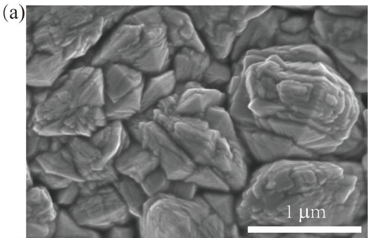

(b)  
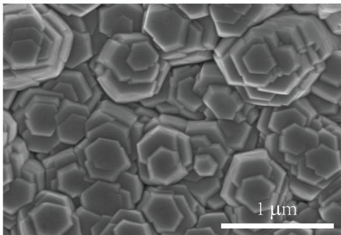

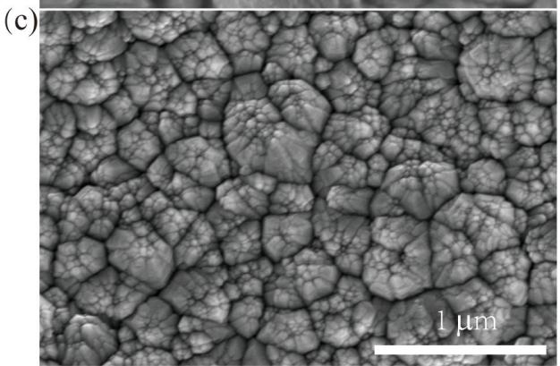

(d)  
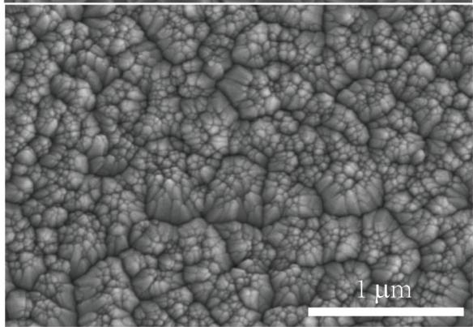

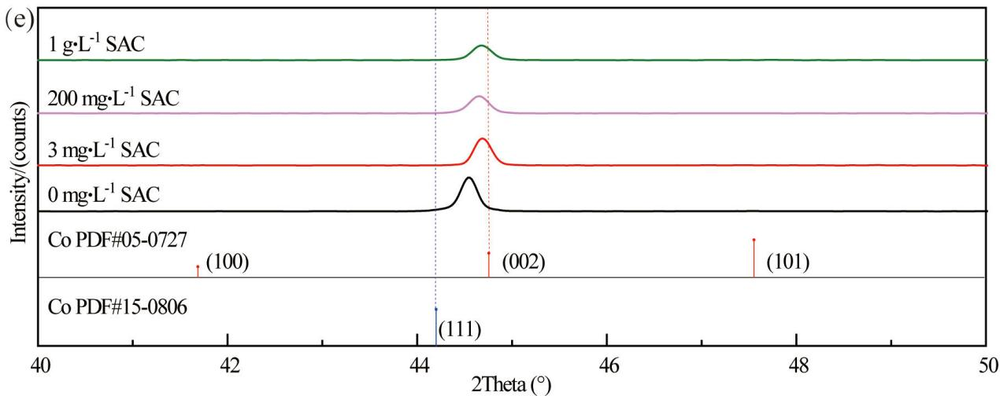  
Fig. 1. Morphologies of the cobalt films with various saccharin concentrations in electroless cobalt solution, (a) 0 mg·L–1, (b) 3 mg·L–1, (c) 200 mg·L–1, (d) $1 \ g { \cdot } L ^ { - 1 }$ and (e) the XRD patterns; electroless plating time: 60 min.

## 3.2. Effects of saccharin on electrical resistance and purity

Fig. 3a shows the electrical resistivity of cobalt plating after 60 minutes of electroless plating with different amounts of saccharin added. When the amount of saccharin added increased from 0 to 3 mg·L–1, the resistivity of the cobalt film decreased from 29.5 μΩ·cm to 14.4 μΩ·cm. This is because after the cobalt coating grains were transformed from disordered to hexagonal phase, and their honeycomb shaped grains came into closer contact, which is conducive to the orientation and long-range transmission of electrons. However, as more amount of saccharin was further added, the electrical resistivity increased. This is due to that

(a)  
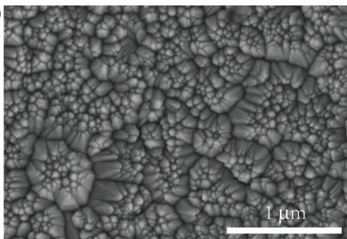

(b)  
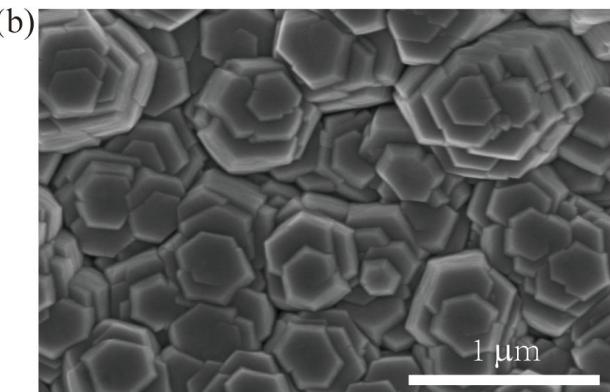

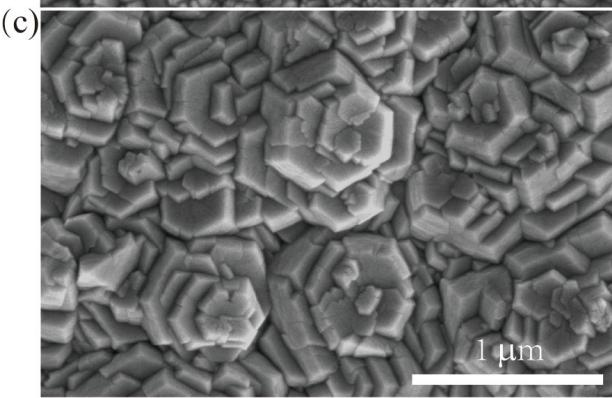

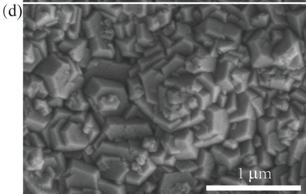

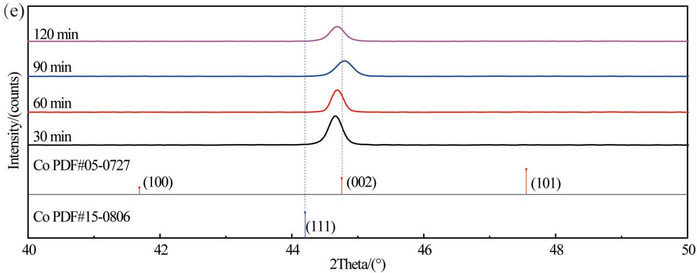  
Fig. 2. Morphologies of the cobalt films with different electroless plating time of (a) 30 min, (b) 60 min, (c) 90 min, and (d) 120 min, and (e) the XRD patterns; the addition of saccharin: 3 mg·L–1.

the high concentration of saccharin could reduce the grain size of cobalt, leading to an increase in grain boundaries and obstruction of electron transport, thereby increasing the resistivity of the cobalt film. After annealing at $3 0 0 ^ { \circ } \mathrm { C }$ on the obtained cobalt film, the resistivity of the cobalt film further decreased to 10.7 μΩ·cm (Fig. 3b). Based on the XRD patterns of cobalt films after annealing (Fig. 3c), it can be seen that the intensity of diffraction peaks increased after the heat treatment at $3 0 0 ^ { \circ } \mathrm { C }$ , indicating that the heat treatment improved the crystallinity of the electroless cobalt coating.

When the saccharin was not added, the purity of Co in the cobalt film was as high as 99.10%. The Co content in the coating increased slightly to 99.52% when the concentration of saccharin was 3 mg·L–1. However, as more amount of saccharin was further added, the purity of cobalt decreased. The purity of all the samples was higher than that without saccharin (Fig. 3d), which indicates that a certain concentration of saccharin has a slight increase in the Co purity of the coating and does not disturb the purity of cobalt film.

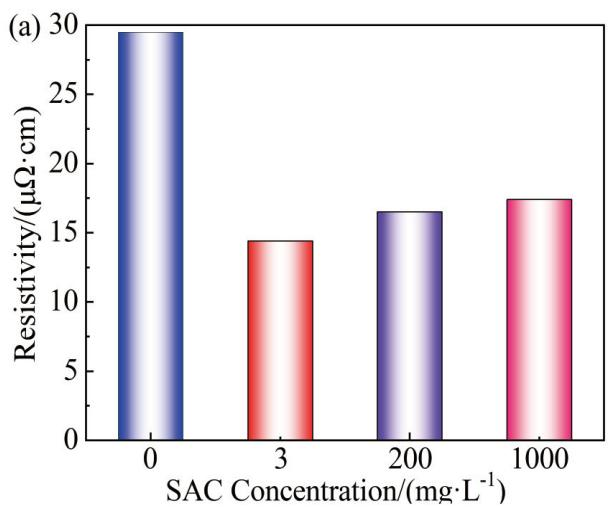

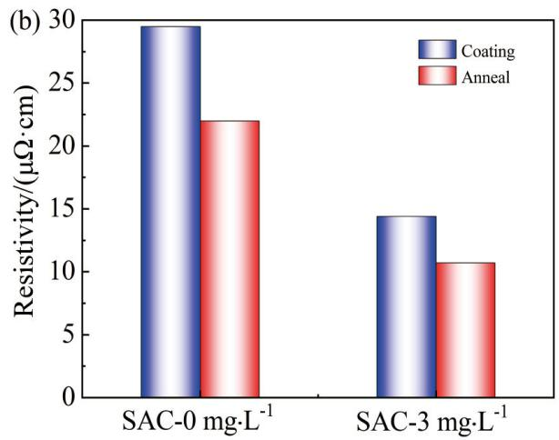

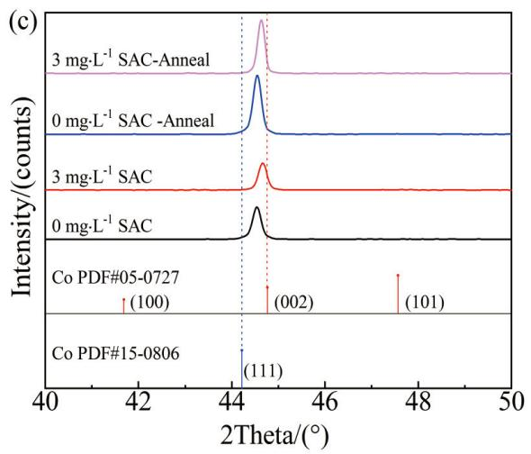

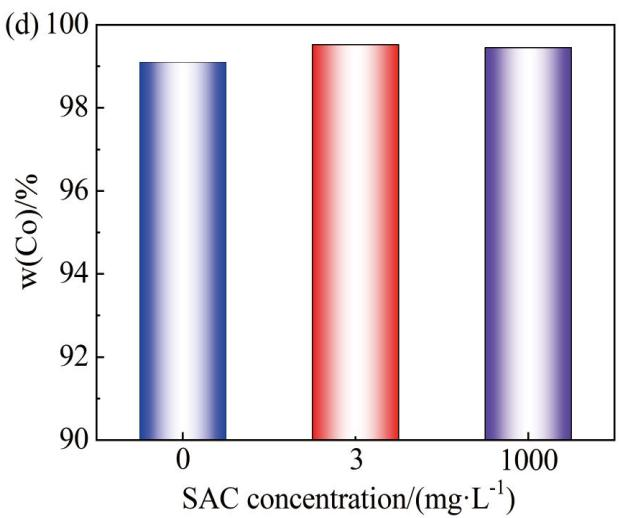  
Fig. 3. (a) The resistivity plots of the cobalt films with various concentrations of saccharin; comparisons of resistivity (b) and XRD patterns (c) of th cobalt films after annealing; (d) the purity plots of cobalt film; the electroless plating time: 60 min.

## 3.3. Effects of saccharin on the deposition rate and polarization behavior of the electroless cobalt bath

The deposition rate of electroless cobalt plating decreased from 5.05 µm·h–1 to 4.31 µm·h–1 when saccharin addition increased from 0 to 3 mg·L–1. When the addition amount was further increased to $1 \mathrm { g } { \cdot } \mathrm { L } ^ { - 1 } ,$ , the deposition rate of cobalt was 2.58 µm·h–1. This indicates that the addition of saccharin might slow down the deposition of electroless cobalt plating. The effect of saccharin on electrochemical kinetics in electroless cobalt plating solution was further studied and the results are given in Fig. 4a. The oxidation peak potential of hydrazine started from –0.68 V toward the positive direction with increasing saccharin concentration from 3 mg·L–1 to 1g·L–1, the oxidation current was correspondingly reduced. While the reduction peak potential of the $\mathrm { C o } ^ { 2 + }$ citrate complex shifted negatively and the reduction peak current decreased with the increase of saccharin concentration, and the reduction peak appeared around –0.95 V (Fig. 4b). Not only the anodic oxidation reaction but also the cathodic reduction reaction was inhibited by an addition of saccharin. Particularly, the oxidation current value (Fig. 4a) was much higher than the absolute value of the reduction current at –0.95 V (Fig. 4b) so that the electroless cobalt deposition should be controlled by the reduction reaction of $\mathrm { C o } ^ { 2 + }$ according to mixed potential theory.

## 3.4. Simulation and analysis of the crystallization behavior

According to Fig. 2e, within 30 minutes of electroless cobalt plating, the characteristic peak of the cobalt coating nuclei layer at $4 4 . 6 6 0 \ ^ { \circ }$ is located between the identical peak position of the (111) facet of FCC Co (PDF#15-0806) and the (002) facet of HCP Co (PDF#05-0727), indicating that the crystal nuclei of cobalt are the mixtures of two cobalt species. It is worth noting that the (111) facet of FCC Co and (002)

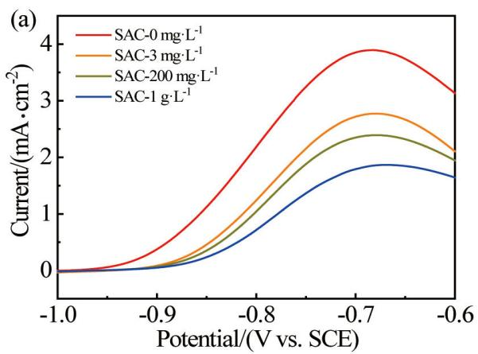

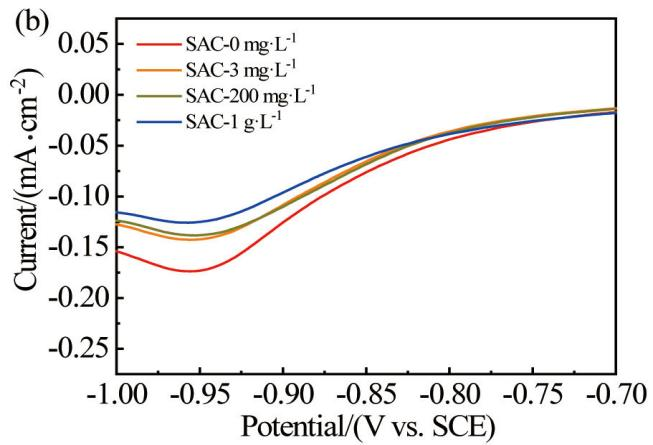  
Fig. 4. (a) Oxidative behavior in hydrazine aqueous solution with the addition of various saccharin concentrations; (b) Co2+ complex reductive behavio in the electroless bath with the addition of various saccharin concentrations.

facet of HCP Co have the same crystal plane orientation, which are two close-packed behavior of abc and ab package, respectively. The (111) crystal plane of FCC and the (002) crystal plane of HCP have an equivalent relationship and both have a hexagonal arrangement (Fig. 5a). The arrangement of FCC Co extension (111) direction is abc dense packing, and that of (002) HCP Co is ab dense packing (Fig. 5b). As the crystal nucleus gradually grows up, the additive saccharin molecules can adsorb onto the c-site on the crystal surface of the nucleus (× mark in Fig. 5c), hindering the arrangement of cobalt atoms at the c-site and resulting in the formation of hexagonal cobalt texture (rather ab packing than abc packing).

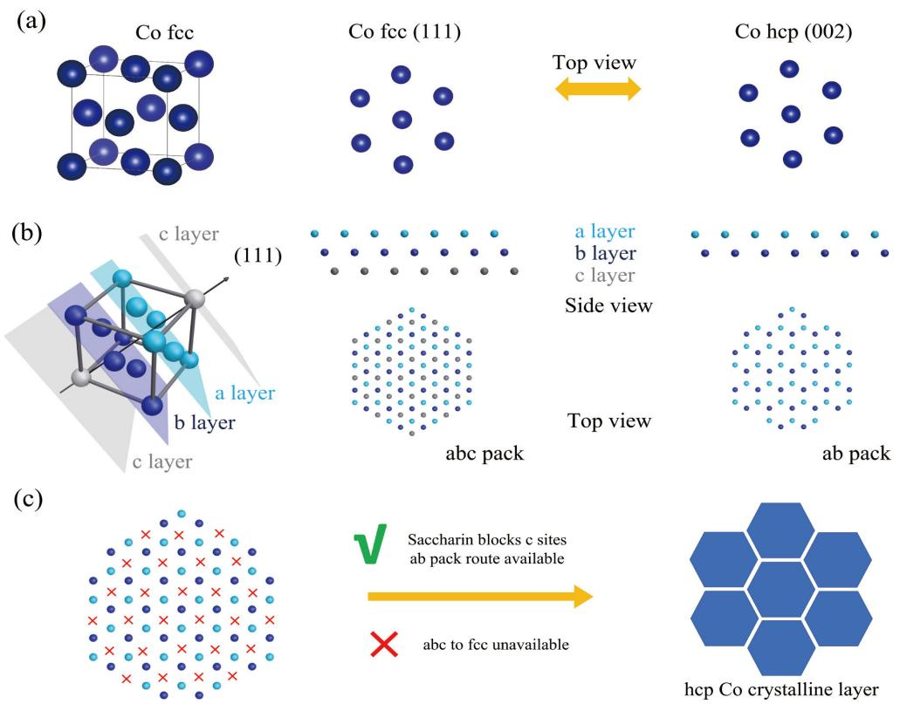  
Fig. 5. (a) Scheme for (111) facet of FCC Co and (002) facet of HCP Co; (b) scheme showing abc pack of FCC Co metal and ab pack of HCP Co metal; (c) schematic drawing of c sites occupied with saccharin molecules leading ab pack crystallization.

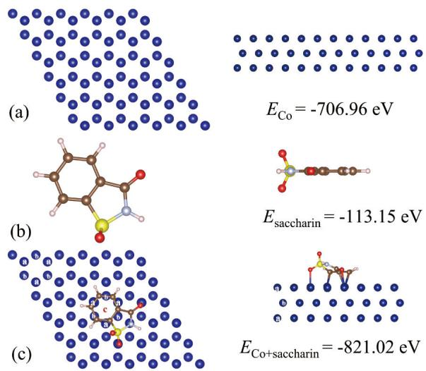  
Fig. 6. (a) Model of HCP cobalt for the (002) crystal surface; (b) molecular structure model of saccharin; (c) complex model of saccharin and cobalt crystal surface.

At the same time, we also conducted density functional calculations on the adsorption of saccharin molecules on the surface of cobalt metal, as shown in Fig. 6. The adsorption energy can be calculated by the following formula: $\Delta E = \overleftarrow { E } _ { _ \mathrm { C o - S A C } } - E _ { _ \mathrm { C o } } - E _ { _ \mathrm { S A C } }$ [31, 32]. The energies of cobalt base $( E _ { \mathrm { c o } } )$ and saccharin molecules $( E _ { \mathrm { s A C } } ^ { = } )$ are –706.96 eV and –113.15 eV, respectively. The energy of the adsorption state $( E _ { _ { \mathrm { C o - S A C } } } )$

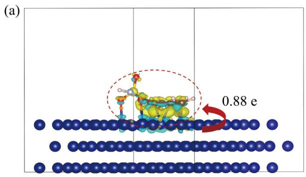

is –821.02 eV. According to the formula above, the adsorption energy ΔE can be calculated to be –0.91 eV, indicating that saccharin molecules can stably adsorb on the Co surface and the benzene ring structure can stably adsorb on the c-site of the crystal plane (Fig. 6c).

To further investigate the interaction between saccharin and the Co surface, we calculated the differential charge density map [33]. It can be observed from Fig. 7a that the charge density near the Co surface is decreased (the cyan region) and the charge density near the aromatic ring structure of saccharin is increased (the yellow region), illustrating that electrons transfer from the Co surface to the saccharin molecule. Bader charge analysis reveals a total charge transfer of 0.88 e. Moreover, the Frontier molecular orbital theory is widely used to analyze and predict the adsorption behavior of molecules [34, 35]. The frontier orbital diagram (Fig. 7b) shows that the LUMO of saccharin, acting as an electron acceptor, is predominantly localized on the unoccupied π orbitals of the phenyl ring and the oxygen atoms. Consequently, the interfacial charge transfer can be attributed to the d → π\* back donation interaction between the Co surface and the saccharin molecule.

Due to the presences of both sulfonic acid groups (–SO H) and aldehyde groups in saccharin, the electron cloud density at certain positions of the benzene ring is relatively reduced. Therefore, the benzene ring on saccharin molecules often exhibits electrophilicity, which meets the calculation result of the differential charge density mentioned above. In the process of electroless cobalt plating, cobalt ions need to be reduced at sites with electron donating properties. Therefore, the adsorption of saccharin molecules on the cobalt surface hinders the continuous growth of cobalt at the c-site during the stacking process (Fig. 5c and Fig. 6c), leading to the formation of ab stacking and HCP cobalt texture. According to Burton-Cabrera-Frank (BCF) theory, [36] surface adsorbed molecules inhibit atomic diffusion and step flow, thereby inhibiting lateral grain growth. When excessive saccharin is added, too many saccharin molecules adsorb to the sites on the densely packed surface of cobalt film, the continuous growth of the crystallization process is also disturbed so that smaller crystallites are obtained. Although the cobalt layer formed with excessive saccharin still maintains the (002) orientation of HCP, the grain refinement is obvious, which, to some extent, affects the conductivity of its coating.

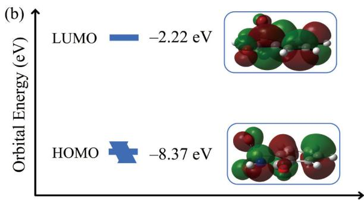  
Fig. 7. (a) Differential charge density map between the Co (200) surface and the saccharin molecule. The yellow color in the figure indicates the accumulation of charge, while the cyan color represents the depletion of charge. (iso surface = 0.006 au); (b) Frontier orbital diagrams of the saccharin molecule and energy levels (iso surface = 0.02 au).

## 4. Conclusions

In the process of electroless cobalt plating, the addition of saccharin changes the microstructure of the obtained cobalt layer. The addition of a small amount of saccharin at a concentration of 3 mg·L–1 caused the cobalt plating film to change from disordered orientation to hexagonal texture, with the preferred orientation of (002) facet of HCP Co phase. Continuous increase in the saccharin concentration (>200 mg·L–1) resulted in the refinement of cobalt film grains with a “Stone Forest” morphology. The honeycomb morphologic cobalt coating with the appropriate addition of saccharin (3 mg·L–1) presented a tight grain boundary connection, thereby reducing the resistance to 10.7 μΩ·cm. After studying the cobalt crystallization process and conducting DFT simulations, it is found that the charge density near the aromatic ring of saccharin is increased from the Co surface donation, so that the saccharin molecules can adsorb to specific c-sites on the surface of densely packed cobalt atoms, hindering the abc stacking arrangement. The crystallization process can be tuned to proceed along the ab stacking, thus forming the (002) preferred texture of HCP cobalt. The findings from this study not only provide a detailed understanding of the role of saccharin in electroless cobalt plating, but also offer a theoretical framework for the design and optimization of additives in electroless plating processes.

## Conflicts of interest

The authors declare no competing interest.

## Acknowledgements

This work was supported by National Natural Science Foundation of China (22402115, 22472094) and Shaanxi Special Fund for Talent Introduction (100090/1204071055).

## Data availability

Data will be made available on request.

## Author contributions

Yu-Xin Luo, Jing-Jing Wang: writing, DFT, experiment; Lu Wang, Zi-Yi Yan: experiment; Yi Ma, writing, editing; Xin Bo, Jing-Shuang Dang, Zeng-Lin Wang: writing, conceptualization, supervision.

## References

[1] Sun T, Yao B, Warren A P, Barmak K, Toney M F, Peale R E, Coffey K R. Surface and grain-boundary scattering in nanometric Cu films[J]. Phys. Rev. B., 2010, 81(15):155454. https:// doi.org/10.1103/PhysRevB.81.155454.

[2] Zhang W, Brongersma S H, Richard O, Brijs B, Palmans R, Froyen L, Maex K. Influence of the electron mean free path on the resistivity of thin metal films[J]. Microelectron. Eng., 2004, 76(1-4): 146–152. https://doi.org/10.1016/j.mee.2004.07.041.

[3] Choi D. Potential of ruthenium and cobalt as next-generation semiconductor interconnects[J]. Korean J. Met. Mater., 2018, 56(8): 605–610. http://dx.doi.org/10.3365/KJMM.2018. 56.8.605.

[4] Tan C M, Roy A, Reports E R. Electromigration in ULSI interconnects[J]. Mater. Sci., 2007, 58(1-2): 1–75. https://doi. org/10.1016/j.mser.2007.04.002.

[5] Bekiaris N, Wu Z Y, Ren H, Naik M, Park J H, Lee M, Ha T H, Hou W, Bakke J R, Gage M. Cobalt fill for advanced interconnects[C]. 2017 IEEE International Interconnect Technology Conference (IITC), Hsinchu, Taiwan, 2017: 1–3. https://doi. org/10.1109/IITC-AMC.2017.7968981.

[6] Bourzac K. Cobalt could untangle chips’ wiring problems[J]. IEEE Spectrum., 2018, 55(2): 12–13. https://doi.org/10.1109/ MSPEĆ 2018 8278123

[7] Wu J, Wafula F, Branagan S, Suzuki H, van Eisden J. Mechanism of cobalt bottom-up filling for advanced node interconnect metallization[J]. J. Electrochem. Soc., 2018, 166(1): D3136– D3141. https://doi.org/10.1149/2.0161901jes.

[8] Auth C, Aliyarukunju A, Asoro M, Bergstrom D, Bhagwat V, Birdsall J, Bisnik N, Buehler M, Chikarmane V, Ding G. A 10nm high performance and low-power CMOS technology featuring 3rd generation FinFET transistors, Self-Aligned Quad Patterning, contact over active gate and cobalt local interconnects[C]. International Electron Devices Meeting(IEDM). 2017: 29.1.1–29.1.4. https://doi.org/10.1109/ IEDM.2017.8268472.

[9] Gusley R, Ezzat S, Coffey K R, West A C, Barmak K. Influence of the seed layer and electrolyte on the epitaxial electrodeposition of Co (0001) for the fabrication of single crystal interconnects[J]. J. Electrochem. Soc., 2020, 167(16): 162503. https:// doi.org/10.1149/1945-7111/abcd13.

[10] Kang J, Sung M, Byun J, Kwon O J, Kim J J. Superconformal cobalt electrodeposition with a hydrogen evolution reaction suppressing additive[J]. J. Electrochem. Soc., 2020, 167(16): 162514. https://doi.org/10.1149/1945-7111/abd3b9.

[11] Ni X R, Chen Y M, Jin X F, Wang C, Huang Y Z, Hong Y, Su X H, Zhou G Y, Wang S X, He W, Chen Q G. Investigation of polyvinylpyrrolidone as an inhibitor for trench super-filling of cobalt electrodeposition[J]. J. Taiwan Inst. Chem. E, 2020, 112: 232–239. https://doi.org/10.1016/j.jtice.2020.06.010.

[12] Kongstein O, Haarberg G, Thonstad. Current efficiency and kinetics of cobalt electrodeposition in acid chloride solutions. Part I: The influence of current density, pH and temperature[J]. J. Appl. Electrochem., 2007, 37: 669–674. https://doi. org/10.1007/s10800-007-9299-z

[13] Wang Z L, Obata R, Sakaue H, Takahagi T, Shingubara S. Bottom-up copper fill with addition of mercapto alkyl carboxylic

acid in electroless plating[J]. Electrochim. Acta., 2006, 51(12): 2442–2446. https://doi.org/10.1016/j.electacta.2005.07.023.

[14] Wang Z X, Wang S, Yang Z, Wang Z L. Influence of additives and pulse parameters on uniformity of through-hole copper plating[J]. Transactions of the IMF., 2013, 88(5): 272–276. https://doi.org/10.1179/002029610X12791981507884.

[15] Yang Z F, Wang Z X, Wang X, Wang Z L. Comparison of bottom-up filling in electroless plating with an addition of PEG, PPG and EPE[J]. Chin. J. Chem., 2011, 29(3): 422–426. https:// doi.org/10.1002/cjoc.201190098.

[16] Zan L X, Liu Z H, Yang Z P, Wang Z L. A synergy effect of 2-MBT and PE-3650 on the bottom-up filling in electroless copper plating[J]. Electrochem Solid St., 2011, 14(12). https:// doi.org/10.1149/2.018112esl.

[17] Hassan Zadeh Shirazi S M, Bahrololoom M E, Shariat M H. The role of functional groups of saccharin in electrodeposition of nanocrystalline nickel[J]. Surf. Eng. Appl. Electrochem., 2016, 52(5): 434–442. https://doi.org/10.3103/S1068375516050112.

[18] Sen R, Das S, Das K. Influence of sodium saccharin on the microstructure of pulse electrodeposited Ni-CeO2 nanocomposite coating[J]. Int. J. Nanosci., 2012, 12(10): 7944–7949. https:// doi.org/10.1166/jnn.2012.6654.

[19] Wang Y H, Yu M Q, Luo H L, Qiao Q, Xiao Z Z, Zhao Y, Zhao L L, Sun H, Xu Z F, Matsugi K, Yu J K. Effect of saccharin on the structure and properties of electrodeposition NiWP alloy coatings[J]. J. Mater. Eng. Perform., 2016, 25(10): 4402–4407. https://doi.org/10.1007/s11665-016-2298-7.

[20] Altamirano-Garcia L, Vazquez-Arenas J, Pritzker M, Luna-Sánchez R, Cabrera-Sierra R. Effects of saccharin and anions (SO 2−, Cl−) on the electrodeposition of Co-Ni alloys[J]. J. Solid State Electrochem., 2014, 19(2): 423–433. https://doi. org/10.1007/s10008-014-2616-7.

[21] Hoghoghifard S, Mokhtari H. Improving the microwave absorption in Ni-coated fabrics by saccharin addition in plating bath[J]. J. Ind. Text., 2018, 49(3): 402–411. https://doi. org/10.1177/1528083718787525.

[22] Kolonits T, Jenei P, Péter L, Bakonyi I, Czigány Z, Gubicza J. Effect of bath additives on the microstructure, lattice defect density and hardness of electrodeposited nanocrystalline Ni films[J]. Surf. Coat. Technol., 2018, 349: 611–621. https://doi. org/10.1016/j.surfcoat.2018.06.052.

[23] Li Y Q, Ren P H, Li R P, Zhang Y H, Zhang J Q, Yang P X, An M Z. A novel bright additive for copper electroplating: electrochemical and theoretical study[J]. Ionics, 2023, 29(1): 363–375. https://doi.org/10.1007/s11581-022-04799-7.

[24] Wang C, Zhang J Q, Yang P X, An M Z. Electrochemical behaviors of Janus Green B in through-hole copper electroplating: An insight by experiment and density functional theory calculation using Safranine T as a comparison[J]. Electrochim. Acta, 2013, 92: 356–364. https://doi.org/10.1016/j.electacta.2013.01.064.

[25] Kresse G, Furthmüller J. Efficiency of ab-initio total energy calculations for metals and semiconductors using a planewave basis set[J]. Comput. Mater. Sci., 1996, 6(1): 15–50. https:// doi.org/10.1016/0927-0256(96)00008-0.

[26] Blöchl P E. Projector augmented-wave method[J]. Phys. Rev. B, 1994, 50(24): 17953. https://doi.org/10.1103/Phys-RevB.50.17953.

[27] Kresse G, Joubert D. From ultrasoft pseudopotentials to the projector augmented-wave method[J]. Phys. Rev. B, 1999, 59(3): 1758. https://doi.org/10.1103/PhysRevB.59.1758.

[28] Perdew J P, Burke K, Ernzerhof M. Generalized gradient approximation made simple[J]. Phys. Rev. Lett., 1996, 77(18): 3865. https://doi.org/10.1103/PhysRevLett.77.3865.

[29] Monkhorst H J, Pack J D. Special points for Brillouin-zone integrations[J]. Phys. Rev. B, 1976, 13(12): 5188. https://doi. org/10.1103/PhysRevB.13.5188.

[30] Frisch M, Trucks G, Schlegel H, Scuseria G, Robb M, Cheeseman J, Scalmani G, Barone V, Petersson G, Nakatsuji H. Gaussian 16, revision a. 03, gaussian, inc., wallingford ct[EB/ CP]. Gaussian 16, 2016.

[31] Dong L W, Zhong S J, Yuan B T, Li Y Q, Liu J P, Ji Y P, Chen D J, Liu Y P, Yang C H, Han J C, He W D. Reconstruction of solid electrolyte interphase with SrI reactivates dead Li for durable anode-free Li-metal batteries[J]. Angew. Chem. Int. Ed., 2023, 135(23): e202301073. https://doi.org/10.1002/ anie.202301073.

[32] Li R P, Li Y Q, Yang P X, Ren P H, Wang D, Lu X Y, Xu R Y, Li Y H, Xue J M, Zhang J Q. Synergistic interface engineering and structural optimization of non-noble metal telluride-nitride electrocatalysts for sustainably overall seawater electrolysis[J]. Appl. Catal. B-Environ., 2022, 318: 121834. https://doi. org/10.1016/j.apcatb.2022.121834.

[33] Li Y Q, Ren P H, Zhang Y H, Li R P, Zhang J Q, Yang P X, Liu A M, Wang G Z, An M Z. Investigation of novel leveler Rhodamine B on copper superconformal electrodeposition of microvias by theoretical and experimental studies[J]. Appl. Surf. Sci., 2023, 615: 156266. https://doi.org/10.1016/j.apsusc. 2022.156266.

[34] Li Y Q, Li C Z, Li R P, Peng X S, Zhang J Q, Yang P X, Wang G Z, Wang B, Broekmann P, An M Z. Experimental and theoretical study of the new leveler basic blue 1 during copper superconformal growth[J]. ACS Appl. Mater. Interfaces, 2023, 15(40): 47628–47639. https://doi.org/10.1021/acsami.3c06567.

[35] Ma X C, Li Y Q, Yang P X, Zhang J Q, An M Z. Influence of suppressing additive malachite green on superconformal cobalt electrodeposition[J]. J. Electroanal. Chem., 2022, 921: 116696. https://doi.org/10.1016/j.jelechem.2022.116696.

[36] Burton W K, Cabrera N t, Frank F. The growth of crystals and the equilibrium structure of their surfaces[J]. Phil. Trans. R. Soc. A, 1951, 243(866): 299–358. https://doi.org/10.1098/ rsta.1951.0006.

# 化学镀钴过程中添加剂糖精对结晶取向的调控

罗雨欣#， 王静静#，王露，闫子一， 马艺，薄鑫\*， 党静霜\*， 王增林\*陕西师范大学， 化学化工学院， 新概念传感器与分子研究院， 应用表面与胶体化学教育部重点实验室，陕西，西安， 710119， 中国

## 摘要：

在化学镀钴过程中， 我们发现添加剂糖精的加入可明显改变化学镀钴层表面的形貌、 织构取向及镀层的导电性。 研究表明， 当糖精添加量为 $3 \mathrm { m g } { \cdot } \mathrm { L } ^ { - 1 }$ 时， 钴镀层由无序大晶粒转变为蜂巢状结构， 具有密排六方 （HCP） 钴晶体的 （002） 择优取向， 其电阻率降低至 $1 4 . 4 \mu \Omega \cdot \mathrm { c m }$ ， 经过热处理后， 电阻率进一步降低至 $1 0 . 7 ~ \mu \Omega \cdot \mathrm { c m }$ ， 这对于其在芯片中的应用具有重要价值。 当糖精浓度升高时， 晶粒逐渐细化， 呈现 “石林” 状结构， 择优取向不变， 而糖精的加入在一定程度上提高了镀钴膜的纯度。 通过密度泛函理论对钴镀层结晶行为的研究表明， 糖精分子可吸附于钴密排晶面的特定 c 位点， 抑制 abc 堆积方式生长， 诱导晶体按 ab 堆积方式生长， 从而实现 HCP（002） 晶面的择优生长。

关键词：化学镀钴； 添加剂； 糖精； 结晶行为