# Investigation of polyvinylpyrrolidone as an inhibitor for trench super-filling of cobalt electrodeposition

Xiuren Nia, Yuanming Chena, Xiaofeng Jinb, Chong Wanga, Yunzhong Huanga,c,d, Yan Honga, Xinhong Suc, Guoyun Zhoua, Shouxu Wanga, Wei Heb,\*, Qingguo Chenb

a School ofMaterials and Energy, University ofElectronic Science and Technology ofChina, Chengdu 610054, China b National Center ofQuality Supervision and Testingfor Printed Circuit Board & National Center ofQuality Supervision and Testingfor Copper-Lead-Zinc Product, Tongling 244000, China

c Zhuhai Founder Sci-Tech Multilayer Circuit Board Co., Ltd and Zhuhai Founder Sci-Tech High-density Electronics Co., Ltd, Zhuhai 519175, China

d Chongqing Founder High-density Electronics Co., Ltd, Chongqing 400030, China

## A R T I C L E I N F O

Article History: Received 12 February 2020 Revised 3 May 2020 Accepted 16 June 2020 Available online 22 July 2020

Keywords: Cobalt electrodeposition Suppressor Trench filling

## A B S T R A C T

Polyvinylpyrrolidone (PVP) is studied in this paper as an inhibitor of cobalt electrodeposition. The suppres sion effect of PVP was analyzed through electrochemical methods, including cyclic voltammetry (CV) and galvanostatic measurements (GM) tests. It is indicated that PVP effectively suppresses the electrodeposition of cobalt and chloride ion accelerates this suppression. Further experiments verify that PVP inhibits the deposition of cobalt through the adsorption on the electrode surface. Quantum chemical calculations were employed to calculate the molecular orbitals of PVP and the electrostatic potential (ESP) energy of the involved molecules. The simulation results imply that the amide group acts as the main electrophilic attack region and facilitates nucleophilic reactions to bond with cobalt. High aspect ratio trench filling on silicon wafer was achieved with the addition of PVP, which confirms that PVP is an applicable inhibitor for the practical electrodeposition of cobalt filling. The mechanism of cobalt trench filling was proposed to explain the role of PVP in the electroplating filling. Besides, crystalline and morphological characterizations reveal that PVP is able to inhibit the specific crystal growth of cobalt. especially the growth of 220 crystal plane. affect the crystal morphology of cobalt and improve surface compactness.

© 2020 Taiwan Institute of Chemical Engineers. Published by Elsevier B.V. All rights reserved.

## 1. Introduction

Metals are the basic building materials to establish the conductive interconnection between the electronic components. The inherent properties of the metal are critical factors for achieving high density interconnection and miniaturization in the electronic devices. Compared with copper, cobalt with shorter electron Mean Free Path (MFP) holds the reduced resistance scaling effect and has been considered as a favorable interconnect metal [1 3]. Also, the thermal expansion coefficient (CTE) of cobalt is close to the one of silicon, which enables cobalt to serve as a compatible metal integrated in silicon-based electronic chips. In comparison with aluminum and copper, cobalt is recommended to be one of the next generation interconnection metals by the leading semiconductor manufacturers, such as Intel and Advanced Semiconductor Engineering (ASE), to meet the requirement of the blooming 5 G communication. Generally, inter-layer connections within the silicon chips are electroplated by bottom-up super filling of through-holes, microvias and trenches.

Cobalt alloys have been playing an important role in aviation components, medical devices and other fields due to its high mechanical strength and wear resistance [4 6]. The researches on pure cobalt electro-depositing are still insufficient because the electrodeposition of cobalt suffers from the intrinsic hydrogen evolution, poor throwing power (deposition uniformity, TP) and inferior plating quality of the deposited cobalt layer [7].

Additives are usually involved in electrolyte to promote plating properties. Researchers have performed extensive experimental as well as theoretical analysis to investigate the growth mechanism and additive behaviors of bottom-up copper super filling for micro-vias [8 11]. It was found that, the additives with the function of increasing metal deposition overpotential are able to obtain void-free super-filling [12]. Convection-dependent adsorption (CDA) of additive causes larger differential current distribution to realize higher deposition rate at the bottom than the one at the surface of microvia [13]. However, researches focusing on the additives involved in cobalt electrodepositing are still inadequate, especially in cobalt super filling.

Huang et al. found that dimethylglyoxime (DMG) exhibits obvious suppression behavior in cobalt electro-deposition [14,15]. They stated that paired amine groups of DMG enable the strong complexing between DMG molecule and cobalt ion. On the other hand, these groups also contribute to the preferred absorption of DMG on the deposited cobalt surface. DMG is, however, not an appropriate candidate for industrial application because the molecular chain of DMG easily breaks down under electric current. In addition, the low solubility in acidic aqueous solution also hinders the feasibility of DMG. PVP is a neutral non-ionic polymer containing paired amine groups with good complexing ability [16 18]. Notably, PVP is soluble in water and most organic solvents with low toxicity, making PVP a potential additive for cobalt super-filling.

In this paper, PVP was studied as major additive for cobalt super filling by electro-plating. The suppression effect of PVP was investigated by electrochemical experiments and the effect of chloride ion was also studied. Moreover, the active site in PVP molecule was speculated by theoretical calculations to understand the mechanism of suppression. In addition, PVP also displays significant influence on the morphology and crystal phase of electrodeposited cobalt. As for practical application, trench super-filling was realized by electrodepositing with PVP.

## 2. Experimental

## 2.1. Quantum chemical calculation

The HOMO and LUMO of PVP were calculated by using the Guassian 09 programs package [19]. The geometry optimizations were conducted by Density Functional Theory (DFT) using B3LYP method in an aqueous solution and gen basis set, which is lanl2dz for cobalt atom and $6 { - } 3 1 1 \mathsf { G } + ( \mathsf { d } , \mathsf { p } )$ for other atoms [20 24]. The ESP was performed by using GaussView program package [25, 26]. E is the energy of the highest orbit of the molecule, and $\mathtt { E } _ { \mathrm { L U M O } }$ represents the lowest unoccupied molecular orbital energy of the molecule [27].

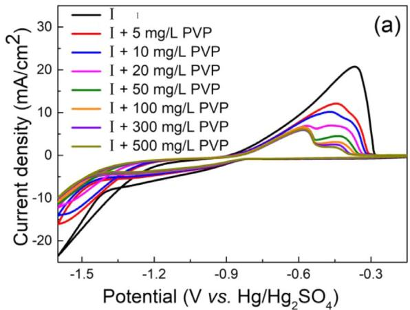

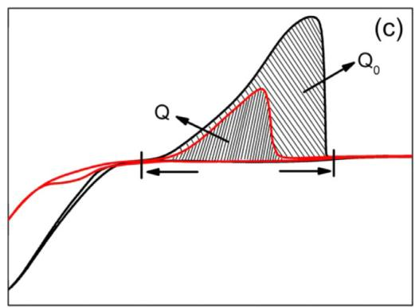

## 2.2. Electrochemistry

The electrochemical behaviors of additives were conducted by galvanostatic measurements (GM) and CV tests. An Auto-Lab potentiostat (PGSTAT302N) was used with a 5 mm diameter platinum rotating disk electrode (Pt-RDE, WE), a Pt rod (CE), and a saturated ${ \mathrm { H g } } / { \mathrm { H g } } _ { 2 } { \mathrm { S O } } _ { 4 }$ reference electrode (0.615 V v.s. S.H.E., RE). All electrochemical experiments were performed in a glass vessel with 200 mL electrolyte containing 0.3 mol/L $\mathrm { C o S O } _ { 4 } { \cdot } 7 \mathrm { H } _ { 2 } 0 { , } 0 . 5 7$ mol/L $\mathrm { H } _ { 3 } \mathrm { B O } _ { 3 }$ and 0.84 mmol/L ${ \mathsf { C o C l } } _ { 2 } { \cdot } 6 { \mathsf { H } } _ { 2 } 0$ and the potential was scanned from 1.6 V to 0.4 V with a scan rate of $1 0 0 \mathrm { m V } / s .$ The effect of different current density and different rotating speed on electrode potential were studied by GM experiments.

## 2.3. Electrodeposition

Electrodeposition was carried out by using a ${ \mathrm { R u O } } _ { 2 }$ coated titanium dimensionally stable anode (DSA) in electroplating bath with 500 mL electrolyte containing 0.3 mol/L $\mathrm { C o S O } _ { 4 } { \cdot } 7 \mathrm { H } _ { 2 } 0 { , } 0 . 5 7$ mol/L $\mathrm { H } _ { 3 } \mathrm { B O } _ { 3 }$ and 0.84 mmol/L ${ \mathsf { C o C l } } _ { 2 } { \cdot } 6 { \mathsf { H } } _ { 2 } 0$ . The current density is $2 \mathrm { m } A / \mathrm { c m } ^ { 2 }$ and 1 L/ min air flow is pumped into agitate the solution. PVP (K30, Chron Chemicals) was used as suppressor in cobalt electrodeposition and the mean molecular weight of PVP is 54,000. The basic solution (0.3 mol/L $\mathrm { C o S O _ { 4 } { \cdot } 7 H _ { 2 } O , 0 . 5 7 m o l / L \quad \ H _ { 3 } B O _ { 3 } }$ and 0.84 mmol/L $\mathsf { C o C l } _ { 2 } { \cdot } 6 \mathsf { H } _ { 2 } 0 )$ was also used in film deposition for XRD and the current density is $2 0 { \mathrm { m A } } / { \mathrm { c m } } ^ { 2 } .$ 1 L/min air flow is pumped into agitate the solution. The cobalt film was obtained and the thickness of the cobalt coating is $1 5 \mu \mathrm { m } .$ . The morphology and crystal size of the coating were observed by a HITACHI S3400 scanning electron microscope. The crystal phases of the coating were measured by an X-ray diffractometer (Rigaku MINIFLEX 600). The roughness tests of coating were observed by 3D measuring laser microscope (Olympus S4100). The width and depth of the trench were 25 and 100 mm on silicon wafers, then Au with a thickness of 500 nm was sputtered as a conductive seed layer. In this paper, the trenches on Si wafer were successfully filled by basic electrolyte and additives.

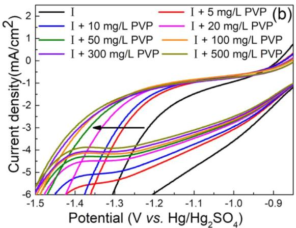

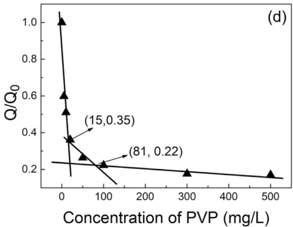  
Fig. 1. CV plots of various plating solutions without Cl (a) and (b). Fig. 1b is an enlarged view of the potential in Fig. 1a from 1.5 V to 0.8 V. The basic solution in this work contains the 0.3 mol/L CoSO 7H O,0.57 mol/L H BO , named Ⅰ. The integrated values of the corresponding Co stripping peaks are recorded as $\mathrm { Q } _ { 0 }$ (without PVP) and Q (with PVP), respectively (c). Q/Q as a function of PVP concentration measured in the plating solutions without Cl (d).

## 3. Results and discussion

## 3.1. Inhibition and maximum ofPVP inhibition

The inhibitive behavior of PVP in the solution was investigated through electrochemical measurements. Fig. 1 shows the significant decrease of cobalt stripping area and hysteretic voltammetric features in the solution with PVP. The current density decreases sharply in the presence of PVP (Fig. 1a). For example, after adding 5 mg/L PVP into plating solution, the stripping peak current density decreases from $2 1 \mathrm { m A } / \mathrm { c m } ^ { 2 }$ to $1 2 { \mathrm { m A } } / { \mathrm { c m } } ^ { 2 } .$ . In the meantime, the oxidation peak potential is also shifted negatively by 80 mV (from 0.36 V to 0.44 V vs Hg/ $\mathrm { H g } _ { 2 } \mathrm { S O } _ { 4 } ) .$ The change in stripping peak current density and oxidation peak potential both reveal that cobalt electrodeposition is inhibited by

PVP. The CV plot in Fig. 1b highlights that the cobalt deposition potential is negative correlated with the concentration of PVP which shows an enhancing effect on the polarization of cobalt electroplating. In addition, with the increasing concentration of PVP, cobalt electrodepositing was further inhibited, which is supported by the decreasing area of oxidation peaks.

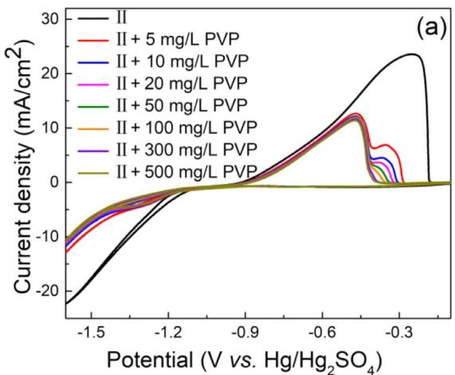

The maximum state of PVP suppression was further studied. As is shown in Fig. 1c, the oxidation peak area of CV was calculated to illustrate the inhibition effect of PVP with different concentrations. The integral of the cobalt stripping peak area is defined as $\mathrm { Q } _ { 0 }$ without PVP and as Q with PVP, respectively [28]. The curve which displays the value of $\mathrm { Q } / \mathrm { Q } _ { 0 }$ as a function of the concentration of PVP can be divided into three stages (Fig. 1d). $\mathrm { Q } / \mathrm { Q } _ { 0 }$ values undergo a sharp drop with low concentration of PVP and a steady stage with the high concentration of PVP. Notably, an intermediate slope appears in the curve for the PVP concentration range between 15 mg/L and 81 mg/L. When the PVP concentration continues to increase to more than 81 mg/L, the inhibition of PVP in cobalt electroplating reaches maximum.

As well known, chloride ions could affect the quality of metal coating and influence the mechanisms of additives in metal electroplating bath [29, 30]. The impact of Cl in the PVP-involved electroplating system was analyzed through voltammetry curves (Fig. 2a). In contrast with the curves in Fig. 1a-b, the stripping peak current density decreases more sharply when 5 mg/L PVP was added into the solution. These results in CV curve imply that PVP can inhibit the electrodeposi tion of cobalt in both chloride-containing and non-chloride ion plating solutions. However, in the solution with Cl, less amount of PVP is needed to reach the saturation (Fig. 2b). As for the $\mathrm { Q } / \mathrm { Q } _ { 0 }$ value, this ratio decreases with increasing concentration of PVP and process is divided into two stages (Fig. 2b). The phenomenon of first stage that $\mathrm { Q } / \mathrm { Q } _ { 0 }$ values decrease sharply with adding PVP can be observed when the concentration of PVP is less than 10.65 mg/L. In the second stage, Q/Q values maintain relatively stable with further increased PVP concentration. In the absence of Cl (Fig. 1d), PVP in plating solution reaches the saturation at a much higher concentration. Furthermore, when 10 mg/L PVP was added, the oxidation peak area in solution with Cl $( \mathrm { Q } / \mathrm { Q } _ { 0 }$ value decreases from 1.0 to 0.42 in Fig. 2b) decreased more than the chlorine-free solution $( \mathrm { Q } / \mathrm { Q } _ { 0 }$ value decreases from 1.0 to 0.51 in Fig. 1d). It is indicated that PVP is a suppressant of electrodeposited cobalt which can negatively shifts the deposition potential of cobalt, and chloride ion helps to accelerate the suppression effect of PVP.

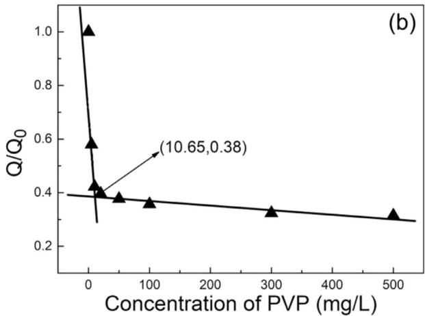

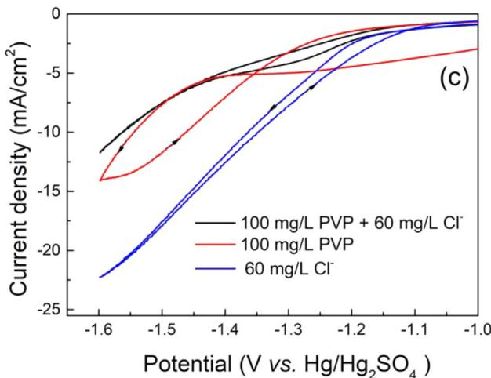  
Fig. 2. CV plots of various plating solutions 1.68 mmol/ $\mathbf { C l } ^ { - } \left( \mathsf { a } \right)$ and (c). Q/Q as a function of PVP concentration measured in the plating solutions with 1.68 mmol/L $\mathrm { C l ^ { - } } ( \mathsf { b } ) .$ Fig. 2c is an enlarged view of the potential in Fig. 2a from 1.6 V to 1.0 V. Schematic diagram of PVP and chloride ions adsorption on the surface of the cobalt layer (d).

The increase of overpotential is attributed to the adsorption of PVP on the surface of cobalt. The reverse scan exhibits an obvious hysteresis in the solution with only 100 mg/L PVP (Fig. 2c), revealing an adsorption and re-adsorption process of PVP. After adding Cl into PVP solution, the CV curve in Fig. 2c displays a weaker hysteresis effect. Thus, the adsorption strength of PVP is enhanced and Cl makes the adsorption more stable. Fig. 2c also shows the synergistic effect between PVP molecules and chloride ions. Chlorine ions were added to the solution containing 100 mg/L PVP, and the absolute value of current density continued to decrease.

The interaction between PVP and cobalt cations in aqueous solution has been reported (Liu et al.) [17, 31]. In this work, when the PVP was added in the solution, it preferentially complexes with cobalt ion. $\mathsf { P V P - C O } ^ { 2 + }$ complexes affect the polarization of cobalt electrodeposition and thus inhibit cobalt deposition. As the concentration of PVP increases, an extra oxidation peak appears with stronger suppression. PVP molecules are absorbed on the electrode surface and chloride ions promote the adsorption of PVP.

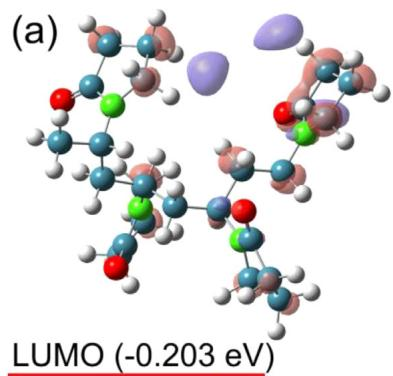

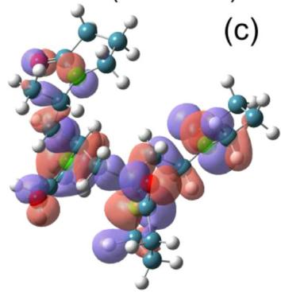

## 3.2. Quantum chemical calculation and CDA

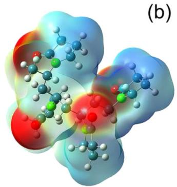

The molecular frontier orbital theory suggests that the key of chemical reactions is the HOMO and LUMO of the molecules [20]. The distribution of HOMO and LUMO of PVP was simulated by molecular orbital method (Fig. 3). The HOMO value $\left( \mathrm { E } _ { \mathrm { H O M O } } \right)$ of a molecule determines its ability to lose electrons outward, and the LUMO value $\left( \mathrm { E } _ { \mathrm { L U M O } } \right)$ represents its ability to accept electrons. Higher E and lower $\mathtt { E } _ { \mathrm { L U M O } }$ partly reflect the reactivity of molecule [32]. The $\mathtt { E _ { H O M O } }$ value of PVP is 6.877 eV (Fig. 3e), compared with 7.338 eV of PEG [21], indicating that PVP has relatively stronger electron donating ability. The simulated values imply that PVP is more likely to interact with cobalt cations and have an impact on electrodeposition of cobalt. Fig. 3e shows that the nitrogen element and oxygen element of the amide group are the main contributors to the HOMO orbital, which acts as the main electrophilic attack region. The organics with higher value of $\mathtt { E _ { H O M O } }$ tent to have stronger electron donating ability to bond with the d-orbital of the metal. PVP with amide group may bond with cobalt, facilitates formation of PVP adsorption and inhibits cobalt electroplating. The electrostatic potential distribution on the surface of molecular van der Waals force of PVP is displayed in Fig. 3a, which is widely used to predict molecular electron donating ability, electro-accepting ability and electrophilic reaction sites [33]. Areas with low ESP value are the positions of high electron density, which are considered to be more affinitive to the cobalt surface [34, 35]. PVP has lowest ESP value of 131.3 kJ/mol compared with PEG [21] ( 131.6 kJ/mol) (Fig. 3a). The electron density map shows that the carbonyl of the amide group contributes greatly to the electron donating ability of PVP. The amide group probably acts as reaction sites in the electrodeposition reaction by the quantum chemical calculations.

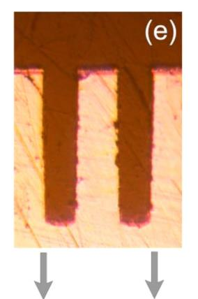

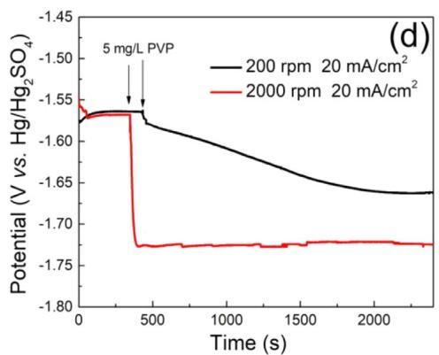

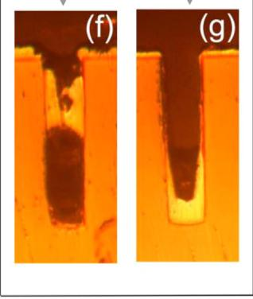  
Fig. 3. Electrostatic potential distribution on the surface of molecular van der Waals of PVP (b) and the LUMO (a) and HOMO (c) of PVP containing four monomers of PVP. The energies of HOMO and LUMO were 6.877 eV and 0.203 eV, respectively. The lowest ESP value is 131.28 kJ/mol and the highest ESP value is 105.02 KJ/mol. (O red, N green, C blue, H white) Time-Potential curves with the addition of PVP at different rotating speed (d) and cross-sectional slice of the cobalt electrodeposited trench filling with (g) or without PVP (f).

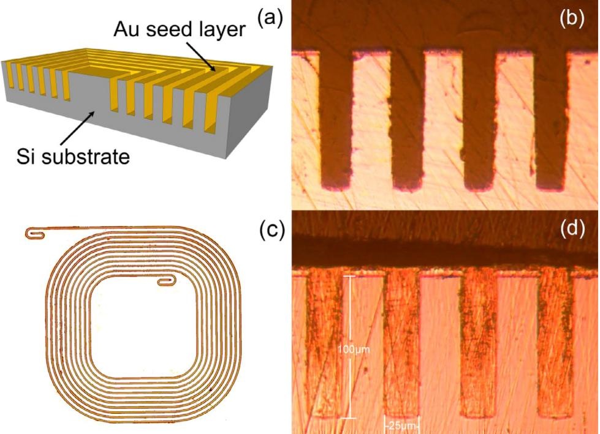  
Fig. 4. Schematic graph showing the trenches. (a) A cross-sectional (b) and top view(c) of the silicon-based chip a series of trench is shown, and cross-sectional slice of the electro deposited cobalt-filled silicon trench (d). The width and depth of the trench were 25 and 100 mm

Convection have significant influence on the process of electrodeposition. For the electroplating with rotating electrodes, the higher rotating speed of electrode leads to the greater convection in the solution. PVP can effectively inhibit the electrodeposition of cobalt in strong convection because the potential was quickly reduced by 160 mV when 5 mg/L PVP was added in strong convection (2000 rpm) (Fig. 3c). However, when 5 mg/L of PVP was added at low rotating speed (200 rpm), the potential was reduced by 100 mV and the inhibitory effect was slowly balanced after 2000s. Ji et al. found that electrolyte flow plays an important role in electroplating process [36]. The convection intensity of the solution inside the hole is lower than the one outside. The local convection affects the transport boundary layer in cobalt electroplating. As a result, more PVP molecules are be transmitted from solution to the electrode surface per unit time in strong convection. In Fig. 3c, PVP demonstrates a faster suppression in the strong convective condition, which is conducive to filling holes in electroplating. PVP molecules can be adsorbed on surface faster, resulting in different concentration distribution of additives at surface and bottom of trenches at the initial stage of electrodeposition. The cause of the secondary current density distribution is the concentration gradient of the additive [37,38]. In addition, the electroplating experiment was also conducted. As shown in Fig. 3d, the silicon trench is sealed in cobalt electroplating without inhibitor during the process of cobalt electroplating which is consistent with the above discussion.

## 3.3. Cobalt trench electrodeposition

Cobalt filling was achieved in silicon trenches, which confirms that PVP is capable of being an inhibitor in the electrodeposited cobalt filling. The silicon-based chip has a series of trenches in which a layer of gold was sputtered and the recess was filled by electrodepositing cobalt (Fig. 4). Fig. 4d is a cross-sectional slice of the electrodeposited cobalt-filled silicon trench with full cobalt super-filling. In this work, cobalt super-filling is achieved in silicon trench with the addition of 100 mg/L PVP. It is assumed that PVP molecules adsorb rapidly on the plated surface in the presence of Cl.

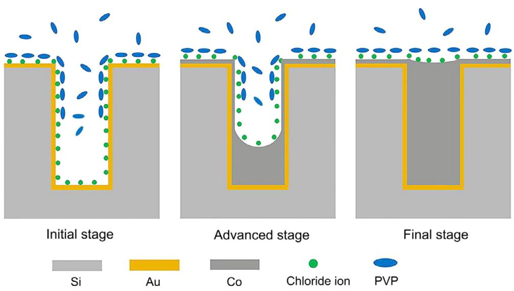  
Fig. 5. the strategy for bottom up super-filling with three stages.

Cobalt bottom up filling mechanism is proposed in Fig. 5. In the initial stage of electrodeposition, PVP molecules were quickly adsorbed on the surface, strongly inhibiting the growth of cobalt on the surface. Therefore, the deposition rate at the bottom is greater than that at the surface. Diffusional limitation and CDA of PVP long chain molecule both contribute to the higher deposition rate at the bottom than the one at the surface of the trench and obvious bottomup filling is then expected.

## 3.4. Surface characterization

The effect of PVP involved in the electrodeposition of cobalt was further investigated by the characterization of morphology. PVP demonstrates considerable effect on electrodeposited cobalt crystals. The XRD results in Fig. 6a indicate that PVP inhibits the cobalt electrodeposition by affecting the growth of cobalt specific crystal surfaces. The electrodeposited cobalt mainly forms cubic crystals in Fig. 6a. And, it is worth mentioning that PVP reduced the intensity of diffraction peak of cobalt along the direction of 220, indicating that the introduction of PVP inhibited the growth of 220 surface of cobalt without affecting the growth of other crystal planes.

The contact angle test indicates that PVP can improve the wettability of plating solution effectively. As is shown in Fig. 6c-d, the contact angle of the plating solution without PVP is more than $3 0 ^ { \circ }$ on the cobalt surface and is reduced to 15° after adding 100 mg/L PVP. Better wettability of the solution enables more hydrogen to be released in time [39] and enhances coating quality in cobalt electrodeposition. PVP can also be used as surfactant in electrodeposited cobalt because the amide group and carbon chains of PVP can act as polar hydrophilic and hydrophobic group respectively. Meanwhile, according to the theory of electro-capillary, polarization can reduce the surface tension and contributes to the desorption of hydrogen, which is consistent with the discussion above.

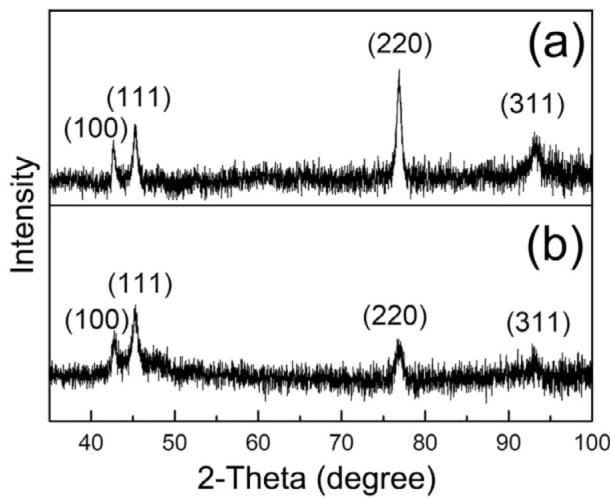

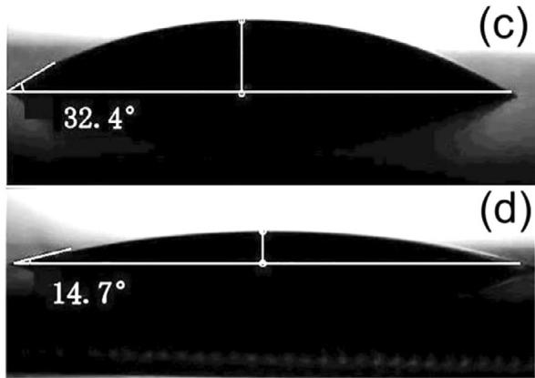

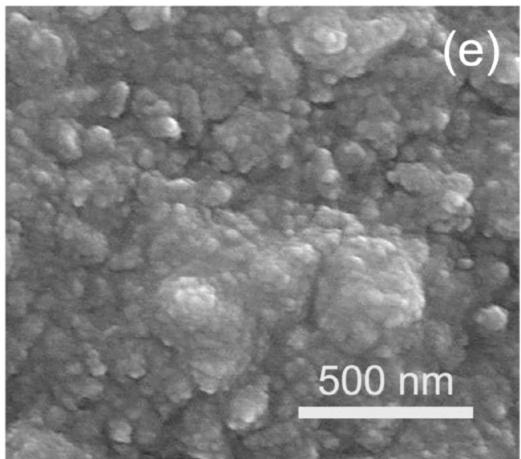

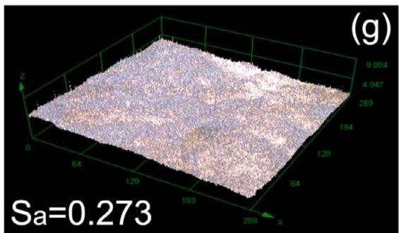

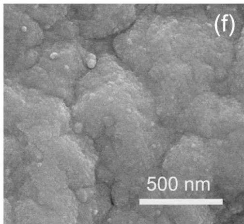

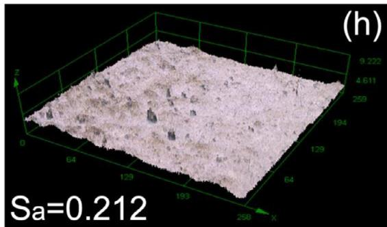  
Fig. 6. XRD patterns of electroplated cobalt samples from electroplating solutions with 0 mg/L PVP (a) and 100 mg/L PVP (b). The contact angle images of electroplating solution with 0 mg/L PVP (c) and 100 mg/L PVP (d). SEM images of electroplated cobalt surface without PVP (e) and with 100 mg/L PVP (f). Roughness tests of electroplated cobalt surface without PVP (g) and with 100 mg/L PVP (h).

In addition, PVP can refine particles and makes the cobalt layer more compact. The SEM images of electrodeposited cobalt in the solution without PVP display different particle size and roughness of surface without inhibitor (Fig. 6e). Fig. 6f shows the SEM of electrodeposited cobalt layer after adding 100 mg/L PVP and the surface morphology of the coating changed obviously in contrast with the one without PVP.

The uniformity of the coating was clearly improved by 3D roughness tests (Fig. 6g-h), and cobalt surface becomes more compact. Sa represents the arithmetic mean of the height values of all the peaks and troughs on plane A in Fig. 6g and Fig. 6h. The larger the value of Sa, the greater roughness of metal surface. The Sa value of electrodeposited cobalt layer in the solution without PVP is less than the Sa value of cobalt layer with 100 mg/L PVP in the electroplating solution, validating that PVP can improve the uniformity of cobalt layer in cobalt electrodeposition. In summary, PVP is an effective cobalt electrodeposition inhibitor. Besides, PVP can effectively facilitate hydrogen desorption, affect the surface morphology, and improve surface uniformity of cobalt layer.

## 4. Conclusions

As a conclusion, PVP can increase the polarization of electrodeposition, affect the growth of cobalt particles growth and redistribute the cathodic current. PVP works as inhibitor for electrodeposited cobalt and the suppression mechanisms of PVP were demonstrated. Chloride ion can facilitate the adsorption of PVP and helps to accelerate the suppression effect of PVP. The amide group of PVP is probably the reaction site by quantum chemical calculations. Void free filling of silicon trenches was achieved by cobalt super-filling on a sputtered gold layer in this paper.

Cobalt electroplating has great application potential in the fabrication of interconnection in electronic devices. More types of additives with the function of manipulating cobalt deposition rate and improving deposition quality of cobalt layer will be attempted in the following research.

## Declaration of Competing Interest

The authors declare that they have no known competing financial interests or personal relationships that could have appeared to influence the work reported in this paper.

## Acknowledgments

The authors gratefully acknowledge the support of National Natural Science Foundation of China (Nos. 61974020 and 51801018) and the projects of science and technology planning of Guangdong province (No. 2019B090910003) and Zhuhai city (No. ZH01084702180040HJL).

## References

[1] Sondheimer EH. The mean free path of electrons in metals. Adv Phys 2001;50:499 537.

[2] Kelly J, Chen JHC, Huang H, Hu CK, Liniger E, Patlolla R, Peethala B, Adusumilli P, Shobha H. Nogami T Spooner T Huang E Edelstein D Canaperi D Kamineni V Mont E. Siddiqui S. IEEE., experimental study of nanoscale Co damascene BEOI. interconnect structures. In: Proceedings of the IEEE International interconnect

technology conference / advanced metallization conference; 2016. p. IEEE, New York40–2.

[3] Wu J, Wafula F, Branagan S, Suzuki H, van Eisden J. Mechanism of cobalt bottomup filling for advanced node interconnect metallization. J Electrochem Soc 2018;166:D3136–41

[4] Inoue A, Shen B, Koshiba H, Kato H, Yavari AR. Cobalt-based bulk glassy alloy with ultrahigh strength and soft magnetic properties. Nat Mater 2003;2:661–3.

[5] Marti A. Cobalt-base alloys used in bone surgery. Inj Int J Care Inj 2000;31:S18–21.

[6] Sheu HH, Lu CE, Lee HB, Pu NW, Wu PF, Hsieh SH, Ger MD. Electrodeposition of black chromium-cobalt alloy based on trivalent sulfate electrolyte. J Taiwan Inst Chem Eng 2016;59:496–505.

[7] Kongstein OE, Haarberg GM, Thonstad J. Current efficiency and kinetics of cobalt electrodeposition in acid chloride solutions. Part I: the influence of current den sity, pH and temperature. J Appl Electrochem 2007;37:669–74.

[8] Dow WP, Li CC, Lin MW, Su GW, Huang CC. Copper fill of microvia using a thiolmodified cu seed layer and various levelers. J Electrochem Soc 2009;156: D314–20.

[9] Moffat TP, Wheeler D, Josell D. Electrodeposition of copper in the SPS-PEG-Cl additive system - I. Kinetic measurements: Influence of SPS. J Electrochem Soc. 2004:151:C262-71

[10] Chen Y-L, Wu J, Lee CC. Solid-state bonding of silicon chips to copper substrates with graded circular micro-trenches. J Mater Sci Mater Electron 2018;29:10037–43.

[11] Li JJ, Zhou GY, Wang JZ, Hong Y, He W, Wang SX, Wang C, Chen YM, Yang WJ, Ma CY, Miao H, Zhou JQ, Chen QG. Nickel-nanoparticles-assisted direct copper-electroplating on polythiophene conductive polymers for PCB dielectric holes. J Taiwan Inst Chem Eng 2019;100:262–8.

[12] Moffat TP, Wheeler D, Edelstein MD, Josell D. Superconformal film growth: mechanism and quantification. IBM LRes Dev 2005:49:19–36

[13] Dow WP, Huang HS, Yen MY, Huang HC. Influence of convection-dependent adsorption of additives on microvia filling by copper electroplating. J Electrochem Soc 2005;152:C425–34.

[14] Huang Q, Lyons TW, Sides WD. Electrodeposition of cobalt for interconnect application: effect of dimethylglyoxime. J Electrochem Soc 2016;163: D715–21.

[15] Menek N, Ucarli O, Topcu S, Zeyrekli S, Karaman Y. Investigation of catalytic effect nitrite on electrochemical reduction of cobalt dimethylglyoxime complex by polarographic and voltammetric techniques. Int J Electrochem Sci 2014;9: 2445–53.

[16] Nayak D, Mukherjee D, Banerjee A, Mukherjee J. Studies on complexation of cobalt with bioligand. J Radioanal Nucl Chem 2009;283:477–80

[17] Liu MH, Yan XP, Liu HF, Yu WY. An investigation of the interaction between polyvinylpyrrolidone and metal cations. React Funct Polym 2000;44:55–64.

[18] Hai NTM, Furrer J, Stricker F, Huynh TMT, Gjuroski I, Luedi N, Brunner T, Weiss F, Fluegel A, Arnold M, Chang I, Mayer D, Broekmann P. Polyvinylpyrrolidones (PVPs): switchable leveler additives for damascene applications. J Electrochem Soc 2013;160:D3116–25.

[19] Becke AD. Correlation energy of an inhomogeneous electron gas: a coordinatespace model. J Chem Phys 1988;88:1053–62.

[20] Lee C, Yang W, Parr RG. Development of the Colle-Salvetti correlation-energy formula into a functional of the electron density. Phys Rev B Condens Matter 1988;37:785–9.

[21] Lai Z, Wang S, Wang C, Hong Y, Zhou G, Chen Y, He W, Peng Y, Xiao D. A comparison of typical additives for copper electroplating based on theoretical computation. Comput Mater Sci 2018;147:95–102.

[22] Murray PP, JS, PVR. Schleyer, Electrostatic potentials: chemical applications, 2002.

[23] Chattaraj PK. Chemical reactivity theory: a density functional view. CRC Press; 2009.

[24] Wang C, An MZ, Yang PX, Zhang JQ. Prediction of a new leveler (N-butyl-methyl piperidinium bromide) for through-hole electroplating using molecular dynamics simulations. Electrochem Commun 2012;18:104–7.

[25] Lu T, Chen FW. Multiwfn: A multifunctional wavefunction analyzer. J Comput Chem 2012:33:580-92

[26] Premkumar S, Jawahar A, Mathavan T, Dhas MK, Sathe VG, Benial AMF. DFT calculation and vibrational spectroscopic studies of 2-(tert-butoxycarbonyl (Boc) -amino)-5-bromopyridine. Spectrochim Acta Part A Mol Biomol Spectrosc 2014;129:74–83.

[27] Zheng L, He W, Zhu K, Wang C, Wang SX, Hong Y, Chen YM, Zhou GY, Miao H, Zhou JQ. Investigation of poly (1-vinyl imidazole co 1, 4-butanediol diglycidyl ether) as a leveler for copper electroplating of through-hole. Electrochim Acta 2018:283:560-7.

[28] Xiao N. Li D. Cui G. Li N. Li O. Wu G. Adsorption behavior of triblock copolymer suppressors during the copper electrodeposition. Electrochim Acta 2014;116:284–91.

[29] Bozzini B, D'Urzo L, Romanello V, Mele C. Electrodeposition of Cu from acidic sulfate solutions in the presence of bis-(3-sulfopropyl)-disulfide (SPS) and chloride jons. LElectrochem Soc 2006:153:C254–7

[30] Healy JP, Pletcher D, Goodenough M. The chemistry of the additives in an acid copper electroplating bath .1. Polyethylene-glycol and chloride-ion. J Electroanal Chem.1992:338:155-65

[31] Lahiri S, Sarkar S. Separation of iron and cobalt using Fe-59 and Co-60 by dialysis of polyvinylpyrrolidone-metal complexes: A greener approach. Appl Radiat Isot 2007;65:387–91.

[32] Gece G. The use of quantum chemical methods in corrosion inhibitor studies. Corros Sci2008:50:2981-92

[33] Murray JS, Politzer P. The electrostatic potential: an overview. Wiley Interdiscip Rev Comput Mol Sci 2011;1:153–63

[34] Bulat FA, Toro-Labbe A, Brinck T, Murray JS, Politzer P. Quantitative analysis of molecular surfaces: areas, volumes, electrostatic potentials and average local ionization energies. I Mol Model 2010:16:1679–91.

[35] Fu R, Lu T, Chen FW. Comparing methods for predicting the reactive site of electrophilic substitution. Acta Phys Chim Sin 2014;30:628–39.

[36] Ji LX, Wang SX, Wang C, Chen GQ, Chen YM, He W, Tan Z. Improved uniformity of conformal through-hole copper electrodeposition by revision of plating cell configuration. J Electrochem Soc 2015;162:D575–83.

[37] Dow WP, Chen HH, Yen MY, Chen WH, Hsu KH, Chuang PY, Ishizuka H, Sakagawa N, Kimizuka R. Through-hole filling by copper electroplating. J Electrochem So 2008:155:D750-7

[38] Dow WP, Lu CW, Lin JY, Hsu FC. Highly selective Cu electrodeposition for filling through silicon holes. Electrochem Solid State Lett 2011;14:D63–7.

[39] Lou Q, Li T, Yang M. Lattice Boltzmann simulations of rising bubble driven by buoyancy in a complex microchannel. Acta Phys Sin 2018;67:13.