# Investigation of adenosine as a leveling additive with synergetic acceleration–suppression behavior for superconformal cobalt filling in X-shaped through-hole

Ruiquan Yang a, Xueting Li b,\*\*, Jie Xie c, Zengbiao Liu c, Hongbin Cui d, Yongsheng Zhou d, Xuemei He e, Yu Jiao f , Shouxu Wang a, Wei He a, Yuanming Chen a,\*

a School of Materials and Energy, University of Electronic Science and Technology of China, Chengdu, 611731, China

b School of Aeronautics and Astronautics, Sichuan University, Chengdu, Sichuan, 610065, China

c Zhuhai Wise Sharp Technologies Co., Ltd., Zhuhai, 519040, China

d Dongguan HONG YUEN Electronics Co., Ltd., Dongguan, 523932, China

e College of Chemistry and Materials Science, Sichuan Normal University, Chengdu, 610066, China

f School of Science, Xichang University, Xichang, 615013, China

## A R T I C L E I N F O

Keywords: Cobalt electrodeposition Suppressor Leveling additive ADO

## A B S T R A C T

Adenosine (ADO) was selected as a leveling additive for superconformal cobalt filling in X-shaped through-hole. Changes in deposition potential and the generation of new stripping peaks in cyclic voltammetry curves were observed in electrochemical tests of ADO-containing plating solution. The adsorption behavior of ADO on the cobalt surface was investigated using density functional theory calculations, molecular dynamics (MD) simulation, and electrochemical in situ Fourier transform infrared (E-FTIR) spectroscopy tests. Furthermore, the Co2+ with ADO coordination was simulated via interaction region indicator analysis. Based on the changes of the ADO adsorption sites from the MD and E-FTIR analyses, an intramolecular synergistic acceleration–suppression mechanism was proposed to explain the effects of low-concentration acceleration but high-concentration suppression in cobalt deposition. Surface analysis revealed that ADO exhibited a grain refinement effect, and crystal analysis showed that the Co hcp (002) crystalline plane was preferentially formed. Finally, X-shaped throughhole with a maximum aspect ratio of 2:1 formed cobalt superconformal filling, with a surface deposition thickness of the cobalt layer as low as 1.2 μm and meanwhile a filling rate ≥90 %.

## 1. Introduction

Electronic interconnect technology is the key for realizing advanced packaging and chip interconnection. With the development of semiconductor technology, the line resistance of copper considerably increases because of the large mean free path of electrons, copper cannot meet the process requirements of damascene filling. However, cobalt exhibits good electrical conductivity and a small mean free path of electrons [1,2], which can prevent electron scattering at the surface interface [3]. In addition, the coefficient of thermal expansion of cobalt (13.3 × 10^-6/K) is similar to that of silicon (10 × 10^-6/K) [4,5], and the internal stresses generated during high-temperature annealing are smaller than those generated during high-temperature annealing of copper [6]. Cobalt is considered the most promising alternative metal for nanoscale interconnect technology.

The bottom-up superfilling phenomenon of cobalt has been increasingly studied, and various micro-nanoscale mechanism models have been proposed. Such models include hydrogen-induced inactivation mechanisms [7,8], voltage-dependent suppression mechanisms [9, 10], S-type negative differential resistance mechanisms [11,12], and differential current efficiency filling mechanisms [13]. Rigsby et al. [12] proposed a differential current efficiency filling mechanism and achieved damascene filling of cobalt. Using the differential current filling mechanism, Ni et al. [14] introduced polyvinylpyrrolidone into electrodeposition of cobalt to achieve a superconformal silicon trench filling. Ma et al. [15,16] used the S-type negative differential resistance mechanism with malachite green and achieved micro blind hole filling of cobalt. Li et al. [17,18] achieved micro blind hole filling with different pore sizes using nitrotetrazolium blue chloride, applicable to S-type negative differential resistance mechanism theory. Huang et al. inves tigated the role of oxime additives and concluded that the amine group can suppress cobalt electrodeposition by coordinating with ${ \bf C o } ^ { 2 + } \ \bar { [ 9 , 1 0 , }$ 19]. In addition, it was proposed that Co $\left( \mathrm { O H } \right) ^ { - }$ was the intermediate for cobalt deposition [20], which explained the difference in cobalt deposition rates at different pH levels. Li et al. [21] delved into the efficacy of 5-alkynylpyrimidines as inhibitors for cobalt superfilling by curbing excessive growth in specific regions to ultimately obtain homogeneous and compact cobalt coating. Ni et al. [22] explored the combined effects of 3-mercapto-1-propanesulfonate and polyvinylpyrrolidone on the growth dynamics of cobalt pillars during electroplating and uncovered a synergistic interaction to efficiently modulate the morphology and dimensions of these pillars. Cao et al. [23] conducted the effects of dimethylglyoxime, 3-mercapto-2-propanesulfonate, and histidine on the growth characteristics and magnetic properties of cobalt electrodeposited on copper substrates and discovered notable impacts on the coating morphology, structure, and magnetic attributes. Li et al. [24] focused on the electroplating of nanocrystalline cobalt within sulfate baths with butynediol ethoxylate to produce coatings with exceptional crystallinity and superior surface morphology. Tong et al. [25] examined the role of alkyne-PEG4-amine as an inhibitor in cobalt superfilling, showing its superiority in hindering cobalt growth in select areas to achieve even and dense coating. Wu et al. [26] assessed the performance of phenyl methyl sulfoxide as an additive for cobalt superfilling to significantly enhance the coating uniformity and density and improve the reliability of the three-dimensional interconnect. Furthermore, the design of an in-situ micro-reactor electrochemical experiment is crucia for investigating cobalt valence in complex intermediates and tracking its reduction process effects [27].

Herein, using adenosine (ADO) as an additive with the lowconcentration acceleration but high-concentration suppression and the differential current efficiency filling mechanism during cobalt deposition, superconformal filling of cobalt in X-shaped through-hole was achieved. Through electrochemical analysis, ADO was observed to exhibit a depolarizing effect on ${ \mathrm { C o } } ^ { 2 + }$ deposition at low concentrations. However, at concentrations of ${ > } 1 0$ mg/L, ADO increased the polarization of cobalt deposition and considerably changed the cobalt deposi tion. Through density functional theory (DFT) calculations and molecular dynamics (MD) simulations, this electrochemical effect was elucidated in terms of electrostatic potential (ESP) on the molecular surface and the adsorption energy of ADO on the cobalt surface, respectively. The shift in the type of ADO electrochemical action at different concentrations was elucidated in terms of the change in adsorption sites during electrochemical in situ Fourier transform infrared (E-FTIR) spectroscopy tests. Finally, cobalt filling with ultrathin surface deposition thickness (SDT) outside the hole was realized via the low-concentration acceleration but high-concentration suppression effect of ADO.

## 2. Experimental

## 2.1. Electrochemical tests

${ \mathsf { C o } } ^ { 2 + }$ reduction by ADO was investigated using a three-electrode system via electrochemical methods (Auto-Lab PGSTAT302 N, Metrohm). A rotating-disk Pt electrode was used as the working electrode, and a $\mathrm { H g / H g _ { 2 } } S 0 _ { 4 }$ electrode and platinum wire were used as the refer ence and counter electrodes, respectively. Electrochemical measurements, including cyclic voltammetry (CV), and galvanostatic measurement (GM), were performed at 1500 or 200 rpm and a scanning rate of 50 mV/s. In a virgin makeup solution $\left( \mathsf { p H } = 4 \right)$ containing 0.3 mol/L $\mathrm { C o S O _ { 4 } } { \cdot } 7 \mathrm { H _ { 2 } O } , 0 . 5 7$ mol/L $\mathrm { H } _ { 3 } \mathrm { B O } _ { 3 } , 0 . 7$ mol $\mathrm { / L N a _ { 2 } S O _ { 4 } } ,$ , and 60 mg/L Cl− , the plating solution was pre-plated for 200 s at a current density of

5 ${ \mathrm { m A / c m } } ^ { 2 } .$ This was followed by CV stripping at voltages ranging from −1.0 to 0.3 V. The chemicals used in this study, including $\mathrm { C o S O } _ { 4 } { \cdot } 7 \mathrm { H } _ { 2 } 0 ,$ $\mathrm { H } _ { 3 } \mathrm { B O } _ { 3 } ,$ NaCl, ${ \mathrm { N a } } _ { 2 } S { \mathrm { O } } _ { 4 } ,$ and the additive ADO (CAS no. 58-61-7), were analytically pure.

## 2.2. DFT calculations and MD simulations

The DFT calculations, including structural optimization and singlepoint energy calculations, of ADO and its complexes with ${ \mathsf { C o } } ^ { 2 + }$ were achieved using Gaussian 09 and Gauss View 6 [28], using the B3LYP/6-311G (d, p) method. The surface ESPs and orbital electron cloud distributions of the involved molecules were visualized by visual MD (VMD) [29]. Weak interaction analysis was realized via borrowing topology, and interaction region indicator (IRI) analysis was performed by Multiwfn [30] and VMD.

MD simulation was implemented via Materials Studio, and the universal force field was selected for structural optimization and dynamics simulation in the Forcite module with a simulation duration of 50 ps and step size of 1 fs. Based on the peaks corresponding to the dominant crystalline facets that observed in the X-ray diffraction (XRD) pattern, the (002) crystalline facet was selected to construct the model of the cobalt layer, and the thickness of layer was six cobalt atoms. Periodic boundary conditions were employed to construct the reaction box with the length of 31.7 Å, the width of 31.7 Å and the height of 45.1 Å at the temperature of 298 K. Sulfate ions and chloride ions, were excluded from the simulation process due to the extensive computational resources. In addition, the model containing 1 g/L of $_ \mathrm { H _ { 2 } O }$ was chosen for the simulation with consideration of both accuracy and feasibility.

## 2.3. Electroplating

Plating was conducted in a 1500-mL Haring cell containing 0.3 mol/ L CoSO ⋅7H O, 0.57 mol/L $\mathrm { H } _ { 3 } \mathrm { B O } _ { 3 } ,$ 60 mg/L Cl− , 0.7 mol/L ${ \mathrm { N a } } _ { 2 } S { \mathrm { O } } _ { 4 } ,$ and 50 mg/L ADO was added. The initial pH of the plating solution was set as $^ { 4 , }$ but in order to ensure the stable pH of the plating solution during the electroplating process, 0.57 mol $/ \mathrm { L } \mathrm { H } _ { 3 } \mathrm { B O } _ { 3 }$ as a buffer was added into the plating solution. At the same time, with the purpose to agitate the solution, air bubbling blow of 2.5 L/min was carried out near the cathode during the plating process. Plating was performed using titanium mesh as an insoluble anode, and a laser-perforated single-layer copper-clad resin plate as a cathode. The surface of the cathode featured dense $\mathrm { X } \mathrm { - }$ shaped through-hole, the thickness of the resin plate was 160 μm, and the aperture of the through-hole was 80 μm at maximum and 40 μm at minimum. X-shaped through-hole showed a maximum aspect ratio of 2:1.

## 2.4. Characterization

E-FTIR tests were performed in a plating solution $\mathrm { ( p H } = 4 )$ containing of 0.03 mol/L $\mathrm { C o S O _ { 4 } \cdot 7 H _ { 2 } O , 0 . 0 5 7 }$ mol/L $_ \mathrm { H _ { 3 } B O _ { 3 } } ,$ 6 mg/L Cl− , and 0.07 mol/L ${ \mathrm { N a } } _ { 2 } S { \mathrm { O } } _ { 4 } .$ E-FTIR tests were conducted to verify the adsorption behavior of ADO. In the E-FTIR tests, the substrates were made by electroless gold plating on the surface of the silicon wafer [Si (100) $2 \times 1 ]$ . When the test potential was too negative (less than −1.0 V), the cobalt layer would fall off from the gold layer, so −1.0V was selected as the test voltage to avoid this effect. FTIR absorption peaks were determined using a Nicolet 6700 (Thermo Fisher Scientific); the applied voltage was −1.0 V and was controlled by a Shanghai Chenhua CHI 660D. ADO powder was subjected to FTIR tests using the Nicolet iS20 (Thermo Fisher Scientific).

Scanning electron microscopy (SEM) (Thermo Fisher Phenom Pharos) was used to observe the surface topography to explore the role of ADO in the plating process. Surface roughness was calculated by confocal laser scanning microscopy (KEYENCE VK-X3050). A contact angle test was performed to compare the wettability of the plating solution on the cobalt substrate. Crystallographic analysis was performed by X-ray Powder diffractometer (Bruker D8 Advance A25X), using to reveal the preferred orientation of plated surfaces in various plating solutions, and diffraction patterns were acquired at a scan speed of $5 \%$ min and step size of $0 . 0 2 ^ { \circ }$ in a 2θ range from $3 0 ^ { \circ }$ to 80◦.

## 3. Results and discussion

## 3.1. Electrochemical and simulated behavior of ADO

Fig. 1 showed the CV, and GM curves for ADO in a cobalt plating solution. Anodic stripping charge of cobalt Q was calculated from CV curves of Fig. 1a. In this way, $Q / Q _ { 0 }$ values could be obtained to find out the performance of ADO with the concentration of 5\~150 mg/L during cobalt plating; Q and $Q _ { 0 }$ was the anodic stripping charge from the plating bath with and without ADO, respectively [31]. $Q / Q _ { 0 }$ values for the condition of 5\~150 mg/L ADO were 107.55 %, 98.79 %, 84.96 % and 48.60 $^ { \% , }$ respectively. The addition of 5 mg/L ADO led to an accelerating performance of cobalt deposition while ADO with the concentration of higher than 5 mg/L resulted in a suppressor behavior of cobalt deposition. As shown in Fig. $^ { \mathrm { 1 b , } }$ the deposition peak had a positive shift at 5 mg/L, indicating that the deposition of cobalt was accelerated. When the concentration exceeded 10 mg/L, the deposition peak had a negative shift and exhibited S-type hysteresis, indicating that ADO could suppress cobalt deposition.

(a)  
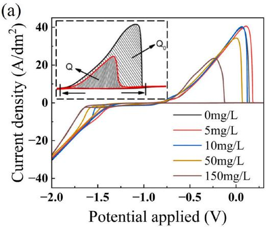

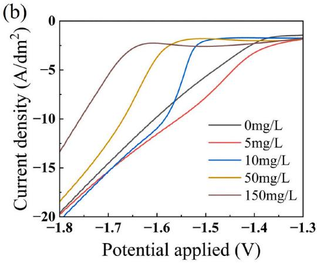

(c)  
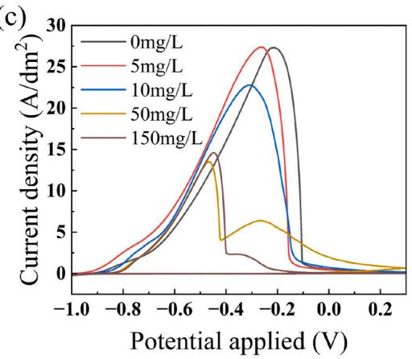

(d)  
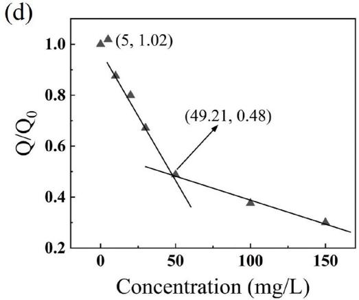

(e)  
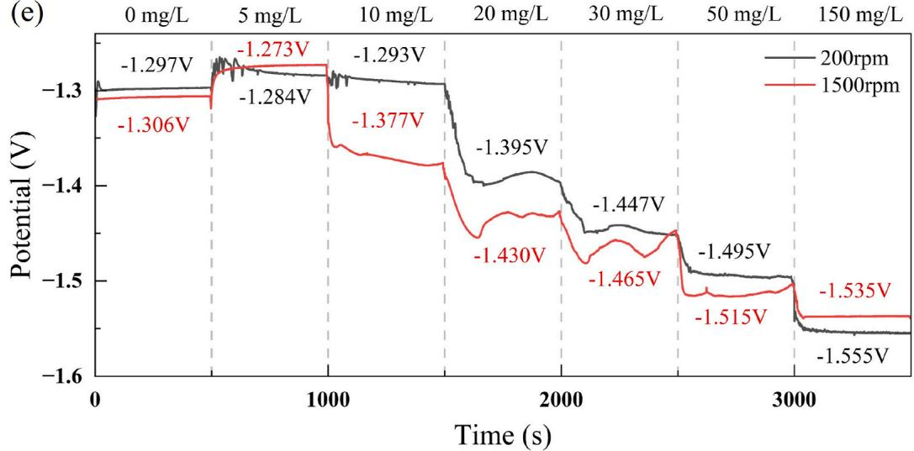  
Fig. 1. CV curves of various ADO concentrations in plating solutions (a) and an enlarged view of the deposition potential from −1.8 V to −1.2 V (b). Stripping curves of various ADO concentrations plating solutions (c). $Q / Q _ { 0 }$ as a function of ADO concentration measured in the plating solutions (d). GM curve at $0 . 5 \ \mathrm { A } / \mathrm { d } \mathrm { m } ^ { 2 } \ \mathrm { ( e ) }$

Electrochemical coupling analysis was performed to further investigate the low-concentration acceleration but high-concentration suppression of ADO. Cobalt deposition was first conducted for 200 s under a $\mathrm { \bar { 0 . 5 A / d m ^ { 2 } } }$ constant current condition, followed by stripping within the potential range $\begin{array} { r l } { \mathbf { 0 } \mathbf { f } - 1 . 0 \mathrm { t o } 0 . 3 \mathrm { V } . } \end{array}$ With an increase in the concentration of ADO, a stripping peak was generated at −0.7 V (Fig. 1c), which differed from the stripping peak position of cobalt [13,32]. It was speculated that ADO could generate complexes with ${ \mathsf { C o } } ^ { 2 + }$ and change the deposition-stripping process of cobalt. During the stripping process, the stripping peak was only observed during the first cycle of the CV test, the ADO solution alone did not produce a peak so the effect of the solution was negligible. Thereby confirming that the peak originated from the stripping of cobalt metal under the action of ADO.

As the ADO concentration increased, the process was divided into three phases (Fig. 1d). When the ADO concentration was 5 mg/L, the Q/ $Q _ { O }$ value was slightly elevated. During the concentration of 10\~50 mg/ L, the second stage phenomenon of rapid decrease of $Q / Q _ { O }$ value with the addition of ADO could be observed. In the third stage, the $Q / Q _ { O }$ values remained relatively stable, illustrating that the ADO in the bath had reached a supersaturated concentration [31]. Above result was approximately the same to the case in Fig. 1a, confirming that the low-concentration acceleration but high-concentration suppression effect of ADO during cobalt deposition. Given that the concentration of 50 mg/L situated close to the intersection of the second and third stages, where ADO had just reached saturation, 50 mg/L was selected as the optimal concentration for DC plating [14,31].

As shown in Fig. 1e of GM test result, the deposition potential of cobalt deposition at high rotational speed, also exhibited a negative potential shift when 10 mg/L ADO was added. However, a large negative shift occurred in the condition of adding 20 mg/L ADO at low rotational speeds. In addition, the potential of cobalt deposition at high rotational speed was more negative than that at low rotational speed, indicating that the suppression of ADO was also dependent on the rotational speed. Nevertheless, when the ADO concentration reached 150 mg/L, the change of deposition potential was reversed during cobalt deposition.

It was observed that ADO exhibited a low-concentration acceleration but high-concentration suppression effect during the electrochemical test. Combined with the results in Fig. 1d and e, in order to avoid the potential reversal phenomenon caused by the concentration, 50 mg/L was selected as the concentration of ADO for DC cobalt plating.

Further, the molecular structure information of ADO was studied by quantum chemical calculations to explain the electrochemical phenomena. Weak interaction visualization IRI analysis, DFT calculations, and MD simulations were involved. Gaussian and VMD were used to calculate the molecular orbitals of ADO and the ESP on the molecular surface. As shown in Fig. 2a and $\mathbf { b } ,$ the highest occupied molecular orbital (HOMO) and lowest unoccupied molecular orbital (LUMO) en ergies of the ADO molecule were −6.38 and −1.05 eV, respectively, both located on the adenine moiety. $\Delta { E } = 5 . 3 3 \mathrm { e V }$ , as calculated using Eq. (1)

[33].

$$
\Delta E = E _ {L U M O} - E _ {H O M O}\tag{1}
$$

The surface ESP of the ADO molecule was within the range from −50.39 to 56.25 kcal/mol, and the higher surface ESP could result in the stronger electrostatic adsorption on the cathode surface [34,35]. The high ESP region of the ADO molecule was extremely dispersed, and the electrostatic adsorption on the cathode surface was in a multipoint adsorption state. The adsorption sites were –NH2 of adenine moiety and –OH of nucleoside moiety. A lower ΔE suggested that ADO was more likely to receive and provide electrons on the cathode surface during electrochemical reactions while having a larger adsorption strength in the electric field [36–38]. With no MO distribution on the nucleoside group, so it exhibited only electrostatic adsorption and low adsorption strength on the cobalt surface. Thus, the electrochemical active site of ADO was the adenine group. According to the MO distribution characteristics and the electrochemical test results, it was hypothesized that the nucleoside group accelerates cobalt deposition, the adenine group suppresses cobalt deposition, and the adsorption site of the adenine group increased at a high concentration, rendering the suppression effect dominant [39,40]. However, the reliable correlation between simple HUMO-LUMO calculations and inhibition efficiency was questioned in early work [41]. Therefore, more relevant simulations of IRI and MD simulations were added to further support the explanation of ADO suppressesing function during cobalt electrodeposition.

To investigate the interaction of ADO with ${ \mathsf { C o } } ^ { 2 + }$ and the complex structure, the distribution of the weak interactions of the complexes was analyzed by the IRI method [42], and the results of the weak interaction visualization analysis were shown in Fig. 3. The strong interactions were masked in the figure to highlight the distribution of the weak interactions. As shown in Fig. 3b, the distribution of the weak interactions of the complexes was near the adenine moiety, and the introduction of $\mathsf { C o } ^ { 2 + }$ resulted in a clear conical interaction zone in the adenine moiety. As shown in Fig. 3c and d, the planar interaction distribution confirmed the enhanced interaction between ${ \mathsf { C o } } ^ { 2 + }$ and adenine moiety, suggesting that the formation of a stable structure between them. The stabilized structure confirmed that cobalt bonded with the adenine group in ADO to generate a complex, which explained the generation of the new electrochemical stripping peaks shown in Fig. 1.

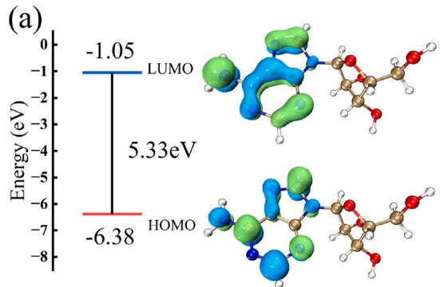

MD simulation for adsorption of ADO on the cobalt surface was conducted to simulate the adsorption behavior of ADO on the surface of cathode in the condition of the Forcite module with a simulation duration of 50 ps and a step size of 1 fs (Fig. 4). All the boundaryless models involved were optimized by the universal force field, and the ADO molecular structure model was built by the Materials Studio software and structurally optimized via the clean force field [43].

As shown in Fig. 4b, the ADO molecule was adsorbed on the cobalt surface with the adsorption sites $\mathbf { o f } \mathrm { - N H _ { 2 } }$ and –OH for the adenine and nucleoside moieties, respectively, which were consistent with the ESP results. The figure was shown with an occultation of H O molecules to

(b)  
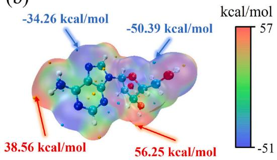  
Fig. 2. Orbital energies and distributions of the HOMO and LUMO of ADO (a). Electrostatic potential distribution of ADO on the molecular surface (b).

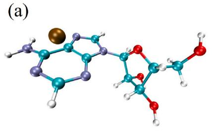

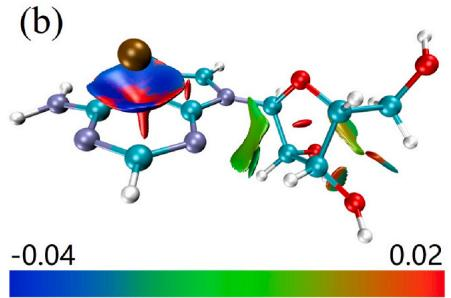

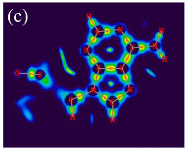

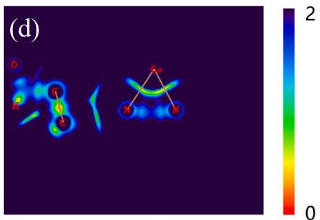  
Fig. 3. Optimized structure of ${ \bf A D O - C O } ^ { 2 + }$ complexes (a). Iso-surface map of IRI of ${ \bf A D O - C O } ^ { 2 + }$ complexes with an IRI iso-value of 1.0 (b). The inserted rainbow represents the coloring method and value range of sign (λ2) ρ and the two-dimensional plane IRI map of ${ \bf A D O - C O } ^ { 2 + }$ complexes (c), (d).

(a)  
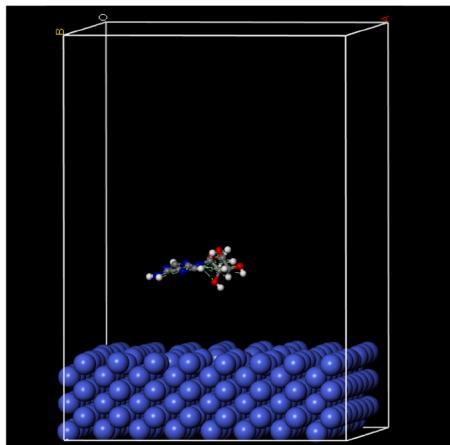

(b)  
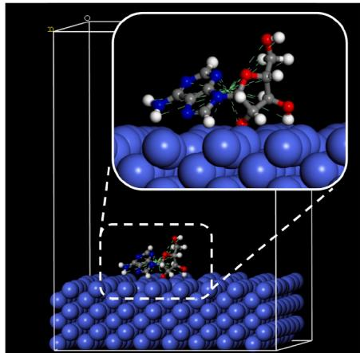

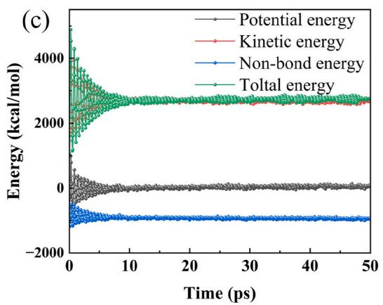

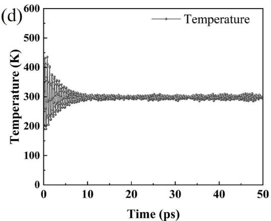  
Fig. 4. Initial state (a), final adsorption state (b), energy change (c), and temperature change (d) of ADO molecular dynamics simulation on the cobalt surface.

highlight the adsorption state of ADO. Fig. 4c showed the change in energy during the MD process, which final energy tended to converge. Fig. 4d presented the change in temperature during the MD process, which final temperature tended toward 298 K. The energy and temperature curves with time indicated that the adsorption of ADO tended toward equilibrium [44]. The adsorption energy of ADO was calculated using Eqs. (2) and (3) [45].

$$
E _ {a d s} = E _ {c o m p l e x} - \left(E _ {C o} + E _ {A D O}\right)\tag{2}
$$

$$
E _ {b i n d i n g} = - E _ {a d s}\tag{3}
$$

where $E _ { \mathrm { a d s } }$ is the interaction energy, $E _ { \mathrm { c o m p l e x } }$ is the total energy of the system, $E _ { \mathrm { C o } }$ is the energy of the Co crystals, and $E _ { \mathrm { A D O } }$ is the energy of ADO. The adsorption energy of ADO on the surface of the cobalt layer was calculated to be 453.23 kJ/mol, indicating that ADO had a good adsorption capacity on the cobalt surface [46–48].

During E-FTIR analysis, infrared differential spectroscopy was used to highlight differences in adsorption at different ADO concentrations. Specifically, the adsorption data at 0 mg/L was used as the baseline, and the adsorption data at other concentrations was subtracted from the baseline to plot the graph. Thus, as shown in Fig. 5b, when the ADO concentration was 0 mg/L, the intensity became a straight line. The N–H out-of-plane bending vibration absorption peaks were observed at 821 $\mathrm { c m } ^ { - 1 }$ . The absorption peaks at 1050 and $1 \bar { 1 } 0 8 ~ \mathrm { { c m } ^ { - 1 } }$ were attributed to the C–O stretching vibration, and the absorption peaks at $1 6 6 4 ~ \mathrm { { c m } ^ { - 1 } }$ originated from the N–H in-plane bending vibration.

As illustrated in Fig. 5b and Table 1, the E-FTIR tests showed that ADO was adsorbed on the surface of the cathode, and the adsorption sites were mainly C–O and O–H in the nucleoside group and N–H in the adenine group, which were consistent with the results of the ESP and MD simulation. As indicated by the red circle in Fig. 5b, the absorption peak at 821 $\mathrm { c m } ^ { - 1 }$ corresponding to the N–H group in 3D image of Fig. 5b gradually displayed a purplish-red hue as the concentration of ADO increased, while the absorption peak at 1663 $\mathrm { c m } ^ { - 1 }$ gradually was towards blue shift with increasing concentration.

(a)  
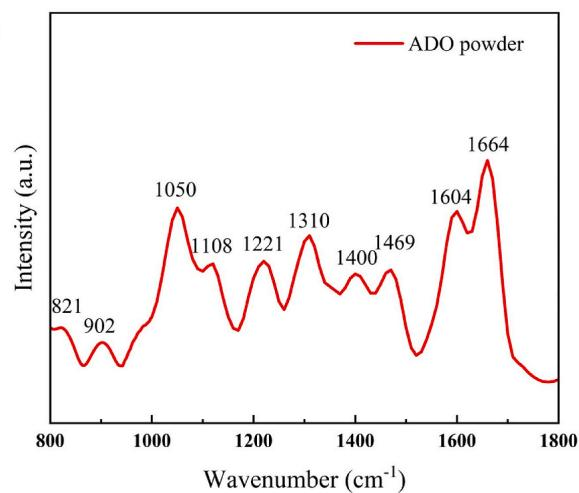

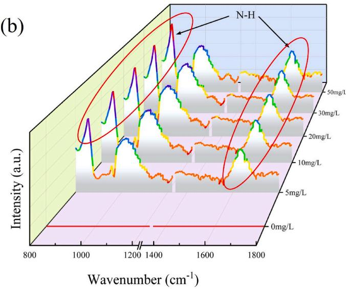  
Fig. 5. FTIR images of ADO powder (a) and E-FTIR test results (b).

Table 1  
FTIR spectra characteristic band assignments for adenosine.

<table><tr><td>Band position/cm-1</td><td>Band assignment</td><td>Ref.</td></tr><tr><td>821</td><td>γ (N-H of Adenine group)</td><td>[49,50]</td></tr><tr><td>1050</td><td>ν (C-O of Nucleoside group)</td><td>[51]</td></tr><tr><td>1108</td><td>ν (C-O of Nucleoside group)</td><td>[51]</td></tr><tr><td>1664</td><td>β (N-H of Adenine group)</td><td>[50]</td></tr></table>

With an increase of ADO concentration, the intensity of N–H absorption peaks attributed to adenine groups at 821 $\mathrm { c m } ^ { - 1 }$ and $1 6 6 4 \mathrm { c m } ^ { - 1 }$ increased, confirming that the adsorption of adenine groups on the cobalt surface increased. The intensity of the corresponding absorption peaks of the nucleoside groups did not considerably change, indicating that the nucleoside groups could be in the maximal adsorption state. The E-FTIR results indicated that the nucleoside group were preferentially adsorbed, and the adsorption of adenine group was enhanced as the concentration of ADO increased.

Above change could attribute to the ESP distribution of ADO in Fig. 2: the nucleoside group with the largest ESP value preferentially adsorbed but adsorption intensity of adenine group could be improved with the increase of ADO concentration. The E-FTIR test and MD simulation showed that the adsorption of adenine groups increased with an increase in concentration, whereas the nucleoside group was always in the maximum adsorption state. Combined with the electrochemical phenomenon where ADO accelerated the cobalt deposition at a low concentration and suppressed the cobalt deposition at a high concentration, this showed that the nucleoside group accelerated cobalt deposition, and the adenine group suppressed the deposition of cobalt.

During the electrochemical testing, ADO was observed to have a low concentration acceleration but high-concentration suppression effect on cobalt deposition. The electrochemical tests, MD simulations, DFT cal culations, and E-FTIR tests explained the reasons for the acceleration at a low concentration and suppression at a high concentration. First, nucleoside groups accelerated cobalt deposition, whereas adenine groups form complexes with ${ \mathsf { C o } } ^ { 2 + }$ to suppress cobalt deposition. Thereafter, adenine groups adsorbed more on the cobalt surface with an increase of the concentration of ADO. Thus, the acceleration disappeared and the suppression increased with an increase of the concentration.

## 3.2. Surface and crystal analysis

Fig. 6 showed the crystal morphology and contact angle changes in cobalt under different conditions as well as the changes in grain orien tation and the coating roughness data. As shown in Fig. 6a–c, the addition of ADO made the cobalt grains significantly smaller, which had the effect of refining the grains. In addition, the distribution of the grains was more uniform, and the uniformity of the plated layer improved. The addition of ADO significantly reduced the contact angle from 105.6◦ to 61.9◦, and the surface energy increased from $9 . 7 2 7 5 ^ { \ast } 1 0 ^ { - 3 }$ to $3 9 . 3 8 2 5 ^ { * } 1 0 ^ { - 3 } \ \mathrm { J } / \mathrm { m } ^ { 2 } .$ . The smaller surface contact angle improved the wettability of the plating solution [52,53], which was conducive to the faster release of hydrogen and the enhancement of the deposition uniformity [54–56]. The change in surface three-dimensional images of roughness tests indicates that ADO significantly improved the quality of the plated layer. The surface roughness decreased from 0.541 to 0.318 μm, and the uniformity of the plated layer improved. The roughness test and the morphological analysis showed that the addition of ADO significantly improved the quality of the plated layer, which was conducive to the reduction of signal transmission loss [57,58].

XRD was performed to analyze the effect of ADO on the crystal orientation (Fig. 6d). Cobalt deposition was achieved on the surface of the copper layer, and a peak of Cu (220) was observed at 74.1◦. The peaks corresponding to the (100), (002), (102), and (110) crystalline

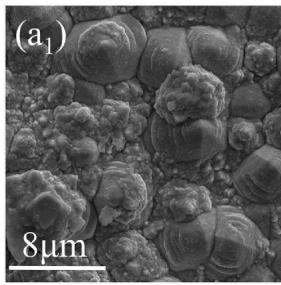

(a2)  
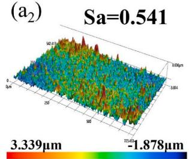

(a3)  
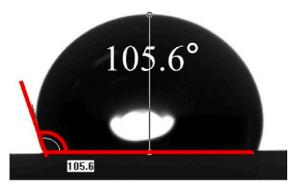

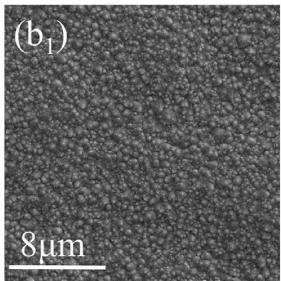

(b2)Sa=0.408  
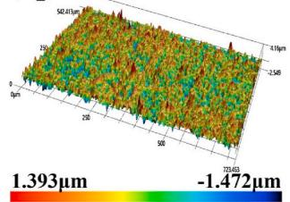  
(b3)

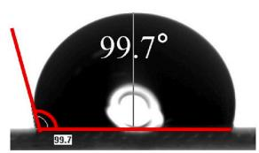

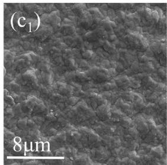

(c2)Sa=0.318  
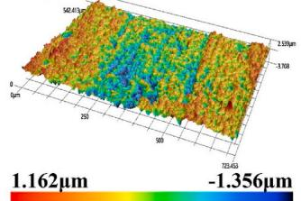  
(c3)

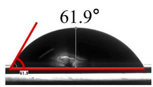

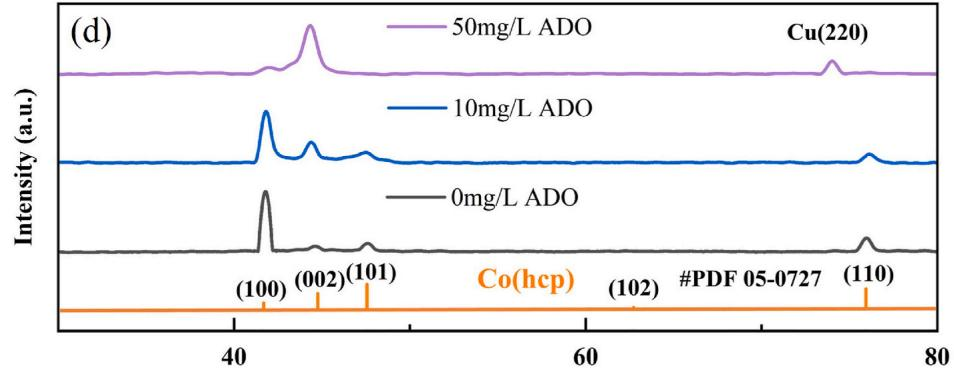  
2θ (°)  
Fig. 6. SEM images, three-dimensional images, and contact angle images of plated cobalt from the plating baths without ADO (a), 10 mg/L ADO (b), and 50 mg/L ADO (c). XRD results of plated cobalt at three different concentrations of ADO (d).

planes of Co hcp were correspondingly observed at 41.7◦, 44.2◦, 47.6◦, and 75.9◦, respectively. The dominant crystalline plane at 0 mg/L con centration was (100); above 10 mg/L, a tendency to suppress the growth of the (110) and (100) crystalline planes and promote the growth of the (002) plane was observed. Although (002) became the dominant crystalline plane at a concentration of 50 mg/L, the intensity of (100) further decreased, and (110) disappeared. The (100) crystal plane of cobalt deposits performed preferential growth when no ADO was added into the plating solution. However, at low concentrations of ADO, the nucleoside group played a significant role in accelerating the growth of the (002) crystal plane. When the ADO concentration increased to 50 mg/L, the growth of the (100), (101), and (110) crystal planes was suppressed instead of the prior growth of (002) crystal plane due to the adenine group for the dominant growth factor. Overall, ADO suppressed the growth of cobalt at (100) and (110), making (002) the dominant crystalline plane. As illustrated in Fig. 6, when the cobalt (002) crystal plane emerges as the predominant orientation, the coating exhibited finer grains, a smoother surface texture, and enhanced hydrophilicity

SEM observations and three-dimensional surface topography demonstrated that the inclusion of ADO led to substantial grain refinement and a notable decrease in surface roughness for electrodeposited cobalt. XRD measurements additionally validated that in the condition of 50 mg/L ADO concentration, the predominant crystalline plane during cobalt deposition transferred to the (002) direction within the hexagonal cobalt crystal lattice.

DC electroplating was performed to corroborate the effect of ADO on cobalt filling. The through-hole filling of cobalt was conducted in a 1.5 L Haring cell with a current density of $0 . 5 ~ \mathrm { A } / \mathrm { d } \mathrm { m } ^ { 2 }$ and plated with a DC power supply for 4 h. Cathodic bubbling was employed during the plating process at a bubbling rate of 2.5 L/min. Here, 50 mg/L of ADO was added during plating, and the X-shaped through-hole filling of cobalt was achieved with the SDT value of 1.2 μm. The pH of plating solution was changed nonlinearly during the cobalt deposition because no acidic or basic substances were added to stabilize the pH value. After plating for 1 h, 2 h and 4 h, the pH values of plating solution were observed as 3.2, 2.6 and 2.3, respectively. The rate of cobalt deposition could become slow due to the decrease of pH value [20,59], thereby leading to thin layer of cobalt growth outside the X-shaped through-hole.

As shown in Fig. 7, ADO was mainly concentrated in the region outside the X-shaped holes, which suppressed the cobalt deposition outside the holes. After 1 h of DC plating, cobalt formed a butterfly-type structure in the X-shaped through-hole, at which time the thickness of the deposited layer outside the hole was less than 1 μm. The X-shaped through-hole filling was achieved after 4 h of DC plating, with a filling rate of ≥90 %, and the thickness of the deposited layer outside the hole was only 1.2 μm.

As shown in Fig. 8a, ADO was adsorbed on the surface of the cathode under electrostatic forces. This resulted in preferential adsorption on the electrode surface outside the pore owing to the difference in liquid mobility and low ADO concentration inside the pore. The DFT calculation, MD simulation, and E-FTIR spectroscopy revealed that the adenine group adsorption increased after the ADO concentration increased, thereby showing suppression of ${ \mathsf { C o } } ^ { 2 + }$ deposition, confirming that ADO accelerated Co deposition at low concentrations and suppressed cobalt deposition at high concentrations during the electrochemical test. Thus, as shown in Fig. 8b, the ${ \mathrm { C o } } ^ { 2 + }$ in the hole was preferentially reduced to ${ \mathsf { C o } } ^ { 0 }$ for accelerating the cobalt deposition, and forming a butterfly-type structure. Although the surface of the electrode outside the hole was strongly suppressed by ADO, the cobalt deposition rate was low and the cobalt layer thickness was below 1 μm. As the deposition process advanced, the curvature of the cobalt layer augmented, leading to an improvement in surface mobility and an increased propensity for ADO adsorption, resulting in a higher adsorption concentration, ultimately suppressing the deposition of cobalt within the pore. As shown in Fig. 8c, the deposition rate decreased. Finally, as shown in Fig. 8d, under the low-concentration acceleration but high-concentration suppression ef fect of ADO, superconformal filling was realized.

## 4. Conclusion

During the electrochemical test, it was observed that ADO exhibited a low-concentration acceleration but high-concentration suppression effect. By analyzing the HOMO-LUMO and ESP values, discovered that the ADO adsorption sites could be categorized into two distinct groups: adenine and nucleoside. Subsequent MD simulations revealed that the specific adsorption sites were the –OH within the nucleoside group and the –NH within the adenine group. Furthermore, the E-FTIR test indicated that the –OH in nucleoside group were preferentially adsorbed, and as the concentration of ADO increased, the adsorption of the –NH in adenine group was enhanced. These findings were consistent with the ESP calculations, which identified the –OH in nucleoside group as the maximum point and the –NH in adenine group as the sub-maximum point. Combined with the results of electrochemical tests and IRI sim ulations, it is concluded that the nucleoside groups which containing multiple –OH played an accelerating role in cobalt deposition, while the adenine group which coordinated with $\mathsf { C o } ^ { 2 + }$ played a role in suppressing cobalt deposition. The difference in the adsorption intensity of nucleoside and adenine groups leads to the low-concentration acceleration but high-concentration suppression effect of ADO in the cobalt electrodeposition.

SEM images and three-dimensional images of plated cobalt showed that ADO had the effects of grain refinement and surface roughness reduction. XRD results showed that under the influence of 50 mg/L ADO, the dominant crystalline plane for cobalt deposition was the (002) crystalline plane in the cobalt hexagonal crystal system. The surface quality of the plated layer improved; moreover, the cobalt grains were refined, and the surface roughness was reduced, which was conducive to the reduction of signal transmission loss.

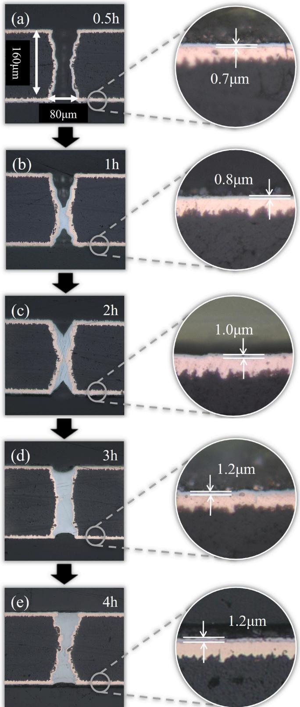  
Fig. 7. Shape evolution of cobalt layer in X-shaped through-hole after plating for 0.5 h (a), 1 h (b), 2 h (c), 3 h (d), and 4 h (e).

Using the low-concentration acceleration but high-concentration suppression effect of ADO, superconformal cobalt filling without porosity was achieved in X-shaped through-hole with an aspect ratio of 2:1 and the SDT value of the plated layer was only 1.2 μm.

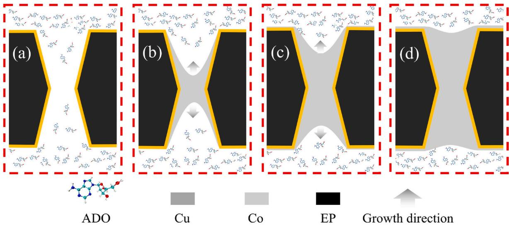

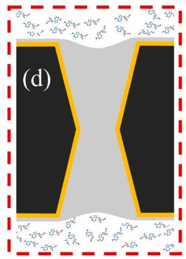  
Fig. 8. Schematic diagram of cobalt superconformal growth with the influence of ADO (EP represented epoxy resin)

## CRediT authorship contribution statement

Ruiquan Yang: Writing – original draft, Methodology, Investiga tion, Formal analysis. Xueting Li: Supervision, Methodology, Investigation. Jie Xie: Supervision, Project administration, Conceptualization. Zengbiao Liu: Methodology, Investigation. Hongbin Cui: Visualization, Data curation. Yongsheng Zhou: Visualization, Investigation. Xuemei He: Resources, Methodology. Yu Jiao: Methodology, Investigation. Shouxu Wang: Validation, Resources. Wei He: Validation, Methodology. Yuanming Chen: Writing – review & editing, Supervision, Conceptualization.

## Declaration of competing interest

The authors declare that they have no known competing financial interests or personal relationships that could have appeared to influence the work reported in this paper.

## Acknowledgments

The authors are thankful for the financial support from Sichuan Science and Technology Program (No. 2025ZNSFSC0382), the project of Industry-University-Research Collaboration of Zhuhai City (No. 2320004002387) and the Key Field R&D project of Dongguan City (No. 20231200300172).

## Data availability

Data will be made available on request.

## References

[1] D. Gall, Electron mean free path in elemental metals, J. Appl. Phys. 119 (2016) 085101, https://doi.org/10.1063/1.4942216.

[2] E.H. Sondheimer, The mean free path of electrons in metals, Adv. Phys. 50 (2001) 499–537, https://doi.org/10.1080/00018730110102187.

[3] W. Zhang, S.H. Brongersma, O. Richard, B. Brijs, R. Palmans, L. Froyen, et al., Influence of the electron mean free path on the resistivity of thin metal films, Microelectron. Eng. 76 (2004) 146–152, https://doi.org/10.1016/j. mee.2004.07.041.

[4] Y. Okada, Y. Tokumaru, Precise determination of lattice parameter and thermal expansion coefficient of silicon between 300 and 1500 K, J. Appl. Phys. 56 (1984) 314–320.https://dei org/10.1063/1.333965

[5] R.N. Abdullaev, R.A. Khairulin, YuM. Kozlovskii, S.V. Stankus, Density and thermal expansion of high purity cobalt over the temperature range from 140 k to 2073 k, Metall. Mater. Trans. A 52 (2021) 5449 5456, https://doi.org/10.1007/s11661- 021-06485-1.

[6] Y.-L. Cheng, H.-C. Huang, C.-Y. Lee, G.-S. Chen, J.-S. Fang, Comparison of cu and co integration with porous low-k sioch dielectrics, Thin Solid Films 704 (2020) 138010, https://doi.org/10.1016/j.tsf.2020.138010.

[7] J. Wu, F. Wafula, S. Branagan, H. Suzuki, J. Van Eisden, Mechanism of cobalt bottom-up filling for advanced node interconnect metallization, J. Electrochem. Soc. 166 (2019) D3136–D3141, https://doi.org/10.1149/2.0161901jes.

[8] F. Wafula, J. Wu, S. Branagan, H. Suzuki, A. Gracias, J. Van Eisden, Electrolytic cobalt fill of sub-5 nm node interconnect features. 2018 IEEE International Interconnect Technology Conference (IITC), IEEE, Santa Clara, CA, USA, 2018, pp. 123–125, https://doi.org/10.1109/IITC.2018.8430384.

[9] Q. Huang, T.W. Lyons, W.D. Sides, Electrodeposition of cobalt for interconnect application: effect of dimethylglyoxime, J. Electrochem. Soc. 163 (2016) D715 D721, https://doi.org/10.1149/2.1111613jes

[10] T.W. Lyons, Q. Huang, Effects of cyclohexane- monoxime and dioxime on the electrodeposition of cobalt, Electrochim. Acta 245 (2017) 309 317, https://doi org/10.1016/j.electacta.2017.05.130

[11] D. Josell, T.P. Moffat, The Suppression Induced S-NDR Mechanism for Defect-free Filling of High Aspect Ratio Features, Meet Abstr, 2016, https://doi.org/10.1149 MA2016-02/29/1907. MA2016-02:1907 1907.

[12] D. Josell, M. Silva, T.P. Moffat, Superconformal bottom-up cobalt deposition in high aspect ratio through silicon vias, J. Electrochem. Soc. 163 (2016) D809–D817, https://doi.org/10.1149/2.0861614jes.

[13] M.A. Rigsby, L.J. Brogan, N.V. Doubina, Y. Liu, E.C. Opocensky, T.A. Spurlin, et al., The critical role of pH gradient formation in driving superconformal cobalt deposition, J. Electrochem. Soc. 166 (2019) D3167 D3174, https://doi.org/ 10.1149/2.0211901jes.

[14] X. Ni, Y. Chen, X. Jin, C. Wang, Y. Huang, Y. Hong, et al., Investigation of polyvinylpyrrolidone as an inhibitor for trench super-filling of cobalt electrodeposition, J. Taiwan Inst. Chem. Eng. 112 (2020) 232–239, https://doi. org/10.1016/j.jtice.2020.06.010.

[15] X. Ma, Y. Li, P. Yang, J. Zhang, M. An, Influence of suppressing additive malachite green on superconformal cobalt electrodeposition, J. Electroanal. Chem. 921 (2022) 116696, https://doi.org/10.1016/j.jelechem.2022.116696.

[16] X. Ma, Y. Li, P. Ren, P. Yang, J. Zhang, M. An, et al., Induction-Diffusion-adsorption process of malachite green for cobalt superconformal electrodeposition, J. Electrochem. Soc. 170 (2023) 022503, https://doi.org/10.1149/1945-7111/ acb9bf.

[17] Y. Li, X. Ma, C. Li, R. Li, J. Zhang, P. Yang, et al., Investigation of novel suppressor Nitrotetrazolium Blue chloride on cobalt superconformal growth, J. Manuf. Process. 101 (2023) 15 24, https://doi.org/10.1016/j.jmapro.2023.05.059.

[18] Y. Li, X. Ma, R. Li, J. Zhang, P. Yang, A. Liu, et al., Suppressing-accelerating effect of Nitrotetrazolium Blue chloride in boosting superconformal cobalt filling, J. Electroanal. Chem. 945 (2023) 117671, https://doi.org/10.1016/j. jelechem.2023.117671.

[19] Y. Hu, T. Lyons, Q. Huang, Influence of furil dioxime on cobalt electrochemica nucleation and growth, J. Electrochem. Soc. 167 (2020) 022509, https://doi.org 10.1149/1945-7111/ab69fb

[20] J.T. Matsushima, F. Trivinho-Strixino, E.C. Pereira, Investigation of cobal deposition using the electrochemical quartz crystal microbalance, Electrochim Acta 51 (2006) 1960–1966, https://doi.org/10.1016/j.electacta.2005.07.003.

[21] H. Li, T. Zhang, S. Song, Q. Li, R. Han, Q. Li, et al., Study of 5-alkynylpyrimidines as cobalt superfilling inhibitors, J. Phys. Chem. C 129 (2025) 232–243, https://doi. org/10.1021/acs.jpcc.4c05741.

[22] X. Ni, C. Wang, Y. Su, Y. Luo, Y. Ye, X. Su, et al., Effect of 3-mercapto-1-propane sulfonate sulfonic acid and polyvinylpyrrolidone on the growth of cobalt pillar by electrodeposition, Nanotechnol. Rev. 11 (2022) 1209–1218, https://doi.org 10.1515/ntrev-2022-0071.

[23] W. Cao, Z. Zhu, Q. Li, J. Xie, L. Cui, M. Zhu, et al., Effect of butanedione oxime, 3- mercapto-2-propanesulfonate, and histidine on growth and magnetic properties of electrodeposited cobalt on copper substrate, J. Mater. Sci. Mater. Electron. 35 (2024) 2268, https://doi.org/10.1007/s10854-024-13997-0

[24] T. Li, X. Wei, Y. Chen, L. Duan, B. Pan, Electrodeposition of nanocrystalline cobalt from sulfate baths containing butynediol ethoxylate, Mater. Chem. Phys. 314 (2024) 128927, https://doi.org/10.1016/j.matchemphys.2024.128927.

[25] Y. Tong, D. Lai, Y. Li, T. Hang, M. Li, Y. Wu, Inhibitor alkyne-PEG4-amine contributes to cobalt superfilling, ACS Appl. Electron. Mater. (2024), https://doi. org/10.1021/acsaelm.4c00774 acsaelm.4c00774.

[26] Y. Wu, M. Zhang, Y. Jiang, Y. Tong, P. Chang, T. Hang, et al., Investigation of phenyl methyl sulfoxide as an additive for cobalt super-filling in 3D interconnect, Surf. Interfaces 56 (2025) 105652, https://doi.org/10.1016/j.surfin.2024.105652.

[27] J. Xue, Q. Che, M. Jiang, Z. Liu, Y. Liu, W. Zhang, et al., Self-organized periodic pattern dynamics of porous copper electrodeposition at the industrial large current, Mater. Today Chem. 34 (2023) 101812, https://doi.org/10.1016/j. mtchem.2023.101812.

[28] M.J. Frisch, G.W. Trucks, H.B. Schlegel, G.E. Scuseria, M.A. Robb, J.R. Cheeseman, et al., Gaussian 03, Revision C.02, Gaussian, Inc., Wallingford CT, 2004.

[29] W. Humphrey, A. Dalke, K. Schulten, VMD: visual molecular dynamics, J. Mol. Graph. 14 (1996) 33–38, https://doi.org/10.1016/0263-7855(96)00018-5.

[30] T. Lu, F. Chen, Multiwfn: a multifunctional wavefunction analyzer, J. Comput. Chem. 33 (2012) 580–592, https://doi.org/10.1002/jcc.22885.

[31] N. Xiao, D. Li, G. Cui, N. Li, Q. Li, G. Wu, Adsorption behavior of triblock copolymer suppressors during the copper electrodeposition, Electrochim. Acta 116 (2014) 284–291, https://doi.org/10.1016/j.electacta.2013.11.056

[32] J. Huang, Y. Li, R. Huang, C. He, L. Gong, Q. Hu, et al., Electrochemical exfoliation of pillared-layer metal-organic framework to boost the oxygen evolution reaction, Angew. Chem. 130 (2018) 4722–4726, https://doi.org/10.1002/ange.201801029.

[33] L. Zheng, W. He, K. Zhu, C. Wang, S. Wang, Y. Hong, et al., Investigation of poly (1- vinyl imidazole co 1, 4-butanediol diglycidyl ether) as a leveler for copper electroplating of through-hole, Electrochim. Acta 283 (2018) 560 567, https://doi. org/10.1016/j.electacta.2018.06.132.

[34] Z. Lai, S. Wang, C. Wang, Y. Hong, Y. Chen, H. Zhang, et al., Computational analysis and experimental evidence of two typical levelers for acid copper electroplating, Electrochim. Acta 273 (2018) 318–326, https://doi.org/10.1016/j. electacta.2018.04.062.

[35] D. Li, Z. Wen, J. Lin, J. Zeng, Z. Li, F. Ke, et al., Molecularly imprinted polymer based on magnetic porous cellulose for specific adsorption of tetracyclines: preparation, characterization, property evaluation, and application, Mater. Today Chem. 33 (2023) 101742, https://doi.org/10.1016/j.mtchem.2023.101742

[36] L. Zhuo, W. Liao, Z. Yu, A frontier molecular orbital theory approach to understanding the mayr equation and to quantifying nucleophilicity and electrophilicity by using HOMO and LUMO energies, Asian J Org Chem 1 (2012) 336 345, https://doi.org/10.1002/ajoc.201200103.

[37] L. Qiu, Z.-H. Ni, Q. Sun, X.-P. Qu, Q. Xu, Investigation of a single-component additive for bottom-up superfilling of the high-aspect-ratio TSV by theoretical and experimental studies, J. Phys. Chem. C 128 (2024) 10336–10346, https://doi.org/ 10.1021/acs.jpcc.4c00989.

[38] T. Zhang, C. Zheng, H. Li, S. Song, W. Huang, Q. Li, et al., Five-membered heterocyclic small molecule compounds as novel levelling agents for blind-hole copper plating, J. Electroanal. Chem. 956 (2024) 118100, https://doi.org 10.1016/j.jelechem.2024.118100.

[39] X. Li, X. Chen, P. Zou, R. Ye, L. Wang, Synthesis and application of anthraquinone quaternary phosphonium salt electroplating copper leveler based on expanded electrostatic adsorption area strategy and physicochemical salt bridge mechanism, Appl. Surf. Sci. 664 (2024) 160259, https://doi.org/10.1016/j. apsusc.2024.160259.

[40] P. Ren, R. Li, P. Yang, J. Zhang, M. An, Effect of nitrogen-containing groups on the reduction of copper ions: in situ Raman and AIMD, Surf. Interfaces 51 (2024) 104769, https://doi.org/10.1016/j.surfin.2024.104769.

[41] K. Anton, L. Matic, K. Barbara, T. Peyman, N. Shova, et al., Simplistic correlations between molecular electronic properties and inhibition efficiencies: do they really exist? Corros. Sci. 179 (2021) 108856 https://doi.org/10.1016/j. corsci.2020.108856.

[42] T. Lu, Q. Chen, Interaction region indicator: a simple real space function clearly revealing both chemical bonds and weak interactions, Chemistry Methods 1 (2021) 231–239, https://doi.org/10.1002/cmtd.202100007.

[43] M. Wu, Y. Zhang, J. Jiang, X. Wang, C. Wang, Q. Wang, et al., Synthesis and molecular dynamics simulation of biobased “bottle-brush” polyfarnesene via aqueous radical polymerization, Mater. Today Chem. 38 (2024) 102053, https:// doi.org/10.1016/j.mtchem.2024.102053.

[44] C. Wang, M. An, P. Yang, J. Zhang, Prediction of a new leveler (N-butyl-methy piperidinium bromide) for through-hole electroplating using molecular dynamics simulations, Electrochem. Commun. 18 (2012) 104 107, https://doi.org/10.1016 j.elecom.2012.02.028.

[45] L. Zheng, C. Wang, D. Cai, Y. Huang, K. Adi, Y. Hong, et al., Hydroquinone oriented growth control to achieve high-quality copper coating at high rate for electronics interconnection, J. Taiwan Inst. Chem. Eng. 112 (2020) 130–136, https://doi.org 10.1016/j.jtice.2020.07.004.

[46] J. Li, J. Xu, X. Wang, X. Wei, L. Wang, Diketopyrrolopyrrole-based supramolecular nano-leveler for the enhancement of conformal copper electrodeposition, Appl. Surf. Sci. 569 (2021) 150982, https://doi.org/10.1016/j.apsusc.2021.150982.

[47] M. Zhou, Y. Meng, J. Ling, Y. Zhang, W. Huang, Y. Min, et al., 5-Amino-1,3,4- thiadiazole-2-thiol as a new leveler for blind holes copper electroplating: theoretical calculation and electrochemical studies, Appl. Surf. Sci. 606 (2022) 154871, https://doi.org/10.1016/j.apsusc.2022.154871.

[48] J.-Q. Yang, J.-P. Qiu, L. Jin, Z.-Y. Wang, T. Song, Y. Zhao, et al., Molecula structure impacts of tetrazole derivatives on their diffusion and adsorption behaviors for microvia copper void-free filling, Surf. Interfaces 44 (2024) 103679, https://doi.org/10.1016/j.surfin.2023.103679.

[49] M. Rozenberg, C. Jung, G. Shoham, Low-temperature FTIR spectra and hydrogen bonds in polycrystalline adenosine and uridine, Spectrochimica Acta Part A. Molecular and Biomolecular Spectroscopy 61 (2005) 733–741, https://doi.org/ 10.1016/j.saa.2004.05.024.

[50] R.P. Lopes, R. Valero, J. Tomkinson, M.P.M. Marques, L.A.E. Batista De Carvalho, Applying vibrational spectroscopy to the study of nucleobases - adenine as a casestudy, New J. Chem. 37 (2013) 2691, https://doi.org/10.1039/c3nj00445g.

[51] G. Dovbeshko, FTIR spectroscopy studies of nucleic acid damage, talanta 53 (2000) 233–246, https://doi.org/10.1016/S0039-9140(00)00462-8.

[52] Y. Meng, M. Zhou, W. Huang, Y. Min, X. Shen, Q. Xu, Benzyl-containing quaternary ammonium salt as a new leveler for microvia copper electroplating, Electrochim. Acta 429 (2022) 141013, https://doi.org/10.1016/j.electacta.2022.141013.

[53] P. Dixit, X. Chen, J. Miao, S. Divakaran, R. Preisser, Study of surface treatment processes for improvement in the wettability of silicon-based materials used in high aspect ratio through-via copper electroplating, Appl. Surf. Sci. 253 (2007) 8637 8646, https://doi.org/10.1016/j.apsusc.2007.04.067.

[54] J. Bi, H. Ling, A. Hu, T. Hang, M. Li, Wetting process of electrolyte in high density Cu/Sn micro-bumps electrodepositing, Appl. Surf. Sci. 257 (2011) 3723 3727, https://doi.org/10.1016/j.apsusc.2010.11.121.

[55] C.-W. Liu, J.-C. Tsao, M.-S. Tsai, Y.-L. Wang, Effects of wetting ability of plating electrolyte on Cu seed layer for electroplated copper film, J. Vac. Sci. Technol. A: Vacuum, Surfaces, and Films 22 (2004) 2315–2320, https://doi.org/10.1116 1.1795831.

[56] S.-C. Chang, Y.-L. Wang, C.-C. Hung, W.-H. Lee, G.-J. Hwang, Role of surface tension in copper electroplating, J. Vac. Sci. Technol. A: Vacuum, Surfaces, and Films 25 (2007) 566–569, https://doi.org/10.1116/1.2731354.

[57] Y. Li, P. Ren, Y. Zhang, S. Wang, J. Zhang, P. Yang, et al., The influence of leveler Brilliant Green on copper superconformal electroplating based on, J. Ind. Eng. Chem. 118 (2023) 78–90, https://doi.org/10.1016/j.jiec.2022.10.047.

[58] D. Zhang, Y. Chen, Y. Su, Y. Hong, C. Wang, et al., Additive-assisted cobalt electrodeposition as surface magnetic coating to enhance the inductance of spiral copper inductors, Surf. Interfaces 28 (2022) 101603, https://doi.org/10.1016/j. surfin.2021.101603.

[59] A. Franczak, A. Levesque, F. Bohr, J. Douglade, J.-P. Chopart, Structural and morphological modifications of the Co-thin films caused by magnetic field and pH variation, Appl. Surf. Sci. 258 (2012) 8683–8688, https://doi.org/10.1016/j. apsusc.2012.05.074.