•ARTICLES•

October 2025 Vol.68 No.10: 5194–5201 https://doi.org/10.1007/s11426-025-2626-2

# Decoding the interfacial structure and functionality of an organic additive for superconformal cobalt electrodeposition

Zijie Mao1, Xianglong Du2, Xindi Xu1, Yicai Wu1, Xiaohui Yang2\* Kun Jiang1, Jun Cheng2, Zhi-You Zhou2, Shi-Gang Sun2 & Wen-Bin Cai .1\*

1Shanghai Key Laboratory of Molecular Catalysis and Innovative Materials, State Key Laboratory of Porous Materials for Separation and Conversion, Department of Chemistry, Fudan University, Shanghai 200433, China

2College of Chemistry and Chemical Engineering, State Key Laboratory of Physical Chemistry of Solid Surfaces, Xiamen University, Xiamen. 361000. Ching

Received January 7, 2025; accepted March 9, 2025; published online May 6, 2025

Cobalt (Co) metallization presents a promising alternative strategy for the bottom interconnect in advanced chip manufacture, yet the interfacial structure and functionality ofan organic additive essential for superconformal Co deposition is far from clear given the concurring hydrogen evolution reaction (HER). Herein, interfacial electrochemistry for a model additive molecule MBIS (sodium 2-mercapto-5-benzimidazolesulfonate) at a Co electrode is investigated by applying in situ surface-enhanced infrared absorption spectroscopy and electrochemical quartz crystal microbalance combined with density functional theory calculations The vertical plane adsorption of MBIS on the Co surface via thiolate reduces the overall reduction current with a higher/lower Faradaic efficiency (FE) towards HER/Co deposition due to the significant blockage of surface Co sites as well as the formation of Co(II) complex with MBIS. Surface coverage of MBIS is found to decrease with increasing pH and overpotential, which may account for the location-dependent functionality of MBIS in practical Co deposition in vias. This work provides a molecularlevel insight into the interfacial mechanism of an organic additive essential for the Co superfilling scenario.

Co superfilling, additive adsorption, interfacial mechanism, ATR-SEIRAS

Citation: Mao Z, Du X, Xu X, Wu Y, Yang X, Jiang K, Cheng J, Zhou ZY, Sun SG, Cai WB. Decoding the interfacial structure and functionality of an organic additive for superconformal cobalt electrodeposition. Sci China Chem, 2025, 68: 5194–5201, https://doi.org/10.1007/s11426-025-2626-2

## 1 Introduction

The interconnect metallization is crucial to attain signal and electrical transmission and thus a central process in chip manufacturing [1–5]. Cu is the most commonly used interconnect metal by means of Damascene Cu plating, however, when a 14-nm (or below) process is adopted, electron scattering at external surfaces and grain boundaries leads to a sharp rise in the resistance of narrow Cu lines in the bottom layers [6]. At the nanoscale, the resistivity of a metal is directly related to $\rho _ { \mathrm { b } } { \times } \lambda$ , where $\rho _ { \mathfrak { b } }$ represents the bulk resistivity of the metal and λ represents the electron mean free path [7,8]. Co, Ru, Rh, and Mo have lower $\rho _ { \mathrm { b } } { \times } \lambda$ values and thus are expected to exhibit lower resistances in narrow lines. In addition, their higher melting points compared to that of Cu, are also beneficial in reducing electromigration [9]. In particular, Co interconnect by electrodeposition is highly promising for commercial applications because of its low cost and relative ease for plating among the four alternative metals [10,11].

Unlike acidic Cu electroplating in which hydrogen evolution reaction (HER) is negligible, Co electroplating is accompanied by HER given that $\varphi _ { \mathrm { C o } ^ { 2 + } / \mathrm { C o } } = - 0 . 2 8 \ : \mathrm { V }$ vs. SHE and $\varphi _ { \mathrm { H } ^ { + } / \mathrm { H } _ { 2 } } = 0 \ : \mathrm { V }$ vs. SHE [12,13]. In order to achieve bottom-up filling and avoid voids in the vias, a suitable inhibiting additive, such as sodium 2-mercapto-5-benzimidazolesulfonate (MBIS) [14], or dimethylglyoxime among others [15–25], is needed to regulate the kinetics of Co deposition. Several superfilling (superconformal deposition) models have been proposed to account for the additive-assisted filling process, including the S-shaped negative differential resistance (S-NDR) [15,26,27], the differential current efficiency fill (DCEF) model [28,29], and the hydrogen reduction-induced deactivation (HID) model [30,31].

Notably, despite their significant achievement from a simulation perspective, these models lack a molecular-level insight into the interaction of a specific organic additive with a Co electrode as well as its impact on the Co electrodeposition, which is otherwise highly demanded for the mechanistic understanding and design ofadvanced additives. Along this line, in situ surface molecular spectroscopies are expected to be valuable for this purpose. The use of surface Raman spectroscopy is limited owing to the very low SERS activity at Co surfaces and the very difficult optical focusing with the strong HER condition. This challenge can be well addressed by the application of the in situ ATR-SEIRAS technique which is least metal-specific and free of gas evolution concern [32–40]. Besides, the convincing analysis of

ATR-SEIRAS results towards the assignment of vibrational peaks and the determination of adsorption geometries calls for supplemental support of relevant density functional theory (DFT) calculations.

In this work, MBIS, an organic additive already validated for nano-vias Co superfilling [14], is selected as the target model molecule. The interfacial structure and mechanistic aspect of adsorbed MBIS at the Co electrode are probed initially by high sensitivity in situ ATR-SEIRAS and DFT calculations. Electrochemical quartz crystal microbalance (EQCM) is applied to quantify the relative contributions of Co deposition and HER in the Co-plating solutions with and without the additive. Potential and pH dependencies of MBIS on Co deposition rates provide an inference to the interfacial functionality of MBIS in Co superfilling.

## 2 Results and discussion

Figure 1a illustrates the linear sweep voltammograms (LSVs) for Co electrodes in 0.5 M $\mathrm { H } _ { 3 } \mathrm { B O } _ { 3 } + 0 . 0 5$ M $\mathrm { C o S O _ { 4 } }$ solutions with and without 25 ppm MBIS at pHs 2 and 3. In the absence of MBIS, the current density increases with the negative potential scan, owing to hydrogen evolution and Co deposition. Lowering the pH from 3 (black line) to 2 (red line) increases the current density at potentials negative of −1.55 V. In the presence of MBIS, the overall reduction current is strongly inhibited from −1.20 to −1.45 V, followed by a sharp increase regardless of pH, which was attributed to the inactivation of the additive [14]. At more negative potentials, the reduction currents largely overlap regardless of MBIS in the solution for a given pH. The closeness of the inactivation potentials for the two pHs suggests that the inactivation process is not $\mathrm { H } ^ { + }$ dependent.

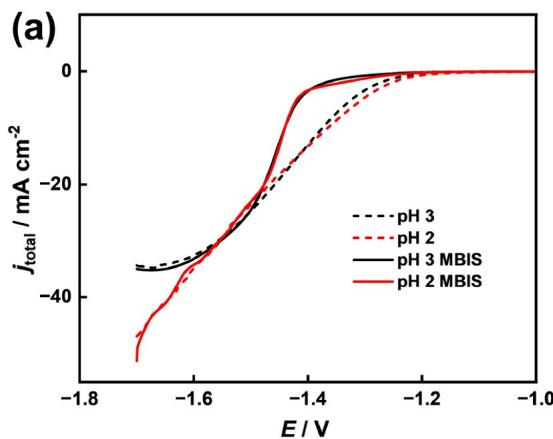

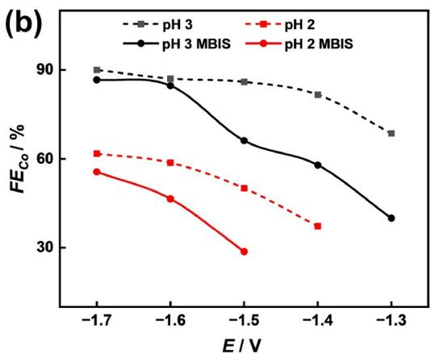

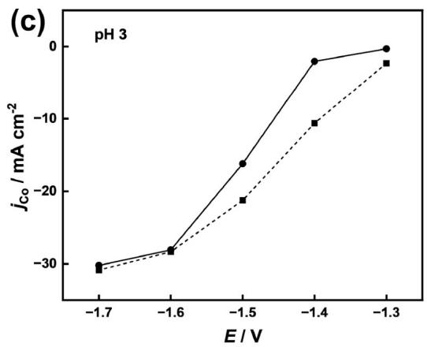

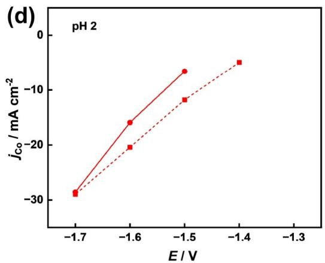  
Figure 1 (Color online) (a) LSVs for Co deposition in 0 5 M $\mathrm { H } _ { 3 } \mathrm { B O } _ { 3 }$ and $0 . 0 5 \mathrm { M } \mathrm { C o S O } _ { 4 }$ with and without 25 ppm MBIS at pH 2 and 3. The pH was adjusted by adding diluted $\mathrm { H } _ { 2 } \mathrm { S O } _ { 4 }$ to the solutions. $( \mathrm { b ) F E _ { C o } }$ at different potentials. (c, d) Partial current densities of Co deposition at different potentials and pHs. It should be noted that at pH 2, the Co deposition reaction at low overpotentials is too low to be shown.

Given the two reduction reactions involved, EQCM was utilized to evaluate the Faradaic efficiencies and thus the partial current densities for Co deposition and HER at varying pHs and potentials, as depicted in Figure 1b. The evaluation of $\mathrm { F E } _ { \mathrm { C o } }$ through the EQCM measurement is explained in Figure S1 (Supporting Information online). In the MBIS-free solution of pH 3, the $\mathrm { F E } _ { \mathrm { C o } }$ increases from 68% to 90% as the potential moves from −1.3 to −1.7 V since a more negative potential favors the more difficultly reduced ${ \mathrm { C o } } ^ { 2 + }$ At a given potential, $\mathrm { F E } _ { \mathrm { H } _ { 2 } }$ increases upon decreasing the solution acidity to pH 2 (red lines).

In an MBIS-containing electrolyte, $\mathrm { F E } _ { \mathrm { C o } }$ is significantly decreased at potentials positive of −1.4 V, as compared to the counterpart in the MBIS-free electrolyte. Increasing the overpotential narrows the difference between Co deposition Faradaic efficiencies with and without MBIS. Notably, a steep rise of $\mathrm { F E } _ { \mathrm { C o } }$ from −1.5 to −1.6 V occurs due to the inactivation of MBIS as shown in Figure 1a. In fact, $\mathrm { F E } _ { \mathrm { C o } }$ is almost unchanged at −1.7 V for a given pH regardless of MBIS in a plating solution. Therefore, it may be concluded that the MBIS functions to decrease the Co deposition rate more than the HER rate, leading to a higher $\mathrm { F E } _ { \mathrm { H } _ { 2 } }$ and a lower $\mathrm { F E } _ { \mathrm { C o } }$ in an MBIS-contained plating solution. To gain a deeper mechanistic understanding, in situ ATR-SEIRAS was employed to study the adsorption behavior of MBIS on a Co film electrode which was pre-characterized by atomic force microscope (AFM) and X-ray photoelectron spectroscopy (XPS) (Figures S2 and S3). Figure 2a displays the timeevolved ATR-SEIRAS spectra for MBIS adsorption at the Co electrode at −1.0 V in a $0 . 5 \mathrm { M H } _ { 3 } \mathrm { B O } _ { 3 }$ and $0 . 0 5 \mathrm { M N a } _ { 2 } \mathrm { S O } _ { 4 }$ solution containing 25 ppm MBIS, and the infrared (IR) spectra for solid MBIS and 30 g/L MBIS solution are shown in Figure S4 for comparison. ${ \mathrm { N a } } _ { 2 } { \mathrm { S O } } _ { 4 }$ was used as the supporting electrolyte instead of $\mathrm { C o S O _ { 4 } }$ in the solution to avoid the fluctuating spectral response due to otherwise the fast growth of the Co film, to ensure the acquisition of highquality IR spectra for MBIS adsorption on Co surfaces. It can be seen in Figure 2a, that MBIS adsorbed rapidly at the Co electrode and the peaks between 1520 to $7 3 1 ~ \mathrm { c m } ^ { - 1 }$ are assigned in Table S1 (Supporting Information online), corresponding to the vibrations of the functional groups of adsorbed MBIS. Strictly speaking, the lone pair of electrons on the nitrogen atom of N-3 in the imidazole molecule is protonated for the pHs herein, for simplification, MBIS is also used to represent its protonated form in this work.

The adsorption structure of MBIS on the Co electrode was further confirmed. The vibrational frequencies and intensities of MBIS were calculated using DFT based on harmonic approximation, and the results are displayed in Figure S5 and MOV 1 (see the details in Supporting Information online). By comparing the infrared spectra of adsorbed MBIS with that of an MBIS solution (black line in Figure 2a), the adsorption configuration of MBIS at the Co electrode surface can be calculated by the surface selection rule of ATR-SEIRAS (see Figure S6 for more details). Thus, the MBIS molecule is deduced to adsorb nearly perpendicularly on the Co electrode via thiolate formation, i.e., at an angle of5° between the molecular plane and the local surface normal (defined as α), while the quasi-symmetric axis of the aromatic ring is edge-tilted by ca. 5° from the surface normal (defined as $\beta ) .$ . To validate the adsorption configuration of MBIS on the Co surface, the structure optimization of adsorbed MBIS was also performed by DFT calculations as shown in Figure 2b, revealing that the corresponding angles α and $\beta$ are both $4 ^ { \circ } .$ . The consistent results from both approaches indicate that MBIS molecules are adsorbed in an essentially vertical orientation on the Co surface. Such an adsorption configuration enables a relatively high coverage of MBIS on the Co electrode surface, leading to a strong inhibition effect.

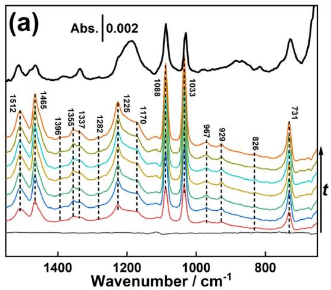

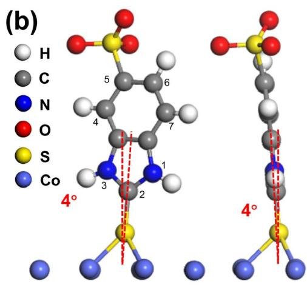  
Figure 2 (Color online) (a) Time-evolved ATR-SEIRAS spectra for MBIS adsorption on a Co electrode in a 25 ppm MBIS-contained 0.5 M H BO and 0.05 M Na SO solution of pH 3 at −1.0 V. The reference spectrum was taken in the same solution before the addition of MBIS. The interval between each spectrum was 1 min. The black line represents the spectrum of 30 $\mathrm { g / I }$ MBIS solution. (b) Configuration of an adsorbed MBIS molecule on Co surface based on DFT calculations.

High sensitivity in situ ATR-SEIRAS measurement was extended to elucidate how the interfacial molecular structure affects the observed functionality of adsorbed MBIS towards Co electrodeposition, that is, inhibition on both partial currents with a lower $\mathrm { F E } _ { \mathrm { C o } }$ and a higher $\mathrm { F E } _ { \mathrm { H } _ { 2 } } .$ On one hand, Figure 3a shows the ν(O‒H) spectral region for interfacial $\mathrm { H } _ { 2 } \mathrm { O }$ at the Co electrode after introducing MBIS molecules in the solution. The broad wavy bipolar band in Figure 3a can be deconvoluted into four ν(O‒H) peaks due to four types of interfacial water, $i . e . ,$ ice-like $\mathrm { H } _ { 2 } \mathrm { O } \ ( { \sim } 3 3 0 0 \ \mathrm { c m } ^ { - 1 } )$ , peak 1), bulk-like $\mathrm { H } _ { 2 } \mathrm { O } \ ( \sim 3 4 2 0 \ \mathrm { c m } ^ { - 1 }$ , peak 2), hydrogen-bond partially broken $\mathrm { H } _ { 2 } \mathrm { O } \left( { \sim } 3 5 5 0 \ \mathrm { c m } ^ { - 1 } \right)$ , peak 3) and hydrogen-bond broken $\mathrm { H } _ { 2 } \mathrm { O } \ \left( \sim 3 6 3 0 \ \mathrm { c m } ^ { - 1 } \right)$ , peak 4) [41], noting that the ν(O‒H) vibration frequency of interfacial water increases with decreasing hydrogen bonding. The deconvolution results for the first and last curves in Figure 3a are shown in Figure 3b. The hydrophobic nature of aromatic ring of adsorbed MBIS favors the breaking of the hydrogen bond network of interfacial water, which may impact the HER kinetics according to previous reports [42,43].

More importantly, the interaction between adsorbed MBIS and adjacent ${ \mathrm { C o } } ^ { 2 + }$ in the solution may contribute to the decreased $\mathrm { F E } _ { \mathrm { C o } } .$ Such an interaction can be demonstrated by

(a)

in situ ATR-SEIRAS measurement in a 3 mM ${ \mathrm { C o } } ^ { 2 + } .$ containing solution at −1.3 V. The deposition condition is to ensure a very slow Co deposition to avoid the abrupt morphological change of the Co film electrode during the spectral acquisition. Using the last single-beam spectrum before the injection of MBIS as the reference to calculate a series ofspectra as shown in Figure 4a. Peaks associated with MBIS are labeled with \*, while peaks related to $\mathrm { H } _ { 3 } \mathrm { B O } _ { 3 }$ and ${ \mathrm { S O } _ { 4 } } ^ { 2 - }$ are labeled with • (see Figure S7 for details). Figure 4b compares the ATR-SEIRAS spectra for MBIS adsorbed on Co electrodes at −1.3 V in the presence and the absence of ${ \mathrm { C o } } ^ { 2 + }$ in the electrolytes. The vibrational peaks of the adsorbed MBIS corresponding to the C=C of aromatic ring stretching modes such as the peaks at 1512 and $1 4 6 5 ~ \mathrm { { c m } ^ { - 1 } }$ are redshifted significantly with ${ \mathrm { C o } } ^ { 2 + }$ addition (indicated by the arrows in Figure 4b), suggesting a decrease in the π-conjugate-electron density of adsorbed MBIS due to its partial electron transfer to adjacent ${ \mathrm { C o } } ^ { 2 + }$ to form a sort of Co(II)-MBIS complex. Besides the reduced surface active sites, this latter species is more difficult to reduce than hydrated ${ \mathrm { C o } } ^ { 2 + }$ ions, leading to the overall inhibited Co deposition with a lower partial current and a Faradaic efficiency for Co deposition. DFT calculations also indicate that the approaching of ${ \mathrm { C o } } ^ { 2 + }$ to MBIS results in an overall redshift in the vibrational frequencies, see Figure $_ \mathrm { 4 c }$ and MOV 2 in the Supporting Information online. Note that the calculated spectra were performed for an MBIS solution, the relative peak positions and intensities are somewhat different from those experimentally observed in the ATR-SEIRAS spectra, nevertheless, the redshift trend matches.

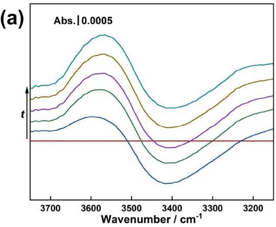

A classical viewpoint in the literature [27,28] suggests that pH is a driving force in the superfilling process assuming the obstructed mass transport in the vias. Here, we further investigate the impact of pH on MBIS adsorption by using in situ ATR-SEIRAS with the spectral results depicted in Figure 5a. Upon reaching a stable MBIS adsorption at pH 3, the solution pH was changed from 3 to 2 by introducing a

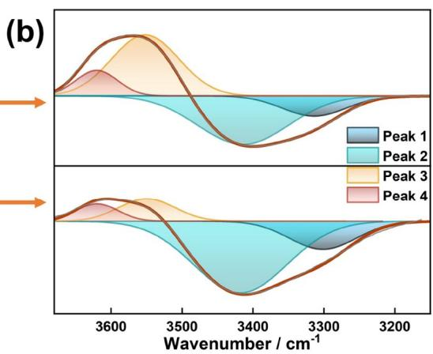  
Figure 3 (Color online) (a) Time-evolved ATR-SEIRAS spectra of interfacial water on a Co electrode at –1 0 V in a 25 ppm MBIS-contained 0 5 M H3BO. and 0.05 M Na SO solution of pH 3. The reference spectrum was recorded in the same solution before the addition of MBIS. The interval between each spectrum was 1 min. (b) Gaussian fitting with four ν(O‒H) modes for the first and last spectra in the left panel.

dilute $\mathrm { H } _ { 2 } \mathrm { S O } _ { 4 }$ solution. To better visualize the spectral change, Figure 5b presents the time-evolved difference spectra utilizing the spectrum immediately prior to the $\mathrm { H } _ { 2 } \mathrm { S O } _ { 4 }$ injection as the reference. The main peak at $1 0 3 3 ~ \mathrm { c m } ^ { - 1 }$ (marked with a star in Figure 5) for adsorbed MBIS increases by \~10% with pH decreased from 3 to $^ { 2 , }$ consistent with a more significant reduction of $\mathrm { F E } _ { \mathrm { C o } }$ at pH 2 than at pH 3 as shown in Figure 1. It is worth mentioning that for Co superfilling, the consumption of protons by HER leads to a progressive increase in pH within the vias due to the limited mass transport, lowering the coverage ofMBIS in the vias and thus creating different Co deposition rates inside and outside the vias. In order to probe the deactivation mechanism of the adsorbed MBIS at potentials negative of ca. $- 1 . 5 \mathrm { V }$ as noted in Figure 1, potentiodynamic ATR-SEIRAS spectra of MBIS on the Co electrode are presented in Figure 6. Compared with those obtained at −1.0 V (Figure 2a), additional peaks emerge at 1410, 1330, and $9 7 4 ~ \mathrm { { c m } ^ { - 1 } }$ attributable to dissolved $\mathrm { H } _ { 3 } \mathrm { B O } _ { 3 } ,$ adsorbed $\mathrm { H } _ { 3 } \mathrm { B O } _ { 3 } ,$ and dissolved $\mathrm { H S O } _ { 4 } ^ { - }$ [44,45], respectively (see Figures S8 and S9 for more details). During cathodic scanning, no additional spectral features characteristic of other new species can be seen except that the peak intensities for adsorbed MBIS tend to decrease, as a result of the MBIS desorption from the Co electrode. Reversing the potential scan results in the increment of the peak intensities. The normalized $1 0 3 3 ~ \mathrm { c m } ^ { - 1 }$ peak (marked with a star in Figure 6a) intensities versus potential plot (red solid line) for the negative potential scan is shown in Figure 6b using the one at −1.0 V as a benchmark. Obviously, the relative spectral coverage θ decreases with decreasing potential, specifically at −1.6 V, the $\theta$ value is only 8% of that at −1.0 V, implying that the deactivation of MBIS at the Co electrode is not due to the structural destruction of MBIS, but rather to potential-driven MBIS desorption. We believe that the low coverage of MBIS may at least partly account for similar electrochemical responses observed at very negative potentials in Figure 1. According to the aforementioned ATR-SEIRAS measurements and DFT calculations, the MBIS at the Co electrode via the $\mathrm { C o - } \mathrm { S }$ bonding can be desorbed at a sufficiently negative potential according to the following equation [46]:

(a)  
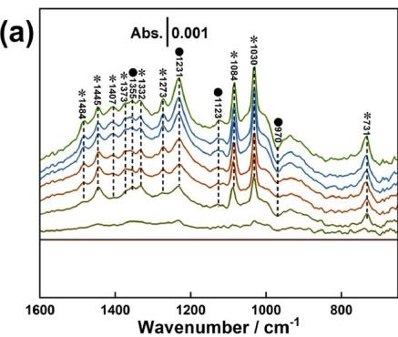

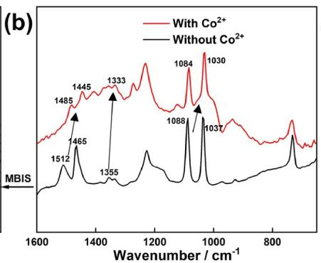

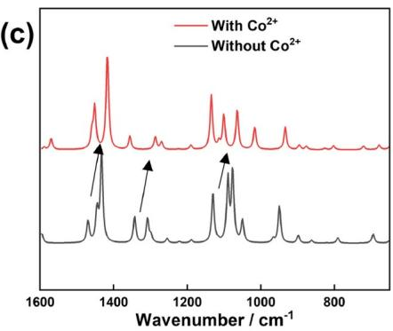  
Figure 4 (Color online) (a) ATR-SEIRAS spectra collected on a Co electrode in $0 . 5 \mathrm { M } \mathrm { H _ { 3 } B O _ { 3 } } , 0 . 0 5 \mathrm { M } \mathrm { N a _ { 2 } S O _ { 4 } } ,$ and $0 . 0 0 3 \mathrm { M C o S O } _ { 4 }$ solution at −1.3 V at pH 3 before and after the addition of 25 ppm MBIS. The reference spectrum was taken $\mathrm { a t } - 1 . 3 \mathrm { V }$ before the addition of MBIS. The interval between each spectrum was 1 min. Peaks associated with MBIS are labeled with \* and peaks from $\mathrm { H } _ { 3 } \mathrm { B O } _ { 3 }$ and ${ \mathrm { S O } _ { 4 } } ^ { 2 - }$ during deposition are labeled with •. (b) Comparison of ATR-SEIRAS spectra of MBIS adsorption on a Co electrode with and without ${ \mathrm { C o } } ^ { 2 + }$ . To facilitate comparison, the direction of the peak movement is indicated by arrows. (c) Comparison of the calculated spectra of MBIS in solution with and without ${ \mathrm { C o } } ^ { 2 + }$

(a)  
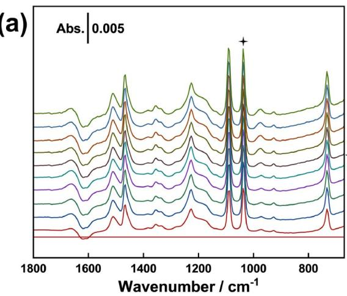

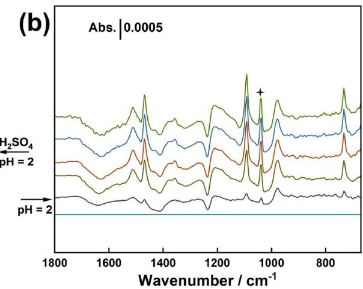  
Figure 5 (Color online) Time-evolved ATR-SEIRAS spectra for 25 ppm MBIS adsorbed on a Co electrode at –1 0 V in $\mathrm { a } 0 . 5 \mathrm { M } \mathrm { H } _ { 3 } \mathrm { B O } _ { 3 }$ and $0 . 0 5 \mathrm { M N a _ { 2 } S O _ { 4 } }$ solution at pH 3, followed by the addition of $\mathrm { H } _ { 2 } \mathrm { S O } _ { 4 }$ dj h h f k i h l i b f h ddi i f ( ) $\mathrm { o r ( b ) ~ H _ { 2 } S O _ { 4 } } .$ The interval between each spectrum was 1 min

$$
\mathrm{Co-SR} + \mathrm{e} ^ {-} = \mathrm{Co(0)} + ^ {-} \mathrm{SR}
$$

Figure 6b (black dashed line) also displays a potential dependency of less than $1 0 \mathrm { { c m } ^ { - 1 } / V }$ for the $1 0 3 3 ~ \mathrm { c m } ^ { - 1 }$ peak (marked with a star in Figure 6a). It is noteworthy that the trend of the peak frequency follows that of θ as a function of potential, suggesting a strong correlation between the two plots. In fact, such a coincidence is also found for other ring vibration modes. The progressive desorption of MBIS with negatively moving potential leads to a weakening of the dipole-dipole interaction among adsorbed MBIS molecules, and thus a small displacement of the vibrational frequencies. In fact, given that the aromatic ring structure of vertically adsorbed MBIS molecules is barely affected by the electric field of the Helmholtz layer, the relevant Stark effect shall be very weak.

Figure 6c and Figure S10 illustrate the variation of interfacial water bands with potential in the presence and absence of MBIS at Co electrodes. The ν(O‒H) band of interfacial water tends to increase with the negative shift of potential. By deconvoluting the broad $\nu ( \mathrm { O - H } )$ band, we can see that peaks 1 and 3 (Figure 6d) increase and decrease significantly with the negative shift of potential in the presence of MBIS, respectively, while peaks 2 and 4 (Figure S11) change insignificantly. In the absence of MBIS, the relative intensities of the four peaks of interfacial water are least affected by the potential shift. The progressive desorption of MBIS leads to a reduced proportion of peak 3, consistent with the results shown in Figure 3.

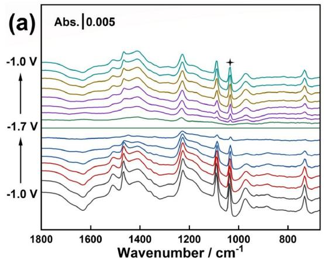

To further investigate the mechanism, the molecular dynamics simulations were performed using classical force fields (see the details in Supporting Information online). Based on the aforementioned results and molecular dynamics simulations, the interfacial mechanism of MBIS on Co electrodes may be proposed (Figure 7). The hydrophobicity of MBIS aromatic rings disrupts the hydrogen bonding of interfacial $\mathrm { H } _ { 2 } \mathrm { O } ,$ , leading to the formation of a more ordered $\mathrm { H } _ { 2 } \mathrm { O }$ structure in favor of HER (1 of the left panel of Figure 7). The positively charged ${ \mathrm { C o } } ^ { 2 + }$ ions are driven towards the electrode surface by the electric field, forming an interfacial Co(II)-MBIS complex that requires higher energy input for its reduction (2, 3 of left panel of Figure 7). On one hand, the adsorption of MBIS reduces the number of surface active sites and decreases the apparent overall current. On the other hand, the formation of a Co(II) complex at the MBIS-modified Co electrode inhibit the Co deposition much more significantly than the HER, leading to a decrease in $\mathrm { F E } _ { \mathrm { C o } }$ and an increase in $\mathrm { F E } _ { \mathrm { H } _ { 2 } } .$ . As a proven additive in the Co superfilling, MBIS essentially displays the feature of a strong inhibitor against Co deposition. The inhibition effect of MBIS is highly dependent on its surface coverage: the higher the coverage, the stronger the inhibition against Co deposition. Thus, the mechanism of the Co superfilling in the vias could be qualitatively unraveled by assuming the existing difference of local surface MBIS coverage inside and outside the vias, which may arise from but not limited to the obstructed mass transport of MBIS and the pH difference caused by HER. The higher and lower MBIS coverages outside and inside the vias lead to slower and faster Co filling outside and inside the vias, respectively, ensuring the Co superfilling (right panel of Figure 7). Based on the above mechanistic understanding at the molecular level, we are constructing (will report in the near future) a simulation model of the Co filling process to quantitatively analyze the distribution of additives in the vias, as well as to predict the conditions for the Co superfilling.

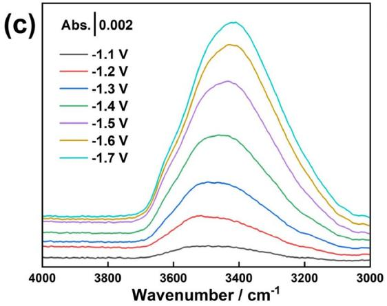

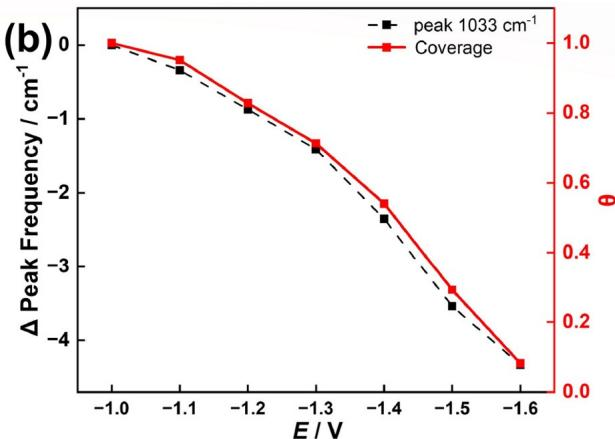

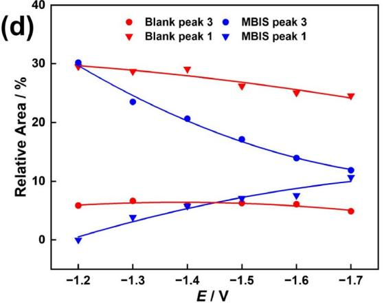  
Figure 6 (Color online) (a) Potentiodynamic ATR-SEIRAS spectra collected on a Co electrode in a 25 ppm MBIS-contained 0.5 M H BO and 0.05 M $\mathrm { N a } _ { 2 } \mathrm { S O } _ { 4 }$ solution of pH 3 with a scan rate of 0.5 mV/s. The ATR-SEIRAS spectra with the corresponding single-beam spectrum $\mathrm { a t } - 1 . 7 \ : \mathrm { V }$ was used as the reference. (b) The characteristic peak frequency shift of MBIS (black dashed line) and coverage of MBIS (red solid line) on a Co electrode as a function of potential. (c) ATR-SEIRAS spectra for interfacial water on a Co electrode at different potentials in a 25 ppm MBIS-contained $0 . 5 \mathrm { M } \mathrm { H } _ { 3 } \mathrm { B O } _ { 3 }$ and 0.05 M $\mathrm { \bar { N a } } _ { 2 } \mathrm { S O } _ { 4 }$ solution of pH 3, using the corresponding single-beam spectrum $\mathrm { a t } - 1 . 0 \ : \mathrm { V }$ as the reference. (d) The proportions of peak 1 and peak 3 at different potentials.

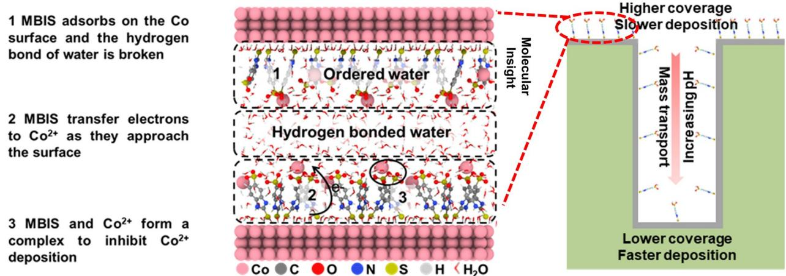  
Figure 7 (Color online) Schematic of interfacial mechanism for MBIS in Co deposition. The left scheme is a snapshot of molecular dynamics simulation while the right panel shows different MBIS coverages inside and outside a channel.

## 3 Conclusions

In this study, we have delved into the inhibition mechanism of the additive MBIS in acidic Co electroplating using a synergistic approach inclusive of electrochemical and ATR-SEIRAS measurement as well as computational simulations.

The MBIS molecule adapts a nearly vertical adsorption configuration on the Co electrode via the formation of thiolate, reducing both partial currents for Co deposition and $\mathrm { H } _ { 2 }$ evolution with a higher $\mathrm { F E } _ { \mathrm { C o } }$ and a lower $\mathrm { F E } _ { \mathrm { H } _ { 2 } } ,$ , as compared to the MBIS-free case. We have revealed at a molecular level that the adsorbed MBIS molecules disrupt the hydrogen bonding of interfacial water, and form a sort of interfacial $\mathrm { M B I S - C o } ^ { \overline { { 2 } } + }$ complex, thereby favoring a higher selectivity toward the hydrogen evolution than the Co deposition. Furthermore, variation in the MBIS coverage has been identified with varying pHs or potentials, offering crucial insights into the refinement of electroplating parameters. The MBIS coverage-dependent inhibition effect can qualitatively account for the Co superfilling process. Our work is valuable in understanding the interfacial structure and functionality of a typical inhibitor for superconformal Co plating and lends important guidance for filling simulations.

Acknowledgements This work was supported by the National Natural Science Foundation of China (22272033, 22241201, 22402167) and the Science and Technology Commission of Shanghai Municipality (2024ZDSYS02).

Conflict of interest The authors declare no conflict of interest.

Supporting information The supporting information is available online at http://chem.scichina.com and http://link.springer.com/journal/11426. The supporting materials are published as submitted, without typesetting or editing. The responsibility for scientific accuracy and content remains entirely with the authors.

1 Andricacos PC, Uzoh C, Dukovic JO, Horkans J, Deligianni H. IBM J Res Dev, 1998, 42: 567–574

2 Kelly JJ, Tian C, West AC. J Electrochem Soc, 1999, 146: 2540–2545

3 Dow WP, Liu CW. J Electrochem Soc, 2006, 153: C190

4 Moffat TP, Wheeler D, Edelstein MD, Josell D. IBM J Res Dev, 2005, 49: 19–36

5 Moffat TP, Wheeler D, Kim SK, Josell D. Electrochim Acta, 2007, 53:

145–154

6 Steinhögl W, Schindler G, Steinlesberger G, Engelhardt M. Phys Rev B, 2002, 66: 075414

7 Mayadas AF, Shatzkes M. Phys Rev B, 1970, 1: 1382–1389

8 Gall D. J Appl Phys, 2016, 119: 085101

9 Hu CK, Kelly J, Chen JHC, Huang H, Ostrovski Y, Patlolla R, Pee thala B, Adusumilli P, Spooner T, Gignac LM, Bruley J, Breslin C, Cohen SA, Lian G, Ali M, Long R, Hornicek G, Kane T, Kamineni V, Zhang X, Mont F, Siddiqui S. In: Proceedings of the 2017 IEEE International Interconnect Technology Conference. Hsinchu: IEEE, 2017. 1‒3

10 Griggio F, Palmer J, Pan F, Toledo N, Schmitz A, Tsameret I, Kasim R, Leatherman G, Hicks J, Madhavan A, Shin J, Steigerwald J, Yeoh A, Auth C. In: Proceedings ofthe 2018 IEEE International Reliability Physics Symposium. Burlingame, 2018

11 Veen MHvd, Vandersmissen K, Dictus D, Demuynck S, Liu R, Bin X, Nalla P, Lesniewska A, Hall L, Croes K, Zhao L, Bömmels J, Kolics A, Tökei Z. In: Proceedings of the 2015 IEEE International Interconnect Technology Conference and 2015 IEEE Materials for Ad vanced Metallization Conference. Grenoble: IEEE, 2015. 25‒28

12 Moreno-García P, Grozovski V, Vázquez MJG, Mysuru N, Kiran K, Kovács N, Hou Y, Vesztergom S, Broekmann P. J Electrochem Soc, 2020, 167: 042503

13 Wei LJ, Zhou ZH, Wu YW, Li M, Wang S. J Electrochem, 2022, 28: 2104431

14 Lee CH, Bonevich JE, Davies JE, Moffat TP. J Electrochem Soc, 2009, 156: D301

15 Huang Q, Lyons TW, Sides WD. J Electrochem Soc, 2016, 163: D715–D721

16 Kang J, Sung M, Byun J, Kwon OJ, Kim JJ. J Electrochem Soc, 2020, 167: 122510

17 Ma X, Li Y, Ren P, Yang P, Zhang J, An M, Lv W. JElectrochem Soc, 2023, 170: 022503

18 Kang J, Sung M, Byun J, Kwon OJ, Kim JJ. J Electrochem Soc, 2020, 167: 162514

19 Hu Y, Lyons T, Huang Q. J Electrochem Soc, 2020, 167: 022509

20 Hu Y, Huang Q. J Phys Chem C, 2020, 124: 21608–21616

21 Lyons TW, Huang Q. Electrochim Acta, 2017, 245: 309–317

22 Zhang D, Chen Y, Su Y, Hong Y, Wang C, Zhou G, Wang S, He W, Sun Y, Zhang W, He X, Xu C, Li Y, Xu Z, Du Y. Surfs Interfaces, 2022, 28: 101603

23 Ni X, Chen Y, Jin X, Wang C, Huang Y, Hong Y, Su X, Zhou G, Wang S, He W, Chen Q. J Taiwan Inst Chem Eng, 2020, 112: 232–239

24 Zhang M, Chang P, Chen P, Hang T, Li M, Wu Y. Appl SurfSci, 2024,

645: 158795

25 Li H, Zhang T, Song S, Li Q, Han R, Li Q, Min Y, Qiu L, Shen X, Xu Q. J Phys Chem C, 2025, 129: 232–243

26 Josell D, Silva M, Moffat TP. J Electrochem Soc, 2016, 163: D809– D817

27 Braun TM, Josell D, Moffat TP. Electrochim Acta, 2021, 375: 137925

28 Rigsby MA, Brogan LJ, Doubina NV, Liu Y, Opocensky EC, Spurlin TA, Zhou J, Reid JD. ECS Trans, 2017, 80: 767–776

29 Rigsby MA, Brogan LJ, Doubina NV, Liu Y, Opocensky EC, Spurlin TA, Zhou J, Reid JD. J Electrochem Soc, 2019, 166: D3167–D3174

30 Wu J, Wafula F, Branagan S, Suzuki H, van Eisden J. J Electrochem Soc, 2019, 166: D3136–D3141

31 Wafula F, Wu J, Branagan S, Suzuki H, Gracias A, Eisden Jv. In: Proceedings of the 2018 IEEE International Interconnect Technology Conference. Santa Clara: IEEE, 2018. 123‒125

32 Chinese Society of Electrochemistry. J Electrochem, 2024, 30: 2024121

33 Mao Z, Wu Y, Ma XY, Zheng L, Zhang XG, Cai WB. J Phys Chem Lett, 2022, 13: 9079–9084

34 Mao Z, Wu Y, Jiang K, Cai WB. Sci Sin Chim, 2023, 53: 1812–1821

35 Wu Y, Mao Z, Jiang TW, Ma XY, Zheng L, Jiang K, Cai WB. J Phys Chem C, 2023, 127: 21695–21703

36 Mao Z, Wu Y, Xu X, Chao Y, Zhang XG, Wang C, Cai WB. J Phys Chem Lett, 2024, 15: 6668–6675

37 Liu GK, Zou S, Josell D, Richter LJ, Moffat TP. J Phys Chem C, 2018, 122: 21933–21951

38 Critelli RAJ, Sumodjo PTA, Bertotti M, Torresi RM. Electrochim Acta, 2018, 260: 762–771

39 Wu Y, Mao Z, Qin X, Jiang K, Ma XY, Jiang TW, Cai WB. J Colloid Interface Sci, 2025, 683: 372–379

40 Xue XK, Wang JY, Li QX, Yan QX, Liu JH, Cai WB. Anal Chem, 2008, 80: 166–171

41 Yan YG, Peng B, Yang YY, Cai WB, Bund A, Stimming U. J Phys Chem C, 2011, 115: 5584–5592

42 Wang YH, Zheng S, Yang WM, Zhou RY, He QF, Radjenovic P, Dong JC, Li S, Zheng J, Yang ZL, Attard G, Pan F, Tian ZQ, Li JF. Nature, 2021, 600: 81–85

43 Li P, Jiang Y, Hu Y, Men Y, Liu Y, Cai WB, Chen S. . Nat Catal, 2022, 5: 900–911

44 Peak D, Luther Iii GW, Sparks DL. Geochim Cosmochim Acta, 2003, 67: 2551–2560

45 Rigsby MA, Spurlin TA, Reid JD. J Electrochem Soc, 2020, 167: 112507

46 Schneider TW, Buttry DA. J Am Chem Soc, 1993, 115: 12391–12397